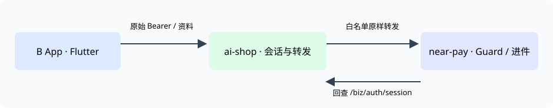

# B 端进件经 ai-shop 接入 near-pay：开发交接

> **本批 N1/N2 已本地验收**：[N1 认领与恢复](./n1-local-acceptance-2026-11-10/README.md)、[N2 独立PAY认领关联](./n2-local-acceptance-2026-11-10/README.md)。默认关闭新增入口，保留现有未提交改动，166 未部署。

> **2026-11-10 宿主状态更新**：R01 受保护会话端点及 R02 15 路由原报文代理已在本地实现；统一身份登录、实际凭证与双 JVM 联调进度见[功能对齐§9](../../technical/注册登录到进件-功能与代码对齐-2026-11-10.md#9-b02b07b08-增量闭环2026-11-10)。下文“待实施/未修改”是原始交接时点；当前未部署166、未验收真实渠道。新制品与精确来源见[发布闭包](./release-closure-2026-11-10.md)。

> 2026-11-09 · B App / near-pay 已实现并进行本机合同联调；实际 ai-shop 服务端待接入。接口真源为 near-pay BA02 合同与 `BizOnboardingForwarder`，本包是接入说明，不是服务已上线证明。

## 一、定位

B App 使用现有 ai-shop 登录和域名提交蓝新资料，ai-shop 转发原始身份与报文，near-pay 独立判定支付商户成员权限、保存私有资料并交运营审核。ai-shop 本轮仅收到文档，服务代码未修改。

## 二、结构与职责



回查线保证每个请求使用仍有效的宿主身份；`subjectType + subjectRef` 共同标识主体。ai-shop 店铺身份不自动变为 near-pay 支付商户成员，避免跨主体借用权限。

| 系统 | 本轮交付 | 接入责任 |
|---|---|---|
| ai-shop-bapp | 生产工作台入口、成员选择、32 项资料、证照 1～10、确认/补件/进度、原命令恢复；私有图片缓存清除 | 设置 ai-shop 域名；服务验收后开启默认关闭的开关 |
| near-pay | `AiShopBizIdentityClient` 回查、BIZ Guard、身份类型隔离、版本化进件、私有附件；可复用 Java 转发适配器 | 开启 api 身份桥、配置 ai-shop 可信 origin，准备成员授权与源主体 |
| ai-shop | 本包中的会话合同、转发白名单、字段与验收清单 | 实现会话端点与有界代理 controller，再做真实环境验收 |

## 三、ai-shop 待实施任务

1. 新增 `GET /biz/auth/session`，规格见 [OpenAPI](./openapi-biz-session.yaml)。从 merchant 登录过滤链产生的 `LoginUser` 及实时会话状态取值，不采信请求体/自报身份头。不加入登录、OTP 等公开端点白名单。只允许 MERCHANT 的 USER / MCH_ACCOUNT，`subjectRef` 取对应服务端 userNo；租户当前限定 MAIN。失效/撤销返回 401，禁止身份返回 403，会话依赖失败返回 503。
2. 为 [routes.json](./routes.json) 的方法和路径增加同源转发 controller。可调用 near-pay `pay-domain` 中 `ai.neargo.shop.pay.client.BizOnboardingForwarder`；该类是普通 Java 适配器，需要显式实例化及注册 controller，不会自动提供路由。依赖坐标/版本沿用项目既有 near-pay 依赖管理，不发布未确认版本。
3. 从固定配置读取 near-pay origin（只允许 HTTPS，开发可 loopback HTTP），禁止调用方指定 URL。保留原始 Bearer、multipart boundary/body 及版本/幂等字段；ai-shop 不存进件资料或重新封装 JSON/图片，不改用服务身份。宿主也先认证原用户会话。
4. 读取请求时先限制 JSON 1 MiB、multipart 请求 6 MiB，每文件 5 MiB，再分配字节数组；适配器的数组长度检查不能替代入口限制。不得套用旧 1 MiB JSON 限制到附件。GET 二进制响应原样透传，禁用响应 JSON 包装器及 body 日志。
5. 代理保持上游 HTTP 状态和 body；仅转发适配器白名单中的响应头，尤其 Content-Type/Disposition、Cache-Control、Pragma、X-Content-Type-Options 等。异常转换成安全 502/504，超时不自动重送 POST/PUT；303/302 不跟随，不把登录页当成功。
6. 完成下列真实环境验收，才启用 App 开关。near-pay 的源商户档案、源关联和支付成员必须由受控开户/成员流程准备；不得由 App 登录自动创建支付管理员。会员 userNo 与商户账号 userNo 即使相同，也不能共用不同 subjectType 的成员行。

### 会话响应例子

```json
{"code":0,"data":{"realm":"MERCHANT","subjectType":"USER","subjectRef":"server-user-no","tenantNo":"MAIN","status":"ACTIVE"}}
```

仅返回身份，不返回角色、权限、电话号码、证件、密钥。near-pay 对每次 `/biz/pay/*` 请求回查，不缓存登录结论；宿主 401/403 对应 near-pay 401，故障/畸形/重定向对应 503。MAIN 以外、禁用、类型不符均拒绝。连接/读取超时为 2/3 秒。

### 转发边界

请求只传 Authorization、X-Merchant-No、X-Store-No、X-Request-Id、X-Trace-Id、Accept、Accept-Language、Content-Type。商户来自 memberships 选择；商户级进件 App 不带 ai-shop 的 X-Store-No。若后续传门店，必须是 near-pay 支付门店编号且通过成员范围校验。不得传 X-User-No、X-Subject-Type、租户/角色等自报权限头。

`no` / `requestNo` 为 `[A-Za-z0-9_-]{1,64}`，fileNo 为 32 位小写 hex。拒绝绝对 URL、`%`、反斜线、`..`、fragment。只暴露表内路由，不开放 OPS、final submit、dispatch、渠道密钥/商务修改接口。转发 connect 3 秒、请求 20 秒、无重试/重定向。认证失败不回退其他近似路由。

## 四、App 调用与字段

先 `GET /biz/pay/v2/memberships`，仅展示含 `onboarding.apply` 的支付商户。选择返回的 merchantNo，之后以 `X-Merchant-No` 调用。路径明细见 [routes.json](./routes.json)，字段及秘密属性见 [fields.csv](./fields.csv)。

```http
POST /biz/pay/v2/onboardings
Authorization: Bearer <current-btk-token>
X-Merchant-No: <payment-merchant-from-memberships>
Content-Type: application/json

{"requestNo":"<uuid>","payChannel":"NEWEBPAY"}
```

取得 onboardingNo 后 GET `/onboardings/{no}/draft`，保存返回的 expectedVersion / draftVersion。普通字段可为 string 或 null；敏感字段先 POST `/onboardings/{no}/newebpay-materials`：

```json
{"expectedVersion":0,"fieldCode":"MemberPhone","secret":"<entered-phone>"}
```

将返回 cipherRef 写入草稿，禁止把敏感原文直接放字段。平台 CONTACT_PHONE / SETTLE_ACCOUNT 分别封存为 MemberPhone / BankAccount；NWP_ 字段封存时去掉前缀。服务端检查 cipherRef 的申请与字段绑定。

```http
PUT /biz/pay/v2/onboardings/{no}/draft
Content-Type: application/json

{"requestNo":"<uuid>","expectedVersion":0,"expectedDraftVersion":1,"fields":{"CONTACT_NAME":"<name>","CONTACT_PHONE":"<cipherRef>"}}
```

每次写入重新使用最新版本。上传 POST `/onboardings/{no}/files`，multipart 字段为 requestNo、expectedVersion、expectedDraftVersion、slot（LICENSE_1～LICENSE_10）、file。App 支持图库 PNG/JPEG，每件 5 MiB 内；PDF 由运营端协助，服务端真实校验格式。未送审附件平台默认 7 天有效，随提交版本保留后按保留策略处理。读取使用 fileNo 及原商户授权，不生成公有 URL。预览关闭、退出或身份变化时清除内存和解码缓存。

完成资料后 POST `/onboardings/{no}/draft/confirm`，body 为 requestNo + expectedVersion + expectedDraftVersion，只确认交运营。运营仍须补齐商务字段并冻结送审。App 无 MID/LoginAccount 或 PaymentType/费率/周期/额度编辑权。渠道成功、密钥交接、账户核验、产品/门店可收款分别判断，不能从确认或成功回执直接推导可收款。

### 错误与未知结果

保留 near-pay HTTP 状态/JSON envelope：401 重新登录；403 成员/权限/范围不足；409 版本冲突，应重新读取；校验失败按原校验错误处理；503 身份服务不可用。正文不得输出 token、secret、文件字节或服务内部栈。

任何写超时都不得新建 UUID 重送。保存原 requestNo 和原版本，GET `/onboardings/{no}/draft/commands/{requestNo}` 查询；未确认时只允许用户显式沿用同一命令重试，不自动重试。敏感原文不持久化；失败清空敏感输入后保留未保存状态，必须重新填写或重新加载。上传原件只在未决命令的当前页面内存保留，离开即清理。

## 五、配置与验收

near-pay 配置示例（受控环境替换 origin，启用项目原有 api profile；api 启动缺桥时 fail closed）：

```yaml
near-pay:
  onboarding:
    drafts:
      enabled: true
    files:
      enabled: true
  biz:
    ai-shop:
      enabled: true
      base-url: https://ai-shop.example.invalid
```

此配置需同时启用原 `shop.secret.enabled=true`，配置受控 Vault 主密钥与对应环境，核验 V72 / V74 / V75 迁移及上传 Servlet 5 MiB / 6 MiB 限制。不得复制测试夹具内的合成密钥。既有 OPS 身份桥及审批政策继续按原部署配置，BIZ 开关不会替代它们。

App 构建：`--dart-define=MERCHANT_API_BASE_URL=https://ai-shop.example.invalid --dart-define=NEARPAY_BIZ_ONBOARDING_ENABLED=true`。开关默认 false，未联通时显示服务待开通。不能用 API_BASE_URL 替代此仓库实际配置名。环境中不配置 near-pay 地址或服务密钥到 App。

真实环境必须验收：

- USER 与 MCH_ACCOUNT 登录、撤销/过期/禁用、宿主不可用及 302 响应；伪造身份头不能改变主体。
- memberships 仅有效成员，同 ref 不同类型互不借权；无权角色、跨商户、跨门店/租户拒绝；支付成员变更即时生效。
- 完整草稿→敏感封存→超过 1 MiB 图片上传→二进制私有读取→确认→运营冻结→补件 2～10→重新确认；保留版本文件可回查。
- 断网/超时原命令查结果及同命令重试；409 后重新读取；身份/门店切换清除旧页面状态与预览缓存。
- 实际 MySQL 迁移、Vault 密钥/存储权限、HTTPS/超时、网关上传限制、容量与清理/保留策略。不得将合成本机身份当线上验收。

实测证据与命令见 [verification.md](./verification.md)。本机链路的宿主会话、批准源档案与渠道目录是合成测试数据；near-pay BIZ Guard、成员、JDBC、Vault、Servlet、Java 转发器与 Dart 网络客户端是真实实现。本包不代表实际 ai-shop 或蓝新测试环境已通过。

## 六、待确认与取舍

- ai-shop 的会话端点与 controller 尚未实现，联调环境、真实身份/源主体/成员数据待接入方准备；服务实现完成后再做实际环境验收。
- App 已展示当前补件清单/原因、平台/渠道状态及驳回原因；历史补件列表暂由运营端查询，App 历史展示为非阻塞后续项。
- 英文/阿拉伯语尚未翻译新增进件文案，按现有本地化机制回退模板；中文文案已进入 ARB，不新增 Dart 硬编码。
- 蓝新 NWP-01～07 仍单独待补，见 [channel-gaps.md](./channel-gaps.md)。未取得当前 AddMerchant、凭据用途/环境、测试向量、未知恢复、审核/签约、ezPay/TWQR 及商务权限合同，不能宣称真实渠道送件完成。
