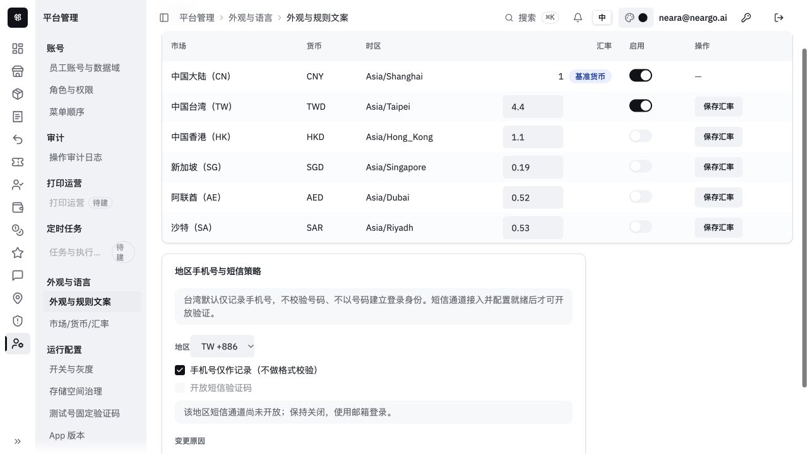
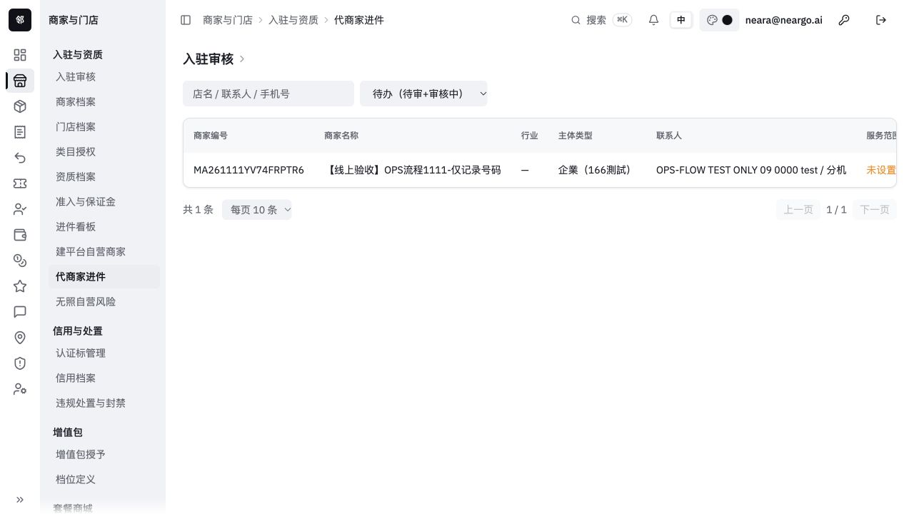

# UME166 运营闭环线上验收 · 2026-11-11

状态：已部署系统/套餐修复与台湾地区手机号策略；已完成下列实测。新店同店建店→进件→收款→购买完整闭环尚未验收通过。

## 发布与保护

- 地址：https://twpay.umeshop.ai/ops-shop/ ，真实接口，mock=0。
- 本轮以线上最新干净源码87f03a6a为基础，保留已部署退款、资金锁、原请求恢复与品牌改动。未将共享工作区整体覆盖到线上。
- 首次系统/套餐发布：1e9975eebef70c5f626f71072c2c33d08726af72。
- 地区增量与当前运营静态制品：e02cee3f1221993821f2f0bfe6cf437d17698e05。
- 当前API/OPS后端：cf8729644001de3319ffc1494f9d7eaf384e824f，实际JAR SHA256=fbd45493fd5c86d3a72b425d2a3a32217cb61e2cbf0d533896c2655678217b0c；两服务均UP，独立PAY/inventory未变，部署锁已释放。
- V655/V656 均先备份、恢复到独立副本演练，再对生产执行，各1项成功。备份保留在/data0/backups/opsflow-26b46e54与opsflow-7c5f9472；2个临时迁移账号与演练库已清理。
- API/OPS按实际JAR SHA256及actuator健康判断；独立PAY、inventory运行实例保持不变。每次切换保留原容器配置、实际运行JAR和前端旧链接，部署锁完成后释放。

## 已验证事实

| 环节 | 结果与边界 |
|---|---|
| 门店行业维护 | 真实页面创建停用父行业；API新增/编辑停用子行业；过期版本拒绝。两条测试数据保持停用 |
| 市场/权限 | 负汇率请求被拒绝，TW原汇率4.4与启用状态保留；无会话读口被拒绝 |
| 套餐维护 | 创建明确标记“线上验收、勿付款”的RETAIL测试SKU，保留原三档方案与在售候选完成一次真实发布，catalogVersion由1到2；错误expected version拒绝。相同旧expected version重复发布返回VERSION_CONFLICT，不能写成“原发布回执幂等重放成功” |
| 测试目录收尾 | 仅本轮ops-flow-retail-pro-1111 SKU经正式停售口变为OFF_SALE v3，历史版本保留 |
| 地区手机号 | TW recordOnly=true，smsVerificationEnabled=false，smsChannelReady=false。配置可保存/回读，未接通时启用短信被10515拒绝 |
| 短信准入 | 真实API台湾发码与PHONE_OTP登录均10515；旧mock前缀、固定码不能把关闭地区开放 |
| 代填 | MA261111YV74FRPTR6由既有已验证邮箱定位owner，非标准格式原始联系方式（含空格/中文分机）原样落库，market_code=TW。未以该号码建立登录身份 |
| 审核边界 | 上述申请保持PENDING，agreed_at为空；代填人自审返回10403。浏览器可见待审记录，未代商户签署协议 |
| 支付事实只读 | 独立Pay来源工作区/账户/门店绑定可读。存量门店存在ACTIVE/VERIFIED账户和ACTIVE绑定，但不能替代新门店开通证据。另一测试进件仍DRAFT，回执NOT_RECEIVED、账户NOT_CREATED、凭据NONE、产品数0、channelReady=false |
| 公开页面 | 当前前端VERSION为e02cee3f、mock=0；首页20个JS/CSS均200且MIME正确 |

台湾策略只约束联系方式与短信准入；店主仍使用已注册邮箱账号。不能用“只作记录”推导手机号已经验证或归属已确认。接通短信后，先配置通道就绪地区，再由系统维护启用；当前TW不会开放模拟登录。

## 尚未完成的闭环

1. C03/C05：普通OPS代办仍需贯通完整门店资料、真实运营身份、经营类型及FREE初始化。旧审核激活传空actor/type，新STORE_V1不能据此宣布开店成功。
2. 新测试申请尚无商户本人协议与独立审核；测试资质清楚标为TEST ONLY，不作为真实渠道材料送件。
3. 新门店的支付进件、真实渠道回执、凭据/产品就绪与门店可收款仍未完成；健康检查、历史账户或门店绑定不等于新店支付开通。
4. 本轮套餐采购只做服务器报价、待付款订单、原键恢复及无实收作废验证；没有真实银行转账，不核造银行到账或支付成功。原订单e0e0b04fa70c4b549b2e5c297f7c73e3已原键恢复、指引回读一致，并以明确标记synthetic/no transfer的RECONCILIATION资料作废，订单与支付轴均CLOSED，付款尝试FAILED/paidAt=null，免费套餐保持原版本。未录入实际银行到账。详见online-assisted-smoke.json。

## 验证证据

地区后端45项、最新联系策略8项重验；运营地区表单6项及原维护/HTTP7项；共享工作区登录合并27项；原键修订22项报价＋3项原生MySQL并发/回放通过。类型、变更ESLint、OpenAPI生成及合同对账完成。原有8条缺后端/13条未分类端点未新增。源码与既有测试的验证范围详见对应TDD，未运行无关全量重复检查。

原同店跨运营使用相同幂等键的创建限制沿既有唯一键保留；本次原键修订只修同一运营重放原单，不宣称跨运营同键可各建一单。

收尾：停用的行业测试行与停售SKU保留审计；申请MA261111YV74FRPTR6明确为内部TEST ONLY并保持待审，需另一审核人按原流程处理，不以自审或改库消除记录。两个迁移账号已撤销、演练库已删除，生产备份和回滚制品保留。
