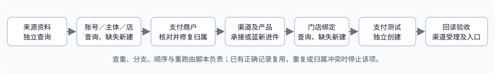

# Oscar 经营主体、门店与渠道同步执行交接

状态：方案待执行，2026-11-16。按用户最新要求，查询与新建 API 独立，查询结果判断、查重、步骤排序和重跑由脚本负责；本文件不代表接口缺口已实现或线上同步已完成。

## 一、目标与执行约定

首户使用 `oscar@umeshop.ai`，经营实体为「創勢科技股份有限公司」，复用现有「ume 早餐店」。目标为建立账号、主体、门店、平台支付商户、渠道账户和产品的正确关联，再逐渠道取得有效支付入口。

全部读取和业务写入通过运营端 API。脚本不连接数据库、不执行 SQL copy、不调用内部服务接口。运营 API 自身按现有架构访问数据库或调用服务不受此限制。

用户最新接口约定：

- 查询 API 只查询；新建 API 只新建。不得把“先查、没有则建、已有则合并”藏进同一个同步或 upsert API。
- 脚本明确执行 `query -> select -> create/reuse -> query`。零条才创建；唯一且归属一致则复用；多条、字段差异或归属不一致时输出冲突，不擅自覆盖。
- 相比前版“有则保存”，本交接的资料同步按最新“查询／新建”口径执行：已有记录复用，差异单独列出。需要修改已有事实时另行使用明确的业务维护流程，不通过新建接口覆盖。
- 提交、审核、状态转换、渠道派发、凭据版本启用、产品开通和门店绑定是已有业务命令，仍须由脚本分别调用，不放进查询或新建接口中，也不以直接改库代替。
- 本轮成功标准为渠道实际受理并返回交易标识和有效支付链接／二维码；只有本地订单号不算成功。不要求实际付款，不把测试结果写成订单已付款或真实资金闭环通过。

## 二、执行结构与已知基线



图中每个节点均由脚本调用独立 API，前一步回读验证通过后才进入下一步。创建前必须判断唯一归属，不能只凭商户名匹配；审核、渠道结果和支付验收各自保留状态。

2026-11-16 本会话通过运营页面及当时只读核对得到的基线如下。后续执行必须重新通过 API 查询，不把这份快照当作实时数据。

| 对象 | 编号／状态 | 执行要求 |
|---|---|---|
| Oscar | `U261113VG2HFDJMK0`，邮箱 `oscar@umeshop.ai` | 已存在，复用；不重设密码或邮箱验证状态 |
| 经营主体 | `M261113Y3QW5XKEFW`，創勢科技股份有限公司 | 当时为 `PENDING_LICENSE / UNREGISTERED`，不能仅因渠道可创建订单就认定资质齐全 |
| 门店 | `ST2611132NS49C2EPQ`，ume 早餐店 | 已属于上述主体，营业中；当时 `pay_merchant_no` 为空 |
| 主账号关系 | `SF261113YSXC3Z3GBC` | Oscar 为现有主体的正常店主／主账号，复用 |
| 既有支付商户 | `PM13A13B737D7C4A57`，創勢科技股份有限公司 | 来源仍关联 `M261106BF7GK8052W`，需先解决历史归属冲突 |
| 既有蓝新账户 | `PMD3A0C5A8C8FB4F92`，MID 尾号 `7919` | 页面当时显示已核验、可收款、绑定 1 店；不能据此自动转移归属 |
| 排除对象 | `TEST ONLY 創勢科技股份有限公司（獨立流程驗收）` | 不作为本次真实经营主体，不复用其沙箱账户冒充正式账户 |

## 三、运营 API 清单与调用顺序

下表中 `P` 表示 `/pay-ops/v2`；`entityNo` 表示商城经营主体编号，`merchantNo` 表示支付平台商户编号，`accountNo` 表示渠道账户编号，三者不可混用。商城旧接口路径虽使用 `{merchantNo}`，其参数仍须传经营主体编号。

“已有”指已核对源码中有对应接口，不代表目标环境开关、权限和版本已验收。“待补”路径是方案建议，不能直接运行。NearPay 已部署分支与开发主线存在差异，涉及代建接口时必须核对运行版本。

### 3.1 来源读取与账号、主体、门店

| 次序 | 查询 API | 独立新建 API／后续动作 | 状态 |
|---|---|---|---|
| 1 | `GET /ops/ume/merchants?registrationNo=...`；`GET /ops/ume/merchants/{sourceMerchantId}` | 仅读取原系统资料、审核依据与来源时间，不写目标记录 | 来源查询运营入口待补／核实原系统可用 API |
| 2 | `GET /ops/ume/merchants/{sourceMerchantId}/channel-accounts` | 获取非秘密渠道标识、审核结果、产品及凭据引用，不返回明文密钥 | 待补／核实原系统可用 API |
| 3 | `GET /ops/customers/users?keyword=oscar@umeshop.ai` | 本次账号已有，复用。通用缺失账号的运营新建 API 尚需补齐，不用商户创建接口隐式开户 | 查询已有；通用新建待补 |
| 4 | `GET /ops/customers/users/{userNo}/stores`；`GET /ops/merchants?keyword=...`；`GET /ops/merchants/{entityNo}`；`GET /ops/customers/operating-entities/{entityNo}` | 主体缺失才 `POST /ops/merchants/apply-on-behalf`，再按申请状态调用 `/ops/merchant/apply/{applyNo}/accept`、`/audit` 两个 POST 命令 | 已有；本次应复用主体 |
| 5 | `GET /ops/stores`；`GET /ops/stores/{storeNo}` | 门店缺失才 `POST /ops/merchants/{entityNo}/stores` | 已有；本次应复用门店 |
| 6 | `GET /ops/merchants/{entityNo}/qualifications` | 缺失资质登记使用 `POST /ops/merchants/{entityNo}/qualifications`，仅提交可核验的原资料；已有差异报告 | 已有；现有 POST 兼容更新，脚本本轮只走新建分支，不用其隐式覆盖 |

来源资料不足时输出缺项，不生成假资料。历史快照中 `tax_no` 与营业登记编号存在位数差异，应按原字段定义和真实证明确认，不把名称匹配或任一同名字段当作统一编号依据。

### 3.2 支付商户和门店投影

| 次序 | 查询 API | 独立新建 API／后续动作 | 状态 |
|---|---|---|---|
| 7 | `GET /ops/merchant/{entityNo}/pay-service`；`GET P/merchants`；`GET P/merchants/{merchantNo}` | 查询来源映射及候选档案。发现旧主体关联冲突时停止，先走归属修复，不重复创建第二个商户 | 已有查询 |
| 8 | `GET P/merchant-creations/context`；`GET P/merchant-creations/by-request/{requestNo}` | 确认确实缺失后，`POST P/merchant-creations`，携带 `operatingEntityId`、名称和请求号 | 已部署分支已有，需核对目标版本及开关 |
| 9 | `GET P/stores/{storeNo}`；`GET P/stores/{storeNo}/sync-events` | `POST /ops/stores/nearpay-sync`，只指定本次门店，随后回读投影及关联 | 已有 |
| 10 | `GET P/merchants/{merchantNo}`；`GET P/merchants/{merchantNo}/profile-revisions` | 来源核验使用 `POST P/merchants/{merchantNo}/source-links/{linkNo}/verify`；资料审核使用现有审批流程 | 已有；须有真实来源及资料依据 |

现有 `POST /ops/merchant/{entityNo}/pay-service/apply` 包含来源申请／同步语义，不将其当作用户本轮要求的纯新建 API。脚本优先使用独立的 `merchant-creations` 新建能力，并先核实其是否会隐式创建或合并资源；不符合纯新建约定时需先调整，不能按名称自动合并。

历史归属修复当前不能靠普通保存完成。建议采用独立资源：`GET P/source-association-repair-requests` 查询，`POST P/source-association-repair-requests` 新建修复申请，之后走明确审批和执行命令。以上为待补契约，范围限定本次来源、目标经营主体、支付商户与受影响门店，保留历史；不得自动迁走其他门店、转移 MID 或授予 Oscar 额外权限。

### 3.3 蓝新进件和其他渠道账户

| 次序 | 查询 API | 独立新建 API／业务命令 | 状态 |
|---|---|---|---|
| 11 | `GET P/onboardings`；`GET P/onboardings/{onboardingNo}` | 无蓝新申请才 `POST P/onboardings`；已有通过申请沿用原申请与 MID | 已有 |
| 12 | `GET P/onboardings/{onboardingNo}/draft`；`GET P/onboardings/{onboardingNo}/draft/readiness` | 按现有草稿流程明确保存、确认、提交及审核；新增同步接口不承担这些动作 | 已有；保存是明确业务维护步骤，不是查询或新建副作用 |
| 13 | `GET P/onboardings/{onboardingNo}` | 需要送件才 `POST P/onboardings/{onboardingNo}/dispatch`；结果查询命令为 `POST .../refresh`，不重复送件 | 已有 |
| 14 | `GET P/channel-accounts`；`GET P/channel-accounts/{accountNo}` | 无账户才 `POST P/channel-accounts`；按环境、渠道、MID、主体确认唯一性，已有正确账户复用 | 已有 |
| 15 | `GET P/credentials`；`GET P/credentials/{keyId}` | 无则 `POST P/credentials`；必要的换钥使用独立版本新建、核验和启用流程，秘密值只从受控配置读取 | 已有 |
| 16 | `GET P/channel-accounts/{accountNo}` | 按允许动作分别执行 `/verify`、`/activate`、`/products/{productCode}/open` 的 POST 命令；关联凭据使用已有明确维护命令 | 已有 |
| 17 | `GET P/stores/{storeNo}/bindings` | 无绑定才 `POST P/stores/{storeNo}/bindings`；已有正确绑定跳过；不同绑定走既有换绑审批，不覆盖 | 已有 |

其他渠道没有线上进件 API 的，跳过第 11—13 步，承接真实渠道账户和产品资格后执行绑定与支付测试。商户运营启用分别使用商城 `POST /ops/merchants/{entityNo}/status` 和支付 `POST P/merchants/{merchantNo}/activate`；依据真实核验及允许状态转换执行，不把成功创建订单当作资质审核依据。

### 3.4 收款入口和支付验收

| 次序 | 查询 API | 独立新建 API／业务命令 | 状态 |
|---|---|---|---|
| 18 | `GET P/collection-entries`；`GET P/collection-entries/{entryNo}` | 无入口才 `POST P/collection-entries`，条件满足后执行 `POST .../{entryNo}/enable` | 已有 |
| 19 | `GET P/payment-test-sessions?requestNo=...` | `POST P/payment-test-sessions`，显式指定门店、收款入口、渠道产品、金额、环境、截止时间及请求号 | 正式环境查询、新建均待补；不能伪装成已有能力 |
| 20 | `GET P/orders/{payOrderNo}`；`GET P/orders/{payOrderNo}/logs` | 回读渠道受理和支付入口结果，输出每个渠道产品的验收记录 | 已有；可能需要补回传结果的字段 |

现有 `POST P/sandbox/collection-entries/{entryNo}/sessions` 仅支持限定产品的沙箱会话，不能作为正式账户验收。正式测试新建应复用正常支付路由，不能绕过账户、产品、门店、环境资格；先确认能返回渠道受理事实，不能把只生成 Checkout 页面算成功。

## 四、脚本责任、恢复与交付

脚本只调运营 API，不把完整商户资料、证件、银行账号、凭据或令牌写入 Git、普通日志或交接文件。环境和地区由系统及可信路由决定，不允许脚本伪造身份头或跨环境套用 MID。

单项算法：

```text
query exact business identity
  zero -> create with stable requestNo -> query receipt/resource
  one and same ownership/data -> reuse
  multiple or conflicting -> record conflict and stop this item
verify response identity, environment and resulting state
execute the next explicit business command only when its prerequisites hold
```

HTTP 错误、超时或权限拒绝不能当成零条结果。新建超时后先查询原请求结果，不换请求号重建；遇到并发唯一性冲突先回查。脚本保留步骤、资源编号、请求号、版本、结果及阻断原因的脱敏执行记录，重跑先查询后继续。来源修订确需变更已有资料时单列差异，不悄悄调用更新接口。

实施顺序：

1. 核对线上版本、权限、来源读取 API 和上述待补契约，不进行数据库兜底。
2. 补齐来源查询、独立新建边界、归属修复申请、正式支付测试的查询／新建能力；只实现本次需要的范围，不建通用迁移平台。
3. 脚本先只查询，输出 Oscar 的编号对照、差异与阻断项；特别解决既有創勢支付商户的来源冲突。
4. 按第 1—20 步执行必要的新建和业务命令，逐步回读；正确已有记录不重复创建。
5. 输出每个渠道的门店、商户、账户、产品、订单、渠道受理结果和有效支付入口证据，分别标记通过／失败／阻断。入口过期不表示当前仍可用，不持续创建重复测试订单。

交接边界：本次仅提交方案，未修改接口、商户状态、归属、渠道配置，未送件或创建支付订单。代码已有情况根据本会话核对的 ai-shop 与 NearPay 源码及已部署分支整理；后续实现须核对最新代码，不能将“待补”接口直接纳入可运行脚本。

## 五、后续进展（2026-11-16 续）

- 设计：[TDD-商户迁移同步与渠道关联](../../technical/TDD-商户迁移同步与渠道关联.md)（草稿，2 档）与 [ADR-060](../../technical/ADR/ADR-060-迁移归属冲突走修复申请不按名称合并.md)（提议）。目标清单按「迁移对象 O1–O9 → 关联 A–H」重排，待补契约编为 N1–N5。
- 版本核对：166 上 near-pay 运行源为 `release/166-collection-sse-20261116`，已含运营代建 `P/merchant-creations` 与沙箱会话；代建只按 `requestNo` 幂等，**不按经营主体去重**（N3）。
- 与上文「状态」列的更正：资质 `POST` 为登记或更新合一（N2 另开只新建端点）；`/ops/ume/*` 来源读取、运营新建账号、归属修复申请、正式支付测试在两个仓库均无实现。
- 只读脚本：[`deploy/ume/oscar-sync/sync.py`](../../../deploy/ume/oscar-sync/sync.py)，只调 GET，输出 REUSE / PLAN_CREATE / CONFLICT / BLOCKED；尚未在 166 运行（需运营令牌）。
