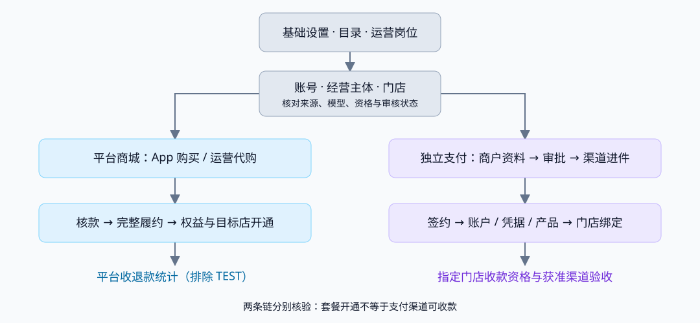

# 平台运营完整闭环交接

> 状态：已形成交接快照；基础运营能力已于 2026-11-14 发布 UME166，真实渠道收款全链仍待验收。本文仅整理代码、发布及既有证据，本轮未操作服务或业务数据。
> 主基线：ai-shop 运行源码 `db59b46c5`，独立 near-pay 运行源码 `bfbd4a682`；发布记录提交分别为 `c51949449`、`a373af96`。后续提交和部署须重新核对，不把本文版本号当实时现网查询结果。

## 一、接手结论与职责

运营端已经具备“设置 → 查账号/门店 → 审核/代购 → 核款/履约 → 查询权益和统计”的主要入口。独立支付已经具备商户代建、加密代填、资料审核及渠道进件工作区。当前完成的是已发布能力与分层验收，尚未完成“同一新店由普通岗位全程办理，最终经真实获准渠道可收款”的一份完整运营验收。

必须分别验收两条资金链：平台销售套餐的收退款，和门店向消费者收款。商家可以在尚未开通经营收款时购买套餐；套餐履约后门店经营开通，也不代表支付渠道已开通。

| 对象 | 权威归属与运营职责 | 不可替代的事实 |
|---|---|---|
| 注册账号 | ai-shop `usr_account`；客户管理查看注册身份及关联门店 | 无门店账号也应存在；注册账号不等于平台会员或支付成员 |
| 经营主体、法人主体、门店、品牌/连锁 | ai-shop；平台维护准入、授权范围内审核与代办，日常经营由商家处理 | 经营组织、法人资格与门店经营审核分开，不以同名/电话合并 |
| 平台会员 | 按平台 `personNo` 聚合，展示原来源与关联门店/品牌 | 不能按手机后四位合并；不能把所有 SaaS 注册账号视作已入会 |
| 平台商城 | ai-shop commerce：主体额度包 ENTITY、门店套餐 STORE、平台商品/订单/权益 | 两套套餐模型保留，不用一个订单域覆盖另一套 |
| 平台商城资金 | 本次现役为 ai-shop 内嵌 pay-domain、`ai_shop_ume.stl_payment` | 独立 near-pay 不承载此商城账本；不得因配置含 standalone 就迁移资金归属 |
| 支付商户、进件、渠道账户/凭据/产品/绑定 | 独立 near-pay；ai-shop 提供来源与统一入口 | 平台资料批准、渠道批准、账户启用、指定门店可收款分别判定 |
| 经营订单 / 支付订单 / 商城订单 | 分别由经营订单域、独立支付、平台商城提供事实 | 三类金额不得合并成平台收入 |

## 二、入口、版本与证据

| 项目 | 本次发布快照 |
|---|---|
| 商城运营 | [nearshop 运营端](https://nearshop.umeshop.ai/ops-shop/)；原域名 `https://twpay.umeshop.ai/ops-shop/` 仍可访问 |
| 支付运营 | [nearshop 支付运营](https://nearshop.umeshop.ai/oms/)；原域名对应 `/oms/` 保留 |
| 统一分支 | ai-shop：`codex/ai-shop-codex`；独立 near-pay：`codex/near-pay-migration`，不能套用同一分支名 |
| 数据库 | ai-shop V672；独立 near-pay V101，历史 checksum 校验保持 |
| 发布批次 | `ops-recovery-20261114-qdrrf23p`；两后端、两运营前端完成切换，发布锁已释放 |
| 权限 | 原角色、成员与授权保持；新增 26 项授权符合已声明的超管或来源继承规则，没有批量扩权 |
| 不在本次发布范围 | 支付 H5、库存、IPS；H5 链接与库存运行实例已核对保持 |
| 备份 | 166 发布目录及 DB61 私有完整备份保留；凭据、完整容器环境、业务原文和材料不进入本文 |

本次发布与浏览器验收以[166 发布记录](../../technical/evidence/ops-primary-menu-20261114/166-deployment.json)为准。关键回归见[发布验证](../../technical/evidence/ops-primary-menu-20261114/release-verification.json)。旧证据中的“未提交、未部署、V98 待改号”等属于当时快照：本次已使用 PAY V100/V101，不能重跑旧改号或覆盖已应用迁移。

### 2.1 验收等级

| 标识 | 可以得出的结论 | 不能扩大为 |
|---|---|---|
| 已发布 + 166 只读验收 | 对应版本运行、页面和真实查询/会话可用 | 该页面所有写操作均已在线完成 |
| 本地真实主进程 / MySQL9 / 浏览器 | 对应服务、事务或交互成立；具体夹具边界以证据为准 | 所有 166 岗位、真实渠道或正式 App 均已验收 |
| 166 TEST 业务闭环 | 测试订单、确认、履约和权益对应，未发生真实转账 | 真实资金入账、真实退款或渠道收款准出 |
| 待验收 / 外部前置 | 实现、配置或授权条件尚需完成 | 可以通过 SQL 改最终状态或 mock 响应宣布完成 |

## 三、运营闭环总览

套餐核款与渠道开通走不同审核及资金路径。门店是否需要经营审核，以真实门店状态和显式提交记录为准；历史已营业门店不自动补造“套餐审核通过”。

### 3.1 主要菜单

| 一级 | 运营最常用入口 | 真实落点与边界 |
|---|---|---|
| 平台设置 | 地区配置、门店行业、运营账号、角色权限、渠道费率、收款相关设置 | 支付目录及费率仍需按实际独立支付能力核对；出现菜单不等于全部费率生命周期开放 |
| 平台商城 | 主体套餐、门店套餐、平台商品、运营代购、全局订单、核款队列、收入概况/明细 | 退款、原单恢复、后补材料进入原订单办理，不另造一套账务 |
| 客户管理 | 用户数据、会员列表、门店列表、连锁数据、经营概况 | 门店详情承接审核/套餐/经营订单，连锁以查询统计为主 |
| 商户管理 | 商户列表、渠道进件 | 打开独立支付权威工作区；资料代填、审核及来源映射在原商户办理 |
| 订单中心 | 订单检索、异常订单、售后工单、支付记录入口 | 支付记录进入独立 PAY；平台套餐订单仍在平台商城 |

实际树见[五目录实施清单](../../technical/reference/平台运营五目录-实施清单-2026-11-14.md)。主导航投影与原功能点身份不是同一个计数：原 155 个功能点身份保留，兼容目录的可见叶子受权限、停用和重定向过滤，不意味着每个角色看到全部功能。

### 3.2 岗位交接

| 岗位 | 办理内容 | 接手时核对 |
|---|---|---|
| 平台管理员 | 地区/目录/岗位权限、配置与审计 | 按正式权限流程配置；不使用临时超管掩盖岗位缺口 |
| 招商/客户运营 | 查注册账号、主体和门店，代办入驻、代购、补材料 | 正确 owner、目标门店、市场与数据域；代办人不成为商户成员 |
| 门店审核岗 | 显式提交的门店审核、驳回/通过 | 真实原因及审计；经营审核不代替法人或支付审核 |
| 财务/核款岗 | 查申报、核对到账、退款/异常资金处置 | 查原单/原请求回执；查询权限不自动赋予核款或退款权 |
| 支付录入岗 | 支付商户代建、加密资料、进件材料与补件 | 资料归属、申请版本、原请求号，材料不能用浏览器持久化明文保存 |
| 支付审批/渠道岗 | 正式审批、送件、签约结果、账户/凭据/产品/绑店 | 执行对应制审分离策略；不得用录入身份替代独立审批身份 |
| 客服/分析 | 授权范围内查单、查状态和统计 | 不可见数据不暴露；不得因菜单收敛扩大数据域 |

本地已对 12 类运营角色完成真实 HTTP 登录及数据库授权驱动的菜单验收，见[角色证据](../../technical/evidence/ops-primary-menu-20261114/browser/roles.json)。166 本次浏览器复验使用既有授权管理员；普通岗位全链仍列 OP01，不能写成“12 角色均已在 166 全流程通过”。

## 四、按运营顺序办理

### 4.1 设置和商品准备

1. 平台设置核对默认地区、语言/币种/精度及行业准入，确认门店行业与支付行业各自规则，不将两套行业表混合。
2. 为参与岗位开通实际权限和数据范围，验证查询、写入、审批、退款分别受控。
3. 平台商城核对经营类型、已发布方案、SKU、价格、币种、周期、销售范围及部署能力；报价和版本以服务端回读为准。
4. 核对平台收款档案，区分银行转账与销售代收；当前测试配置不能用于对外正式收款。
5. 发布并发冲突时读取当前版本、重新确认；不得手填旧版本强行覆盖。

产出：目标市场可用目录、可售套餐和有效收款条款。真实运营正式售价、收款账户、渠道凭据仍需业务批准，不以测试数据自动转正式。

### 4.2 账号、建店与经营审核

1. 客户管理 → 用户数据查注册账号及门店关系，确认是否已有 owner/主体；无店账号也是合法结果。
2. 新店走已有代办入驻/统一入驻及审核流程，填写真实市场、法律形态、行业与开店资料；不能把自营豁免用于普通第三方。
3. 回到客户管理 → 门店列表，核对门店、法人/经营组织与品牌关系。历史 LEGACY 门店和 STORE_V1 新店分别判断，不直接套用同一套餐初始化规则。
4. 需要经营审核的门店由授权岗位显式提交，进入待开通；可在原详情人工驳回/重提/通过，裁决必须有原因和审计。
5. 走付费开通时，只在符合条件的套餐**完整履约成功**后批准并开通明确目标店。待核款、金额不符、部分硬件履约、失败/重复回调及旧订单，不得提前开通。

STORE 路径要求冻结非 FREE PLAN、完整履约且对应本次提交的目标门店；ENTITY 保留原额度与恢复语义，不批量批准同主体的待审/驳回店。平台治理停用不能被套餐履约或额度恢复绕过。免费建店及历史门店原规则保留，不新增“一切新店必须付费”的条件。

产出：可查门店经营状态、审核记录和对应订单/权益；法人资格、门店经营状态及支付资格仍是不同事实。

### 4.3 商家购买或运营代购 → 核款 → 权益

| 顺序 | 运营动作 | 应核对的事实 |
|---|---|---|
| 1 | 从门店/主体确认模型，进入运营代购；或从全局订单定位 App 发起原单 | ENTITY/STORE、owner、目标店、SKU/方案版本、币种、周期正确 |
| 2 | 读取正式报价、确认下单并显示平台付款指引 | 服务器报价与冻结条款；下单不等于实收，也不立即发权益 |
| 3 | 商家线下付款后申报，或授权运营直接办理核款 | 申报只是申报；直接核款沿原正式入口，不要求虚构买家申报 |
| 4 | 核对实际收款方、金额、币种、发生时间、凭据及收款人员/流水 | 明确选择 TEST 或实际事实；真实时间不得自动冒充当前时间；重复凭据不重复登记 |
| 5 | 读取核款和资金结果 | 受理、MATCHED/UNMATCHED、已支付、履约完成分别展示；响应未知查原回执，不换键再核款 |
| 6 | 原订单继续履约或恢复 | 订阅/权益来源、唯一购买周期、有效期和目标门店一致；需要经营审核的店核对自动开通结果 |
| 7 | 后补凭证/说明，核对 App 回显 | 后补不再次确认收款、不改变原资金字段、不重复发权益 |
| 8 | 收入概况/明细与原单回读对账 | 只统计验证成功的收退款，按币种/模型/分类分组，明确排除 TEST 原款及其退款 |

“同店”指单个验收场景从购买到权益回读都保持同一目标店；不同模型可使用各自适用门店，不要求同一间店购买两套模型。

两套套餐的领域、并发与异常流程均已有实现和原生回归。166 既有记录证明 STORE 年付单完成 TEST 确认、补材料、完整履约及 App PRO 年付权益回读；详见[测试套餐闭环](../sales-collection-166-2026-11-13/closure-review/README.md)。该证据不能替代两套模型、两种购买入口和“显式待审新店”组合的一次完整浏览器验收，剩余 OP02。

### 4.4 异常收款、退款与占用解除

- 少付、多付、异币种、重复流水或关闭订单后到账：保留真实资金结果，进入原订单异常资金/对账办理；不把 UNMATCHED 改成正常实收，不直接发套餐。
- 已经有实际资金的订单：先查可退款金额、在途及原退款请求，按权限审核和登记实际出款，再核对退款事实与权益处理。不能用“关闭订单”替代资金退还。
- 没有实际收款的订单：走正式无实收作废/对账；关闭、采购占用解除及权益状态要回读，不凭前端按钮成功推断。
- TEST 原款不得进入真实退款或出款。演练测试款隔离，用测试回执验证拒绝行为；普通款异常退款用隔离环境和受控测试事实验收，不能把 TEST 改为 NORMAL 来绕过隔离。
- 未知/超时结果：保留原业务单、原请求号、版本和原因，先查回执/恢复；同一命令不换新流水重复执行。

这些场景有本地原生服务证据及历史部分 166 回读，尚无覆盖全部组合的本次 166 浏览器写入验收，统一收口到 OP02，而不是重新实现退款系统。

### 4.5 支付商户 → 资料 → 审批 → 进件

1. 商户管理进入独立支付工作区，优先识别已有来源支付商户，核对来源主体/门店映射；来源维护型和独立 STAFF 代建型的资料写入口不同。
2. 仅对允许代建的场景，用真实经营主体权威查询建立商户及正确商户管理员；STAFF 不是 owner，也不因此自动成为支付成员。
3. 资料草稿保存到既有 SecretVault，提交形成不可变资料修订及审批；证照/结算资料沿独立 PAY 私有方式处理，不重复收集到 ai-shop。
4. 按现行审批策略补件、另一操作员重提、独立审核、批准并执行；不能因 ai-shop 某类审核允许同人就绕过 PAY 制审分离。
5. 在该商户原工作区创建目标渠道进件，核对材料版本、确认/签署要求及审核结果。平台批准不表示已送件，候选账户也不表示已启用。
6. 响应未知后硬刷新，使用同账号/商户/原请求指针查服务器回执；不会自动重发 POST。私有字段刷新后显示“已填写”等状态，不把原文写入持久存储。

本地已经验证真实 PayApplication、MySQL9、SecretVault、补件/重提/制审分离，以及创建/保存已提交后丢响应的刷新恢复。166 本次验证到既有商户、掩码修订与进件入口只读可用；新代建/草稿写入及恢复没有冒充在线全流程已验。OP03 补该验收。

### 4.6 渠道账户 → 门店可收款

真实渠道前置条件齐备后，按原申请办理送件、补件、商户本人签约与结果恢复；UNKNOWN 先查询原单，不能自动重复开户。随后依次核对：

1. 渠道通过回执及候选账户正确交接，失败恢复原交接，不重发开户。
2. 账户核验与启用；仅 verificationStatus=VERIFIED 不足以证明 accountStatus=ACTIVE。
3. 商户凭据的归属、环境、版本、验证与复核启用；平台伙伴凭据与商户凭据分开。
4. 对应渠道产品、币种、方式及限额已开通。
5. 正确来源门店已映射并绑定该商户有权使用的账户，收款策略和路由资格可用。
6. ai-shop/App 回显读取同一门店的权威结果；在明确获准的渠道环境完成受控交易、查询、退款及日志关联后，才认定渠道可收款。

现有本地 stub 已走到候选账户/核验，但明确 `channelReady=false`、账户未 ACTIVE、无门店绑定；此前 166 TEST 资料与进件已平台批准但未真实派发。OP04/OP05 是剩余准出工作，不能用模拟资料对外开户，也不能以平台审批结论替代它们。

## 五、已完成任务与证据

| 编号 | 完成内容 | 验收边界 / 证据 |
|---|---|---|
| DONE01 | 五主目录、旧入口/权限身份保留、订单三域分区 | 已发布；166 真实管理员浏览器、旧入口及本地 12 角色证据 |
| DONE02 | 注册用户、门店/连锁、平台会员及来源关系查询 | 已发布；166 门店/连锁读取，本地原生查询/数据域；166 会员空态不等于历史会员导入完成 |
| DONE03 | 门店独立经营审核、人工裁决与套餐履约联动 | V672 已发布；本地真实浏览器审核及原生同事务/重放/停用/旧订单隔离；166 同店付费审核组合留 OP02 |
| DONE04 | 两套套餐原报价、代购、申报/直接核款、异常款/退款/恢复及权益 | 实现与本地回归已有；166 STORE TEST 闭环与本次全局订单/队列只读已验；完整矩阵留 OP02 |
| DONE05 | 全局 ENTITY/STORE 订单、核款队列、平台收退款统计 | 已发布并 166 浏览器验收；TEST 原款/退款已过滤，普通异常事实仍严格拒绝 |
| DONE06 | 独立支付 STAFF 代建、资料加密草稿、版本化提交/审批入口 | 已发布；本地真实服务/SecretVault/审批通过；166 新增写入矩阵留 OP03 |
| DONE07 | 未知创建/保存跨硬刷新恢复，原回执与账号隔离 | PAY V101 已发布；本地丢响应+硬刷新，创建/保存各只写一次；166 写入恢复留 OP03 |
| DONE08 | Shop/PAY 同源 SSO、返回及语言接续 | 两运营端已发布；本地双向/英文，166 管理员实际往返；各岗位 166 权限留 OP01 |
| DONE09 | PAY 分支/迁移占号冲突、MySQL9 运行适配与 166 升级发布 | 现网历史校验、SHOP V668–672 / PAY V100–101 成功；不是 1–42 全新建库交付认证 |
| DONE10 | 部署 ACL 保留、门店同步启动顺序与单条历史事件审计修复 | 最终健康验收成功；未删除事件、未跳过校验、无重放渠道请求；详见发布记录 incidentsAndCorrections |
| DONE11 | TEST 收款统计冲突修复、原生/只读探针及浏览器复验 | 只改报表过滤，不改资金记录；[发布验证](../../technical/evidence/ops-primary-menu-20261114/release-verification.json) |

## 六、剩余任务及执行顺序

完整可筛选清单见[剩余任务 CSV](./tasks.csv)。P0 表示完成首条运营准出链所必需；其中有验收、配置及外部条件，不等于全部需要重新开发。

| ID / 优先级 | 剩余任务 | 性质 / 交付判据 |
|---|---|---|
| OP01 / P0 | 166 普通运营岗位与数据域验收 | 配置/验收：用正式岗位分别登录；至少验证跨主体拒绝、只读不能核款/退款、录入不能越权审批、撤权即时生效；不赋临时超管 |
| OP02 / P0 | 两套套餐、两种购买入口的同店运营全闭环 | 验收优先：分别选各模型适用门店，至少一间显式待审 STORE_V1 验 STORE 完整履约开通，ENTITY 验原额度/明确目标店语义；各场景测试 App/代购→核款→履约→权益；覆盖未到账/未知、异常退款、占用解除、并发重放、治理停用；保留可追溯单据 |
| OP03 / P0 | 166 支付代建、资料制审及硬刷新恢复 | 验收/配置：两个授权 STAFF，真实来源校验、加密草稿、补件/R2、拒绝 maker 自审、另一人审批执行；创建/保存未知只恢复原结果，跨账号不串资料；不发真实渠道 |
| OP04 / P0 | 确定首个真实渠道准入条件 | 外部/配置：批准真实主体、材料、环境、伙伴合同/凭据、签约人与执行范围，清除 TEST 占位并形成新审核版本；不重用测试获批快照 |
| OP05 / P0 | 真实渠道到指定门店收款资格 | 集成/验收：按原申请完成结果恢复、账户、凭据、产品、绑店、路由与 App 回显；在获准环境完成受控支付/查询/退款证据。先核对已有读口，只对确有缺口补适配 |
| OP06 / P1 | 渠道/费率及未开放支付入口补齐 | 盘点/开发：区分渠道成本、商户费率、平台服务费；现役 live 路由、API、权限和业务规则逐项接线，不能只改菜单名称。独立流水/退款页是否需要独立入口按原方案缺口收口 |
| OP07 / P1 | 正式 App 基础能力差异验收 | App/验收：固定真实前端项目与发布版本，验证新注册/送达、owner/员工/无店员工、身份/两店切换、撤权及正确支付状态；不以旧 Vue b-app 记录替代 Flutter ai-shop-bapp 当前包 |
| OP08 / P1 | 存量账号、LEGACY 门店及会员关系核对 | 数据/需求：种子导入不是资格、套餐或支付开通；逐店确认模型与权益，平台会员保留 personNo 和来源；先映射/审计，禁止按名称/手机号强并、批量补造通过 |
| OP09 / P1 | 三种统计、导出与历史归属验收 | 验收/必要优化：门店营业额、平台商城收退款、独立支付分别核对；跨币种不混加、跨日退款、删除/迁移店归属、数据域及导出范围一致，TEST 隔离保持 |
| OP10 / P1 | PAY 全新环境初始化交付认证 | 工程/交付：找回并验证历史交付包及 V42 provenance，形成可重现初始化/升级证据；现网升级成功不能替代全历史建库认证，不重写冻结 SQL 或 repair checksum |
| OP11 / P2 | 兼容目录降噪与入口退役 | 盘点/优化：逐个确认调用方、替代入口、权限及使用量，验收后再隐藏/退役，不删除原授权事实或批量铺开商家经营模块 |
| OP12 / P2 | 恢复指针异常及剩余文案完善 | 小缺口：复核本地存储单条损坏指针影响同命名空间恢复的已知低优先级问题；补无权/未配置/空数据的中英繁体文案，不将其扩大为跨设备自动恢复能力 |

执行顺序：**OP01 → OP02、OP03 → OP04 → OP05**。OP02 与 OP03 可由不同职责在同一基线推进；OP04 的外部资料准备可提前，但未就绪时不阻塞其他内部验收。OP06–OP10 在相关条件具备后执行，OP11/OP12 最后收敛。服务业完整经营流程、库存 writer 切流和 IPS 延续各自任务，本交接不重开这些范围。

## 七、代码与接口接手索引

浏览器外部代理前缀与服务逻辑路径分开：ai-shop OPS 外部通常为 `/ops-shop` 加 `/ops/...`；PAY live 为 `/oms-api/pay-ops/v2/...`。新增 OPS 接口不是商家 App 的调用合同，App 不应持有内部互信凭据。

| 能力 | 代码 / 已存在逻辑接口 |
|---|---|
| 五目录和权限投影 | [platform-nav.ts](../../../ops-web/lib/platform-nav.ts)、[别名来源](../../../ops-web/lib/platform-menu-aliases.json) |
| 用户/会员/连锁 | [OpsCustomerController](../../../backend/shop-app/src/main/java/ai/neargo/shop/portal/ops/OpsCustomerController.java)；GET `/ops/customers/users`、`/users/{userNo}/stores`、`/members`、`/members/{personNo}`、`/chains` |
| 经营主体权威查询 | [OpsOperatingEntityController](../../../backend/shop-app/src/main/java/ai/neargo/shop/portal/ops/OpsOperatingEntityController.java)；GET `/ops/customers/operating-entities/{id}`，供已授权的独立 PAY 核验来源，不是新浏览器建档 API |
| 门店审核 | [OpsStoreController](../../../backend/shop-merchant/src/main/java/ai/neargo/shop/merchant/api/ops/OpsStoreController.java)、[StoreOperationalReviewServiceImpl](../../../backend/shop-merchant/src/main/java/ai/neargo/shop/merchant/service/impl/StoreOperationalReviewServiceImpl.java)；GET `/ops/stores/{storeNo}/operational-review`，POST 后缀 `/submit`、`/decide` |
| 主体套餐 | [EntityPlanPurchaseServiceImpl](../../../backend/shop-merchant/src/main/java/ai/neargo/shop/merchant/plan/impl/EntityPlanPurchaseServiceImpl.java)；门店套餐沿 commerce 原报价/购买/履约端口，保持两模型 |
| 全局商城查询 | [OpsPlatformMallController](../../../backend/shop-app/src/main/java/ai/neargo/shop/portal/ops/OpsPlatformMallController.java)；GET `/ops/platform-mall/orders`、`/claims`、`/cash` |
| 统计与 TEST 隔离 | [PlatformMallReporting](../../../backend/shop-app/src/main/java/ai/neargo/shop/commercebridge/PlatformMallReporting.java)、[PlatformCashReportingImpl](../../../backend/pay/pay-domain/src/main/java/ai/neargo/shop/pay/service/impl/PlatformCashReportingImpl.java) |
| 门店同步启动顺序 | [StoreSyncPublisher](../../../backend/shop-merchant/src/main/java/ai/neargo/shop/merchant/paysync/StoreSyncPublisher.java)；应用就绪后启动，不在装配期扫描 |
| 独立 PAY 代办 | 独立仓库 `backend/pay/pay-portal/.../OpsMerchantAssistanceController.java`；POST `/pay-ops/v2/merchant-creations`、GET `/merchant-creations/by-request/{requestNo}`、GET/PUT `/merchants/{merchantNo}/assisted-profile/draft`、POST `/assisted-profile/submit`、GET `/assisted-profile/operations/{requestNo}`（后两者均在商户路径下） |
| 独立 PAY 实现 | 独立仓库 `platmch/creation/OpsMerchantCreationService.java`、`platmch/profile/OpsAssistedProfileService.java`、`ops-web/features/merchants/merchant-assistance.tsx`、`assistance-intent.ts` |

完整 API/权限继续使用现有生成清单，本交接不新增端点、权限码或数据库合同。

## 八、状态误读与恢复注意

| 现象 | 正确处理 |
|---|---|
| 页面有菜单但不能办理 | 核对岗位权限、模型读权限和数据范围，再看依赖及配置；不要放宽权限或显示假成功 |
| 下单/申报/请求受理成功 | 继续查原资金、履约、权益和审核结果，不直接显示开通 |
| 资料/进件平台批准 | 分别查送件、签约、账户、凭据、产品和门店绑定；不能推导可收款 |
| 超时或刷新丢输入 | 查原请求回执；私有草稿不恢复明文，允许从已填写状态继续；不自动换新请求号重复提交 |
| 收入冲突 | TEST 明确排除后，普通账本无归属/校验失败仍应报冲突，不能静默显示零收入或跳过异常 |
| 发布后 JAR 无读取权限 | 保留原 POSIX ACL 和扩展属性，核对容器用户；不简单改为全员可写 |
| 旧事件阻塞启动 | 精确检查来源、payload 摘要及持久化消费事实，走受审计修复；本次一条已完成的旧事件基于 PAY 既有回执确认，不能复制为通用批量置 SENT 脚本 |
| 需要回退 | 先核对现役版本、并行发布、数据库前向兼容和权限/备份；PAY V100/V101 新表会被旧包环境校验拒绝，不能直接拿任意升级前 JAR 回退 |

不得照抄 11 月 11–13 日归档中的旧密钥、旧回滚命令、旧迁移号或未准出状态。最新 166 升级已验证，历史 PAY 交付包完整 provenance 仍单独待 OP10；这两条结论不冲突。

## 九、下一轮交付材料

每个 P0 场景保留：环境/版本、受控岗位、主体/目标店及模型、申请/修订/订单/原请求号、输入版本、提交/审批/资金/履约/权益各状态、预期/实际、回执和审计关联、失败恢复结果。私有材料和完整身份信息进入受控档案，公开交接仅保留脱敏引用。

业务验收表至少包含以下场景：

- [ ] 只读运营跨主体越权拒绝；撤权后旧会话失去操作能力。
- [ ] STORE 与 ENTITY 各自适用的新店路径，分别覆盖 App 下单和运营代购。
- [ ] 待付款/申报未核款不开放经营；完整履约只批准目标门店。
- [ ] 未知确认、同凭据并发/重放、异常款退款、原单作废及占用解除。
- [ ] TEST 不入真实收入、不走真实退款；补材料不再次核款或重复发权益。
- [ ] 支付商户代建/资料保存响应未知后硬刷新，原回执恢复，无重复创建/提交。
- [ ] 支付制审分离、补件与新版本重提，旧版本/失效授权拒绝。
- [ ] 渠道未准入时如实显示未就绪；已获准后按原单完成签约、账户/凭据/产品/绑店和受控收款验收。

当前无需因整理文档重新跑业务全量测试。下一轮按变更范围复用有效证据，在完成对应 P0 的实际操作后再更新准出结论。
