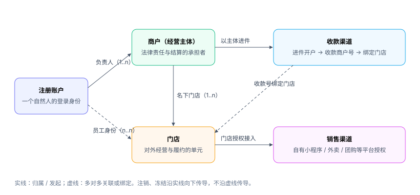

# 运营端 · 账户 / 商户 / 门店 / 渠道 · 管理功能矩阵

> 状态：**草稿（待评审）** · 创建 2026-11-16
> 口径：§一–§六**从管理要求出发独立整理，不参考现有功能**；§七是事后与 ops-web 现状的对照（2026-11-16 读代码盘点）。
> 交互形态遵循 [规范-运营端-列表与抽屉](../technical/design/规范-运营端-列表与抽屉.md)：列表 + 行内动作 + 右侧抽屉。

## 一、定位（L1）

平台要对四类对象负责：**谁在用平台（注册账户）**、**谁承担经营与资金责任（商户）**、**在哪里对外经营（门店）**、**钱和订单从哪里进出（渠道）**。
运营端的管理需求归结为三件事：**准入**（谁能进、凭什么进）、**在营管控**（变更要审、风险要管、问题能处置）、**退出**（冻结、清退、注销，且留痕可追溯）。

## 二、结构（L2）

- **注册账户与商户不是一回事**：账户是"人"，商户是"法律主体"。一个人可以负责多个主体，也可以在别人的门店当员工。审核、处罚、结算都落在**商户**上；登录安全落在**账户**上。
- **门店归属于商户，渠道挂在两头**：收款渠道以**商户**身份进件开户，开出的收款号再**绑定到门店**；销售渠道由**门店**授权接入。
- **处置沿归属向下传导**：冻结商户 → 其门店全部停业、收款号暂停出款；但冻结一个账户只影响登录，不自动冻结他负责的商户（避免一人违规连坐多个主体，需人工判断）。

| 对象 | 管理重心 | 生命周期 | 功能数 | 其中 P0 |
|---|---|---|---:|---:|
| 注册账户 | 身份真实、登录安全、关联关系 | 注册 → 实名 → 正常 → 锁定 / 冻结 → 注销 | 14 | 7 |
| 商户 | 资质、准入、经营范围、信用与资金责任 | 申请 → 审核 → 开通 → 在营 → 整改 / 冻结 → 清退 / 注销 | 24 | 10 |
| 门店 | 信息真实、内容合规、营业状态 | 建档 → 审核 → 营业 → 停业 / 下线 → 关店 | 18 | 6 |
| 收款渠道 | 开户进件、收款号与门店绑定、费率、对账 | 进件 → 审核中 → 开通 → 暂停 → 关闭 | 13 | 7 |
| 销售渠道 | 授权接入、同步健康、异常处置 | 申请接入 → 授权 → 运行 → 异常 / 暂停 → 解绑 | 10 | 3 |
| 通用 | 审计、导出、通知、数据域、工单 | — | 9 | 5 |

**优先级口径**：P0 = 没有它就不能合规上线或无法处置风险；P1 = 规模上来后人工扛不住；P2 = 提效与分析。

**交互形态缩写**：列 = 列表页；详 = 详情抽屉；编 = 新增/编辑抽屉；审 = 审核抽屉（只读上下文 + 审核意见）；确 = 确认弹窗；批 = 批量操作。

## 三、功能矩阵（L3）

### 3.1 注册账户

| # | 功能 | 管理要求 / 规则 | 形态 | 优先级 |
|---|---|---|---|---|
| A01 | 账户检索 | 按手机 / 邮箱 / 账户编号 / 名下主体查；手机、证件默认掩码显示 | 列 | P0 |
| A02 | 账户详情 | 基本信息、实名状态、注册来源与时间、最近登录、名下主体与员工身份 | 详 | P0 |
| A03 | 关联关系查看 | 该账户是哪些商户的负责人、哪些门店的员工及角色 | 详 | P0 |
| A04 | 实名认证审核 | 证件信息与人脸 / 第三方核验结果对照；不通过需写原因并通知 | 审 | P1 |
| A05 | 锁定 / 解锁 | 多次密码错误自动锁定；运营可手动锁定、解锁，写原因 | 确 | P0 |
| A06 | 强制下线 | 吊销该账户全部会话，用于疑似盗号 | 确 | P0 |
| A07 | 冻结 / 解冻 | 禁止登录与一切操作；不自动冻结名下商户（见 §二） | 审 | P0 |
| A08 | 换绑手机 / 邮箱 | 本人无法自助时的人工换绑，需凭证材料，双人复核 | 审 | P1 |
| A09 | 注销申请处理 | 名下有在营商户、未结清资金时不可注销；注销后保留审计所需最小信息 | 审 | P1 |
| A10 | 登录与安全日志 | 登录时间、IP、设备、结果；异常地点登录高亮 | 详 | P1 |
| A11 | 风险标记 | 手工打标（疑似刷单、黑产设备等），标记跨对象可见 | 编 | P1 |
| A12 | 同人识别 | 同证件 / 同设备 / 同手机号的多个账户聚合查看 | 详 | P2 |
| A13 | 账户导出 | 按筛选条件导出，敏感字段掩码，导出动作留痕 | 批 | P2 |
| A14 | 测试账户管理 | 测试号白名单、固定验证码，与真实账户隔离显示 | 编 | P0 |

### 3.2 商户（经营主体）

| # | 功能 | 管理要求 / 规则 | 形态 | 优先级 |
|---|---|---|---|---|
| M01 | 入驻申请列表 | 按状态（待审 / 审核中 / 已通过 / 已驳回）、地区、行业、来源（自助 / 代办）筛选；待审按提交时间排队 | 列 | P0 |
| M02 | 入驻审核 | 主体信息、证照、法人、经营类目、门店信息一页看全；通过须确定经营范围，驳回须写原因 | 审 | P0 |
| M03 | 代办入驻 | 运营代商户填报；需商户本人确认协议后才生效 | 编 | P1 |
| M04 | 商户档案 | 主体类型、名称、统一编号、法人、联系人、经营状态、创建时间 | 列 / 详 | P0 |
| M05 | 资质证照管理 | 营业执照、行业许可证等；补录、更新、吊销；到期前提醒、过期自动限制相关类目 | 编 / 确 | P0 |
| M06 | 经营类目授权 | 按资质授予可售类目；缺资质的类目不可授予 | 编 | P0 |
| M07 | 主体信息变更审核 | 名称、法人、统一编号、结算账户变更需审核，审核前旧信息继续生效 | 审 | P0 |
| M08 | 结算账户管理 | 查看与审核对公 / 对私结算账户；变更冷静期与通知 | 审 | P0 |
| M09 | 协议与签约 | 平台服务协议、支付协议的签署状态与版本；新版协议需重签 | 详 | P1 |
| M10 | 费率与套餐 | 商户适用的平台费率、套餐档位、到期时间；调整需理由 | 编 | P1 |
| M11 | 经营模式 | 自营 / 第三方等模式的设定与切换，切换前校验收款条件 | 确 | P1 |
| M12 | 认证标识 | 授予 / 撤销平台认证标（如"已认证"），有违规上限 | 确 | P2 |
| M13 | 信用档案 | 违规次数、处罚记录、投诉率、履约指标汇总 | 详 | P1 |
| M14 | 违规登记与处置 | 警告 / 限制上新 / 下架商品 / 门店停业 / 冻结主体，分级处置，写依据 | 编 | P0 |
| M15 | 冻结 / 解冻 | 冻结后全部门店停业、暂停出款；解冻需审核 | 审 | P0 |
| M16 | 整改通知 | 下发整改项与期限，到期未整改自动升级处置 | 编 | P1 |
| M17 | 清退 | 强制退出：先结清资金与售后，再关闭门店与渠道 | 审 | P1 |
| M18 | 注销申请处理 | 商户主动注销；前置检查同清退 | 审 | P1 |
| M19 | 名下门店与渠道一览 | 从商户直达其门店、收款号、销售渠道，不再到别处手输编号 | 详 | P0 |
| M20 | 负责人变更 | 更换商户负责人账户，原负责人与新负责人双方确认 | 审 | P1 |
| M21 | 保证金与额度 | 准入保证金、单笔 / 日限额等风控额度的查看与调整 | 编 | P1 |
| M22 | 商户全景 | 一页看主体、门店、商品、订单、资金、信用的关键数 | 详 | P2 |
| M23 | 商户导出 | 同 A13 | 批 | P2 |
| M24 | 升档 / 风险信号 | 一人多主体、频繁变更结算账户等信号的自动提示 | 列 | P2 |

### 3.3 门店

| # | 功能 | 管理要求 / 规则 | 形态 | 优先级 |
|---|---|---|---|---|
| S01 | 门店检索 | 按门店名 / 编号 / 所属商户 / 地区 / 状态筛选 | 列 | P0 |
| S02 | 门店详情 | 名称、地址与坐标、服务范围、营业时间、类目、所属商户、绑定渠道 | 详 | P0 |
| S03 | 新店审核 | 地址真实性（地图核对）、门头照、经营范围是否超出主体授权 | 审 | P0 |
| S04 | 门店信息变更审核 | 名称、地址、服务范围的变更须审核；营业时间等可直接生效 | 审 | P1 |
| S05 | 店铺内容审核 | 店招、公告、门头图等对外展示内容；机审命中项人工复核 | 审 | P0 |
| S06 | 营业状态管理 | 停业 / 恢复营业，写原因；停业期间不接单 | 确 | P0 |
| S07 | 强制下线 | 违规门店对 C 端不可见，独立于营业状态 | 确 | P0 |
| S08 | 关店 | 关店前检查未完成订单、未结资金；关店后编号不复用 | 审 | P1 |
| S09 | 门店归属迁移 | 门店从一个商户迁到另一个商户（如转让）；须双方确认，资金分段结算 | 审 | P2 |
| S10 | 服务范围管理 | 查看与修正配送 / 服务覆盖区域；越界的自动拦截 | 编 | P1 |
| S11 | 门店码与物料 | 生成门店码、登记印刷量、换码（旧码失效须写原因） | 编 / 确 | P1 |
| S12 | 员工与授权查看 | 门店员工账户、角色、最近操作；可协助移除离职员工 | 详 | P1 |
| S13 | 门店模板 | 店铺装修模板的维护与默认模板设定 | 编 | P2 |
| S14 | 门店评分与投诉 | 评分、差评、投诉汇总，超阈值预警 | 详 | P1 |
| S15 | 获客效果 | 扫码、进店、注册、首单的转化 | 列 | P2 |
| S16 | 履约配置查看 | 自提 / 配送 / 到店等履约方式及其参数 | 详 | P1 |
| S17 | 门店导出 | 同 A13 | 批 | P2 |
| S18 | 门店标签 | 运营打标（重点店、试点店等），供筛选与活动圈选 | 编 | P2 |

### 3.4 收款渠道

| # | 功能 | 管理要求 / 规则 | 形态 | 优先级 |
|---|---|---|---|---|
| P01 | 进件申请列表 | 按渠道、状态（待提交 / 审核中 / 已开通 / 被拒 / 需补件）筛选 | 列 | P0 |
| P02 | 进件资料准备与提交 | 以商户主体资料生成进件单；缺项提示；提交幂等，重复点击不重复开户 | 编 | P0 |
| P03 | 进件结果跟踪 | 渠道回执、驳回原因、补件要求；超时未回执提醒 | 详 | P0 |
| P04 | 收款商户号管理 | 渠道开出的商户号、费率、开通时间、状态 | 列 / 详 | P0 |
| P05 | 收款号与门店绑定 | 一个收款号可绑多个门店；门店无收款号不可切到需收款的经营模式 | 编 | P0 |
| P06 | 费率配置 | 渠道费率、平台加价；调整需审核并通知商户 | 审 | P1 |
| P07 | 暂停 / 恢复收款 | 风险时暂停收款或仅暂停出款，写原因 | 确 | P0 |
| P08 | 关闭收款号 | 关闭前确认无在途资金与未完成退款 | 审 | P1 |
| P09 | 渠道对账差异 | 渠道流水与平台订单的差异清单与处理状态 | 列 / 详 | P0 |
| P10 | 渠道健康 | 各渠道成功率、超时率、最近故障 | 列 | P2 |
| P11 | 渠道凭证与密钥 | 证书 / 密钥的到期与轮换提醒（只显示指纹，不显示明文） | 详 | P1 |
| P12 | 测试 / 沙箱环境 | 沙箱商户号与真实环境隔离显示，禁止混用 | 详 | P1 |
| P13 | 跳转渠道运营后台 | 需要在渠道侧完成的操作给出直达入口 | 详 | P2 |

### 3.5 销售渠道

| # | 功能 | 管理要求 / 规则 | 形态 | 优先级 |
|---|---|---|---|---|
| C01 | 渠道目录 | 平台支持的销售渠道及其开放状态（全量 / 白名单 / 关闭） | 列 / 编 | P1 |
| C02 | 门店接入申请审核 | 门店申请接入某渠道；校验资质与类目是否满足渠道要求 | 审 | P1 |
| C03 | 授权状态 | 门店在各渠道的授权、到期、店铺编号 | 列 / 详 | P0 |
| C04 | 同步健康 | 商品、库存、订单、状态回传的同步延迟与失败数 | 列 | P0 |
| C05 | 同步失败处理 | 失败明细、重试、标记已处理 | 详 / 批 | P0 |
| C06 | 暂停 / 恢复渠道 | 对单个门店或整个渠道暂停接单 | 确 | P1 |
| C07 | 解绑 | 解绑前确认无在途订单 | 审 | P1 |
| C08 | 渠道订单抽查 | 按渠道查订单，用于核对外部平台投诉 | 列 | P2 |
| C09 | 渠道规则提示 | 各渠道对类目、图片、价格的限制 | 详 | P2 |
| C10 | 渠道数据看板 | 各渠道订单量、GMV、退款率 | 列 | P2 |

### 3.6 通用能力

| # | 功能 | 管理要求 / 规则 | 优先级 |
|---|---|---|---|
| G01 | 操作审计 | 所有写操作记录操作人、时间、前后值、原因；不可删改 | P0 |
| G02 | 审核意见必填 | 驳回、冻结、处罚、关闭类动作必须写原因，并同步给对方 | P0 |
| G03 | 敏感信息掩码 | 手机、证件、银行账号默认掩码；查看明文需权限且留痕 | P0 |
| G04 | 数据域 | 运营人员只看授权地区 / 行业内的对象 | P0 |
| G05 | 通知触达 | 审核结果、处罚、到期提醒通过站内信 / 短信 / 邮件送达 | P0 |
| G06 | 双人复核 | 高风险动作（换绑、清退、结算账户变更）由第二人复核 | P1 |
| G07 | 批量操作 | 批量审核、批量打标、批量导出，单次上限与二次确认 | P1 |
| G08 | 工单与备注 | 对象上的内部备注、关联工单，交接时可追溯 | P1 |
| G09 | 到期与待办中心 | 资质到期、整改到期、进件超时的统一待办 | P2 |

## 四、生命周期 × 管理动作

同一个动作在不同阶段的含义不同；这张表回答"现在这个状态下运营能做什么"。

| 对象 | 准入 | 在营变更 | 风险处置 | 退出 |
|---|---|---|---|---|
| 注册账户 | 实名审核 A04 | 换绑 A08 · 风险标记 A11 | 锁定 A05 · 强制下线 A06 · 冻结 A07 | 注销 A09 |
| 商户 | 入驻审核 M02 · 代办 M03 · 类目授权 M06 | 主体变更 M07 · 结算账户 M08 · 负责人变更 M20 · 费率套餐 M10 | 违规处置 M14 · 冻结 M15 · 整改 M16 | 清退 M17 · 注销 M18 |
| 门店 | 新店审核 S03 · 内容审核 S05 | 信息变更 S04 · 服务范围 S10 · 换码 S11 · 迁移 S09 | 停业 S06 · 强制下线 S07 | 关店 S08 |
| 收款渠道 | 进件 P02 · 结果跟踪 P03 | 绑定门店 P05 · 费率 P06 | 暂停收款 / 出款 P07 · 对账差异 P09 | 关闭收款号 P08 |
| 销售渠道 | 接入审核 C02 | 同步失败处理 C05 | 暂停 C06 | 解绑 C07 |

## 五、角色 × 对象

R = 查看；W = 新增 / 编辑；A = 审核 / 处置；— = 不可见。

| 角色 | 注册账户 | 商户 | 门店 | 收款渠道 | 销售渠道 | 说明 |
|---|---|---|---|---|---|---|
| 超级管理员 | RWA | RWA | RWA | RWA | RWA | 只用于配置与兜底 |
| 入驻审核员 | R | RA（准入、变更） | RA（新店、变更） | R | R | 不做风险处置 |
| 风控专员 | RA（锁定、冻结） | RA（违规、冻结、清退） | RA（停业、下线） | RA（暂停） | RA（暂停） | 处置须写依据 |
| 内容审核员 | — | R | RA（内容） | — | — | 只管对外展示内容 |
| 商户运营 / BD | R | RW（代办、套餐） | RW（门店码、模板） | R | RW（接入） | 无审核权，避免自审 |
| 财务 | — | R（结算账户 A） | R | RWA（费率、对账、关闭） | R | 结算账户变更终审 |
| 渠道运营 | — | R | R | RW（进件） | RWA | 不能改费率 |
| 客服 | R（掩码） | R | R | R | R | 只读，用于答复咨询 |

**互斥约束**：同一笔变更的提交人与审核人不能是同一人；BD 不持有审核权。

## 六、边界与待决（L4）

| # | 待决项 | 选项 | 倾向 |
|---|---|---|---|
| D1 | "渠道"的范围 | ① 只指收款渠道 ② 收款 + 销售渠道 ③ 再加物流运力 | 本文按 ②，物流另立 |
| D2 | 冻结账户是否连带冻结其负责的商户 | 连带 / 不连带 / 提示后人工决定 | 提示后人工决定 |
| D3 | 注销后保留哪些数据、保留多久 | 依当地法规（交易记录通常 ≥ 3 年） | 待法务确认 |
| D4 | 门店归属迁移（S09）是否支持 | 支持 / 只允许关店重开 | 先不做，按关店重开 |
| D5 | 双人复核的动作清单 | 见 G06 | 待风控确认 |
| D6 | 数据域的划分维度 | 地区 / 行业 / 二者组合 | 地区为主 |
| D7 | 自营商户是否走同一套准入 | 同一套 / 简化 | 同一套，审核可由系统自动通过 |

**取舍记录**

- 账户与商户分开管理：把人和主体混成一个对象，会在"一人多主体""员工离职"两类场景里无解。
- 处置只沿归属向下传导：员工身份、收款号绑定这类关联关系不传导，否则一次处罚会意外波及无关主体。
- 所有退出类动作都先做前置检查（在途订单、未结资金），检查不过直接拦截，不靠运营记得去看。

## 七、与现状对齐（2026-11-16）

> 方法：逐条在 `ops-web/app/**`、`ops-web/lib/nav.ts`、`ops-web/lib/api/contracts/**` 里找实现。
> ⚠️ 线上运行的是 `codex/ops-customers-simplify` 分支（比 main 多 41 个提交，含「客户管理」菜单：用户数据 / 门店 / 连锁）。除 A01–A03 外本表按 main 盘点，线上可能更多。
> ✅ 有界面且做到了 · 🟡 部分做到，或只有接口没有界面 · ❌ 没有。是读代码的结论，未逐条在真后端上点验。

### 7.1 汇总

| 对象 | 功能数 | ✅ | 🟡 | ❌ | 结论 |
|---|---:|---:|---:|---:|---|
| 注册账户 | 14 | 2 | 3 | 9 | **只读层已有，处置层缺失**：客户管理 → 用户数据（`/customers?tab=users`，线上分支 `codex/ops-customers-simplify`，未合入 main）能检索、看名下主体数 / 门店数与门店清单；锁定、强制下线、冻结、实名、登录日志都没有 |
| 商户 | 24 | 8 | 9 | 7 | 准入、资质、类目、处罚已成形；**变更审核、协议、整改、清退 / 注销、负责人变更**缺 |
| 门店 | 18 | 7 | 7 | 4 | 档案、内容审核、门店码、获客已成形；**独立新店审核、停业与下线分离、关店**缺 |
| 收款渠道 | 13 | 5 | 7 | 1 | 进件在 near-pay 完成，本端多为只读或跳转；**收款号列表、绑定、暂停收款 / 出款**缺 |
| 销售渠道 | 10 | 0 | 0 | 10 | **整域缺失**（商户抽屉里的 channel 是履约方式，不是销售渠道） |
| 通用 | 9 | 1 | 7 | 1 | 审计已有；写原因、掩码、数据域、通知都是各页各做，**双人复核**没有 |
| **合计** | **88** | **23** | **33** | **32** | |

### 7.2 逐条

| ID | 现状 | 位置 | 缺什么 |
|---|---|---|---|
| A01 | ✅ | 客户管理 → 用户数据 `/customers?tab=users`（线上分支，未合入 main） | 按关键词检索；缺手机 / 证件掩码规则核对 |
| A02 | 🟡 | 同上，详情抽屉 | 只列名下门店，缺实名、最近登录、注册来源 |
| A03 | 🟡 | 同上：列表带主体数、门店数，抽屉列门店 | 缺员工身份与角色 |
| A04 | ❌ | — | 无实名审核 |
| A05 | ❌ | — | 停用只对运营员工（`/iam`） |
| A06 | ❌ | — | 强制下线只对运营员工角色 |
| A07 | ❌ | 近似：`/risk?tab=blacklist` 用户名单 | 无账户冻结 |
| A08 | ❌ | — | 无人工换绑 |
| A09 | ❌ | — | 无注销处理 |
| A10 | ❌ | — | 无登录日志 |
| A11 | 🟡 | `/risk?tab=blacklist` | 是黑名单不是标签 |
| A12 | ❌ | — | 人档合并 ≠ 同人识别 |
| A13 | ❌ | — | 无导出 |
| A14 | ✅ | `/system?tab=testPhone` | — |
| M01 | 🟡 | `/merchants`（入驻申请）`apply-tab.tsx` | 缺地区、行业、来源筛选 |
| M02 | ✅ | `apply-tab.tsx` 审核抽屉 | — |
| M03 | 🟡 | `on-behalf-tab.tsx` | 缺商户本人确认协议 |
| M04 | ✅ | `/merchants?tab=list` | — |
| M05 | ✅ | `/merchants?tab=qualifications` | 缺到期提醒 |
| M06 | ✅ | `/merchants?tab=categories` | — |
| M07 | ❌ | — | 无主体变更审核 |
| M08 | 🟡 | 商户列表"结算账户"列（只读）；`/finance?tab=payout-accounts` | 只审自营供应商账户 |
| M09 | ❌ | — | 无协议签约视图 |
| M10 | 🟡 | `/merchants?tab=plans`；`/finance?tab=rates` | 无商户级费率 |
| M11 | ✅ | `/merchants?tab=admission` | — |
| M12 | ✅ | `/merchants?tab=verify` | — |
| M13 | 🟡 | `/merchants?tab=credit` | 缺投诉率、履约指标 |
| M14 | ✅ | `/merchants?tab=ban` | 缺"下架商品"一档 |
| M15 | 🟡 | `/merchants?tab=ban` 停业 / 解封 | 无冻结态入口，解冻不经审核 |
| M16 | ❌ | — | 无整改通知 |
| M17 | ❌ | 近似：商户归档 | 无结清前置的清退流程 |
| M18 | ❌ | — | 无注销处理 |
| M19 | 🟡 | 商户抽屉：门店链接、支付服务页签 | 缺收款号、销售渠道一览 |
| M20 | ❌ | — | 无负责人变更 |
| M21 | ✅ | `/merchants?tab=admission` 押金、收款额度 | — |
| M22 | 🟡 | 商户抽屉链条行；`/merchants?tab=chain` | 缺资金、信用汇总 |
| M23 | ❌ | — | 无导出 |
| M24 | 🟡 | 升档信号；`/merchants?tab=mode-risk` | 缺一人多主体等风险信号 |
| S01 | ✅ | `/merchants?tab=stores` | 用社区代替地区 |
| S02 | ✅ | 门店档案抽屉：档案 / **经营状况 / 订单**三个页签（订单页签 2026-11-16 新增） | 缺坐标、类目 |
| S03 | 🟡 | 只在入驻审核里看门店资料 | 无独立新店审核 |
| S04 | 🟡 | `/stores`（审核，服务范围） | 只覆盖服务范围变更 |
| S05 | ✅ | `/stores`（审核，店招 / 公告） | — |
| S06 | 🟡 | `/merchants?tab=ban` 门店下线；门店抽屉恢复 | 停业与下线未分开 |
| S07 | ✅ | 同上 | — |
| S08 | ❌ | — | 无关店 |
| S09 | ❌ | — | 无归属迁移（D4 倾向不做） |
| S10 | 🟡 | 门店抽屉覆盖范围（只读） | 不能修正 |
| S11 | ✅ | `/stores?tab=qrcode` | — |
| S12 | 🟡 | 商户抽屉「人员」（只读） | 不能移除员工 |
| S13 | 🟡 | `/stores?tab=template` | 未开放 |
| S14 | 🟡 | 门店抽屉评分；`/reviews` | 无投诉汇总与预警 |
| S15 | ✅ | `/stores?tab=effect` | — |
| S16 | ✅ | 商户抽屉「履约」 | — |
| S17 | ❌ | — | 只导出门店码 |
| S18 | ❌ | — | 无门店标签 |
| P01 | ✅ | `/merchants?tab=onboarding` | — |
| P02 | ✅ | 商户抽屉「支付服务」 | 进件在 near-pay 完成 |
| P03 | 🟡 | 进件抽屉（状态、驳回原因） | 人工回查仅接口，无超时提醒 |
| P04 | 🟡 | 门店列表"收款号"列 | 无收款号列表 |
| P05 | 🟡 | 跳 near-pay | 本端无绑定 |
| P06 | 🟡 | `/finance?tab=pay-channels` | 只有全局费率，无审核 |
| P07 | 🟡 | `/pay-ops/qr-codes` 停用收款码 | 不能暂停收款 / 出款 |
| P08 | ❌ | — | 无关闭收款号 |
| P09 | ✅ | `/orders?tab=pay` 对账差异 | — |
| P10 | 🟡 | `/pay-ops` 异常、请求日志 | 无成功率看板 |
| P11 | ✅ | `/pay-ops/platform-keys`、`/pay-ops/apps` | 缺到期提醒 |
| P12 | 🟡 | 接口字段 sandbox | 界面未显示 |
| P13 | ✅ | 进件抽屉、支付服务页签的 near-pay 链接 | — |
| C01–C10 | ❌ | — | 无销售渠道域 |
| G01 | ✅ | `/iam?tab=audit` | — |
| G02 | 🟡 | 多处要求写原因 | 不是统一规则 |
| G03 | 🟡 | 手机掩码；`/members` 查看明文需写原因 | 证件、银行号未统一 |
| G04 | 🟡 | `/iam` 员工数据域（商户、社区、自提点） | 缺地区、行业维度 |
| G05 | 🟡 | `/messages` 场景通道、模板 | 与这些事件的对接未知 |
| G06 | ❌ | — | 无双人复核 |
| G07 | 🟡 | 门店码批量导出、订单导出 | 无批量审核、打标 |
| G08 | 🟡 | `/messages?tab=tickets` | 对象上无内部备注 |
| G09 | 🟡 | 工作台"待审商户"卡 | 无到期待办中心 |

### 7.3 现状有、矩阵没列的

建议评审时决定是否补进 §三：

- 自营建档：`/merchants?tab=self-operated`，建平台自营主体并加门店（超管）。
- 三档准入策略：按法律形态配置押金、限额、禁售，以及资金路径（归集 / 直连）——`/merchants?tab=admission`。
- 自营风险清单：无照主体又是自营门店的税务敞口——`/merchants?tab=mode-risk`。
- 链条画像与催办：建品到持续记账的六步漏斗 + 催办——`/merchants?tab=chain`。
- 主体套餐：档位定义、授予、额度覆盖、线下购买核款、运营代购——`/merchants?tab=plans`；门店套餐商城 `/mall`。
- 经营范围字典：门店行业、行业准入、经营授权码、服务范围开关——`/system`。
- 社区网格与商家提报——`/communities`（门店覆盖范围与入驻审核依赖它）。
- 履约方式锁路——商户抽屉「履约」。

### 7.4 补齐顺序（只看 P0 缺口）

| 顺序 | 缺口 | 涉及 | 理由 |
|---|---|---|---|
| 1 | 注册账户处置（锁定、强制下线、冻结）+ 详情补全 | A02、A05–A07 | 只读已有（用户数据页），盗号与违规处置仍无从下手 |
| 2 | 主体变更与结算账户审核 | M07、M08 | 资金安全：结算账户改了没人审 |
| 3 | 收款号列表、绑定、暂停收款 / 出款 | P04、P05、P07 | 风险时只能停收款码，停不了钱 |
| 4 | 冻结态与停业 / 下线分离 | M15、S06 | 处置分级的前提 |
| 5 | 商户名下门店与渠道一览 | M19 | 1–3 做完后的汇总入口 |
| 6 | 统一写原因、掩码、数据域、通知 | G02–G05 | 横切；建议随 1–4 一起落 |
| 7 | 销售渠道授权与同步健康 | C03–C05 | 取决于 D1 是否纳入，且需先有接入方 |
