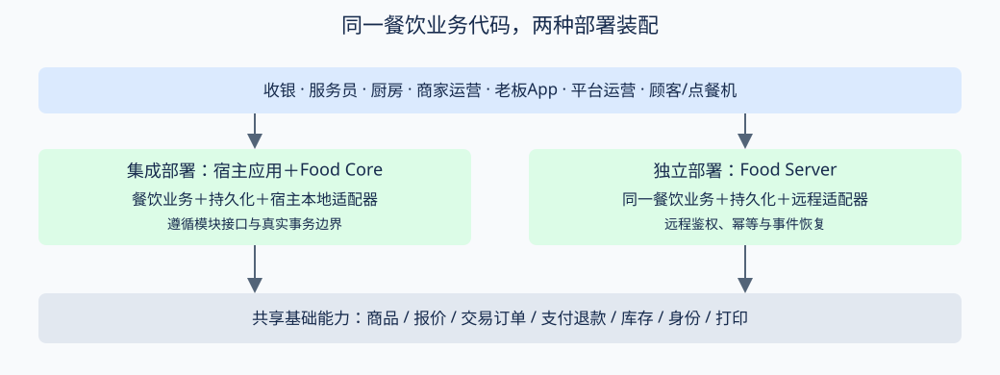

# 餐饮系统完整需求文档

> 最新补充（2026-10-21）：[时段/渠道餐牌、小料、套餐与耗用评审及计划](../technical/TDD-餐饮系统-餐牌选配套餐与耗用增强方案.md)；执行顺序按该文P0～P6，本轮为评审，未新增运行时能力。

> 底座约束：[项目兼容对齐](../technical/design/餐饮系统-项目底座兼容对齐.md)。门店营业时间、账号、主体、收款商户、门店及认证权限直接复用现有模型；营业日核算不替代门店营业时间。

> 详细设计：[领域对象](../technical/design/餐饮系统-领域对象与设计总览.md) · [数据库](../technical/design/餐饮系统-数据库设计.md) · [API输入输出](../technical/design/餐饮系统-API设计.md)。

> 状态：待评审 · 版本：新版需求基线草案 2026-10-19 · 上游：历史V2餐饮场景与本轮独立项目设计。
> 本册为餐饮产品需求入口；[需求矩阵](./餐饮系统-需求矩阵.md)给出109项需求的六端权限、分期、依赖和最低验收结果。本册不宣称这些能力已实现。

## 一、目标与边界

支持单店、连锁、多品牌的堂食、自取、外带及配送餐饮，兼容先付后吃、先吃后付、多轮加菜、多端协作及完整营业日管理。产品按能力组合覆盖业态，不为中餐、西餐分别复制系统。

独立Java项目拥有餐牌、台账、点餐批次、桌台服务、制作上菜、退餐编排、当班与日结编排；共享商品SKU、报价、交易订单、支付退款、库存、会员营销及结算的权威能力。支持独立Server远程适配、food-core随宿主集成两种装配；门店断网为额外边缘模式。

同一餐饮业务代码通过两种适配方式访问底座。独立部署不意味着复制资金账；集成部署不意味着可以直接写核心表。同门店不能被两套部署重复派工或收款。

不在本项目重建的产品：完整采购供应链、配送运力、财务总账、税务申报、支付清算、会员资产账。通过接口接入这些能力；餐饮可维护配方耗用与经营分析需求，但不会以菜单估算替代真实库存或财务凭证。

## 二、来源与采用规则

| 来源 | 采用内容 |
|---|---|
| [V2场景](../v2/03-场景.md)、[全量场景手册](../technical/design/三行业场景工作流手册.md) | F1–F10、先付后付、多轮点单、包间预约、退餐与营业日 |
| [V2商品](../v2/05-商品域规格.md)、[V2订单](../v2/06-订单域规格.md) | 统一商品交易、组合选配、渠道报价及资金分配方向；均不直接当当前可用接口 |
| [V2资源](../v2/10-预约资源域规格.md)、[V2打印](../v2/13-打印域规格.md) | 时段预约与开放占用接力、通用打印 |
| [历史已评审决议](../v2/评审-待确认决议清单.md) | 充值预收款口径、渠道与支付场景分离、AA尾差、抹零及小费边界 |
| [旧餐饮TDD](../technical/design/TDD-餐饮包-场景与工作流.md) | 业务动作、台账车、制作与金额分离；作废注记优先于旧正文 |
| [当前比较与对齐](../technical/design/餐饮系统-V2需求比较与对齐.md) | 已确认的旧新差异与待核验核心能力 |
| [B端报表清单](./B端报表清单-由浅入深.md)、[报表库与日结设计](../technical/design/TDD-B端报表库与日结.md) | 复用报表能力；沿用App数字卡、排行榜、明细表优先的呈现 |
| [定时任务需求](./PRD-定时任务管理.md) | 业务日期驱动、漏跑检测、补跑及水位 |

本册与新矩阵收敛餐饮产品目标；其他行业不受影响。技术实现以最新真实代码与契约核验为准。旧V2中未实现的目标表不能与fnb候选表简单叠加；现有自然日报表不因本需求自动改成营业日口径。

## 三、业态能力矩阵

通用=通常启用；选配=按门店场景开启；重点=该形态的核心差异。下表是模板而非互斥分类，一店可兼具咖啡、正餐、外卖。

| 形态 | 点餐/收费 | 制作与服务重点 | 专属能力及边界 |
|---|---|---|---|
| 中餐正餐/包间 | 后付、多轮加菜、按桌共享 | 凉热菜工位、先后上、叫起、齐菜、转台 | 按份/例/斤、茶位、预约订金、宴会选配 |
| 西餐/精致餐饮 | 先付或后付，按人/座位 | course分道、hold/fire、同道齐出、座位移转 | 熟度、side选配、搭配酒；小费税费为地区专项 |
| 快餐/食堂/档口 | 先付优先，柜台/自助机 | 高频出品、取餐号、自取核销 | 取餐号不等同排队号；可无桌无台账 |
| 茶饮/咖啡/烘焙 | 先付，堂食外带配送 | 杯标、糖冰温度、加料、制作顺序 | 双拼/配料组合、规格及限量、包装标签 |
| 火锅/烧烤 | 后付，多轮加菜 | 锅底、荤素分工位、分批上菜 | 半份双拼、称重、串签计数计量需报价支持 |
| 自助餐/放题 | 按人/餐段，先付或后付 | 入场核销、限时、加点限量 | 成人儿童规则、超时/浪费费、最后点单需明示确认 |
| 海鲜/称重餐厅 | 标称预估、实称确认 | 活鲜选材、加工做法、计量交接 | 皮重净重单位、允差、加工费与差价补退 |
| 酒吧/小酒馆/夜宵 | 后付/挂账，跨午夜 | 酒水与热食协作、续杯 | 寄存酒批次归属/到期、最低消费、押金；寄存为P4专项 |
| 宴会/团餐/包场 | 预订订金、合同价、分次付款 | 预排餐、桌次、齐出、临时加席 | 保证人数、实际人数、取消条款、企业应收 |
| 外卖/云厨房 | 先付优先，定时履约 | 多渠道备餐、打包核对、骑手交接 | 共享配送；第三方订单定权威防重复扣减 |
| 酒店/客房送餐 | 后付或房账转挂 | 房号服务单、定时交付 | 房账系统接口与额度确认；不伪造为已付，P4专项 |
| 连锁混合经营 | 各店模板与总部控制 | 餐牌批量发布、门店差异 | 主体/门店权限隔离，不默认跨店合账 |

自助餐要求人数类别规则与适用年龄/身高条件由门店显式配置；不推定通用儿童政策。限时从入场或开台起算需明确，暂停/续时/超时宽限留痕。寄存酒与房账为增补需求，见矩阵L组；不伪装成普通库存/支付。

## 四、用户与端职责

收银负责收款、结账、钱箱和当班；服务员负责桌台服务与代客点单；厨房负责制作出品；商家运营负责配置与经营分析；老板端复用现有B端App，负责移动经营、异常处理和审批；平台端负责开通、版本、治理及工单诊断。顾客端和点餐机只开放会话范围内的自助能力。

角色必须叠加门店、工位、本人当班、敏感金额及导出权限。折扣、免单、退款、强制日结、坏账等按动作设权限；同人申请审批应被阻止或进入更高层明确例外流程，不能由终端绕过。平台默认不代商家执行营业操作。

## 五、业务对象与端到端需求

### 5.1 菜单与报价（A、B组）

菜品关联基础商品SKU；菜单有独立展示分类、餐段/日期例外、渠道/终端可见规则及发布版本。基础规格决定SKU，免费做法引用既有字典，收费配料关联可计价对象，套餐与配料组合须校验选择数量、互斥、默认值和循环引用。

报价返回基价、选配、套餐补差、优惠、费用、税费及最终应收明细，金额与币种由核心确认。负向优惠不使应收为负；价格变化要求再次确认。过敏信息、售罄替代、服务费、最低消费和超时费用在顾客确认前展示。

地区税费按可信经营地区、供应方税登记、商品税类及合法税点配置，支持价外加税、价内拆税、零税率/免税/范围外分类；不得因不参与促销而免税。阿联酋标准VAT初始税档为5%，消费者默认含税展示，已含税价格不重复加税；真实地区/资格及有效版本由平台核验，门店不能任意修改法定税率。积分、优惠券、人工抹零是否影响税基需有原权威分类，报价与结账确认均显示净额/税额/含税总额及客户剩余应付。AA、打印、日结和退款保留原税分摊证据。实现细化见[规则初始化与地区税费方案](../technical/TDD-统一试算引擎-初始规则与结账税费.md)；此处为目标要求，不表示已接入开票或税务申报。

停售、每日配额与物理库存分开。每日重置只能恢复应恢复的销售限制或配额，不能把上日库存数写回。渠道差价与加工费不能在餐饮表独立加价后覆盖核心金额。

### 5.2 预约、开台与点单（C、D组）

预约包括时段、人数、资源、联系人、订金政策、取消/爽约记录；到店通过可恢复的资源接力转开台，未到店不提前生成正式消费订单。单门店内支持一台账多桌、多台账拼桌、多轮加菜，桌台物理占用与资金归属分别记录。

购物车按就餐会话协作，并记录添加人/座位；明确提交形成不可变批次，绑定基础订单和稳定行。原单不因加菜而重算。无桌快餐、外卖及自取可不建立堂食台账。并发、超时和终端重试必须恢复原提交结果。

先付模式只在可信付款且受理完成后派工；后付在授信/营业许可、库存承诺和受理完成后派工，不能靠终端选择OFFLINE直接获得后付能力。后付订单不得在正在制作时按普通未付超时规则取消。

### 5.3 制作、传菜与交付（E组）

制作按批次、源行/套餐组件及工位拆分。数量至少区分待制作、制作中、出品、上菜、撤销和重做；支持同SKU不同口味、分次出品、跨工位齐套与回传异常。

中餐按桌共享，西餐增加seat与course，course可等叫/叫起/齐出；同桌仍可混用共享菜与个人菜。催菜不改变财务状态。厨房出品不等于上菜；出纸不等于制作；配送交接不等于顾客签收。取餐号、排队号、桌号、预约号分别定义。

### 5.4 收银、资金与逆向（F、G组）

餐饮结账单冻结本次覆盖的台账/批次/订单和应收版本。逐单付款、跨单付款、AA、按人分单、事后按菜分摊是不同能力。AA尾差由最后一笔承接；不能把一次总收款拿来反复确认多个支付根。

现金、线上、储值、券、订金、挂账分别注明性质；充值和押金不计商品销售收入，小费不默认属于菜品营收。收款未知时查询原请求；退款从正式售后链路执行并可追溯原分配。小费一期不启用，P4需专门评审并补齐资金归属。

退餐同时记录制作决定和财务决定；已制作物料不因退钱自动回库存。当前仅整门店订单退款，部分退餐金额调整、套餐拆退需核心扩展。取消重下不可作为已制作订单的默认退餐方案。错单重开、反结账与坏账均保留原事实，不能删单掩盖资金差异。

### 5.5 打印与设备（H组）

统一支持厨房票、饮品标签、加菜单、撤菜单、叫起催菜条、预结单、收款票、整桌结账票、交班票、日结票。场景、路由、模板、设备与内容版本明确；零路由、失败和结果未知均可见。

补打保留原任务引用并标补打，厨房不能据补打票再次制作。设备断网与渠道超时不等于未出纸；未知结果先查询，必要时人工确认。中文、长菜名、双语、西餐座位/course、切纸、标签尺寸和断网恢复须真机验收。

## 六、营业日、交接班、日结与对账（I组）

### 6.1 四个概念分开

| 概念 | 范围 | 完成意味着什么 |
|---|---|---|
| 交接班 Shift Close | 员工/钱箱/班次 | 现金及在途事项交接，不代表门店当日关账 |
| 营业日关账 Business Close | 门店、营业日、币种及版本 | 已核对数据范围、责任签核和例外移交 |
| 统计日汇总 Report Aggregation | 指标日期与维度 | 可重建投影计算完成，不代表现金已盘点 |
| 支付/结算对账 Reconciliation | 通道账期/结算周期 | 流水与账单核对，不等于营业日已关账或钱已到账 |

现有shop-report自然日统计按原口径保留。新增营业日维度和日结业务编排；报表重跑不能关闭钱箱或生成一份新的实际收款。

### 6.2 营业日归属

门店配置IANA时区、切点、餐段、节假日和生效版本。每笔事实保留真实发生时间、归属营业日、规则版本与来源号；时间区间采用左闭右开，跨午夜仍可归同营业日。时区夏令时边界在实现设计定义并测试。

开台归属、成交归属、付款发生日、退款发生日、上菜时间与通道结算日分别保留，不用一个date混用。跨营业日台账保留来源日；后续收款按收款发生营业日记录，同时核销原应收。修改切点不能悄悄改写已签核历史。

### 6.3 开班与交接

钱箱明确责任人、开班时间、备用金与币种，允许门店配置共享钱箱协作但仍能追责到每次操作。交班采用实盘录入、系统对照、差异说明与接班确认；可配置盲盘，防止按系统数字“盘平”。

应有现金＝期初备用金＋现金收款＋其他现金流入−现金退款−现金支出−已缴存；实盘差额＝实盘−应有现金。找零从现金净收口径扣除，不能把顾客递交的票面实收当销售收入。非销售现金支出、备用金调拨与缴存单独记录凭证。

### 6.4 日结流程与异常

预结检查 → 冻结可关账范围/数据水位 → 汇总营业与资金 → 盘点及通道对账 → 差异认领/审批 → 生成日结草稿 → 负责人签核 → 形成不可覆盖正式版本 → 输出日结票及报表。

| 检查 | 正常关账条件 | 存在异常时 |
|---|---|---|
| 活动台账、待制作、未交付 | 已完成或具备明确结转策略 | 逐项移交，不能删单清台代替 |
| 未收应收、企业挂账 | 已收或有效结转及责任人 | 显示账龄、审批和后续追偿 |
| 支付未知、退款未决 | 已确认或作为受控在途事项列明 | 不把未知改成功；高风险差异阻止普通关账 |
| 现金差异、缺凭证 | 差异处理完成或获准例外 | 强制关账需更高权限、原因与责任人 |
| 边缘未同步、第三方晚到 | 已达到同步要求及对账水位 | 显示未覆盖范围，不宣称全部结清 |
| 汇总任务失败、漏跑 | 关键账务数据可核验 | 标未完成，补跑后生成待审版本 |

正式关账键含门店、营业日、币种与版本，并有幂等关账请求。不能仅凭后台定时任务跑过就自动生成“已签核”。营业日可前进且允许按政策带明细结转；开始新营业日不表示上一日异常已消失。

### 6.5 关账后更正

迟到支付、跨日退款、补录、更正走带来源与影响范围的调整记录，保留原签核版本。退款经营口径按发生日展示，另提供原单归属分析；调整不能回写成原日“从未发生过”。统计重算可生成新投影版本，但需标注与签核日结差异。

平台或通道最终结算可能晚于门店日结；通道到账净额、交易实收、手续费和结算在途分别展示。多币种分开汇总，跨币种经营参考须明确汇率、时点及折算用途。

## 七、报表目录、口径与呈现（J组）

| 报表族 | 最低内容 | 下钻及过滤 |
|---|---|---|
| 实时营业看板 | 待接单、待做、待上、待结、退款/设备异常 | 门店/工位/餐段→具体任务 |
| 营业汇总 | 标价额、折扣、赠送、服务费用、应收、退款、净销售口径 | 营业日/自然日明确标识→订单与调整 |
| 收款及支付结构 | 线上/现金/资产核销、退款、订金转消费、未分配资金 | 渠道/班次/收银员→权威流水 |
| 现金与交接 | 备用金、收支、退款、缴存、实盘、差异及审批 | 钱箱/班次→现金操作凭证 |
| 日结与对账 | 正式版本、签核人、异常结转、通道差异及在途 | 营业日/版本→差异责任明细 |
| 应收与信用 | 期初、当期发生、收回、调整、核销、期末与账龄 | 台账/客户/企业→回款核销 |
| 菜品与组合 | 商品/SKU/套餐/选配销量、销售额、退菜、赠送、沽清 | 菜单/餐段/渠道→成交行；套餐组件不重复记收入 |
| 桌台与客流 | 到店人数、开台数、完成桌次、用餐时长、上座、翻台、人均 | 桌区/餐段→台账；非堂食单不入翻台分母 |
| 厨房效能 | 接单/开做/出品/上菜耗时、P50/P90、超时、重做、损耗 | 工位/菜品/餐段→任务事件时间 |
| 员工与内控 | 服务单量、操作归因、折扣、免单、退菜、补打、强制关账 | 员工/原因/审批状态→审计记录 |
| 会员与来源 | 新老客、复购、渠道来源、储值充值/本金赠金/核销 | 顾客脱敏/活动/来源→获准明细 |
| 连锁对比 | 分店、品牌、同期同口径比较、配置差异 | 只在授权门店集合内汇总 |
| 成本与毛利 | 理论配方耗用、实际耗用、历史成本、差异、毛利 | 仅成本数据足够时展示；未知不按零成本 |
| 预约排队 | 到店/取消/爽约、等位时长、过号与流失 | 预约/队列→去重事件 |
| 业态专项 | course齐出率、自助餐超时、宴会履约、寄存余量、房账回款 | 启用相应能力后提供 |

### 7.1 必须公布的指标定义

- 商品净销售额：依据核心成交和调整分摊计算，排除充值、押金、小费等非商品款；退款与原销售关联但按选定发生日或原单分析口径显式展示。
- 实收：已确认的资金流入，按工具分列；通道到账与储值核销不是同一个指标。净资金流与净销售额不能互称。
- 期末应收＝期初应收＋新增应收＋调整−收款核销−获准减免/坏账核销；退款和充值不直接套入此式，按其原业务关联处理。
- 客单价默认以已成交的核心门店订单为分母；桌均消费按台账、堂食人均按有效用餐人数，禁止把三者都叫客单价。匿名顾客不当作新会员。
- 翻台率默认按营业日每张有效营业桌的完成接待次数计算；并桌、拼桌、转台去重规则在指标版本中固定。座位利用率以有效开放座位时间为分母，缺数据时不展示伪精确值。
- 制作耗时区分排队/制作/出品等待上菜；hold时长独立展示，可选择扣除但须标注。退款件数不得从整单金额比例猜测。

上述为产品默认经营口径，不等同财务收入确认或法定税务口径。各报表给出指标定义、时间基准、币种、筛选条件、数据截至、水位/完整性、口径版本和导出人。App沿用数字卡、对比、排行、明细；未授权导出、跨店访问与敏感手机号访问均拒绝。

## 八、专项业态需求（L组）

自助餐/放题需套餐入场凭证、人数类别、餐段/时长、续时、加点轮次与间隔、最后点单提示；超时或浪费费用在消费前明示，需证据与确认，不能厨房直接加账。

宴会支持预报价、菜单版本、订金、保证人数、加席、履约与分期收款；特殊合同价仍进入统一报价。酒吧寄存需存取批次、保管凭证、期限、损耗与本人授权；客房送餐需对接PMS房账权威结果，房账转挂失败仍是未收应收。

小费、税费、税含/税外价和当地票据为地区能力包，金额、归属、退款和披露均需单独验证。本需求不推断任何地区的法规或税率，实施前由目标市场规则专项确认。

## 九、运行、集成与非功能需求（K组）

1. 两种部署共享接口合同、鉴权、金额及幂等语义；独立构建、版本与迁移历史，不允许餐饮领域依赖核心Mapper/实体。缺能力时禁用相应门店功能而不拖垮无关零售业务。
2. 同一订单的提交、支付、派工、退款、打印、日结各有稳定编号及独立幂等边界；异步事件允许重复和乱序，未知结果可查、可恢复、可人工接管。
3. 断网仅开放门店获准能力、库存/额度范围与单写者租约；本地制作与现金事实恢复时走认领合同，不普通重下一单。线上支付无可信结果保持未知。
4. 第三方接入先确认商品、订单、库存、支付与制作权威，映射及对账异常可见。外部回调验签且最小权限，不能重复消费第三方销量。
5. 高峰场景验收覆盖多人同桌、并发开台、餐段切换、工位积压、支付未知和断网恢复。定量容量/SLA、RPO/RTO须按试点门店规模实测确定，不把未测数字写成已承诺能力。
6. 对订单受理、派工延迟、缺路由、日结水位、退款异常、同步冲突建立告警。备份恢复演练检查交易、资金及厨房任务一致性；统计投影可重建，审计与正式日结版本不可任意丢弃。
7. 多语言、触屏、大字号、厨房远距可读、色觉可辨、设备扫描输入与危险动作二次确认作为终端体验验收。操作确认不代替后台审批。

## 十、实施分期与验收场景

| 阶段 | 可验收闭环 | 前置与限制 |
|---|---|---|
| P1 | 快餐先付、扫码/服务员、免费做法、KDS打印、自取/现有配送、基础看板 | 稳定行关联、授权代办、销售约束、合法交付；收费组合和后付不能假定已具备 |
| P2 | 正餐后付、桌台协作、course、预约转开台、交班及营业日日结、基础经营报表 | 核心后付库存/取消/交付语义；可逐单收款；涉及缺失的单项调整仍门控 |
| P3 | 套餐选配、称重差价、复杂费用、跨单/混合/AA、部分退餐、完整资金与组合报表 | 核心计价分摊、资金分配、应收调整及行级退款 |
| P4 | 自助放题/宴会深化/酒吧寄存/房账、挂账、税费小费、排队、第三方与断网 | 按专项合同、外围服务及市场规则分别验收 |

最低场景：中餐后付三轮加菜并部分出品；西餐三course按seat齐出；快餐机支付未知不出票；茶饮同SKU多口味与配料；海鲜实称补差；自助餐儿童与限时规则；夜宵跨凌晨日切；宴会订金转消费；拼桌分付与并桌合账；跨日退款和未收移交；现金盘差审批；日结漏跑恢复；第三方/离线恢复不重扣重做；平台越店访问拒绝。各场景需同时核对金额、库存、任务、打印、审计和报表。

## 十一、后续设计与待定项

本册不锁定最终表数。下一步按需求编号产出领域合同、状态机、数据模型、API/权限、日结口径与报表字典，并逐项核验现有代码可复用范围；旧多端技术矩阵作为演化记录。

试点门店形态和规模、总部/门店审批责任、营业日切点及未结跨日策略、称重和套餐首批范围、目标支付工具、现金钱箱协作模式、订金退款政策、目标市场税费票据、边缘服务拓扑、第三方首家协议、数据保留和脱敏周期需在对应实施前确认。已有需求先保留明确默认与功能门控，不据此臆造已可用接口。

## 十二、餐牌、配料、套餐与消耗统计补充

2026-10-21补充明确：时段餐牌、渠道差异配置、茶饮小料、套餐及消耗统计均为正式目标需求。原文已涉及的概念不等于数据库、API及实际交易已完整交付；差异评审、候选表和执行顺序见[增强方案](../technical/TDD-餐饮系统-餐牌选配套餐与耗用增强方案.md)。

| 验收细项 | 对应既有需求 | 必须包含的行为 |
|---|---|---|
| E01 时段和自定义餐牌 | FNB-B02、A02 | 早餐、午餐、晚餐、夜宵/节日/自定义；门店营业时间与接单日历求交；跨日及左闭右开；同组同优先级冲突拒绝 |
| E02 外送渠道餐牌同步 | FNB-B02、K组接入 | provider、账号及外部门店精确绑定；上传修订、外部映射、部分失败、UNKNOWN及旧ACK恢复；本地发布不代表远端生效 |
| E03 差异价格和配料 | FNB-B01、B04、B07 | 同SKU不同渠道价，保留同一库存身份；餐牌条目可替换默认选配；价格由报价权威确认，不在餐饮任意覆盖金额 |
| E04 奶茶/饮料与小料 | FNB-B03、B04、B06、B09 | 杯型等销售规格；糖冰等免费口味；单项及组合小料的价格/独立库存或配方耗用；已含小料也扣相应物料 |
| E05 固定和自选套餐 | FNB-B05 | 选组、候选、补差、组件及选配冻结；父子不双扣、收入不重复、退款用原分摊 |
| E06 菜品与原料消耗 | FNB-E09、J05、J08、J11 | 分列销量、制作、理论及实际耗用；历史配方、重做/报废/退料、整数库存精度和历史成本；领料不冒充逐菜实耗 |

这些是原109项顶层需求的细化，不改变现有矩阵计数。配置可管理与可报价/可成交分别验收，缺正式渠道报价或库存消耗合同的能力不得开放交易。库存实存、成本与资金账继续归已有权威系统。
