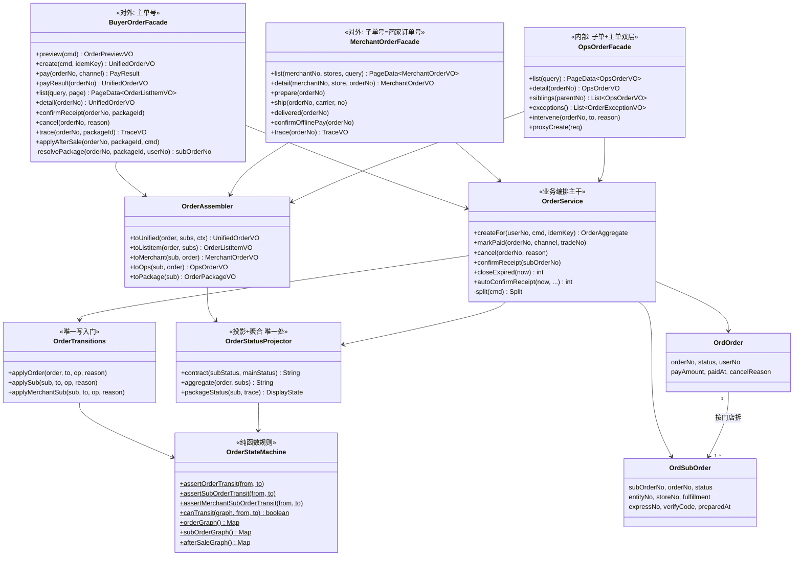
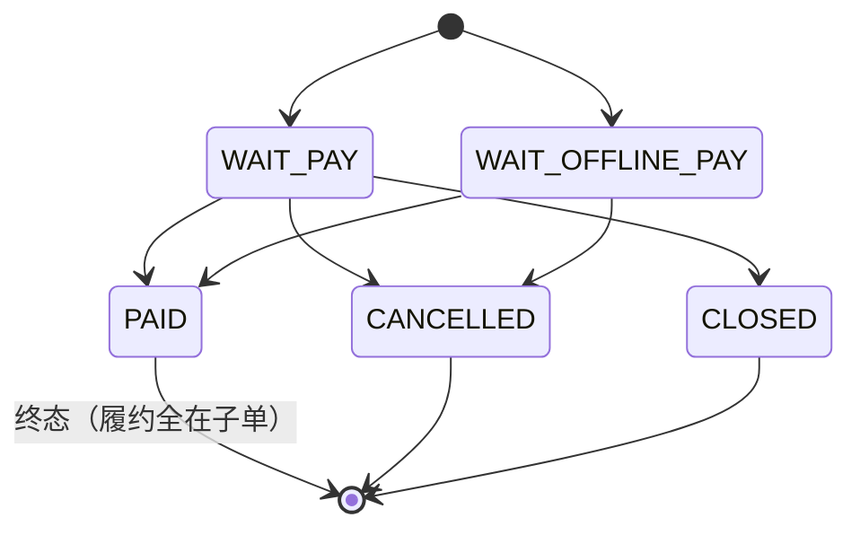
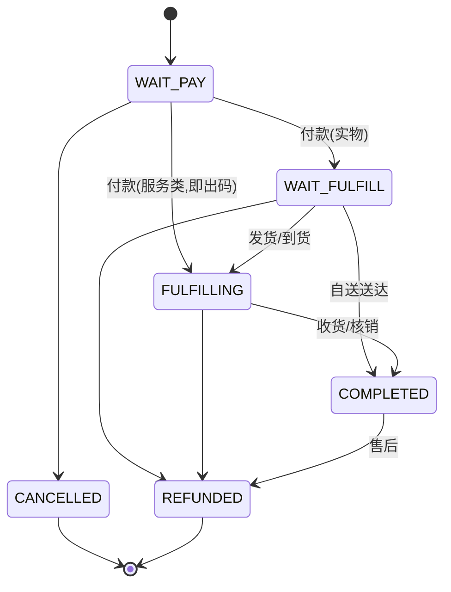
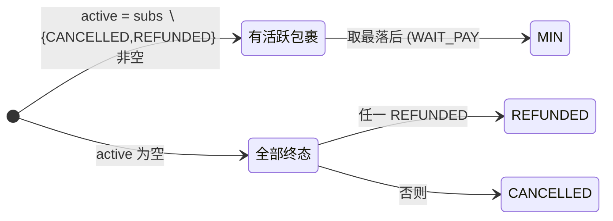

# 订单服务（OrderService）· 详细设计

> 2026-10-11。方案 2.0 的核心服务深化。配套：[方案 2.0](./2026-10-11-订单与物流-方案2.0-design.md)、[数据契约与 Service 参考](./2026-10-11-订单与物流-数据契约与Service参考.md)。
> **核心决策（相对现状的演进）**：子单是**业务实现**，不作为"订单"暴露给前端。每个端只有**一种订单号、一种订单状态**。

---

## 1. 设计目标

| 目标 | 现状问题 | 本设计 |
|---|---|---|
| 前端只认一种订单号 | 同一端点返主/子两种粒度，前端靠字段有无猜（payView vs orderView）；`payGroupSize`/`CLOSED` 直发/聚合口径未定一连串 bug 都源于此 | **三端各自一种订单号语义**（见 §2），子单号不出现在买家前端 |
| 统一订单状态 | 主单 `PAID` 终态 + 子单派生 + `CLOSED` 直发，三端三套文案 | 对外只有**契约 7 状态**，由子单**投影 + 聚合**而来（§5），封装在 `OrderStatusProjector` 一处 |
| 子单内部化 | 买家前端直接拿 `sub_order_no` 当订单号跳转/售后/确认收货 | 买家侧子单降级为订单内的**包裹（package）**，用订单内 `packageId` 操作，后端翻译回子单 |
| 写入收口 | 5 处裸 `setStatus`，状态机形同虚设 | 所有状态变更经 `OrderTransitions` 唯一写入门（ArchUnit 守卫） |
| 聚合可证明 | 投影散在 `toContract`/`payView`/`orderView` | 投影与聚合收敛到 `OrderStatusProjector`，封闭性测试枚举全状态 |

---

## 2. 三端订单号 / 订单状态语义（最关键）

> 原则：**每个端内只出现一种"订单号"概念，不暴露第二种**。"统一"= 每端一个真源，不是三端同号。

| 端 | 对外"订单号" | 订单边界 | 订单状态 | 子单可见性 |
|---|---|---|---|---|
| **C 端（买家）** | **主单号**（`orderNo`，一次支付一个号） | 一个订单 = 一次结算 | **聚合状态**（由各包裹投影+聚合，§5.3） | ❌ 不可见。子单 → 订单内 `packages[]`，用 `packageId`（订单内稳定序号）操作 |
| **B 端（商家）** | **子单号**（但语义上就叫"订单号"） | 一个订单 = 商家自己那一份（天然单商家） | 该子单**契约状态**（§5.2） | — 商家本就只有自己这一张，不存在"子"的概念；主单对商家无意义，不暴露 |
| **运营端** | 子单号 `orderNo` + 主单号 `parentNo` | 内部管理，双层可见 | 子单契约状态 + 主单状态 | ✅ 两层都可见（内部运维需要） |

**要点**：
- "子单不展示到前端"精确含义 = **买家端消灭 `sub_order_no`**；商家端的作业单元本就是单商家子单，用它当"订单号"对商家是自然的（商家不感知"这是某大订单的一部分"）；运营端是内部，可见全貌。
- 买家端所有**包裹级操作**（确认收货、申请售后、看物流）传 `(orderNo, packageId)`；`OrderService` 内部 `resolvePackage(orderNo, packageId, userNo) → subOrderNo`。前端 TS 类型里**不再有** `subOrderNo`。
- `packageId` = 订单内稳定标识（建议 `P + 门店分组序号`，如 `P1/P2`；与 `sub_order_no` 一一映射但不泄露它）。

---

## 3. 分层架构

```
┌─────────────────────────────────────────────────────────────┐
│ API 层   MpTradeController / BizOrderController / OpsOrderController │
│          （按端；只做鉴权、参数绑定、调 Facade）                      │
└───────────────┬─────────────────────┬───────────────────────┘
                │ 买家                 │ 商家 / 运营
        ┌───────▼────────┐   ┌─────────▼─────────┐
        │ BuyerOrderFacade│   │ MerchantOrderFacade│   ← 对外统一订单号/状态
        │ （统一订单号）   │   │ OpsOrderFacade     │
        └───────┬────────┘   └─────────┬─────────┘
                └──────────┬───────────┘
                  ┌────────▼─────────┐
                  │   OrderService    │  下单/支付/取消/完成 的业务编排（主干）
                  └───┬────┬────┬─────┘
       ┌──────────────┘    │    └──────────────┐
┌──────▼──────┐  ┌─────────▼────────┐  ┌────────▼────────┐
│OrderAssembler│  │OrderStatusProjector│ │ OrderTransitions │  ← 装配/投影/写入门
│ (主子单→VO)  │  │ (投影+聚合状态)   │  │ (唯一 setStatus)  │
└──────┬──────┘  └─────────┬────────┘  └────────┬────────┘
       │                   │                     │
       │              ┌────▼─────────────────────▼────┐
       │              │      OrderStateMachine         │ 纯函数规则（唯一真源）
       │              └────────────────────────────────┘
       │
┌──────▼───────────────────────────────────────────────────────┐
│ Domain:  OrdOrder · OrdSubOrder · OrdItem · OrdStatusLog        │
│ Mapper:  OrderMapper · SubOrderMapper · ItemMapper · StatusLogMapper │
└───────────────────────────────────────────────────────────────┘
       │ 出向依赖（Ports，§6）
       ▼ StockPort · PayPort · SettlePort · PointsPort · CouponPort
         LogisticsPort · AfterSalePort · PickupPort · Notify(OutboxEventBus)
         MerchantQueryPort · ReviewQueryPort · SettingPort
```

> **新增构件**（相对现状）：`BuyerOrderFacade`（统一订单号 + packages 聚合）、`OrderStatusProjector`（投影+聚合收口）、`OrderTransitions`（写入门）。
> 现状的 `payView`/`orderView`（private）被 `OrderAssembler` + `OrderStatusProjector` 取代；`detailOf` 的两分支歧义消除。

---

## 4. 类图



> **职责切分**：Facade 只管"对外形状 + 端语义"；`OrderService` 管业务编排（下单/支付/取消/完成）；`OrderAssembler` 管主子单→VO 装配；`OrderStatusProjector` 管状态投影与聚合（**唯一处**）；`OrderTransitions` 管写入（**唯一处**）；`OrderStateMachine` 管规则（纯函数）。

---

## 5. 状态机

### 5.1 主单（内部）


### 5.2 子单（内部实现单元）


### 5.3 对外投影 + 聚合（`OrderStatusProjector`，唯一处）

**单包裹投影** `contract(subStatus, mainStatus)`：
```
mainStatus == CLOSED                → CANCELLED              (Q6, 不直发 CLOSED)
mainStatus ∈ {WAIT_PAY}             → WAIT_PAY
mainStatus == WAIT_OFFLINE_PAY      → WAIT_OFFLINE_PAY (子单待付时)
subStatus == WAIT_FULFILL           → PAID
其余                                 → subStatus 原样 (封闭在 7 值内)
```

**订单聚合** `aggregate(order, subs)`（C 端订单状态 = 全部包裹的聚合，Q12）：

- 付款前（主单非 `PAID`）直接用主单投影；付款后才聚合子单。
- "最落后活跃包裹"= 一家没发货，订单整体就显示"待发货"；都发了才"已发货"。

**包裹展示态** `packageStatus(sub, trace)`（买家看每个包裹的细态，含物流信号，Q5）：
`PAID×快递→待发货`、`FULFILLING×快递+已揽收→已发货`、`+已签收→已签收待确认`、`FULFILLING×自提→已到自提点` …（落在 shared `orderView`）。

### 5.4 封闭性测试（P7）
- 枚举 `OrdOrder` × `OrdSubOrder` 全部常量 → 断言 `contract/aggregate` 结果 ∈ 契约 7 值。
- 枚举契约 7 值 → 断言三端 `OrderStatus` 类型与 i18n 清单逐一存在。接入 pre-push。

---

## 6. 依赖

### 6.1 入向（谁调 OrderService / Facade）
| 调用方 | 经由 |
|---|---|
| C 端 `MpTradeController` / `MpTrackController` | `BuyerOrderFacade` |
| B 端 `BizOrderController` | `MerchantOrderFacade` |
| 运营 `OpsOrderController` | `OpsOrderFacade` |
| 支付回调 `PayCallbackController` | `OrderService.markPaid` |
| 定时任务 `OrderAutoCloseJob` / `OrderAutoReceiptJob` | `OrderService.closeExpired` / `autoConfirmReceipt` |
| 售后 `AfterSaleService` | `OrderService`（查子单 / 确认收货触发结算） |

### 6.2 出向（OrderService 依赖的 Port）
| Port | 用途 | 关键约束 |
|---|---|---|
| `StockPort`（DualWriteStockPort） | 锁/扣/释放库存 | `available-qty>=0` 守卫；双写镜像现已 PLATFORM 单写 |
| 支付域 `PayPort` | 下单取唤起参数、退款 | `pay()` 落流水 |
| `SettlePort` | 分账/结算/回退 | 结算闸读售后"进行中"集合（✏️B1 派生） |
| `PointsPort` | 积分抵扣/赠送/退/追回/补偿 | `required=false`，调用处判空 |
| `CouponPort` | 券核销/释放 | 整单退完才退券 |
| `LogisticsPort` | 读运单轨迹、批量签收时间 | `track(refresh=false)` 读；`signedAtOf` 列表批量（无 N+1） |
| `AfterSalePort` / `AfterSaleService` | 挂载售后卡、系统退款 | 详情挂 `ofSubOrder`；取消走 `systemRefund` |
| `PickupPort`（FulfillmentQueryPort） | 核销/到货 | 订单状态写入仍回 trade（经 `OrderTransitions`） |
| `OutboxEventBus` | 发领域事件 | `ORDER_CREATED/PAID`、`SUB_ORDER_SHIPPED/COMPLETED` 等 |
| `MerchantQueryPort` | 主体→门店、商家名 | 拆单落店 |
| `ReviewQueryPort` | 是否已评价 | 只详情查（列表 N+1） |
| `SettingPort` / `AfterSaleRuleService` | 阈值/规则 | 极速退展示、时效 |

---

## 7. 对外方法清单（Facade，统一订单号）

### 7.1 `BuyerOrderFacade`（C 端，orderNo=主单号，packageId 操作包裹）
| 方法 | 入 | 出 | 说明 |
|---|---|---|---|
| preview | `CreateOrderReq` | `OrderPreviewVO`（按包裹分区试算） | 不落库 |
| create | `CreateOrderReq`+idemKey | `UnifiedOrderVO` | 下单，返回统一订单 |
| pay / payResult | orderNo[, channel] | `PayResult` / `UnifiedOrderVO` | 主单号 |
| list | query(status/shape)+page | `PageData<OrderListItemVO>` | **主单粒度**（一行一订单，内含包裹数/聚合状态） |
| detail | orderNo | `UnifiedOrderVO` | 统一订单（含 `packages[]`） |
| confirmReceipt | orderNo, packageId | `UnifiedOrderVO` | 后端解析回子单 |
| cancel | orderNo, reason | `UnifiedOrderVO` | 整单取消 |
| trace | orderNo, packageId | `TraceVO` | 某包裹物流 |
| applyAfterSale | orderNo, packageId, cmd | `AfterSaleVO` | 某包裹售后 |

### 7.2 `MerchantOrderFacade`（B 端，orderNo=子单号=商家订单号）
`list / detail / prepare / ship / delivered / confirmOfflinePay / trace` —— 参数里只有"订单号"（实为子单号），无主单、无"子"概念。

### 7.3 `OpsOrderFacade`（运营，双层可见）
`list / detail / siblings(parentNo) / exceptions / intervene / proxyCreate` —— `OpsOrderVO` 带 `orderNo`(子) + `parentNo`(主)。

---

## 8. 对外契约 DTO（买家统一订单）

```
UnifiedOrderVO {
  orderNo            // 统一订单号 = 主单号
  status             // 聚合订单状态（契约 7 值）
  amount             // 合计（含积分抵扣汇总）
  items[]            // 全部商品（扁平，带 packageId 标归属）
  packages[]         // 发货分组（内部子单，对外不叫"订单"）
    packageId        // 订单内稳定标识（P1/P2…），非 sub_order_no
    merchantName, storeName
    status           // 该包裹展示态（含物流信号）
    fulfillment
    items[]
    expressCompany, expressNo, trace   // 快递
    verifyCode, pickupName             // 自提/核销
    receiver                           // 配送
    afterSale                          // 该包裹售后卡
  receiver           // 订单级收货（单包裹时提升到订单级）
  payTime, createdAt, payDeadlineAt
  actions[]          // 订单级可做动作（取消/再买）；包裹级动作在 package 上
}

OrderListItemVO {    // 列表一行一订单
  orderNo, status, amount, createdAt
  packageCount       // 几个包裹（替代 payGroupSize）
  cover, title, itemCount   // 首商品+件数，列表摘要
  primaryAction      // 这单当前该做什么（支付/确认收货/…）
}
```

> **消除**：买家前端的 `sub_order_no`、`payOrderNo`（主单号即 orderNo）、支付视角/订单视角二义性、`payGroupSize`（改 `packageCount`）。

---

## 9. 关键流程（时序要点）

**下单** `create`：`split`(按门店)→锁库存→`OrderTransitions.applyOrder(WAIT_PAY)`+逐包裹 `applySub(WAIT_PAY)`→`ORDER_CREATED`→`toUnified`。
**支付** `markPaid`：主单→`PAID`(终态)→逐包裹→`WAIT_FULFILL`/`FULFILLING`→出码/实扣→事件；幂等(主单已 PAID 返回)。
**发货**（商家）：`applyMerchantSub(FULFILLING)`→运单登记事件→聚合状态由 `aggregate` 现算，买家端订单状态随最落后包裹变化。
**确认收货** `confirmReceipt(orderNo,packageId)`：解析子单→`applySub(COMPLETED)`→若全包裹终态触发订单级收尾/评价入口。
**取消/关单**：仅未付款；主单→`CANCELLED`/`CLOSED`、包裹→`CANCELLED`，对外一律投影 `CANCELLED`。

---

## 10. 与现状的差异 · 迁移

| 变化 | 影响面 | 批次 |
|---|---|---|
| 新增 `OrderStatusProjector`（投影+聚合收口） | 后端；替 `toContract`/`payView`/`orderView` | B2 |
| 新增 `OrderTransitions` 写入门 + ArchUnit | 后端；5 处裸写收口 | B3 |
| 新增 `BuyerOrderFacade` + `UnifiedOrderVO` + `packageId` | **买家前端大改**：列表转主单粒度、详情用 packages、售后/确认收货/物流改传 packageId | **B5+（需单列一批 B5a）** |
| B 端/运营端 | 基本不变（B 端本就单商家子单；运营双层） | — |
| 聚合状态 `aggregate` | 买家列表/详情状态口径统一 | B2 |

> **提示**：买家端"子单内部化"是本设计里**最大的前端改动**（列表粒度、详情结构、三类包裹级操作全改），建议从 B5 里拆出独立一批 **B5a 买家统一订单号**，单独发版、灰度。后端 `OrderStatusProjector`/`OrderTransitions`（B2/B3）先行，不依赖前端。

---

## 11. 待确认

1. **买家列表是否转主单粒度**（一行一订单，内含包裹）——这是"子单不暴露"的直接后果，确认后才好动前端。
2. `packageId` 形态：订单内序号 `P1/P2`（可读、稳定）vs 不透明 token（更隐蔽）。建议序号。
3. B 端"订单号=子单号"是否就叫"订单号"（商家不感知"子"）——确认措辞。
4. 其余沿用方案 2.0 §8 三项。
