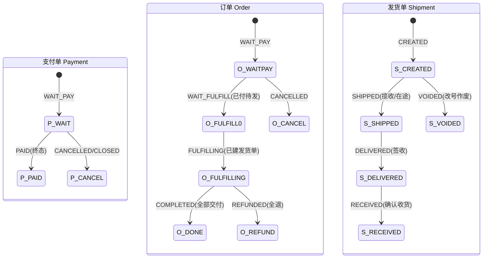

# 订单服务 · 核心逻辑与方法实现（基于三层模型）

> 2026-10-12。承 [领域模型草案](./2026-10-12-订单领域模型-草案.md)。按上一轮默认倾向（①②③是·⑤发货单级·⑥不支持行内分批）展开。⚠️ 草案。

---

## 0. 命名映射（贯穿全文，务必先看）

物理表语义与新领域名**错位**，为避免大迁移，**物理表名不改**，代码引入领域名层：

| 领域对象 | 物理表（不改名） | 说明 |
|---|---|---|
| **支付单 Payment** | `ord_order`（现"主单"） | 名字像"订单"实为支付聚合；加注释，不改表名 |
| **订单 Order** | `ord_sub_order`（现"子单"） | **门店粒度**（一店一单，ADR-031，维持现状）；对外"订单号" |
| **订单行 OrderItem** | `ord_item` | 加 `supply_store_no`、`shipment_no`、`shipped_qty` |
| **发货单 Shipment** | 🆕 `ord_shipment` | 交易域新表，统一快递/自提/自送的一次交付 |
| **运单 Waybill** | `lgs_waybill`（`biz_ref`→发货单号） | 物流域，仅快递 |

> 表名不改是权衡：改名牵动所有 mapper/SQL/迁移，风险极高。领域名只活在 Service/DTO 层。

---

## 1. 三层状态与联动



**联动规则（唯一处：`OrderStatusProjector` + `OrderTransitions`）**：
| 触发 | 联动 |
|---|---|
| Payment → PAID | 其下所有 Order：实物→`WAIT_FULFILL`，服务类→`FULFILLING` |
| Order 建首个 Shipment | Order → `FULFILLING` |
| Shipment → RECEIVED（或自动确认） | 若该订单**所有行已交付且无在途发货单** → Order → `COMPLETED` |
| 订单所有行退款终局 | Order → `REFUNDED` |

**订单对外展示态（派生，不落库）** = `f(order.status, shipments 聚合, 物流信号)`：
待付款 / 待发货 / **部分发货**（有发货单但有行未发）/ 已发货（全发在途）/ 已签收待确认 / 已完成 / 已退款。

---

## 2. 创建订单 `createOrder`

```
OrderService.createFor(userNo, CreateOrderCommand cmd, idemKey) → UnifiedOrderVO
```
**输入** `CreateOrderCommand`：`items[]{skuNo,qty}`、`fulfillment`、收货(addressId|pickupNo|appointmentAt)、`couponNo`、`usePoints`、`payMode`、`remark`。

**步骤**：
1. **幂等**：`idemKey` 命中 → 返回原支付单视图。
2. 校验商品在架/可售/限购；解析每个 SKU 的**供货门店** `supplyStoreNo`（落店解析）。
3. **按门店(supplyStoreNo)分组**（ADR-031：一店一单；同商家多店 = 多笔订单一次付；无门店时退回按商家）。
4. 建 **Payment**(`ord_order`，`WAIT_PAY`/`WAIT_OFFLINE_PAY`)：payNo、userNo、payDeadlineAt。
5. 每门店建 **Order**(`ord_sub_order`，`WAIT_PAY`)：orderNo（对外号，不含 payNo 结构）、payNo、entityNo、storeNo。
6. 建 **OrderItem**(`ord_item`)：每 SKU 一行，记 `supplyStoreNo`、`shipped_qty=0`、`shipment_no=null`。
7. **锁库存**（`StockPort.lock`，守卫 `available-qty>=0`）。
8. 算金额/券/积分**在 Order 级**；Payment.payAmount = Σ Order。
9. **不建发货单**（发货时才建）。
10. 发 `ORDER_CREATED`（每 Order 一条）。

**写**：`ord_order`(payment) + `ord_sub_order`(order) + `ord_item`。
**状态**：Payment `WAIT_PAY`、Order `WAIT_PAY`。
**输出**：`UnifiedOrderVO`（含待付 orders + 合计），收银台用 payNo。
**边界**：全程经 `OrderTransitions.applyXxx` 落初态；拆分唯一实现 `split(cmd)` 改**按 entityNo**。

---

## 3. 支付 `pay` / `markPaid`

```
OrderService.pay(payNo, channel) → PayResult{payParams, settled}
OrderService.markPaid(payNo, channel, tradeNo) → void   // 回调
```
**pay 步骤**：校验 Payment 为待付；落支付流水；向网关下单取唤起参数；FREE 通道就地 `markPaid`。**无 @Transactional**（落流水独立）。

**markPaid 步骤**（`@Transactional`）：
1. **幂等**：Payment 已 `PAID` 直接返回（回调会重发）。
2. 状态机 `assertOrderTransit(WAIT_PAY→PAID)`；Payment → `PAID`（**终态**）。
3. `StockPort.confirm`（锁定转实扣）。
4. 遍历其下 Order：`OrderTransitions.applySub`：实物→`WAIT_FULFILL`，服务类(`STORE_VERIFY/APPOINTMENT`)→`FULFILLING`。
5. 出核销码（所有 Order，`verify_code` 唯一键兜底）。
6. 积分入账/赠送；分账预备；发 `ORDER_PAID`、`SUB_ORDER_PAID`；服务类即 `notifyShipping`。

**写**：`ord_order.status/paid_at/pay_trade_no`、`ord_sub_order.status/verify_code`、库存、积分。
**事件**：`ORDER_PAID`（聚合）、`SUB_ORDER_PAID`（每 Order）。

---

## 4. 查询 `queryOrder`（三端）

| 场景 | 方法 | 粒度 | 返回 |
|---|---|---|---|
| 买家列表 | `BuyerOrderFacade.list(query,page)` | **订单**（一行一订单=一门店） | `PageData<OrderListItemVO>`；批量 `signedAtOf` 填物流信号；不列支付单 |
| 买家详情 | `BuyerOrderFacade.detail(orderNo)` | 订单 | `UnifiedOrderVO`：订单行 + `shipments[]`(每个含运单/轨迹) + 售后卡 |
| 商家列表/详情 | `MerchantOrderFacade.list/detail(orderNo)` | 订单(=自己那笔) | `MerchantOrderVO`；按 entityNo+门店过滤；查不到别家=NOT_FOUND |
| 运营 | `OpsOrderFacade.list/detail` | 订单 + payNo(parent) | `OpsOrderVO` 双层可见 |

**关键**：买家列表从"支付单聚合"回到"**订单粒度**"——因为订单本就是独立业务对象（淘宝式）。支付单仅在"合并付款"那一刻出现。
**状态**：三端订单状态统一 = `OrderStatusProjector` 派生（含部分发货聚合）。
**展示态**：详情头优先物流轨迹步骤，否则派生态。

---

## 5. 发货 / 物流 `ship` + `trace`（核心改动）

```
MerchantOrderFacade.ship(orderNo, ShipCommand) → MerchantOrderVO
ShipCommand{ itemNos[], carrier, waybillNo }   // 勾选本次发哪些行
```
**ship 步骤**（`@Transactional`）：
1. 校验订单属该商家、状态 ∈ `{WAIT_FULFILL, FULFILLING}`。
2. **运单号容错**（B4）：`normalize`（trim/全角/去前缀）→ 按 carrier 格式校验(`WAYBILL_FORMAT`) → 活跃运单重号校验(`WAYBILL_DUPLICATE`，消息带冲突订单)。
3. 校验 `itemNos` 都属本订单且**未发货**(`shipment_no is null`)；为空默认"剩余全部行"。
4. 建 **Shipment**(`ord_shipment`，`CREATED`)：shipmentNo、orderNo、shipStoreNo、fulfillment=EXPRESS、carrier、waybillNo。
5. 选中行 `ord_item.shipment_no = shipmentNo`。
6. 首次发货 → Order `WAIT_FULFILL→FULFILLING`（经写入门）。
7. 发 `SHIPMENT_CREATED`（→物流域 `ShipmentRegistrar` 按 shipmentNo 登记运单、订阅）。
8. `notifyShipping`（微信上报）。

**部分发货**：剩余 `shipment_no is null` 的行可再次 `ship` 建第二个发货单。
**全部发货判定**：`所有行 shipment_no 非空` → 展示"已发货"，否则"部分发货"。
**自提/自送**：`ship` 的变体——到货登记/标记送达也建 Shipment（无运单），统一发货单层。

**trace**：`BuyerOrderFacade.trace(orderNo, shipmentId)` → 按发货单查 `lgs_waybill`(biz_ref=shipmentNo) 轨迹。一个订单多个发货单 → 详情里每个发货单一条物流入口。

**写**：🆕`ord_shipment`、`ord_item.shipment_no`、`ord_sub_order.status`、`lgs_waybill`(biz_ref=shipmentNo)。
**改号**：作废旧 Shipment(`VOIDED`,`superseded_by`)+建新（Q3）；旧运单节点留旧发货单。

---

## 6. 收货 `confirmReceipt`（部分收货 → 完成）

```
BuyerOrderFacade.confirmReceipt(orderNo, shipmentId) → UnifiedOrderVO
```
**步骤**：
1. 解析 shipmentId → Shipment，校验属该订单该买家、状态 `DELIVERED`（或允许在途提前确认）。
2. Shipment → `RECEIVED`（经写入门）。
3. **订单完成判定**：该订单**所有行都已交付**（每行所属 Shipment ∈ `{RECEIVED}` 或自提已核销）**且无在途发货单** → Order `FULFILLING→COMPLETED`，触发 `settleOnReceipt`（结算放款 + 若有 WAIT_RECEIPT 售后则退款）+ 评价入口。
4. 否则订单保持 `FULFILLING`（部分收货）。

**自动确认**：`OrderAutoReceiptJob` 对每个 Shipment 独立计时（签收 N 天/发货 M 天）；排除自提；有处理中售后跳过。
**核销**（自提）：`PickupService.verify` → Shipment `RECEIVED`，同样触发订单完成判定。

**写**：`ord_shipment.status`、（完成时）`ord_sub_order.status`。
**事件**：`SHIPMENT_RECEIVED`、（完成）`SUB_ORDER_COMPLETED`。

---

## 7. 退款 / 售后 `refund`（行级）

```
BuyerOrderFacade.applyAfterSale(orderNo, AfterSaleCommand) → AfterSaleVO
AfterSaleCommand{ itemNo, qty, type(REFUND_ONLY|RETURN_REFUND), reason, images }
```
**申请步骤**：
1. 校验行属本订单、`qty ≤ 可退数量(已付 - 已退)`。
2. 算 `FulfillStage`（按该行所属发货单的运单状态）+ 生鲜闸（`AfterSaleRules`）。
3. 建 AfterSale(`ord_after_sale`，行级：itemNo+qty)；进度快照 fulfill_stage；needImage/reasons 后端强制（C6）。
4. 发 `AFTER_SALE_APPLIED`。

**退款执行 `doRefund`**（商家同意/系统/裁决触发）：
1. 核定金额（按行、按 qty，部分退闸 stage=RECEIVED 才允许改额）。
2. CASH：`SettlePort.reverseSplit`（回退分账）→ `PayPort.refund(payNo, amount)`（**原路退到支付流水**）→ AfterSale `REFUNDED`。
3. POINTS：`PointsPort.compensate`（判空，C4）→ 不回冲分账（I4 排除，C3）。
4. 退货退款：`RETURN_REFUND` 且已发 → `WAIT_RECEIPT`/`REFUNDING`，收到退货后退款 + 回补库存。
5. **整单退完才退券/退积分**（判据：订单所有行都退完）；行级部分退不退券。

**状态联动**：
- 行退款不改订单状态；**订单所有行退完** → Order `REFUNDED`。
- 退款金额退到 **Payment 的支付流水**（Payment 本身保持 `PAID`，不设 REFUNDED——退款是行/订单维度）。

**写**：`ord_after_sale`、分账回退、支付退款流水、库存回补、积分/券。

---

## 8. 取消 / 关单 `cancel`

```
BuyerOrderFacade.cancel(orderNo, reason)        // 买家，仅未付款
OrderService.closeExpired(now)                   // 定时，WAIT_PAY 超时
```
- 仅 `WAIT_PAY`/`WAIT_OFFLINE_PAY`。Order→`CANCELLED`；若支付单下所有 Order 都取消 → Payment→`CANCELLED`/`CLOSED`。
- 对外投影：Payment `CLOSED`→`CANCELLED`（Q6）。
- 已付款取消 = 走售后退款（§7），不走 cancel。
- 释放库存/名额（条件 UPDATE 打标记再减，防还两次）。

---

## 9. 幂等与并发汇总

| 动作 | 幂等键 |
|---|---|
| 创建 | `Idempotency-Key` |
| 支付回调 | Payment `PAID` 终态 |
| 发货 | Shipment 唯一(orderNo+waybillNo 活跃) + 行 `shipment_no` 已占 |
| 收货 | Shipment `RECEIVED` 终态 |
| 退款 | AfterSale `REFUNDED` 终态 |
| 关单/取消 | 状态 `CANCELLED` + 释放标记 |

全部状态写入经 `OrderTransitions`（唯一门，ArchUnit 守卫）。

---

## 10. 与现状迁移（方法视角）

| # | 现状方法 | 目标 | 批 |
|---|---|---|---|
| R1 | `split` 按门店 | 按 entityNo | B-model |
| R2 | `ship` 改子单 express_no（1 次） | 建 `ord_shipment`（多次/部分发货） | B-model |
| R3 | 售后挂子单 | 挂订单行 + qty | B-model |
| R4 | 金额/积分在子单 | 在订单(=现子单，粒度合并) | B-model |
| R5 | 跨门店/跨商家主单 | 多订单一次付（与现状一致，无存量拆迁） | B-model |
| — | `payView`/`orderView` 两视角 | `OrderStatusProjector`+`UnifiedOrderVO` | B2 |
| — | 5 处裸 setStatus | `OrderTransitions` | B3 |

> **发货单层(`ord_shipment`)是这版的最大新增**，牵动 ship/trace/收货/售后四条链。建议作为独立批次 **B-model**，排在资金安全(B1)/契约(B2)/写入门(B3) 之后——那三批不依赖模型重构、可先落地止血。

---

## 11. 待确认（承上一轮）

①②③④⑤⑥ + 本文新引出的：
- **发货单对自提/自送**是否也建（统一发货单层）还是只快递建？（我倾向统一建，模型一致）
- **Payment 不设 REFUNDED**、退款只在订单/行维度——确认？
- 物理表**不改名**、仅领域层命名——确认？（改名风险极高）
