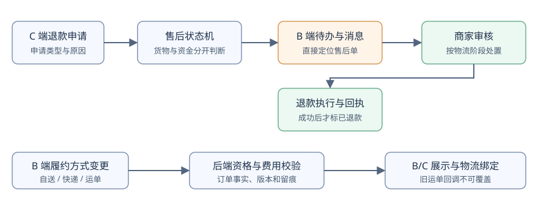

# B 端订单退款、履约与消息优化方案

> 状态：实施中，尚未部署与人工验收｜2026-10-15｜优先级：退款待办与资金安全先于页面美化｜上游：[B 端功能清单](../requirements/B端功能清单.md)、[售后规则](TDD-售后规则-审核与部分退款.md)、[订单一期主流程](TDD-订单一期主流程与基础退款.md)

## 一、一句话

把 B 端订单页变成按风险和待办排序的工作台：商家先看见并处理退款，再处理收款、备货和交付；售后、物流与配送方式由同一笔订单的事实驱动，商家确认后才按货物所处阶段执行退款。

## 二、现状、目标与取舍

### §0 需求和验收条件

| AC | 场景和结果 | 落点 |
|---|---|---|
| AC1 | 有待审核退款时，具备 `biz:aftersale` 权限的人员在工作台、订单列表首屏、订单详情均能看到明显入口、准确待办数和相应订单；无权限者不显示金额与操作 | 待办聚合接口、B 端三处入口 |
| AC2 | 订单默认按“需要我处理”排序；售后待审优先于发货，全部订单仍可按时间查看；翻页不漏单、不重复 | 服务端待办查询与稳定排序 |
| AC3 | C 端申请后，B 端查看申请类型、原因、金额、履约/物流实况并确认或驳回；确认结果同步到 C 端；退款到账以支付回执为准 | 售后详情、状态机、通知 |
| AC4 | 已备货、已出单、在途、签收、退回各阶段的资金和货物处理有明确规则，退款申请期间不会继续发货或误入结算 | 售后守卫、物流处置记录、结算守卫 |
| AC5 | 消息按“待处理 / 进度 / 全部”展示，点击售后消息进入对应售后单；已读与已处理分离，处理后待办数更新 | 消息关联业务资源、B 端消息页 |
| AC6 | B 端订单详情不再展示“叫快递上门”；快递单只显示录入快递公司/运单，自送单只显示自送动作，其他履约单只显示本类型可执行动作 | 订单详情能力接口与界面 |
| AC7 | 未交运且满足条件时可在自送与快递之间切换；发货前可选快递公司，发货后可更正公司/运单；变更同步到 B/C 端及物流订阅，留操作记录 | 履约变更命令、运单更正、物流绑定 |

### 当前代码核对

- `b-app/src/pages/orders/index.vue` 默认“全部”，售后筛选靠售后单号集合再与**前 50 笔订单**前端相交；较早的待审退款可能不出现。订单卡片没有独立的退款待办标识。
- `b-app/src/pages/after-sale/index.vue` 默认“待处理”，但一次拉全部售后，并仅取前 50 笔订单补充展示；`/biz/after-sale` 当前返回列表，不分页，也不能按门店精确过滤。
- `b-app/src/pages/order/index.vue` 的“叫快递上门 / 自己发货”是**快递订单内部的寄件采购方式**，不等于订单的 `fulfillment`。当前自送 `DELIVERY` 和快递 `EXPRESS` 是订单属性，界面没有相互切换命令。快递发货后的运单更正能力已存在。
- 现有 `AfterSaleServiceImpl`：支付后未备货且无运单的仅退款可自动进入退款执行；其余由商家处理。退货退款同意后等待寄回、确认收货再退款；仅退款在途同意后进入 `WAIT_RECEIPT`，商家另行确认才执行。`REFUNDING` 不代表资金已到账。
- 商家售后申请已有站内消息、微信订阅与短信尝试，但站内链接只到售后列表；消息页只有“全部 / 交易 / 系统”，没有按待处理状态归类。

### 为什么这么设计

订单状态与售后状态是两条状态轴。只按下单时间排，会把需要立即停止发货的退款埋在后面；只改前端排序，仍然会被“前 50 单”截断。因此服务端按待办事件分页，并把售后状态投影到订单卡片。物流“已出单”也不能等同“已揽收”：退款是否需要等待货物返回，必须依据可信的交运、签收与退回事实。配送类型的变更涉及买家承诺和运费，不能被一个快递公司下拉框替代。

## 三、结构与界面

这个结构的关键是售后、订单列表和消息读取同一笔售后及订单事实；消息只负责提醒，不充当退款状态的真源。

### 订单列表的信息层级

1. 默认进入“待办”，顶部固定“退款待处理 N”醒目入口；具备售后权限才出现。页签顺序：**待办、售后、待收款、待备货/发货、配送/待核销、全部、已完成**。窄屏允许横向滚动，保留当前门店范围。
2. 待办按服务端 `priority, dueAt, createdAt, subOrderNo` 稳定排序：**退款待审核/退回待验收/待确认退款** → 支付或履约异常 → 待收款 → 待备货与发货 → 待核销。每组内部按处理期限或等待时长升序；“全部”仍按创建时间倒序。签收/退款终态不进入待办。
3. 卡片第一行显示主订单号、主要状态及“退款待审核”等待办标签；第二行保留商品、金额和收件方式，第三行只在有行动时显示“查看退款/备货/发货”。订单详情顶部同样显示活动售后摘要，并在售后处理中禁用有冲突的履约动作。订单状态与物流状态分别有清晰名称，不能用物流阶段覆盖退款审核状态。
4. 点击退款标签直接打开**具体售后单**，其详情显示申请类型、原因/凭证、申请额、可退额、履约阶段、物流最近节点、运费/优惠影响、买家与商家动作、操作时间线。“同意退款”按钮旁明确标注“立即发起原路退款”或“先等待退回/签收”。

### 消息展示

- “待处理”只包含当前仍需本人/本店动作的消息；“进度”展示退款执行、退回物流、审核结果；“全部”保留历史。红点为未读，待办数字为**服务端仍未处理的业务单数**，两者不可互相替代。
- 售后消息显示“退款申请｜订单号｜申请时间｜当前状态”，带“查看并处理”；通知链接携 `afterSaleNo`、`storeNo`，进入页面先校验门店权限并定位售后详情。旧消息无业务编号时回退到列表。
- 商家审核、确认收货、发起退款、退款成功/失败、履约方式变更各生成明确进度文本；同一事件按事件号去重。微信与短信沿用现有通道配置和失败记录，不能把“已尝试”写成“已送达”。页面返回时重新读取待办数和业务状态。

## 四、详细规则与契约

### 4.1 退款、物流和货物处置

| 申请时货物阶段 | 审核后动作 | 资金放行条件 | B/C 端展示 |
|---|---|---|---|
| 已支付、未备货且无运单 | 沿用现有自动仅退款；撤销待发货任务 | 支付渠道退款回执确认后才标“已退款” | “退款处理中/已退款”，B 端无待审核 |
| 已备货、未出单 | 商家审核，停止发货并记录备货处置 | 商家同意后触发原路退款；生鲜/库存按实际处置，不自动盲目回库 | “待商家确认”→“退款处理中” |
| 已出单、未揽收 | 商家审核，停用旧运单/撤销可撤寄件预约并核对货仍在店 | 确认未交运后退款；交运事实不明则转人工核实，不按“未揽收”盲退 | “撤销发货中/待核实” |
| 已揽收、在途 | 审核后尝试拦截；不支持自动拦截则记录人工联系快递 | **拦截成功且退回商家**、或买家签收后按售后类型核实；仅“拦截申请已受理”不能放款 | “拦截中/待退回/待确认退款” |
| 已签收 | 仅退款按核定范围处理；退货退款等待买家寄回并验收 | 仅退款经商家确认可执行；退货退款以实物验收为门槛 | “待寄回/退货中/已收到退货/退款中” |
| 拒收、逆向退回 | 继续跟踪退回单号与签收凭证，商家确认收货 | 商家验收后执行退款；是否回库单独记录 | “退回途中/商家已收货” |

- 当前代码在“在途仅退款”审核后是 `WAIT_RECEIPT`，且 `confirm-refund` 允许商家主动确认；目标方案为其增加**签收/退回事实或明确例外理由**守卫。纯补偿型仅退款无需退货的例外，须由具备售后权限者注明理由和风险，不与退货退款混淆。
- 退货退款同意只进入 `WAIT_RETURN`，买家回寄后进入 `RETURNING`，商家确认实收才进入 `REFUNDING`。退回物流和正向物流分别记录，不能共用一个运单状态。仓库回库只能在验收通过后执行，损坏商品不能自动加回可售库存。
- 售后活动期间，备货、发货、确认自送、履约切换和运单更正均由后端基于售后状态守卫；驳回后是否恢复履约由当前订单及物流事实决定。退款执行失败保留售后单、记录失败原因并提供有权限的重试/运营介入，不能把订单改成已退款。
- 退款申请、商家审核、物流拦截、资金回执均写时间线：操作人、时间、前后状态、物流来源/节点、退款请求号及失败原因。已签收的订单即使交易自动完成，售后仍按可申请窗口独立处理；订单交易状态和售后状态分别展示。
- 结算/提现以实际退款状态及分账回退结果为依据。`APPLIED/WAIT_RETURN/RETURNING/WAIT_RECEIPT/REFUNDING` 的争议金额不得被当作无争议可提现额；具体冻结口径需与当前结算模块对账后落地。

### 4.2 配送方式与快递公司变更

| 当前订单 | 可见操作 | 条件与处理 |
|---|---|---|
| `EXPRESS`，尚未交运 | “快递发货”：选快递公司、录运单；可点“改为商家自送” | 门店/商品支持自送、地址在配送范围、无活动售后、无有效取件预约或先撤销；服务端复核运费 |
| `DELIVERY`，尚未开始配送 | “商家自送”：开始/完成配送；可点“改为快递” | 门店/商品支持快递、收件地址完整、无活动售后；快递方式保存后再录公司与运单 |
| 已录运单但未揽收 | 显示运单及“更正快递公司/运单” | 走现有更正命令；如要改为自送，先确认旧运单与预约均撤销、货仍在店，再走受控切换 |
| 已揽收、已自送出发、已签收/完成 | 只允许在合理场景更正快递公司/运单，不允许直接改为另一配送类型 | 货物已移动；误操作走异常处置/售后，不能重写历史履约承诺 |
| 自提、邻里取货、到店服务等 | 只展示其自身交付/核销动作 | 首期不开放与快递/自送互切，避免改写买家选的取货点和服务地点 |

- **删除“叫快递上门”入口和默认 `PICKUP` 选择**，快递单直接展示“自行寄件并录入运单”。历史已预约单仍显示预约状态与取消入口，未取消/已取件前禁止切换；后端寄件预约接口先保留以兼容旧版本，待旧版本退场再决定下线。
- 快递公司/运单更正沿用 `mCorrectWaybill`，要求更正原因；旧物流订阅与回调绑定失效，新公司/运单重新做同步查询并订阅微信及快递 100。回调必须按当前有效运单版本匹配，旧运单后到消息不得改写新状态。B/C 页刷新读最新订单和轨迹，不依赖消息推送刷新。
- 自送↔快递是**履约类型变更**，新命令必须在子订单行锁内校验订单版本、支付及履约状态、门店/商品能力、地址覆盖、活动售后、取件预约与运单；记录原值、新值、原因、操作人，发订单变更事件给 C/B 展示与消息。前端展示服务端返回的可选项及不可选原因，不在端上自行猜规则。
- 首期只允许**买家应付金额和运费结算口径均不变**的类型切换，并在确认弹层写明新预计送达方式；费用差额、地址改变或买家需补款的场景禁用，提示联系买家重下单/运营处理。后续若要开放费用变更，另设计买家确认、差额补退、支付和结算对账，不能静默改价。

### 4.3 建议的接口与数据改动

| 改动 | 建议契约 | 防止的问题 |
|---|---|---|
| 订单待办 | 新增 `GET /biz/order/worklist`，服务端按当前门店、权限、`kind`、分页游标/页码返回 `subOrderNo, displayOrderNo, priority, dueAt, actionKind, activeAfterSale` 及总待办数 | 前 50 笔订单拼接导致漏售后；跨页排序漂移 |
| 售后待办与详情 | 新增分页售后工作列表和 `GET /biz/after-sale/{afterSaleNo}`；响应含主订单号、子订单号、门店、履约及双向物流摘要、可执行动作 | B 端必须靠另查前 50 单补信息；通知无法精确定位 |
| 业务动作 | 审核/确认退货/确认退款请求保留 `afterSaleNo`；补 `expectedVersion` 或等价条件更新，并返回最新售后与订单摘要 | 重复点击、旧页面审核和另一端更新相互覆盖 |
| 履约资格 | 新增 `GET /biz/order/{subOrderNo}/fulfillment-options`，由后端返回允许类型、禁用原因、金额影响 | 端上选项和实际订单能力不一致 |
| 履约变更 | 新增 `POST /biz/order/{subOrderNo}/fulfillment-change`，请求含 `targetFulfillment, reason, expectedVersion`；金额或交运校验失败给明确错误 | 直接改数据库字段导致物流/财务/展示脱节 |
| 物流处置 | 记录正向和退回物流、拦截尝试/结果、运单有效版本；拦截能力以实际承运商接口为准，失败回退人工核实 | 把“已提交拦截”误认成“货已退回” |
| 消息关联 | 消息增加 `sceneCode, bizType, bizNo, storeNo` 或等价只读投影；待处理状态实时取售后/订单，不存第二份“已处理”真值 | 已读消息仍待审核，或已处理消息仍显示可操作 |

实现时优先扩展现有售后、订单和消息接口，保持老 APK 的原接口/字段兼容；新接口与枚举、权限、i18n、数据库迁移需按仓库契约清单逐项登记。任何微信物流/快递 100 拦截能力在接入前核实官方接口与商户权限；没有能力时明确展示人工处置，不伪造成功状态。

### §2 可执行开发计划（2026-10-15）

以下每个任务是一笔可单独评审、定向验证的交付。接口名和文件路径为实施目标；编写代码前先核对仓库最新分支、迁移最大版本与已有同名能力。每批完成后更新本 TDD 的契约与测试对账，不把“计划完成”写成“功能已上线”。

**依赖顺序**：D0 → D1 → D2；D1 → D3；D2、D3 → D4；D2 → D5 → D6；D4、D6 → D7。D2 的资金守卫是发布退款入口的前置条件；D5 的履约变更可在退款链路稳定后独立发布。

| 任务 | 目标与边界 | 主要文件/契约 | 定向验证及完成标准 |
|---|---|---|---|
| **D0 基线对账** | 只读核对 `APPLIED/WAIT_RECEIPT/WAIT_RETURN/RETURNING/REFUNDING`、运单揽收、逆向物流、分账/可提现计算；确认当前门店数据范围、消息跳转参数和旧 APK 兼容要求；形成契约清单 | `AfterSaleServiceImpl`、`MerchantOrderServiceImpl`、`SettleSourcePortImpl`、物流端口、`BizAfterSaleController`；本 TDD §4.3 | 产出状态/资金/物流对账表和接口字段表；对未验证的承运商拦截能力标“人工处置”，不作为自动退款前提 |
| **D1 售后与订单待办查询** | 新增服务端售后分页详情和订单待办分页；一张子单只出一条最高优先级待办，排序固定 `priority,dueAt,createdAt,subOrderNo`；店员范围由服务端裁剪 | `AfterSaleService`/`AfterSaleServiceImpl`、`BizAfterSaleController`、`MerchantOrderService`/`MerchantOrderServiceImpl`、`BizOrderController`、新增独立待办查询 DTO/Mapper；B 端 `contract.ts`/`endpoints.ts`/`http.ts` | 在后端场景测试中覆盖第 51 笔之后的待审退款、跨店无权、同单多待办去重、分页边界；单接口返回准确待办总数，旧 `/biz/after-sale` 响应保持兼容 |
| **D2 退款资金与物流守卫** | 在售后申请、审核、确认退款、确认退货和发货/更正/自送动作的服务端统一检查活动售后；审核前再读**实时**运单阶段；未交运核实、在途待签收/退回、退货验收分别推进，退款成功仍以支付回执为准；核对并补齐争议金额结算冻结 | `AfterSaleServiceImpl`、`AfterSaleMachine`/`AfterSaleGuards`、`MerchantOrderServiceImpl`、`SettleSourcePortImpl`；必要时新增售后物流处置记录迁移，迁移号实施时分配 | 扩充 `BasicReturnRefundFlowTest`、`RefundShippedResourceFlowTest`、`SettlementRefundBasisFlowTest` 等相关场景；证明“拦截已申请”不能退款、退回确认才放款、回执失败不显示已退款、活动售后不能继续交运。**不运行并发测试** |
| **D3 B 端退款入口与列表** | 工作台、订单列表、订单详情显示退款待办数/标签和直达入口；列表默认待办，售后默认待处理，售后详情直接查服务端，不再拼接前 50 笔订单；按权限隐藏敏感操作，错误/空态分开 | `b-app/src/pages/home/index.vue`、`orders/index.vue`、`order/index.vue`、`after-sale/index.vue`、`b-app/src/api/{contract,endpoints,http}.ts`、相关三语词条 | B 端类型检查与列表/权限定向测试；人工核对“第 51 笔售后仍可见”“处理后返回列表数字更新”“无权限者看不到退款按钮”；不卡在旧版数据字段 |
| **D4 售后消息定位与状态** | 站内消息关联售后号和门店，点击精确定位；消息按“待处理/进度/全部”分组，未读与业务待办分别计算；审核和退款结果的微信/短信/站内消息文案指明真实阶段 | `NotificationConsumer`、`MessageServiceImpl`、`MessageVOs`、`BizMessageController`、`b-app/src/pages/messages/index.vue`、售后页深链处理、消息契约与词条 | `AfterSaleDecisionNotifyTest` 等场景覆盖同事件去重、跨店深链拒绝、旧消息回退列表、已读但未处理仍有待办；人工检查微信/短信失败日志独立留痕 |
| **D5 履约切换后端** | 先实现资格查询，再实现 `EXPRESS`↔`MERCHANT_DELIVERY` 受控命令；只允许未交运、无活动售后、门店/商品/地址可用、运费与应付金额不变；预约未撤销、已揽收、自送已出发均拒绝；留操作人和变更前后值 | `MerchantOrderService`/`MerchantOrderServiceImpl`、`BizOrderController`、订单履约策略/日志、`OrderShippingServiceImpl`、物流绑定端口；`GET fulfillment-options`、`POST fulfillment-change` | 新的 `FulfillmentChangeFlowTest` 覆盖允许和拒绝矩阵；确认不会重写已交运历史、不会改变金额/分账、无权限或旧版本请求失败。旧预约 API 保留兼容 |
| **D6 B/C 端履约和物流同步** | B 端移除新单“叫快递上门”及默认 PICKUP，历史预约只读/可取消；快递与自送按订单属性显示动作及可切换选项；运单更正沿用现有接口，切换/更正后重建有效物流绑定并刷新 B/C 展示 | `b-app/src/pages/order/index.vue`、`b-app/src/pages/orders/index.vue`、`c-app/src/pages/order/index.vue`、`c-app/src/pages/orders/index.vue`、两端 API 契约、物流订阅与当前运单读取路径 | 两端类型检查；`OrderShipmentLogisticsFlowTest`、`LogisticsRegistrationFlowTest` 等定向验证旧运单回调无法覆盖新绑定；人工核对旧预约单、快递新单、自送单及 C 端状态 |
| **D7 发布与回看** | 后端数据库迁移和接口先部署，旧 B APK 兼容核对后再构建/安装 B 端真机，最后发布 C 端体验版；人工进行真实支付退款、微信/快递 100 物流和通知验证 | 发布脚本按现有仓库流程；记录版本、迁移号、订单号/售后号、退款请求号、通知回执与回滚开关 | 观察待审积压、退款失败、重复通知、物流旧单回调、结算余额；失败时先关闭新入口并修复数据，保留旧接口与历史记录，不逆向修改已执行资金流水 |

**D0 必须作出的实施决定**：① 结算争议金额到底按售后申请额、商家核定额还是剩余可退额冻结；② 在途仅退款“无需等签收”的例外由谁授权、记录何种理由；③ 承运商是否支持自动拦截，若不支持统一走人工核实；④ 当前订单的自送/快递运费口径是否真的可无差额切换。若任一项未核实，对应分支不开放，其他已验证分支继续开发。

**契约先行**：D1 固定 `worklist` 的行键为 `subOrderNo`、售后动作键为 `afterSaleNo`；待办列表和详情只由服务端计算 `actionKind/allowedActions`，B 端不复制规则。D5 的切换请求使用 `targetFulfillment,reason,expectedVersion`；服务端返回最新订单和物流绑定版本，C/B 以最新详情重新渲染。新增 JSON 字段、枚举、i18n、迁移和权限前，按本仓库清单登记，不以临时前端常量替代契约。

**每批最小验证**：先补能证明业务边界的场景测试，再实现，再只跑相关测试类；端上只做受影响页面的类型检查和必要的页面用例。D2 额外跑退款与结算相关测试，D5/D6 额外跑发货与物流绑定测试。用户要求减少测试强度，故不做并发压测，也不在每次文案或布局修改后跑全量回归；真实微信支付/退款、物流和短信由人工在体验环境验证。

## 五、实施计划与定向验收

| 发布批次 | 对应任务 | 发布门槛 |
|---|---|---|
| R1：退款与待办 | D0 → D1 → D2 → D3 → D4 | 后端守卫已生效，B 端能找到并处理全部待审单，消息直达售后单；旧端仍可使用原接口 |
| R2：配送与运单 | D5 → D6 | 服务端先开放安全的变更条件，再发布 B/C 选项；交运后的历史状态和资金不被改写 |
| R3：人工联调 | D7 | 真机/小程序对订单、售后、物流和通知进行人工验证，保留版本与回执记录 |

### §5 验收用例（按用户要求，只做定向验证，不做并发或每次全量回归）

1. 已支付未备货申请仅退款，B 端无待审核，C 端显示退款处理中，支付回执后才显示已退款。
2. 已备货申请仅退款：工作台、订单列表与售后详情都出现待办；同意后未交运单发起退款，驳回后 C 端看到理由。
3. 已出单未揽收申请：旧单撤销失败或已揽收时不能按未发货路径退款；物流轨迹与处置原因可见。
4. 在途仅退款与退货退款分别走待核实/待收货；只提交拦截申请不退款，实物退回并确认后才执行；回执失败保持可追踪。
5. 售后对应订单排在第 50 笔之后、跨门店、无售后权限三种场景：不漏待办、不越权、不展示错误门店数据。
6. 消息点进具体售后单；已读但未处理仍计入待办；审核后待办消失、历史消息保留。
7. 快递新单不再出现叫快递上门；自送单只看到自送动作；自送↔快递在允许阶段成功，费用变化、活动售后、已交运和旧预约未取消时拒绝。
8. 更正快递公司/运单后，微信与快递 100 订阅绑定更新；旧运单回调不能覆盖新单；B/C 显示一致。

实现阶段每完成一块只运行相关后端测试/端上类型检查与少量人工真机操作；真实微信退款、物流和短信由人工测试，记录请求号、回执和页面截图。文档阶段只检查链接、术语与变更，不声称功能已经实现。

## 六、待决与取舍记录

- **已确认**：用户要求既可自送↔快递切换，也可更换快递公司；本方案按两种不同命令与风险等级处理。
- **待实现前确认**：自送↔快递是否需要买家主动确认。首期建议至少在 C 端通知并展示变更时间线；若改变承诺送达时间或费用，则先禁用、另行设计买家确认。
- **待核实**：承运商拦截/退回接口、微信订阅及快递 100 对该门店的权限、逆向运单获取方式；能力不存在时走人工核实。
- **已取舍**：保留历史叫快递上门预约数据与旧版 API 兼容，仅移除新单入口；这样避免旧 APK/已有预约失联。
- **已取舍**：待办由服务端排序和分页，不能在 B 端拿前 50 单自行交叉过滤；否则退款入口再醒目也会漏单。
- **待与结算模块核对**：争议资金冻结粒度、已分账订单退款时的回冲路径和实际可提现口径，未核对前不得宣称“审核通过即到账”。

## 七、2026-10-15 实施记录与发布前差距

- D0/D2：结算开放售后集合补入 `WAIT_RECEIPT`，避免在途同意退款后误当成无争议。已出单未揽收的仅退款审核先进入 `WAIT_RECEIPT`，商家须再次核实货物并填写提前退款理由；审核及确认前主动读取微信优先、快递 100 兜底的可用物流状态。订单有运单但物流绑定缺失或状态不可判时从严按已交运处理，不直接放款。签收后的待确认退款仍由商家确认，实际到账以支付回执为准。承运商取消取件/拦截与货物实收尚无自动凭证，理由是人工处置记录，不可理解为承运商成功回执。
- D1/D3：售后和订单待办改为服务端按门店分页，B 端订单默认待办；订单详情可直达活动售后。订单待办采用优先级、创建时间、子单号稳定排序，保留旧接口；纯配送员的新待办接口同样返回裁剪视图。仍需在真实门店核对跨店及历史第 51 笔售后。
- D4：站内售后消息带售后单号与门店，待处理从售后事实计算，已读与已处理分离；B 端消息分待处理、进度、全部。微信和短信继续沿用已有通道，成功触达由通道回执判断。
- D5/D6：新增配送资格查询和带版本的自送↔快递切换，限定已支付未交运、商品/门店/区域允许、无活动售后/有效运单/取件预约且运费相等。操作日志和买家站内/推送事件已接入；B 端新单不再提供叫快递上门，历史预约仍可取消。运单更正继续走原接口及微信、快递 100 双订阅链路；旧回调的当前运单身份保护由原有物流用例验证。
- 旧 APK 兼容口径：原有接口和返回字段保留；但旧版在未签收运单的 `confirm-refund` 请求里没有处置理由，新后端会以明确“升级商家端并填写货物处置说明”拒绝该高风险动作。签收后的正常确认仍可执行。发布时应尽快提供新版 APK 下载，后台先上线到新版可用之间的窗口由商家升级或运营人工协助，不能跳过资金守卫。
- 发布前还需：完成定向后端验证及 B/C 类型检查，校验迁移 `V422` 和测试库种子一致；按 D7 顺序部署、打包并安装 B 端真机、上传 C 端体验版。真实退款、物流、通知及收件人体验由人工测试，保留订单号、售后号与回执。没有自动拦截成功凭证时，商家必须人工核实，不能按自动拦截成功放款。
