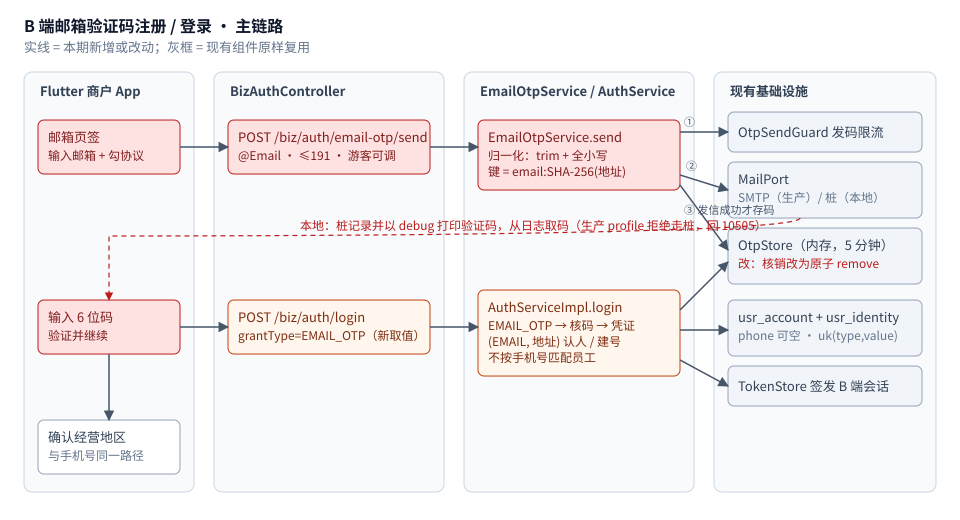

# TDD-B端邮箱验证码注册登录

状态：**已确认**（2026-11-05，L4 三条按建议确认）
关联需求：`ai-shop-bapp` · `docs/requirements/PRD-台湾一期注册开店Plan套餐商城与支付开通-V3.md` §3.1；
本仓 `docs/requirements/B端全链路-流程节点与开发状态-2026-11-04.md`（「邮箱验证码登录为商城后独立追加工作」）
关联决策：[ADR-051 B端账号允许邮箱作为独立登录身份](./ADR/ADR-051-B端账号允许邮箱作为独立登录身份.md)
档位：**2**（跨端：后端 + Flutter；新增端点与登录方式取值；改变「手机号是唯一权威标识」这一既定模型）
创建：2026-11-05 · 最后更新：2026-11-05

---

## L1 定位

台湾一期没有可用的国际短信通道，PRD 规定此时**以邮箱验证码注册／登录为实际入口**。
今天 App 的「邮箱」页签是占位（按钮全灰、写着「待接入」），后端没有任何邮箱认证端点 ——
商户在台湾**只能靠开发桩登录**，上线即断。本设计补上这条入口：
商户输入邮箱 → 收到 6 位码 → 首次即注册、之后即登录，后续进入与手机号完全相同的「确认经营地区」路径。

**这不是从零开始。** `codex/ai-shop-codex` 上的 `stash@{0}`（2026-11-03 切分支前保存，未提交）
已有一版实现与 11 条通过的测试（`EmailOtpService`、`EmailOtpAuthTest`、`SmtpMailPrivacyTest`）。
但那份 stash 把邮箱与「会话外置 / 账号市场 / 登出」三件事混在一起，后三件在统一线上已经用别的方式落地。
本方案**只移植其中的邮箱部分**，并补齐它缺的三块：本地可测、邮件正文语言、Flutter 端。

## L2 结构



图上最重要的是右侧灰框：**发码限流、邮件通道、验证码存储、身份表、会话签发全部是现有组件**，
本期只新增一个服务类和一个端点，再给登录加一个取值。红色虚线是本地验证路径 ——
它和生产路径在「桩」与「SMTP」处分叉，生产 profile 下桩直接拒绝，不会出现「假装发出去了」。

| 部分 | 现状 | 本期 |
|---|---|---|
| 发码端点 | 只有 `/biz/auth/otp/send {phone}` | 新增 `/biz/auth/email-otp/send {email, locale}` |
| 登录方式 | `PHONE_OTP` / `PASSWORD`（principal=手机号） | 新增 `EMAIL_OTP`；`PASSWORD` 的 principal 可为邮箱 |
| 身份模型 | `IdentityType` 无 EMAIL；注释写「手机号唯一权威标识」 | 加 `EMAIL`，进 `RESOLVE_ORDER`；注释改为 ADR-051 口径 |
| 账号表 | `usr_account.phone` 可空；`usr_identity uk(type,value)` | **不改表、不加迁移** |
| 验证码存储 | `OtpStore` 内存 5 分钟；核销先 get 再 remove（非原子） | 核销改为 `remove(key, entry)` 原子，同码并发只成功一次 |
| 邮件通道 | `MailPort`：SMTP / 桩，桩**不打印正文** | 桩对 `bizType=OTP` 以 debug 打印验证码（与短信桩同口径） |
| App | 邮箱页签占位 | 接通发码、倒计时、登录；错误按码分别提示 |

---

## §0 对账一 · 需求 → 设计

| AC | 需求（一句话，可断言） | 落点 |
|---|---|---|
| AC1 | Given 合法邮箱 When 发码 Then 该邮箱收到 6 位码，接口返回 `expiresInSeconds=300`、`resendAfterSeconds=60` | `BizAuthController#sendEmailOtp` → `EmailOtpService#send` → `MailPort.send(..., "OTP", null)` |
| AC2 | Given 60 秒内再次发码 Then 拒绝（10450）且**旧码仍有效**；超日上限 10451 | 复用 `OtpSendGuard.check(key)`，限流在生成新码之前 |
| AC3 | Given 首次邮箱 + 已勾协议 When `EMAIL_OTP` 登录 Then 新建 `usr_account`（phone 为空）与 `usr_identity(EMAIL, 归一化地址)`，返回 B 端会话；未勾协议拒绝 | `AuthServiceImpl#login` 新 `case GRANT_EMAIL_OTP`；凭证解析 `resolveCredentials` 加分支，认人 / 建号沿用 `resolveUserNo` |
| AC4 | Given 同一邮箱大小写/首尾空格不同 When 再登录 Then 认到同一账号，不新建 | `EmailOtpService.normalize`（trim + 全小写，不合并供应商别名） |
| AC5 | 邮箱码不能核销手机码，反之亦然；邮箱登录**不**按手机号匹配员工；**不**自动与同人手机号账号合并 | `OtpStore` 键前缀 `email:`；`BizAuthController#login` 员工分支仍只认 `PHONE_OTP`；ADR-051 |
| AC6 | 输错 → 10455；连错 5 次 → 10454 并作废当前码；过期 → 10455；同码并发两次只成功一次 | 复用 `OtpStore` 失败闸；核销改原子 |
| AC7 | Given 已设登录密码 When `PASSWORD` 登录且 principal 为邮箱 Then 按 EMAIL 身份找人；限流键与手机号分开 | `AuthServiceImpl#loginByPassword` 识别 `@` |
| AC8 | 日志、审计、异常消息中不出现完整邮箱与验证码（生产口径） | `LoginAuditor.maskPrincipal` 遮邮箱；SMTP 失败映射 10505 且不带供应商原文 |
| AC9 | Given 生产 profile 且 `shop.mail.stub=true` When 发码 Then 10505，不返回成功 | `EmailOtpService#send` 检查 profile（同 `FixedOtpGuard` 的口径） |
| AC10 | Given 本地 profile 且走桩 When 发码 Then 桩记录，debug 日志可见 `[mail-stub] otp to n***@domain = 123456` | `StubMailGateway` 覆写 5 参 `send`，仅 `bizType=OTP` 打印 |
| AC11 | 邮件正文语言跟随 App 当前界面语言（繁 / 简），缺省繁体 | 请求体 `locale`；`EmailOtpService` 两套正文模板（见 L4-D3） |
| AC12 | App：邮箱页签可发码、显示倒计时、输入后才可提交；成功后进入「确认经营地区」；10455/10454/10505/10450 各自提示 | Flutter `OnboardingApi#sendEmailOtp`、`login(grant: EMAIL_OTP)`、`StandardLoginPage` 邮箱卡片 |

**孤立项**
- 没落点的 AC：无。
- 挂不上 AC 的设计：`OtpStore` 核销改原子 —— 手机号同样受益，挂在 AC6；不单列。

**不做（Out of Scope）**
- 已有手机号账号**绑定 / 换绑邮箱**、邮箱找回密码、邮箱链接验证、HTML 邮件模板。
- C 端（小程序）邮箱登录。
- 账号合并（同一人先后用手机号与邮箱各注册一次 → 两个账号；见 ADR-051 后果）。
- 选择 / 采购邮件服务商：沿用现有 SMTP 配置（`shop.mail.*`，缺省 smtp.office365.com:587）。

---

## §1 现状与影响面

- **现有模块**
  - `shop-core/.../user/service/impl/AuthServiceImpl.java`：登录总入口，按 `IdentityType.RESOLVE_ORDER` 认人 / 建号。
  - `shop-app/.../portal/biz/BizAuthController.java`：B 端认证端点；登录后吊销 C 端凭证、签 B 端会话；员工分支只在 `PHONE_OTP`。
  - `shop-base/.../common/OtpStore.java`：内存验证码，5 分钟，失败闸 15 分钟 5 次。
  - `shop-base-auth/.../ratelimit/OtpSendGuard.java`：发码三道闸（间隔 / 日上限 / 发起人）。
  - `shop-notify/.../port/SmtpMailGateway.java`、`StubMailGateway.java`：`shop.mail.stub` 切换，缺省走桩。
- **可直接复用**：上面全部；`stash@{0}` 中的 `EmailOtpService`、`EmailOtpAuthTest`、`SmtpMailPrivacyTest`
  （`git show 'stash@{0}^3':<path>` 取未跟踪文件，`git diff 'stash@{0}^1' 'stash@{0}'` 取已跟踪改动）。
- **会被改到的已上线功能**
  - 手机号验证码登录：`OtpStore` 核销逻辑改原子（行为不变，只消除竞态）。
  - 密码登录：principal 增加邮箱分支；手机号分支行为不变。
  - 登录审计：`maskPrincipal` 增加邮箱遮盖。
- **明确不受影响**：C 端 `/mp/user/otp/send`、员工登录 `staff-login`、运营端第二因子（也走 MailPort，但不经 `EmailOtpService`）、
  账号经营市场（统一线由 `shop.merchant.default-market` + 「确认经营地区」页承担，**不移植** stash 里的 `/biz/auth/market` 与 `usr_account.market_code`）。

---

## §2 方案

### 契约变更

- **端点**
  - 新增 `POST /biz/auth/email-otp/send`，游客可调（`SecurityConfig` 与 `CommerceRoutePolicy` 两处放行）。
    请求 `{ "email": string(@Email, ≤191), "locale": "zh-Hant" | "zh-Hans" | null }`；
    响应 `{ "expiresInSeconds": 300, "resendAfterSeconds": 60 }`。
  - `POST /biz/auth/login`：`grantType` 新增取值 `EMAIL_OTP`（principal=邮箱，credential=6 位码）；
    `PASSWORD` 的 principal 允许为邮箱。请求体加 `@Valid`：`grantType`、`principal` 非空，邮箱形态时 `@Email ≤191`。
- **库表 / 迁移**：无。`usr_identity` 新增取值 `identity_type='EMAIL'`（列宽 32、值宽 191 均够）。
- **权限码**：无。
- **i18n**：后端无新增错误码（复用 10450/10451/10454/10455/10505）。邮件正文不进 `messages*.properties`（理由见 L4-D3）。
  Flutter：删除 `emailUnavailable`；新增 `emailOtpPrompt`、`errMailUnavailable`（繁 / 简两份 arb）。
- **配置项**：无新增。`shop.mail.stub`、`shop.mail.*` 沿用；生产 profile 下走桩发验证码即拒绝。

### 模块设计

| 动作 | 路径 | 说明 |
|---|---|---|
| 新增 | `backend/shop-core/src/main/java/ai/neargo/shop/user/service/EmailOtpService.java` | 移植 stash；改：桩判定按 profile（AC9/AC10）、正文按 locale（AC11） |
| 修改 | `backend/shop-core/src/main/java/ai/neargo/shop/user/IdentityType.java` | 加 `EMAIL`，进 `RESOLVE_ORDER`（排在 PHONE 之后）；类注释改为 ADR-051 口径 |
| 修改 | `backend/shop-core/src/main/java/ai/neargo/shop/user/service/AuthService.java` | `GRANT_EMAIL_OTP`、`sendEmailOtp(email, locale)` |
| 修改 | `backend/shop-core/src/main/java/ai/neargo/shop/user/service/impl/AuthServiceImpl.java` | `case GRANT_EMAIL_OTP`；密码登录邮箱分支与独立限流键；日志不带完整地址 |
| 修改 | `backend/shop-base/src/main/java/ai/neargo/shop/common/OtpStore.java` | `TTL` 公开；核销 `cache.remove(key, e)` 原子 |
| 修改 | `backend/shop-base-auth/src/main/java/ai/neargo/shop/auth/LoginAuditor.java` | `maskPrincipal` 遮邮箱 |
| 修改 | `backend/shop-notify/src/main/java/ai/neargo/shop/notify/port/StubMailGateway.java` | 覆写 5 参 `send`：`bizType=OTP` 时 debug 打印码（地址打码） |
| 修改 | `backend/shop-notify/src/main/java/ai/neargo/shop/notify/port/SmtpMailGateway.java` | 失败消息不含供应商原文（cause 保留），移植 stash |
| 修改 | `backend/shop-app/src/main/java/ai/neargo/shop/portal/biz/BizAuthController.java` | 新端点；`LoginReq` 校验 |
| 修改 | `backend/shop-app/src/main/java/ai/neargo/shop/config/SecurityConfig.java` | 放行新端点 |
| 修改 | `backend/commerce/commerce-spring-boot-starter/.../security/CommerceRoutePolicy.java` | 放行新端点（与 `/biz/auth/otp/send` 同组） |
| 新增 | `backend/shop-core/src/test/java/ai/neargo/shop/user/service/EmailOtpAuthTest.java` | 移植 stash 的 11 条中的 9 条 + 本期 AC9/AC11；**不移植** `taiwanRegistrationPersistsMarket…` 与 `businessRegistrationRequiresExplicitMarket…`（依赖不移植的账号市场字段）；拆分 `stubAndDeliveryFailures…`（见 §5 AC9） |
| 新增 | `backend/shop-app/src/test/java/ai/neargo/shop/portal/biz/BizAuthEmailLoginTest.java` | 控制器层：邮箱账号无手机号也能取到 profile；不走员工匹配 |
| 新增 | `backend/shop-notify/src/test/java/ai/neargo/shop/notify/port/StubMailGatewayTest.java` | AC10 |
| 新增 | `backend/shop-notify/src/test/java/ai/neargo/shop/notify/port/SmtpMailPrivacyTest.java` | 移植 stash |
| 修改 | `backend/shop-app/src/test/java/ai/neargo/shop/contract/ApiContractTest.java` | 新端点进游客端点清单 |
| 修改 | `backend/shop-core/src/test/java/ai/neargo/shop/user/ProfileAndPasswordTest.java` | 构造参数 |
| 修改 | `docs/api/`（B 端认证 OpenAPI，如统一线已有则改，无则从 stash 的 `merchant-app-auth.openapi.json` 取邮箱两段） | 契约真源 |
| 修改 | Flutter `apps/merchant_app/lib/features/standard_onboarding/onboarding_api.dart` | `sendEmailOtp(email, locale)`；`login` 支持 `EMAIL_OTP` |
| 修改 | Flutter `.../onboarding_controller.dart` | 登录方法带身份类型 |
| 修改 | Flutter `.../onboarding_forms.dart` | 邮箱卡片接通：发码、倒计时、提交启停、错误显示（与手机卡片共用状态机） |
| 修改 | Flutter `.../onboarding_widgets.dart` | 邮箱上下文下 10505 → `errMailUnavailable` |
| 修改 | Flutter `lib/l10n/merchant_zh.arb`、`merchant_zh_Hans.arb` + 生成物 | 见 i18n |
| 新增 | Flutter `test/onboarding_email_login_test.dart` | AC12 |

### 关键接口

```java
// EmailOtpService
public Delivery send(String email, @Nullable String locale);   // 10450/10451/10505
public String verify(String email, String code);               // 返回归一化地址；10455/10454
public static String normalize(String email);                  // trim + toLowerCase(ROOT)
public record Delivery(long expiresInSeconds, int resendAfterSeconds) {}

// AuthService
String GRANT_EMAIL_OTP = "EMAIL_OTP";
EmailOtpService.Delivery sendEmailOtp(String email, @Nullable String locale);
```

```dart
// OnboardingApi
Future<AppResult<EmailOtpDelivery>> sendEmailOtp(String email, {required String locale});
Future<AppResult<OnboardingLogin>> login(String principal, String credential,
    {required bool agreed, required LoginGrant grant}); // phoneOtp | emailOtp | password
```

---

## §3 选型

| 方案 | 优点 | 缺点 | 结论 |
|---|---|---|---|
| A 移植 stash 的邮箱部分，补本地可测 / 语言 / Flutter | 已有 11 条测试与隐私修正；不改表 | 需要从混合 stash 里挑文件，挑漏会编译失败 | ✅ 采用 |
| B 整体应用 stash | 一步到位 | 会把 `/biz/auth/market`、`usr_account.market_code`、`/biz/auth/session` 带进来，与统一线已落地的「默认市场 + 确认经营地区」冲突 | ❌ |
| C 从零重写 | 不受 stash 约束 | 白扔已验证的并发 / 隐私测试 | ❌ |
| 邮箱进 `usr_account.email` 列 | 查询直观 | 违反本模型「凭证一人多条，不平铺成列」（`IdentityType.PASSWORD` 注释）；要加迁移 | ❌ 用 `usr_identity` |
| 验证码按邮箱哈希做键 | 堆转储不直接暴露地址 | 多一次 SHA-256 | ✅ 沿用 stash |

不可逆部分（邮箱成为与手机号并列的独立身份、不自动合并）见 ADR-051。

## §4 风险

| 风险 | 影响 | 缓解 |
|---|---|---|
| 生产误开桩，发码「成功」但无人收到 | 台湾商户全部无法注册 | AC9：生产 profile + 桩 → 10505；`PlatformChannelCredentials` 健康页已显示 MAIL 是否走桩 |
| `profileOf(personal, null, phone=null)` 等下游假设手机号非空 | 邮箱账号登录后 500 | `EmailOtpAuthTest` 加一条端到端：邮箱首登 → 取 profile → 建店入口可达；`grep result.user().phone()` 逐处过 |
| 同一人手机号、邮箱各注册一次成两个账号 | 门店分散在两个账号 | ADR-051 明确接受；后续「我的 → 账号」做绑定（不在本期） |
| SMTP 被判垃圾邮件 / 送达慢 | 首登失败率高 | 纯文本、短正文；`resendAfterSeconds` 60；上线前做一次真实投递（Gmail / Outlook / Yahoo TW 各一）并记录 |
| 邮箱地址进日志 | 违反日志方案 §7 | AC8 测试断言日志无完整地址；桩打印也打码地址 |
| `OtpStore` 内存存储，多实例部署时发码与核码落到不同实例 | 验证码「总是不对」 | 现状同样适用于手机号；本期不改，记入 L4 |

---

## §5 对账三 · 实现 → 需求（测试）

实现后填写。stash 中已有、预计直接移植的测试先列出名字：

| AC | 测试方法 | 跑过 | 消融验证 |
|---|---|---|---|
| AC1 | `EmailOtpAuthTest#sendsThroughExistingMailAndReturnsRealExpiryAndResendMetadata`（stash） | | |
| AC2 | `EmailOtpAuthTest#resendIsRateLimitedBeforeCodeReplacement`（stash） | | |
| AC3 | `EmailOtpAuthTest#firstRegistrationRequiresAgreementAndExistingLoginDoesNot`（stash） · `BizAuthEmailLoginTest#emailOnlyAccountReachesProfileWithoutPhone`（新增，§4 第二条风险） | | |
| AC4 | `EmailOtpAuthTest#repeatedEmailLoginUsesSameRealAccountWithoutPhoneMerge`（stash） | | |
| AC5 | `EmailOtpAuthTest#emailCodeIsSingleUseAndCannotConsumePhoneCode`（stash） · `BizAuthEmailLoginTest#emailLoginNeverAttemptsPhoneStaffMatch`（新增） | | |
| AC6 | `EmailOtpAuthTest#expiredEmailCodeCannotAuthenticate` · `#repeatedWrongAttemptsInvalidateEmailCode` · `#sameCodeCanOnlyBeConsumedByOneConcurrentRequest`（stash） | | |
| AC7 | `EmailOtpAuthTest#passwordLoginResolvesEmailIdentity`（stash） | | |
| AC8 | `EmailOtpAuthTest#emailLoginAuditNeverContainsRawAddress` · `SmtpMailPrivacyTest#failureLogMessageDoesNotContainRecipientOrCode`（stash） | | |
| AC9 | `EmailOtpAuthTest#productionRefusesStubDelivery` · `#deliveryFailureNeverStoresValidOtp`（由 stash 的 `stubAndDeliveryFailuresNeverProduceSuccessfulDeliveryOrValidOtp` 拆分：stash 在任何环境都拒绝桩，与 AC10「本地可走桩」冲突，必须改） | | |
| AC10 | `StubMailGatewayTest#otpCodeIsLoggedAtDebugWithMaskedAddress` | | |
| AC11 | `EmailOtpAuthTest#bodyFollowsRequestedScript` | | |
| AC12 | `onboarding_email_login_test.dart`：发码→倒计时→空码不可提交→错码 10455 提示→正确码进入「确认经营地区」 | | |

另：模拟器 `pos_tablet@5580` 全链路一次 —— 本地走桩，从后端日志取码完成注册、退出、再登录；贴截图与日志行。

## §6 对账二 · 设计 → 实现

实现完填写（`git show --stat <提交>` 与 §2 模块设计逐行比）。

## §7 确认与完成

| 日期 | 事件 |
|---|---|
| 2026-11-05 | 草稿 |
| 2026-11-05 | 方案确认：D1 本期不互绑；D2 邮箱账号可设密码；D3 请求带 locale、繁 / 简两段正文、缺省繁体 |

---

## L4 边界：待决与取舍

**已决（2026-11-05 按建议确认）**

- **D1 邮箱与手机号是否可以互绑？** 已决：本期不做 ——首登用什么就是什么，两个入口各成一号（ADR-051）。
  若要做，至少需要「已登录状态下验证第二身份」与「冲突时不合并、提示改用原账号」两条规则，单开 TDD。
- **D2 邮箱账号能否设登录密码？** 已决：能 ——stash 已实现且有测试（AC7），改动只在密码登录的 principal 识别。
- **D3 邮件正文语言。** 后端 `messages*.properties` 只有 zh-CN / en / ar，没有繁体；App 也不发 `Accept-Language`。
  已决：请求体带 `locale`（App 当前界面语言），`EmailOtpService` 内置繁 / 简两段纯文本正文，缺省繁体；
  不为两句正文新增整套 `messages_zh_TW.properties`（会被 `BackendI18nParityTest` 要求补齐全部 319 条）。

**取舍记录**

- 不移植 stash 的账号市场字段与 `/biz/auth/market`：统一线已由默认市场 + 「确认经营地区」页承担（TDD-B端建店默认经营市场）。
- 不把 `OtpStore` 换成 Redis / 数据库：多实例问题对手机号同样存在，应单独决策；本期只修核销竞态。
- 验证码只存内存、不落库：本地验证从日志取码（AC10），不为测试方便把明文验证码写进数据库。
