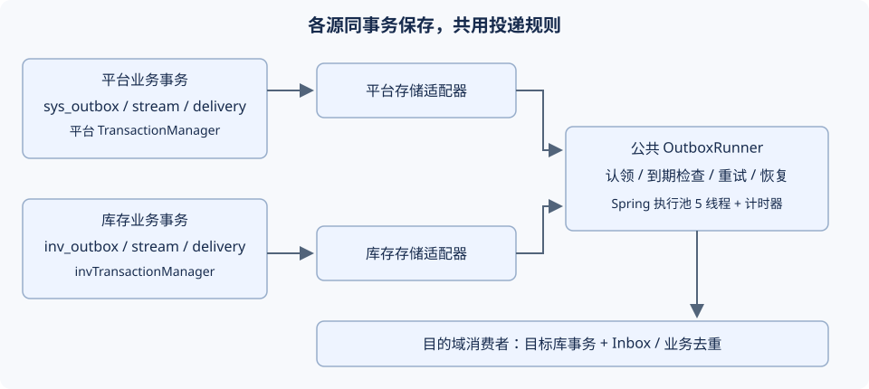

# TDD-Outbox统一投递与封装

状态：设计已确认；执行计划待评审；尚未实施。  
创建 / 更新：2026-10-19。  
依据：本次 Outbox review 与用户对统一封装、复用 Spring 能力的要求；现有《PRD-定时任务管理》§三、《运营端-开发计划》链路健康、《PRD-积分模块》AC-PTS-33。  
档位：2；正式实施需同步上述 PRD 的过时调度描述，并登记 ADR。用户于 2026-10-19 确认按建议执行；本次补充 §2.12 的书面执行计划，代码尚未修改。

## §0 对账一：需求到设计

### 定位

平台和库存各自同事务写本地 Outbox，共用发布协议、投递引擎、重试及诊断规则。Spring 提供事务、线程池和计时器；数据库保存事件与投递进度。支付域未来通过自己的存储与事务适配器接入，本期不新增支付业务事件链。

### 验收标准

| AC | 可观测结果 | 设计落点 |
|---|---|---|
| OB01 | 业务回滚时事件、顺序号和投递记录一起回滚；使用错误的数据源事务时拒绝发布 | Publisher、显式事务管理器与数据源资源检查 |
| OB02 | 提交后立即唤醒；回调丢失、运行期异常及重启后可由数据库恢复 | OutboxRunner、分页补扫、Spring 生命周期 |
| OB03 | 平台和库存采用相同到期检查、退避、失败上限及失败分类 | RetryPolicy、投递状态机 |
| OB04 | 库存转平台重复转发只创建一条目标事件；同源号异载荷必须报冲突 | 接收唯一键、payload_hash、独立平台事务 |
| OB05 | 同一消费者按业务流序号处理；不同消费者互不阻塞 | stream_sequence、delivery 表及头部认领 |
| OB06 | 成功消费者不因其他消费者失败而重复执行；目标库业务写入与消费去重同事务 | 稳定 handler_id、本地 Inbox / 既有业务去重 |
| OB07 | 没有消费者不记作 SENT；禁用、配置缺失、失败、结果未知均可区分 | 路由快照、错误码、FAILED 原因 |
| OB08 | 同一实例两套数据源合计最多 5 个业务处理任务，积压不一次性装入内存 | 共享执行池、有界队列、批量恢复 |
| OB09 | 可查询事件源、消费者、尝试次数、错误和下次重试；人工重放保留历史 | 诊断查询、重放服务、审计记录 |

孤立项：以上 AC 均有设计落点。现有 PRD 中“平台 Outbox 必须每 5 秒由业务作业投递”的表述与当前提交后投递实现不符，实施前同步为“即时投递 + 内部持久补扫”。

## §1 现状与影响面

| 现有位置 | 已有能力 | 本轮 review 发现 |
|---|---|---|
| shop-store-mybatis/event/OutboxEventBus | 写 sys_outbox、提交后通知泵 | 未强制同数据源事务；每次生成新 event_no，缺少接收去重入口 |
| OutboxDispatcher | PENDING/SENT/FAILED、10 次上限、指数退避 | dispatchOne 不检查 next_retry_at；单条/批量两份实现；无消费者也记 SENT；批量共用事务 |
| OutboxPump | 5 条处理线、即时投递、启动恢复 | 全量加载 PENDING、无界内存队列；异常后缺运行期恢复；失败重排不能保证同单顺序 |
| shop-inventory/.../InvOutboxDispatchJob | 独立库投递、无 sink 保留 | 不按 next_retry_at 筛选；8 次后留 PENDING 不再取出；与平台不同的退避与状态规则 |
| shop-app/.../PlatformInventoryEventSink | inv_outbox → sys_outbox | 源 eventNo 未用于接收去重；载荷被包为 JSON 字符串 |
| shop-store-mybatis/idem/EventIdempotency | sys_event_consumed 唯一事件号 + handler；REQUIRED 事务 | 可复用，但不能直接用于库存 / 支付库的业务事务；没有统一接管全部消费者 |
| shop-app/.../LinkHealthServiceImpl | 双向积压、重试与最近发送时间 | 尚未覆盖独立消费者失败；MAX(last_error) 不是最近失败记录 |

本次核对了上述源码、两库 baseline、V284 幂等表及相关接口。没有查询生产数据，也没有运行功能测试。

影响链路：订单支付/发货/退款通知、物流登记与订阅、商品库存镜像、库存过账回写、风控及营销事件。业务状态变更仍由各域服务负责；Outbox 记录“事实交付进度”，不能用 SENT 推断外部短信已经到达用户手机。

## §2 方案与实施细节

### 2.1 结构和职责



两份持久存储分别参与各自业务事务；公共引擎只通过适配器读写。源端 delivery 记录交付进度，目的域的 Inbox / 业务唯一键记录生效结果，两者之间允许重复交付，靠稳定事件号恢复。

| 层 | 位置及拟定组件 | 职责 |
|---|---|---|
| 公共契约 | shop-base，ai.neargo.shop.event.outbox | OutboxEnvelope、EventRoute、RetryPolicy、DeliveryResult；不引入 Mapper |
| 公共引擎 | shop-store-mybatis，同包下 runtime | OutboxRunner、OutboxPublisherSupport、OutboxConsumerInvoker；使用 Store 接口，不硬编码数据源/表名 |
| 平台适配 | shop-store-mybatis，同包下 platform | SysOutboxStore、PlatformOutboxPublisher、平台 Mapper 和事务适配 |
| 库存适配 | shop-inventory，inventory/event/outbox | InvOutboxStore、InventoryOutboxPublisher、库存 Mapper 和 invTransactionManager |
| 装配与桥接 | shop-app | 注册两个 source、共享执行池、InventoryToPlatform 接收适配、健康查询 |
| 兼容入口 | 现有 OutboxEventBus、OutboxConsumer、InventoryEventSink | 通过适配器接入新引擎，逐步迁移调用方 |

现有 shop-inventory 已依赖 shop-store-mybatis，因此第一期复用现有模块，无须新增 Maven 模块。引擎不依赖平台事件实体 SysOutbox；保留它作为旧消费者的兼容载体。

Spring 使用方式：显式 TransactionTemplate 绑定各自 PlatformTransactionManager；TransactionSynchronization.afterCommit 唤醒；ThreadPoolTaskExecutor 执行业务；ThreadPoolTaskScheduler 负责到点提示和持久补扫；SmartLifecycle 管理启动/停机。补扫注册在 Outbox 自身生命周期，避免依赖 worker profile、@EnableScheduling 或 shop.job.enabled。

### 2.2 事件协议与公共接口

拟定的协议字段：

| 字段 | 规则 |
|---|---|
| eventNo | 当前库的稳定事件号，重复接收返回已有事件号 |
| sourceSystem / sourceEventNo | 原始来源及事件号，跨库转发保持不变；本地产生时 sourceEventNo=eventNo |
| eventType / schemaVersion | 保留现有类型；旧载荷按 v1 解码，版本用于后续兼容 |
| aggregateType / aggregateId | 业务归属，沿用现有值 |
| streamKey / streamSequence | 顺序范围与该范围内的事务序号，不用 created_at 判断先后 |
| payload / payloadHash | 合法 JSON 及规范化内容指纹，转发时校验同源号异参 |
| occurredAt / createdAt | 业务事实时间与本库入站时间分别保存 |

接口草案，正式执行计划按此固定签名及所在文件：

```java
interface OutboxPublisher {
    PublishReceipt publish(DomainEvent event, PublishOptions options);
}
interface OutboxIngress {
    PublishReceipt accept(OutboxEnvelope sourceEvent);
}
interface OutboxStore {
    List<DeliveryRef> findDue(Instant now, int limit);
    Optional<ClaimedDelivery> tryClaim(DeliveryRef ref, String claimToken, Instant now);
    boolean complete(ClaimedDelivery claim, DeliveryResult result, Instant now);
    int recoverExpired(Instant now, int limit);
}
interface OutboxHandler {
    String handlerId();
    boolean supports(String eventType);
    DeliveryResult handle(OutboxEnvelope event);
}
```

publish 要求调用方已持有正确源库事务；accept 在目标库开启显式独立事务。PublishReceipt 返回 eventNo 与 created/reused 结果。tryClaim 和 complete 由 Store 自己绑定短事务，调用方不能把外部 HTTP 包进去。规范化指纹覆盖事件类型、schemaVersion、业务归属和载荷，排除本地 id、入站时间及本地顺序号。

### 2.3 存储设计

保留 sys_outbox / inv_outbox，追加字段：source_system、source_event_no、schema_version、payload_hash、stream_key、stream_sequence、routing_mode（DELIVERY / ARCHIVE_ONLY）。原有 event_no 唯一键保留；新增来源唯一键 (source_system, source_event_no) 与流序号唯一键 (stream_key, stream_sequence)。历史行先允许新增列为空，分批迁移后再收紧所需约束。

每个源库增加两类表，平台前缀 sys_、库存前缀 inv_：

| 表 | 核心字段和索引 | 用途 |
|---|---|---|
| *_outbox_stream | stream_key 主键、stream_type、business_ref、next_sequence | 发布事务内锁定一行分配序号，避免 auto_increment id 提前分配但晚提交导致乱序 |
| *_outbox_delivery | event_no、handler_id、stream_key、stream_sequence、status、attempt_count、replay_count、next_retry_at、claim_token、lease_until、first_attempt_at、last_attempt_at、completed_at、last_error_code、last_error | 一个事件给一个消费者的交付进度；唯一键 (event_no,handler_id)，索引 (status,next_retry_at,id)、(handler_id,stream_key,stream_sequence) |

delivery 是源端调度记录，目标端 Inbox 是去重记录，职责不同。平台目标端继续复用 sys_event_consumed；库存目标端优先复用已经存在的业务唯一键与去重台账，缺少覆盖的消费者补 inv_event_consumed。只连接库存出口的 sink 不需要在库存源库再写一份“业务消费成功”记录。

每个源库另有 *_outbox_operation，保存重放/跳过的 request_id、操作人、原因及状态前后快照；操作记录与该源状态变更同事务。运维跨源查询分别读取并汇总，不要求两库操作审计共享事务。

事件主表 status 是交付记录的汇总：所有目标 SENT 才 SENT；任一 FAILED 则 FAILED；其余为 PENDING。存在人工跳过则汇总为 SKIPPED；ARCHIVE_ONLY 记录为 ARCHIVED，不能算作交付成功。主表 retry_count 等旧字段作为过渡兼容投影，不参与新引擎调度。主表 SENT 不等于外部业务动作最终成功；外部动作结果由物流/通知等目的域记录。

迁移脚本分别放平台 db/migration 与库存 db/inventory；迁移版本执行时依据最新最大版本分配。冻结的 baseline 和 V284 不改。新字段/表使用与所在库业务键一致的字符排序规则，避免 join 时字符集冲突。

### 2.4 发布流程：业务与事件同事务

1. 入口检查事务资源是否绑定到源数据源；仅检查 isSynchronizationActive 不足以识别误用库存或支付事务。
2. 先完成业务状态更新，再按稳定顺序锁定要使用的 stream 行；多流发布按 stream_key 排序，避免相互倒序加锁。
3. 分配序号，序列化载荷，插入事件和目标 delivery 记录。以上写入与业务共用一个事务。
4. handler 目标清单由路由注册表在发布时确定并持久化；配置改变后不自动扩大历史事件的目标集合。
5. 提交后只发送一个轻量唤醒信号。入队失败只记录限频日志，由持久补扫恢复；不能向调用者返回“业务失败”诱发重复提交。

无消费者时先持久化事件为 FAILED，原因 NO_CONSUMER，不伪造 SENT。明确只用于留档的事件必须在路由注册表显式声明 ARCHIVE_ONLY，不产生 delivery，并保存路由决策。正常依赖消费者在启动时检查；动态禁用与配置缺失分别给出 DISABLED / NOT_CONFIGURED 原因。

### 2.5 消费流程、顺序和隔离

1. 内存唤醒、延迟唤醒和分页补扫统一进入 OutboxRunner，只查询到期或租约到期的数据。
2. 认领单位是一条 delivery。仅当同 handler、同 stream 更小序号的交付全部成功或经审计跳过，才能认领当前行。
3. 使用带状态、到期时间及未过期占用检查的条件更新认领；更新 1 行后获得 claim_token。更新 0 行即放弃，不先执行消费者。
4. 认领短事务提交后，在执行池调用目标 handler；每个目标域在自己的事务中记录 Inbox 和本地业务写入。
5. 成功后源库以 id + claim_token + PROCESSING 条件写 SENT，并更新事件汇总；条件不匹配则旧执行者不能覆盖新进度。
6. 失败后仅该 handler 的 delivery 退避或 FAILED，其他 handler 继续。这样短信通道失败不会阻断物流登记、库存镜像和订单事件处理。

顺序粒度是 (sourceSystem, streamKey, handlerId)，不是全系统全局顺序。订单生命周期通知映射到 ORDER:主订单号；子单事件中已有 orderNo 的直接取值。缺少根订单号的事件须在发布边界补充显式路由信息，禁止用任意 JSON 字段猜测或仅按相同字符串拼在一起。物流以 WAYBILL:运单业务号分流，商品投影以 SKU:skuNo，库存过账以 DOCUMENT:docNo；库存 ownerId 不能作为所有单据的全局串行键。

跨数据源的事件不承诺共享一条序号链；跨库时序由源事实号、版本及目标域状态机检查处理。FAILED 阻塞该 handler 的后续同流事件，必须修复并重放或由有权限操作员带原因跳过。跳过会破坏“全部事实已交付”条件，诊断必须显示，不能自动把失败当作成功。

### 2.6 事务和幂等边界

| 场景 | 事务边界 | 去重依据 |
|---|---|---|
| 源业务 → 本地 Outbox | 原业务事务 | 业务防重 + 事件稳定号 |
| 源 delivery → 平台本地消费者 | 每次消费者独立平台事务 | sys_event_consumed 的 event_no + 稳定 handler_id |
| 源 delivery → 库存写入 | 显式 invTransactionManager 事务 | 库存 Inbox / 现有业务唯一键，与库存写入同事务 |
| 库存 → 平台接收 | 平台接收独立事务；库存确认另一个短事务 | 平台来源唯一键 + 指纹 |
| 短信、微信、快递 API | HTTP 在源调度事务之外 | 目的域动作号、渠道幂等键、结果查询及业务状态 |

现有 EventIdempotency.once 不能在无目标事务时单独落成功标记，再调用另一事务的业务。统一 invoker 必须先开启目标库事务，再在事务内执行去重和业务。业务异常必须传到该事务外触发回滚；调度器在回滚完成后另开源库事务记录失败。消除目前批量大事务内捕获异常、继续处理的做法。

外部调用无法靠本地 Inbox 达到 exactly-once。网络超时后渠道可能已成功：支持幂等键的带稳定动作号重试，支持查询的先查再决定；两者都不支持时标 OUTCOME_UNKNOWN，停止自动重放并暴露给人工核查。通知内部已有多通道台账时保留逐通道结果，框架不能用一条粗粒度成功标记替代它。

### 2.7 重试、占用和恢复

delivery 状态统一为 PENDING → PROCESSING → SENT；可重试失败回 PENDING；不可重试/耗尽上限/结果未知进入 FAILED。人工审计跳过用 SKIPPED，并与 SENT 区分。

默认失败上限 10 次，退避 min(10秒 × 2^(本轮第n次失败−1), 30分钟)。第 10 次失败转 FAILED。attempt_count 保存总尝试次数；人工重放增加 replay_count，并开启新的本轮尝试预算，总历史不清零。重放仍针对原 event_no、原 handler_id，成功消费者的 Inbox 保留。

next_retry_at 是数据库事实：dispatchOne、补扫和延迟唤醒必须再次检查它。成功/终止时用显式 SQL 清空 next_retry_at、claim_token 和 lease_until，不能依赖 ORM 默认忽略 null 的更新策略。

建议初始配置：认领租约 120 秒，执行期间每 20 秒续租；内部补扫 5 秒，每页 100 条；HTTP 默认单次超时 10 秒，具体渠道按实际 SDK 校验。未开始执行的内存任务不提前占租约。租约过期后依据 handler 的恢复策略决定重试或 OUTCOME_UNKNOWN。

claim_token 能防旧执行者回写调度状态，不能撤销已发出的 HTTP，也不能阻止失去租约的旧线程继续执行业务。数据库业务依赖事务唯一键；外部操作依赖渠道去重/查询。租约失效时停止发起后续动作，不能仅凭 token 宣称所有外部操作严格有序。

Spring 线程池每实例共 5 个业务线程，两个源共享；队列上限建议 500，满时拒绝内存提示并保留数据库待处理状态。补扫分页并在数据源之间轮转，避免单库积压占满名额；没有 backlog 时只做有限索引查询。计时器不执行 HTTP。持久补扫补回提示丢失与调度异常，延迟唤醒降低正常重试延迟；二者均调用同一认领逻辑。

### 2.8 库存桥接

InvOutboxDispatchJob 的发出目标改为稳定 handler inventory-to-platform。保留 InventoryEventSink 适配入口，由桥接组件调用 OutboxIngress.accept。

平台接收按 (sourceSystem,sourceEventNo) 插入并提交；撞唯一键时在可用事务边界查询已存在记录，指纹一致返回 reused，指纹不一致返回 SOURCE_EVENT_CONFLICT 并告警。仅处理该来源唯一键冲突，不把任意 DuplicateKeyException 当成功。库存随后确认 delivery；如果中间崩溃，重试只拿回原平台事件。

过渡期保留旧 INV_* 类型及旧载荷读取能力。新事件采用 schemaVersion=2 的 JSON 对象，payload 不再套一层字符串；InventoryWritebackConsumer 按版本读取，旧行不批量重写。规范化载荷的变更应在接收前固定；同一源事件所有重试使用相同指纹规则。

### 2.9 日志、查询和保留

结构化日志字段：sourceSystem、sourceEventNo、eventNo、eventType、streamKey、sequence、handlerId、attempt、replay、result、errorCode、nextRetryAt、durationMs。第一次失败和最终失败记录堆栈，中间限频单行；payload、收件人手机号和 access_token 不入日志。

健康查询复用 LinkHealthService，扩展统计：due、processing、retrying、failed、unknown、blocked、oldest_due_age、last_success_at。最近错误按 last_attempt_at 排序取真实对应行，不用 MAX(last_error)。旧 API 字段保持可读，新增字段契约执行时同步前端类型；本轮没有新增页面。

人工重放服务以 source + eventNo + handlerId 定位，只允许 FAILED，已有 PROCESSING 不抢占；重复请求幂等。记录操作人、原因、前后状态、时间和原错误。新建对外重放端点前核对现有物流重放入口及运营权限，执行计划再固定端点与权限码。

第一期不自动删除成功事件或消费去重记录。后续归档须保证“允许最晚重放时间”短于 Inbox 保存期限，且载荷敏感数据策略与物流现有仅带业务引用的规则一致。

### 2.10 代码迁移顺序和交付拆分

| 顺序 | 交付 | 主要路径 | 可检查的结果 |
|---|---|---|---|
| P0 | 固定契约和清点消费者 | 本 TDD；现有 PRD；ADR；所有 implements OutboxConsumer 的类 | 列齐稳定 handlerId、目标事务、顺序键、外部动作和现有去重方式；不遗漏条件装配消费者 |
| P1 | 公共协议与存储扩展 | shop-base/event/outbox；两库新增 Flyway；对应实体和 Mapper | 新旧模式均能读取事件，旧迁移 checksum 不变 |
| P2 | 平台源统一发布和交付 | OutboxEventBus、OutboxDispatcher、EventIdempotency；新增 platform 适配 | publish 同事务、逐消费者进度、稳定去重、失败单独落库 |
| P3 | 公共运行器和恢复 | OutboxPump、OutboxRunner、Spring 装配配置 | 共享 5 线程、有界队列、到期认领、补扫、续租和停机恢复 |
| P4 | 库存适配及桥接 | InvOutboxDispatchJob、StockPostingServiceImpl、InventoryEventSink、PlatformInventoryEventSink | 与平台共用 RetryPolicy；重复转发只创建一条平台事件 |
| P5 | 消费者分批接入 | message、logistics、invbridge、risk、marketing | 每批核实 handler 目标事务和副作用幂等；兼容 v1/v2 载荷 |
| P6 | 健康诊断及受控切换 | LinkHealthServiceImpl、现有 job handlers、application 配置 | 两库及逐消费者状态可追踪；旧投递入口不能绕开新认领 |

P2、P3 作为同一可切换平台版本交付，不能让新记录在没有运行器的环境中启用。P4、P5 按功能开关迁移，外部通知先复用既有通道台账，禁止同时跑新旧发送器。

### 2.11 上线、历史事件和回退

1. 先部署增量 DDL 和兼容读取版本，新字段暂可空；新引擎默认不接管。实施阶段使用隔离 worktree，避免混入当前工作区其他任务。
2. 按来源盘点 PENDING/FAILED、历史幂等覆盖和外部结果未知事件。仅靠老状态无法判断每个消费者是否已成功，不能自动清零后全量重放。
3. 切换某一 source 时，先暂停其旧投递并确认在途结束；业务发布与写入协议切换需所有该源发布实例一致，可使用短维护窗口排空写请求，避免新旧发布器混写顺序号。
4. 在暂停期间，按业务流为待处理旧行分配迁移序号，建立 delivery；已知成功消费者标成功并保留原 Inbox；未知结果先核查。旧 SENT 保持历史，不因新消费者上线自动补发。
5. 存量 ID 顺序只是迁移排序，不能还原过去真实提交顺序；无法确定的事件按目标状态机与动作结果核对后再放行。补齐旧事件缺失的根订单号，失败项单独隔离并记录原因。
6. 启用新发布和新 runner，先观察平台再切库存。旧 @Scheduled / 独立 job 两条入口关闭或统一代理新引擎，不能继续直接更新主表状态。
7. 回退方式为暂停 runner、继续兼容版本读取和修复后恢复；一旦启用 delivery，新数据不能退回未经适配的旧二进制。确需回滚应用，使用前向兼容版本，保留新增表、源键和消费者成功进度。

配置拟统一在 shop.outbox 下：enabled、concurrency=5、queue-capacity=500、recovery-interval=5s、batch-size=100、lease-duration=120s、heartbeat-interval=20s、retry.max-attempts=10、retry.initial-delay=10s、retry.max-delay=30m、sources.platform.mode / sources.inventory.mode（legacy 或 unified）。原 pump.enabled / legacy-scan.enabled 在迁移版兼容读取，并验证与新模式组合，拒绝双发送器装配。

### 2.12 书面执行计划

> For agentic workers: REQUIRED SUB-SKILL: 使用 superpowers:executing-plans 在本会话逐项执行；最终安排一次独立代码审查。执行过程中不在任务之间重复请求确认。

**Goal:** 用公共运行器统一平台与库存的可靠事件交付，落实 OB01–OB09。  
**Architecture:** Spring 管理事务和执行资源；两个源各自持久化事件、顺序和逐消费者进度；跨库接收使用源事件唯一键。  
**Tech Stack:** 项目父 BOM 所管理的 Java 21、Spring Boot、MyBatis-Plus、Flyway；复用现有数据库及测试设施。  
**Spec:** 本文件 §0–§4；执行顺序为任务 1 到任务 8。  
**Execution:** 建议本会话直接执行；每个任务记录提交与定向验证，最后统一审查。不部署或自动接管生产存量。

#### 全局约束与验证方式

- 源库正确事务、每实例共享 5 个执行线程、队列 500、补扫 5 秒/100 条、租约 120 秒/续租 20 秒、失败上限 10 次、退避 10 秒至 30 分钟，沿用前文参数。
- mode 的默认值为 legacy；unified 必须显式启用。扩展 DDL、运行器、消费者完成前禁止切换任何 source。
- 每个任务先写能复现缺口的最小测试，确认失败后实现并定向验证；不做并发压测、不跑全量场景集。数据库认领的交错操作用两个可控连接顺序推进，不依赖随机并发。
- 执行命令从 backend/ 运行，使用 JDK 21。公共命令模板为 `mvn -pl <模块> -am test -Dtest=<类名> -Dsurefire.failIfNoSpecifiedTests=false`；只选择本任务列出的类。最终执行 `mvn -pl shop-app -am -DskipTests package` 检查整条后端依赖链编译。
- 真数据库验证使用单独临时库及测试凭据，不能写生产库；若当前环境无可用实例，列为未完成验证，不能用 H2 通过替代。
- 新增平台迁移暂定 V425__outbox_delivery.sql、库存迁移暂定 V9__outbox_delivery.sql；写入前再次确认版本未被其他任务占用。变更须同步 schema-test.sql 与 inventory-h2 测试 schema。
- 日志不输出敏感载荷。所有 source 枚举、handler ID 和新 SQL 表名来自注册配置/固定适配器，不允许 API 参数直接拼接表名。

#### 审查重点

1. 发布事务分配了早序号但晚提交时，晚序号不能抢跑；多流加锁顺序一致。
2. 来源唯一键只去重同事件，其他唯一键冲突不可被当成成功；指纹含所有业务语义字段。
3. 执行者失去租约之后，不能继续发起外部动作，也不能覆盖新 claim 的结果。
4. 吞异常、把所有 NOT_FOUND 当已执行、以及返回 void 的外部流程，不能被框架错误记作成功。
5. 双引擎开关、历史部分成功、已重放事件与测试手动 drain 的兼容性，必须有明确分支。

#### 任务 1：契约、路由和消费清单

**Files:** 新增 shop-base 的 `src/main/java/ai/neargo/shop/event/outbox/` 下 OutboxEnvelope、PublishOptions、PublishReceipt、DeliveryRef、ClaimedDelivery、DeliveryResult、OutboxPublisher、OutboxIngress、OutboxStore、OutboxHandler、RetryPolicy；新增 `shop-base/src/test/java/ai/neargo/shop/event/outbox/OutboxRetryPolicyTest.java`。同步 PRD-定时任务管理 §三与本文件 AC；新增 ADR-039-Outbox统一投递与双库适配.md（编号实施时核对）。

**Produces:** §2.2 接口；`RetryPolicy.retryDelay(int roundAttempt): Duration`；显式失败分类 RETRYABLE / PERMANENT / OUTCOME_UNKNOWN。DeliveryResult 带错误码、摘要及动作引用，不能只有布尔值。ClaimedDelivery 包含 delivery ID、claimToken、source、event、handlerId、leaseUntil。

- [ ] RED：OutboxRetryPolicyTest 断言第1次失败10秒、第2次20秒、第9次1800秒、第10次不再调度，非法次数拒绝。
- [ ] 固定 envelope 版本和字段长度；拒绝空来源号、空 handler、超长业务键及非法 JSON；确定规范化 JSON 的对象键排序、数组保序与数值表示规则。
- [ ] 将下表固化为路由注册表，启动检查 handler ID 唯一、事务管理器存在、恢复策略已配置；不以代理类名自动生成 ID。
- [ ] GREEN：运行 shop-base 的 OutboxRetryPolicyTest；提交公共契约和文档对齐。

| 消费者 | 固定 handlerId | 执行事务 / 恢复类型 |
|---|---|---|
| NotificationConsumer | notification | EXTERNAL_WORKFLOW；沿用目的域逐渠道台账，不包住全部 HTTP 的长事务 |
| RiskOutboxConsumer | risk | LOCAL_TRANSACTION / transactionManager |
| FissionOutboxConsumer | fission-attribution | LOCAL_TRANSACTION / transactionManager |
| InventoryItemProjectionConsumer | inventory-item-projection | LOCAL_TRANSACTION / invTransactionManager |
| InventoryOnSaleConsumer | inventory-on-sale | LOCAL_TRANSACTION / invTransactionManager |
| InventoryInvModeConsumer | inventory-mode | LOCAL_TRANSACTION / invTransactionManager |
| InventorySkuRetiredConsumer | inventory-sku-retired | LOCAL_TRANSACTION / invTransactionManager |
| InventoryMirrorConsumer | inventory-mirror | LOCAL_TRANSACTION / invTransactionManager |
| InventoryWritebackConsumer | inventory-writeback | LOCAL_TRANSACTION / transactionManager；跨库查询只读 |
| ShipmentRegistrar | logistics-register | LOCAL_TRANSACTION / transactionManager |
| WxUploadedConsumer | logistics-wx-uploaded | LOCAL_TRANSACTION / transactionManager |
| SubscribeExecutor | logistics-subscribe | EXTERNAL_WORKFLOW；目的域订阅状态与动作结果核查 |
| WxBindExecutor | logistics-wx-bind | EXTERNAL_WORKFLOW；目的域绑定状态与动作结果核查 |
| WxConfirmOnSignedConsumer | wx-confirm-signed | EXTERNAL_WORKFLOW；确认提醒服务去重/结果核查 |
| PlatformInventoryEventSink | inventory-to-platform | INGRESS；目标平台独立事务，来源号去重 |

LOCAL_TRANSACTION 的 Inbox 与全部本地业务变更同目标事务；发现某消费者实际上写多个库时必须拆开动作，不能强行套用表中事务名。EXTERNAL_WORKFLOW 必须在适配器中检查已持久化动作结果，失败可见后才能向 Outbox 返回成功。

#### 任务 2：两库增量存储和原子认领

**Files:** 平台/库存 Flyway 新迁移；修改 SysOutbox、InvOutbox；新增 `shop-store-mybatis/.../event/outbox/platform/SysOutboxDelivery.java`、SysOutboxStream.java、SysOutboxDeliveryMapper.java、SysOutboxStreamMapper.java；新增 `shop-inventory/.../inventory/entity/InvOutboxDelivery.java`、InvOutboxStream.java 及 `inventory/mapper/InvOutboxDeliveryMapper.java`、InvOutboxStreamMapper.java；公共源码使用 BaseMapper 以匹配现有扫描。新增 `shop-app/src/test/java/ai/neargo/shop/scenario/OutboxStoreFlowTest.java`，更新两份 H2 schema。

**Produces:** `SysOutboxStore implements OutboxStore` 和 `InvOutboxStore implements OutboxStore`；按 source 分别绑定事务模板。插入事件及 delivery 的 append 方法由发布器持有的源适配器提供，不能暴露任意库名参数。

- [ ] RED：OutboxStoreFlowTest 覆盖未到期认领失败、单一 claim 成功、旧 token 不能完成、新 token 恢复、早 delivery 阻塞同 handler 晚 delivery、其他 handler 可推进。
- [ ] 增加 §2.3 字段；delivery 补 round_attempt_count 和 last_replayed_at，使总尝试数保留、人工重放后的预算可单独计数；主表补 occurred_at。lease/retry 清空使用显式 SQL。
- [ ] 以正确源事务锁 stream 分配序号；delivery 认领用条件更新及前序阻塞检查，前序判断包含 PENDING、PROCESSING、FAILED。SKIPPED 视为已审计放行但汇总不伪装 SENT。
- [ ] 目标来源唯一键插入冲突后，在回滚的事务之外读取旧行并比对指纹；其他冲突继续抛出。
- [ ] GREEN：运行 shop-app 的 OutboxStoreFlowTest，并在临时 MariaDB/MySQL 库执行迁移、回滚、认领及唯一键场景；提交 DDL、适配器和验证记录。

#### 任务 3：平台发布、事务隔离与逐消费者交付

**Files:** 新增 `shop-store-mybatis/.../event/outbox/runtime/OutboxPublisherSupport.java`、OutboxConsumerInvoker.java、OutboxRouteRegistry.java；新增 `.../platform/PlatformOutboxPublisher.java`、PlatformOutboxIngress.java；修改 OutboxEventBus、OutboxDispatcher、EventIdempotency；新增 `shop-app/.../config/OutboxConfiguration.java`；新增 `shop-app/src/test/java/ai/neargo/shop/scenario/OutboxPublisherTransactionTest.java`、OutboxConsumerTransactionTest.java；修改 IdempotencyTest 和 OutboxEventBusPumpTest 中 unified 分支的事务断言。

**Consumes:** 任务1的 envelope/handler 协议及任务2两个 Store。  
**Produces:** 平台 OutboxPublisher/OutboxIngress；`OutboxConsumerInvoker.invoke(ClaimedDelivery): DeliveryResult`；显式 LOCAL_TRANSACTION 和 EXTERNAL_WORKFLOW 两条执行路径；`OutboxRouteRegistry.resolve(DomainEvent): EventRoute`。

- [ ] RED：事务回滚后业务/事件/delivery/序号一起回滚；仅库存事务下平台发布拒绝；A成功B失败后只重试B；目标事务失败不留 Inbox。
- [ ] 统一发布并保存目标 handler 快照。无消费者持久化 NO_CONSUMER；归档类型显式登记，不隐式吞掉未知类型。
- [ ] LOCAL_TRANSACTION 的目标事务使用独立 TransactionTemplate 包住 Inbox 与 action；源端认领/确认在独立短事务，异常先退出目标事务再记录失败。
- [ ] legacy 模式保留已有入口行为；unified 模式禁止无事务 publish，单独后台接收使用 OutboxIngress，不能静默新开发布事务掩盖与业务分离的问题。
- [ ] GREEN：运行上述3组受影响测试；提交平台入口和消费执行器。

#### 任务 4：Spring运行器、限额与持久恢复

**Files:** 新增 `shop-store-mybatis/.../event/outbox/runtime/OutboxRunner.java`、OutboxProperties.java、OutboxLifecycle.java；修改 OutboxPump、OutboxDispatchJob、`shop-app/.../config/PlatformOutboxJobHandler.java`、OutboxConfiguration.java、application.yml 与 application-test.yml；新增 `shop-store-mybatis/src/test/java/ai/neargo/shop/event/outbox/OutboxRecoveryTest.java`、OutboxRunnerCapacityTest.java；修改 OutboxWiringTest 为可同时验证 legacy 和 unified 装配。

**Produces:** `OutboxRunner.signal(String source)`、`recoverDue()`、`stop()`；Spring 生命周期按指定 source 注册；两个 source 共用一个5线程执行池，计时器不执行业务。

- [ ] RED：故意丢弃内存提示后到期补扫恢复；队列拒绝后记录仍可发现；两个 source 合计不超过5个任务；关总 job 开关仍有内部恢复；过期旧回调不覆盖新 claim。
- [ ] 内存队列只存轻量引用；在执行名额可用后认领。补扫 source 轮转、分页、重复提示去重；异常限频，单次异常不终止后续补扫。
- [ ] 延迟唤醒与恢复统一调用认领，到期再次核查；租约续期失败停止后续动作，外部未知结果按 handler 策略隔离。
- [ ] 停机先停止接收信号和认领，再终止计时器与执行池；未完成记录留库待恢复。新旧模式冲突时启动失败，避免静默双投。
- [ ] GREEN：运行 OutboxRecoveryTest、OutboxRunnerCapacityTest 及受影响 OutboxPumpTest、OutboxWiringTest；提交运行器。

#### 任务 5：库存发布、跨库去重与兼容载荷

**Files:** 新增 `shop-inventory/.../inventory/event/outbox/InventoryOutboxPublisher.java`；修改 StockPostingServiceImpl、InvOutboxDispatchJob、InventoryEventSink、`shop-app/.../invbridge/PlatformInventoryEventSink.java`、InventoryWritebackConsumer.java、InventoryJobHandlers.java；新增 `shop-app/src/test/java/ai/neargo/shop/scenario/InventoryOutboxIngressTest.java`。

**Produces:** 库存 OutboxPublisher 绑定 invTransactionManager；inventory-to-platform 调用平台 OutboxIngress.accept；旧 sink 接口兼容；v1/v2 显式解码。

- [ ] RED：平台入库后模拟源确认失败，再次转发返回相同 eventNo 且只有一条平台事件；异参冲突；非来源唯一键错误不能当成功；v1/v2 均正确读取 docNo。
- [ ] 库存过账使用 JSON 序列化器，不再手拼 JSON；发布快照选择 inventory-to-platform 目标及 DOCUMENT:docNo 顺序键。
- [ ] 旧库存 job 在 unified 模式代理公共引擎或关闭，不直接扫描和更改主表；legacy 模式补齐真实到期筛选和失败终态，使用同一 RetryPolicy。
- [ ] GREEN：运行 InventoryOutboxIngressTest 及已有 StockSyncWritebackTest 中受影响的定向方法；提交库存接入。

#### 任务 6：消费者逐项接管与失败语义修复

**Files:** 修改任务1表中14个现有 OutboxConsumer；新增 `shop-app/.../config/OutboxHandlerConfiguration.java`（显式适配 bean 和条件装配）；按需增加库存 Inbox 实体/Mapper与同批新增迁移；新增 `shop-app/src/test/java/ai/neargo/shop/scenario/OutboxDeliveryOrderTest.java`、OutboxRoutingTest.java、OutboxHandlerFailureTest.java。

**Produces:** 稳定 handlerId、目标事务和恢复策略；显式 stream 解析器（trade 根订单、物流运单、商品SKU、库存单据）。

- [ ] RED：主单/子单通知同流有序；失败只阻塞该 handler；disabled / 未配置 / 未注册可区分；InventoryMirror 的普通数据库错误不得作为“已经处理”吞掉；裂变回填失败不得被判成功。
- [ ] 修复 InventoryMirrorConsumer.settled 捕获全部 RuntimeException 的路径，只接受业务定义的确切已处理结果；修复 FissionOutboxConsumer 吞掉全部业务异常的路径，可重试错误交回引擎。
- [ ] 外部流程逐项确认已有状态与渠道返回值。缺少可靠去重/查询的超时返回 OUTCOME_UNKNOWN；不能因适配旧 void 接口而直接返回成功。
- [ ] 平台本地消费者复用 EventIdempotency；跨库库存写入在库存事务内复用业务唯一键，无法完整覆盖的增设库存 Inbox。禁止在平台 Inbox 里提前标记库存成功。
- [ ] GREEN：运行上述3个类及任务3消费事务类；提交消费者接管及明确的行为变更说明。

#### 任务 7：诊断、受控重放与存量接管

**Files:** 修改 LinkHealthService、LinkHealthServiceImpl、OpsLinkHealthController；新增 `shop-app/.../invbridge/OutboxOperationsService.java`、`.../invbridge/impl/OutboxOperationsServiceImpl.java`；新增 `shop-store-mybatis/.../event/outbox/runtime/OutboxMigrationService.java`；新增 `shop-app/src/test/java/ai/neargo/shop/scenario/OutboxDiagnosticsTest.java`、OutboxMigrationTest.java。重放审计存储纳入新增平台迁移，不借用日志冒充持久审计。

**Produces:** 现有 GET /ops/inventory/link-health 的兼容扩展；内部运维方法 `replay(source,eventNo,handlerId,reason,requestId)`、`skip(source,eventNo,handlerId,reason,requestId)`；迁移入口 `inspect(source)`、`adopt(source,confirmedManifest)`。本期不增加未审定权限的外部写端点；只读诊断沿用 INVENTORY_STOCK_READ。

- [ ] RED：FAILED、UNKNOWN 和被早序号阻塞的后续记录能区分；最近错误不是按字符串大小取值；重放保留历史并去重 requestId；未知历史进度不能自动认定未处理。
- [ ] 新增 `sys_outbox_operation` / `inv_outbox_operation`：request_id唯一、source、event_no、handler_id、operation、actor、reason、before/after状态、created_at；操作记录与各自源状态更新同事务，运维读取时分别查询汇总。Mapper分别位于平台 event/outbox/platform 与 inventory/mapper，实体放对应平台包和 inventory/entity。
- [ ] inspect 只读输出计数、来源、条件装配和不确定项；adopt 要求源已暂停且无在途，按确认清单接管，分批可恢复；没有确认清单拒绝修改。
- [ ] GREEN：运行 OutboxDiagnosticsTest、OutboxMigrationTest；提交诊断及受控运维服务。生产清单核实与上线切换单独执行，不混入代码开发。

#### 任务 8：定向验收和全分支审查

**Files:** 本 TDD §5–§7、PRD对应状态；仅修复本次范围的重要问题，不混入共享工作区存量改动。

- [ ] 按 §5 跑一次本次新增定向类，检查全部结果；已逐任务通过的用例不反复重跑，除非修改触及对应路径。
- [ ] 做来源去重或到期检查的一次最小消融，确认对应测试变红，再恢复代码并确认通过；记录真实命令与输出。
- [ ] 执行后端依赖链编译与迁移资源检查，核对两库Mapper绑定、SQL方言、配置互斥和归档状态读兼容。
- [ ] 对整个实现安排一次独立审查，按审查重点检查租约、事务、历史接管和外部未知结果；修复重要问题后仅重跑受影响用例。
- [ ] 更新本 TDD §5 实际结果、§6 自有提交文件对账与偏差；保留未完成的真实数据库验证或上线工作，不提前标已交付。

## §3 选型与取舍

| 选择 | 结论与理由 |
|---|---|
| Spring 事务 + Executor + Scheduler + 统一持久协议 | 推荐；保留既有事件入口和双库边界，收敛重复逻辑 |
| Spring Modulith Event Publication Registry | 候选；同事务记录和逐监听器进度值得借鉴，但两库装配、存量表迁移、外部动作恢复仍需适配，本轮不引入依赖 |
| 单一共享 Outbox 表 | 不采用；独立库存/支付库业务无法与平台表共享本地事务 |
| 只抽 RetryPolicy、保留原两套 Dispatcher | 可作为止血补丁，不能交付 OB02/OB05/OB06 的完整目标 |
| 为每个消费者记录 delivery | 接受增加存储成本，换取独立重试与明确进度，避免通知失败阻断业务消费者 |

Spring Modulith 官方参考：https://docs.spring.io/spring-modulith/reference/events.html 。第三方库版本兼容性不作为本设计已验证结论；未来若决定采用，另做与项目父 BOM 的兼容评估。

## §4 风险与边界

| 风险 | 处理 |
|---|---|
| 外部通道成功但本地未确认 | 稳定动作号 / 查询；不能确认的标 OUTCOME_UNKNOWN，不盲目重发 |
| 历史事件已部分消费 | 先核实已有业务去重和台账，再建立 delivery；未知不按未执行处理 |
| 同一个订单通知失败造成积压 | 仅阻塞该 handler 的同流后续事件，其他业务消费者独立推进 |
| stream 行热点或反向锁序 | 业务流保持足够细，多流固定加锁顺序；不使用 ownerId 串行全部库存 |
| 新旧引擎同时运行 | 每源模式互斥，切换前排空在途，旧 job 统一代理或停用 |
| disabled 的消费者被当成成功 | 显式路由决策、启动依赖检查，诊断展示 disabled/unconfigured |

本方案不改变订单、退款、物流的业务状态机；消费者仍需拒绝非法状态倒退。投递保证为至少一次，外部最终效果由目的域幂等与核查实现。

## §5 对账三：验证设计

以下是实施后的定向验证清单，本轮未新增/运行测试。沿用用户减少测试强度的要求，不做压力测试或全量回归；认领与事务恢复用小范围、可控场景验证。

| AC | 拟定验证方法 | 当前状态 |
|---|---|---|
| OB01 | OutboxPublisherTransactionTest：业务回滚无事件、无 delivery；错误数据源事务被拒绝 | 待实施 |
| OB02 | OutboxRecoveryTest：丢弃提交提示、执行异常、启动恢复均重新发现到期记录 | 待实施 |
| OB03 | OutboxRetryPolicyTest：两适配器共用退避；未到期不执行；第10次转FAILED | 待实施 |
| OB04 | InventoryOutboxIngressTest：目标已提交而源确认失败后再转发，目标只有一条；异参报冲突 | 待实施 |
| OB05 | OutboxDeliveryOrderTest：早序号失败时同handler晚序号不执行，另一handler继续；主子单映射一致 | 待实施 |
| OB06 | OutboxConsumerTransactionTest：A成功B失败只重试B；目标事务回滚不留下成功Inbox | 待实施 |
| OB07 | OutboxRoutingTest：无消费者为NO_CONSUMER；归档策略、禁用、未配置分别有结果 | 待实施 |
| OB08 | OutboxRunnerCapacityTest：两个source共享5个执行名额，队列拒绝后数据库记录可恢复 | 待实施 |
| OB09 | OutboxDiagnosticsTest：最近错误对应真实记录；重放不清总尝试、跳过有审计 | 待实施 |

关键消融：移除来源唯一键接收逻辑、到期检查或同目标事务去重后，对应定向用例应失败。涉及数据库唯一键/事务/条件更新的核心场景需在与部署环境一致的数据库上定向执行，不能仅依据 H2 或 mock 推断通过。

## §6 对账二：设计到实现

本轮仅新增此设计草稿。生产代码、DDL、配置、部署均未修改；没有实现提交和测试结果可登记。后续按 P0–P6 的实际文件与提交逐项对账。

## §7 评审状态

用户于 2026-10-19 回复“按照建议执行”，书面设计已确认。§2.12 已补入文件清单、接口边界、实施步骤和定向验证方式，待用户审阅本次新增执行计划并选择执行方式；建议本会话直接执行。当前未开始代码实施。
