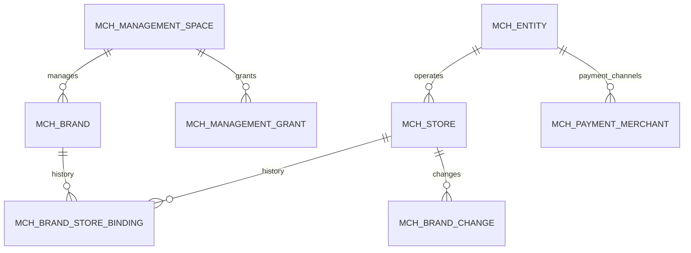
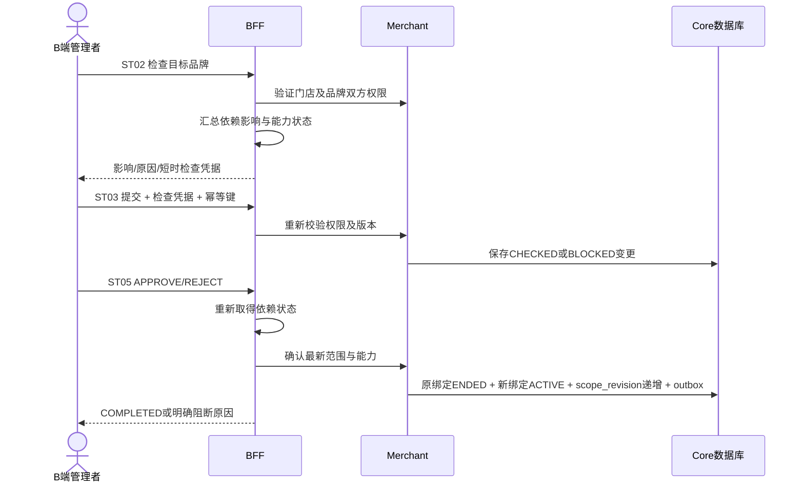

# 第一阶段经营组织与品牌管理详细设计

状态：设计待开发。适用范围：P1经营管理空间、品牌、门店品牌配置、主体及支付商户候选。设计日期：2026-10-21。

第一阶段把B端的顶层经营管理与当前门店经营分开，交付可以实际使用的品牌组织配置。复用现有经营主体、门店、成员身份和渠道进件，新增5张Merchant表及20项API。品牌关联只改变运营组织，不改变门店经营主体、收款商户、会员可见范围或储值资金归属。

相关文件：[阶段计划](../superpowers/plans/2026-10-21-brand-stored-value-organization.md)、[总体设计](TDD-品牌与门店双线储值-系统设计.md)、[总体API](TDD-品牌与门店双线储值-API清单.md)、[总体数据库](TDD-品牌与门店双线储值-数据库设计.md)、[P1接口清单JSON](design/schema/brand-stored-value-p1-contract.json)、[P1评审DDL](design/schema/brand-stored-value-p1-review.sql)。评审DDL不放入Flyway目录，不执行生产迁移。

## 1 业务边界与设计选择

| 能力 | 第一阶段交付 | 后续阶段 |
|---|---|---|
| 顶层经营管理 | 管理空间、资源授权；品牌、主体、支付商户、门店平级入口 | 财务岗位进一步接入发行、付款与收款确认 |
| 品牌 | 创建、编辑、启停、门店清单、变更审计 | 品牌会员及发行方 |
| 门店 | 查看组织上下文、加入/退出/切换品牌、影响检查及变更单 | 会员和Pay准入双向切换 |
| 经营主体 | 复用主体创建及资料流程；只列获授权主体 | 选作品牌发行方结算主体 |
| 支付商户 | 复用进件；按主体、通道、方式、适用店和授权筛选候选 | 实际充值渠道路由与冻结快照 |
| 储值/会员 | 保持已有单店行为，展示未开通状态 | P2共享会员、P3发行及旧账、P5品牌钱包 |

选择“新增品牌及显式授权，复用主体/门店/渠道商户”。单纯在门店加brand_no无法表达关联历史、范围版本与变更恢复；把品牌归到主体下无法支持跨主体连锁。也不引入通用集团组织树，避免扩大第一阶段范围。管理空间是授权组织，不是经营主体、结算账户或新增发行方。

## 2 领域关系与模块



一个门店当前最多关联一个品牌，也可不关联品牌；独立门店不创建默认品牌。一个品牌可含不同主体的门店。品牌与主体之间不建直接关系表。品牌归属一个管理空间；同一门店可由不同获授权管理人员操作，不能以“空间可见”推导其所有资金可见。

| 模块 | 本阶段职责 | 数据权威来源 |
|---|---|---|
| shop-base-auth | 验证MERCHANT登录态、认证身份与请求入口；复用现有认证链 | 已认证token；不接受body传actor/tenant |
| shop-merchant | 空间、品牌、授权、绑定、变更、支付商户筛选 | Merchant本地事务及5张新表 |
| shop-app BFF | 顶层/门店上下文聚合、影响检查适配、请求DTO | 服务端解析后的管理/门店范围 |
| shop-core | 原有主体及资料流程按现有边界复用；读取依赖影响摘要 | 现有业务服务/port |
| Pay | P1不新增发行或账务写入；只用已有受限只读能力提供影响依据 | 既有账户、原单与冻结事实 |
| b-app | 管理入口、品牌列表/详情/编辑、门店配置品牌底部弹框、授权页 | 本阶段20项API及已有主体/进件API |

## 3 复用表与新增表

### 3.1 已有表保持职责

| 现有表 | 使用字段/关系 | P1处理 |
|---|---|---|
| mch_entity | entity_no、状态、market、owner_user_no | 经营主体，原入驻/资质规则继续生效 |
| mch_store | store_no、entity_no、pay_merchant_no、status、version | 不新增brand_no副本，品牌关系从binding读取；变更锁定门店行并CAS递增version |
| mch_account | mch_account_no、user_no、is_owner、status、entity_no | 现有成员关系，支持USER/MCH两类认证主体；不替代品牌授权表 |
| mch_store_role / mch_role | 现有门店角色与能力 | 保持门店权限；不把角色扩大成跨主体权限 |
| mch_payment_merchant | entity_no、store_no、pay_merchant_no、pay_channel、apply_status、pay_methods | 主体与商户1:N；store_no空串代表主体级默认号，不能用IS NULL查 |
| sys_outbox | event_no、source_event_no、payload、状态与重试信息 | 事务事件与关键审计证据；不新建另一套outbox |
| sys_audit_log | op_action、target、before_json、after_json及操作者 | 通过现有平台审计适配，BR07返回受限品牌审计；不是原始日志下载 |

P1不改sv_account、sv_lot、pmt_activity、会员表，也不生成品牌余额。数据库落在Merchant所属Core数据源，Pay数据源无P1新增表。各域间无跨库外键；应用校验关系、唯一索引防并发。

### 3.2 公共字段与存储规范

5张新表均有下列字段，延续BaseEntity；认证身份字段按现有审计编码填充，不覆盖全局BaseEntity约定。

| 字段 | 类型 | 规则 |
|---|---|---|
| id | BIGINT AUTO_INCREMENT PK | 内部主键，不返回端上 |
| tenant_no | VARCHAR(32) NOT NULL | 从服务端可信上下文取得，当前MAIN也显式约束查询 |
| version | BIGINT NOT NULL DEFAULT 0 | 行级乐观锁，与scope_revision区分 |
| deleted | TINYINT NOT NULL DEFAULT 0 | P1始终0，无物理/逻辑删除入口，状态表示停用 |
| created_at / updated_at | DATETIME(3) NOT NULL | UTC存储，按端上时区显示 |
| created_by / updated_by | VARCHAR(64) NOT NULL | 服务端认证操作者，展示时查脱敏姓名 |

实体业务号调用已有BizKey并注册集中前缀；人工可见变更单调用现有DocumentNumberGenerator并注册业务类型，不另写UUID/时间戳拼号。具体编号配置跟随现有统一登记机制实施。外部引用预留VARCHAR(64)，不依赖编码长度。

MySQL实际版本、排序规则、CHECK是否执行在迁移演练核对。应用必须验证枚举、长度与有效期，不能只依赖CHECK。名称trim+Unicode NFC生成name_key，唯一性遵循目标库已确认的排序规则，前端提示不代替唯一键。

### mch_management_space

经营管理授权空间，不是资金账户或品牌与主体归属关系。

| 字段 | 数据类型与空值 | 业务含义 |
|---|---|---|
| `management_no` | `VARCHAR(64) NOT NULL` | 管理空间号 |
| `name` | `VARCHAR(64) NOT NULL` | 空间名称 |
| `owner_actor_no` | `VARCHAR(64) NOT NULL` | 有效所有人，变更需审计 |
| `status` | `VARCHAR(24) NOT NULL` | ACTIVE/SUSPENDED |
| `bootstrap_source_account_no` | `VARCHAR(64) NOT NULL` | 创建时验证的现有所有人账号关系，不授予其余主体权限 |
| `bootstrap_key` | `VARCHAR(64) NOT NULL` | 创建幂等键，同一所有人相同键返回原空间 |
| `bootstrap_hash` | `CHAR(64) NOT NULL` | 创建请求规范化摘要 |
| `auth_revision` | `BIGINT NOT NULL DEFAULT 0` | 空间授权版本，授予及撤销递增 |

唯一键：`(tenant_no,management_no)`；`(tenant_no,owner_actor_no,bootstrap_key)`。

查询索引：使用唯一键查询；不额外建立无用途索引。

### mch_management_grant

独立授予品牌、门店及主体管理权限。

| 字段 | 数据类型与空值 | 业务含义 |
|---|---|---|
| `grant_no` | `VARCHAR(64) NOT NULL` | 授权号 |
| `management_no` | `VARCHAR(64) NOT NULL` | 空间号 |
| `actor_no` | `VARCHAR(64) NOT NULL` | 现有认证主体标识 |
| `resource_type` | `VARCHAR(24) NOT NULL` | SPACE/BRAND/STORE/ENTITY/PAYMENT_MERCHANT，各自授权 |
| `resource_no` | `VARCHAR(64) NOT NULL` | 资源号 |
| `permission_code` | `VARCHAR(64) NOT NULL` | 能力码，复用权限注册机制 |
| `status` | `VARCHAR(24) NOT NULL` | ACTIVE/REVOKED |
| `valid_from` | `DATETIME(3) NOT NULL` | UTC生效 |
| `valid_to` | `DATETIME(3) NULL` | UTC失效 |
| `authority_source_type` | `VARCHAR(24) NOT NULL` | OWNER_ACCOUNT/PARENT_GRANT/SPACE_OWNER，实时复核授权来源 |
| `authority_source_no` | `VARCHAR(64) NOT NULL` | 原始账号关系号、父授权号或空间号 |
| `delegatable` | `TINYINT NOT NULL DEFAULT 0` | 可否继续委派本资源本能力 |
| `authority_snapshot` | `JSON NOT NULL` | 创建时来源摘要，仅审计不代替实时权限 |

唯一键：`(tenant_no,grant_no)`；`(tenant_no,management_no,actor_no,resource_type,resource_no,permission_code)`。

查询索引：`(tenant_no,actor_no,status)`；`(tenant_no,resource_type,resource_no,status)`。

### mch_brand

经营品牌，不直接归属经营主体。

| 字段 | 数据类型与空值 | 业务含义 |
|---|---|---|
| `brand_no` | `VARCHAR(64) NOT NULL` | 品牌号 |
| `management_no` | `VARCHAR(64) NOT NULL` | 所属经营授权空间，非经营主体 |
| `name` | `VARCHAR(100) NOT NULL` | 品牌名 |
| `logo` | `VARCHAR(512) NULL` | 标识资源 |
| `status` | `VARCHAR(24) NOT NULL` | DRAFT/ACTIVE/INACTIVE |
| `scope_revision` | `BIGINT NOT NULL` | 门店范围版本 |
| `name_key` | `VARCHAR(100) NOT NULL` | 名称trim及Unicode NFC规范化，唯一性按目标库排序规则 |
| `create_key` | `VARCHAR(64) NOT NULL` | 同空间创建幂等键 |
| `create_hash` | `CHAR(64) NOT NULL` | 创建请求规范化摘要 |

唯一键：`(tenant_no,brand_no)`；`(tenant_no,management_no,name_key)`；`(tenant_no,management_no,create_key)`。

查询索引：`(tenant_no,management_no,status,id)`。

### mch_brand_store_binding

门店品牌有效期关系；品牌与主体无直接关系表。

| 字段 | 数据类型与空值 | 业务含义 |
|---|---|---|
| `binding_no` | `VARCHAR(64) NOT NULL` | 绑定号 |
| `brand_no` | `VARCHAR(64) NOT NULL` | 品牌 |
| `store_no` | `VARCHAR(64) NOT NULL` | 门店 |
| `status` | `VARCHAR(24) NOT NULL` | PREPARING/ACTIVE/ENDED |
| `effective_from` | `DATETIME(3) NOT NULL` | UTC生效 |
| `effective_to` | `DATETIME(3) NULL` | UTC结束 |
| `scope_revision` | `BIGINT NOT NULL` | 品牌范围版本 |
| `change_no` | `VARCHAR(64) NOT NULL` | 关联变更单 |
| `active_store_no` | `VARCHAR(64) GENERATED ALWAYS AS (CASE WHEN status='ACTIVE' THEN store_no ELSE NULL END) STORED` | 当前绑定唯一辅助键 |

唯一键：`(tenant_no,binding_no)`；`(tenant_no,active_store_no)`。

查询索引：`(tenant_no,brand_no,status,store_no)`；`(tenant_no,store_no,effective_from)`。

### mch_brand_change

加入退出品牌及独立影响检查，不迁移资金。

| 字段 | 数据类型与空值 | 业务含义 |
|---|---|---|
| `change_no` | `VARCHAR(64) NOT NULL` | 变更号 |
| `management_no` | `VARCHAR(64) NOT NULL` | 管理上下文 |
| `store_no` | `VARCHAR(64) NOT NULL` | 门店 |
| `from_brand_no` | `VARCHAR(64) NULL` | 原品牌 |
| `to_brand_no` | `VARCHAR(64) NULL` | 目标品牌，NULL退出 |
| `expected_scope_revision` | `BIGINT NOT NULL` | 提交时范围版本 |
| `status` | `VARCHAR(24) NOT NULL` | DRAFT/CHECKED/BLOCKED/PREPARING/COMPLETED/REJECTED |
| `check_snapshot` | `JSON NOT NULL` | 会员、预占、原发行方、账单检查结果 |
| `authorization_snapshot` | `JSON NOT NULL` | 品牌与门店双方授权依据 |
| `reason` | `VARCHAR(255) NULL` | 原因 |
| `expected_store_version` | `BIGINT NOT NULL` | 提交时门店乐观锁版本，不改变门店经营主体 |
| `expected_from_brand_revision` | `BIGINT NULL` | 原品牌范围版本，首次加入可空 |
| `expected_to_brand_revision` | `BIGINT NULL` | 目标品牌范围版本，退出可空 |
| `command_key` | `VARCHAR(64) NOT NULL` | 同店提交幂等键 |
| `command_hash` | `CHAR(64) NOT NULL` | 规范化提交摘要 |
| `check_expires_at` | `DATETIME(3) NOT NULL` | 检查时效，到期或数据变化必须重新检查 |
| `submitted_by` | `VARCHAR(64) NOT NULL` | 发起认证身份 |
| `decision` | `VARCHAR(16) NULL` | APPROVE/REJECT；批准不等于已生效 |
| `decided_by` | `VARCHAR(64) NULL` | 决定认证身份 |
| `decided_at` | `DATETIME(3) NULL` | UTC决定时间 |
| `decision_key` | `VARCHAR(64) NULL` | 决定命令幂等键 |
| `decision_hash` | `CHAR(64) NULL` | 决定命令摘要 |
| `pending_store_no` | `VARCHAR(64) GENERATED ALWAYS AS (CASE WHEN status IN ('CHECKED','PREPARING') THEN store_no ELSE NULL END) STORED` | 同店最多一笔待决或执行中变更 |

唯一键：`(tenant_no,change_no)`；`(tenant_no,store_no,command_key)`；`(tenant_no,pending_store_no)`。

查询索引：`(tenant_no,store_no,status,id)`。


### 3.3 补充约束

- mch_management_grant同一空间/人/资源/能力只保留一行：撤销后再次授予更新原行并增加version，完整过程进审计。authority_source_no不可用已撤销或循环父授权；最大链深8，超过拒绝。
- authority_source_type=OWNER_ACCOUNT时，source_no为有效mch_account_no，检查当前is_owner、status及资源真实主体；SPACE_OWNER只可授权该空间自身及其品牌，不自动授权任意ENTITY/STORE/PAYMENT_MERCHANT。
- PARENT_GRANT只允许相同资源相同能力的子委派，父授权delegatable=true；每次请求追溯当前有效来源。父授权失效后子授权立即无效，不以authority_snapshot放行。
- active_store_no的唯一键保证同租户同门店最多一个ACTIVE品牌；NULL允许保留多条历史。deleted不参与唯一键，不能软删后绕过。
- pending_store_no保证同店最多一个CHECKED/PREPARING变更。BLOCKED为已结束的阻断结果；重新检查后使用新commandKey提交，不修改旧证据。
- expected_scope_revision表示当前门店有效binding版本（未关联为0）；from/to_brand_revision分别检查两个品牌整体范围。两者不是mch_store.version。
- 绑定不做定时生效：PREPARING不参与有效查询；COMPLETED时写实际effective_from，结束原绑定写effective_to。时间为半开区间[from,to)。
- mch_brand_change没有物理外键；from/to不能同时为空、不能相同。跨管理空间品牌迁移、所有人移交本阶段不提供写入口。

## 4 管理空间、身份与授权逻辑

### 4.1 两种上下文

顶层页面使用显式managementNo，完全不从X-Store-No推导品牌或财务范围。门店页面使用路径storeNo并与当前已验证门店一致；旧BizContextFilter对错误门店头可能回落默认店，新接口必须校验显式路径，不允许静默写入默认店。

认证主体支持现有USER及MCH登录。新表actor_no/owner_actor_no使用服务端生成的类型化标识USER:<userNo>或MCH:<mchAccountNo>，最长64字符；不能按手机号自动合并两种身份，不能信任客户端声明其绑定关系。审计created_by仍保持现有全局审计身份格式，业务授权快照额外记录actorKey和subjectKind。

### 4.2 初始化与资源进入空间

1. 已认证商家调用MG02；服务端验证其当前有效mch_account.is_owner=true。仅店长或店员不能自行成为经营管理空间所有人。
2. 同事务写空间与SPACE级必要管理授权，固定bootstrap来源及幂等摘要；相同键不同内容409，不生成第二空间。是否创建另一个空间由新的明确请求决定，不按手机号自动创建。
3. 空间所有人具有本空间的管理与品牌创建能力，不获得整个tenant或其他主体的权限。创建品牌时为创建者建立BRAND级必要授权，写品牌、授权与事件在同事务完成。
4. 不单独增加“资源导入表”。MG04授予资源能力即形成该资源在空间中的可见关系；必须先证明授予者对该资源具有有效原始所有权，或已有同能力且可委派的授权。资源号由后端反查存在性与tenant，不能仅凭客户端填号进入空间。
5. 分配给别人时要求授予者有management.grant.manage，并且具有该资源可委派的能力。单有“授权管理”不能给自己增加entity/payment能力。目标账号必须是已验证且可管理的现有身份，不提供任意用户号探测接口。
6. 存量已验证所有人可在初始化中选择导入本人实际拥有的主体/门店/支付商户能力；逐项检查现有关系，不批量导入整个tenant，也不把品牌运营管理员当主体财务管理员。

### 4.3 能力规则

| 资源 | 示例能力 | 作用范围 |
|---|---|---|
| SPACE | management.enter、management.resource.read、management.grant.manage、brand.change.read（本空间变更摘要）、brand.change.decide（无品牌一侧治理）、brand.manage（创建） | 指定管理空间 |
| BRAND | brand.read、brand.manage、brand.audit.read、brand.change.decide | 指定品牌 |
| STORE | store.read、store.brand.change | 指定门店，不含主体财务 |
| ENTITY | entity.read、payment.merchant.read | 指定主体，查看商户还要通过具体商户授权 |
| PAYMENT_MERCHANT | payment.merchant.read | 指定渠道商户；不含密钥/原始结算资料 |

只允许权限注册表中“资源类型+能力码”合法组合，不接受*资源、任意能力字符串或默认财务通配。绑定提交要同时有门店变更权、原品牌和目标品牌的配置权；无原品牌时不查原品牌。审批者还要有相关品牌brand.change.decide；无品牌的一侧用本空间相应治理权限。不同主体的门店可以加入同一品牌，前提是分别授权。

MG05撤销逻辑更新status、version，同时递增空间auth_revision并写outbox。P1每个请求从有效授权及当前来源重建范围，跨请求不缓存放行结果，撤销后下一请求生效；写入在事务内重查版本并锁相关授权行。已开始并先取得合法锁的操作与撤销按提交顺序串行，不宣称能撤回已提交操作。

最后一名空间所有人的结构权限不能用MG05撤掉；所有人移交不在P1范围。停用空间只关闭新增配置，不改变存量门店/历史账务。P1无空间停用公开接口。

## 5 核心业务流程

### 5.1 品牌创建、修改和停用

创建只填写名称、logo与目标状态（DRAFT或ACTIVE），不选择经营主体或结算主体。品牌号、managementNo授权与操作者由后端校验。name_key同空间唯一；跨空间同名允许。logo使用现有上传资源校验，不任意保存外站URL。

品牌编辑带expectedRevision，CAS更新失败409；scope_revision仅有效门店范围变化时递增，改名只增加行version。BR05支持DRAFT→ACTIVE、ACTIVE→INACTIVE、INACTIVE→ACTIVE；INACTIVE不能新绑定门店。P1有ACTIVE绑定或待决变更时拒绝停用并返回影响数量，不隐式退店。后续有发行方时再接入相应能力检查，停用品牌不等于冻结历史资金。

品牌管理和门店变更涉及的事务采用统一锁顺序：SPACE授权版本→相关BRAND（按brandNo排序）→STORE（按storeNo排序）→CHANGE/ACTIVE绑定→相关授权行（按grantNo排序）。单次数据库事务中只访问本地数据库，无远程RPC。死锁/乐观冲突返回可重试冲突，不能隐藏重放为另一次操作。

### 5.2 门店加入、退出或切换品牌



- ST02无业务写入，返回服务端签名的checkToken，默认有效期60秒；含tenant、actor、management/store、from/to、门店和品牌版本、影响摘要hash。凭据不能换人/换店/换目标，签名密钥不进前端。
- ST03不把checkToken当金融安全锁；校验签名和时效，重新做当前权限及本地版本验证。检查过期返回CHECK_EXPIRED；数据变化返回REVISION_CONFLICT。存量资金/未完原单或检查不确定的情况写BLOCKED及check_snapshot，不改有效关系。
- CHECKED等待明确决定。P1管理者具备双方资源权且有决定权时可自行确认组织变更；尚未引入“同人不得审批”的活动审批制度，不能把组织关联当储值活动审批。没有决定权则由有权管理者处理。
- APPROVE必须重查依赖及权限，成功在一个本地事务完成：旧ACTIVE关系结束、写新ACTIVE（退出时无新关系）、增加受影响品牌scope_revision、门店version及变更单version、写COMPLETED与outbox。REJECT写原因与REJECTED，不改原关系。
- 品牌暂停/绑定竞争、同店待决竞争由行锁、CAS、pending_store_no及active_store_no双重约束。错误后整个事务回滚，不能出现先退品牌又未加入目标的半状态。
- ST05重放相同decisionKey及内容返回原结果；同key不同内容或已决定后发不同决定返回409。ST04用于超时后查询原单，不能重新生成另一变更。

### 5.3 变更单状态

| 状态 | P1含义 | 允许后续动作 |
|---|---|---|
| DRAFT | 保留枚举，P1不单独保存客户端草稿 | 无公开写入 |
| CHECKED | 已提交且检查满足，等待决定 | APPROVE或REJECT |
| BLOCKED | 已提交但存在明确阻断，未改关系 | 只读；重新检查后新命令提交 |
| PREPARING | 为后续跨模块准备保留；P1不提交此中间状态 | 后续协议恢复；P1不可据此开通 |
| COMPLETED | 组织绑定已在本地事务生效 | 只读，新的反向变更需新单 |
| REJECTED | 已明确拒绝 | 只读，可重新检查提交新单 |

ST02不创建DRAFT/CHECKED行；ST03成功进入CHECKED或BLOCKED；ST05只能处理CHECKED，决定与COMPLETED同事务完成。审批前依赖暂时不可用返回503并保留CHECKED，不产生假决定；明确阻断则记录BLOCKED及新证据。用户放弃待决单可在有决定权时执行REJECT，不物理删除。

### 5.4 P1影响检查与后续金融切换的边界

| 检查项 | P1处理 |
|---|---|
| 门店/品牌不存在、跨tenant、双方授权不足 | 拒绝；对无读权资源统一不存在，避免泄露 |
| 非ACTIVE目标品牌、门店被平台处置 | 阻断新增绑定 |
| 同店另有CHECKED/PREPARING | 返回冲突及本人有权查看的原单引用 |
| 已有单店余额、冻结、已收款未到账、相关未完成储值原单 | 保守阻断或记录BLOCKED变更申请；不给迁移资金入口 |
| 无法精确归属门店的历史账、依赖服务不可用 | UNKNOWN并阻断，不把查询失败当0 |
| 部署环境已经存在品牌会员或品牌资金能力 | P1不执行范围切换；返回DEPENDENCY_NOT_READY，等待P2/P3相应协议 |
| 单店普通历史资料、已完结零余额账单 | 保留原事实，不改entity/store/顾客或归属 |

检查为读快照，不能用60秒凭据声称锁住Pay资金。P1仅在确认品牌资金功能未启用的部署能力下完成纯组织关系变更；此时并发新增的旧单店充值仍固定原store/entity，品牌关系不会把它共享或迁移。P3接入有版本的准入/在途控制前，不允许用本流程更改任何已启用品牌金融范围。阻断检查与“金融已启用必须阻断”两者都要实现，不能靠环境口头约定。

### 5.5 支付商户候选

MG08不是修改收款路由。必须先校验主体读权限与具体商户读权限，再按entity_no=请求主体、apply_status=ACTIVE、pay_channel/payScene、通道回执pay_methods过滤。storeNo给定时仅返回该店可使用的主体默认号或现有规则允许的店级号，禁止使用其他主体商户；主体级默认号条件为store_no=''。

不能因为相同品牌而返回别的主体商户，也不能因为门店已有pay_merchant_no就把它当品牌统一收款商户。返回内部payMerchantNo、渠道、适用店、已授权支付方式、脱敏标签；不返回密钥、原始银行卡号、原始通道响应。新进件和商户切换复用既有API，P1不开放顶层品牌人员绕过主体所有权操作旧进件接口。

## 6 API清单与通用契约

以下20项是拟新增接口，沿用当前项目响应包装、鉴权和异常处理；不另加一套网关协议。现有主体创建、门店创建和支付进件不计入20项新增接口。

| 编号 | 方法及路径 | 请求 | 响应 | 能力 |
|---|---|---|---|---|
| MG01 | `GET /biz/management/context` | — | `ManagementContext` | `management.enter` |
| MG02 | `POST /biz/management/spaces` | ManagementSpaceCreate | `ManagementSpace` | `management.bootstrap` |
| MG03 | `GET /biz/management/spaces/{managementNo}/resources` | resourceType?,view=EFFECTIVE|GRANTS,actorNo?,cursor,size | `CursorPage<GrantedResource>` | `management.resource.read` |
| MG04 | `POST /biz/management/spaces/{managementNo}/grants` | GrantCreate | `GrantView` | `management.grant.manage` |
| MG05 | `DELETE /biz/management/spaces/{managementNo}/grants/{grantNo}` | expectedRevision,reason | `GrantView` | `management.grant.manage` |
| MG06 | `GET /biz/management/spaces/{managementNo}/entities` | cursor,size | `CursorPage<EntityBrief>` | `entity.read` |
| MG07 | `GET /biz/management/spaces/{managementNo}/stores` | brandNo?,cursor,size | `CursorPage<StoreBrief>` | `store.read` |
| BR01 | `GET /biz/management/brands` | managementNo,status?,keyword?,cursor,size | `CursorPage<Brand>` | `brand.read` |
| BR02 | `POST /biz/management/brands` | BrandCreate | `Brand` | `brand.manage` |
| BR03 | `GET /biz/management/brands/{brandNo}` | — | `BrandDetail` | `brand.read` |
| BR04 | `PUT /biz/management/brands/{brandNo}` | BrandEdit | `Brand` | `brand.manage` |
| BR05 | `POST /biz/management/brands/{brandNo}/status-changes` | StatusChange | `ChangeResult` | `brand.manage` |
| BR06 | `GET /biz/management/brands/{brandNo}/stores` | cursor,size | `CursorPage<BrandStore>` | `brand.read` |
| BR07 | `GET /biz/management/brands/{brandNo}/audit-events` | cursor,size | `CursorPage<AuditEvent>` | `brand.audit.read` |
| ST01 | `GET /biz/stores/{storeNo}/operating-context` | — | `StoreOperatingContext` | `store.read` |
| ST02 | `POST /biz/stores/{storeNo}/brand-changes/check` | BrandChangeCheck | `BrandChangeImpact` | `store.brand.change` |
| ST03 | `POST /biz/stores/{storeNo}/brand-changes` | BrandChangeSubmit | `BrandChange` | `store.brand.change` |
| ST04 | `GET /biz/management/brand-changes/{changeNo}` | — | `BrandChange` | `brand.change.read` |
| ST05 | `POST /biz/management/brand-changes/{changeNo}/decisions` | BrandChangeDecision | `BrandChange` | `brand.change.decide` |
| MG08 | `GET /biz/management/entities/{entityNo}/payment-merchants` | managementNo,payChannel?,payScene?,storeNo? | `List<AuthorizedPaymentMerchant>` | `payment.merchant.read` |

### 6.1 通用字段与返回

- managementNo出现在路径、查询或请求body的唯一位置；BR03/04/05/06/07与ST04/05从资源反查空间，若前端传上下文则必须一致。
- tenantNo、actorNo、ownerActorNo、createdBy、updatedBy、财务授权范围不可由客户端设置。MG04的actorNo仅代表被授权对象，由后端解析并验证，不代表请求操作者。
- GET分页默认size=20，最大100；按内部id DESC稳定游标，cursor签名绑定tenant/space/筛选与最后位置，不返回id。游标过期返回CURSOR_EXPIRED；不以OFFSET无限深翻页。
- 变更带expectedRevision；PUT主体是品牌全量可编辑字段，缺失字段不隐式重置状态。品牌状态只能走BR05。
- 创建与命令使用Idempotency-Key（1–64字符），摘要由服务端规范化JSON生成，包含路径、目标资源、命令类型和操作者。事务唯一键保证重复请求不会生成新单。过期旧客户端不得用相同键重建其他命令。
- MG04以表中六元唯一键复用授权，不另建命令表；第一次创建后重放返回当前有效授权，相同唯一元组但来源/委派/有效期不同必须带expectedRevision显式更新；已撤销或过期授权不能被普通重试自动复活，明确reactivate=true及当前revision才可重新授予。
- MG03保持CursorPage<GrantedResource>，items包含resourceType/resourceNo/actions；view=GRANTS时附带grantNo、actorRef、permissionCode、状态、来源和revision，不能返回原始身份凭据。MG05的expectedRevision、reason放查询参数，避免DELETE body兼容性问题；已撤销返回原状态，不能删除审计。MG03 view=GRANTS只向授权管理者返回其可管理范围的授权，用于列表及撤销；普通用户仅view=EFFECTIVE。
- 返回品牌/变更/授权时包含status、createdAt、updatedAt、createdByLabel、updatedByLabel、revision；数字版本若可能超过JS安全范围用十进制字符串。可用actions用于页面，但后端始终重验权限。
- 列表空结果返回items=[]，不返回可越权推断的tenant总数。无资源读权404，有读权但无动作权403，版本/状态/幂等冲突409，输入错误400，依赖未知503；使用现有异常码体系登记业务码，不占用未知数字。

### 6.2 主要请求DTO

| DTO | 字段及规则 |
|---|---|
| ManagementSpaceCreate | name(1–64)、sourceAccountNo；source必须是当前actor有效所有人关系；bootstrapKey由幂等头提供 |
| GrantCreate | actorNo、resourceType、resourceNo、permissionCode、validFrom、validTo?、delegatable=false、expectedRevision?、reactivate=false；validTo>validFrom；授权来源由服务端确定 |
| BrandCreate | managementNo、name(1–100)、logo?、status=DRAFT；createKey取幂等头 |
| BrandEdit | name、logo?、expectedRevision；不能改managementNo/entityNo/brandNo |
| StatusChange | targetStatus、reason、expectedRevision；命令幂等结果按品牌当前状态及持久审计命令引用验证，不单凭“已经是目标状态”跳过请求冲突 |
| BrandChangeCheck | managementNo、toBrandNo?；null=退出，必须存在当前品牌；请求门店取路径 |
| BrandChangeSubmit | managementNo、toBrandNo?、checkToken、expectedStoreRevision、expectedScopeRevision、expectedFromBrandRevision?、expectedToBrandRevision?、reason；后端不接受自报影响摘要 |
| BrandChangeDecision | decision=APPROVE/REJECT、expectedRevision、reason；decisionKey取幂等头，check过期可在决定前由服务端重查并更新证据，不复用旧快照 |

MG01允许已认证但尚无空间的商家取得spaces=[]及canBootstrap（服务端核验现有所有人关系）；不能因没有management.enter把初始化入口锁死。已有空间仍逐空间验证management.enter。MG01返回actorKey、可进入spaces、每空间actions及能力状态；不得把空间所有权当ENTITY列表来源。MG06/07/BR06在数据库查询中关联授权范围，不能先查全部再在前端过滤。BR06只有brand.read时给授权的门店最小品牌运营摘要，不自动给主体财务资料；详细门店信息另验store.read。

### 6.3 关键响应示例

```json
{
  "managementNo": "MG_EXAMPLE",
  "storeNo": "ST_EXAMPLE",
  "entity": {"entityNo": "M_EXAMPLE", "name": "甲经营主体"},
  "brand": {"brandNo": "BR_EXAMPLE", "name": "示例品牌", "scopeRevision": "3"},
  "storeRevision": "12",
  "storedValue": {
    "store": {"availability": "LEGACY_STORE", "issuerNo": null},
    "brand": {"availability": "NOT_ENABLED", "issuerNo": null}
  },
  "actions": ["store.read", "store.brand.change"]
}
```

ST01返回上述组织语义；LEGACY_STORE只说明已有单店能力，不能作为品牌issuerNo。没有品牌时brand=null；没有单店能力时也返回NOT_ENABLED。

```json
{
  "changeNo": "BC_EXAMPLE",
  "status": "BLOCKED",
  "applied": false,
  "reasons": [{"code": "STORED_VALUE_UNRESOLVED", "message": "存在未完成储值，请先处理"}],
  "revision": "0"
}
```

BLOCKED业务结果可正常返回，不显示“关联成功”；后台检查调用失败应返回503，不能伪造BLOCKED成功受理或COMPLETED。

## 7 事务、幂等和审计恢复

所有创建、授权与绑定事实均在本地事务写入；同时调用已有OutboxPublisher写事件。关键审计采用持久outbox作为原始证据，平台审计投影按事件号幂等落地；不能直接复用StaffAuditLogger吞异常的写法作为唯一证据。事件包含tenant、空间、actorKey、target、前后状态、资源版本、commandKey及发生时间，不包含收款凭据、手机号或密钥。

事件建议：ManagementSpaceCreated、ManagementGrantChanged、BrandCreated、BrandUpdated、BrandStatusChanged、BrandStoreChanged。sourceSystem固定本模块，sourceEventNo与本次业务变更唯一关联，沿用现有统一outbox协议。为需要命令恢复但无命令表的BR04/BR05，sourceEventNo由tenant/actor/资源/命令类别/Idempotency-Key的规范化摘要确定；在同一事务内按source查询已有outbox，比较payload中持久化的commandHash（请求摘要）并返回原结果快照；命中同commandHash返回原命令结果，异hash拒绝。outbox.payloadHash是整个事件摘要，不等同于commandHash，不能把重试时新生成的时间戳纳入请求摘要；跨实例唯一性由现有outbox源事件唯一约束确认，若目标基线无此约束必须先补兼容约束，不能用内存map替代。P1这些命令事件保留原source、commandHash与resultSnapshot，不随投递成功清除；后续归档必须保留可查唯一命令索引，不能清理后重新执行旧命令。

BR07经应用层审计查询port读取品牌目标及授权门店关联事件，按tenant和品牌重验权限；异步投影有水位时返回projectionUpdatedAt，必要时用持久outbox补近期未投影事件并按eventNo去重。不直接把sys_audit_log映射器引入merchant；没有现成查询port时在shop-base定义最小查询契约、Core实现。

变更单COMPLETED及绑定提交是同一事务，不依赖异步消息决定组织是否生效。客户端网络超时先ST04查原单；事件投递失败由统一worker按原事件重试，不重绑品牌。事务回滚则没有半截绑定或成功事件。业务审计不随授权撤销或品牌停用删除。

## 8 代码模块及类清单

以下为拟新增或改造位置，不表示已经实现。与总体计划中的brand包保持一致，实体仍放现有entity目录。

| 位置 | 类/职责 |
|---|---|
| shop-merchant/.../entity | MchManagementSpace、MchManagementGrant、MchBrand、MchBrandStoreBinding、MchBrandChange |
| shop-merchant/.../brand/ManagementScopeService.java | 创建空间、解析ManagementContext、列有效资源、授权/撤销、来源链校验 |
| shop-merchant/.../brand/BrandService.java | 品牌CRUD、状态与关联变更聚合；事务和统一锁顺序 |
| shop-merchant/.../brand/BrandChangeCheckService.java | 组织影响、版本摘要、checkToken及依赖能力判断；远程依赖在事务外 |
| shop-merchant/.../brand/PaymentMerchantScopeService.java | 主体+商户授权及通道场景候选 |
| shop-merchant/.../mapper | 五张表Mapper及带授权范围查询；禁止无范围selectList |
| shop-app/.../portal/biz | BizManagementController、BizBrandController、BizStoreOperatingContextController；薄DTO适配 |
| shop-app/.../merchantbridge | BrandChangeImpactFacade：汇总已有会员/Pay只读摘要，未知即阻断 |
| shop-base/.../spi | 需要时最小管理范围与品牌审计查询port，避免merchant依赖shop-core |
| b-app/src/api | management.ts、brands.ts，沿用统一请求和错误处理 |
| b-app/src/pages | management、brand-list、brand-edit、brand-detail；门店配置和授权页按原型注册 |

建议核心接口：

```java
ManagementContext resolve(ActorContext actor, String managementNo);
ManagementSpace create(ActorContext actor, ManagementSpaceCreate command, CommandKey key);
GrantView grant(ManagementContext context, GrantCreate command);
Brand create(ManagementContext context, BrandCreate command, CommandKey key);
BrandChangeImpact check(StoreExecutionContext context, BrandChangeCheck command);
BrandChange submit(StoreExecutionContext context, BrandChangeSubmit command, CommandKey key);
BrandChange decide(ManagementContext context, String changeNo, BrandChangeDecision command, CommandKey key);
List<AuthorizedPaymentMerchant> candidates(EntityContext entity, PaymentMerchantFilter filter);
```

ActorContext从认证生成；ManagementContext/EntityContext/StoreExecutionContext均为服务端验证对象，不能直接反序列化客户端body。接口DTO对外使用业务键及脱敏标签，不返回MyBatis实体。

## 9 B端交互对接

顶层经营管理的品牌、经营主体、支付商户、门店四个入口平级。选择品牌进入品牌详情，显示名称、状态、门店数量、创建/修改时间与修改人；品牌储值入口本阶段显示未开通，不允许跳到旧单店方案伪装品牌活动。

门店设置显示“经营主体”和“所属品牌”。品牌选择用底部弹框，先列获授权ACTIVE品牌；提交前显示影响结果，阻断原因简洁可操作。绑定成功后刷新当前门店上下文；切门店只改门店空间，不改顶层管理空间。独立门店显示“未关联品牌”，不创建“默认品牌”。

现有主体/门店创建、进件页面按原组件复用；顶层仅展示本人能操作的入口。管理品牌但无主体所有权的人只能看获授摘要，不能通过新入口调用旧owner-only写接口。统一间距、底部按钮、安全区、loading防重与三语词条跟随现有B端组件库。

## 10 数据初始化、测试与阶段上线

迁移只新增5张表和必要权限/编号配置，不改已执行迁移，不预占版本号；开发时重新核对目标分支Flyway最大版本。存量门店全部保持未关联品牌，不按同名主体或历史会员自动生成连锁。已有主体所有人通过验证初始化空间，导入范围逐项校验，禁止tenant级批量“全开”。

定向测试至少覆盖：

| 领域 | 本阶段验收 |
|---|---|
| 授权 | 仅A品牌权限不能读B；同tenant也不能越权；USER/MCH不串号；父授权撤销下个请求失效；grant.manage不能自增财务权 |
| 品牌 | 同空间并发同名只成功一次；相同创建key返回原品牌、异内容冲突；编辑/停用版本冲突明确 |
| 绑定 | 同店并发两品牌最多一个有效、一个待决；旧绑定结束和新绑定生效原子；check过期/范围变化不能提交 |
| 影响 | 单店未完原单/资金阻断；依赖超时不当0；品牌金融已启用时P1写入口必须拒绝 |
| 商户 | 主体甲不能选乙商户；同品牌不突破主体；非ACTIVE/无场景授权不返回；主体默认号按空串正确命中 |
| 审计恢复 | 写事件失败业务回滚；超时按原变更号恢复；重复投递不重复审计或绑定 |
| 页面 | 顶层与门店范围独立、底部弹框、按钮防重、空态和未开通提示；无密钥/原始账号泄露 |

每轮执行受影响模块编译和基本定向单测；本阶段编码全部收口后集中进行以上业务闭环、HTTP契约、真实MySQL唯一键/生成列及B端行为测试。不跑无关模块全量回归。现有计划两类后端测试至少补充BrandBindingConcurrencyTest与ManagementGrantRevocationTest，使并发和权限撤销有独立断言。

上线顺序：兼容数据库及配置→含Merchant/BFF的Core应用→B端H5/App构建。P1不因品牌表而部署无改动Pay。核验实际SHA、健康状态、页面版本和授权/绑定冒烟；记录版本、测试数量、迁移、开放范围和回滚条件，完成后再进入P2。

回滚关闭新增管理入口并回退兼容应用，保留品牌/授权/变更/审计数据；回退程序不得把brand关系解释成资金准入。新表不直接删除，原会员、单店账户和收款路由保持原状。

本阶段完成标准：可创建品牌、把有权门店关联到品牌、看到完整创建修改状态和审计、正确筛选主体渠道商户，并通过越权及并发检查；品牌会员和品牌储值资金仍明确未开通。
