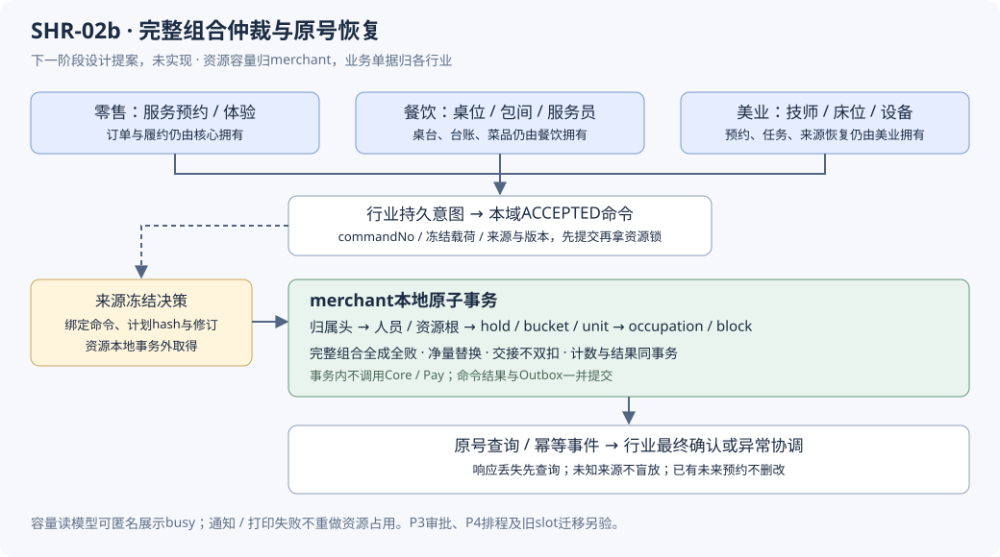

# SHR-02b 共用资源容量与组合占用：详细需求与方案

> 状态：**实施中；02b-1a算法/1b数据契约完成，持久命令协议与预留尚未实现** · 2026-10-21 · 档位2。
> 基线：美业隔离分支378a5f2f7；只读核验最新本地餐饮ca71f6092，共用merchant/base及平台迁移相对8e732eeb7无新增。
> 上游：[多端功能矩阵](../requirements/美业系统-多端功能矩阵.md) D01–D05、H04–H07；[主执行计划](./TDD-美业系统-后端开发计划.md) §11–13。
> 既有设计：[字段真源](./design/schema/beauty-database-design.json) · [日历设计](./design/美业系统-预约工作台与日历API设计.md) · [旧资源方案](./design/TDD-预约资源域-多行业完整方案.md)。
> 决策提案：[ADR-043](./ADR/ADR-043-共用资源仲裁归属与命令恢复.md)。交付状态按§5.4/5.5分批记录；未交付的接口、业务任务与跨域恢复仍待后续验收。

## §0 定位、现状与需求追溯

本阶段把“资源与周班表事实”推进为“一个完整资源组合可原子预留、确认、替换、交接、释放，并可在超时和结果未知时恢复”。
商品/订单/资金/权益仍由原域拥有；共用merchant只维护时间容量与占用证据，行业维护预约、桌台、工单及收费流程。

| 已有基础 | 当前能力 | 本阶段不能直接假定的能力 |
|---|---|---|
| PersonnelFactsPort、mch_personnel五表 | 明确人员名单、有效任职/岗位/资格事实 | 不等于整个服务时段的开工许可；现有Port拒绝调用方事务 |
| ResourceFactsPort、mch_resource | 同主体同人一个STAFF资源，容量1；物理资源归店 | openOccupationNo只有字段，尚无占用仲裁 |
| ScheduleWindowsPort、周规则/变更历史 | 31天内周窗口、任职裁剪、跨店重叠拒绝、DST守卫 | 尚无P3例外审批、容量桶及写入期间的规则变更协调 |
| 预约/工单/任务及来源恢复数据层 | 已有聚合、修订、提交意图和来源guard持久化 | 完整Service协调、实际来源决策和可用的工作台尚未全部完成 |
| 旧AppointmentSlotPort | 零售等已有门店单时段占位/释放 | 没有多资源原子事务、跨店STAFF或本域幂等释放 |

| 需求来源 | 本阶段落点 | 行业侧仍承担 |
|---|---|---|
| D01/D02/D03 | 规范资源、班表与容量联合校验、跨店同人仲裁、匿名busy | 项目定义、服务资格要求、营业政策、页面筛选 |
| D05 | 完整替换、失败保留旧安排、原号恢复 | 改约预览、顾客同意、业务修订及历史安排 |
| H04/H05 | 实际交接、延长/超时阻断、暂停不默认释放 | 接单、参与段、步骤、实际数量与交接审批 |
| H07 | 有依据且幂等的资源释放、清洁缓冲保护 | 完工/结清、核心履约确认、来源恢复 |
| D04/P3、D06/H08/P4 | 保留后续扩展点 | 请假/加班审批、团体、多阶段并行、跨日上门调度不在本阶段上线 |

## §1 总体边界与三行业复用

最重要的边界是：行业先持久化意图，资源域接受稳定命令后在事务外取得来源冻结决策，再独立完成本地原子仲裁；网络响应和事件投影都不能代替权威结果。
跨域不持数据库锁等待远程调用。图表示待实现处理路径，未实现的来源决策协议是收费/权益场景的接入门禁。

| 能力 | 零售 | 餐饮 | 美业 | 所有者 |
|---|---|---|---|---|
| 有限区间组合预留 | 导购/体验/安装人员＋场地/设备 | 服务员＋座位/包间预约 | 技师＋床位/房间/设备，含缓冲 | merchant共用 |
| 开放占用 | 独占体验位，条件满足时使用 | 不确定结束的独占桌位/包间 | 未预约的独占床位/设备 | merchant共用，P1限capacity=1 |
| 有限预留转实际执行 | 服务人员到岗 | 预约到店接待 | 预约转任务开工 | 共用原语＋行业协调 |
| 容量>1 | 体验名额/服务池 | 可共享房间容量 | 可共享设备/空间容量 | 有限预留按整数qty；未知结束不按预计时间自动回收 |
| 行业业务 | 核心订单/自提/履约 | 桌台开合迁移、台账、菜品、时段餐牌 | 项目、预约、工单、护理、疗程 | 各行业/原核心，不塞入资源域 |
| 现有旧单格模式 | 原路径保持 | 存量使用者原路径保持 | 新资源模式不借旧槽兜底 | 写入权威互斥，迁移另立验收 |

**推荐：规范UTC容量桶＋资源根行串行仲裁。** 相比仅扫描时间区间计数，它能落地唯一键/CAS/明细对账；相比每店独立桶，它能防止同一人员跨店重复出售。
代价是桶向外取整会保守降低利用率，同一资源的写命令在P1按根行串行；须用压测决定后续细化，不能先取消跨店互斥。

## §2 需求清单与交付拆分

下列“P1”是本阶段完整目标，需按子阶段交付；某一子阶段通过不代表整个SHR-02b或预约工作台完成。

| 编号 | 模块 | 详细需求与成功条件 | 阶段 |
|---|---|---|---|
| R01 | 范围 | 服务端取得可信tenant/entity/store/operator，资源、来源、任职、明细全部核对父链 | 02b-1 |
| R02 | 身份 | STAFF跨店共用同一resourceNo/容量1；物理资源只归属店；引用按数据库规范主档号比较 | 02b-1 |
| R03 | 时间 | UTC毫秒、半开区间；持续时间/缓冲先算清，再向外映射固定桶；不按本地DST日直接分桶 | 02b-1 |
| R04 | 需求 | 一命令包含完整资源集合、稳定需求行、整数qty及全部占用区间；不由前端直接指定bucketNo | 02b-1 |
| R05 | 归一 | 同一持续使用组的准备/服务/清洁取区间并集；独立并发组累计qty；重复/矛盾行拒绝 | 02b-1 |
| R06 | 桶 | 同resource/start唯一、粒度统一、容量来自本域；缺桶由本域显式生成或拒绝，不能当无限容量 | 02b-1 |
| R07 | 幂等 | 所有变更强制键，同范围同动作同键同参返回原结果；异参冲突，重试不延TTL、不重复扣量 | 02b-1 |
| R08 | 来源归属 | 同来源多个不同键并发也最多一个当前hold；同一外部修订不允许绕过替换协议再开独立占用 | 02b-1 |
| R09 | 预留 | 所有资源/桶在一事务成功或全回滚；任一资源不足不留下半组合 | 02b-2 |
| R10 | 准入 | 全区间任职/班表、资源状态、需求资格证据重验；班外/规则缺失/开放阻断明确拒绝 | 02b-2 |
| R11 | TTL | HELD有服务端期限，判断统一到毫秒；到期仅表示可发起过期处理，不等于容量已释放 | 02b-2 |
| R12 | 保护 | 可能触发支付/权益副作用前必须将hold切为来源协调保护；未知结果不得只靠TTL释放 | 02b-2 |
| R13 | 确认 | 只把本hold现存held转confirmed，容量总和不增；校验当前hold/版本、准入与来源许可 | 02b-2 |
| R14 | 续期 | 仅有效HELD、版本相符且来源允许；不复活终态，旧过期任务不得释放新租期 | 02b-2 |
| R15 | 释放 | 仅释放合法单位；单位打标、减计数、根状态及事件同事务；重复释放减量为0 | 02b-2 |
| R16 | 恢复 | 响应丢失先查command/hold；未完成意图可原号重放，不用新key猜测重做 | 02b-2 |
| R17 | 替换 | 锁旧/新资源并集，按净增量校验；重叠部分不自撞，失败旧hold/安排均保留 | 02b-3 |
| R18 | 修订 | CAS仲裁归属头、hold版本及行业来源修订；旧预览/旧消费者不能覆盖新方案 | 02b-3 |
| R19 | 历史 | 成功替换保留旧hold/units与新旧关联；已开工不走普通整单替换 | 02b-3 |
| R20 | 交接 | 有限预约转occupation复用原confirmed units，不再扣第二份容量 | 02b-4 |
| R21 | 明细归属 | 每个实际occupation明确绑定原单位；P1整单位交接/释放，不拆分同单位qty | 02b-4 |
| R22 | 结束 | 实际使用及清洁完成后按单位释放；暂停、预计结束、支付成功不触发默认释放 | 02b-4 |
| R23 | 开放占用 | P1仅独占capacity=1；与当前/未来HELD、CONFIRMED及实际占用共同仲裁 | 02b-4 |
| R24 | 关闭开放占用 | 只允许同一occupation或合法协调动作清其指针；保留历史，重复关闭不影响新占用 | 02b-4 |
| R25 | 超时保护 | 有限服务仍未释放但超原区间时产生持续阻断；不依据expectedEnd自动空闲 | 02b-5 |
| R26 | 已有未来预约 | 超时阻断允许与已有预约冲突事实并存，生成待办，禁止新的冲突开工，不删约/强占 | 02b-5 |
| R27 | 延长/换人 | 活动占用只走专门调整协议；新增容量与旧占用交接同事务，行业参与段追加恢复 | 02b-5 |
| R28 | 多份容量 | 多个超时原因可并存；P1保守阻断整个资源，新命令不能因另一原因解除而提前放开 | 02b-5 |
| R29 | 读投影 | 查询临时/确认/实际/持续阻断及asOf；重复展示不重复算容量，超限明确不完整或拒绝 | 02b-6 |
| R30 | 隐私 | 只返回受权业务摘要，跨店忙碌匿名，不输出电话、账号、护理资料或外店预约详情 | 02b-6 |
| R31 | 对账 | 桶计数可从有效hold明细解释；occupation绑定不再叠加计量；异常先阻断，不凭猜测改数 | 02b-6 |
| R32 | 运维 | 复用JobHandler、Outbox、通知/日志/指标；有恢复积压、超时保护、计数漂移告警 | 02b-6 |
| R33 | 旧径兼容 | 新旧写权威互斥；旧“没有开过时段可放行”不进入新资源模式 | 接入门禁 |
| R34 | 发布 | 本域并发验收、来源协议及权限完成才接行业；不可仅因Mapper/DDL测试通过开放收费预约 | 接入门禁 |

### 2.1 建议开发顺序

| 子阶段 | 实际可验收产物 | 必须证明 | 不提前宣称 |
|---|---|---|---|
| 02b-1 数据与仲裁归属 | 冻结模型、归属头/命令/桶/hold/units及必要索引，规范需求算法 | 唯一性、作用域、归一、真实DDL、失败恢复检查点 | 尚不能预约营业 |
| 02b-2 预留生命周期 | reserve/protect/confirm/renew/release/expire/reconcile/query | 集合原子、同键/异键竞争、确认/过期竞争、未知状态守护 | 还未完成改约/现场占用 |
| 02b-3 原子替换 | 整计划replace、净增量、旧新证据 | 失败保旧、跨店同人、同来源并发、重复替换 | 已开工换人未完成 |
| 02b-4 预约交接与开放占用 | occupation绑定、正常open/close、按单位结束释放 | 不双扣、不双释放、未来预约互斥、指针CAS | 超时协调尚未闭环 |
| 02b-5 实际超时与活动调整 | 多原因block、延长/换人、影响事件/恢复 | 现有预约保留、后续开工阻断、调整失败保旧 | 不承诺P3审批/P4排程 |
| 02b-6 对账与接入准出 | 同事务outbox、恢复/对账Job、容量读模型、跨部署合同测试 | 三行业边界、匿名busy、投影不完整、旧径兼容、监控 | 仍不是完整工作台/订单资产闭环 |

每部分启动前按本文件冻结其字段、方法/错误结果及测试用例；正式DDL版本实施时重新核对，不预占V535或修改V532–V534。

### 2.2 可执行开发计划（2026-10-21）

**目标：** 先形成零售/餐饮/美业共用的确定性需求计划，再开发持久仲裁；本轮完整实施02b-1a。
**执行：** executing-plans原会话实施，测试先行；沿用隔离worktree。规格为本文件R03–R05及§3.2。
**技术：** Java21、JUnit5；纯领域算法，不加Spring Bean、Controller、配置、依赖或空转Service。

| 顺序 | 开发单元与接口 | 验收/下一步输入 |
|---|---|---|
| 1a（本轮） | `merchant.policy.ResourceDemandNormalizer.normalize(List<Demand>, List<ResourceFact>) -> Plan` | 固定UTC5分钟；规范资源/稳定组；单位列表与桶汇总；R03–R05及R04规模保护 |
| 1b | 冻结五表字段及schema JSON：owner、command、bucket、hold、hold_unit；追加新DDL、Entity及MerchantMappers | 正式MySQL约束、作用域、并发唯一性；不预占迁移号 |
| 1c | owner根锁/CAS与持久命令接受、冲突、查询/恢复方法，复用规范摘要和审计 | 同键异参、不同键同来源、未知提交恢复；事务协议不得用空壳模拟 |
| 2 | 02b-2：冻结来源许可接口及实现reserve全事务，再protect/confirm/renew/release/expire/reconcile | 同资源/同来源/过期竞争，实际MySQL事务验收；无真实来源协议不接收费 |
| 3–6 | 02b-3～6逐批按§2.1启动前细化 | 替换→交接/开放占用→超时调整→查询/对账与三行业接入 |

#### 1a冻结的输入、输出与约束

代码路径：`backend/shop-merchant/src/main/java/ai/neargo/shop/merchant/policy/ResourceDemandNormalizer.java`。
测试路径：`backend/shop-merchant/src/test/java/ai/neargo/shop/merchant/policy/ResourceDemandNormalizerTest.java`。

- 内嵌输入`Demand(String resourceNo, String sourceLineRef, int quantity, List<Interval> intervals)`，
  `Interval(Instant startAt, Instant endAt)`；行业预先合并准备/服务/清洁为同组的多段输入。
- facts必须是调用方可信范围内的owner规范资源快照；resourceNo必须精确匹配规范号，未知/别名拒绝，
  **不在Java里猜数据库CI/AI身份**。同规范资源只出现一个fact，capacity正整数且STAFF=1。
- 同resourceNo/sourceLineRef只能出现一个Demand；同组重复区间或数量矛盾拒绝。
  sourceLineRef为区分大小写的稳定不透明引用（1..128字符，首尾不含空白），后续持久化必须保持相同精确语义。
- 时间为UTC毫秒精度，拒绝纳秒截断；范围沿班表安全边界`1000-01-03T00:00Z`至`9999-12-29T00:00Z`，
  start<end。固定300000毫秒网格，开始floor、结束ceil，半开端点不多占一桶。
- 输出`Plan(List<Unit> units, List<BucketDemand> buckets)`，
  `Unit(resourceNo, sourceLineRef, startAt, endAt, quantity)`逐组逐桶保留证据；
  `BucketDemand(resourceNo, startAt, endAt, quantity)`按资源桶汇总用于后续锁内检查；全部列表不可变。
- 同组重叠、相邻、甚至不相邻但落入同桶的片段不重复计量；独立组同桶累计。
  输入顺序不影响输出，按规范资源号、桶开始、组引用排序；不修改调用方列表。
- 最多10资源、10000组/原始区间总数/归一单位；先验证规模、合并桶区间再展开，避免长区间或重叠片段消耗无界内存。
  qty与同桶累计不得超过fact.capacity；用long累计避免int溢出。完整组合一处失败则返回失败，不输出半计划。
- 本算法不访问数据库、不写容量、不授予准入；服务端当前时间/提前量、任职、取整后班表覆盖、跨店范围、
  缓冲定义、开放阻断和锁内最新事实复核属于后续业务协调。facts不是调用方自由传入的公开API。

#### 1a执行与验收清单

- [x] 写反射调用真实算法的测试，先运行看到缺少实现导致的断言RED，避免把编译错误当RED。
- [x] 实现上述类型及normalize；测试证明：边界取整、毫秒、负epoch、UTC/DST、同组并集、组间累计、
  精确规范号、重复/矛盾、正数量、容量溢出、10资源和10000单位/输入上限、确定性与不可变输出。
- [x] `mvn -o -f backend/pom.xml -pl shop-merchant -am test`全相关模块测试GREEN；正常输入、拒绝输入都测真实算法。
- [x] 消融独立组累计守卫，相应用例必须RED，恢复后全套GREEN。
- [x] 独立审查一次；重要发现补RED→GREEN。核对需求→实现→测试，记录真实命令/结果并本地检查点提交。

**Review Focus：** 负epoch取整、边缘毫秒漏桶、同桶不同组被错误合并、大输入/整数溢出、大小写别名被错误当规范号。
上述五项各有独立行为测试；后续数据库排序规则与权限不由纯算法测试替代。

### 2.3 本轮需求对账

| 需求 | 实现落点 | 验收证据 |
|---|---|---|
| R03 UTC半开区间及固定桶 | ResourceDemandNormalizer | roundsOutwardWithoutAddingAnAlignedEnd；handlesPreEpochAndDstAsUtc |
| R04完整集合、qty及上限 | normalize输入验证及桶汇总 | rejectsCapacityOverflowAcrossGroups；enforcesResourceAndUnitLimits |
| R05并集、累计、重复拒绝 | 同组桶区间合并与逐桶汇总 | mergesOneGroupButAddsIndependentGroups；rejectsDuplicateOrContradictoryGroups |
| R01/R02/R06–R34 | 不属于1a验收完成范围 | 1b及后续继续；事实精确匹配不等于作用域/班表/容量仲裁 |

### 2.4 02b-1b五表数据层实施计划（2026-10-21）

**范围：** 在1a基础上冻结并实现五表DDL、继承BaseEntity的Entity、MerchantMappers内嵌BaseMapper及主体数据域注册。
只交付持久数据契约，不交付owner/command业务方法、不可变写协议或预留Service；1c开始前继续细化事务/CAS方法。
最新本地food为14f90a9ad，较ca71f6092仅base商品SPI新增，与本批merchant/迁移无交集；不导入无关代码。
两个工作树平台最大版本分别534/531，新追加V535__shared_resource_booking_foundation.sql，V532–534不改。

| 表/Entity/Mapper（均merchant归属） | 本批冻结的业务字段 | 约束与后续责任 |
|---|---|---|
| mch_booking_owner / MchBookingOwner / BookingOwnerMapper | ownerNo,storeNo,sourceType,sourceNo,currentHoldNo,ownerVersion,sourceRevision | tenant/entity/store/sourceType/sourceNo唯一；head与sourceRevision同空或同非空；版本非负，ownerVersion与BaseEntity.version不同 |
| mch_resource_command / MchResourceCommand / ResourceCommandMapper | commandNo,ownerNo,storeNo,action,requestKeyHash,payloadHash,frozenPayload,expectedOwnerVersion,sourceRevision,targetHoldNo,expectedHoldVersion,expectedLeaseRevision,status,resultPayload,rejectionCode,waitReason,nextRetryAt,initiatedBy | 范围+动作+键唯一；摘要小写SHA256；JSON合法；ACCEPTED无结果/拒绝码，SUCCEEDED有结果无拒绝码，REJECTED有结果与拒绝码；终态无重试；载荷不可变/终态不可逆由1c协议实现 |
| mch_resource_bucket / MchResourceBucket / ResourceBucketMapper | bucketNo,resourceNo,startAt,endAt,capacity,heldQty,confirmedQty,capacityRevision | 主体/resource/start唯一，无store；UTC五分钟网格、存储安全边界；capacity>0，held/confirmed非负，和<=capacity且防int溢出；容量修订非负 |
| mch_booking_hold / MchBookingHold / BookingHoldMapper | holdNo,ownerNo,storeNo,commandNo,sourceRevision,leaseRevision,status,expirationPolicy,expiresAt,creationPlanHash,currentPlanHash,planRevision,replacesHoldNo,replacedByHoldNo,terminationReason,terminatedAt,executionStartedAt | 业务号及创建command唯一；HELD/CONFIRMED/RELEASED/EXPIRED；LOCAL_TTL/SOURCE_COORDINATED；租约/计划修订>=1，外部修订>=0；保留初始expiresAt；终态必须有原因/时间，非终态不得有；HELD不得开工 |
| mch_booking_hold_unit / MchBookingHoldUnit / BookingHoldUnitMapper | unitNo,holdNo,bucketNo,allocationRevision,qty,sourceLineRef,releasedAt,releaseCommandNo | hold/allocationRevision/bucket/sourceLineRef历史唯一；组引用varchar128且utf8mb4_bin，匹配1a精确身份；qty>0，分配修订>=1，释放时间/命令同空或同非空；活动单位唯一由1c/2根锁/CAS保证 |

公共字段沿BaseEntity；所有Entity显式entityNo。五表业务唯一键不含deleted，软删不释放身份。
业务号/主体/门店引用跟随库默认排序规则；状态、动作/来源类别与摘要采用二进制比较，拒绝状态大小写漂移；
组引用单列utf8mb4_bin不跨域JOIN，保留大小写/重音区别；不得把规范资源号改成Java大小写折叠。
无跨域外键，父链/范围写校验、当前头CAS、不可变历史及完整事务是后续服务门禁；不能以BaseMapper可写宣称业务安全。

**真源同步：** 原39表添加owner/command两项至41表，扩充bucket/hold/unit三项字段；occupation-unit/block留作后续提案，暂不新增。
原49任务数量/NOT_STARTED定义保留，owner/command归SHR-02；动态生成统计由真源计算，不再硬编码39/14。
美业私有V1与16表输出不变；生成器类型白名单支持共用表longtext，仍只渲染16私有表；同步数据库册、字段字典/图、Java规划及任务索引、平台H2/表清单/ER/分层/词汇投影。

- [x] 先写ResourceBookingPersistenceIT及verify-resource-booking-persistence.mjs；缺少新Entity的真实断言RED。
- [x] 按真源新增V535、五Entity/五Mapper、五表主体注册；不加空转Service/Repository。
- [x] 真实MySQL逐表验证约束、JSON、毫秒网格、溢出、大小写组引用、修订历史与软删唯一性；并发相同来源/幂等键/桶只能插入一份。
- [x] 真实装配逐表插入/字段读取/审计与主体隔离；拒绝输入不依赖H2；业务父链/租户鉴权另验。
- [x] 消融桶总量约束使超容量测试RED，恢复后真实MySQL全部GREEN；运行merchant全套、旧slot相关及美业独立reactor回归。
- [x] 重生成、SQL/字段/结构检查、独立只读审查一次，回填真实输出并检查点提交。

实现适配：H2生成器将JSON_VALID简单列参数映射IS JSON、MICROSECOND映射EXTRACT，保持重复转换幂等。
对应Node回归先RED后GREEN，完整353表/2400种子实际H2重放；正式MySQL校验不放宽。
共用表longtext暴露原美业生成器白名单缺口：既有测试先RED，再扩充单个类型，冻结V1输出保持字节一致。

**Review Focus：** nullable CHECK穿透、CI/AI与精确组引用混淆、int求和溢出、终态/释放证据不完整、软删或跨店复制STAFF容量身份。
用例/验收追溯：R01基础主体注册→allMappersUseAuditAndSubjectScope；R03/R06→bucketGridAndCapacityAreDatabaseInvariants；
R07/R08→scopedCommandAndOwnerIdentitySurviveConcurrentInsertAndDeletion；R18/R19→allocationHistoryAndExactGroupIdentityArePreserved。
仅这些需求的数据约束部分完成；不替代后续服务级幂等、原子预留、来源恢复验收。

## §3 桶、区间与完整组合

### 3.1 候选工程参数

| 参数 | 本批冻结或后续候选 | 理由与边界 |
|---|---|---|
| 桶粒度 | 1a算法冻结5分钟UTC网格，后续仲裁沿用 | 不能同一STAFF在A店5分钟、B店15分钟产生两套容量；后续改粒度须迁移而非动态切换 |
| HELD初始TTL | 10分钟，普通续期累计上限建议30分钟 | 付款/权益保护后的未知恢复不靠该上限盲目释放 |
| 单命令范围 | 最多10规范资源、10000桶单位，qty为正整数 | 服务端归一后再检查，超限拒绝；不据此开放P4多人排程 |
| 查询窗口 | 沿既有31天上限，分页/密度另限 | 不允许把不完整结果解释为空闲 |
| 新预约前瞻 | 建议90天，后台按资源/日滚动准备 | 不是一次调用现有31天ScheduleWindowsPort生成90天快照 |
| 时间/容量 | UTC毫秒、qty不超过当前资源容量；STAFF固定1 | 容量上限保护值需压测冻结，禁浮点计数 |

除1a冻结的网格及输入/输出规模上限外，其余仍是建议值；不在本轮新增配置项。容量事实为int正数，聚合使用long。

### 3.2 映射与归一

- 新计划业务开始时刻不得早于服务端当前时间与门店最短提前量；规范桶可因向下取整覆盖当前桶早部，但不能借此回填过去预约。现场立即使用走受控实际占用协议，普通命令不得伪造过去时间复活容量。
- 时间区间统一`[startAt,endAt)`；先将业务时长、准备、清洁等转换为完整资源使用区间，再做向下取整开始/向上取整结束。
- 例：床位09:02–10:03占09:00–10:05相关桶；如果取整扩展到班外，不能静默扣班外桶，本期返回需调整时间。
- 同一个持续使用组由服务端提供稳定`sourceLineRef`：技师09:00–10:00，床位准备08:50–09:00＋服务09:00–10:00＋清洁10:00–10:10，床位组占08:50–10:10，qty=1。
- 同组同资源相邻/重叠区间取并集，不能把准备与服务各扣一次；独立并发组按qty相加。同组数量矛盾、重复行或不允许的资源重用直接拒绝。
- 多个业务项目连续共用资源时，行业先形成可追溯的持续使用组，并在自己的安排关系中保留项目→组映射；共用域不从商品名或SKU猜测可合并。
- 不同使用组落入同桶会保守累计，即使原分钟区间不重叠也可能冲突；这是网格取整代价，可改选对齐时间，不能私下减计数。
- 初次分配按`hold＋allocationRevision＋bucket＋sourceLineRef`保留历史唯一性；同一需求组在同桶的活动单位最多一个，由归属根锁、旧单位释放CAS与事务后置核验共同保证。分配修订不是再开一份活动容量的理由；同组可按桶逐行追溯，prepare/service/cleanup标签由行业计划映射，不额外重复扣容量。

### 3.3 生成与有效性

bucket容量来自资源，不是门店班次容量之和；同一STAFF的所有门店共用同一bucket。桶存在不等于该店上班，门店班表/任职仍须单独覆盖全部规范占用区间。
全局blocked只表示资源级阻断，不能因A店关门把本可在B店工作的人员全局封住；店级例外是后续独立规则。
缺桶只允许本域在资源根锁保护下按统一网格幂等创建，或明确返回NOT_READY；生成任务不得改已占用桶的计数/时间身份。
容量降低必须拒绝影响未完成承诺的变更并进入影响协调，不能直接覆盖capacity；修改未占用未来桶也要有资源/排班修订依据。

## §4 本地事务、幂等与并发

### 4.1 为什么还需要“仲裁归属头”和命令记录

仅hold的`requestKeyHash`挡不住同一来源用两个不同key同时抢不同资源；仅检查“当前没hold”也锁不住不存在的行。
建议增加按`tenant/entity/store/sourceType/sourceNo`唯一的`mch_booking_owner`：唯一插入建立稳定归属锚点，持久保存currentHoldNo和本域ownerVersion。
它只管理资源归属，不存预约顾客、商品/金额或行业状态，因而不是第二张预约/订单表。外部sourceRevision与本域ownerVersion分开，不混作同一个版本。

[IdempotencyScope](../../backend/shop-store-mybatis/src/main/java/ai/neargo/shop/idem/IdempotencyScope.java)可复用强制键和规范摘要；
[IdempotencyService](../../backend/shop-store-mybatis/src/main/java/ai/neargo/shop/idem/IdempotencyService.java)已有结果重放，但sys_idempotent没有冻结动作载荷、恢复阶段、leaseRevision及来源决策引用，不能把“并发结果为空请重试”当完整业务恢复。
因此建议本域持久命令日志，复用平台鉴权/摘要/审计/outbox/调度，不建设第二套平台幂等框架。

### 4.2 命令生命周期

1. 范围/权限和请求形状检查后，写入不可变commandNo、action、作用域keyHash、payloadHash、冻结载荷、目标归属/hold版本并提交ACCEPTED。
2. 同键同参回原命令；同键异参冲突。不同键同来源由bookingOwner.currentHoldNo/ownerVersion再次仲裁。
3. 资源本地事务完成时，计数、hold/units/occupation、owner头、命令SUCCEEDED及Outbox在同一事务提交。
4. 回放/查询仍校验当前操作者或来源恢复权限，不能因知道key/commandNo取得他人结果；发起actor与实际恢复actor分别留痕，scope hash显式覆盖tenant/entity/store/action。
5. 明确业务拒绝须确认前一事务已回滚，再持久化REJECTED和稳定原因；提交结果未知时仍是待查，不得猜测REJECTED或重做第二次。
6. ACCEPTED可记录等待原因/nextRetryAt，供原号恢复；重复查询响应须区分原命令结果与hold当前状态。
7. 容量不足后改选方案，提交新预览/新key；不能改旧命令载荷。旧ownerVersion未改变时可尝试新命令，不让失败意图永久占死来源。

命令/持有历史及防重放水位不按sys_idempotent的24小时缓存TTL直接删除；来源仍可恢复/重放或业务未收口时必须保留，正式归档沿项目审计/隐私规则。不能让旧key清理后再执行一次容量副作用。

### 4.3 建议统一锁序

`命令短事务定幂等并提交 → 本域业务事务：相关主体/门店范围守卫 → bookingOwner → 人员主行（有STAFF时） → 按规范号排序的resource根 → hold根 → bucket → unit/occupation/绑定/block → outbox`。

- 本域业务事务建议显式READ_COMMITTED，并在取得根锁后做本域当前读复核；不能在默认REPEATABLE_READ事务早期建立快照，等完根锁后再用旧普通SELECT冒充最新准入。相关写者须参加同一守卫，不能只换隔离级别而不锁根。
- 所有资源写者，包括过期、生成、现场占用、超时、对账及未来人员/班表维护，遵守同一根锁顺序；多资源先取根锁并集，禁止一边释放一边补锁新资源。
- 锁序使用已解析的规范主档号。不能拿子引用P/p排序，也不能只靠一条IN/ORDER BY假定实际拿锁顺序；根逐一按统一顺序锁。
- 同一资源根被本事务持有后，桶可批查/批锁；缺桶创建、全未来预约检查与开放占用创建由根锁互斥，不能靠空SELECT或可空releasedAt唯一键防并发。
- 人员资格/任职写者先锁人员再锁资源；排班/资源维护如果需要多个owner，先发现影响范围再按序锁，资源根下复核新出现的owner，范围漂移则回滚重试，不能反向补锁。
- 不接受调用方已开启的业务写事务。行业先提交持久意图，再在事务外调用本域；避免嵌入式部署下外层持锁等待独立仲裁，远程部署也沿同一合同。
- 现有PersonnelFactsPort拒绝外层事务，不能在本域写事务内直接调用它冒充二次校验；本域需有正式的Mapper/策略复核路径，未来资格/班表写者也必须参加守卫。
- 死锁/锁超时整事务回滚并按原命令有限重试；结果未知先查commandNo。事务内不访问Core/Pay或任何远程许可服务。

### 4.4 计数不变量

每桶必须满足`heldQty>=0、confirmedQty>=0、heldQty+confirmedQty<=capacity`；容量和qty均为整数。
HELD未释放单位计入held，CONFIRMED未释放单位计入confirmed，不能因为expiresAt已过就从查询算式里偷偷减掉。
occupation绑定只是同一承诺进入执行，不加第三份计数；开放/超时阻断另行禁止新冲突，不伪造负余量。
单位释放标记、对应桶减量、hold收口、owner修订、命令结果与事件同事务；任何一处失败全回滚。
open指针或单位父链残缺、阻断原因不一致时失败关闭并进入对账；不能因为查不到关联行就把它当空闲。

## §5 状态机、TTL与未知来源

### 5.1 hold状态

| 当前 | 动作与条件 | 结果 |
|---|---|---|
| 无当前hold | reserve，全组合通过 | 新HELD，owner指向它 |
| HELD | confirm，未过期、来源许可有效、版本/准入复核通过 | CONFIRMED；held减q、confirmed加q |
| HELD | renew，仍有效且来源允许 | 仍HELD，expiresAt及leaseRevision单调更新 |
| HELD | protect，副作用启动前获得保护 | 仍HELD，expirationPolicy改为SOURCE_COORDINATED |
| HELD | release/expire，释放决策允许且无实际交接 | 全部释放后RELEASED/EXPIRED |
| CONFIRMED | 有依据的分组释放，无活动实际占用或已有完成证明 | 未释放部分仍CONFIRMED，全释放后RELEASED |
| HELD/CONFIRMED | 未开始执行的整计划replace | 旧RELEASED＋新同类状态hold，同事务切owner指针 |
| RELEASED/EXPIRED | 任何旧confirm/renew | 拒绝；新安排须新命令、新hold并重新争取容量 |

必须有额外的leaseRevision、expirationPolicy、终止原因和新旧hold关联字段；不能把这些过程语义藏在payloadHash里。

### 5.2 到期规则

- LOCAL_TTL仅用于来源明确承诺“没有外部支付/权益副作用，资源到期会阻止后续确认”的预留。
- 任何可能开始付款/扣权益的路径，必须先完成protect并获得成功结果，再启动外部副作用；旧TTL释放与protect争同一owner/hold，过期先赢则副作用不能开始。
- SOURCE_COORDINATED到期后仍保留held计数，进入恢复待处理投影；后台在事务外取得冻结来源的明确决策，再回本域仲裁。
- 普通confirm在`now>=expiresAt`拒绝；受保护且从未释放的HELD只能通过显式reconcile决定确认或释放，确认前重新核查准入，不能把终态EXPIRED复活。
- 如来源允许“释放资源、保留资金恢复”，必须先冻结并阻止旧来源后续确认；该决策不等于退款成功、权益已返还或客户需要再付款。
- 迟到支付成功且资源已真实释放：保留原号恢复，重新查资源或转异常协调；不能拿旧hold强占已给别人的容量。
- 确认与过期并发只有一个状态迁移生效；过期扫描须绑定holdNo＋leaseRevision，续期后旧扫描作废。

### 5.3 跨域许可与启用门禁

建议新增ResourceSourceAuthorityPort，由零售、餐饮、美业按sourceType提供正式适配；不能直接拿权益域SourceDecisionPort充当所有资源场景的通用许可。
来源意图先提交；资源域持久化ACCEPTED并产生commandNo后，才在事务外请求来源冻结相关业务修订，返回绑定commandNo、来源/父行、sourceRevision、规范计划hash、允许动作、有效期与fence引用的决策。
资源域本地校验该决策的精确绑定，并在锁内复核本域资源/资格/班表；资源成功后由行业原意图继续最终确认，Outbox只推进恢复，不替代权威查询。
来源不能在冻结期间允许相反动作绕过fence；仅在查询前读到一次“已付/已取消”不足以防后续并发变化。
该冻结/回查合同未实现时，收费/权益场景不得接通；只能验证无外部副作用的受控场景和资源本地域，不能以模拟许可宣称完整营业闭环。

### 5.4 02b-1a实际验收（2026-10-21）

需求→设计→测试对应§2.3。归一测试15项，使用真实算法，无mock，无数据库替身。

| 运行 | 真实结果 | 证据 |
|---|---|---|
| 首次测试先行 | Tests run:15, Failures:15, Errors:0, Skipped:0；缺少算法类型的断言失败 | `/tmp/resource-normalizer-red.log` |
| 相关模块首轮全套 | 268通过、0失败/错误/跳过，BUILD SUCCESS | `/tmp/resource-normalizer-green.log` |
| 消融组间总量守卫 | Tests run:1, Failures:1, Errors:0；应拒绝超容量却未拒绝 | `/tmp/resource-normalizer-ablation.log` |
| 恢复后的最终全套 | 268通过、0失败/错误/跳过，BUILD SUCCESS | `/tmp/resource-normalizer-final.log` |

全套命令：`JAVA_HOME=/opt/homebrew/opt/openjdk@21/libexec/openjdk.jdk/Contents/Home mvn -o -f backend/pom.xml -pl shop-merchant -am test`。
定向RED附加`-Dtest=ResourceDemandNormalizerTest -Dsurefire.failIfNoSpecifiedTests=false`，
消融仅运行`ResourceDemandNormalizerTest#rejectsCapacityOverflowAcrossGroups`，随后恢复源码再跑全套。
五组美业设计生成检查、冻结V1检查、Node生成器6项、SQL无新增方言、Java120列与diff空白检查通过。
分层/文档索引已重新生成；分层输出保持原样，索引仅更新本文件状态。
本次未运行MySQL、完整宿主或美业独立reactor；未改其数据库/部署/接入，不沿用旧结果作本批验收。

独立审查无Critical/Important；1个Minor待补：非修改输入的测试应在每次调用后立即比对原列表快照，
并增加乱序可变interval列表的断言。目前实现不修改输入，但该断言增强尚未交付，不宣称该故障已被测试完整排除。
审查范围明确不含身份/数据库CI解析、业务准入/班表、事务并发/MySQL及预约生命周期，这些仍由后续各批验收。

### 5.5 02b-1b实际验收（2026-10-21）

| 验收 | 真实结果 | 日志/边界 |
|---|---|---|
| 测试先行 | 实际MySQL17项全部断言失败、0错误，缺少五Entity | `/tmp/resource-booking-red.log`；前一次测试夹具主键编译错误已修正，不算功能RED |
| 首轮原生验证 | 17通过、0失败/错误/跳过 | `/tmp/resource-booking-green.log` |
| 消融容量求和CHECK | 17项中2项断言失败、0错误；容量与int溢出均检出 | `/tmp/resource-booking-ablation.log`；随后恢复正式V535 |
| 最终原生验证 | 17通过、0失败/错误/跳过，BUILD SUCCESS | `/tmp/resource-booking-final-native.log`；包含可空当前头、目标版本、重试和释放字段回读 |
| merchant与依赖全套 | 268通过、0失败/错误/跳过 | `/tmp/resource-booking-merchant.log` |
| 独立美业reactor | 54通过、0失败/错误/跳过 | `/tmp/resource-booking-beauty.log` |
| 旧预约与结构漂移 | 旧路径37项通过；另SchemaDriftTest 2项中1项失败，合计39项/1失败 | `/tmp/resource-booking-legacy.log`，见下方基线核对 |
| H2生成器/私有迁移生成器 | Node7项通过；五组设计检查、冻结V1、SQL无新增方言及diff检查通过 | JSON/微秒映射各有RED→GREEN；完整353表/2400种子实际H2重放成功 |
| 全局schema-lineage | 14通过/2既有失败 | `/tmp/resource-booking-lineage.log`；旧同名键未分类及gen-erd键归属分叉，无新增本域未分类键 |

原生命令：`JAVA_HOME=/opt/homebrew/opt/openjdk@21/libexec/openjdk.jdk/Contents/Home node scripts/verify-resource-booking-persistence.mjs`。
每例独立数据库、正式V535、真实MySQL8.4/utf8mb4_unicode_ci；运行器只删除本次UUID一次性容器。
不重放全部平台Flyway历史、不接营业库，不证明所有部署排序规则或MariaDB具体版本。

结构漂移失败为`pay_ent_exception_action`：Java重放器仅解析出id/operation_kind，而既有H2具有完整列。
已从基线7925cbf5e提取**原迁移及原H2文件**，在该目录用未改动的同一SchemaDriftTest实际方法调用复现相同断言，
日志`/tmp/resource-booking-drift-baseline.log`。没有放宽断言、改原迁移或碰无关资金表；不声称全局闸门全绿。

独立只读审查无Critical/Important；Minor待补：增加REJECTED命令的Mapper非空resultPayload/rejectionCode回读。
当前两个Entity字段正确，状态约束已由真实SQL覆盖；该映射覆盖增强排入1c结果/恢复测试，不宣称已完成。
前批1a的输入列表非修改断言增强也仍未实施。

## §6 替换、实际交接与超时

### 6.1 未开工整计划原子替换

冻结旧ownerVersion、hold版本及来源修订；锁旧新资源根/桶并集。按每桶计算`目标其他占用＋新计划qty<=capacity`，剔除本次合法可替换的旧单位。
重叠桶只按净变化更新；从resourceA换B不先释放A，也不要求同一个人的重叠部分再占一次容量。
成功写新hold/units、释放旧units、旧hold关联新hold并切owner；失败原指针、旧units、TTL/确认状态均不变。
P1业务门店不可通过replace改变；跨店同人指不同门店来源争同一STAFF，不等于允许原预约直接换业务门店。跨店迁店需要独立的双归属头协议及行业授权，后续另定。
源资格/班表变化、请求版本陈旧、已有实际occupation或已消费分组不能走普通replace；需要新预览或专门活动调整。

### 6.2 有限预留转实际occupation

- 只接受当前有效CONFIRMED hold、明确资源/持续使用组及相应未释放units，来源冻结了待开工任务修订；实际开工许可另核查。
- occupation明确记录mode、qty、sourceLineRef、originalHoldNo、expectedEndAt；通过关系表绑定原单位。P1整单位交接，拒绝拆分一行qty供多个执行者消费。
- 实际开始及本次剩余使用/缓冲区间须被有效单位覆盖；提前/迟到导致区间超出时先调整再开工，不能把过去的桶当当前容量。
- 单位不能同时被两个实际occupation接走；交接创建和绑定同事务，重复命令回原occupationNo；bucket.confirmedQty保持不变。
- 预约转工单不是再次reserve；任务参与人数量、步骤数或多个泳道卡片不重复扣量。
- 提前完成不自动释放清洁缓冲；只有实际资源使用及清洁政策均结束的组才close/release，未结束组继续占用。
- 暂停保持占用；要让出须显式关闭/释放，恢复重新争取新容量，不能把旧已释放units重新标成活动。

### 6.3 正常开放占用

P1仅capacity=1且整资源独占。锁resource根后核查有效未释放hold单位、有限实际占用、其他开放指针及block；与任何未来有效预留冲突则拒绝。
检查范围是从实际开始起的整个未来，并结合所有未释放实际占用/阻断；已过去但未清理的历史单位不凭空延长成未来占用。检查不能仅限当前已生成桶或日历可视窗口：存在90天后的有效预留也不能忽略；根锁防并发插入未来承诺。
允许创建时，插入OPEN occupation并CAS写openOccupationNo；预计结束时间仅作展示，不安排按该时间自动释放。
close只对仍指向本occupation的根指针清理；旧关闭消息不允许清掉后来新建的开放占用。
更复杂的“在下一预约前保证离台”、多份容量开放使用和餐饮预计离台策略后续另定，不能借expectedEnd绕过P1保护。

### 6.4 超时保护区别于正常开放占用

有限服务超出承诺区间仍未实际释放时，要生成OVERRUN阻断及受影响预约事件。已有未来hold保持真实存在，不能为了满足“开放占用不得有未来预约”而拒绝保护或删掉未来预约。
建议mch_resource_block记录多个独立原因，指向实际occupation。P1对任意超时原因保守阻断整个资源，包括容量>1资源；解除一个原因不能抹掉其他原因。
后台Job主动检查；每个资源变更/开工命令在根锁下也须重新识别已超时但尚未投影的活动occupation，不等Job轮询后才保护。
正常有限安排可预订原确定区间之后的时段；一旦实际超时，新的冲突预留/开工必须被阻断，已有未来安排转协调，不承诺预计完成即必可开工。
block不能替代实际容量台账：保留原单位计数，超出原窗口的busy由持续阻断表达；不能编造超容量桶或擦除confirmedQty。

### 6.5 已开工换人与延长

走专用amendOccupation：冻结任务/参与段修订，锁旧新资源并集，争取新增区间或替代人员，再同事务写新occupation/单位关联并结束合法旧段。
同资源延长只补新增桶并延展原occupation；换人追加新occupation，不覆盖原段。hold保留创建请求摘要，并单独推进currentPlanHash/planRevision；新单位用allocationRevision留历史，已经释放或已绑定旧执行的unitNo不重新复用。未受影响组不跟随释放或改写。
失败保留原活动占用及阻断；成功后行业追加参与/交接历史，通过原意图恢复，不覆盖旧技师、原指定或实际时间。
延长遇已确认未来预约必须返回冲突并生成协调事项，店长权限不等于可超容量双约；资源调整不自动扣钱、退款或返疗程次数。

### 6.6 02b-1a实现文件对账

| §2计划 | 实际文件 | 交付边界 |
|---|---|---|
| 归一类型/算法 | `backend/shop-merchant/src/main/java/ai/neargo/shop/merchant/policy/ResourceDemandNormalizer.java` | 纯策略；规范计划与汇总，不预留容量 |
| 行为验收 | `backend/shop-merchant/src/test/java/ai/neargo/shop/merchant/policy/ResourceDemandNormalizerTest.java` | 15项测试及消融证据 |
| 设计/执行记录 | 本文件§2/§5/§6、主执行计划§15、ADR043、README、原ledger | 按原计划记录，不新建平行计划目录 |

相对本批基线d838f8ebf核对新增/修改文件；不改Controller/Service/Mapper/SPI、DDL、schema JSON或依赖。
偏差：将02b-1细分为1a/1b/1c，先交付确定性算法，五表及持久仲裁后续；不是原02b-1整体完成。
原worktree/ledger保留供后续实施，无合并/推送/营业库执行。

### 6.7 02b-1b实现对账与剩余门禁

| §2.4计划 | 实际交付 |
|---|---|
| 五表正式契约 | V535__shared_resource_booking_foundation.sql；MchBookingOwner/MchResourceCommand/MchResourceBucket/MchBookingHold/MchBookingHoldUnit |
| 数据层接线 | MerchantMappers五个嵌套BaseMapper；PersonnelDataScopeRegistration新增五表 |
| 原生验收 | ResourceBookingPersistenceIT、verify-resource-booking-persistence.mjs；17项及求和消融 |
| 设计真源与派生 | 两个schema JSON至41表/49任务；生成器动态统计；数据库册、字典/两张资源图、Java/任务索引；H2、表清单、ER、分层、词汇 |
| 必要适配 | H2生成器与Node回归；美业渲染器仅放行longtext类型；ER及血缘测试主键分类/owner_no碰撞说明 |
| 执行记录 | 本TDD、主执行计划、ADR043、README与原ledger |

偏差：生成器适配是新契约进入既有回归所必需；均有实际RED→GREEN，不修改冻结V1。
本批无业务Service、HTTP或跨域Port，无命令不可变/终态不可逆、根锁/CAS、活动单位唯一或历史删除保护协议。
跨表父链、来源权限/租户授权及当前资源事实校验仍由1c/2写入服务验收；数据域投影隔离不代替业务授权。
02b-1b数据契约完成，02b-1整体及预约营业未完成；下一步1c按当前五表冻结命令接受/查询/恢复与归属根CAS方法。
无合并/推送/营业库迁移；保留隔离工作树和ledger。

## §7 数据结构补充提案

原39项设计包含4张容量表。02b-1b已加入归属头/命令两项并扩展bucket/hold/unit字段，真源现为41项；occupation-unit/block仍为后续提案，不静默塞进自由JSON。

| 表 | 本轮建议字段/约束增量 | 对应需求 |
|---|---|---|
| mch_resource_bucket（原候选） | 统一start/end网格、capacity/held/confirmed非负及总和约束；capacityRevision、幂等创建；resource/start唯一 | R03/R06/R09 |
| mch_booking_hold（原候选） | ownerNo、外部sourceRevision与本域修订区分；leaseRevision、expirationPolicy、currentPlanHash/planRevision、replaces/replacedBy、终止原因、执行开始标记 | R08/R11–R19 |
| mch_booking_hold_unit（原候选） | hold/allocationRevision/bucket/sourceLineRef历史唯一，活动组单位不重复；正整数qty、释放动作/时间，原需求组可追溯 | R04/R05/R15/R21 |
| mch_resource_occupation（原候选） | mode=RESERVED/OPEN、qty、sourceLineRef、实际状态、原hold及规范组引用，原expectedEnd仅建议值 | R20–R25 |
| mch_booking_owner（建议新增） | ownerNo；tenant/entity/store/sourceType/sourceNo唯一；currentHoldNo、ownerVersion、外部sourceRevision/fence引用 | R08/R17/R18 |
| mch_resource_command（建议新增） | commandNo、ownerNo/action、作用域keyHash/payloadHash、冻结载荷、预期版本、状态/结果/等待原因/nextRetryAt | R07/R16/R32 |
| mch_resource_occupation_unit（建议新增） | occupationNo/unitNo关系，P1unitNo仅绑定一次；不得跨hold/资源/作用域，保留历史不复用已释放单位 | R20–R22 |
| mch_resource_block（建议新增） | blockNo/resourceNo/原因类型、关联occupation、有效/解除证据；同一原因幂等，多原因并存 | R25–R28 |
| mch_resource（已建，未来新迁移扩展） | 保留openOccupationNo原义；增加仲裁相关修订或锁内权威复核，不把正常开放指针当所有超时原因列表 | R02/R23/R28 |
| mch_appointment_slot（既有） | 本阶段不强制扩展/切写；后续明确模式映射/迁移验收才动 | R33 |

即：原4候选容量表＋4建议支撑表，共8表的仲裁方案；这4张建议表尚未进入原39项JSON，不能把本文件当已冻结DDL。
命令载荷/安全结果可用不可变JSON快照，关系、scope、状态、计数、当前指针和恢复索引必须有正式列/约束。沿BaseEntity、UTC及tenant/entity业务索引规则，不建跨域FK。
owner、command、hold、unit、occupation、block的跨父链校验需实际SQL验证；数字id不对外，账号/电话/护理内容不进快照和事件。

## §8 Java合同与行业接入

以下为候选合同职责，不是已存在类/端点；正式方法和DTO在各子阶段启动时按零售规范细化，Service接口/实现分包、Mapper按对象、Port只在shop-base/spi。

| 拟定位置/类 | 方法族 | 边界 |
|---|---|---|
| shop-base: ai.neargo.shop.spi.resource.ResourceBookingPort | reserve/protect/confirm/renew/release/expire/reconcile/replace/queryCommand/queryHold | 可信内部操作；返回commandNo、确定结果或待恢复状态，不能只返回boolean |
| shop-base: ai.neargo.shop.spi.resource.ResourceOccupationPort | occupyReserved/open/close/amendOccupation/queryOccupation | 实际占用与交接，不替行业创建工单/参与段 |
| shop-base: ai.neargo.shop.spi.resource.ResourceCapacityQueryPort | queryBusy/queryCapacity | asOf、完整性、匿名busy；读结果不是锁 |
| shop-base: ai.neargo.shop.spi.resource.ResourceSourceAuthorityPort | prepareDecision/queryDecision/finalizeDecision | 来源侧冻结与原号恢复；各来源适配，不能信任客户端传已付标记 |
| shop-merchant: ai.neargo.shop.merchant.service.ResourceBookingService | 与预留合同对应；实现放service.impl.ResourceBookingServiceImpl | 直接调本域Mapper、策略及平台outbox，不造转发Repository |
| shop-merchant: ai.neargo.shop.merchant.service.ResourceOccupationService | 与实际占用合同对应；实现放service.impl.ResourceOccupationServiceImpl | 同一锁序和本地事务 |
| shop-merchant: ai.neargo.shop.merchant.policy.ResourceDemandNormalizer/ResourceAdmissionPolicy | 时间网格/需求归一、锁内准入 | 不在Controller/Mapper里拼行业工作流 |
| shop-merchant: ai.neargo.shop.merchant.mapper.MerchantMappers | 各正式表Mapper、根锁/批查/CAS/恢复扫描 | 显式scope、版本+1与actor/updateAt，不把失败影响行0当成功 |
| 既有JobHandler/Outbox桥接 | 到期扫描、命令恢复、超时保护、对账与事件投递 | 复用平台，不新建调度/消息系统 |

共同命令字段：可信Scope、operatorRef、sourceRef、外部sourceRevision、expectedOwnerVersion/holdVersion、idempotencyKey、规范完整计划或明确动作对象、许可/原因引用。
读模型分开返回账面余量与阻断状态；被block/open阻断时不能用正数账面余量判可约或可开工，已有CONFIRMED预约可以同时带冲突标记。
返回需区分SUCCEEDED/REJECTED/ACCEPTED，含业务号/修订/稳定原因。候选结果如CAPACITY_CONFLICT、OUTSIDE_SCHEDULE、RESOURCE_BLOCKED、STALE_REVISION、IDEMPOTENCY_CONFLICT、LEASE_EXPIRED、SOURCE_DECISION_REQUIRED仅是领域原因，评审后再映射既有ErrorCode/i18n，不在本轮新增错误码。

餐饮桌台/台账与resourceNo、零售服务与来源编号、美业项目/任务与持续使用组的实际映射需要各行业接入验收；尚未接入的分支不能据共用接口存在就宣称使用了新占用。
本阶段先交付内部Port；公开预约/改约/任务API继续按已列行业清单实现，不能给C端暴露自由reserve任意资源的接口。
嵌入式调用与独立服务调用遵循同样的幂等/查询/恢复合同；后续内部HTTP要沿现有安全、响应封装和版本规范，不另造认证。

## §9 监控、打印通知与验收

### 9.1 共用基础能力

- 审计：实际operator、来源/命令/根业务号、动作、预期/结果修订及安全差异；不记录护理、电话、原始请求密钥。
- 事件：hold确认/释放/过期/替换、实际交接/结束、阻断产生/解除，同源事务写平台Outbox，eventNo幂等消费。
- 通知：业务预约成功/冲突由行业按事件和权限组织，复用通知能力；资源域不直接发顾客短信，消息失败不回滚已提交容量。
- 打印：餐饮桌台单据、美业服务单由行业使用现有打印；打印失败重试，不重复reserve/confirm。
- 指标：冲突率、根锁等待/死锁、命令ACCEPTED积压、保护hold超期时长、过期扫描延迟、block持续/影响数、Outbox滞后、对账差异。
- 日志/追踪：request/command/owner/hold/occupation关联；外店只给匿名busy。对账异常先阻断/人工核查，修复命令有审计，不直接把计数重置为0。

### 9.2 必须落地的测试清单

| 用例 | 场景 | 必须观察到的结果 |
|---|---|---|
| A01 | 同技师两店同桶并发 | 仅一个完整组合成功，另一方冲突，无重复人员容量 |
| A02 | 技师可用、床位被竞争 | 全失败后技师无孤立held，重试不多扣 |
| A03 | 房间capacity3，三组qty竞争 | 总量不超3，第四份拒绝，计数与units相符 |
| A04 | 同键同参/异参 | 原号/原结果不变；异参拒绝，TTL不偷偷续 |
| A05 | 同一来源不同key抢不同资源 | 归属头最多一个当前hold；不生成双预约容量 |
| A06 | UTC跨日、5分钟边界、准备/清洁 | 向外取整/同组并集明确，班外缓冲拒绝，DST不猜偏移 |
| A07 | 原班表/任职/资格并发改变 | 锁内复核/共同守卫决定唯一合法结果；不依赖旧读Port快照 |
| A08 | 确认与到期同时发生 | 单一有效迁移，held/confirmed不重计、不为负 |
| A09 | 续期后旧过期任务执行 | leaseRevision不符，不释放新租期 |
| A10 | protect与到期并发 | 只一方成功；过期先成功则付款副作用不能开始 |
| A11 | 付款/权益未知且TTL已过 | 保留资源保护或按明确冻结决策释放；无自动退款/重扣 |
| A12 | 已释放后迟到付款成功 | 旧hold不复活，原号恢复/重新查可约，不强占第三方 |
| A13 | replace部分重叠/完全相同/跨店同人竞争 | 按合法旧量抵扣，资源净计数正确；跨店仍同STAFF |
| A14 | replace任一新资源不足 | 旧hold、旧指针、旧单位/确认状态全部保留 |
| A15 | 两个replace/取消竞争 | ownerVersion/CAS只允许合法一方，旧预览不能覆盖新方案 |
| A16 | 已开工执行普通replace | 明确拒绝，原实际段不被覆盖 |
| A17 | 预约转occupation、响应丢失重试 | 原confirmed不再增加，返回同occupation，单位只交接一次 |
| A18 | 同单位双开工、跨hold/店偷接 | 唯一关系/父链守卫拒绝，数据库无部分绑定 |
| A19 | 暂停、提前结束、清洁未结束 | 无默认释放；合法close只释放对应组，不影响其他任务 |
| A20 | 正常open与未来reserve并发 | 无论是否已有桶，只有满足全未来互斥的一方成功 |
| A21 | 正常open面对可视窗口外有效预约 | 拒绝，不能只查今日或滚动90天 |
| A22 | 旧close消息晚于新open | 不清除新指针，不重复返还容量 |
| A23 | 有限服务超时且已有下一预约 | 持续block生效、已有预约保留并产生协调事件，下一冲突开工拒绝 |
| A24 | capacity>1，多个occupation超时 | 保守全资源阻断；解除一个原因不能放开另一个 |
| A25 | 延长/换人失败 | 旧活动占用/参与事实保留，不先释放后抢 |
| A26 | 每处SQL失败、事务回滚、响应丢失 | 计数/单位/根/命令结果/Outbox一致，原号查询能判断结果 |
| A27 | 工作进程在ACCEPTED/提交前后退出 | 恢复器以原冻结载荷重放，不造新号或重复副作用 |
| A28 | foreign tenant/entity/store及P/p引用 | 错域拒绝，合法引用投影规范身份，不出现大小写分组绕过 |
| A29 | 日历筛掉某项目/分页不完整 | busy仍保留，不完整明确标识；任务/预约跨泳道只算一次 |
| A30 | 通知/打印/Outbox重复投递 | 资源结果稳定，业务副作用按原号幂等，不重复扣容量 |
| A31 | 人工制造桶与units漂移 | 对账识别并保护，不擅自修成空闲 |
| A32 | 旧单时段及已交付事实能力 | 原37项兼容和人员/资源/排班回归不退化；新路径缺数据拒绝，不双扣 |

数据/并发使用一次性真实MySQL及多连接同步屏障，证明唯一键、行锁、CAS、回滚和SKIP LOCKED；H2只作兼容验证。
跨域恢复分别做本域真实DB＋来源合同测试、嵌入式/独立部署集成测试，模拟未知结果不能冒充真实Core/Pay适配通过。
消融至少去掉组合原子边界、owner归属守卫或开放根锁之一，对应并发反例必须变红，再恢复全绿；保留证据及一次独立审查。

## §10 新旧方案差异与评审冻结项

| 旧稿/当前缺口 | 本次细化 | 影响 |
|---|---|---|
| 原4张容量表，hold请求键是主要竞争点 | 补归属头/命令日志/交接关系/多原因阻断4类数据 | 建议新增4表，评审后才同步JSON/DDL，不隐瞒表数变化 |
| 旧mch_staff/refNo、人员每店资源假设 | 沿已交付personnel及主体内唯一STAFF | 不重复人员/账号，不复制跨店容量 |
| 旧“零时段放行”兼容例外 | 限既有旧slot路径 | 新资源模式不继承，数据未备齐拒绝 |
| 旧tryBook自动改为单格hold | 本阶段保持旧合同，迁移另验 | 不无声改变零售释放幂等/计数权威 |
| 只有HELD TTL概念 | LOCAL_TTL/来源保护＋显式reconcile | 支付未知不盲放，也不把终态hold复活 |
| 整体“先占后放”描述 | 资源根并集、按净量、同事务换指针/明细 | 旧资源不用先释放，重叠区间不自撞 |
| 预约转任务未有明细归属 | occupation-unit绑定，交接不重计 | 防双开工/双释放，P1不拆一单位qty |
| 开放占用与未来预约不得并存 | 区分正常open和真实超时block | 正常open严格互斥，超时保留冲突证据并协调 |
| 业务完成/支付/实际释放易混同 | 独立来源状态、执行事实、资源释放许可 | 无自动退款、扣次或仅凭计划结束释放 |

### 10.1 推荐基线与正式冻结

本提案推荐采用8表仲裁模型、5分钟UTC网格、先内部Port、根锁序列化、完整组合/单位交接、未知来源保护及正常open/超时block分离。
1a已冻结网格与算法规模限制，其余仍是可评审选择；相关子批编码前继续冻结下列项目并同步相应设计真源：

| 冻结项 | 本文建议 | 后续动作 |
|---|---|---|
| 桶粒度/TTL/容量和请求上限 | §3.1默认值 | 三行业时长/流量样本评估，冻结后写正式配置/契约 |
| 4张支撑表与既有字段增量 | §7八表模型 | 逐字段映射需求，在当前41项基线上继续纳入后续交接关系/block，重新生成字典/ER |
| 来源冻结许可/副作用保护 | §5.3 typed decision＋fence | 明确各来源可用动作/查询/失败恢复；未完成者不接收费入口 |
| P1执行单位 | 整单位交接释放，持续使用组可追溯 | 行业保存项目→组关系，P4拆分/多阶段另定 |
| 锁序/维护写守卫 | §4.3统一根锁与人员顺序 | 同步人员/排班/资源维护；未参加守卫的写入口不开放 |
| 正常open/超时处理 | capacity1正常open；超时多原因全资源保守block | 实测餐饮/美业冲突协调，不能假定预计结束释放 |

本轮在方案基础上实施02b-1a纯算法；未写迁移或访问营业库，02b-1整体及后续仍未完成。已有V532–V534与美业V1保持不变；1b真源41项、49个任务数量不变，业务协议后续。
