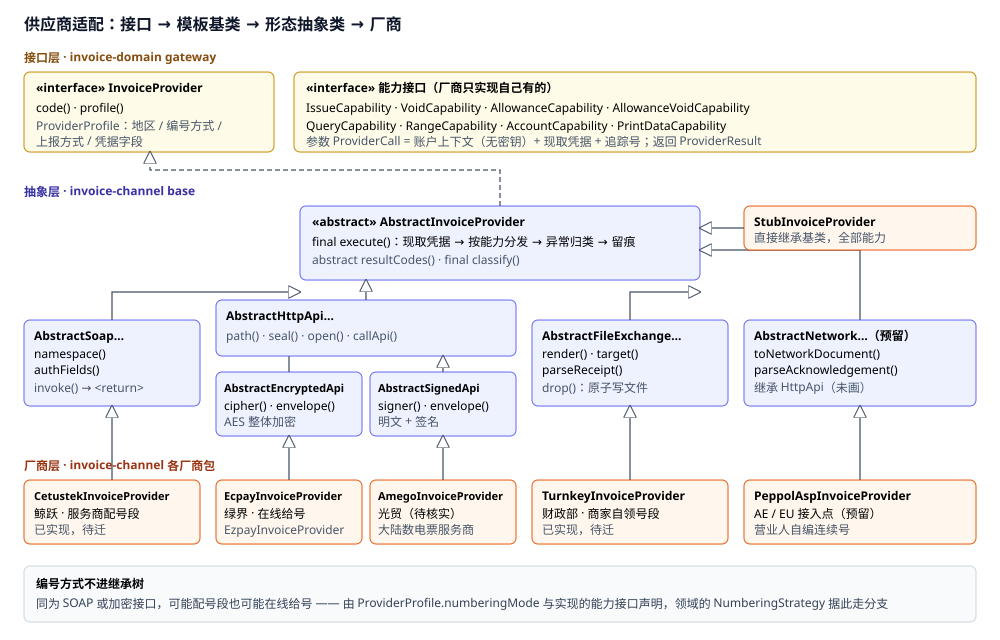

# TDD-发票服务-供应商适配抽象

状态：草稿 · 待评审 · 2026-11-22
依据：[TDD-发票服务-总体设计](./TDD-发票服务-总体设计.md) §2.2、§3.3–§3.5、§12 · [代码结构与类清单](./TDD-发票服务-代码结构与类清单.md) §2.3、§2.8
参照：支付渠道层 `pay-channel` 的能力接口拆分与 `StandardPipeline`

---

## L1 定位

> **供应商适配按「对接形态」做两级抽象：一个所有厂商共享的模板基类，管凭据、留痕、超时、结果分类；
> 五个按形态划分的抽象类（SOAP / 加密 HTTP 接口 / 签名 HTTP 接口 / 文件交换 / 网络接入点），管各自的报文封装与传输。
> 具体厂商只继承自己所属形态的抽象类，填三样东西：报文映射、结果码表、它支持的能力接口。**

接一家新厂商的工作量因此是「选一个形态、写一个子类、加一行能力表种子」，不碰开票主流程，也不碰同形态的其它厂商。

## L2 结构



图分三层看：

- **最上一层是接口**：领域只认 `InvoiceProvider` 和能力接口（`IssueCapability` …）。
- **中间是抽象类**：`AbstractInvoiceProvider` 是模板方法；五个形态抽象类各管一种协议。
- **最下一层是具体厂商**：每家只写协议之上的差异。

**编号方式不进继承树**（同一形态里既有服务商配号段的，也有在线给号的，比如鲸跃和绿界）。它通过能力接口与 `ProviderProfile` 声明，所以不会出现「SOAP + 在线给号」这类组合爆炸的抽象类。

### 主流厂商按形态归类

| 形态 | 抽象类 | 厂商 | 地区 | 编号方式 | 上报方式 | 状态 |
|---|---|---|---|---|---|---|
| SOAP Web Service | `AbstractSoapInvoiceProvider` | 鯨躍 Cetustek（`InvoiceEntitySync`） | TW | 服务商配号段 | 异步上传 | 已实现，待迁到本抽象 |
| 加密 HTTP 接口（对称加密报文） | `AbstractEncryptedApiInvoiceProvider` | 綠界 ECPay（JSON + AES-128-CBC） | TW | 在线给号 | 开立即上报 | 已有对接文档 |
| 同上 | 同上 | 藍新 ezPay 電子發票（表单 + AES 加密） | TW | 在线给号 | 开立即上报 | 待核实 |
| 签名 HTTP 接口（明文报文 + 签名） | `AbstractSignedApiInvoiceProvider` | 光貿 Amego | TW | 在线给号 | 开立即上报 | 待核实 |
| 同上 | 同上 | 大陆数电票服务商（百望云、航信等） | CN | 税局在线赋码 | 开立即上报 | 预留 |
| 文件交换 | `AbstractFileExchangeInvoiceProvider` | 財政部 Turnkey | TW | 商家自领号段 | 落文件，回执目录回写 | 已实现，待迁到本抽象 |
| 网络接入点 | `AbstractNetworkInvoiceProvider` | Peppol 接入点服务商（ASP） | AE / EU | 营业人自编连续号 | 异步回执 | 预留（阿联酋方案待核实） |
| 测试 | `AbstractInvoiceProvider`（直接继承） | `StubInvoiceProvider` | 任意 | 商家自领号段 | 收下即成功 | 已实现，待迁到本抽象 |

「待核实」「预留」的厂商只确定所属形态，协议细节以厂商文档为准，实现前先补对接文档。

### 三条分工

| 谁 | 负责 | 不负责 |
|---|---|---|
| `AbstractInvoiceProvider` | 能力分发、凭据现取、调用留痕、超时与网络异常 → `Unknown`、按结果码表分类 | 任何协议细节 |
| 形态抽象类 | 报文封装 / 加解密 / 签名 / 写文件 / 传输 / 从回包取「结果码 + 数据」 | 哪个码代表成功、字段怎么映射 |
| 厂商类 | 报文映射（标准报文 → 厂商格式）、结果码表、凭据字段、实现哪些能力 | 传输、留痕、异常分类 |

---

## §1 接口层（`invoice-domain` · `gateway` 包）

领域定义、渠道实现（依赖倒置）。下面是完整签名。

```java
package ai.neargo.shop.invoice.gateway;

/** 一家供应商。领域经 ProviderInvoker 找到它，再按能力接口调用。 */
public interface InvoiceProvider {
    String code();                         // CETUSTEK / ECPAY / TURNKEY / STUB …
    ProviderProfile profile();             // 地区、编号方式、上报方式、凭据字段
}

public record ProviderProfile(
        String code,
        Set<String> regions,               // TW / AE …
        NumberingMode numberingMode,       // LOCAL_RANGE / PROVIDER_RANGE / PROVIDER_ONLINE / LOCAL_SEQUENCE
        ReportMode reportMode,             // ASYNC_UPLOAD / SYNC_ON_ISSUE / FILE_DROP
        List<CredentialField> credentialFields) {}   // 与 ivc_provider_credential_field 启动比对

public record CredentialField(String code, boolean secret, boolean accountCode, boolean required,
                              String pattern, int maxLength) {}

/** 一次调用的上下文：账户（无密钥）+ 现取的凭据 + 追踪号。由 AbstractInvoiceProvider 组装后交给能力方法。 */
public record ProviderCall(ProviderAccountContext account, CredentialSet credentials, String traceNo) {}

/** 凭据明文，只活在一次调用里；toString 不输出值。 */
public final class CredentialSet {
    private final Map<String, String> values;
    public CredentialSet(Map<String, String> values) { this.values = Map.copyOf(values); }
    public String require(String field) { … }          // 缺字段抛 IllegalStateException（配置错误，不是业务错误）
    @Override public String toString() { return "CredentialSet" + values.keySet(); }
}

// ── 能力接口：按动作拆，厂商只实现自己有的 ──
public interface IssueCapability          { ProviderResult issue(ProviderCall call, IssueCommand cmd); }
public interface VoidCapability           { ProviderResult voidInvoice(ProviderCall call, VoidCommand cmd); }
public interface AllowanceCapability      { ProviderResult allowance(ProviderCall call, AllowanceCommand cmd); }
public interface AllowanceVoidCapability  { ProviderResult voidAllowance(ProviderCall call, AllowanceVoidCommand cmd); }
public interface QueryCapability          { ProviderResult query(ProviderCall call, QueryCommand cmd); }
public interface RangeCapability          { ProviderResult allocateRange(ProviderCall call, RangeCommand cmd); }
public interface AccountCapability        { ProviderResult verify(ProviderCall call, VerifyCommand cmd); }
public interface PrintDataCapability      { ProviderResult printData(ProviderCall call, PrintDataCommand cmd); }

/** 领域调用供应商的唯一入口（实现：invoice-channel 的 StandardProviderInvoker）。 */
public interface ProviderInvoker {
    ProviderResult invoke(ProviderAccountContext account, ProviderCommand command);
}

public sealed interface ProviderResult {
    /** data 的标准键见 ResultKeys：fiscalNumber / randomCode / issuedAt / applyId / track / startNo / endNo / taxId / qrKey … */
    record Accepted(String providerCode, String providerRef, Map<String, String> data) implements ProviderResult {}
    record Rejected(String providerCode, String message, boolean retryable, boolean accountProblem) implements ProviderResult {}
    record Unknown(String reason) implements ProviderResult {}
    record Unsupported(ProviderOperation operation) implements ProviderResult {}
}
```

**为什么能力接口拿 `ProviderCall` 而不是 `ProviderAccountContext`**：凭据由基类现取后塞进 `ProviderCall`。
厂商类不注入凭据服务，也就拿不到别的账户的凭据。领域侧 `ProviderInvoker.invoke` 只传无密钥的上下文（规则 I5）。

**在线给号的统一约定**：在线给号的厂商，`issue` 的 `Accepted.data` 必须带 `fiscalNumber`、`randomCode`、`issuedAt`。
号段类厂商不带，号码已在本地事务里取好。`InvoiceOutcomeService` 只认这几个标准键，不认厂商字段名。

---

## §2 模板基类（`invoice-channel` · `channel.base` 包）

```java
package ai.neargo.shop.invoice.channel.base;

/**
 * 所有厂商的模板基类。分发 → 现取凭据 → 调能力方法 → 异常归类 → 留痕。
 * 子类（形态抽象类）提供传输；厂商类提供映射与结果码表。
 */
public abstract class AbstractInvoiceProvider implements InvoiceProvider {

    private final ProviderCredentialAccess credentialAccess;
    private final ProviderCallRecorder recorder;           // 写 ivc_provider_call_log / ivc_raw_payload

    protected AbstractInvoiceProvider(ProviderCredentialAccess credentialAccess, ProviderCallRecorder recorder) {
        this.credentialAccess = credentialAccess;
        this.recorder = recorder;
    }

    /** 唯一入口（StandardProviderInvoker 调）。final：分发与异常归类不允许子类改写。 */
    public final ProviderResult execute(ProviderAccountContext account, ProviderCommand command) {
        var call = new ProviderCall(account, credentialAccess.open(account), Traces.current());
        try {
            return switch (command) {
                case IssueCommand c          when this instanceof IssueCapability x         -> x.issue(call, c);
                case VoidCommand c           when this instanceof VoidCapability x          -> x.voidInvoice(call, c);
                case AllowanceCommand c      when this instanceof AllowanceCapability x     -> x.allowance(call, c);
                case AllowanceVoidCommand c  when this instanceof AllowanceVoidCapability x -> x.voidAllowance(call, c);
                case QueryCommand c          when this instanceof QueryCapability x         -> x.query(call, c);
                case RangeCommand c          when this instanceof RangeCapability x         -> x.allocateRange(call, c);
                case VerifyCommand c         when this instanceof AccountCapability x       -> x.verify(call, c);
                case PrintDataCommand c      when this instanceof PrintDataCapability x     -> x.printData(call, c);
                default -> new ProviderResult.Unsupported(command.operation());
            };
        } catch (ProviderTransportException e) {
            // 请求可能已到对方：一律 Unknown，交给查单 / 重传，绝不当成「没开成」
            return e.maybeDelivered() ? new ProviderResult.Unknown(e.getMessage())
                                      : rejected(e.getMessage(), true, false);
        }
    }

    /** 厂商的结果码表：哪些码算成功、哪些可重试、哪些是账户问题。 */
    protected abstract ResultCodeTable resultCodes();

    /** 形态抽象类拿到「结果码 + 数据」后调这里统一分类。 */
    protected final ProviderResult classify(ProviderOperation op, String resultCode, String providerRef,
                                            Map<String, String> data) {
        return switch (resultCodes().lookup(op, resultCode)) {
            case ACCEPTED, ALREADY_DONE -> new ProviderResult.Accepted(code(), providerRef, data);
            case RETRYABLE               -> rejected(resultCode, true, false);
            case ACCOUNT_PROBLEM         -> rejected(resultCode, false, true);
            case FINAL                   -> rejected(resultCode, false, false);
        };
    }

    protected final ProviderResult rejected(String message, boolean retryable, boolean accountProblem) {
        return new ProviderResult.Rejected(code(), message, retryable, accountProblem);
    }

    protected final ProviderCallRecorder recorder() { return recorder; }
}

/** 结果码表：数据，不是代码分支。每家一张，单测逐码覆盖。 */
public final class ResultCodeTable {
    public enum Kind { ACCEPTED, ALREADY_DONE, RETRYABLE, ACCOUNT_PROBLEM, FINAL }
    public static Builder builder() { … }
    /** 未登记的码按 FINAL 处理（宁可停下等人看，也不盲目重试） */
    public Kind lookup(ProviderOperation op, String code) { … }
}
```

### 2.1 台湾标准报文的公共读取（`channel.tw` 包）

台湾几家厂商都从同一份 MIG 报文映射，相同的规则只写一次：

```java
package ai.neargo.shop.invoice.channel.tw;

/** MIG 报文的类型化视图：厂商映射读它，不直接读 JSON 路径。 */
public final class TwMigView {
    public static TwMigView of(RegimeDocument doc) { … }
    public String invoiceNumber();  public LocalDate invoiceDate();  public LocalTime invoiceTime();
    public boolean b2b();           public String buyerId();          public String buyerName();
    public Optional<String> carrierType(); public Optional<String> carrierId(); public Optional<String> donateCode();
    public boolean printed();       public String randomNumber();
    public TaxType taxType();       public List<Item> items();        public Amounts amounts();
    public record Item(int seq, String description, BigDecimal quantity, String unit,
                       BigDecimal unitPrice, long amount, TaxType taxType) {}
}

/** 台湾厂商映射的公共规则。 */
public abstract class AbstractTwDocumentMapper {
    /** 纸本 2 / 载具 0 / 捐赠 1（鲸跃）；绿界等用 Print/Donation 两个标记 —— 子类各取所需 */
    protected static String donateMark(TwMigView v) { … }
    /** B2C 不带买方识别码 */
    protected static Optional<String> buyerIdentifier(TwMigView v) { return v.b2b() ? Optional.of(v.buyerId()) : Optional.empty(); }
    /** 零税率需要通关方式等额外字段，多数厂商首期不支持 → 映射阶段拒绝，不送半对的票 */
    protected static void rejectZeroRatedUnlessSupported(TwMigView v, boolean supported) { … }
    protected static String slashDate(LocalDate d) { return d.format(DateTimeFormatter.ofPattern("yyyy/MM/dd")); }
}
```

---

## §3 五个形态抽象类

### 3.1 SOAP · `AbstractSoapInvoiceProvider`

```java
package ai.neargo.shop.invoice.channel.base;

/** SOAP 1.1：信封、命名空间、按顺序的参数、从回包取 <return>。 */
public abstract class AbstractSoapInvoiceProvider extends AbstractInvoiceProvider {

    private final ProviderTransport transport;

    protected AbstractSoapInvoiceProvider(ProviderCredentialAccess c, ProviderCallRecorder r, ProviderTransport t) {
        super(c, r);
        this.transport = t;
    }

    /** 厂商命名空间，如 http://webservice.cetustek.com/ */
    protected abstract String namespace();

    /** 每个操作都带的认证参数（鲸跃：officeid / posno / posid），按顺序 */
    protected abstract LinkedHashMap<String, String> authFields(ProviderCall call);

    /** 调一个 SOAP 操作，返回 <return> 的原文（已反转义）。HTTP 非 200、无 <return> → ProviderTransportException */
    protected final String invoke(ProviderCall call, ProviderOperation op, String soapOperation,
                                  LinkedHashMap<String, String> fields) {
        var all = authFields(call);
        all.putAll(fields);
        String envelope = SoapEnvelope.build(namespace(), soapOperation, all);
        var response = transport.post(call, op, endpoint(call), "text/xml;charset=UTF-8", envelope, recorder());
        return SoapEnvelope.returnValue(response);
    }

    protected String endpoint(ProviderCall call) { return call.account().endpoint(); }
}
```

### 3.2 HTTP 接口公共层 · `AbstractHttpApiInvoiceProvider`

```java
/** HTTPS 请求 / 响应型接口的公共部分：地址拼接、传输、外层判定。加密与签名两类再往下分。 */
public abstract class AbstractHttpApiInvoiceProvider extends AbstractInvoiceProvider {

    protected AbstractHttpApiInvoiceProvider(ProviderCredentialAccess c, ProviderCallRecorder r, ProviderTransport t) { … }

    /** 业务路径，如 /B2CInvoice/Issue */
    protected abstract String path(ProviderOperation op);

    /** 把业务报文封装成线上请求（加密或签名由子类决定） */
    protected abstract HttpRequestBody seal(ProviderCall call, Map<String, Object> payload);

    /** 从线上响应解出业务结果：结果码、供应商单号、标准数据（解密或验签由子类决定） */
    protected abstract ApiOutcome open(ProviderCall call, ProviderOperation op, HttpResponseBody response);

    /** 模板：封装 → 发送 → 解开 → 分类 */
    protected final ProviderResult callApi(ProviderCall call, ProviderOperation op, Map<String, Object> payload) {
        var response = transport.post(call, op, call.account().endpoint() + path(op), seal(call, payload), recorder());
        var outcome = open(call, op, response);
        return classify(op, outcome.resultCode(), outcome.providerRef(), outcome.data());
    }

    public record ApiOutcome(String resultCode, String providerRef, Map<String, String> data) {}
}
```

### 3.3 加密 HTTP 接口 · `AbstractEncryptedApiInvoiceProvider`

```java
/** 报文整体对称加密（AES-CBC）：外层只有商户号 + 时间戳 + 密文。绿界、蓝新属于此类。 */
public abstract class AbstractEncryptedApiInvoiceProvider extends AbstractHttpApiInvoiceProvider {

    /** 厂商的加解密规则：URL Encode 与否、AES 位数、Base64 变体 —— 用官方测试向量做单测 */
    protected abstract PayloadCipher cipher(ProviderCall call);

    /** 外层封装（绿界：{MerchantID, RqHeader{Timestamp}, Data}；蓝新：表单 MerchantID_ + PostData_） */
    protected abstract HttpRequestBody envelope(ProviderCall call, String cipherText);

    /** 外层判定（绿界 TransCode；蓝新 Status）：外层失败 = 传输 / 认证问题，不进业务码表 */
    protected abstract String outerCipherText(HttpResponseBody response) throws OuterRejected;

    /** 解密后的业务 JSON → 结果 */
    protected abstract ApiOutcome business(ProviderOperation op, Map<String, Object> decrypted);

    @Override
    protected final HttpRequestBody seal(ProviderCall call, Map<String, Object> payload) {
        return envelope(call, cipher(call).encrypt(Json.write(payload)));
    }

    @Override
    protected final ApiOutcome open(ProviderCall call, ProviderOperation op, HttpResponseBody response) {
        try {
            return business(op, Json.read(cipher(call).decrypt(outerCipherText(response))));
        } catch (OuterRejected e) {
            return new ApiOutcome(e.code(), null, Map.of());     // 外层码也登记在结果码表里（通常 ACCOUNT_PROBLEM）
        }
    }
}

/** AES-CBC/PKCS7 的公共实现；参数化 URL Encode、Key 长度、Base64 变体 */
public class AesCbcPayloadCipher implements PayloadCipher { … }
```

### 3.4 签名 HTTP 接口 · `AbstractSignedApiInvoiceProvider`

```java
/** 报文明文 + 签名（MD5 / HMAC-SHA256 / RSA）：光贸、大陆数电票服务商属于此类。 */
public abstract class AbstractSignedApiInvoiceProvider extends AbstractHttpApiInvoiceProvider {

    protected abstract Signer signer(ProviderCall call);              // 签名算法与密钥
    protected abstract HttpRequestBody envelope(ProviderCall call, String body, String signature, long timestamp);
    protected abstract void verifyResponse(ProviderCall call, HttpResponseBody response);   // 需要验签的厂商才实现
    protected abstract ApiOutcome business(ProviderOperation op, Map<String, Object> body);

    @Override
    protected final HttpRequestBody seal(ProviderCall call, Map<String, Object> payload) {
        String body = Json.write(payload);
        long ts = Instant.now().getEpochSecond();
        return envelope(call, body, signer(call).sign(body, ts), ts);
    }

    @Override
    protected final ApiOutcome open(ProviderCall call, ProviderOperation op, HttpResponseBody response) {
        verifyResponse(call, response);
        return business(op, Json.read(response.text()));
    }
}
```

### 3.5 文件交换 · `AbstractFileExchangeInvoiceProvider`

```java
/** 把报文写成文件交给对方程序（Turnkey）；结果来自回执文件，不在本次调用里。 */
public abstract class AbstractFileExchangeInvoiceProvider extends AbstractInvoiceProvider {

    /** 报文 → 文件内容（Turnkey：MIG XML） */
    protected abstract byte[] render(ProviderOperation op, RegimeDocument doc);

    /** 目标目录与文件名（文件名 = 报文代号 + 业务号，重发覆盖同名文件） */
    protected abstract Path target(ProviderCall call, ProviderOperation op, RegimeDocument doc);

    /** 回执文件 → 标准回执（由 ProviderReceiptService 调用，见总体设计 §6.5） */
    public abstract List<ProviderReceipt> parseReceipt(Path file);

    /** 模板：先写 .tmp 再原子改名，对方扫到的一定是完整文件；送达 = 文件已落地 */
    protected final ProviderResult drop(ProviderCall call, ProviderOperation op, RegimeDocument doc) {
        Path target = target(call, op, doc);
        AtomicFiles.write(target, render(op, doc));
        recorder().recordFile(call, op, target);
        return new ProviderResult.Accepted(code(), target.toString(), Map.of());
    }
}
```

### 3.6 网络接入点 · `AbstractNetworkInvoiceProvider`（预留）

```java
/** 经接入点服务商（如 Peppol ASP）投递标准电子发票文档；投递同步受理，结果异步回执。 */
public abstract class AbstractNetworkInvoiceProvider extends AbstractHttpApiInvoiceProvider {
    protected abstract String toNetworkDocument(RegimeDocument doc);   // 如 UBL / PINT
    protected abstract String participantId(ProviderCall call);        // 发送方网络标识
    public abstract List<ProviderReceipt> parseAcknowledgement(String raw);
}
```

---

## §4 具体厂商实现

### 4.1 鲸跃 `CetustekInvoiceProvider`（迁移现有代码）

```java
package ai.neargo.shop.invoice.channel.cetustek;

@Component
public class CetustekInvoiceProvider extends AbstractSoapInvoiceProvider
        implements IssueCapability, VoidCapability, AllowanceCapability, AllowanceVoidCapability,
                   QueryCapability, RangeCapability, AccountCapability {

    static final ProviderProfile PROFILE = new ProviderProfile("CETUSTEK", Set.of("TW"),
            NumberingMode.PROVIDER_RANGE, ReportMode.ASYNC_UPLOAD, List.of(
                    new CredentialField("office_id", false, true, true, null, 32),
                    new CredentialField("pos_no", true, false, true, null, 64),
                    new CredentialField("pos_id", true, false, true, null, 128)));

    static final ResultCodeTable CODES = ResultCodeTable.builder()
            .accepted(ISSUE, "S0").alreadyDone(ISSUE, "S2")
            .accepted(VOID, "C0").alreadyDone(VOID, "C5")
            .accepted(ALLOWANCE, "A0").alreadyDone(ALLOWANCE, "A6")
            .accepted(ALLOWANCE_VOID, "C0")
            .accountProblem("invalid").retryable("error")
            .build();                                       // 其余（S1、M1、C3/C4、A3–A8 …）按 FINAL

    private final CetustekDocumentMapper mapper = new CetustekDocumentMapper();

    @Override public String code() { return "CETUSTEK"; }
    @Override public ProviderProfile profile() { return PROFILE; }
    @Override protected ResultCodeTable resultCodes() { return CODES; }
    @Override protected String namespace() { return "http://webservice.cetustek.com/"; }

    @Override protected LinkedHashMap<String, String> authFields(ProviderCall call) {
        var f = new LinkedHashMap<String, String>();
        f.put("officeid", call.account().providerAccountCode());
        f.put("posno", call.credentials().require("pos_no"));
        f.put("posid", call.credentials().require("pos_id"));
        return f;
    }

    @Override public ProviderResult issue(ProviderCall call, IssueCommand cmd) {
        String code = invoke(call, ISSUE, "UploadInvoice", fields("invoicexml", mapper.invoice(cmd.document(), cmd.refNo())));
        return classify(ISSUE, code, "CETUSTEK:" + cmd.refNo(), Map.of());
    }

    @Override public ProviderResult allocateRange(ProviderCall call, RangeCommand cmd) {
        String applyId = invoke(call, RANGE, "ApplyInvoiceNumber", fields("year", cmd.rocYear(), "month", cmd.monthPair()));
        if (CODES.isFailure(applyId)) return classify(RANGE, applyId, null, Map.of());
        String taken = invoke(call, RANGE, "TakeInvoiceNumber", fields("applyid", applyId));
        return CetustekReplies.range(this, applyId, taken);   // "AB;12345600;12345649;07" → Accepted(data: track/startNo/endNo/…)
    }

    // voidInvoice / allowance / voidAllowance / query / verify 同样「映射 → invoke → classify」，各十行以内
}

/** MIG → 鲸跃 XML（现有 CetustekInvoiceGateway 里的 invoiceXml / cancelXml / allowanceXml 迁来） */
final class CetustekDocumentMapper extends AbstractTwDocumentMapper { … }
```

### 4.2 绿界 `EcpayInvoiceProvider`

```java
@Component
public class EcpayInvoiceProvider extends AbstractEncryptedApiInvoiceProvider
        implements IssueCapability, VoidCapability, AllowanceCapability, AllowanceVoidCapability,
                   QueryCapability, AccountCapability, PrintDataCapability {

    static final ProviderProfile PROFILE = new ProviderProfile("ECPAY", Set.of("TW"),
            NumberingMode.PROVIDER_ONLINE, ReportMode.SYNC_ON_ISSUE, List.of(
                    new CredentialField("merchant_id", false, true, true, "^\\d{7,10}$", 10),
                    new CredentialField("hash_key", true, false, true, "^.{16}$", 16),
                    new CredentialField("hash_iv", true, false, true, "^.{16}$", 16)));

    static final ResultCodeTable CODES = ResultCodeTable.builder()
            .accepted(ANY, "1")                            // RtnCode=1
            .accountProblem("TRANS_FAILED")                // 外层 TransCode≠1（解密 / 认证）
            .build();                                      // 其余 RtnCode 按 FINAL；重复 RelateNumber 由查单确认

    @Override protected String path(ProviderOperation op) {
        return switch (op) {
            case ISSUE -> "/B2CInvoice/Issue";       case VOID -> "/B2CInvoice/Invalid";
            case ALLOWANCE -> "/B2CInvoice/Allowance"; case ALLOWANCE_VOID -> "/B2CInvoice/AllowanceInvalid";
            case QUERY, VERIFY -> "/B2CInvoice/GetIssue"; case PRINT_DATA -> "/B2CInvoice/InvoicePrint";
            default -> throw new IllegalArgumentException(op.name());
        };
    }

    @Override protected PayloadCipher cipher(ProviderCall call) {
        return AesCbcPayloadCipher.aes128UrlEncoded(call.credentials().require("hash_key"), call.credentials().require("hash_iv"));
    }

    @Override protected HttpRequestBody envelope(ProviderCall call, String cipherText) {
        return HttpRequestBody.json(Map.of("MerchantID", call.account().providerAccountCode(),
                "RqHeader", Map.of("Timestamp", Instant.now().getEpochSecond()), "Data", cipherText));
    }

    @Override protected String outerCipherText(HttpResponseBody r) throws OuterRejected { … }   // TransCode≠1 → OuterRejected("TRANS_FAILED")

    @Override protected ApiOutcome business(ProviderOperation op, Map<String, Object> d) {
        // Issue 成功：InvoiceNo / InvoiceDate / RandomNumber → 标准键 fiscalNumber / issuedAt / randomCode
        return EcpayReplies.toOutcome(op, d);
    }

    @Override public ProviderResult issue(ProviderCall call, IssueCommand cmd) {
        return callApi(call, ISSUE, EcpayDocumentMapper.issue(call, cmd.document(), cmd.providerOrderNo()));
    }
    // 其余能力同形
}
```

### 4.3 Turnkey `TurnkeyInvoiceProvider`

```java
@Component
@ConditionalOnProperty(name = "shop.invoice.turnkey.root")
public class TurnkeyInvoiceProvider extends AbstractFileExchangeInvoiceProvider
        implements IssueCapability, VoidCapability, AllowanceCapability, AllowanceVoidCapability {

    static final ProviderProfile PROFILE = new ProviderProfile("TURNKEY", Set.of("TW"),
            NumberingMode.LOCAL_RANGE, ReportMode.FILE_DROP,
            List.of(new CredentialField("sender_id", false, true, true, null, 32)));

    @Override protected byte[] render(ProviderOperation op, RegimeDocument doc) { return TurnkeyMigWriter.xml(doc); }   // 现有 xml() 迁来
    @Override protected Path target(ProviderCall call, ProviderOperation op, RegimeDocument doc) { … }                // UpCast/B2SSTORAGE/{mig}/SRC
    @Override public List<ProviderReceipt> parseReceipt(Path file) { … }                                             // ProcessResult

    @Override public ProviderResult issue(ProviderCall call, IssueCommand cmd) { return drop(call, ISSUE, cmd.document()); }
    @Override public ProviderResult voidInvoice(ProviderCall call, VoidCommand cmd) { return drop(call, VOID, cmd.document()); }
    // 文件交换没有同步结果码：resultCodes() 只登记回执里的码
}
```

### 4.4 其余厂商（只定形态，细节待核实后实现）

| 类 | 继承 | 需填的差异 |
|---|---|---|
| `EzpayInvoiceProvider` | `AbstractEncryptedApiInvoiceProvider` | 表单外层（`MerchantID_` + `PostData_`）、AES 参数、`Status` 外层判定、业务码表 |
| `AmegoInvoiceProvider` | `AbstractSignedApiInvoiceProvider` | 签名规则（报文 + 时间戳 + 密钥）、外层参数、业务码表 |
| `BaiwangInvoiceProvider` 等（CN） | `AbstractSignedApiInvoiceProvider` | 令牌与签名、数电票字段映射（需 `CN_FAPIAO` 税制实现） |
| `PeppolAspInvoiceProvider`（AE / EU） | `AbstractNetworkInvoiceProvider` | 文档格式（UBL / PINT）、参与方标识、回执解析（需 `AE_EINVOICE` 税制实现） |
| `StubInvoiceProvider` | `AbstractInvoiceProvider` | 实现全部能力、收下即成功；在线给号时生成测试号码 |

---

## §5 调用顺序（与总体设计 §6 衔接）

```
InvoiceTransmissionServiceImpl / ProviderOnlineNumbering / ProviderAccountServiceImpl …   领域
 └ ProviderInvoker.invoke(account, command)                                               gateway 接口
   └ StandardProviderInvoker                                                              channel.invoke
       ├ 按 account.providerCode 取 InvoiceProvider
       ├ 拦截器：校验 → 追踪号 → 防重入 → 超时 → 重试（仅 QUERY / VERIFY）
       └ AbstractInvoiceProvider.execute                     final 模板
           ├ ProviderCredentialAccess.open → CredentialSet   凭据现取
           ├ 按命令类型分发到能力接口（没实现 → Unsupported）
           │   └ 厂商类：映射报文 → 形态类：封装 / 传输 / 解开 → classify(结果码表)
           └ 网络异常：可能已送达 → Unknown；确定没发出 → Rejected(retryable)
 └ InvoiceOutcomeService.apply(…)                                                         领域唯一写入口
```

---

## §6 守卫与测试

| 守卫 / 测试 | 锁什么 |
|---|---|
| `ProviderProfileParityTest` | 每个 `InvoiceProvider` 实现的能力接口、`profile()` 声明的编号 / 上报方式、凭据字段，与 `ivc_provider_product`、`ivc_provider_credential_field` 种子一致 |
| `ProviderStatelessTest` | `AbstractInvoiceProvider` 的子类没有 `CredentialSet` / `String key` 类字段；不注入 `ProviderCredentialAccess` |
| `ProviderEntryTest` | 能力方法只被 `AbstractInvoiceProvider.execute` 调用；领域不直接依赖任何 `channel.*` 类 |
| `ResultCodeTableTest`（每家一个） | 结果码表逐码覆盖：成功、已处理过、可重试、账户问题；未登记的码为 FINAL |
| `AesCbcPayloadCipherTest` | 绿界 / 蓝新官方测试向量逐字节一致 |
| 各厂商 `*ProviderTest` | 本机假服务（SOAP / HTTP）或临时目录，验报文形状与回包解析（沿用现有 `CetustekInvoiceGatewayTest` 的做法） |

---

## §7 L4 边界

| # | 取舍 / 待决 |
|---|---|
| 1 | **为什么继承只按「形态」分**：协议封装是厂商间真正可复用的代码（SOAP 信封、AES 外层、原子写文件）；编号方式与能力是声明，用接口组合。两者都进继承树会出现 2×5 个抽象类 |
| 2 | **基类 `execute` 为什么是 final**：凭据现取、异常归类（尤其「可能已送达 → Unknown」）是防重复开票的底线，不允许某家厂商绕开 |
| 3 | **结果码表做成数据**：码表是厂商文档的直接转写，评审时可以逐行对照；写成 if-else 的话，漏一个码没人看得出来 |
| 4 | 蓝新、光贸、大陆服务商、Peppol 的协议细节待核实；先占形态，不写实现 |
| 5 | 与 `pay-channel` 的拦截器管线是否抽共用库（总体设计 L4-3）不影响本抽象：`StandardProviderInvoker` 可换为共用实现 |
