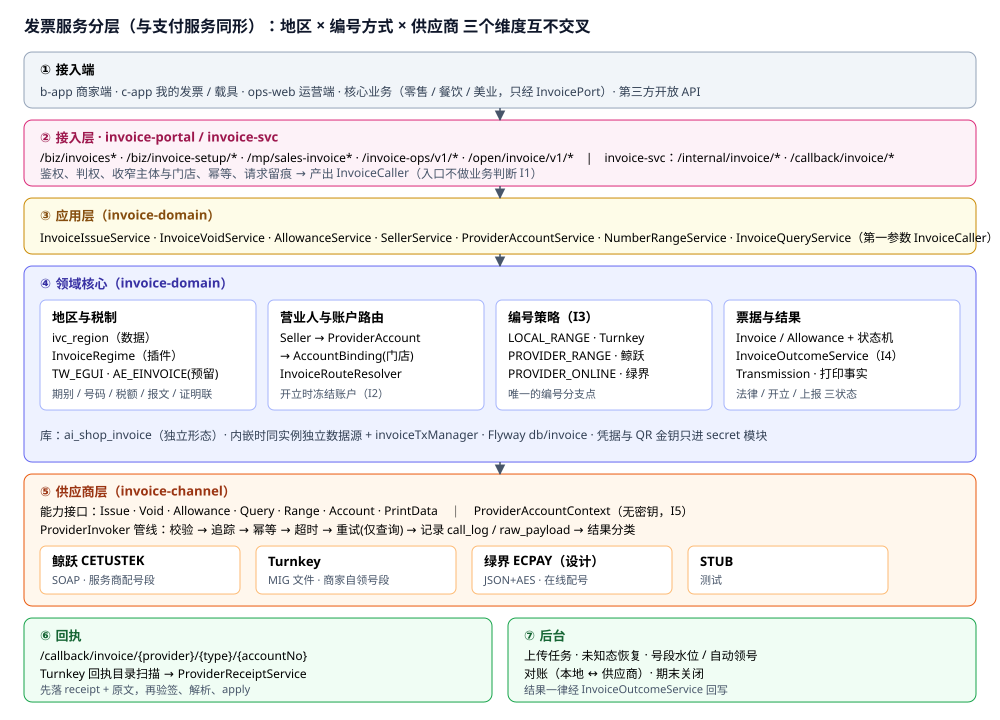
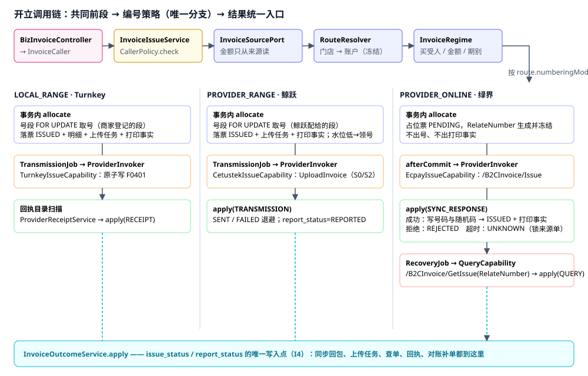
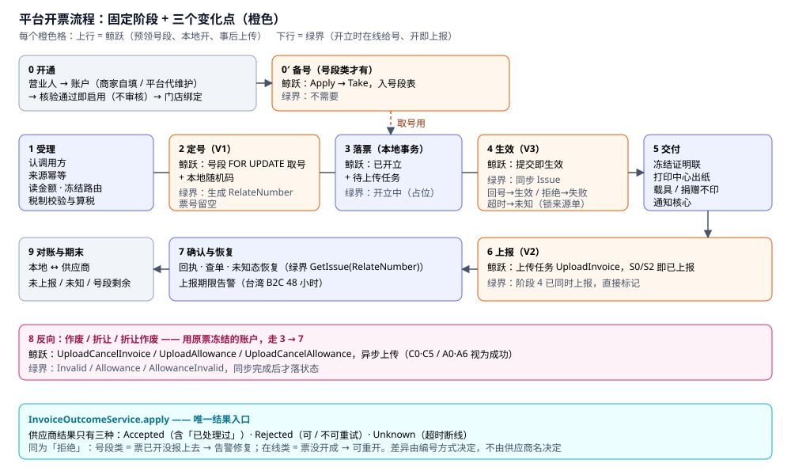

# TDD-发票服务-总体设计（多地区 · 多供应商 · 独立服务）

状态：**草稿 · 待评审** · 2026-11-22 · 档位 2（新服务、新库、跨端）
依据：[PRD-发票开立与打印](../requirements/PRD-发票开立与打印.md) AC1–AC34 · [ADR-064](./ADR/ADR-064-发票独立为服务与多地区多供应商.md) · 现状 [TDD-发票模块](./TDD-发票模块.md) §0–§11
参照：支付服务的分层与双形态 —— [ADR-021](./ADR/ADR-021-支付域独立为服务与独立库.md)、[ADR-044](./ADR/ADR-044-支付接入层模块pay-portal.md)、[TDD-支付服务-完整设计方案](./TDD-支付服务-完整设计方案.md)、[TDD-支付服务-代码结构与类清单](./TDD-支付服务-代码结构与类清单.md)、[TDD-基础包分层与支付双形态](./design/TDD-基础包分层与支付双形态.md)

---

## L1 定位

> **一个调用方，替一个营业人，按所在地区的税制，为一笔已收款的交易开一张（或作废、折让）法定票据；
> 票号由号段或服务商给出，报文经该营业人在某个供应商的账户送达税务平台；结果只从一个入口回写，证明联交给打印中心。**

发票从「主应用里的一个模块」升级为**与支付同形状的独立服务**：自己的目录 `backend/invoice/`、自己的库 `ai_shop_invoice`、
自己可单独部署的进程 `invoice-svc`；同一份代码保留「内嵌在主应用」的默认形态。
地区（台湾、阿联酋 …）与供应商（鲸跃、绿界、Turnkey …）都是**数据 + 插件**，加一个地区或一家供应商不改主流程。

本设计以已落地的两家 —— **鲸跃（加值中心，服务商配号段）**、**Turnkey（财政部直传，商家自领号段）** —— 为基准抽象，
并用文档已核实的**绿界（在线配号）**验证抽象能覆盖第三种编号方式（见 §4.3）。

---

## L2 结构



图里最重要的是两条竖线：**左边的调用方只知道 `InvoicePort`，不知道发票服务在哪个进程**（内嵌 / 独立两种装配，换的是 bean）；
**右边的供应商只认 `ProviderAccountContext`，不读库、不持密钥**。中间三层里，地区差异只在「税制」，编号差异只在「编号策略」，
供应商差异只在「能力适配」——三个维度互不交叉，这是整套抽象成立的前提。

| 层 | 组件（模块） | 职责 | 对照支付 |
|---|---|---|---|
| ① 接入端 | b-app、c-app、ops-web、核心业务（零售 / 餐饮 / 美业）、第三方 | 发起开票、查票、设置 | 同 |
| ② 接入层 | `invoice-portal`：`/biz/invoices*`、`/biz/invoice-setup/*`、`/mp/sales-invoice*`、`/invoice-ops/v1/*`、`/open/invoice/v1/*`；`invoice-svc`：`/internal/invoice/*`、`/callback/invoice/*` | 鉴权、判权、收窄主体与门店、幂等、请求留痕；产出 `InvoiceCaller` | `pay-portal` · `pay-svc` |
| ③ 应用层 | `InvoiceIssueService`、`InvoiceVoidService`、`AllowanceService`、`SellerService`、`ProviderAccountService`、`NumberRangeService`、`InvoiceQueryService` | 编排；每个方法第一个参数是 `InvoiceCaller` | `PaymentService` … |
| ④ 领域核心 | `invoice-domain`：地区与税制、营业人与账户路由、编号策略、票据聚合与状态机、统一结果入口、上传任务、打印事实 | 规则与一致性 | `pay-domain` |
| ⑤ 供应商层 | `invoice-channel`：能力接口、`ProviderInvoker` 调用管线、记录型客户端、鲸跃 / 绿界 / Turnkey / Stub 适配 | 协议与传输 | `pay-channel` |
| ⑥ 回执 | `/callback/invoice/{provider}/{type}/{accountNo}`；Turnkey 回执目录扫描 | 外部结果进来的唯一入口 | `/pay/callback` |
| ⑦ 后台 | 上传、未知态恢复、号段水位、对账、期末关闭 | 异步一致性 | 支付任务 |

**跨服务契约**（不变的原则：发票不读核心表、核心不读发票表，全部经 `spi` Port；跨库只存业务键 + 快照）：

| 方向 | 契约 | 内嵌形态 | 独立形态 |
|---|---|---|---|
| 核心 → 发票 | `spi.invoice.InvoicePort`（开票、查是否已开、预存买受人、自动开立） | `LocalInvoiceAdapter` 直调应用层 | `RemoteInvoiceClient` → `invoice-svc /internal/invoice/*` |
| 发票 → 核心 | `spi.invoice.InvoiceSourcePort`（来源单金额与明细，**金额只从来源所有者读**） | 核心的 `SubOrderInvoiceSourcePortImpl` | `RemoteInvoiceSourceClient` → 主应用 `/internal/invoice-sources/*` |
| 发票 → 核心 | `spi.user.MerchantQueryPort`（主体名、统编、市场、门店归属） | 本地 | HTTP，结果落快照 |
| 发票 → 打印 | `BusinessPrintFactReady` 事件 + `PrintSourceFactsPort` | 同进程 Outbox | `ivc_biz_notify` → 主应用 |
| 发票 → 核心 | `InvoiceIssuedEvent` / `InvoiceVoidedEvent` | 同进程 Outbox | `ivc_biz_notify` 投递 |

---

## §0 对账一 · 需求 → 设计

新增需求（PRD AC29–AC34，草稿）与已实现 AC 的承接：

| AC | 落点 |
|---|---|
| AC1–AC28（已实现） | 领域规则原样保留；`ivc_regime_profile` 拆为 `ivc_seller` + `ivc_provider_account` + `ivc_account_binding`（§5.6 迁移） |
| AC29 多地区 | `ivc_region` + `InvoiceRegime` 插件（§4.1）；营业人按地区开通（`ivc_seller.region_id`） |
| AC30 多供应商与门店路由 | `ivc_provider` / `ivc_provider_region` / `ivc_provider_product`；`ivc_provider_account` + `ivc_account_binding`；`InvoiceRouteResolver`（§4.2） |
| AC31 开立时冻结账户 | `ivc_invoice.account_id` + 快照列；作废 / 折让 / 重传 / 查询只认原票账户（规则 I2） |
| AC32 在线配号与未知态恢复 | `NumberingMode.PROVIDER_ONLINE` + `issue_status=PENDING/UNKNOWN` + `InvoiceRecoveryJob`（§4.3、§6.3） |
| AC33 双形态部署 | `shop.invoice.deployment=embedded|standalone`；`invoice-svc`；独立库与独立事务管理器（§7） |
| AC34 往来全留痕可回放 | `ivc_api_request_log`、`ivc_provider_call_log`、`ivc_provider_receipt`、`ivc_raw_payload`；运营回放（§5.5） |

---

## §1 现状与影响面

| 已有（TDD-发票模块） | 本设计如何处理 |
|---|---|
| `backend/invoice/{invoice-domain, invoice-channel}`，controller 在 `invoice-domain/api` | 拆出 `invoice-portal`（controller 与鉴权），新增 `invoice-svc`（独立形态进程）；`invoice-domain` 不再有面向人的 controller |
| 库表 `ivc_*` V1–V5，与主库同一数据源 | 新增 `InvoiceDataSourceConfig`（独立数据源 + `invoiceTxManager`）；独立形态连 `ai_shop_invoice` |
| 主体级一条 `ivc_regime_profile`（税制 + 通道 + 鲸跃账号） | 拆成营业人 / 供应商账户 / 门店绑定三张表 |
| `InvoiceGateway#send` + `InvoiceProviderGateway#verify/allocate` | 拆为按动作的能力接口（§3.4），由 `ProviderInvoker` 统一调用 |
| `InvoiceTransmissionServiceImpl`（异步上传，重试在此） | 保留为「异步上报」路径；新增同步开立路径（在线配号） |
| `TwEguiRegime`（台湾规则 + MIG 报文 + 证明联） | 成为 `InvoiceRegime` 的第一个实现；接口按地区通用化 |
| 号段 `ivc_number_range`（MANUAL / PROVIDER） | 加 `account_id`；编号方式抽到 `NumberingStrategy` |
| 证明联 / 交易明细 / 折让单打印 | 不变（打印中心事实接口） |

影响面：`shop-app` 的 `invoicebridge`（来源适配）不动；新增 `invoiceclient`（本地 / 远程 `InvoicePort`）。
b-app 发票设置页由「一条主体配置」改为「营业人 + 账户 + 门店绑定」。ops-web 新增供应商与账户管理。

---

## §2 业务抽象

### 2.1 名词 → 抽象 → 承载类

| 业务概念 | 抽象 | 模式 | 承载类 |
|---|---|---|---|
| 谁在调用 | **调用方** | 值对象 + 能力矩阵 | `InvoiceCaller` · `InvoiceCallerPolicy` |
| 在哪国开、按什么法 | **地区 + 税制** | 插件（SPI） | `IvcRegion` · `InvoiceRegime`（`TwEguiRegime`、`AeEInvoiceRegime` …） |
| 替谁开 | **营业人** | 实体 + 快照 | `IvcSeller` |
| 用谁的账户送 | **供应商账户 + 门店绑定 → 开票路由快照** | 不可变快照 | `IvcProviderAccount` · `IvcAccountBinding` · `InvoiceRoute` |
| 号从哪来 | **编号方式** | 策略（Strategy） | `NumberingStrategy`：`LocalRange` / `ProviderRange` / `ProviderOnline` / `LocalSequence` |
| 开 / 作废 / 折让 | **票据聚合** | 聚合 + 显式状态机 | `IvcInvoice` · `IvcAllowance` · `InvoiceStateMachine` |
| 结果从哪来 | **统一结果入口** | 单一写入点 | `InvoiceOutcomeService` |
| 怎么跟供应商说话 | **供应商能力** | 能力接口拆分 + 无状态适配 + 上下文注入 | `IssueCapability` 等 · `ProviderAccountContext` · `ProviderInvoker` |
| 送没送到、平台收没收 | **上报** | 任务 + 回执 | `IvcTransmission` · `IvcProviderReceipt` |
| 纸 | **证明联事实** | 冻结快照交打印中心 | `InvoicePrintSourceFactsPortImpl` |

### 2.2 三个维度不要混

| 维度 | 取值 | 决定什么 | 由谁决定 |
|---|---|---|---|
| **地区税制** `regime_code` | `TW_EGUI` · `AE_EINVOICE`（预留）· `CN_FAPIAO`（预留） | 期别、号码格式、买受人规则、金额与税额算法、证明联版式、标准报文 | `InvoiceRegime` |
| **编号方式** `numbering_mode` | `LOCAL_RANGE`（商家领号段登记，本地取号）· `PROVIDER_RANGE`（服务商配号段，本地取号）· `PROVIDER_ONLINE`（开立时由服务商给号）· `LOCAL_SEQUENCE`（无号段，营业人自编连续号，预留） | 开立是本地事务还是「先占位后远程」；何时能出证明联 | `ivc_provider_product`，由 `NumberingStrategy` 执行 |
| **供应商协议** `provider_code` | `CETUSTEK`（SOAP）· `ECPAY`（JSON + AES）· `TURNKEY`（文件）· `STUB` | 报文格式、认证、结果码、幂等键 | `invoice-channel` 适配 |

| 已知组合 | 地区 | 编号方式 | 上报方式 |
|---|---|---|---|
| 鲸跃 | TW_EGUI | PROVIDER_RANGE | 异步上传（`UploadInvoice` 等） |
| Turnkey | TW_EGUI | LOCAL_RANGE | 异步落文件，回执目录回写 |
| 绿界 | TW_EGUI | PROVIDER_ONLINE | 同步开立即完成上报 |
| Stub | 任意 | LOCAL_RANGE | 收下即成功（仅测试） |

合法组合由 `ivc_provider_product` 约束（无行 = 不支持），启动时与代码实际实现的能力比对，不一致拒绝启用该产品。

### 2.3 六条贯穿全局的规则（类设计就是为了让它们写不错）

| # | 规则 | 由哪个结构保证 |
|---|---|---|
| I1 | **入口不做业务判断** | 接入层只产出 `InvoiceCaller`；应用层每个方法第一行 `callerPolicy.check(...)` |
| I2 | **开立时冻结地区与账户，之后只认冻结值** | `ivc_invoice.account_id` + 快照列；`IvcAllowance` 没有路由字段，只能从原票取；门店改绑只影响新票 |
| I3 | **编号方式的差异只在一个地方** | 所有「本地号段 / 服务商号段 / 在线配号」分支收进 `NumberingStrategy` 实现；别处出现 `if (mode == …)` 视为缺陷（架构测试） |
| I4 | **状态只有一个写入点** | 同步回包、查单、回执、对账补单都调 `InvoiceOutcomeService#apply`；只有它能把票推到 `ISSUED / REJECTED / REPORTED`（架构测试） |
| I5 | **适配无状态、不持密钥** | 能力方法第一个参数是 `ProviderAccountContext`；适配类禁止有密钥类型字段，凭据只经 `ProviderCredentialAccess` 现取（架构测试） |
| I6 | **金额只从来源所有者读** | 开立命令不收金额；应用层经 `InvoiceSourcePort` 取冻结明细（沿用 AC1） |

---

## §3 抽象分层与代码结构

### 3.1 目录与模块

```
backend/invoice/                      ← 独立目录（聚合 pom，与 backend/pay 同形）
├── pom.xml                           invoice-modules：只做聚合，不是第二个父工程
├── invoice-channel/                  ⑤ 供应商层：能力接口、调用管线、四家适配
├── invoice-domain/                   ④ 领域核心 + ③ 应用层 + ⑥ 回执处理 + ⑦ 后台任务
├── invoice-portal/                   ② 接入层：biz / mp / ops / open 的 controller 与鉴权过滤器
└── invoice-svc/                      独立形态进程：/internal、/callback，可单独打包、单独部署
shop-base  · spi.invoice               跨服务契约：InvoicePort、InvoiceSourcePort、事件（已存在，扩展）
shop-app   · invoiceclient             InvoicePort 的本地 / 远程两种实现（按 shop.invoice.deployment 装配）
shop-app   · invoicebridge             核心侧来源适配与自动开立消费者（已存在，不动）
```

**依赖方向**：`invoice-portal → invoice-domain → invoice-channel`；`invoice-domain → shop-base(spi) / secret-api`；
`invoice-svc → portal + domain + channel + secret-core`。**`invoice-*` 不依赖任何业务域模块与 `shop-app`**；
`shop-app` 只依赖 `invoice-portal`（内嵌形态）与 `spi.invoice`。由架构测试锁住（§8）。

### 3.2 包规划（`ai.neargo.shop.invoice.*`）

> **以 [TDD-发票服务-代码结构与类清单](./TDD-发票服务-代码结构与类清单.md) 为准**：该清单按 java.md §七 修正了本节四处（controller 包为 `invoice.api.*`、按分层分包、Mapper 集合、`InvoiceSellerService`）。本表保留为按职责的阅读视图。

| 模块 | 包 | 主要类 |
|---|---|---|
| invoice-channel | `channel.api` | `ProviderAccountContext`、`ProviderCommand`（`IssueCommand` / `VoidCommand` / `AllowanceCommand` / `AllowanceVoidCommand` / `QueryCommand` / `RangeCommand` / `VerifyCommand`）、`ProviderResult`（`Accepted` / `Rejected` / `Unknown`）、`ProviderOperation` |
| | `channel.base` | 模板基类 `AbstractInvoiceProvider` 与五个形态抽象类（能力接口定义在 `invoice-domain` 的 `gateway`），见 [供应商适配抽象](./TDD-发票服务-供应商适配抽象.md) |
| | `channel.invoke` | `ProviderInvoker`、`ProviderInterceptor` 与拦截器：校验 / 追踪 / 幂等 / 超时 / 重试（仅查询类）/ 记录 / 结果分类 |
| | `channel.credential` | `ProviderCredentialAccess`（经 secret 模块现解） |
| | `channel.http` | `RecordingProviderClient`（脱敏副本 + 加密原文）、`ProviderTransport` |
| | `channel.cetustek` · `channel.ecpay` · `channel.turnkey` · `channel.stub` | 每家一个包：协议客户端 + 能力实现 + 结果码映射 |
| invoice-domain | `access` | `InvoiceCaller`、`InvoiceCallerPolicy` |
| | `region` · `regime` · `regime.tw` | `IvcRegion`、`RegionRegistry`；`InvoiceRegime` SPI；`TwEguiRegime`、`TwPeriods`、`TwProofCodes`、`TwQrCipher`、`TwBuyerRules` |
| | `seller` | `IvcSeller`、`SellerService(Impl)` |
| | `account` | `IvcProviderAccount`、`IvcAccountBinding`、`ProviderAccountService(Impl)`、`InvoiceRouteResolver`、`InvoiceRoute`、`ProviderContextFactory`（**唯一**构造 `ProviderAccountContext` 的地方） |
| | `numbering` | `NumberingStrategy`、`LocalRangeNumbering`、`ProviderRangeNumbering`、`ProviderOnlineNumbering`、`NumberRangeService(Impl)` |
| | `issuing` | `InvoiceIssueService(Impl)`、`InvoiceVoidService(Impl)`、`AllowanceService(Impl)`、`InvoiceStateMachine`、`IvcInvoice`、`IvcInvoiceLine`、`IvcAllowance` |
| | `outcome` | `InvoiceOutcomeService(Impl)`、`InvoiceOutcome` |
| | `transmission` | `IvcTransmission`、`TransmissionService(Impl)`、`InvoiceTransmissionJob` |
| | `recovery` · `recon` | `InvoiceRecoveryJob`；`InvoiceReconJob`、`IvcReconDiff` |
| | `receipt` | `ProviderReceiptService(Impl)`（回调与 Turnkey 回执的统一处理）、`TurnkeyReceiptScanner` |
| | `buyer` | 载具、会员载具、预存买受人（自现有 `InvoiceBuyerServiceImpl` 迁入） |
| | `print` | `InvoicePrintSourceFactsPortImpl`（不变） |
| | `log` | `IvcApiRequestLog`、`IvcProviderCallLog`、`IvcRawPayload`、`ReceiptReplayService` |
| | `client` | `InvoiceInternalApi`、`InvoiceInternalPaths`、请求 / 响应 record（独立形态的内部契约） |
| | `mapper.{master,seller,document,log}` | **Mapper 只在这里**；`InvoiceDataSourceConfig` 只扫这里，主应用 `@MapperScan` 排除 `invoice.*` |
| invoice-portal | `portal.biz` · `portal.mp` · `portal.ops` · `portal.open` · `portal.auth` | `BizInvoiceController`、`BizInvoiceSetupController`、`MpSalesInvoiceController`、`OpsInvoiceProviderController`、`OpsProviderAccountController`、`OpenInvoiceController`；`OpenInvoiceSignatureFilter` |
| invoice-svc | `svc` | `InvoiceServiceApplication`、`InternalInvoiceEndpoint`、`InternalInvoiceSourceClient`、`InvoiceCallbackEndpoint` |
| shop-app | `invoiceclient` | `LocalInvoiceAdapter`（embedded）、`RemoteInvoiceClient`（standalone）、`InvoiceClientConfig` |
| | `invoicebridge` | `SubOrderInvoiceSourcePortImpl`、`InvoiceAutoIssueConsumer`、`InternalInvoiceSourceEndpoint`（独立形态时供 `invoice-svc` 回读来源） |

### 3.3 关键接口

```java
// ── 地区税制（invoice-domain/regime）：一个地区一个实现 ──
public interface InvoiceRegime {
    String code();                                              // TW_EGUI
    String periodOf(Instant at);                                // 期别；无期别的地区返回 null
    void validateSeller(IvcSeller seller);
    void validateBuyer(Buyer buyer, IvcSeller seller);
    Amounts amounts(List<InvoiceSourcePort.Line> lines, Buyer buyer);   // 销售额 / 税额 / 课税别
    String fiscalNumber(RangeCursor cursor);                    // 号码格式
    RegimeDocument document(DocumentType type, IvcInvoice invoice, List<IvcInvoiceLine> lines, IvcAllowance allowance);
    Map<String, Object> proof(IvcInvoice invoice, List<IvcInvoiceLine> lines, byte[] qrKey);  // 证明联冻结内容
    boolean voidable(IvcInvoice invoice, Instant now);
}
/** 标准报文：地区法定格式的树（台湾 = MIG 4.0），schema 如 "MIG4/F0401"；ext 放供应商需要、法定格式外的补充字段 */
public record RegimeDocument(String schema, Map<String, Object> body, Map<String, Object> ext) {}

// ── 编号策略（invoice-domain/numbering）：I3 的唯一分支点 ──
public interface NumberingStrategy {
    NumberingMode mode();
    /** 本地事务内调用：本地号段类直接取号；在线配号类返回占位（issue_status=PENDING） */
    Allocation allocate(IssueContext ctx);
    /** 事务提交后调用：在线配号类在这里同步调用供应商；号段类什么都不做（上报走异步任务） */
    void afterCommit(IvcInvoice pending, InvoiceRoute route);
}

// ── 开票路由（invoice-domain/account）：I2 ──
public interface InvoiceRouteResolver {
    /** 门店绑定优先，无绑定取营业人级（store_no='*'）；只返回 ACTIVE 账户 */
    InvoiceRoute resolve(String tenantNo, String entityNo, String storeNo, String regionCode);
    /** 按冻结的 account_id 回读（作废、折让、重传、查单）；ISSUE_STOPPED 也返回 */
    InvoiceRoute frozen(long accountId);
}
public record InvoiceRoute(long sellerId, long accountId, String accountNo, String regionCode, String regimeCode,
        String providerCode, String environment, NumberingMode numberingMode, String providerAccountCode,
        int credentialVersion) {}

// ── 供应商能力（invoice-channel/capability）：按动作拆，适配只实现自己有的 ──
public interface IssueCapability extends ProviderCapability {
    ProviderResult issue(ProviderAccountContext ctx, IssueCommand cmd);      // 号段类=上传；在线配号类=开立并取号
}
public interface VoidCapability extends ProviderCapability { ProviderResult voidInvoice(ProviderAccountContext ctx, VoidCommand cmd); }
public interface AllowanceCapability extends ProviderCapability {
    ProviderResult allowance(ProviderAccountContext ctx, AllowanceCommand cmd);
    ProviderResult voidAllowance(ProviderAccountContext ctx, AllowanceVoidCommand cmd);
}
public interface QueryCapability extends ProviderCapability { ProviderResult query(ProviderAccountContext ctx, QueryCommand cmd); }
public interface RangeCapability extends ProviderCapability { ProviderResult allocateRange(ProviderAccountContext ctx, RangeCommand cmd); }
public interface AccountCapability extends ProviderCapability { ProviderResult verify(ProviderAccountContext ctx, VerifyCommand cmd); }

public record ProviderAccountContext(String regionCode, String providerCode, String environment, long accountId,
        String accountNo, String providerAccountCode, int credentialVersion, String endpoint) {}  // 不含密钥本身

public sealed interface ProviderResult {
    record Accepted(String providerRef, Map<String, String> data) implements ProviderResult {}   // data：号码、随机码、号段 …
    record Rejected(String providerCode, String message, boolean retryable) implements ProviderResult {}
    record Unknown(String reason) implements ProviderResult {}   // 超时、断线：对方可能已收到
}

// ── 统一结果入口（invoice-domain/outcome）：I4 ──
public interface InvoiceOutcomeService {
    void apply(InvoiceOutcome outcome);   // 来源：SYNC_RESPONSE / TRANSMISSION / QUERY / RECEIPT / RECON
}
```

### 3.4 三家适配对能力接口的实现

| 能力 | 鲸跃 `CETUSTEK`（已实现） | Turnkey `TURNKEY`（已实现） | 绿界 `ECPAY`（设计） |
|---|---|---|---|
| `IssueCapability` | `UploadInvoice`（S0/S2 视为已收） | 写 F0401 文件 | `/B2CInvoice/Issue`（回 `InvoiceNo`、日期、随机码） |
| `VoidCapability` | `UploadCancelInvoice`（C0/C5） | 写 F0501 文件 | `/B2CInvoice/Invalid` |
| `AllowanceCapability` | `UploadAllowance`（A0/A6）/ `UploadCancelAllowance` | 写 G0401 / G0501 文件 | `/B2CInvoice/Allowance` / `AllowanceInvalid` |
| `QueryCapability` | `QueryInvoiceStatus`（待接） | 读回执目录 | `/B2CInvoice/GetIssue`（按 `RelateNumber`） |
| `RangeCapability` | `ApplyInvoiceNumber` → `TakeInvoiceNumber` | —（商家自领，B 端登记） | 离线配号区间（后续） |
| `AccountCapability` | `QueryOfficeInfo`（核统编、取 QR 金钥） | — | 用 `GetIssue` 探测凭证有效性 |
| 幂等键 | 发票号码 | 文件名（报文代号 + 号码） | `RelateNumber`（≤50，大写字母数字，同一次开立重用） |

### 3.5 调用管线

`ProviderInvoker#invoke(ctx, command)` 是供应商层的唯一入口（应用层不直接调适配），拦截器顺序：

```
校验 → 追踪号 → 幂等（同 ref + operation 在途则拒） → 超时 → 重试（只对 Query/Verify；开立、作废、折让不自动重试，交给任务）
     → 记录（ivc_provider_call_log + ivc_raw_payload） → 结果分类（Accepted / Rejected / Unknown） → 适配
```

形状与 `pay-channel` 的 `StandardPipeline` 一致；首期在 `invoice-channel` 内实现，不依赖 `pay-channel`（§9 L4-3）。

---

## §4 关键机制

### 4.1 多地区

- 地区是数据：`ivc_region`（地区码、国家、税制码、币种、金额小数位、时区、期别规则、规则版本）。
- 税制是插件：`InvoiceRegime` 实现以 `code()` 注册进 `RegionRegistry`；**有地区行、没有插件实现 → 启动失败**，反之插件存在而地区未启用则不可选。
- 营业人按地区开通：同一主体在台湾、阿联酋各有一个 `ivc_seller`（统编 / TRN 格式由各自税制校验）。
- 开立时由来源单的门店所在市场（`MerchantQueryPort`）决定地区；**地区在开立时冻结在票上**。
- 首期只有 `TW_EGUI`。`AE_EINVOICE` 作为第二个实现的预留：编号方式 `LOCAL_SEQUENCE`、经认证服务商（ASP）上报——**阿联酋电子发票的格式、时间表与服务商清单待核实**，不在本期实现。

### 4.2 多供应商与路由

```
ivc_seller（营业人 × 地区）
   │ 1:N
ivc_provider_account（营业人在某供应商的账户：代号 + 凭据引用 + 环境 + 状态）
   │ 1:N
ivc_account_binding（门店 → 账户；store_no='*' 为营业人级默认）
```

- 解析：`InvoiceRouteResolver.resolve(tenant, entity, store, region)` —— 门店绑定优先，否则营业人级默认；只认 `ACTIVE` 账户。
- 同一营业人同一供应商同一环境至多一个 `ACTIVE` 账户（生成列唯一索引）；同一门店同一时刻只绑一个账户。
- **切换供应商**：新账户启用并改绑后，旧账户转 `ISSUE_STOPPED`（不再开新票，仍可作废 / 折让 / 重传 / 查单），历史票沿原账户（I2）。
- 账户生命周期：`ONBOARDING`（录入）→ 核验通过（`AccountCapability.verify`，统编一致）即自动 `ACTIVE`（**不设审核**；没有核验能力的供应商如 Turnkey 录入即 `ACTIVE`）→ `ISSUE_STOPPED` / `SUSPENDED` → `CLOSED`。凭据由商家自填或平台代维护两种方式，见 §13。

### 4.3 编号方式（I3）

| 策略 | 本地事务内 `allocate` | 提交后 `afterCommit` | 证明联 |
|---|---|---|---|
| `LocalRangeNumbering`（Turnkey、Stub） | 号段 `FOR UPDATE` 取号 → 票 `ISSUED` + 上传任务 | 无 | 立即可打 |
| `ProviderRangeNumbering`（鲸跃） | 同上，号段来自供应商配给（`allocation_owner=PROVIDER`） | 无；水位低于阈值时排一次「领号段」 | 立即可打 |
| `ProviderOnlineNumbering`（绿界） | 写占位票 `issue_status=PENDING`、`provider_order_no=RelateNumber`，**不出号、不出证明联** | 事务外调 `IssueCapability.issue` → `InvoiceOutcomeService.apply`：Accepted 写号码与随机码并冻结证明联；Rejected → `REJECTED`；Unknown → `UNKNOWN` 交恢复任务 | 回写成功后才可打 |
| `LocalSequenceNumbering`（预留） | 营业人连续号 | 无 | 立即可打 |

在线配号的硬规则：**`PENDING / UNKNOWN` 的来源单不得改用别的账户或别的供应商重开**；恢复任务只按原 `RelateNumber` 查单。

### 4.4 票据状态（三个状态分开记）

| 字段 | 取值 | 谁推进 |
|---|---|---|
| `status`（法律状态） | `ISSUED` · `VOIDED` | 开立 / 作废（`InvoiceOutcomeService`） |
| `issue_status`（开立过程） | `PENDING` · `UNKNOWN` · `ISSUED` · `REJECTED`（号段类开立即 `ISSUED`） | `InvoiceOutcomeService` |
| `report_status`（上报） | `PENDING` · `REPORTED` · `REJECTED` · `NOT_REQUIRED` | 上传任务结果、回执、同步开立 |
| 打印 | 打印中心自己的任务状态 | 打印中心（不在发票表） |

---

## §5 数据库设计（`ai_shop_invoice`，Flyway 历史表 `ivc_flyway_history`）

> 逐表字段以 [TDD-发票服务-数据库表结构说明](./TDD-发票服务-数据库表结构说明.md) 为准（真源 `design/schema/invoice-service-database.json`，DDL 草案 `design/schema/invoice-service.sql`）；本节讲分组与取舍。

约定：主键 `id BIGINT AUTO_INCREMENT`；库内关联用 `<表>_id`；对外可见编号用业务号（`*_no`）；
引用核心系统只存业务键（`tenant_no` / `entity_no` / `store_no` / `source_no`）+ 生成那一刻的快照列；
所有表带 `created_at` / `updated_at`（`DATETIME(3)`，UTC）；快照与报文用 `LONGTEXT + CHECK (JSON_VALID(...))`（沿用 V4 的结论：JSON 列会改键序，哈希对不上）。

### 5.1 总览（23 张：2 张沿用、5 张改、16 张新增；`ivc_regime_profile` 迁移后删除；凭据三张见 §13.4）

| 组 | 表 | 动作 |
|---|---|---|
| A 主数据（平台） | `ivc_region` · `ivc_provider` · `ivc_provider_region` · `ivc_provider_product` | 新 |
| B 营业人与账户 | `ivc_seller` · `ivc_provider_account` · `ivc_account_binding` · `ivc_provider_credential_field` · `ivc_account_credential` · `ivc_account_event` | 新（取代 `ivc_regime_profile`；后三张见 §13.4） |
| C 号码 | `ivc_number_range` | 改 |
| D 票据 | `ivc_invoice` · `ivc_invoice_line` · `ivc_allowance` | 改 / 沿用 / 改 |
| E 买受人 | `ivc_buyer_preference` · `ivc_user_carrier` | 沿用 / 改 |
| F 往来记录 | `ivc_transmission` · `ivc_api_request_log` · `ivc_provider_call_log` · `ivc_provider_receipt` · `ivc_raw_payload` · `ivc_biz_notify` | 改 / 新 / 新 / 新 / 新 / 新 |
| G 对账 | `ivc_recon_diff` | 新 |

关系（文字 ER）：

```
ivc_region ─N:M─ ivc_provider            （经 ivc_provider_region；无行 = 不可用）
ivc_provider ─1:N─ ivc_provider_product  （供应商 × 地区 × 票种 × 编号方式）
ivc_region ─1:N─ ivc_seller ─1:N─ ivc_provider_account ─1:N─ ivc_account_binding
ivc_provider_account ─1:N─ ivc_number_range
ivc_provider_account ─1:N─ ivc_invoice ─1:N─ ivc_invoice_line
                                       └─1:N─ ivc_allowance
ivc_invoice / ivc_allowance ─1:N─ ivc_transmission ─1:N─ ivc_provider_call_log ─0:1─ ivc_raw_payload
ivc_provider_account ─1:N─ ivc_provider_receipt
```

### 5.2 A 主数据

**`ivc_region`** 地区与税制

| 列 | 类型 | 说明 |
|---|---|---|
| `region_code` | VARCHAR(8) UK | `TW` · `AE` |
| `country_code` | CHAR(2) | ISO 3166 |
| `regime_code` | VARCHAR(16) | `TW_EGUI` · `AE_EINVOICE`；须有同名 `InvoiceRegime` 实现 |
| `currency` / `amount_scale` | CHAR(3) / TINYINT | `TWD` / 0 |
| `timezone` | VARCHAR(32) | `Asia/Taipei`（期别与票面时间按此） |
| `period_rule` | VARCHAR(16) | `BIMONTHLY` · `MONTHLY` · `NONE` |
| `rule_version` | VARCHAR(16) | 税制规则版本，如 `MIG4.0` |
| `status` | VARCHAR(16) | `ACTIVE` · `DISABLED` |

**`ivc_provider`** 供应商

| 列 | 类型 | 说明 |
|---|---|---|
| `provider_code` | VARCHAR(16) UK | `CETUSTEK` · `ECPAY` · `TURNKEY` · `STUB` |
| `name` | VARCHAR(64) | |
| `provider_type` | VARCHAR(16) | `VALUE_ADDED_CENTER`（加值中心）· `GOV_DIRECT`（直连税务平台）· `ASP` · `TEST` |
| `protocol` | VARCHAR(16) | `SOAP` · `JSON_AES` · `FILE` |
| `sandbox_endpoint` / `production_endpoint` | VARCHAR(255) | 地址（Turnkey 为目录根；含凭据的不进此表） |
| `status` | VARCHAR(16) | 运营开关 |

**`ivc_provider_region`**：`provider_id`、`region_id`、`status`；UK `(provider_id, region_id)`。**无行 = 该供应商在该地区不可用**。

**`ivc_provider_product`** 供应商能力（与代码能力启动比对）

| 列 | 说明 |
|---|---|
| `provider_id`、`region_id` | |
| `doc_type` | `B2C` · `B2B` |
| `numbering_mode` | `LOCAL_RANGE` · `PROVIDER_RANGE` · `PROVIDER_ONLINE` · `LOCAL_SEQUENCE` |
| `report_mode` | `ASYNC_UPLOAD` · `SYNC_ON_ISSUE` · `FILE_DROP` |
| `supports_void` / `supports_allowance` / `supports_allowance_void` / `supports_query` | TINYINT |
| `carrier_types` | 支持的载具类别，逗号分隔（`3J0002,CQ0001` 及会员载具） |
| `print_mode` | `LOCAL`（本地打印中心出纸）· `PROVIDER_URL`（供应商列印网址） |
| `enabled` | 运营开关 |
| UK | `(provider_id, region_id, doc_type)` |

### 5.3 B 营业人与账户

**`ivc_seller`** 营业人（取代 `ivc_regime_profile` 的营业人部分）

| 列 | 说明 |
|---|---|
| `seller_no` UK、`tenant_no`、`entity_no`、`region_id` | UK `(tenant_no, entity_no, region_id)` |
| `tax_id` | 统编 / TRN，由税制校验 |
| `legal_name`、`address` | 快照（成交时），改名不回改历史票 |
| `auto_issue` | 付款成功后自动开立 |
| `member_carrier_type` | 会员载具类别号（台湾） |
| `qr_key_id`、`qr_key_source`、`qr_key_fingerprint` | QR 加密金钥的 secret 引用（营业人级，财政部按统编核发）；来源 `MERCHANT` / `PLATFORM` / `PROVIDER`（鲸跃核验时回传）；指纹供界面显示 |
| `status` | `ACTIVE` · `SUSPENDED` |
| `created_by` / `updated_by` | |

**`ivc_provider_account`** 供应商账户（对照 `pay_merchant`）

| 列 | 说明 |
|---|---|
| `account_no` UK、`seller_id`、`provider_id`、`environment`（`SANDBOX` / `PRODUCTION`） | |
| `provider_account_code` | 鲸跃 officeid · 绿界 MerchantID · Turnkey 传送者代号 |
| `status` | `ONBOARDING` · `ACTIVE` · `ISSUE_STOPPED` · `SUSPENDED` · `CLOSED` |
| `verified_at`、`verified_snapshot` | 最近一次核验结果（服务商侧统编 / 名称，JSON） |
| `managed_by` | `MERCHANT`（商家自填自维护）· `PLATFORM`（平台代维护），见 §13 |
| `credential_version`、`last_verify_error` | 当前生效的凭据版本；最近一次核验失败原因 |
| `created_by`、`created_via` | 录入人与入口（`BIZ` / `OPS`）；不设启用审核 |
| `active_key` | 生成列：`status='ACTIVE'` 时为 `seller_id:provider_id:environment`，否则 NULL；**UK** → 同营业人同供应商同环境至多一个 ACTIVE |

**`ivc_account_binding`** 门店 → 账户

| 列 | 说明 |
|---|---|
| `seller_id`、`store_no`（`'*'` = 营业人级默认）、`account_id` | |
| `effective_from` | 生效时间（只影响之后的新票） |
| `status` | `ACTIVE` · `RETIRED` |
| `active_key` | 生成列：ACTIVE 时为 `seller_id:store_no`；**UK** → 一个门店同一时刻只绑一个账户 |

### 5.4 C 号码 · D 票据 · E 买受人

**`ivc_number_range`**（改）：在现有列（`range_no`、`period_code`、`track`、`start_no`、`end_no`、`next_no`、`store_no`、`status`、`allocation_owner`、`apply_id`、`invoice_type`）上加：
`account_id`（号段属于哪个账户；Turnkey 手工登记的也挂账户）、`low_water`（剩余低于此值时提醒 / 自动领号）。
取号依旧 `SELECT … FOR UPDATE` 与开立同事务。

**`ivc_invoice`**（改）在现有列上加：

| 列 | 说明 |
|---|---|
| `seller_id`、`account_id` | 冻结路由（I2） |
| `region_code`、`regime_code`、`provider_code`、`numbering_mode` | 冻结快照（便于查询与对账，不随主数据改） |
| `issue_status` | `PENDING` · `UNKNOWN` · `ISSUED` · `REJECTED` |
| `report_status` | `PENDING` · `REPORTED` · `REJECTED` · `NOT_REQUIRED` |
| `provider_order_no` | 供应商侧幂等身份（绿界 `RelateNumber`；鲸跃 `OrderId`）；UK `(account_id, provider_order_no)` |
| `provider_ref` | 供应商回执号 |
| `fiscal_number` | 在线配号时可为空，回写后不可改；UK `(region_code, period_code, fiscal_number)` |

**`ivc_allowance`**（改）加 `account_id`（取自原票，冗余便于任务）、`issue_status`、`provider_allowance_no`（绿界折让号）、`status`（`ACTIVE` / `VOIDED`）、`voided_at`；保留 V5 的 `fiscal_allowance_number`。

**`ivc_invoice_line`**、**`ivc_buyer_preference`** 沿用；**`ivc_user_carrier`** 加 `region_code`（载具类别是地区性的）。

### 5.5 F 往来记录 · G 对账

| 表 | 关键列 | 用途 |
|---|---|---|
| `ivc_transmission`（改） | 现有列 + `account_id`、`operation`（`ISSUE`/`VOID`/`ALLOWANCE`/`ALLOWANCE_VOID`） | 异步上报任务；重试只在这里 |
| `ivc_api_request_log`（新） | `request_no`、`caller_type`、`caller_ref`、`path`、`idempotency_key`、`request_masked`、`response_code`、`elapsed_ms` | 调用方进来的请求留痕（对照 `pay_api_request_log`） |
| `ivc_provider_call_log`（新） | `call_no`、`account_id`、`provider_code`、`operation`、`ref_type`、`ref_no`、`attempt`、`request_masked`、`response_masked`、`raw_payload_id`、`http_status`、`elapsed_ms`、`outcome`（`ACCEPTED`/`REJECTED`/`UNKNOWN`）、`provider_result_code`、`trace_no` | 每一次对外调用一行 |
| `ivc_provider_receipt`（新） | `receipt_no`、`account_id`、`provider_code`、`kind`（`CALLBACK`/`FILE_RECEIPT`/`PLATFORM_RESULT`）、`ref_no`、`raw_payload_id`、`raw_sha256`、`verify_result`、`outcome`、`replay_of`、`received_at`、`handled_at` | 外部结果进来的唯一记录；可回放 |
| `ivc_raw_payload`（新） | `cipher`（信封加密）、`sha256`、`expire_at` | 原文单独存，按合规期限清理 |
| `ivc_biz_notify`（新） | `notify_no`、`event_type`、`payload`、`status`、`attempts`、`next_attempt_at` | 独立形态下发给主应用的事件（开立、作废、打印事实）；内嵌形态走平台 Outbox |
| `ivc_recon_diff`（新） | `recon_date`、`account_id`、`ref_no`、`local_state`、`provider_state`、`diff_type`、`resolution`、`resolved_by` | 本地与供应商 / 平台状态的差异 |

### 5.6 从 V1–V5 迁移

| 现有 | 迁到 | 规则 |
|---|---|---|
| `ivc_regime_profile` 每行 | 1 行 `ivc_seller`（TW）+ 1 行 `ivc_provider_account`（`gateway_code` → `provider_code`；`provider_account_code`、`provider_secret_ref` → `ivc_account_credential(v1, CURRENT).sec_key_id`；`qr_key_ref` → `ivc_seller.qr_key_id`；`managed_by=MERCHANT`）+ 1 行 `ivc_account_binding('*')` | `status` 原样；`gateway_code=STUB` 的环境记 `SANDBOX` |
| `ivc_number_range` | 加 `account_id` = 所属主体的账户 | |
| `ivc_invoice` / `ivc_allowance` / `ivc_transmission` | 补 `account_id`、`region_code='TW'`、`issue_status='ISSUED'`、`report_status` 按上传任务状态推 | 历史票即「本地号段、已开立」 |
| `ivc_regime_profile` | 迁移完成并验证后停写，下一版本删除 | 两版本内可回退 |

迁移是新的 `db/invoice/V6+`，只加表加列 + 数据搬运，不改已应用的 V1–V5。

---

## §6 代码调用链



图上三条泳道分别是三种编号方式。**差别只出现在 `NumberingStrategy` 那一格**：前后的入口、路由、税制、落库、打印事实完全相同 —— 这正是规则 I3 要的效果。

### 6.1 开立 · 号段类（鲸跃 `PROVIDER_RANGE` / Turnkey `LOCAL_RANGE`）

```
BizInvoiceController.issue(IssueInvoiceReq)                          [invoice-portal · 接入层]
 └ BizInvoiceScope.current() → InvoiceCaller(BIZ, tenant, entity, store, actor)
   └ InvoiceIssueService.issue(caller, IssueCommand)                 [invoice-domain · 应用层]
     ├ InvoiceCallerPolicy.check(caller, ISSUE)
     ├ InvoiceSourcePort.load(scope, sourceType, sourceNo)           [spi → 核心 · 内嵌直调 / 独立 HTTP]
     ├ InvoiceRouteResolver.resolve(tenant, entity, store, region) → InvoiceRoute
     ├ RegionRegistry.regime(route.regimeCode)
     │   ├ validateBuyer · amounts · periodOf
     └ @Transactional(invoiceTxManager)
         ├ 幂等：InvoiceMapper.lockActive(source) FOR SHARE → 已开过则返回原票
         ├ NumberingStrategy[route.numberingMode].allocate(ctx)
         │   └ NumberRangeService.take(account, period, store)  ← ivc_number_range FOR UPDATE
         ├ insert ivc_invoice(issue_status=ISSUED, report_status=PENDING) + ivc_invoice_line
         ├ regime.proof(...) → 冻结证明联 / 交易明细快照
         ├ insert ivc_transmission(operation=ISSUE, payload=regime.document(ISSUE))
         └ outbox：BusinessPrintFactReady、InvoiceIssuedEvent
   … 返回 InvoiceVO（已有号码，可立即打印）

InvoiceTransmissionJob（每分钟）                                     [invoice-domain · 后台]
 └ TransmissionService.transmitDue(limit)
   ├ 条件更新认领 PENDING/FAILED → SENDING
   ├ ProviderContextFactory.of(InvoiceRouteResolver.frozen(t.accountId))
   └ ProviderInvoker.invoke(ctx, IssueCommand(document, refNo))       [invoice-channel]
       ├ 拦截器：校验 → 追踪 → 幂等 → 超时 → 记录(ivc_provider_call_log) → 分类
       ├ ProviderCredentialAccess.open(ctx)  ← secret 模块现解 posno/posid
       └ CetustekInvoiceProvider.issue（extends AbstractSoapInvoiceProvider）→ SOAP "UploadInvoice"
           | TurnkeyInvoiceProvider.issue（extends AbstractFileExchangeInvoiceProvider）→ 原子写 F0401 XML
   └ InvoiceOutcomeService.apply(TRANSMISSION, Accepted|Rejected|Unknown)
       └ ivc_transmission → SENT / FAILED(退避)；ivc_invoice.report_status → REPORTED
```

### 6.2 开立 · 在线配号（绿界 `PROVIDER_ONLINE`）

```
InvoiceIssueService.issue(caller, cmd)                               （前半段同 6.1）
 └ @Transactional
     ├ NumberingStrategy[PROVIDER_ONLINE].allocate(ctx)
     │   └ 生成 provider_order_no = RelateNumber（大写字母数字，≤50，同一来源单重用）
     ├ insert ivc_invoice(issue_status=PENDING, fiscal_number=NULL) + lines
     └ 不出打印事实
 └ afterCommit：ProviderOnlineNumbering.afterCommit(pending, route)
     └ ProviderInvoker.invoke(ctx, IssueCommand)
         └ EcpayInvoiceProvider.issue（extends AbstractEncryptedApiInvoiceProvider）→ "/B2CInvoice/Issue"（AES Data）
     └ InvoiceOutcomeService.apply(SYNC_RESPONSE, result)
         ├ Accepted → 写 fiscal_number、random_code、issued_at；issue_status=ISSUED；report_status=REPORTED
         │            regime.proof(...) 冻结；outbox BusinessPrintFactReady、InvoiceIssuedEvent
         ├ Rejected → issue_status=REJECTED（来源单可换账户重开）
         └ Unknown  → issue_status=UNKNOWN（来源单锁定，不得重开）
   … 返回 InvoiceVO（PENDING 时页面显示「开立中」）

InvoiceRecoveryJob（每分钟）
 └ 取 issue_status ∈ (PENDING 超 2 分钟, UNKNOWN)
   └ ProviderInvoker.invoke(ctx, QueryCommand(provider_order_no))
       └ EcpayInvoiceProvider.query → "/B2CInvoice/GetIssue"
   └ InvoiceOutcomeService.apply(QUERY, result)   ← 与同步回包同一个写入点
```

### 6.3 作废 / 折让（任一供应商）

```
BizInvoiceController.void / allowance
 └ InvoiceVoidService.voidInvoice(caller, invoiceNo, reason) / AllowanceService.allowance(...)
   ├ regime.voidable(invoice, now)
   ├ route = InvoiceRouteResolver.frozen(invoice.accountId)      ← 原票账户（I2），即使已 ISSUE_STOPPED
   ├ @Transactional：条件更新状态 / 累计折让；insert ivc_allowance（对外折让号 = 号码 + 两位序号）
   │                insert ivc_transmission(operation=VOID|ALLOWANCE)；outbox 打印事实
   └ report_mode=SYNC_ON_ISSUE 的供应商（绿界）在提交后同步调用；其余走 6.1 的上传任务
```

### 6.4 账户开通与领号段（鲸跃）

```
OpsProviderAccountController.create / BizInvoiceSetupController.saveAccount
 └ ProviderAccountService.create(caller, cmd)
   ├ 凭据 → SecretVault.seal(KeyOwner(PLATFORM, "INVOICE_PROVIDER", accountId)) → ivc_account_credential.sec_key_id（版本化，§13.4）
   └ insert ivc_provider_account(ONBOARDING)
 └ ProviderAccountService.verify(caller, accountNo)
   └ ProviderInvoker.invoke(ctx, VerifyCommand) → CetustekInvoiceProvider.verify → QueryOfficeInfo
   └ 统编一致 → verified_snapshot；QRCode 合法 → SecretVault.seal → ivc_seller.qr_key_id
   └ 核验通过即 ACTIVE（不设审核）；营业人还没有默认绑定时自动绑 store_no='*'
 └ NumberRangeService.fetchFromProvider(caller, accountNo, period)
   └ ProviderInvoker.invoke(ctx, RangeCommand) → Apply → Take
   └ insert ivc_number_range(allocation_owner=PROVIDER, apply_id)；同段只入一次
```

### 6.5 回执与回调

```
InvoiceCallbackEndpoint  POST /callback/invoice/{provider}/{type}/{accountNo}       [invoice-svc / 内嵌时主应用]
TurnkeyReceiptScanner    扫 Turnkey 回执目录（ProcessResult）
 └ ProviderReceiptService.receive(raw)
   ① 落 ivc_provider_receipt + ivc_raw_payload（永远先于一切）
   ② 按 accountNo 取账户 → 验签（该账户凭据）
   ③ 解析 → 校验报文内商户号 == 账户 provider_account_code
   ④ InvoiceOutcomeService.apply(RECEIPT, …)
   ⑤ 回写 receipt.outcome；按供应商要求回 ack
```

### 6.6 打印（不变）

开立 / 作废 / 折让的事务里发 `BusinessPrintFactReady`；打印中心经 `InvoicePrintSourceFactsPortImpl` 读冻结快照出纸，
补印与禁止加印由打印中心负责。在线配号的票只在 `issue_status=ISSUED` 后才发打印事实。

---

## §7 部署双形态（照支付）

| | 内嵌（默认） | 独立 |
|---|---|---|
| 开关 | `shop.invoice.deployment=embedded` | `shop.invoice.deployment=standalone` |
| 进程 | 主应用 `ai-shop.service` | `ai-shop-invoice.service`（`invoice-svc`，端口待定） |
| 库 | 主库同实例，独立数据源与 `invoiceTxManager`（先解事务耦合） | 独立库 `ai_shop_invoice`，独立账号只授权该 schema |
| Flyway | `db/invoice`，历史表 `ivc_flyway_history`（已是独立序列） | 同左 |
| 核心 → 发票 | `LocalInvoiceAdapter` | `RemoteInvoiceClient` → `/internal/invoice/*`（内部令牌） |
| 发票 → 核心来源 | 本地 `InvoiceSourcePort` | `RemoteInvoiceSourceClient` → 主应用 `/internal/invoice-sources/*` |
| 三端到达 | 主应用装配 `invoice-portal` | nginx 按路径分流到 `invoice-svc` |
| 事件 | 平台 Outbox | `ivc_biz_notify` 投递 |
| 鲸跃出口 | 主应用所在机房（UME166，台湾出口） | `invoice-svc` 必须同样部署在台湾出口的机房 |

**调用方不知道发票在哪跑**：`shop-core` 只依赖 `InvoicePort`，切形态换的是装哪个 bean。
**独立形态必须有自己的装配测试**（对照 `PayStandaloneAssemblyTest`），不能只靠上线那天试。

分阶段（每阶段是可停下的完整状态，同 ADR-021）：

| 阶段 | 内容 | 闸门 |
|---|---|---|
| 1 收拢 | 拆 `invoice-portal`；能力接口与 `ProviderInvoker`；表 V6 迁移；`InvoiceDataSourceConfig` | 架构测试：`invoice-*` 不依赖业务域与 `shop-app`；`invoice-domain` 无 controller |
| 2 多供应商 | 账户 / 绑定 / 路由上线；鲸跃迁到新能力接口；绿界适配 + 在线配号 + 恢复任务 | 两家各走纸本 / 载具 / 捐赠 / 统编、作废、折让、超时恢复、门店切换 |
| 3 独立部署 | `invoice-svc`、`invoiceclient` 远程实现、独立库 | 断网演练 + 独立装配测试 |

---

## §8 架构守卫（新增）

| 测试 | 锁什么 |
|---|---|
| `InvoiceBoundaryTest`（扩展） | `invoice-*` 不依赖业务域模块与 `shop-app`；Mapper 只在 `invoice.mapper` |
| `InvoiceHasNoControllerTest` | `invoice-domain` 无 controller；`invoice-svc` 只有 `/internal`、`/callback` |
| `NumberingBranchTest` | `NumberingMode` 的分支只出现在 `numbering` 包（I3） |
| `InvoiceOutcomeWriterTest` | 只有 `InvoiceOutcomeService` 能写 `issue_status` / `report_status` 为终态（I4） |
| `ProviderStatelessTest` | 能力实现类没有密钥类型字段；只能经 `ProviderInvoker` 被调用（I5） |
| `ProviderProductParityTest` | `ivc_provider_product` 种子与代码中实现的能力一致 |
| `InvoiceStandaloneAssemblyTest` | 独立形态能启动、能走一遍开立 |

---

## §9 L4 边界

### 9.1 取舍记录

| # | 选了 | 没选 | 为什么 |
|---|---|---|---|
| 1 | 与支付同形：同仓库独立目录 + 可单独部署的 `invoice-svc` | 独立仓库 / 独立 Maven 父工程 | 共享 `shop-base` 的 spi、`secret` 模块与 pre-push 闸门；拆仓库后这三样要各复制一份，而独立发布的收益在 `invoice-svc` 已经拿到 |
| 2 | 编号方式做成策略 | 按供应商写分支 | 绿界与鲸跃的根本差异是「号从哪来」，不是协议；按供应商分支会让每加一家都改开立主流程 |
| 3 | 账户挂营业人、门店经绑定选账户 | 账户直接挂门店 | 同一营业人多门店共用一个账户是常态（UME 一主体一账号）；绑定表只在例外时用 |
| 4 | 主数据表 + 启动比对 | 纯代码常量 | 运营要能关停某地区某供应商；但能力以代码为准，防止「表里开了、代码没有」 |
| 5 | 状态三分（法律 / 开立过程 / 上报） | 一个状态字段 | 在线配号下「开立中」「已开立未上报」「已上报」是三件独立会失败的事 |

### 9.2 待决

| # | 待决 | 影响 |
|---|---|---|
| L4-1 | 实施基线：本设计落在 ai-shop；远端方案以 ai-neargo trade T3 为基线，需产品与架构确认二选一 | 全部 |
| L4-2 | `invoice-svc` 端口与部署机房（必须台湾出口以连鲸跃） | §7 |
| L4-3 | 调用管线是否与 `pay-channel` 抽一个共用库（`channel-kit`）；首期各自实现、形状一致 | §3.5 |
| L4-4 | 鲸跃：沿用 `InvoiceEntitySync` 还是改接 `InvoiceMultiWeb`；HTTPS 地址与白名单；`QRCode` 是否即 QR 金钥 | 鲸跃适配 |
| L4-5 | 绿界：是否首批需要离线配号；证明联走本地打印（需 AES 金钥）还是 `InvoicePrint` 网址 | 绿界适配、`print_mode` |
| L4-6 | 阿联酋电子发票的格式、时间表与认证服务商（待核实后再定 `AE_EINVOICE` 的编号与上报方式） | 第二个地区 |
| L4-7 | 账户录入入口：运营端为主（平台核对营业人、环境、字轨），B 端是否保留自助录入 | 接入层、权限码 |
| L4-8 | 存量迁移：UME 274 个鲸跃账号按营业人与门店迁入的节奏与对账口径 | 上线 |

---

## §10 对账三 · 实现 → 需求（实现时填）

| AC | 测试 | 结果 |
|---|---|---|
| AC29–AC34 | 待实现 | — |

## §11 对账二 · 设计 → 实现（实现时填）

实现后贴 `git show --stat`，与 §3.2 包规划逐行比对。

---

## §12 平台开票流程（鲸跃 + 绿界整合）

### 12.1 一句话

> **平台只有一条开票流程，九个阶段固定不变；供应商之间的全部差异收敛成四个「变化点」，由供应商能力表 `ivc_provider_product` 声明、由代码中对应的策略执行。**
> 鲸跃与绿界看起来流程完全相反（一个本地先开、事后上传；一个在线开、开即上传），抽象后只在「定号」与「生效 / 上报」两格不同。



图上每一格都是平台的固定阶段，**橙色格是变化点**，格内的两行分别是鲸跃与绿界的走法。其余格对任何供应商一字不改。

### 12.2 四个变化点（其余全部是平台共性）

| # | 变化点 | 取值 | 鲸跃 | 绿界 | 由谁执行 |
|---|---|---|---|---|---|
| V1 | 号从哪来 `numbering_mode` | `LOCAL_RANGE` / `PROVIDER_RANGE` / `PROVIDER_ONLINE` | `PROVIDER_RANGE`：预领号段，本地取号 | `PROVIDER_ONLINE`：开立时由绿界给号 | `NumberingStrategy` |
| V2 | 怎么上报 `report_mode` | `ASYNC_UPLOAD` / `SYNC_ON_ISSUE` / `FILE_DROP` | `ASYNC_UPLOAD`：事后 `UploadInvoice` | `SYNC_ON_ISSUE`：开立即上报 | 上传任务 / 同步调用 |
| V3 | 何时生效（可交付、可打印） | 落库即生效 / 供应商确认后生效 | 落库即生效 | 绿界回号后生效 | `NumberingStrategy#afterCommit` + `InvoiceOutcomeService` |
| V4 | 供应商侧幂等身份 `provider_order_no` | 发票号码 / 独立请求号 | 发票号码（重复上传回 `S2`） | `RelateNumber`（同来源重用） | 适配 + `ivc_invoice` 唯一键 |

协议（SOAP / JSON+AES）、认证、结果码、字段格式属于**适配内部**，不是平台变化点：平台只看到 `ProviderResult` 的三种结果。

### 12.3 九个平台阶段

| 阶段 | 平台做什么（与供应商无关） | 鲸跃 | 绿界 |
|---|---|---|---|
| **0 开通** | 营业人（按地区）→ 供应商账户（商家自填或平台代维护，凭据进 secret）→ 核验通过即启用（不审核）→ 门店绑定 | 核验 `QueryOfficeInfo`，顺带存 QR 金钥 | 用查询请求探测凭证；QR 金钥由商家提供 |
| **0′ 备号** | 号段类账户低于水位时领号（定时 + 手动） | `ApplyInvoiceNumber` → `TakeInvoiceNumber` | 不需要（字轨在绿界后台） |
| **1 受理** | 认调用方 → 来源单幂等（一来源一有效票）→ 从来源读金额 → **冻结路由**（地区 + 账户）→ 税制校验与算税 | 同 | 同 |
| **2 定号**（V1） | `NumberingStrategy.allocate` | 号段 `FOR UPDATE` 取号 + 本地随机码 | 生成 `RelateNumber`，票号留空 |
| **3 落票** | 本地事务写票、明细、上传任务 / 占位 | 状态「已开立」+ 待上传任务 | 状态「开立中」 |
| **4 生效**（V3） | 票可交付：冻结证明联、发打印事实、通知核心 | 提交即生效 | 提交后同步调 `/B2CInvoice/Issue`，回号后生效；拒绝即失败；超时转「未知」 |
| **5 交付** | 纸本 → 打印中心出证明联；载具 / 捐赠 → 不印、明细写去向 | 同 | 同（本地打印；无密钥时可用 `InvoicePrint` 网址） |
| **6 上报**（V2） | 保证每张票进入税务平台 | 上传任务 `UploadInvoice`，退避重试 | 阶段 4 已完成，标记已上报 |
| **7 确认与恢复** | 回执 / 查单 / 未知态恢复，一律经 `InvoiceOutcomeService` | 上传结果码；`QueryInvoiceStatus`（待接） | `GetIssue(RelateNumber)` 恢复未知态 |
| **8 反向** | 作废 / 折让 / 折让作废：**用原票冻结账户**，走阶段 3→7 | `UploadCancelInvoice` / `UploadAllowance` / `UploadCancelAllowance`，异步 | `Invalid` / `Allowance` / `AllowanceInvalid`，同步 |
| **9 对账与期末** | 每日对账（本地 ↔ 供应商）；期末检查：未上报、未知态、号段剩余 | 查状态对账；期末未用号码的处理方式待鲸跃确认 | `GetIssue` / `GetAllowanceList` 对账 |

### 12.4 统一的票据状态

三个状态分开记（§4.4），两家都只通过 `InvoiceOutcomeService` 推进：

| 事件 | 鲸跃路径 | 绿界路径 |
|---|---|---|
| 落票 | `issue=ISSUED`、`report=PENDING` | `issue=PENDING`、`report=PENDING` |
| 供应商接受 | 上传 `S0/S2` → `report=REPORTED` | 开立成功 → `issue=ISSUED`、`report=REPORTED`（同时） |
| 供应商拒绝 | 上传失败 → 任务退避重试；多次失败告警（票仍有效，号已用） | `issue=REJECTED`（票不成立，来源单可修正后重开） |
| 不知道结果 | 上传超时 → 任务重发（幂等由 `S2` 保证） | `issue=UNKNOWN` → 恢复任务查单；期间来源单锁定 |
| 作废 | `status=VOIDED` + 作废上传任务 | `status=VOIDED`（同步成功后才落） |

**同一类失败，两家后果不同，平台据此定处置规则**：
号段类「拒绝」意味着「票已开、没报上去」→ 必须修好报上去（告警 + 人工）；
在线类「拒绝」意味着「票根本没开」→ 可以重开。这条差异由 V1 决定，不由供应商名决定。

### 12.5 统一的结果分类

| 平台结果 | 含义 | 鲸跃 | 绿界 |
|---|---|---|---|
| `Accepted` | 供应商已接受（含「已处理过」） | `S0` `S2` `C0` `C5` `A0` `A6` | `TransCode=1` 且 `RtnCode=1`；重复 `RelateNumber` 经查单确认已开 |
| `Rejected(retryable=false)` | 确定没成，重试无用 | `invalid`（认证）、`M1`（格式）、`C3/C4`、`A3–A8` 等 | `RtnCode≠1` 的业务错误 |
| `Rejected(retryable=true)` | 确定没成，可重试 | `error`（供应商系统错误） | 系统忙类错误 |
| `Unknown` | 不确定对方收到没有 | 超时 / 断线 | 超时 / 断线 / `TransCode` 异常但请求已送出 |

认证类失败（鲸跃 `invalid`、绿界解密失败）统一标为**账户问题**：暂停该账户的自动重试并通知运营，避免对错误凭据无限重试。

### 12.6 平台保证（与供应商无关）

| # | 保证 | 机制 |
|---|---|---|
| G1 | 一来源单同时最多一张有效票 | 来源幂等 + `FOR SHARE` 复查（已实现） |
| G2 | 本地取号不跳号不重号 | 号段行锁与开立同事务（已实现） |
| G3 | 不确定时不重开 | `PENDING / UNKNOWN` 锁定来源单；只按原 `provider_order_no` 查单 |
| G4 | 反向操作找得到原账户 | 开立时冻结 `account_id`（I2） |
| G5 | 每张票按时进入税务平台 | 上报任务 + 期限告警（台湾 B2C 开立后 48 小时内上传） |
| G6 | 往来可追溯可回放 | 调用日志、回执、加密原文（§5.5） |
| G7 | 凭据不落业务表、不进日志 | secret 模块 + 适配无状态（I5） |

---

## §13 密钥维护：商家自填 / 平台代维护

### 13.1 一句话

> **同一套账户与凭据模型，按 `managed_by` 决定谁能写：`MERCHANT` 由商家在 B 端自己录入与轮换，`PLATFORM` 由运营在运营端代为录入与轮换；两种方式都不设审核 —— 核验通过即生效。**
> 凭据明文只在请求里出现一次，进 secret 模块后任何接口都不回显，只回「已配置 + 掩码 + 指纹」。

### 13.2 两种方式对比

| | 商家自填 `MERCHANT` | 平台代维护 `PLATFORM` |
|---|---|---|
| 适用 | 商家自己和鲸跃 / 绿界签约、自己掌握账号 | 平台统一签约或商家把账号交给平台代管（如 UME 存量 274 个鲸跃账号迁入） |
| 谁建账户 | B 端，权限 `biz:invoice:setup` | 运营端，权限 `ops:invoice:account` |
| 谁录入 / 轮换凭据 | B 端 | 运营端 |
| 谁核验、改状态、改门店绑定 | B 端（运营端可暂停） | 运营端 |
| B 端能看到 | 全部（凭据只见掩码） | 只读：供应商、代号、状态、核验结果、掩码；不显示录入入口 |
| 运营端能看到 | 只读 + 暂停 / 接管 | 全部（凭据只见掩码） |
| 切换 | 运营端「接管」→ `PLATFORM`；「交还」→ `MERCHANT`；切换只改写权，凭据与账户不变，记事件 | 同左 |
| 审核 | 无 | 无 |

**写权判定只有一处**：`ProviderAccountService` 每个写方法第一行 `managementPolicy.checkWrite(caller, account)` —— `caller.type=BIZ` 只能写 `MERCHANT` 账户，`caller.type=OPS` 只能写 `PLATFORM` 账户；
例外只有两个运营动作：暂停（`SUSPENDED`，止损用）与切换维护方。

### 13.3 不审核时靠什么保证安全

| 风险 | 机制 |
|---|---|
| 填错凭据导致开票失败 | **新凭据先存成「待生效」版本，自动核验；通过才切为当前版本，失败则旧版本继续用**（没有核验能力的供应商直接生效） |
| 填了别人的账号 | 核验时比对供应商侧统编与营业人统编，不一致拒绝生效（鲸跃 `QueryOfficeInfo`；绿界以查询探测为准，统编比对待确认） |
| 凭据泄露 | 只进 secret（PLATFORM 命名空间，ownerType `INVOICE_PROVIDER`）；接口只回掩码与指纹；日志与调用记录不含凭据 |
| 事后追责 | 每次录入、轮换、核验、状态变化、维护方切换都写 `ivc_account_event`（操作人、入口、掩码后的差异） |
| 误停用正在用的账户 | 停用前检查：有未完成的上传任务 / 未知态票 / 被门店绑定时拒绝 `CLOSED`，只允许 `SUSPENDED` |

### 13.4 数据库（新增 3 张，补充 2 张）

**`ivc_provider_credential_field`**（新）供应商凭据字段定义 —— 前端据此渲染表单，后端据此校验，加一家供应商不改代码里的表单

| 列 | 类型 | 说明 |
|---|---|---|
| `id` | BIGINT PK | |
| `provider_id` | BIGINT | |
| `field_code` | VARCHAR(32) | `office_id` / `pos_no` / `pos_id`；`merchant_id` / `hash_key` / `hash_iv` |
| `label_key` | VARCHAR(64) | 多语文案键，如 `invoice.credential.cetustek.posNo` |
| `is_secret` | TINYINT | 1 = 进 secret、只回掩码；0 = 明文存账户表（如代号） |
| `is_account_code` | TINYINT | 1 = 这个字段就是 `provider_account_code`（每家恰好一个） |
| `required` | TINYINT | |
| `pattern` / `max_length` | VARCHAR(128) / INT | 格式校验（绿界 HashKey/HashIV 为 16 位） |
| `sort_no` | INT | 表单顺序 |
| UK | | `(provider_id, field_code)` |

种子：

| 供应商 | field_code | is_secret | is_account_code |
|---|---|---|---|
| CETUSTEK | `office_id` | 0 | 1 |
| CETUSTEK | `pos_no` | 1 | 0 |
| CETUSTEK | `pos_id` | 1 | 0 |
| ECPAY | `merchant_id` | 0 | 1 |
| ECPAY | `hash_key` | 1 | 0 |
| ECPAY | `hash_iv` | 1 | 0 |
| TURNKEY | `sender_id`（传送者代号） | 0 | 1 |

**`ivc_account_credential`**（新）凭据版本

| 列 | 类型 | 说明 |
|---|---|---|
| `id` | BIGINT PK | |
| `account_id` | BIGINT | |
| `version` | INT | 账户内递增；UK `(account_id, version)` |
| `sec_key_id` | BIGINT | secret 模块引用（整组秘密字段封成一个 blob） |
| `fingerprint` | CHAR(16) | 秘密字段规范化后 SHA-256 前 16 位，用于「是否同一组凭据」与界面显示 |
| `masks` | LONGTEXT JSON | `{"pos_no":"ab****yz","pos_id":"******"}`，只供展示 |
| `status` | VARCHAR(16) | `PENDING`（待核验）· `CURRENT` · `RETIRED` · `FAILED` |
| `verify_error` | VARCHAR(256) | 核验失败原因（供应商原文代码） |
| `created_by` / `created_via` | VARCHAR(64) / VARCHAR(8) | 操作人 / `BIZ`·`OPS` |
| `created_at` / `effective_at` / `retired_at` | DATETIME(3) | |
| 约束 | | 生成列 `current_key`（`status='CURRENT'` 时 = `account_id`）UK → 每个账户恰好一个当前版本 |

**`ivc_account_event`**（新）账户事件（只增不改）

| 列 | 说明 |
|---|---|
| `account_id`、`event_type` | `CREATED` · `CREDENTIAL_SUBMITTED` · `CREDENTIAL_EFFECTIVE` · `CREDENTIAL_FAILED` · `VERIFIED` · `VERIFY_FAILED` · `STATUS_CHANGED` · `MANAGEMENT_CHANGED` · `BINDING_CHANGED` · `RANGE_FETCHED` |
| `operator_type` / `operator_no` | `BIZ` · `OPS` · `SYSTEM` / 操作人 |
| `detail` | LONGTEXT JSON，掩码后的前后差异（不含凭据） |
| `created_at` | |

**`ivc_provider_account`**（对 §5.3 的补充，已并入）： `managed_by`（`MERCHANT`/`PLATFORM`）、`credential_version`（指向当前版本）、`last_verify_error`、`created_via`；
凭据本身不在账户表：秘密字段存 `ivc_account_credential.sec_key_id`（版本化）。

**`ivc_seller`**（对 §5.3 的补充，已并入）：QR 加密金钥归营业人（财政部按统编核发，与用哪家供应商无关）—— `qr_key_id`、`qr_key_source`（`MERCHANT`/`PLATFORM`/`PROVIDER`）、`qr_key_fingerprint`。
写权同样按营业人下账户的维护方：营业人下只要有一个 `PLATFORM` 账户，QR 金钥由运营维护。

### 13.5 API 设计

> 完整接口文档见 [TDD-发票服务-API文档](./TDD-发票服务-API文档.md)（真源 `docs/api/invoice-service.openapi.json`）。

约定：统一响应包 `{code, message, data}`；B 端主体与门店取登录上下文，入参不收主体号；运营端显式传 `entityNo`；
秘密字段只能写不能读；所有写接口支持 `Idempotency-Key` 头。凭据输入统一形状：

```json
{ "providerCode": "CETUSTEK", "environment": "PRODUCTION",
  "credentials": { "office_id": "53112345", "pos_no": "pos01", "pos_id": "••••" } }
```

后端按 `ivc_provider_credential_field` 校验：缺必填、多余字段、格式不符 → `26013 INVOICE_CREDENTIAL_INVALID {0}`（`{0}` = 字段码）。

**账户视图 `ProviderAccountVO`**（两端共用）

```json
{ "accountNo": "IA2026112200001", "regionCode": "TW", "providerCode": "CETUSTEK",
  "environment": "PRODUCTION", "providerAccountCode": "53112345",
  "managedBy": "MERCHANT", "status": "ACTIVE", "editable": true,
  "credential": { "configured": true, "version": 3, "fingerprint": "9f2c1b7e4a51d0c3",
                  "masks": { "pos_no": "po***01", "pos_id": "******" },
                  "pending": null },
  "verifiedAt": "2026-11-22T03:10:00Z", "verifiedTaxId": "53112345", "lastVerifyError": null,
  "boundStores": ["*"] }
```

`editable` 由后端按 `managed_by` 与调用方算好，前端只按它显示 / 隐藏编辑入口。

#### B 端（权限 `biz:invoice:setup`）

| 方法 | 路径 | 说明 | 可写条件 |
|---|---|---|---|
| GET | `/biz/invoice-setup/providers?regionCode=TW` | 本地区可用供应商 + 凭据字段定义（渲染表单） | — |
| GET | `/biz/invoice-setup/sellers` | 本主体各地区营业人 | — |
| PUT | `/biz/invoice-setup/sellers/{regionCode}` | 建 / 改营业人：`taxId`、`legalName`、`address`、`autoIssue`、`memberCarrierType`、`qrAesKeyHex`（只写） | QR 金钥：营业人下无 `PLATFORM` 账户 |
| GET | `/biz/invoice-setup/accounts` | 本主体全部账户（含平台代维护的，只读） | — |
| POST | `/biz/invoice-setup/accounts` | 新建账户 + 首版凭据，`managed_by=MERCHANT`；有核验能力则立即核验，通过即 `ACTIVE` | — |
| GET | `/biz/invoice-setup/accounts/{accountNo}` | 详情 | — |
| PUT | `/biz/invoice-setup/accounts/{accountNo}/credentials` | 轮换凭据：存为 `PENDING` → 自动核验 → 通过切 `CURRENT` | `MERCHANT` |
| POST | `/biz/invoice-setup/accounts/{accountNo}/verifications` | 手动重新核验（可同步更新 QR 金钥） | `MERCHANT` |
| PUT | `/biz/invoice-setup/accounts/{accountNo}/status` | `{status: ACTIVE\|SUSPENDED\|CLOSED}` | `MERCHANT` |
| GET | `/biz/invoice-setup/accounts/{accountNo}/events` | 账户事件（分页） | — |
| POST | `/biz/invoice-setup/accounts/{accountNo}/ranges` | 向供应商领号段（号段类供应商） | `MERCHANT` |
| GET | `/biz/invoice-setup/bindings` | 门店 → 账户绑定 | — |
| PUT | `/biz/invoice-setup/bindings/{storeNo}` | `{accountNo}`；`storeNo='*'` 为营业人级默认 | 目标账户为 `MERCHANT` |

#### 运营端（权限 `ops:invoice:account`；供应商主数据 `ops:invoice:provider`）

| 方法 | 路径 | 说明 |
|---|---|---|
| GET | `/invoice-ops/v1/providers` | 供应商、地区开通、能力、凭据字段定义 |
| PUT | `/invoice-ops/v1/providers/{providerCode}` | 运营开关、地址（`ops:invoice:provider`） |
| PUT | `/invoice-ops/v1/providers/{providerCode}/regions/{regionCode}` | 开通 / 关闭某地区 |
| GET | `/invoice-ops/v1/sellers?entityNo=&regionCode=` | 营业人查询 |
| PUT | `/invoice-ops/v1/sellers/{entityNo}/{regionCode}` | 代建 / 代改营业人（含 QR 金钥只写） |
| GET | `/invoice-ops/v1/accounts?entityNo=&providerCode=&managedBy=&status=&page=&size=` | 账户查询 |
| POST | `/invoice-ops/v1/accounts` | 代建账户 + 凭据，`managed_by=PLATFORM`；body 多 `entityNo`、`regionCode` |
| GET | `/invoice-ops/v1/accounts/{accountNo}` | 详情 |
| PUT | `/invoice-ops/v1/accounts/{accountNo}/credentials` | 轮换（仅 `PLATFORM`） |
| POST | `/invoice-ops/v1/accounts/{accountNo}/verifications` | 核验（任一维护方都可触发，只读性质） |
| PUT | `/invoice-ops/v1/accounts/{accountNo}/status` | `PLATFORM` 可设任意状态；`MERCHANT` 账户只允许设 `SUSPENDED` |
| PUT | `/invoice-ops/v1/accounts/{accountNo}/management` | `{managedBy: PLATFORM\|MERCHANT, reason}`：接管 / 交还 |
| GET | `/invoice-ops/v1/accounts/{accountNo}/events` | 事件 |
| POST | `/invoice-ops/v1/accounts/{accountNo}/ranges` | 代领号段（仅 `PLATFORM`） |
| GET / PUT | `/invoice-ops/v1/bindings?entityNo=` · `/invoice-ops/v1/bindings/{entityNo}/{storeNo}` | 代改绑定（目标账户为 `PLATFORM`） |
| POST | `/invoice-ops/v1/accounts/imports` | 批量导入（存量迁移，如 UME 鲸跃账号），每行等同一次 POST，逐行返回结果，`managed_by=PLATFORM` |

### 13.6 关键流程

**新建账户（两端同一条，入口不同）**

```
POST …/accounts
 └ ProviderAccountService.create(caller, cmd)
   ├ managementPolicy：BIZ → MERCHANT；OPS → PLATFORM
   ├ CredentialSchema.validate(provider, credentials)          ← ivc_provider_credential_field
   ├ 唯一检查：同营业人同供应商同环境已有 ACTIVE → 26014 INVOICE_ACCOUNT_DUPLICATE
   ├ @Transactional
   │   ├ insert ivc_provider_account(ONBOARDING, provider_account_code = is_account_code 字段)
   │   ├ SecretVault.seal(秘密字段 JSON) → insert ivc_account_credential(v1, PENDING, masks, fingerprint)
   │   └ insert ivc_account_event(CREATED, CREDENTIAL_SUBMITTED)
   └ 事务外：供应商有 AccountCapability？
        有 → ProviderInvoker.invoke(verify)
             通过 → 凭据 v1 CURRENT、账户 ACTIVE、记核验快照；鲸跃回传 QR 金钥 → ivc_seller（来源 PROVIDER）
                    营业人无默认绑定 → 自动绑定 '*'
             失败 → 凭据 v1 FAILED、账户保持 ONBOARDING、last_verify_error；返回 200 + 账户视图（前端提示改填）
        无 → 凭据 v1 CURRENT、账户 ACTIVE
```

**轮换凭据**：存为 `PENDING` 新版本 → 核验 → 通过则同事务「新版本 CURRENT、旧版本 RETIRED、`credential_version` 指向新版本」；
失败则新版本 `FAILED`，旧版本继续服务，开票不中断。上传任务按发送时的当前版本取凭据（旧版本 `RETIRED` 后不再被取用）。

**接管 / 交还**：`PUT /invoice-ops/v1/accounts/{accountNo}/management` 只改 `managed_by` 并记事件；凭据、状态、绑定、号段都不动。

### 13.7 错误码（新增）

| 码 | 键 | 何时 |
|---|---|---|
| 26012 | `INVOICE_ACCOUNT_MANAGED_ELSEWHERE` | 写了不归自己维护的账户（B 端改平台代维护的，或运营改商家自填的凭据） |
| 26013 | `INVOICE_CREDENTIAL_INVALID {0}` | 凭据字段缺失 / 多余 / 格式不符，`{0}` = 字段码 |
| 26014 | `INVOICE_ACCOUNT_DUPLICATE` | 同营业人同供应商同环境已有启用账户 |
| 26015 | `INVOICE_ACCOUNT_IN_USE` | 关闭仍有绑定 / 未完成上传 / 未知态票的账户 |
| 26011（已有） | `INVOICE_PROVIDER_REJECTED {0}` | 核验或领号段被供应商拒绝 |

### 13.8 权限码（新增）

| 码 | 端 | 说明 |
|---|---|---|
| `biz:invoice:setup` | B 端 | 已有，沿用：营业人、商家自填账户、绑定 |
| `ops:invoice:account` | 运营端 | 平台代维护账户、接管 / 交还、暂停任意账户、批量导入 |
| `ops:invoice:provider` | 运营端 | 供应商主数据与地区开通 |

---

## §14 开发计划：以鲸跃落地为主线

状态：草稿 · 2026-11-22。原则：**先让鲸跃在现有代码上跑通真实开票（M0–M1），再做服务化收拢（M2），最后迁存量（M3）**。
每个里程碑结束都是可上线的完整状态；绿界等第二家供应商排在 M4，不阻塞鲸跃。

### 14.1 现状（2026-11-22）

| 已完成（`c40f1d96c`） | 缺口 |
|---|---|
| SOAP 客户端（与 UME 同形）、开立 / 作废 / 折让报文映射与上传、结果码 S0/S2·C0/C5·A0/A6 | 没用真实账号走过；`QRCode` 是否即 QR 金钥未确认 |
| 核验账号（`QueryOfficeInfo`，统编比对，存 QR 金钥）、领号段（Apply → Take） | 折让作废 `UploadCancelAllowance`、查单 `QueryInvoiceStatus` 未接 |
| 账号密码进 secret；B 端「核验账号」「取号段」 | 所有失败一律退避重试：认证失败（`invalid`）会无限重试 |
| 对外折让单号、V5 迁移、单测 5 + MySQL 24 例、经 UME166 实连（占位账号 `InValid`） | 没有上报期限告警、号段水位、期末处理；没有生产部署验证 |

### 14.2 任务清单

规模：S ≈ 1–2 人日，M ≈ 3–5 人日，L ≈ 1–2 人周。档位按「契约动没动」（开发规范）。

#### M0 联调准备（非开发，需要鲸跃与运维配合，**阻塞 M1**）

| # | 任务 | 产出 / 验收 | 负责 |
|---|---|---|---|
| M0-1 | 向鲸跃要测试账套（officeid / posno / posid + 测试字轨） | 账号到位，在测试环境 `QueryOfficeInfo` 返回营业人资料 | 商务 / 产品 |
| M0-2 | 确认接口地址与网络：沿用 `InvoiceEntitySync`（http）还是改 `InvoiceMultiWeb`（https）；把 ai-shop 生产出口 IP 加入白名单 | 书面确认的测试 / 正式地址；UME166 上 ai-shop 进程能连通 | 产品 + 运维 |
| M0-3 | 向鲸跃确认语义：`QRCode` 是否即财政部 QR 金钥；`UploadCancelInvoice` 与 `UploadVoidInvoice` 区别；`S1/S2` 含义；期末未用号码谁回报；单张上传时限 | 写进 TDD-发票模块 §11.5，未确认项列入风险 | 产品 |

#### M1 鲸跃最小可上线闭环（在现有代码上做，不等服务化）

| # | 任务 | 内容 | 档位 | 规模 | 依赖 |
|---|---|---|---|---|---|
| M1-1 | 真实账号联调 | 测试账套上走通：核验 → 领号段 → 纸本 / 载具 / 捐赠 / 统编四种开立 → 作废 → 部分折让；逐张对照鲸跃后台 | 0 | M | M0 |
| M1-2 ✅ | 结果码细分与止损（已实现，见 TDD-发票模块 §12） | 上传任务区分：认证失败（`invalid`）→ 暂停该主体的自动重试并告警，修好账号后恢复；`error` → 可重试；`M1`、`D0_`、`C3/C4`、`A3–A8` 等 → 不重试，标为「需人工处理」；结果码表做成数据并逐码单测 | 1（任务状态加值） | M | — |
| M1-3 | 查单 | 接 `QueryInvoiceStatus`；上传超时或状态不明的票按号码查单，补记结果；B 端发票详情显示「鲸跃侧状态」 | 1 | M | M0-3 |
| M1-4 | 折让作废 | 接 `UploadCancelAllowance`；新增端点 `POST /biz/invoices/{invoiceNo}/allowances/{allowanceNo}/void`；折让状态 `ACTIVE/VOIDED`，累计折让回退；折让证明单作废不再打印 | 1（端点 + 列） | M | — |
| M1-5 | 上报期限告警 | 上传任务加法定期限（台湾 B2C 开立后 48 小时）；超过 24 小时未送达预警、超过 48 小时告警；运营端可见积压列表 | 1 | S | — |
| M1-6 | 号段水位与预领 | 剩余号码低于阈值提醒；可选自动向鲸跃领号；双月期别切换前预领下期号段，跨期第一张不卡 | 1 | M | — |
| M1-7 | 证明联与 QR 实测 | 用鲸跃回传的 QR 金钥打 58 mm 证明联，财政部「统一发票兑奖」App 扫码能读出明细；条码可扫 | 0 | S | M1-1 |
| M1-8 | 生产配置与部署 | `shop.invoice.cetustek.url` 按环境配置；确认生产 ai-shop 在台湾出口机房；连接失败与超时指标、日志不含凭据 | 0 | S | M0-2 |
| M1-9 | 灰度上线 | 选 1–2 家门店：开启鲸跃通道、领号段、开自动开立；观察 3 天：开立数、上传成功率、积压、对账 | 0 | S | M1-1…8 |

**M1 完成标准**：灰度门店连续 3 天，上传成功率 100%（或失败均有处理结论），无重号、无跳号、无超期未上传；证明联扫码可验。

#### M2 服务化收拢（总体设计阶段 1，鲸跃作为第一家迁入）

| # | 任务 | 内容 | 档位 | 规模 | 依赖 |
|---|---|---|---|---|---|
| M2-1 | 供应商适配抽象 | 按[供应商适配抽象](./TDD-发票服务-供应商适配抽象.md)建接口与 `AbstractInvoiceProvider` / `AbstractSoapInvoiceProvider` / `AbstractFileExchangeInvoiceProvider`；鲸跃、Turnkey、Stub 改为继承；行为不变，现有测试全绿 | 0 | M | M1 |
| M2-2 | 调用管线与留痕 | `StandardProviderInvoker` + 拦截器；`ivc_provider_call_log`、`ivc_raw_payload`；领域只经 `ProviderInvoker` 调用 | 1（新表） | M | M2-1 |
| M2-3 | 库表 V6–V9 | 主数据、营业人、账户、凭据版本、绑定、事件；票据表加列；`ivc_regime_profile` 数据搬迁（只搬密钥引用） | 2 | L | — |
| M2-4 | 账户与凭据服务 | 商家自填 / 平台代维护两种方式、凭据版本切换（新凭据核验通过才生效）、事件、门店绑定、`InvoiceRouteResolver` 开立时冻结账户 | 1 | L | M2-3 |
| M2-5 | 拆分开票服务 | `InvoiceServiceImpl` 拆为开立 / 作废 / 折让 / 查询；`NumberingStrategy`（鲸跃 = 服务商配号段）；`InvoiceOutcomeService` 唯一写入口 | 0 | L | M2-1、M2-3 |
| M2-6 | 接口 | B 端 13 个、运营端 17 个（[API 文档](./TDD-发票服务-API文档.md)）；旧 `/biz/invoice-setup/profile`、`/ranges` 保留一个版本兼容 | 1 | M | M2-4 |
| M2-7 | 前端 | b-app 发票设置重写 + 账户编辑页（按凭据字段动态表单）；ops-web 供应商 / 账户 / 营业人三页；重跑界面清单 | 1 | L | M2-6 |
| M2-8 | 架构守卫 | 编号分支只在策略、结果只经一个入口、供应商类无密钥字段、Mapper 归属、独立数据源事务管理器 | 0 | S | M2-5 |

**M2 完成标准**：M1 的灰度门店无感切到新结构（V9 迁移后开立、作废、折让、上传、打印行为一致）；商家可在 B 端自填鲸跃账号，运营可代建与接管。

#### M3 UME 存量鲸跃商户迁入

| # | 任务 | 内容 | 规模 | 依赖 |
|---|---|---|---|---|
| M3-1 | 存量盘点 | UME `invoice.t_user` 274 个账号 ↔ ai-shop 主体 / 门店对应表；标出已停用、重复、对不上的 | M | M2 |
| M3-2 | 号段冲突处置 | **UME POS 手里已领未用的号段不能被两边同时用**：按门店约定切换日，切换前 UME 停止开票，剩余号码由一方用完或按鲸跃规定处理；ai-shop 切换后重新领号 | M | M0-3 |
| M3-3 | 批量导入 | `POST /invoice-ops/v1/accounts/imports`（平台代维护）；导入后逐个核验，失败清单回给运营 | S | M2-6 |
| M3-4 | 分批切换与对账 | 每批门店：切换 → 首日开立核对（ai-shop 本地 ↔ 鲸跃后台）→ 一周对账；可回退到 UME | M | M3-1…3 |

#### M4 之后（不阻塞鲸跃）

| # | 任务 | 说明 |
|---|---|---|
| M4-1 | 对账任务 | 每日本地 ↔ 鲸跃状态对账，差异进 `ivc_recon_diff` |
| M4-2 | 绿界 | `AbstractEncryptedApiInvoiceProvider` + 在线给号策略 + 未知态恢复（总体设计阶段 2） |
| M4-3 | 独立部署 | `invoice-svc` + 独立库（阶段 3） |
| M4-4 | 零税率 | 确认鲸跃零税率字段后放开（目前映射阶段拒送） |

### 14.3 关键路径与风险

```
M0-1 账号 ─┬─ M1-1 联调 ─ M1-7 打印实测 ─┐
M0-2 地址 ─┴─ M1-8 部署 ─────────────────┼─ M1-9 灰度 ─ M2 收拢 ─ M3 迁存量
M0-3 语义 ── M1-3 查单 / M3-2 号段处置 ──┘
M1-2 / M1-4 / M1-5 / M1-6 可与 M0 并行开发（用本机假 SOAP 测）
```

| 风险 | 影响 | 应对 |
|---|---|---|
| 鲸跃测试账套迟迟不到 | M1 全部卡住 | M1-2/4/5/6 先用本机假 SOAP 开发；联调项集中到账套到位后一次走完 |
| 生产出口不在台湾或不在白名单 | 上传全失败 | M1-8 在灰度前单独验证连通；失败即止，不开门店 |
| UME 与 ai-shop 同时用同一段号码 | 重号，税务风险 | M3-2 按门店切换日一刀切，切换前后两边号段不重叠 |
| `QRCode` 不是 QR 金钥 | 证明联 QR 扫不出 | M1-7 实测；不是则由商家另行提供金钥（B 端已支持手填） |
| 认证失败无限重试 | 刷鲸跃接口、日志噪音 | M1-2 优先做 |
