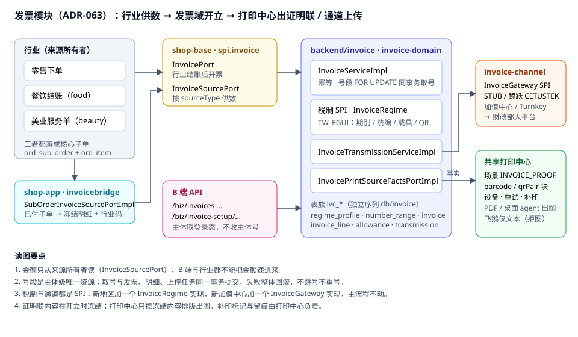

# TDD-发票模块（多行业 · 首期台湾电子发票与证明联打印）

状态：已实现（后端、证明联打印、B 端页面、自动开立、混合课税、Turnkey 通道；运营端与回执回写见 §7 后续）
档位：2 · 依据：[PRD-发票开立与打印](../requirements/PRD-发票开立与打印.md) §4 ·
决策：[ADR-063](./ADR/ADR-063-发票独立成模块与税制SPI.md)
创建：2026-11-21 · 最后更新：2026-11-23

---

## L1 定位

`invoice` 是独立业务域：**持有发票号码资源（字轨号段），把一张已付清的来源单开成一张合法发票，
负责作废、折让、上传与证明联打印**。行业（零售 / 餐饮 / 美业）只提供「来源单的冻结事实」，
税制（台湾 `TW_EGUI` …）与开票通道（加值中心 / Turnkey）都是可替换的实现。

## L2 结构



| 部分 | 位置 | 职责 |
|---|---|---|
| 跨域契约 | `shop-base` `ai.neargo.shop.spi.invoice` | `InvoicePort`（行业开票入口）、`InvoiceSourcePort`（行业供数） |
| 发票域 | `backend/invoice/invoice-domain` `ai.neargo.shop.invoice` | 号段、开立、作废、折让、上传任务、B 端 API、打印来源 |
| 税制 SPI | `…invoice.regime` / `…invoice.regime.tw` | 买受人校验、号码格式、证明联内容（一维码 / QR）、上传报文 |
| 通道 SPI | `…invoice.gateway`；实现在 `invoice-channel` | 首期 `STUB`，正式加值中心另加实现 |
| 来源实现 | `shop-app` `ai.neargo.shop.invoicebridge.port` | `SubOrderInvoiceSourcePortImpl`：已付核心子单 → 发票来源（零售、餐饮、美业共用） |
| 打印接入 | 发票域 `InvoicePrintSourceFactsPortImpl` + 打印中心场景 `INVOICE_PROOF` | 证明联走共享打印中心；打印中心新增 `barcode` / `qrPair` 版面块 |
| 迁移 | `invoice-domain/src/main/resources/db/invoice`，历史表 `ivc_flyway_history` | 独立序列 V1 起，不与主序列抢号 |

**为什么来源实现只写一个**：餐饮结账（`DiningCheckoutServiceImpl`）、美业服务单与零售下单最终都落成
核心 `ord_sub_order` + `ord_item`，行业码记在 `ord_industry_order_source.source_system`。
所以「已付子单」一个来源就覆盖三行业；行业以后有子单之外的来源（如美业储值卡销售）时，再各加一个
`InvoiceSourcePort` 实现，开票主流程不动。

**表前缀用 `ivc_` 而不是 `inv_`**：`inv_` 已被进销存占用（`inv_stock_balance` 等）。

## §0 对账一 · 需求 → 设计

| AC | 需求（一句话） | 落点 |
|---|---|---|
| AC1 | 号段依序取号、并发不重号 | `ivc_number_range` + `InvoiceServiceImpl#allocate`（`SELECT … FOR UPDATE` 后 `next_no+1`，与发票同事务） |
| AC2 | 号段用尽拒开 | `allocate` 无可用号段 → `INVOICE_NUMBER_EXHAUSTED(26003)` |
| AC3 | 同来源单幂等 | `ivc_invoice.active_source_key` 唯一键；`InvoiceServiceImpl#issue` 先查有效发票 |
| AC4 | 买受人校验 | `TwBuyerRules`（统编检查码、手机条码、自然人凭证、爱心码、互斥）→ `INVOICE_BUYER_INVALID(26004)` |
| AC5 | 金额一致 | `InvoiceSourcePort` 给出明细与总计，`InvoiceServiceImpl` 校验明细合计 = 总计；`TwEguiRegime#amounts` 按 B2C/B2B 拆销售额/税额 |
| AC6 | 证明联内容 | `TwProofCodes`（期别、一维码 19 码、左右 QR、AES 验证码 `TwQrCipher`）→ `ivc_invoice.proof_snapshot`；`InvoicePrintSourceFactsPortImpl` 供打印中心 |
| AC7 | 载具/捐赠不印证明联 | `TwEguiRegime#printMark` → `print_mark=N`，打印来源返回 `BLOCKED` |
| AC8 | 补印标「补印」并留痕 | 打印中心既有 `REPRINT`（`biz:print:reprint`，系统标记含原因与操作人）；发票域不另做 |
| AC9 | 当期作废，可重开 | `InvoiceServiceImpl#voidInvoice`：`status=VOIDED`、清 `active_source_key`、建 `VOID` 上传任务 |
| AC10 | 跨期不能作废 | `TwEguiRegime#voidable` 比较期别 → `INVOICE_VOID_PERIOD_CLOSED(26006)` |
| AC11 | 折让不超剩余 | `InvoiceServiceImpl#allowance` 条件更新 `allowed_minor + ? <= total_minor` → `INVOICE_ALLOWANCE_EXCEEDED(26007)` |
| AC12 | 上传与重试 | `ivc_transmission` + `InvoiceTransmissionServiceImpl#transmitDue`；`InvoiceGateway` SPI；失败退避重试 |
| AC13 | 多行业同一入口 | `InvoiceSourcePort`（按 sourceType 注册）+ `InvoicePort`；发票域不依赖 shop-core 与行业插件（`InvoiceBoundaryTest`） |
| AC14 | 税制可替换 | `InvoiceRegime` SPI + `ivc_regime_profile`；未开通 → `INVOICE_REGIME_NOT_ENABLED(26001)` |
| AC15 | B 端查询 | `GET /biz/invoices`、`GET /biz/invoices/{invoiceNo}` |
| AC16 | 付款后自动开立 | `ivc_regime_profile.auto_issue` + `ivc_buyer_preference` + `PUT /biz/invoices/buyer-preferences`；`InvoicePort#rememberBuyer / issueIfAutomatic`；`shop-app/…/invoicebridge/InvoiceAutoIssueConsumer`（`ORDER_PAID`） |
| AC17 | 混合课税别 | `InvoiceSourcePort.Line.taxType`（取自报价行冻结税类）、`ivc_invoice.zero_tax_sales_minor / free_tax_sales_minor`、`TwEguiRegime#amounts` |
| AC18 | 积分折抵 / 秤重调整 | `SubOrderInvoiceSourcePortImpl` 各成一行 |
| AC19 | Turnkey 通道 | `invoice-channel/…/turnkey/TurnkeyInvoiceGateway`（`shop.invoice.turnkey.root`） |

**孤立项**：无。号段登记、税制开通（`/biz/invoice-setup/*`）挂 AC1、AC14 的前置。

## §1 现状与影响面

- **可复用**：打印中心（`PrintSourceFactsPort`、`BusinessPrintFactReady`、场景 JSON 资源）；
  `BizKey`；`OutboxEventBus`；`SecretVault`（QR 加密密钥）；`ErrorCode` + 三语 properties。
- **会被改到的已在跑功能**（逐个列）：
  - 打印中心编译器 `DefaultPrintDocumentCompiler`：白名单加 `barcode`、`qrPair` 两种块；只对引用它们的模板生效。
  - 版面引擎 `DefaultPrintLayoutEngine`：行里带 `symbol` 时画 `ImageRun`；纯文本行逻辑不变。
  - PDF 渲染器 `PdfReceiptRenderer`：原来遇到 `ImageRun` 抛 `print.imageDrawingUnsupported`，改为画图。
  - `PrintSourceDataScopes`：`INVOICE` → `SOURCE_INVOICE_READ`；`PrintActorFactory` 按 `biz:invoice:read` 授予。
  - `BizPerms.ROLE_PERMS`：店长加 `biz:invoice:read/issue/void/setup`，店员加 `read/issue`。
- **明确不受影响**：`ord_invoice_request`（V94，线上事后申请）、结算发票（V111 / pay）、飞鹅通道
  （仍只收文本，遇图片按既有逻辑拒绝 `print.vendorDrawingUnsupported`，见 §4）。

## §2 方案

### 2.1 契约变更

**端点**（B 端，`@Profile("api")`，门店取 `X-Store-No`，主体取 `BizContext`，入参不接受主体号）

| 方法 | 路径 | 权限 | 说明 |
|---|---|---|---|
| POST | `/biz/invoices` | `biz:invoice:issue` | `{sourceType, sourceNo, buyer{taxId,name,carrierType,carrierId,donateCode}}` → `InvoiceVO`；幂等（同来源返回原发票） |
| GET | `/biz/invoices` | `biz:invoice:read` | `?periodCode&status&page&size` 本店分页 |
| GET | `/biz/invoices/{invoiceNo}` | `biz:invoice:read` | 详情含明细、上传状态、折让 |
| POST | `/biz/invoices/{invoiceNo}/void` | `biz:invoice:void` | `{reason}` |
| POST | `/biz/invoices/{invoiceNo}/allowances` | `biz:invoice:void` | `{amountMinor, reason}` |
| GET | `/biz/invoice-setup/profile` | `biz:invoice:setup` | 本主体税制配置 |
| PUT | `/biz/invoice-setup/profile` | `biz:invoice:setup` | `{regimeCode, sellerTaxId, sellerName, gatewayCode(STUB/TURNKEY), qrAesKeyHex?, memberCarrierType?, autoIssue?}` |
| PUT | `/biz/invoices/buyer-preferences` | `biz:invoice:issue` | `{sourceType, sourceNo, buyer}`：付款前预存买受人，自动开立时使用 |
| GET | `/biz/invoice-setup/ranges` | `biz:invoice:setup` | `?periodCode` |
| POST | `/biz/invoice-setup/ranges` | `biz:invoice:setup` | `{periodCode, track, startNo, endNo, storeNo?}` |

证明联打印、补印沿用打印中心 `POST /biz/print/requests`（`sourceRef.type=INVOICE`，`scene=INVOICE_PROOF`）。

**库表**（`db/invoice/V1__invoice_core.sql`，`V2__invoice_role_permissions.sql`）

| 表 | 关键列 | 约束 |
|---|---|---|
| `ivc_regime_profile` | tenant_no, entity_no, regime_code, seller_tax_id, seller_name, gateway_code, qr_key_ref, member_carrier_type, status | uk(tenant, entity, regime) |
| `ivc_number_range` | range_no, tenant/entity, regime_code, store_no(`*`=主体共用), period_code, track, start_no, end_no, next_no, status ACTIVE/EXHAUSTED | uk(tenant, entity, regime, period, track, start_no)；CHECK start≤end |
| `ivc_invoice` | invoice_no, tenant/entity/store, regime_code, industry_code, source_type, source_no, **active_source_key**, fiscal_number, period_code, random_code, issued_at, buyer_type, buyer_tax_id, buyer_name, carrier_type, carrier_id, donate_code, print_mark, currency, sales/zero_tax_sales/free_tax_sales/tax/total_minor, allowed_minor, tax_type, status, void_*, proof_snapshot JSON, proof_snapshot_hash | uk(tenant, fiscal_number, regime)；uk(tenant, entity, active_source_key)；CHECK allowed≤total |
| `ivc_invoice_line` | invoice_no, line_no, source_line_ref, name, quantity, unit, unit_price_minor, amount_minor, tax_type | uk(invoice_no, line_no) |
| `ivc_buyer_preference` | tenant/entity, source_type, source_no, buyer_tax_id, buyer_name, carrier_type, carrier_id, donate_code | uk(tenant, entity, source_type, source_no) |
| `ivc_allowance` | allowance_no, invoice_no, tenant/entity/store, amount_minor, tax_minor, reason | uk(allowance_no) |
| `ivc_transmission` | transmission_no, tenant/entity, regime/gateway_code, message_type ISSUE/VOID/ALLOWANCE, ref_no, payload JSON, status PENDING/SENT/FAILED, attempts, next_attempt_at, last_error, gateway_ref | uk(tenant, message_type, ref_no)；idx(status, next_attempt_at) |

**权限码**：`biz:invoice:read` / `issue` / `void` / `setup`（`BizPerms` + V2 角色种子）。

**错误码**（26xxx · 发票，交易段）：

| 码 | 枚举 | 场景 |
|---|---|---|
| 26001 | INVOICE_REGIME_NOT_ENABLED | 主体未开通发票 |
| 26002 | INVOICE_SOURCE_NOT_READY | 来源单未付清 / 不存在 / 金额组成不支持 |
| 26003 | INVOICE_NUMBER_EXHAUSTED | 本期号码已用完 |
| 26004 | INVOICE_BUYER_INVALID | 买受人信息不合规（统编、载具、爱心码、互斥） |
| 26005 | INVOICE_NOT_FOUND | 发票不存在 |
| 26006 | INVOICE_VOID_PERIOD_CLOSED | 跨期不能作废 |
| 26007 | INVOICE_ALLOWANCE_EXCEEDED | 折让超过剩余可折让 |
| 26008 | INVOICE_STATE_INVALID | 已作废发票再作废 / 折让 |
| 26009 | INVOICE_RANGE_INVALID | 号段格式错误或与已有号段重叠 |

**i18n**：上述 9 条 × 三语（`messages*.properties`）。**配置项**：`shop.invoice.transmission.enabled`（默认 false）、`shop.invoice.turnkey.root` / `shop.invoice.turnkey.path-pattern`（配了才装 Turnkey 通道）、
`shop.invoice.flyway.enabled`（默认 true，与平台迁移同开同关）。

### 2.2 关键接口

```java
// shop-base · ai.neargo.shop.spi.invoice
public interface InvoicePort {                       // 行业结账后开票
    InvoiceReceipt issue(Scope scope, String sourceType, String sourceNo, Buyer buyer);
    Optional<InvoiceReceipt> activeOf(Scope scope, String sourceType, String sourceNo);
}
public interface InvoiceSourcePort {                 // 行业供数，按 sourceType 注册，重复启动失败
    Set<String> sourceTypes();
    InvoiceSource load(Scope scope, String sourceType, String sourceNo);  // 未付清抛 INVOICE_SOURCE_NOT_READY
}
record InvoiceSource(String industryCode, String currency, Instant paidAt, long totalMinor, List<Line> lines)
record Line(String sourceLineRef, String name, BigDecimal quantity, String unit, long unitPriceMinor, long amountMinor)

// invoice-domain · 税制 SPI
public interface InvoiceRegime {
    String code();                                         // TW_EGUI
    String periodOf(Instant at);                           // 11512
    void validateBuyer(Buyer buyer, IvcRegimeProfile p);   // 不合规抛 INVOICE_BUYER_INVALID
    Amounts amounts(long totalMinor, Buyer buyer);         // B2C: 销售额=总计、税额=0；B2B: 拆 5%
    boolean printMark(Buyer buyer);                        // 有载具/捐赠 → false
    String randomCode();
    Map<String,Object> proof(IvcInvoice inv, List<IvcInvoiceLine> lines, IvcRegimeProfile p, byte[] qrKey);
    boolean voidable(IvcInvoice inv, Instant now);
    Map<String,Object> message(String messageType, IvcInvoice inv, List<IvcInvoiceLine> lines, IvcAllowance a);
}
// 通道 SPI
public interface InvoiceGateway { String code(); GatewayReceipt send(String regimeCode, String messageType, String payloadJson); }
```

### 2.3 台湾证明联内容（`TwProofCodes`）

- 期别 `yyyMM`：民国年 3 位 + 双月（11、12 月 → `12`）；显示「115年11-12月」。时区固定 `Asia/Taipei`。
- 一维码（Code39）：期别 5 + 号码 10 + 随机码 4 = 19 码。
- 左 QR：号码 10 + 民国日期 7 + 随机码 4 + 销售额 8 位十六进制 + 总计 8 位十六进制 + 买方统编 8（无则 `00000000`）
  + 卖方统编 8 + 加密验证 24 + `:**********:` + QR 内品目笔数 + `:` + 总品目笔数 + `:1:` + `品名:数量:单价…`。
- 加密验证：`AES/CBC/PKCS5Padding`，密钥 = 主体在财政部取得的 32 位十六进制 AES Key，IV 为财政部公开固定值，
  明文 = 号码 + 随机码，Base64 后 24 字符。
- 右 QR：`**` + 左码放不下的品目；单码预算 200 字节（UTF-8），超出部分不入码（总品目笔数仍如实写）。

### 2.4 模块设计（代码清单）

| 动作 | 路径 | 说明 |
|---|---|---|
| 新增 | `backend/invoice/pom.xml` | 聚合 `invoice-domain`、`invoice-channel` |
| 新增 | `backend/invoice/invoice-domain/pom.xml` | 依赖 shop-base、shop-base-auth、shop-store-mybatis、print-api、secret-api |
| 新增 | `invoice-domain/…/invoice/entity/Ivc{RegimeProfile,NumberRange,Invoice,InvoiceLine,Allowance,Transmission}.java` | 表实体 |
| 新增 | `invoice-domain/…/invoice/mapper/InvoiceMappers.java` | 六个 Mapper + 号段加锁查询 |
| 新增 | `invoice-domain/…/invoice/dto/InvoiceDtos.java` | Req / VO / Query |
| 新增 | `invoice-domain/…/invoice/regime/{InvoiceRegime,InvoiceRegimes,RegimeModels}.java` | 税制 SPI、注册表、Amounts/Buyer 模型 |
| 新增 | `invoice-domain/…/invoice/regime/tw/{TwEguiRegime,TwPeriods,TwBuyerRules,TwProofCodes,TwQrCipher}.java` | 台湾电子发票 |
| 新增 | `invoice-domain/…/invoice/gateway/{InvoiceGateway,GatewayReceipt}.java` | 通道 SPI |
| 新增 | `invoice-domain/…/invoice/service/{InvoiceService,InvoiceSetupService,InvoiceTransmissionService}.java` + `impl/` | 开立/作废/折让/查询、配置与号段、上传任务 |
| 新增 | `invoice-domain/…/invoice/port/{InvoicePortImpl,InvoicePrintSourceFactsPortImpl}.java` | 对行业、对打印中心 |
| 新增 | `invoice-domain/…/invoice/api/biz/{BizInvoiceController,BizInvoiceSetupController,BizInvoiceScope}.java` | B 端；`BizInvoiceScope` 统一取租户/主体/门店/操作人 |
| 新增 | `invoice-domain/…/invoice/job/InvoiceTransmissionJob.java` | 定时上传（开关控制） |
| 新增 | `invoice-domain/src/main/resources/db/invoice/V1__invoice_core.sql`、`V2__invoice_role_permissions.sql` | 独立迁移序列 |
| 新增 | `backend/invoice/invoice-channel/…/invoice/channel/stub/StubInvoiceGateway.java` | 本地桩通道 |
| 新增 | `backend/invoice/invoice-channel/…/invoice/channel/turnkey/TurnkeyInvoiceGateway.java` | 财政部 Turnkey：MIG XML 原子落目录 |
| 新增 | `invoice-domain/…/invoice/entity/IvcBuyerPreference.java` | 预存买受人 |
| 新增 | `shop-app/…/invoicebridge/InvoiceAutoIssueConsumer.java` | `ORDER_PAID` → 自动开立 |
| 修改 | `shop-base-auth/…/auth/BizPerms.java` | `LABELS` 补发票四码；`assignableCodes` 排除 `biz:invoice:setup` |
| 修改 | `b-app/src/i18n/locale/{zh-CN,en,ar}.ts`、`packages/shared/tests/biz-role-seed.test.ts`、`docs/technical/README.md` | 权限文案、角色种子守卫读模块序列、索引 |
| 新增 | `shop-base/…/spi/invoice/{InvoicePort,InvoiceSourcePort}.java` | 跨域契约 |
| 新增 | `shop-app/…/invoicebridge/port/SubOrderInvoiceSourcePortImpl.java` | 已付子单来源（三行业共用） |
| 新增 | `shop-app/…/config/InvoiceSchemaConfig.java` | `db/invoice` 迁移，历史表 `ivc_flyway_history` |
| 修改 | `backend/pom.xml`、`shop-app/pom.xml`、`shop-core/pom.xml` | 模块登记；zxing 版本在父 POM 管理 |
| 修改 | `shop-base/…/common/{ErrorCode,BizKey}.java`、`shop-base-auth/…/auth/BizPerms.java` | 26001–26009、`IVC/IVA/IVR/IVT`、四个权限码 |
| 修改 | `shop-app/…/i18n/messages{,_en,_ar}.properties`、`docs/api/响应格式规范.md` | 错误码文案与分段表 |
| 修改 | `print-api/…/PrintSourceDataScopes.java`、`shop-app/…/printbridge/PrintActorFactory.java` | INVOICE 数据权限 |
| 新增 | `shop-core/…/printing/center/layout/PrintSymbolRenderer.java` | zxing 生成 Code39 / QR 位图 |
| 修改 | `shop-core/…/template/DefaultPrintDocumentCompiler.java`、`layout/DefaultPrintLayoutEngine.java` | `barcode`、`qrPair` 块 |
| 修改 | `shop-core/src/main/resources/print/print-{scene-catalog,template-definitions,scene-examples}.json` | `INVOICE_PROOF` 场景与 58mm 模板 |
| 修改 | `print-channel/…/pdf/PdfReceiptRenderer.java` | 画 `ImageRun` |
| 新增 | 测试：`TwRulesTest`、`TwProofCodesTest`、`InvoiceServiceMysqlTest`、`InvoiceBoundaryTest`（invoice-domain），`TurnkeyInvoiceGatewayTest`（invoice-channel），`InvoiceProofLayoutTest`（print-channel），`SubOrderInvoiceSourcePortImplTest`、`InvoiceAutoIssueConsumerTest`（shop-app） | 见 §5 |
| 修改 | `shop-app/src/test/…/arch/{ArchitectureTest,BizEndpointPermTest,BizRoleSeedTest}.java`、`infra/SchemaDriftTest.java` | 登记 `invoice` 域与 `invoicebridge`、6 个 /biz 端点的权限、模块迁移序列的角色追加、`db/invoice` 重放 |
| 修改 | `backend/scripts/gen-test-schema.py`、`shop-app/src/test/resources/schema-test.sql` | H2 夹具接上 `db/invoice`（只并入发票增量，见 §6） |
| 修改 | `print-channel/src/test/…/ReceiptSoftwareAcceptanceTest.java` | 按场景声明的纸宽渲染（证明联只有 58） |
| 新增 | `docs/api/invoice.openapi.json` | 10 个 /biz 端点的公开契约（首次提交时另有 `backend-ui-delivery-invoice.json` 登记「页面待接」，B 端页面接通后已删除） |
| 新增 | `b-app/src/pages/{sales-invoices,sales-invoice,sales-invoice-issue,invoice-setup}/index.vue` | 列表（期别/状态筛选）、详情（作废 / 折让 / 打印证明联走打印中心 J03）、开票（含「仅预存，付款后自动开立」）、设置（税制、通道、自动开立、号段） |
| 新增 | `b-app/src/api/{sales-invoice,sales-invoice-http}.ts`、`api/mocks/sales-invoice.ts`、`shared/sales-invoice.ts` | 端点 `mSi*`；mock 抛「不可用」不伪造成功 |
| 修改 | `b-app/src/{pages.json,shared/nav.ts,shared/store-scope.ts,api/contract.ts,api/endpoints.ts,api/http.ts,api/mocks/index.ts,pages/home/index.vue,pages/order/index.vue}`、三语 locale、`docs/technical/design/ui-catalog.json` | 路由登记、首页「销售发票」入口、订单详情「开发票」入口（子单号预填）、门店作用域、界面清单 |

### 2.5 开立时序

1. B 端 / 行业调用 `issue(scope, sourceType, sourceNo, buyer)`。
2. 已有有效发票（`active_source_key` 命中）→ 原样返回（AC3）。
3. 读主体税制配置；未开通 → 26001。
4. `InvoiceSourcePort#load` 取冻结明细；校验明细合计 = 总计（AC5）。
5. 税制校验买受人（AC4），算销售额/税额，定 `printMark`。
6. **同一事务**：号段 `FOR UPDATE` 取号（AC1/2）→ 插发票、明细 → 生成证明联快照 → 插 `ISSUE` 上传任务；
   唯一键冲突（并发同来源）回读原发票返回。
7. 提交后：`printMark=Y` 时发 `BusinessPrintFactReady`，打印中心按路由自动出证明联。

## §3 选型

| 方案 | 优点 | 缺点 | 结论 |
|---|---|---|---|
| 号段计数器放 Redis | 快 | 与发票落库不在同一事务，宕机会跳号/重号 | ❌ |
| 号段行 `SELECT … FOR UPDATE` + 同事务插发票 | 不重号、不跳号可证 | 单主体高并发时串行 | ✅ 门店开票 QPS 极低，串行可接受 |
| 证明联自己出 ESC/POS | 不依赖打印中心 | 重复造设备/重试/补印留痕 | ❌ |
| 证明联走打印中心，条码以位图 `ImageRun` 画 | 复用设备、补印、对账；PDF/桌面 agent 天然支持 | 飞鹅等文本通道暂不能出条码 | ✅ |
| 发票迁移进主序列 | 一处管理 | 主序列多会话并行抢号，本分支与 main 已差 26 号 | ❌ 用独立序列 `db/invoice` |

## §4 风险

| 风险 | 影响 | 缓解 |
|---|---|---|
| QR 加密规格与财政部验证不一致 | 证明联扫不出 | `TwQrCipher` 用财政部公开 IV 与样例单测；正式启用前用财政部「电子发票 QR 码验证」实测一张 |
| 飞鹅通道不支持图片 | 用飞鹅的门店打不出证明联 | 打印中心如实返回 `print.vendorDrawingUnsupported`；后续给飞鹅适配 `<QR>`/`<BC128>` 原生标签（Code39 需确认机型） |
| 子单金额组成与发票总计口径 | 开错金额 | 明细 + 运费 − 优惠 − 积分折抵 ± 秤重 = 实付，对不上 → 26002；混合税别下整单优惠/折抵分不到税别 → 26002，不伪造分摊 |
| Turnkey 只确认「文件已交出」 | 大平台退件看不到 | 报文与文件名可追溯；回执目录（ERRORS/ProcessResult）回写是下一步；48 小时期限在 B 端可见上传状态 |
| 报价税类缺失或 OUT_OF_SCOPE | 不能开 | 回 26002，不默认按应税开 |

## §5 对账三 · 实现 → 需求（测试）

原生库测试连本机 MySQL 9.7（127.0.0.1:3308，每次建随机库、跑完删除），环境变量沿用 `COMMERCE_MYSQL_URL/USER/PASSWORD`。

| AC | 测试方法 | 结果 |
|---|---|---|
| AC1 | `InvoiceServiceMysqlTest#ac1NumbersAreSequentialAndConcurrentIssuesNeverDuplicate`（顺序 3 张 + 12 线程并发，15 号 15 张无缺号） | ✅ |
| AC2 | `#ac2ExhaustedRangeRejectsWithoutCreatingAnInvoice` | ✅ |
| AC3 | `#ac3SameSourceReturnsTheOriginalInvoiceEvenUnderConcurrency`（6 线程同来源 → 1 张、只取 1 号） | ✅ |
| AC4 | `TwRulesTest#taxIdChecksumIncludingTheSeventhDigitSevenRule`、`#buyerCombinationsAndCarrierFormats`；`#ac4InvalidBuyerRejectedBeforeANumberIsTaken` | ✅ |
| AC5 | `TwRulesTest#b2cKeepsTaxInsideSalesAndB2bSplitsFivePercent`；`#ac5AmountsAgreeWithTheSourceAndB2bSplitsTax` | ✅ |
| AC6 | `TwProofCodesTest`（19 码一维码、左 QR 77 字头、溢出到右 QR 与笔数）；`TwRulesTest#qrVerificationIsAesCbcOfNumberAndRandomWithTheOfficialIv`；`#ac6ProofSnapshotCarriesCodesAndPrintCenterIsWoken`；`InvoiceProofLayoutTest#proofDrawsBarcodeAndTwoQrCodesAsImagesThatSurviveIntoPdf` | ✅ |
| AC7 | `#ac7CarrierOrDonationMeansNoProof` | ✅ |
| AC8 | 补印复用打印中心 REPRINT（既有测试覆盖）；本期无新增代码 | — |
| AC9 | `#ac9VoidInPeriodFreesTheSourceForANewNumber`（作废后打印守卫为 CANCEL） | ✅ |
| AC10 | `#ac10PreviousPeriodCannotBeVoided` | ✅ |
| AC11 | `#ac11AllowancesNeverExceedTheInvoice` | ✅ |
| AC12 | `#ac12TransmissionSendsAndRetriesTheSamePayload` | ✅ |
| AC13 | `InvoiceBoundaryTest#invoiceDomainImportsNoIndustryOrTradeCode`；`ArchitectureTest` 登记 `invoice` 域（无发票违规） | ✅ |
| AC14 | `#ac14NoRegimeMeansNoInvoice` | ✅ |
| AC15 | `#ac15ListByPeriodAndStatusInTheCurrentStore`；B 端页面 `vue-tsc --noEmit` 无错、b-app vitest 400/400 | ✅ |
| 设置 | `#setupRejectsOverlappingRangesAndRoleSeedGotInvoicePermissions`（V2 角色追加在真库生效） | ✅ |
| AC16 | `#autoIssueUsesTheRememberedBuyerOnlyWhenTheEntityTurnedItOn`；`InvoiceAutoIssueConsumerTest`（2） | ✅ |
| AC17 | `TwRulesTest#mixedTaxTypesSplitIntoTaxableZeroAndFreeAndOnlyTaxablePaysTax`、`#allowanceTaxFollowsTheTaxableShareOfTheInvoice`；`#ac5MixedTaxTypesArePersistedPerLineAndInTheUploadMessage`；`SubOrderInvoiceSourcePortImplTest#foodOrderTakesIndustryAndTaxClassFromTheFrozenQuote`、`#mixedTaxWithWholeOrderDiscountOrUnknownTaxClassIsNotInvoiced` | ✅ |
| AC18 | `SubOrderInvoiceSourcePortImplTest#retailOrderBecomesItemsFreightDiscountPointsAndWeighLinesThatSumToThePayment`、`#unpaidOrPartlyRefundedOrdersAreNotInvoiced` | ✅ |
| AC20 | `InvoiceServiceMysqlTest#ac20BuyerKeepsCarriersAndTheFirstOrChosenOneIsDefault` | ✅ |
| AC21 | `#ac21MemberCarrierNumberIsTheLoggedInBuyerAndIssuesWithoutPaper` | ✅ |
| AC22 | `#ac22AutoIssueDefaultsToMemberCarrierWhenThereIsABuyerAndNoChoice` | ✅ |
| AC23 | `#ac21…`（买家只看到自己的）；`MpEndpointAuthTest#loginRequiredEndpointsRejectAnonymous`（6 个端点匿名被拒） | ✅ |
| AC24 | `#ac23ChoosingOnAPaidOrderIssuesNowAndEachShopAnswersForItself` | ✅ |
| AC19 | `TurnkeyInvoiceGatewayTest`（2：命名空间 XML、转义、原子写、重发覆盖；拒绝非台湾与未知报文） | ✅ |

实际输出（2026-11-21）：

```
invoice-domain  TwRulesTest 8 · TwProofCodesTest 3 · InvoiceServiceMysqlTest 20 · InvoiceBoundaryTest 1  → Tests run: 32, Failures: 0, Errors: 0
invoice-channel TurnkeyInvoiceGatewayTest 2                                                           → Tests run: 2, Failures: 0, Errors: 0
shop-app        SubOrderInvoiceSourcePortImplTest 4 · InvoiceAutoIssueConsumerTest 2                   → Tests run: 6, Failures: 0, Errors: 0
print-channel   ReceiptSoftwareAcceptanceTest 27 · InvoiceProofLayoutTest 2                            → Tests run: 29, Failures: 0, Errors: 0
shop-app        BizRoleSeedTest 4 · BackendI18nParityTest 6 · ErrorCodeUniqueTest 3 · ConditionalBeanWiringTest 1
                ControllerProfileTest 2 · FunctionPointPermAlignmentTest 3 · JsonColumnSeedTest 1           → 全绿
packages/shared spec-completeness「错误码分段表与 ErrorCode.java 一致」对 26xxx 无差异
scripts/check-sql-portability.mjs（扫 backend/，含 db/invoice）                                         → exit 0
```

**本分支 HEAD 上已有、与本次无关的红**（逐条核过失败信息不含 invoice；其中 `SchemaDriftTest` 与 `BusinessPrintSourceFlowTest`
另在干净 HEAD 工作树复跑同样失败）：`ArchitectureTest` 5 条、`BizKeyConventionTest`、`OrphanModuleTest`、`ScheduledJobConventionTest`、
`MpEndpointAuthTest`、`PayAuditTrailTest`、`PayReverseDependencyBudgetTest`、`InventoryDisabledContextTest`、`SchemaParityTest`、
`SchemaDriftTest`（正则 StackOverflow）、`MapperSmokeTest`（prd_execution_retention 等表缺 H2 投影）、`BizEndpointPermTest`（其他 5 个端点）、
`MerchantRoleFlowTest#assignablePermsComeFromBackend`、`BusinessPrintSourceFlowTest`；vitest `message-placeholder` 与 `LOGIN_TICKET_INVALID`、字段说明缺失。

## §6 对账二 · 设计 → 实现

文件清单见提交 `git show --stat`（§2.4 已按实际补齐）。与 §2.4 对比无遗漏、无多出文件。

### 偏差说明

| 偏差 | 原因 |
|---|---|
| `ivc_invoice.proof_snapshot` 用 `LONGTEXT` + `CHECK (JSON_VALID(...))`，不用 `JSON` 类型 | 真库测试发现 MySQL 会把 JSON 列重排键、加空白（实测 `{"source":1,"a":2}` → `{"a": 2, "source": 1}`），读回文本与开立时算的哈希对不上，打印中心 `FrozenJson` 直接拒绝。**同一隐患疑似存在于打印中心既有的 `biz_print_fact.snapshot`（V589，JSON 列 + 哈希）**，未在本次处理，另行核实 |
| 取号后的同来源复查改为锁定读 `InvoiceMapper#lockActive`（`FOR SHARE`） | 可重复读隔离下普通 SELECT 读的是事务首读快照，看不见排在前面刚提交的发票，会撞唯一键而不是返回原发票；AC3 并发用例覆盖 |
| zxing 依赖加在 `shop-core`（版本在父 POM） | 版面引擎住在 `shop-core/printing/center`，条码位图在那里生成 |
| 证明联模板只有 `STANDARD_58`；`ReceiptSoftwareAcceptanceTest` 改为按场景声明的纸宽渲染 | 证明联法定 5.7 cm，不提供 80 mm 版本 |
| 上传任务增加 `SENDING` 中间态（超过 10 分钟视为执行者中断） | 多实例下用条件更新认领，避免同一报文并发发送 |
| V1 在首次合入前补改（课税别两列、`auto_issue`、`ivc_buyer_preference`），未另开 V3 | V1 只存在于本分支未推送的提交里，从未在任何持久库执行过（测试库每次建删）；补改比叠一条 `DROP CHECK` 迁移干净，且 H2 重放器不认 `DROP CHECK` |
| `biz:invoice:setup` 不进自定义角色可分配列表 | 它写统编、QR 加密密钥与号段，与已排除的跨店税配置同类 |
| `schema-test.sql` 只并入发票增量 | 本分支已存在与生成器不一致的漂移（他人在途改动），整份重生成会把无关改动一并带入 |

## §7 确认与完成

| 日期 | 事件 |
|---|---|
| 2026-11-21 | 用户确认：依据 CKO-24 / CKO07 / 打印中心 / V94；通用方案先实现台湾；直接在 codex/food-next01 开发 |
| 2026-11-21 | 已实现首期；闸门：invoice-domain / print-channel 相关测试全绿（MySQL 9 原生），shop-app 守卫对发票部分全绿，扫描范围见 §5 |

### 后续（不在本期）

1. 运营端「上传失败 / 即将超过 48 小时」清单（PRD §2 运营场景；需 ops 五处登记）。
2. Turnkey 回执目录（处理结果、退件）回写 `ivc_transmission`；商业加值中心通道按签约方各加一个 `InvoiceGateway`。
3. 手机条码真伪验证：接财政部验证接口（需营业人或加值中心 AppID）；目前只校验格式。
4. 飞鹅等文本通道：其原生标签只有 Code128 / QR，没有证明联规定的 Code39，故证明联只走 PDF / 桌面 agent；如需飞鹅出证明联，须先确认机型支持 Code39。

## §8 载具优先（C 端载具、会员载具、我的发票）

| AC | 落点 |
|---|---|
| AC20 | `ivc_user_carrier`（V3）+ `InvoiceBuyerServiceImpl#saveCarrier / carriers / deleteCarrier`；`GET/POST /mp/invoice-carrier`、`POST /mp/invoice-carrier/{carrierNo}/delete` |
| AC21 | `InvoiceServiceImpl#memberCarrier`：类别号取主体 `member_carrier_type`，号码 = 登录买家用户号，服务端填 |
| AC22 | `InvoiceServiceImpl#issueIfAutomatic`：无预存选择 + 来源有买家 + 主体有会员载具 → 会员载具；否则一般 |
| AC23 | `ivc_invoice.buyer_user_no`（V3，开立时取自 `InvoiceSource.buyerUserNo`）；`GET /mp/sales-invoice`、`/{invoiceNo}` |
| AC24 | `InvoiceSourcePort#sourcesOfBuyerOrder`（子单实现按买家过滤）+ `InvoiceBuyerServiceImpl#choose`；`PUT /mp/sales-invoice/choice` |

**为什么会员载具号码不让顾客填**：会员载具的号码就是他的账号；让客户端报号码，等于允许把发票存进别人的载具。
**为什么按订单而不是按子单选**：C 端只认识主订单；一张单拆给几家商家时，每家各自一个事务、各自回结果，一家没开通不影响另一家。
**为什么迁移是 V3 而不再补改 V1**：V1 已在本分支提交；此后改表一律加新迁移。

| 动作 | 路径 | 说明 |
|---|---|---|
| 新增 | `invoice-domain/…/db/invoice/V3__invoice_buyer_carriers.sql` | `ivc_invoice.buyer_user_no` + 索引；`ivc_user_carrier` |
| 新增 | `invoice-domain/…/entity/IvcUserCarrier.java`、`service/InvoiceBuyerService.java`、`service/impl/InvoiceBuyerServiceImpl.java`、`api/mp/MpSalesInvoiceController.java` | C 端载具与开法 |
| 修改 | `shop-base/…/spi/invoice/InvoiceSourcePort.java` | `InvoiceSource.buyerUserNo`、`sourcesOfBuyerOrder`、`BuyerSource` |
| 修改 | `invoice-domain/…/service/impl/{InvoiceServiceImpl,InvoiceSetupServiceImpl}.java`、`dto/InvoiceDtos.java`、`mapper/InvoiceMappers.java` | 买受人在读到来源后决定、`listForBuyer / getForBuyer`、VO 带营业人；清空会员载具类别号显式写 null |
| 修改 | `shop-app/…/invoicebridge/port/SubOrderInvoiceSourcePortImpl.java` | 带出买家、按买家列订单子单 |
| 修改 | `shop-app/src/test/…/arch/MpEndpointAuthTest.java` | 6 个 /mp 端点登记为要登录，补探测请求体 |
| 新增 | `c-app` 我的发票 / 载具管理 / 订单开法页面 | 见 §8 测试 |

偏差：`InvoiceSetupServiceImpl#saveProfile` 原先用 `updateById`，清空会员载具类别号时被静默跳过（商家关不掉会员载具）；
AC22 用例在 MySQL 上复现后改为显式写 null。

## §9 发票打印（后端）

| AC | 落点 |
|---|---|
| AC25 | 场景 `INVOICE_DETAIL`（58 / 80）；`TwEguiRegime#detail`、`InvoiceServiceImpl#detailLines`；`ivc_invoice.detail_snapshot`（V4）；开立后唤醒 |
| AC26 | 场景与来源类型 `INVOICE_ALLOWANCE`（58 / 80）；`TwEguiRegime#allowanceProof`；`ivc_allowance.print_snapshot`（V4）；折让后唤醒 |
| AC27 | 正本唯一：打印中心按事实的触发键去重（既有）；加印：场景目录 `extraCopiesAllowed: false` → `PrintReprintServiceImpl` 拒绝 `print.extraCopiesNotAllowed`、`PrintViews` 不出「加印」动作；补印标记：场景目录 `reprintNotice`「補印」随文档冻结，`DefaultPrintLayoutEngine` 在 REPRINT 时以 16pt 画在正文开头 |

**为什么交易明细每张都唤醒、证明联只在应印时唤醒**：载具 / 捐赠发票不出纸，顾客手上唯一的东西就是明细；
是否真的自动出纸由门店的场景策略决定（打印中心既有），不在发票域写死。
**为什么折让证明单的法定全称不放在系统栏**：系统栏的公告行不换行，58 mm 放不下「營業人銷貨退回、進貨退出或折讓證明單」，
所以系统栏写「折讓證明單」，全称作为正文第一行（会换行）。
**补印标记只对非紧凑版面生效**：发票三种模板都不用 COMPACT_V2；以后紧凑模板要用 `reprintNotice` 需在 `CompactPrintLayout` 补同样的一段。

| 动作 | 路径 | 说明 |
|---|---|---|
| 新增 | `invoice-domain/…/db/invoice/V4__invoice_print_documents.sql` | 明细与折让证明单快照（LONGTEXT + JSON_VALID） |
| 修改 | `invoice-domain/…/port/InvoicePrintSourceFactsPortImpl.java` | 两种来源类型、三种场景；作废发票的证明联与明细都取消 |
| 修改 | `invoice-domain/…/regime/{InvoiceRegime,tw/TwEguiRegime}.java`、`service/impl/InvoiceServiceImpl.java`、`entity/{IvcInvoice,IvcAllowance}.java` | 内容生成、冻结与唤醒 |
| 修改 | `shop-core/…/printing/center/{template/PrintSceneRegistry,template/DefaultPrintDocumentCompiler,layout/DefaultPrintLayoutEngine,service/impl/PrintReprintServiceImpl,service/impl/PrintQueryServiceImpl,support/PrintViews}.java` | `extraCopiesAllowed`、`reprintNotice` |
| 修改 | `print-api/…/PrintSourceDataScopes.java`、`shop-core/src/main/resources/print/print-*.json` | 数据权限与场景、模板、示例 |

| AC | 测试 | 结果 |
|---|---|---|
| AC25 | `InvoiceServiceMysqlTest#ac25EveryInvoiceHasAFrozenDetailSlipAndCarrierOnesSayWhereTheInvoiceWent`、`#ac7CarrierOrDonationMeansNoProof`；`ReceiptSoftwareAcceptanceTest`（58 / 80 出 PDF） | ✅ |
| AC26 | `#ac26AllowanceProofIsFrozenPrintableAndVoidStopsTheInvoiceDocuments`；`ReceiptSoftwareAcceptanceTest` | ✅ |
| AC27 | `InvoiceProofLayoutTest#reprintOfTheProofCarriesAVisibleBuYinMarkButTheOriginalDoesNot`、`#onlyTheProofRefusesExtraCopies` | ✅ |

`PrintDatabaseAcceptanceTest#sampleSimulationAndPdfExportNeverCreateProductionJobs` 在干净父提交上同样失败（模拟运行 0 成功，与 `BusinessPrintSourceFlowTest` 同一症状），非本次引入。

### §9.1 打印前端（B 端）

| 入口 | 接法 |
|---|---|
| 发票详情「打印证明联」 | `POST /biz/print/requests`（J03），`sourceRef {INVOICE, invoiceNo, scene INVOICE_PROOF}`；ISSUED + printMark + `biz:print:submit`。重复按不会出第二张正本（打印中心按触发键去重） |
| 「打印交易明细」 | 同上，scene `INVOICE_DETAIL`；ISSUED 即可，不看 printMark |
| 折让行「打印折让证明单」 | 同上，`sourceRef {INVOICE_ALLOWANCE, allowanceNo, scene INVOICE_ALLOWANCE}` |
| 「补印证明联」 | 按场景分页查作业（J06），取 `documentKey = 发票号:INVOICE_PROOF` 的最新一张；选原因（卡纸 / 缺纸 / 顾客遗失 / 其他）后 `POST /biz/print/jobs/{jobNo}/reprints`（J13）。没出过正本时提示先打正本；`biz:print:reprint` + `biz:print:read` |
| 打印中心 | 动作只认后端下发的 `allowedActions`（证明联不出「加印」）；23 个场景三语名称；`printCenter.failure.*` 失败文案 |
| 「打印中心」链接 | 按来源子单号过滤 —— 发票打印件的事实记了来源子单（`InvoicePrintSourceFactsPortImpl#fact`），与该单的支付小票列在一起 |

**共享 `ApiError` 带出失败 `data`**（`packages/shared/src/net/http-client.ts`）：打印中心把机器可读原因放在 `data.key`，
此前 HTTP 失败路径把它丢了，用户只看到「打印操作未完成」。改为可选第三参数，旧调用不受影响（`http-error-data.test.ts`）。

| 测试 | 结果 |
|---|---|
| `b-app/tests/sales-invoice-print.test.ts`（7）、`b-app/tests/print-center.test.ts`；b-app vitest 410/410；b-app、c-app `vue-tsc` 无错 | ✅ |
| `packages/shared/tests/http-error-data.test.ts`（2） | ✅ |
| `InvoiceServiceMysqlTest#ac25…`（打印事实挂来源子单） | ✅ |

## §10 服务商接入整合方案（鲸跃、绿界）

状态：草稿 · 2026-11-21。依据远端 `codex/food-next01` 的三份对接文档（`TDD-台湾电子发票-鲸跃与绿界.md`、`design/台灣電子發票多服務商接入方案.md`、`交接-台湾电子发票-鲸跃与绿界.md`，提交 `b41142678`、`b494219df`）与 UME Git 备份 `trendlab-pay/service-rpc@master` 的源码核对，把两家厂商落到本模块（`ivc_*`）上。

### 10.1 已核实的事实

| 项 | 鲸跃（Cetustek） | 绿界（ECPay） |
|---|---|---|
| 存量 | UME `invoice.t_user` 274 个账号、`t_invoice` 18,653 张，全部 `cetustek`；餐饮四分片当日仍在开立 | 无存量，新接入 |
| 协议 | SOAP 1.1，`text/xml`，命名空间 `http://webservice.cetustek.com/`，结果取 `<return>` | HTTPS JSON；外层 `MerchantID`、`RqHeader.Timestamp`、`Data`，`Data` 为 URL Encode 后 AES-128-CBC/PKCS7 再 Base64；先判 `TransCode` 再判 `RtnCode` |
| 地址 | UME 生产 `http://ve.ei.com.tw/InvoiceEntitySync/InvoiceAPI`；dev/uat `http://invoice.cetustek.com.tw/InvoiceEntitySync/InvoiceAPI`；两者改 HTTPS 读 WSDL 均 403。另有公开新服务 `https://www.ei.com.tw/InvoiceMultiWeb/InvoiceAPI`（`CreateInvoiceV3`、`QueryInvoiceByOrderid`、`CancelInvoice`、`CreateAllowance` 等，方法集不同） | 测试 `https://einvoice-stage.ecpay.com.tw`，正式 `https://einvoice.ecpay.com.tw` |
| 凭证 | 只有商家级：`officeid`（店家代号）、`posno`（账号）、`posid`（密码），UME 来源 `t_user.OFFICE_ID/ID/PW`；**无平台密钥** | 商家级：`MerchantID`、发票专用 `HashKey`、`HashIV`；无平台密钥 |
| 发票号 | **厂商配号段，本地依序取号**：`ApplyInvoiceNumber(民国年, 双月)` → `applyid` → `TakeInvoiceNumber` 回 `字轨;起号;讫号;种类`；`CheckInvoiceNumber` 回目前号；开立时本地生成随机码后 `UploadInvoice` | **在线由绿界分配**：`/B2CInvoice/Issue` 回 `InvoiceNo`、日期、随机码；本地以 `RelateNumber`（≤50，大写字母数字）作幂等身份；离线另有取号区间 + `OfflineIssue` |
| 动作 | `QueryOfficeInfo`、`QueryLoveCode`、`UploadInvoice`(S0)、`QueryInvoiceStatus`、`UploadCancelInvoice`(C0，作废)、`UploadVoidInvoice`(V0)、`UploadAllowance`(A0)、`UploadCancelAllowance`(C0)；失败 `error/invalid/exist/nodata/notake` | `Issue`、`GetIssue`、`Invalid`、`Allowance`/线上折让、`GetAllowanceList`、`AllowanceInvalid`、`CheckBarcode`、`InvoicePrint`（回一小时有效的列印网址） |
| 证明联 QR | `QueryOfficeInfo` 返回 `Office.QRCode`，UME 打印端用它生成 QR（32 位十六进制，与财政部 QR AES Key 同格式，待厂商确认） | 可本地生成（需 AES Key）或用 `InvoicePrint` 网址；以本地打印中心出纸为主 |

### 10.2 与本模块的差距

| 对接方案要求 | 本模块现状 | 需要的改动 |
|---|---|---|
| 厂商账户：营业人 × 厂商 × 环境 × 账号，凭证只存引用 | `ivc_regime_profile` 只有 `gateway_code`，没有账号、环境、凭证 | 新增 `ivc_provider_account`；凭证进 secret 模块（PLATFORM 命名空间，ownerType 区分厂商） |
| 门店路由：按门店选唯一生效账户，切换只影响新开立，历史沿原账户 | 主体级一条配置；上传任务记 `gateway_code` 但不记账户 | 新增 `ivc_provider_route`（主体或门店级，生效时间，范围内唯一启用）；`ivc_invoice`、`ivc_transmission` 记 `account_id`，重试、作废、折让一律用原账户 |
| 鲸跃号段来自厂商 | 号段由商家在 B 端手工登记 | 「领取本期号段」动作：调 `ApplyInvoiceNumber`/`TakeInvoiceNumber`，写入现有 `ivc_number_range`（加 `account_id`、`apply_id`、`allocation_owner=PROVIDER`）；手工登记保留给 Turnkey |
| 绿界在线配号 | 开立在本地事务里取号，上传是事后异步 | 新增「厂商配号」开立模式：先落开立命令（`issue_status=PENDING`，`provider_order_no`=RelateNumber）→ 事务外调用 → 成功写回号码与随机码 → 超时置 `UNKNOWN`，由恢复任务按 `RelateNumber` 查单；`UNKNOWN` 不得换厂商重开 |
| 开票、上报、出纸三种状态分开 | 发票 `ISSUED/VOIDED` + 上传任务状态 + 打印中心 | 补 `issue_status`（仅厂商配号模式有 PENDING/UNKNOWN/REJECTED）；上报状态沿用上传任务；出纸沿用打印中心，已满足 |
| 证明联 QR 参数 | 商家在 B 端手填 AES Key | 鲸跃开通时调 `QueryOfficeInfo` 取 `QRCode` 自动入密钥模块（厂商确认语义后启用）；绿界仍手填或走厂商打印数据 |
| 日志不落凭证与完整报文 | 上传任务保存完整报文（供补传） | 保留报文（补传必需）；应用日志只记请求号、厂商码、业务状态、耗时，不打凭证与签名原串 |
| 旧 UME POS 兼容（SHA-256 签名网关） | 无 | 不做：ai-shop 原生端用现有门店身份 |

**不需要改的**：开立主流程的幂等与金额校验、税制 SPI（`TW_EGUI`）、证明联 / 交易明细 / 折让证明单打印、补印与禁止加印、载具与会员载具、自动开立、B 端与 C 端页面。厂商差异全部收在 `InvoiceGateway` 实现与账户路由里。

### 10.3 通道 SPI 扩展

现有 `InvoiceGateway#send(regime, messageType, payload)` 只覆盖「本地配号 + 事后上传」。扩展为按能力声明：

| 能力 | 鲸跃 `CETUSTEK` | 绿界 `ECPAY` | Turnkey / Stub |
|---|---|---|---|
| `numbering` | `PROVIDER_RANGE`（领号段，本地取号） | `PROVIDER_ONLINE`（开立即配号） | `LOCAL_RANGE`（手工登记） |
| `fetchRange(account, period)` | Apply + Take | — | — |
| `issue(account, invoice)` | `UploadInvoice`（异步上传任务调用） | `Issue`（同步，开立时调用） | 写文件 / 桩 |
| `query(account, ref)` | `QueryInvoiceStatus(号码, 日期)` | `GetIssue(RelateNumber)` | — |
| `void` / `allowance` / `cancelAllowance` | `UploadCancelInvoice` / `UploadAllowance` / `UploadCancelAllowance` | `Invalid` / `Allowance` / `AllowanceInvalid` | 写文件 |
| `officeInfo(account)` | `QueryOfficeInfo`（核对营业人、取 QRCode） | — | — |

### 10.4 数据库变更（完整方案，首期按 §11 简化落地）

| 表 | 字段与约束 |
|---|---|
| `ivc_provider_account`（新） | `account_no, tenant_no, entity_no, seller_tax_id, provider_code, environment(SANDBOX/PRODUCTION), provider_account_code, office_id, secret_ref, status`；唯一 `tenant + entity + provider + environment + provider_account_code` |
| `ivc_provider_route`（新） | `route_no, tenant_no, entity_no, store_no('*'=主体), account_no, effective_from, status`；同一路由范围仅一条 ACTIVE |
| `ivc_invoice`（加列） | `account_no`、`provider_order_no`（绿界 RelateNumber，账户内唯一）、`issue_status`（PENDING/UNKNOWN/ISSUED/REJECTED，本地配号直接 ISSUED） |
| `ivc_number_range`（加列） | `account_no`、`apply_id`、`allocation_owner`（PROVIDER/MANUAL） |
| `ivc_transmission`（加列） | `account_no`（重试与补传沿原账户） |

迁移只加列和新表，不改已存在的 V1–V4。

### 10.5 配置与凭证

| 项 | 位置 |
|---|---|
| 厂商地址 | 配置：`shop.invoice.provider.cetustek.{sandbox,production}-url`、`shop.invoice.provider.ecpay.{sandbox,production}-url`（绿界已知；鲸跃待厂商给 HTTPS POST 地址） |
| 鲸跃凭证 | 账户表存 `office_id`；`posno`、`posid` 存 secret 模块，账户表只存 `secret_ref` |
| 绿界凭证 | 账户表存 `MerchantID`（provider_account_code）；`HashKey`、`HashIV` 存 secret 模块 |
| 运行环境 | 每个账户自带 `environment`；进程按部署环境只加载对应环境的账户，交叉加载拒绝 |
| 录入入口 | 运营端（平台人员核对营业人、环境、字轨后录入并启用路由）；B 端只读账户状态。存量 UME 鲸跃商户（274 个账号）按营业人与门店逐个迁入，不复制明文到文档或工单 |

### 10.6 实施顺序

| 步 | 内容 | 依赖 |
|---|---|---|
| 1 | V5 表与账户 / 路由服务、运营端录入；`InvoiceGateway` 能力扩展；开票流程按账户路由，记 `account_no` | 无 |
| 2 | 鲸跃适配器：SOAP 封装、`QueryOfficeInfo`、领号段、上传 / 作废 / 折让 / 查询、结果码映射；用 UME 报文结构做单测 | 鲸跃测试账套与 HTTPS 地址 |
| 3 | 绿界适配器：加解密（官方测试向量字节级核对）、`Issue/GetIssue/Invalid/Allowance/AllowanceInvalid`；厂商配号开立模式与 `UNKNOWN` 恢复任务 | 绿界测试商户（公开测试介接资料可先用） |
| 4 | 联调：两家各走纸本 / 载具 / 捐赠 / 统编、作废、部分折让、超时恢复、门店切换后新旧单分流；58mm 实机出纸与扫码 | 测试账号、实机 |
| 5 | 存量鲸跃商户迁入与单店启用；对账（交易—发票—厂商回执—上报—出纸） | 厂商书面确认生产地址、账套、字轨 |

### 10.7 待决与待厂商确认

- **实施基线**：远端方案以 `ai-neargo` trade T3 为基线（`ng_trade.tax_tw_*`）；本节按 ai-shop 已实现的发票模块落地。两者只能选一个作为实施代码库，需产品与架构确认。
- 鲸跃：新系统应接旧 `InvoiceEntitySync` 还是公开的 `InvoiceMultiWeb`（`CreateInvoiceV3`）；各自 HTTPS 测试 / 正式 POST 地址、白名单；`QRCode` 是否即 QR AES Key；`UploadCancelInvoice` 与 `UploadVoidInvoice` 的确切语义；`S1/S2` 含义；字段长度与回复时限。
- 绿界：首批是否需要离线开立（取号区间 + `OfflineIssue`）；证明联走本地打印中心还是 `InvoicePrint` 网址（建议本地，需 AES Key）。

## §11 鲸跃接入（首期实现）

状态：已实现 · 2026-11-21 · 档位 1（新增端点、库表列、错误码、i18n）· 需求 PRD AC28。协议与字段照 UME `trendlab-pay/service-rpc` 的 `CetustekInvoiceServiceHelper` / `CetustekInvoiceServiceImpl` / `Soap*` 模型。

### 11.1 范围与相对 §10 的简化

| §10 方案 | 首期实现 | 为什么 |
|---|---|---|
| `ivc_provider_account` + `ivc_provider_route`（门店路由、多账户） | 账号挂在主体配置上：`ivc_regime_profile.provider_account_code`（officeid）+ `provider_secret_ref`（posno/posid 封存于 secret，ownerType `INVOICE_PROVIDER`） | UME 存量是一主体一账号；路由表等到同一主体真要分店用不同账号时再加，迁移只加列，不挡后续 |
| 账户表 `environment` | 不区分；地址取配置 `shop.invoice.cetustek.url`（默认 UME 用的正式地址） | 一个部署只连一个环境 |
| 绿界 `ECPAY`（在线配号） | 不做 | 本期只接鲸跃；绿界需要「厂商配号」开立模式，另起 |
| 运营端录入 | B 端「发票设置」录入（只写不读） | 现有设置页即主体级入口，权限 `biz:invoice:setup` |

### 11.2 契约变更

| 类 | 内容 |
|---|---|
| 库表 | `db/invoice/V5`：`ivc_regime_profile` + `provider_account_code`、`provider_secret_ref`；`ivc_number_range` + `allocation_owner`（MANUAL/PROVIDER）、`apply_id`、`invoice_type`；`ivc_allowance` + `fiscal_allowance_number`（发票号码 + 两位序号，MIG 上限 16 位，内部单号放不下） |
| 端点 | `POST /biz/invoice-setup/provider-verification`（QueryOfficeInfo，统编须一致，QRCode 存为 QR 金钥）；`POST /biz/invoice-setup/provider-ranges`（ApplyInvoiceNumber → TakeInvoiceNumber，同段重复取回只入库一次）；`PUT /biz/invoice-setup/profile` 加 `providerAccountCode / providerUser / providerPassword`（后两者只写） |
| 错误码 | `26011 INVOICE_PROVIDER_REJECTED {0}`（服务商原文代码：invalid / exist / nodata / unreachable / tax_id_mismatch / account_not_configured） |
| 配置 | `shop.invoice.cetustek.url`、`shop.invoice.cetustek.timeout-seconds`（默认 20） |
| 前端枚举 | `SiGatewayCode` 加 `CETUSTEK` |

### 11.3 模块设计

| 文件 | 职责 |
|---|---|
| `invoice-domain/gateway/InvoiceGateway` | `send(GatewayRequest)`：请求带 `refNo` 与可空的 `ProviderAccount` |
| `invoice-domain/gateway/InvoiceProviderGateway` | 加值中心类通道：`verify`、`allocate`、`ProviderException(code)` |
| `invoice-domain/service/impl/InvoiceProviderAccounts` | 账号封存与现解（secret PLATFORM） |
| `InvoiceTransmissionServiceImpl` | 加值中心通道发送前按任务主体 + 税制现取账号；没账号记一次失败，不抛 |
| `InvoiceSetupServiceImpl` | 保存账号、核验、取号段；远程调用不在事务里 |
| `InvoiceServiceImpl#allowance` / `TwEguiRegime#message` | 对外折让单号；G0401 带 `ext.OriginalInvoiceTime`（Turnkey 不输出 `ext`） |
| `invoice-channel/cetustek/CetustekSoapClient` | SOAP 信封（与 UME 逐字同形）、`<return>` 提取、转义 |
| `invoice-channel/cetustek/CetustekInvoiceGateway` | MIG 树 → 鲸跃 XML；结果码：开立 S0/S2、作废 C0/C5、折让 A0/A6 视为送达；零税率拒送 |
| b-app `invoice-setup` | 通道选「鲸跃」时出现商家代号 / 账号 / 密码；已保存为鲸跃后出现「核验账号」「向加值中心取号段」 |

字段映射（鲸跃 `Invoice`）：日期 `yyyy/MM/dd`；`OrderId` = 发票单号；B2C 不带 `BuyerIdentifier`；`DonateMark` 纸本 2 / 载具 0 / 捐赠 1；`PayWay` 5；明细 `ProductionCode` = 行序号，`DType` 应税空、免税 `TN`；金额栏取 MIG `Amount` 原值。

### 11.4 测试（对账三）

| AC | 测试 | 结果 |
|---|---|---|
| AC28 | `CetustekInvoiceGatewayTest`（本机假 SOAP）：`#ac28IssueSendsUmeShapedSoapWithEscapedInvoiceXml`、`#ac28ResultCodesDecideDelivery`、`#ac28VoidAndAllowanceMapToCetustekFields`、`#ac28VerifyAndAllocateParseProviderReplies`、`#ac28UnreachableProviderIsAProviderException` | 5/5 ✅ |
| AC28 | `InvoiceServiceMysqlTest#ac28ProviderAccountIsSealedVerifiedAndAllocatesRanges`、`#ac28ProviderRejectionsSurfaceTheProviderCode`；`#ac11…` 加断言对外折让单号（MySQL 9，全类 24/24） | ✅ |
| AC28 实连 | 经 UME166 隧道（台湾出口）用本实现调正式 `invoice.cetustek.com.tw`：占位账号下 `QueryOfficeInfo`、`ApplyInvoiceNumber` 均回 `InValid`，被映射为 `ProviderException(invalid)` —— 信封、地址、回包解析在真服务上成立；未用真实账号，未产生任何发票 | ✅ |

### 11.5 待办

- 拿到鲸跃测试 / 正式账号后：核验 QRCode 是否即 QR AES Key（目前按 32 位十六进制才存）、一单 S0 实开、作废与折让实走一遍。
- 鲸跃只放行台湾出口：生产实例在 UME166 机房可直连；本机开发无法直连，需经隧道。
- `UploadCancelAllowance`（折让作废）、`QueryInvoiceStatus` 未接，本模块尚无折让作废动作。

## §12 上传失败分级止损（鲸跃 M1-2）

状态：已实现 · 2026-11-22 · 档位 1（`ivc_transmission.status` 加值、`ivc_regime_profile` 加两列、新端点、三语文案）· 需求 PRD AC35 · 计划见 [TDD-发票服务-总体设计 §14](./TDD-发票服务-总体设计.md) M1-2。

### 12.1 问题

改之前所有上传失败都按 1、2、4 … 分钟退避重发。账号填错（鲸跃回 `invalid`）时，**该主体的每一张票都会每小时打一次鲸跃**，一直到有人发现；
报文格式错误同样无限重发，而重发多少次结果都一样。

### 12.2 方案

通道回执带失败种类（`GatewayReceipt.Outcome`），上传任务按种类处置：

| 种类 | 鲸跃码（`CetustekResultCodes`，数据表） | 任务状态 | 处置 |
|---|---|---|---|
| `ACCEPTED` | `S0 S2` · `C0 C5` · `A0 A6` | `SENT` | — |
| `RETRYABLE` | `error`；网络不通 / HTTP 异常（通道抛异常） | `FAILED` | 退避重发（不变） |
| `ACCOUNT_PROBLEM` | `invalid`；没配账号 | `HELD` | 主体配置写 `provider_hold_reason / provider_held_at`；**之后该主体的任务在发送前直接转 `HELD`，不再打到服务商**；ERROR 日志 `INVOICE_PROVIDER_HOLD`（每次暂停只打一条） |
| `FINAL` | 其余全部（`S1`、`M1`、`D0_`、`C3/C4`、`A3–A8`、未登记的码） | `NEEDS_REVIEW` | 不自动重发；ERROR 日志 `INVOICE_TRANSMISSION_NEEDS_REVIEW` |

- **恢复**：`POST /biz/invoice-setup/provider-verification` 核验通过即调 `InvoiceTransmissionService.releaseHeld`：清暂停标记，`HELD` 任务全部放回 `PENDING` 下一轮补发。
- **重传**：`POST /biz/invoices/{invoiceNo}/retransmissions`（`biz:invoice:issue`）把这张票及其折让的 `NEEDS_REVIEW` 任务放回待发，报文不变；没有可重传的回 26008。
- **B 端**：发票列表与详情把 `HELD` / `NEEDS_REVIEW` 标红，详情给出说明与「重新上传」按钮；发票设置页在暂停时显示原因与「核验账号即恢复」。
- `S1 / C1 / A1`（「上传失败」）语义待鲸跃确认（§14 M0-3），确认可重试后改码表一行即可。
- 告警目前是固定关键字的 ERROR 日志，供日志告警订阅；接运营站内消息（`OpsAlertPort`）需在 shop-core 加一类通知，列为后续。

### 12.3 改动清单

| 文件 | 改动 |
|---|---|
| `gateway/InvoiceGateway` | `GatewayReceipt(outcome, gatewayRef, error)` + 四个工厂方法 |
| `channel/cetustek/CetustekResultCodes`（新） | 结果码表 |
| `channel/cetustek/CetustekInvoiceGateway` · `turnkey/TurnkeyInvoiceGateway` · `stub/StubInvoiceGateway` | 改用新回执 |
| `service/InvoiceTransmissionService(Impl)` | 分级处置、`releaseHeld`、`retry` |
| `service/impl/InvoiceSetupServiceImpl` | 核验通过后解除暂停；视图带暂停原因 |
| `api/biz/BizInvoiceController` | 重传端点 |
| `db/invoice/V6__invoice_transmission_hold.sql` | 两列 + 索引 |
| b-app `api/*` · `pages/sales-invoice(s)` · `pages/invoice-setup` · `i18n` · `enum-registry` | 状态、按钮、提示；`SiRangeOwner` 改为具名类型 |
| `docs/api/invoice.openapi.json` | 新端点与字段 |

### 12.4 测试

| AC | 测试 | 结果 |
|---|---|---|
| AC35 | `InvoiceServiceMysqlTest#ac35AccountProblemHoldsTheEntityUntilVerified`：两张票第一张 `invalid` 后第二张不再发送（服务商调用 1 次）；暂停期间新票直接 `HELD`；核验通过后 3 张一次补发 | ✅ |
| AC35 | `#ac35RejectedUploadWaitsForManualRetryAndSystemErrorsBackOff`：`M1` → `NEEDS_REVIEW` 且不重发；重传后送达；无可重传回 26008；`error` → `FAILED` 退避且不暂停主体 | ✅ |
| AC35 | `CetustekInvoiceGatewayTest#ac28ResultCodesDecideDelivery`：`InValid` → 账号问题、`error` → 可重试、`S1` / `M:CarrierId1` → 待人工、没配账号 → 账号问题 | ✅ |

MySQL 9 全类 26/26、鲸跃 5/5、Turnkey 2/2、b-app `vue-tsc` 无错。

## §13 折让作废（鲸跃 M1-4）

状态：已实现 · 2026-11-22 · 档位 1（新端点、`ivc_allowance` 加列、上传报文类型 `ALLOWANCE_VOID`、三语文案）· 需求 PRD AC36 · 计划见 [TDD-发票服务-总体设计 §14](./TDD-发票服务-总体设计.md) M1-4。

### 13.1 规则

| 规则 | 实现 |
|---|---|
| 只能作废本期折让（跨期已申报） | `InvoiceRegime#allowanceVoidable`：台湾按折让开立时间的期别与当期比较；与发票作废同一口径，错误码 26006 |
| 一张折让只作废一次 | 条件更新 `status ACTIVE → VOIDED`，并发也只有一次成功；第二次 26008 |
| 累计折让回退 | `InvoiceMapper#releaseAllowance`：`allowed_minor -= 金额`（不会减成负数）；与状态更新同事务。全部折让作废后 `allowed_minor=0`，发票本身可作废 |
| 折让证明单不再出纸 | `InvoicePrintSourceFactsPortImpl#executionGuard` 遇已作废折让返回 `CANCEL_UNSUBMITTED_EXECUTION / ALLOWANCE_VOIDED` |
| 上传 | 上传任务 `message_type=ALLOWANCE_VOID`、报文 MIG `G0501`（`CancelAllowanceNumber` 用对外折让单号）；鲸跃 `UploadCancelAllowance`（`C0` 成功、`C4` 已上传过算送达、`C3` 等待人工）；Turnkey 写 `G0501/CancelAllowance` 文件。失败按 §12 分级处置，可用重传端点补发 |
| 折让单号不复用 | 对外折让单号的序号按该发票全部折让（含已作废）计数，作废后再开的折让取下一个序号 |

### 13.2 接口

`POST /biz/invoices/{invoiceNo}/allowances/{allowanceNo}/void`，权限 `biz:invoice:void`，请求 `{reason}`，返回发票详情。
`AllowanceVO` 加 `fiscalAllowanceNumber`、`status`、`voidReason`、`voidedAt`。

### 13.3 改动清单

| 文件 | 改动 |
|---|---|
| `db/invoice/V7__invoice_allowance_void.sql` | `ivc_allowance` 加 `status`（默认 ACTIVE）、`void_reason`、`voided_at`、`voided_by` |
| `entity/IvcAllowance` · `mapper/InvoiceMappers` | 新字段；`releaseAllowance` |
| `regime/InvoiceRegime` · `regime/tw/TwEguiRegime` | `allowanceVoidable`；`message("ALLOWANCE_VOID")` 产出 G0501 |
| `service/InvoiceService(Impl)` · `api/biz/BizInvoiceController` | `voidAllowance` 与端点 |
| `port/InvoicePrintSourceFactsPortImpl` | 已作废折让不出纸 |
| `channel/cetustek/*` · `channel/turnkey/TurnkeyInvoiceGateway` | `UploadCancelAllowance` 报文与结果码；G0501 文件 |
| b-app `pages/sales-invoice` · `api/*` · `i18n` · `enum-registry`（`SiAllowanceStatus`） | 折让状态标签、「作废折让」按钮（确认 + 原因），已作废隐藏打印 |
| c-app `api/sales-invoice-types.ts` | 折让类型补字段（页面未展示折让，不改页面） |

### 13.4 测试

| AC | 测试 | 结果 |
|---|---|---|
| AC36 | `InvoiceServiceMysqlTest#ac36AllowanceVoidReleasesTheAmountStopsPrintingAndQueuesG0501`：有折让时不能作废发票 → 作废折让后累计折让为 0、状态与原因正确、G0501 报文单号为「号码+01」、打印守卫拦下、重复作废 26008、发票本身可作废 | ✅ |
| AC36 | `#ac36PreviousPeriodAllowanceCannotBeVoided`：跨期 26006；不存在的折让 26005 | ✅ |
| AC36 | `CetustekInvoiceGatewayTest`：`UploadCancelAllowance` 信封与字段；`C4` 算送达、`C3` 待人工 | ✅ |
| AC36 | `TurnkeyInvoiceGatewayTest#allowanceVoidBecomesG0501CancelAllowance` | ✅ |

MySQL 9 全类 28/28、鲸跃 5/5、Turnkey 3/3、b-app / c-app `vue-tsc` 无错；契约、孤儿页、i18n 孤儿词条检查通过。

## §14 上报期限告警（鲸跃 M1-5）

状态：已实现 · 2026-11-22 · 档位 1（`ivc_transmission` 加列、新端点、新定时任务、三语文案）· 需求 PRD AC37 · 计划见 [TDD-发票服务-总体设计 §14](./TDD-发票服务-总体设计.md) M1-5。

### 14.1 期限

| 项 | 规则 | 实现 |
|---|---|---|
| 窗口 | 台湾 B2C 开立 / 作废 / 折让 / 作废折让后 48 小时内上传；B2B（存证）7 日 | `InvoiceRegime#reportWindow`（`TwEguiRegime` 按买受人类型） |
| 起算 | 事件发生即入队的那一刻 | `InvoiceServiceImpl#enqueue` 写 `report_deadline_at`、`report_warn_at`（窗口过半） |
| 存量 | V8 回填：从任务创建时间按票的买受人类型算；已送达的直接标为不参与 | `V8__invoice_report_deadline.sql` |

### 14.2 告警

`InvoiceReportDeadlineJob`（每 10 分钟，分布式锁 `invoice-report-deadline`，与上传任务同一开关 `shop.invoice.transmission.enabled`）调 `InvoiceTransmissionService#checkDeadlines`：

| 级别 | 条件 | 动作 |
|---|---|---|
| 1 预警 | 未送达且过了 `report_warn_at` | `deadline_level → 1`；按主体汇总一条 WARN `INVOICE_REPORT_DEADLINE_WARN` |
| 2 逾期 | 未送达且过了 `report_deadline_at` | `deadline_level → 2`；按主体汇总一条 ERROR `INVOICE_REPORT_OVERDUE` |

- 每条每级只报一次：条件更新 `deadline_level < 目标级别`，多实例同时巡检也只有一个实例报；先判逾期再判预警，直接跨两级的只报逾期。
- 送达即退出：上传成功时 `deadline_level = 2`。`HELD`、`NEEDS_REVIEW` 仍算未送达，照样到期告警 —— 这正是需要人处理的那批。
- 日志按主体汇总，附前 5 条业务号，供日志告警订阅；接运营站内消息仍列为后续（同 §12）。

### 14.3 B 端可见

- `GET /biz/invoices/upload-backlog`（`biz:invoice:read`）：本门店 `pending / held / needsReview / dueSoon / overdue / oldestDeadlineAt`。任务加了 `store_no`（V8 回填）以按门店统计。
- 发票列表顶部：有逾期或暂停时红色、只有即将到期或待人工时黄色提示条。
- 发票详情：未送达时显示「上传期限」，逾期标红。`InvoiceVO.uploadDeadlineAt`。

### 14.4 改动清单

| 文件 | 改动 |
|---|---|
| `db/invoice/V8__invoice_report_deadline.sql` | `store_no`、`report_warn_at`、`report_deadline_at`、`deadline_level`，回填，两个索引 |
| `regime/InvoiceRegime` · `regime/tw/TwEguiRegime` | `reportWindow` |
| `service/impl/InvoiceServiceImpl` | 入队时写门店与期限；详情带期限 |
| `service/InvoiceTransmissionService(Impl)` | `checkDeadlines`、`backlog`；送达即退出巡检 |
| `job/InvoiceReportDeadlineJob`（新） | 巡检任务与任务声明 |
| `api/biz/BizInvoiceController` · `dto/InvoiceDtos` | 积压端点、`UploadBacklogVO`、`uploadDeadlineAt` |
| b-app `pages/sales-invoices` · `pages/sales-invoice` · `api/*` · `i18n` | 提示条、期限展示 |
| 测试夹具 `InvoiceServiceMysqlTest` | `@BeforeEach` 清空桩通道的 `payloads`（原先未清，用例之间会串数） |

### 14.5 测试

| AC | 测试 | 结果 |
|---|---|---|
| AC37 | `InvoiceServiceMysqlTest#ac37DeadlinesWarnOnceEscalateOnceAndBacklogIsPerStore`：B2C 窗口 48 小时；到预警点报 1 次、再巡检不重复；到期限报 1 次；积压按门店统计（他店为 0）；送达后退出积压 | ✅ |
| AC37 | `#ac37BusinessBuyersGetSevenDaysAndJumpingStraightToOverdueReportsOnlyOnce`：B2B 窗口 168 小时；直接跨两级只报逾期 | ✅ |

MySQL 9 全类 30/30、鲸跃 5/5、Turnkey 3/3、b-app `vue-tsc` 无错；契约、孤儿页、i18n、controller 内聚检查对发票无新增。

## §15 号段水位与预领下期（鲸跃 M1-6）

状态：已实现 · 2026-11-22 · 档位 1（`ivc_regime_profile` 加列、设置请求 / 视图加字段、新定时任务、三语文案）· 需求 PRD AC38 · 计划见 [TDD-发票服务-总体设计 §14](./TDD-发票服务-总体设计.md) M1-6。

### 15.1 为什么

号码用尽时开票直接失败（26003 `INVOICE_NUMBER_EXHAUSTED`），门店当场开不出发票；双月换期的第一张票如果下期还没号段，同样失败。两者都要在发生之前发现。

### 15.2 规则

`InvoiceSetupService#watchRanges(now, prefetchBefore)`，由 `InvoiceRangeWatermarkJob` 每 30 分钟调用（分布式锁 `invoice-range-watermark`；开关 `shop.invoice.range-watch.enabled` 默认关，`prefetch-days` 默认 5）：

| 检查 | 条件 | 动作 |
|---|---|---|
| 本期不足 | 本期可用号码（主体内全部 ACTIVE 号段之和）< `range_low_water`（默认 50） | 第一次跌到该级时：开了自动领号就先向鲸跃领号，领到后余量够了不提醒；否则 WARN `INVOICE_RANGE_LOW` |
| 本期用尽 | 可用号码 = 0 | 同上；仍为 0 时 ERROR `INVOICE_RANGE_EMPTY` |
| 下期未备 | 距本期结束 ≤ `prefetch-days` 且下期可用号码 = 0 | 开了自动领号就领下期；仍没有则 WARN `INVOICE_RANGE_NEXT_PERIOD_MISSING` |

- **只报一次**：`range_alert_key` 记「期别:级别」（如 `11512:LOW`），`next_range_alert_key` 记已提醒的下期；同期同级不再报、也不再重复领号。补足后清空，下次跌破重新计；换期自然换键。
- **自动领号的边界**：只对服务商配号的通道（`InvoiceProviderGateway`，鲸跃）；账号暂停中（§12）不领；领号失败（如鲸跃 `exist`）记 WARN `INVOICE_RANGE_AUTO_FETCH_FAILED` 并转为提醒，不中断巡检。下期能否提前申请待鲸跃确认（§14 M0-3），确认前建议只对本期开自动领号或保持关闭。
- **口径**：余量按主体汇总，含门店专用号段；门店专用号段多的主体，个别门店可能先用尽而总量仍够 —— 首期接受，M2 改为按账户 / 门店统计。
- 期别边界放进税制：`InvoiceRegime#periodEnd`（台湾 `TwPeriods.periodEnd`：`11512` → 2027-01-01 台北时间），下期 = `periodOf(periodEnd(本期))`。

### 15.3 B 端

- 发票设置：「剩余号码提醒值」（数字）、「号码不足时自动向鲸跃领号」（仅鲸跃通道显示）。
- 号段区顶部提示：本期期别与剩余张数、下期已备张数；用尽标红、低于提醒值标黄。
- 视图 `RegimeProfileVO` 加 `rangeLowWater / autoFetchRanges / currentPeriod / currentRemaining / nextPeriod / nextRemaining`；请求加 `rangeLowWater`（0–100000）、`autoFetchRanges`，不传 = 不改。

### 15.4 改动清单

| 文件 | 改动 |
|---|---|
| `db/invoice/V9__invoice_range_watermark.sql` | `range_low_water`（默认 50）、`auto_fetch_ranges`、`range_alert_key`、`next_range_alert_key` |
| `regime/InvoiceRegime` · `regime/tw/TwEguiRegime` · `TwPeriods` | `periodEnd` |
| `mapper/InvoiceMappers.NumberRangeMapper` | `remaining`（某期可用号码数） |
| `service/InvoiceSetupService(Impl)` | `watchRanges`、自动领号、视图余量、保存提醒值与开关 |
| `job/InvoiceRangeWatermarkJob`（新） | 巡检任务与任务声明 |
| b-app `pages/invoice-setup` · `api/sales-invoice.ts` · `i18n` | 设置项与余量提示 |

### 15.5 测试

| AC | 测试 | 结果 |
|---|---|---|
| AC38 | `InvoiceServiceMysqlTest#ac38ManualRangesWarnOnceWhenLowOnceWhenEmptyAndOnceForAMissingNextPeriod`：50 < 60 提醒一次、不重复；用尽再提醒一次；补足后清键；离期末 6 天不查下期、1 小时内下期缺号提醒一次 | ✅ |
| AC38 | `#ac38AutoFetchAsksTheProviderOnceAndNeverWhileTheAccountIsHeld`：余量不足自动领号后不提醒（余量 50→100）；期末前自动领下期并入库；账号暂停中只提醒、不调服务商；领号失败转提醒，同期同级不再重复领号 | ✅ |

MySQL 9 全类 32/32、鲸跃 5/5、Turnkey 3/3、b-app `vue-tsc` 无错；契约、孤儿页、i18n 检查通过；定时任务 / 架构 / 权限守卫失败数与改动前一致，均不涉及发票。

## §16 向服务商查单与对账（鲸跃 M1-3）

状态：已实现 · 2026-11-22 · 档位 1（新端点、通道接口加方法、三语文案）· 需求 PRD AC39 · 计划见 [TDD-发票服务-总体设计 §14](./TDD-发票服务-总体设计.md) M1-3。

### 16.1 鲸跃接口（照 UME `CetustekInvoiceServiceImpl#queryInvoiceStatus`）

`QueryInvoiceStatus(officeid, posno, posid, invoicenumber, invoicedate)` → `<return>`：

| 回码 | 含义 | `ProviderInvoiceStatus.State` |
|---|---|---|
| `0` | 已开立 | `ISSUED` |
| `1` | 已作废 | `VOIDED` |
| `2` | 已开立，部分折让 | `PARTIALLY_ALLOWED` |
| `3` | 完全折让 | `FULLY_ALLOWED` |
| `nodata` | 查无此票 | `NOT_FOUND` |
| `invalid` / `error` | 认证错误 / 系统错误 | 抛 `ProviderException` → 26011 |
| 其它 | 未知 | 抛 `ProviderException("unexpected:…")`，不猜 |

`invoicedate` 用 `yyyy/MM/dd`（与上传一致；UME 源码未写明，**待鲸跃确认**）。2026-11-22 经 UME166 隧道对正式地址发占位账号请求，回 `QueryInvoiceStatusResponse / InValid`，接口名与参数名在真服务上成立。

### 16.2 对账规则

`POST /biz/invoices/{invoiceNo}/provider-checks`（`biz:invoice:issue`）→ `InvoiceTransmissionService#checkWithProvider`：

| 情况 | 处理 |
|---|---|
| 鲸跃不是 `NOT_FOUND`，本地开立上传未 `SENT`（超时、`S1` 待人工等） | 补记 `SENT`，`gateway_ref = CETUSTEK:QUERY:<回码>`，退出期限巡检；INFO `INVOICE_TRANSMISSION_RECONCILED` |
| 鲸跃 `VOIDED`，本地作废上传未 `SENT` | 同上补记 |
| 鲸跃状态 = 按本地推出的应有状态（作废 → `VOIDED`；无折让 → `ISSUED`；部分 / 全额折让 → `PARTIALLY / FULLY_ALLOWED`） | `CONSISTENT` |
| 不一致，但这张票（含折让）还有未送达的上传 | `PENDING_UPLOAD`：差异只是还没补传 |
| 不一致，且没有待补传 | `MISMATCH`，ERROR `INVOICE_PROVIDER_MISMATCH`，需人工与鲸跃核对 |

- 折让上传不按查单补记：鲸跃只回「部分 / 完全折让」，对不上是哪一张折让。
- 只对服务商类通道（鲸跃）开放；STUB / Turnkey 回 26008。

### 16.3 改动清单

| 文件 | 改动 |
|---|---|
| `gateway/InvoiceProviderGateway` | `queryStatus` + `ProviderInvoiceStatus` |
| `channel/cetustek/CetustekInvoiceGateway` | `QueryInvoiceStatus` 实现 |
| `regime/InvoiceRegime` · `TwEguiRegime` | `zone()`（开立日按税制时区） |
| `service/InvoiceTransmissionService(Impl)` | `checkWithProvider` |
| `api/biz/BizInvoiceController` · `dto/InvoiceDtos` | 端点、`ProviderCheckVO` |
| b-app `pages/sales-invoice` · `api/*` · `i18n` | 「向服务商查询状态」按钮与结论提示 |

### 16.4 测试

| AC | 测试 | 结果 |
|---|---|---|
| AC39 | `CetustekInvoiceGatewayTest#ac39QueryStatusSendsNumberAndDateAndMapsCetustekCodes`：信封、号码与日期；0/1/2/3/nodata 映射；invalid、未知码抛异常 | ✅ |
| AC39 | `InvoiceServiceMysqlTest#ac39ProviderCheckReconcilesDeliveredUploadsAndFlagsMismatches`：STUB 通道 26008；`S1` 待人工后查单补记为已送达且不重复补记；本地已送达而鲸跃查无 → MISMATCH；本地作废未送达 → PENDING_UPLOAD；鲸跃已作废 → 补记作废；认证失败 26011；票不存在 26005 | ✅ |
| AC39 | 经 UME166 实连：`QueryInvoiceStatus` 回 `InValid`（占位账号） | ✅ |

MySQL 9 全类 33/33、鲸跃 6/6、Turnkey 3/3、b-app `vue-tsc` 无错。

## §17 打包排除发票模块

状态：已实现 · 2026-11-22 · 档位 1（`/biz/context` 的 `switches` 加一个键；构建 profile）。

### 17.1 怎么打

| 形态 | 命令 | jar 里 |
|---|---|---|
| 默认（带发票） | `mvn -pl shop-app -am package -DskipTests` | 有 `invoice-domain`、`invoice-channel` |
| 排除发票 | `mvn -pl shop-app -am package -DskipTests -Dinvoice.exclude`（或 `-P !invoice`） | 没有 |

实现：`shop-app/pom.xml` 的 `invoice` profile 以 `!invoice.exclude` 为激活条件，发票两个依赖只在 profile 里。
`backend/invoice` 仍在 reactor 里照常编译，只是不进 shop-app 的包。

### 17.2 排除后的行为

| 部分 | 行为 | 怎么做到 |
|---|---|---|
| 发票接口（`/biz/invoices*`、`/biz/invoice-setup/*`、`/mp/sales-invoice*`、`/mp/invoice-carrier*`） | 不存在 | controller 在发票模块里，没打进包 |
| 迁移 `db/invoice` | 不跑，`ivc_*` 表不建 | `InvoiceSchemaConfig` 加 `@ConditionalOnResource(classpath:db/invoice)` |
| 付款后自动开票 | 不认领 `ORDER_PAID` | `InvoiceAutoIssueConsumer` 改取 `ObjectProvider<InvoicePort>`，没有实现时 `supports` 回 false（消费者仍注册，outbox 不缺处理器） |
| 定时任务（上传、期限、水位） | 不存在 | 都在发票模块里 |
| 打印 | 发票三个场景不可用，其余照常 | 打印中心按来源类型找供数端口，找不到只在用到时回 `print.sourceUnavailable`，不影响启动 |
| B 端入口 | 全部隐藏 | `/biz/context` 下发 `switches.invoice`（有没有 `InvoicePort` 实现）；`merchant.can` 在 `switches.invoice === false` 时对 `biz:invoice:*` 一律回 false，**店主的 `*` 也不例外**。只认明确的 false：没下发该键的旧后端都带着发票 |
| 权限种子 | 新库不写 `biz:invoice:*` | 种子在发票自己的迁移 V2 里，排除时不跑；已跑过的库留着权限也无妨（上一条兜住） |

### 17.3 守卫

- `InvoiceOptionalTest`（shop-app）：shop-app 自己的类不得依赖 `ai.neargo.shop.invoice..` —— 只能经 `spi.invoice`。否则排除打包时编译失败，而默认打包照样绿，所以在默认形态里守。
- `MpEndpointAuthTest` 按类名探测发票模块是否在包里，不在时跳过发票 `/mp` 端点的「要登录」探测（排除形态下它们本来就 404）。

### 17.4 验证

| 形态 | 验证 | 结果 |
|---|---|---|
| 排除 | `package -Dinvoice.exclude`：jar 内发票模块包 0 个 | ✅ |
| 排除 | `MpEndpointAuthTest`（加载完整 `ShopApplication` 上下文）：上下文正常启动，无装配失败；失败仅为既有的 checkout 端点未分类 | ✅ |
| 排除 | `InvoiceOptionalTest`、`InvoiceAutoIssueConsumerTest`、`SubOrderInvoiceSourcePortImplTest` | ✅ |
| 默认 | jar 内发票模块包 2 个；同一组测试 + `BizEndpointPermTest` 失败数与改动前一致（均为既有、与发票无关） | ✅ |
| 前端 | b-app `vue-tsc` 无错 | ✅ |

排除形态只用于打包部署；全量测试按默认形态跑（pre-push 不变）。


## §18 运营端电子发票

状态：已实现 · 2026-11-22 · 档位 1（新端点、菜单行迁移、运营端页面与文案）· 需求 PRD AC40。

### 18.1 调用方案

运营端由发票模块直接提供 controller（`@Profile("ops")`），用运营权限码判权，不经 shop-app 转一层：

| 端 | 谁提供接口 | 判权 |
|---|---|---|
| 运营 | 发票模块 `api/ops/OpsSalesInvoiceController` | `finance:invoice:read` / `finance:invoice:verify`（复用开票申请那批财务码） |
| B 端 | 发票模块 `api/biz/*` | `biz:invoice:*` |
| C 端 | 发票模块 `api/mp/*`；随单开票经订单模块事件 | 登录态 |

处置动作调的是 B 端同一批服务方法（`verifyProvider`、`fetchProviderRange`、`retry`、`checkWithProvider`），运营只是替商家点那一下。
主体级动作用 `Scope(tenant, entityNo, "*", 运营账号)`；单票动作由 `InvoiceService#scopeOf` 从发票反查主体与门店。

### 18.2 端点

| 方法 | 路径 | 权限 | 说明 |
|---|---|---|---|
| GET | `/ops/sales-invoice-sellers` | read | 营业人一览；`problem` = HELD / OVERDUE / REVIEW / BACKLOG / LOW_RANGE |
| POST | `/ops/sales-invoice-sellers/{entityNo}/provider-verifications` | verify | 代核验加值中心账号，通过即解暂停 |
| POST | `/ops/sales-invoice-sellers/{entityNo}/provider-ranges` | verify | 代领号段 |
| GET | `/ops/sales-invoice-transmissions` | read | 上传任务；`overdue=true` 只看逾期 |
| GET | `/ops/sales-invoices` | read | 发票跨商家查询 |
| POST | `/ops/sales-invoices/{invoiceNo}/retransmissions` | verify | 重传待人工的上传 |
| POST | `/ops/sales-invoices/{invoiceNo}/provider-checks` | verify | 向服务商查单对账 |

营业人一览的积压与余量各一条聚合 SQL（`TransmissionMapper#backlogByEntity`、`NumberRangeMapper#remainingByEntity`），按主体合并后在内存筛选分页 —— 营业人数以百计，不值得为 `problem` 拼动态 SQL。
单票详情端点不做：页面列表行已带全部字段，孤儿接口闸门（`check-ops-orphan`）也不允许没有调用方的端点。

### 18.3 菜单

`db/invoice/V10__invoice_ops_menu.sql` 写 `OPS_FINANCE__E_INVOICES`（结算与资金 › 应付与发票，`/e-invoices`，P-12.2）及超管、财务两行角色授权。
菜单行放在发票模块自己的迁移里：打包排除发票时，菜单随表一起不存在。为此 `ops-web/lib/nav.test.ts` 的「每个叶子在迁移里有菜单行」一并扫 `db/invoice`。

### 18.4 页面（`ops-web/app/e-invoices`）

三个页签：营业人 · 上传任务 · 发票查询。无 `finance:invoice:verify` 时只读；核验、领号段只对 CETUSTEK 通道显示，查单在上传任务页只对 CETUSTEK 且未送达的任务显示。
演示模式（mock）不造发票数据，页面保持关闭。

### 18.5 改动清单

| 文件 | 改动 |
|---|---|
| `api/ops/OpsSalesInvoiceController` | 新增 |
| `service/InvoiceOpsService(Impl)` | 营业人一览、上传任务 |
| `service/InvoiceService(Impl)` | `listForOps`、`scopeOf` |
| `mapper/InvoiceMappers` | `backlogByEntity`、`remainingByEntity` |
| `dto/InvoiceDtos` | `OpsSellerQuery/VO`、`OpsTransmissionQuery/VO`、`OpsInvoiceQuery` |
| `db/invoice/V10__invoice_ops_menu.sql` · shop-app `schema-test.sql` | 菜单行与授权 |
| ops-web `lib/api/{invoice-types,contracts,https,mocks}/invoice.ts` · `contract/http/mock.ts` | 接口层 |
| ops-web `app/e-invoices/{page,copy}.tsx` · `lib/nav.ts` · `lib/point-codes.ts` · `lib/i18n/nav-labels.ts` · `lib/nav.test.ts` | 页面、菜单叶子、功能点码、英文名、菜单行闸门扫描面 |
| `docs/api/invoice.openapi.json` · 生成的界面清单 / 运营端功能清单 / 运营端规范 | 文档 |

### 18.6 测试

| AC | 测试 | 结果 |
|---|---|---|
| AC40 | `InvoiceServiceMysqlTest#ac40OpsSeesEverySellerWithBacklogAndRangesAndFiltersByProblem`：跨商家看到每个营业人、积压与余量计数、按问题筛 | ✅ |
| AC40 | `OpsEndpointPermTest`（5/5）：新端点都带 `@perm.can` | ✅ |
| AC40 | ops-web `nav.test.ts`、`design-tokens.test.ts`：菜单行、功能点码、可见性基线、英文名、分页与空态规范 | ✅ |

MySQL 9 全类 34/34；ops-web `tsc` 无错；vitest 935 条中仅 `lib/mock/db/finance.test.ts` 退款回退分账 1 条失败，为既有、与本改动无关；`check-ops-contract`、`check-ops-orphan`、`gen-ui-catalog --check` 通过。

### 18.7 数据域：按运营会话的商家维度收窄

发票模块可选打包，不依赖 shop-app 的数据域引擎（`ivc_*` 登记进 `DataScopeRegistration` 会在排除打包时注册不存在的表）。
所以照物流运单（`OpsShipmentController#entityScope`）在控制器里显式算范围 —— `api/ops/OpsEntityScope`：

| 会话数据域 | 可见主体 |
|---|---|
| 没有 / 全部 | 不限 |
| 配了商家维度 | 只看这些主体 |
| 只配了社区 / 自提点维度 | 一个都看不到（发票表上没有这两列，与引擎「缺锚点」同口径） |

- 列表（营业人、上传任务、发票）：服务按 `entityNos` 加 `entity_no IN (…)`，空集直接回空页。
- 代处置动作：范围外的主体回 26001（与「该主体没开通」同答），范围外的发票回 26005（与「没有这张票」同答），不泄露其存在。
- 测试：`OpsEntityScopeTest`（会话 → 主体集合）、`InvoiceServiceMysqlTest#ac40OpsViewsAreNarrowedToTheStaffMerchantScope`（不限 / 限定 / 空集三种）。

## §19 供应商接口层抽象（台湾 / 阿联酋多供应商）

状态：已实现 · 2026-11-22 · 档位 0（纯内部重构：对外接口、错误码、库表、页面均不变）· 需求 PRD AC41 · 设计依据 [TDD-发票服务-供应商适配抽象](./TDD-发票服务-供应商适配抽象.md)（草稿）。

### 19.1 分层

| 层 | 位置 | 内容 |
|---|---|---|
| 接口（领域定义） | `invoice-domain` · `gateway` | `InvoiceGateway`（上传）+ `ProviderProfile`（地区、编号方式、上报方式、要不要账号）；能力接口 `AccountCapability` / `RangeCapability` / `QueryCapability`；`ProviderException`；注册表 `InvoiceGateways` |
| 模板基类 | `invoice-channel` · `channel.base` | `AbstractInvoiceGateway`：`send` 为 final，账号核对 → 解析报文 → 厂商 `upload` → 异常归类；`ResultCodeTable` 结果码表（数据） |
| 形态抽象类 | 同上 | `AbstractSoapInvoiceGateway`（SOAP）· `AbstractHttpApiInvoiceGateway` 下分 `AbstractEncryptedApiInvoiceGateway`（AES-CBC 整体加密）与 `AbstractSignedApiInvoiceGateway`（明文 + 签名）· `AbstractNetworkInvoiceGateway`（Peppol 接入点，继承签名接口）· `AbstractFileExchangeInvoiceGateway`（落文件）；公共件 `HttpTransport`、`SoapEnvelope`、`AesCbcCipher` |
| 厂商 | `channel.<厂商>` | 只写报文映射、码表、实现哪些能力 |

| 形态 | 台湾 | 阿联酋 |
|---|---|---|
| SOAP | 鲸跃 `CetustekInvoiceGateway`（已迁移） | — |
| 加密接口 | 绿界、蓝新（待接） | — |
| 签名接口 | 光贸（待接） | 接入点服务商的 REST API |
| 网络接入点 | — | Peppol ASP（PINT AE），待选定服务商 |
| 文件交换 | Turnkey `TurnkeyInvoiceGateway`（已迁移） | — |
| 测试 | `StubInvoiceGateway`：任何税制、收下即成功 | 同左 |

### 19.2 统一规则（模板基类，每家一样）

| 情况 | 回执 |
|---|---|
| 要账号却没配 | `ACCOUNT_PROBLEM` → 暂停该主体（§12） |
| 厂商不支持这类报文（鲸跃零税率、网络里没有「作废」） | `FINAL`，不送半对的票 |
| 密钥配错（AES 密钥长度、解不开回包） | `ACCOUNT_PROBLEM` |
| 不可达、HTTP 非 2xx（`ProviderException`） | `RETRYABLE`，原报文下一轮补发；可能已送达的由查单兜底（§16） |
| 供应商结果码 | 查厂商码表：先按报文种类、再查通用码；**未登记一律 `FINAL`**；同码重复登记启动即失败 |

### 19.3 用哪家供应商：系统统一决定

供应商由系统统一决定 —— 商家在 B 端选择，或平台指定，都落在主体配置的 `gateway_code` 上。供应商层与开立流程**不核对市场**：
`ProviderProfile.regimes` 只是声明，`InvoiceGateways#forRegime` 据此列出候选，不做拦截。`saveProfile` 的校验与改动前一致。

领域不再 `instanceof` 具体通道：要不要取账号看 `profile().requiresAccount()`，核验 / 领号 / 查单按能力从注册表取，没有该能力回 26008（与此前一致）。

### 19.4 与设计稿的偏差

| 设计稿 | 落地 | 原因 |
|---|---|---|
| `InvoiceProvider` + 按动作拆的 `IssueCapability` … + `ProviderInvoker` + 命令对象 | 保留 `InvoiceGateway#send(GatewayRequest)` 作上传入口，只把上传之外的动作拆成能力接口 | 内嵌模块的开立是「本地取号 + 异步上传报文」，上传入口按报文种类已足够；命令对象等在线给号落地时再引入 |
| `CredentialSet`（任意字段）+ `ivc_provider_credential_field` | `ProviderAccount(accountCode, keyId, secret)` 三元 | 已覆盖鲸跃、绿界 / 蓝新、签名接口与接入点的凭据形状；不新增表。secret 里的 JSON 键沿用 user / password，已封存数据不迁移 |
| `ProviderCallRecorder` 调用留痕 | 未做 | 需 `ivc_provider_call_log` 表，留待独立服务阶段 |
| 编号方式 `PROVIDER_ONLINE` / `LOCAL_SEQUENCE` | 只声明 | 开立主流程目前只支持号段；绿界（在线给号）与阿联酋（自编连续号）各需一段开立流程改造 |

### 19.5 尚未覆盖（接阿联酋 / 绿界前要做）

1. 阿联酋税制 `AE_EINVOICE`（`InvoiceRegime` 实现：TRN 校验、5% VAT、报文）与 `LOCAL_SEQUENCE` 编号。
2. 选定阿联酋接入点服务商，按其文档写 `AbstractNetworkInvoiceGateway` 子类（PINT AE 文档、路径、码表）。
3. 在线给号的开立流程（绿界），再写 `AbstractEncryptedApiInvoiceGateway` 子类。

### 19.6 改动清单

| 文件 | 改动 |
|---|---|
| `gateway/InvoiceGateway` | 加 `profile()`；`ProviderAccount` 字段改为 `keyId` / `secret` |
| `gateway/{ProviderProfile, AccountCapability, RangeCapability, QueryCapability, ProviderException, InvoiceGateways}` | 新增；删除 `InvoiceProviderGateway` |
| `service/impl/InvoiceTransmissionServiceImpl` · `InvoiceSetupServiceImpl` · `InvoiceProviderAccounts` | 改用注册表与能力 |
| `channel/base/*` | 新增模板、码表、传输与五个形态类 |
| `channel/cetustek` · `turnkey` · `stub` | 迁到对应形态类；删除 `CetustekSoapClient`、`CetustekResultCodes` |

### 19.7 测试

| AC | 测试 | 结果 |
|---|---|---|
| AC41 | `InvoiceGatewaysTest`（3）：按声明的地区列出候选；按能力取用；编码重复启动失败 | ✅ |
| AC41 | `AbstractInvoiceGatewayTest`（2）：不核对市场、无账号不调厂商、不可达、不支持的报文、密钥配错 | ✅ |
| AC41 | `ResultCodeTableTest`（2）、`AesCbcCipherTest`（2，与 openssl 独立算出的密文一致） | ✅ |
| AC41 | `EncryptedApiInvoiceGatewayTest`（2）：样例加密厂商对本机假服务，报文用账号密钥加密、回包解密分类、外层拒绝为账号问题 | ✅ |
| AC41 | `NetworkInvoiceGatewayTest`（2）：样例阿联酋接入点，投递外层、HMAC 签名、受理号、接入点码表 | ✅ |
| 回归 | `CetustekInvoiceGatewayTest` 6/6、`TurnkeyInvoiceGatewayTest` 3/3、`InvoiceServiceMysqlTest` 34/34（MySQL 9）、`BackendI18nParityTest`、`InvoiceOptionalTest` | ✅ |

`ArchitectureTest`（5）与 `MpEndpointAuthTest`（1，checkout 端点）的失败为既有，与本改动无关；`MpEndpointAuthTest` 加载完整 `ShopApplication` 上下文，注册表装配正常。

## §20 默认市场与供应商、商家可选

状态：已实现 · 2026-11-22 · 档位 1（新端点、保存配置的两个字段放宽为可不传、新错误码 26012、迁移 V11、配置项）· 需求 PRD AC42。

### 20.1 规则

用哪家供应商由系统统一决定，三层：

| 层 | 来源 | 说明 |
|---|---|---|
| 默认市场 | `shop.invoice.default-regime`（缺省 `TW_EGUI`） | 开通时不指定市场就用它 |
| 市场默认供应商 | `shop.invoice.regimes.<市场>.default-gateway`（缺省 `STUB`） | 主体没选供应商就走它（`gateway_code` 为空）。换阶段只改这一项，没选过的主体一起切 |
| 商家选择 | 主体配置 `gateway_code` | 从其它系统迁来、已在用某家供应商的商户可自选；必须在「本市场支持的供应商」里，否则 26012 |

「本市场支持的供应商」= `shop.invoice.regimes.<市场>.gateways`（逗号分隔）里已装配的；没配则为所有声明服务该市场的供应商。默认供应商总在其中、排第一。

**多家同时在用**：每条上传任务在开立时记下当时生效的供应商（`ivc_transmission.gateway_code`），之后切换默认或商家改选，已开的票仍由原供应商上报；查单也去原供应商查（取该票开立任务上的供应商）。

供应商层（§19）仍不核对市场：选择与校验都在这一层完成。

### 20.2 接口

| 端点 | 变化 |
|---|---|
| `GET /biz/invoice-setup/providers?regimeCode=` | 新增，`biz:invoice:setup`。回 `{regimeCode, defaultGatewayCode, options[]}`，每项带能力：`requiresAccount`、`verifiable`、`rangeProvided`、`queryable`、`isDefault` |
| `PUT /biz/invoice-setup/profile` | `regimeCode` 可不传（取默认市场）；`gatewayCode` 可不传或空串（跟随默认）。老调用方照传不受影响 |
| `GET /biz/invoice-setup/profile` · `GET /ops/sales-invoice-sellers` | 加 `gatewaySource`（`MERCHANT` / `DEFAULT`）；`gatewayCode` 改为生效的供应商 |

### 20.3 数据

`V11__invoice_gateway_default.sql`：`ivc_regime_profile.gateway_code` 改为可空；存量 `STUB` 置空 —— 它是开通页的缺省值、不是商家的真实选择，置空后跟随默认。STUB 从未对外送出，已开的票不受影响。

### 20.4 页面

- 商户端发票设置：供应商选项从接口读，第一项「跟随平台默认（某某）」；账号输入、自动领号、核验 / 领号段按所选供应商的能力出现，不再认 `CETUSTEK`。
- 运营端电子发票：「供应商」列显示生效供应商，跟随默认的标「平台默认」；按供应商筛选按生效供应商筛。

### 20.5 改动清单

| 文件 | 改动 |
|---|---|
| `service/impl/InvoiceGatewayPolicy` | 新增：默认市场、市场默认供应商、可选列表、生效供应商 |
| `service/impl/InvoiceSetupServiceImpl` · `InvoiceServiceImpl` · `InvoiceTransmissionServiceImpl` · `InvoiceOpsServiceImpl` | 改用生效供应商；保存时校验商家所选；查单取开立时的供应商 |
| `api/biz/BizInvoiceSetupController` · `dto/InvoiceDtos` | 新端点与字段 |
| `db/invoice/V11__invoice_gateway_default.sql` · `schema-test.sql` | `gateway_code` 可空、存量 STUB 置空 |
| `ErrorCode` · `messages*.properties` · `docs/api/响应格式规范.md` | 26012 |
| b-app `api/*` · `pages/invoice-setup` · `i18n` | 读可选供应商、按能力显示 |
| ops-web `lib/api/invoice-types.ts` · `app/e-invoices` | 生效供应商与来源 |
| `packages/shared` 枚举登记 | `SiGatewaySource`、`EInvoiceGatewaySource` |

### 20.6 测试

| AC | 测试 | 结果 |
|---|---|---|
| AC42 | `InvoiceGatewayPolicyTest`（2）：未配置时行为同今天；改一行配置即切换默认；商家所选优先；配了支持列表只开放这些、未装配的跳过；不支持的 26012 | ✅ |
| AC42 | `InvoiceServiceMysqlTest#ac42DefaultMarketAndProviderWithMerchantChoiceFrozenAtIssue`：可选列表与能力；不传市场 / 供应商跟随默认且库里存空；不支持的 26012；商家选 PROV 开票、改回默认再开票，两张票各自冻结在当时的供应商；查单去当时那家 | ✅ |
| 回归 | `InvoiceServiceMysqlTest` 35/35（含 V11，迁移 11 条）、通道各测试、`BizEndpointPermTest` 新端点已登记、`BackendI18nParityTest`、b-app `vue-tsc`、ops-web `tsc` 与 `nav.test` / `design-tokens.test` | ✅ |

### 20.7 一并补上的闸门（运营端与早先 C 端工作留下的）

`packages/shared` 的测试此前漏跑，补齐了与电子发票相关的几处：运营端两个枚举登记；菜单↔功能点守卫一并扫 `db/invoice`；运营端权限矩阵基线与细化登记表加入 7 个电子发票端点；`响应格式规范.md` 补 26011 / 26012；C 端发票类型字段说明并重新生成 `openapi.yaml`；`ops-data-scope` 写明 `ivc_*` 为何未登记数据域、范围如何显式收窄（见 §18.7）。

仍未处理：
- `schema-lineage`：JS 与 Python 两个解析器对 `ivc_*` 表不一致（JS 只扫 shop-app 迁移）。改 JS 扫描面会牵出一批同名业务键分类，单独处理。
- B 端 `openapi-b.yaml` 未能重新生成：生成器被补货模块既有端点 `mRpState` 的命名校验挡住，与发票无关。

## §21 发票打印模拟（B 端）

状态：已实现 · 2026-11-22 · 档位 1（新端点、新页面与三语文案）· 需求 PRD AC43。

### 21.1 做什么

独立页面「发票打印模拟」（`b-app/pages/sales-invoice-print-sim`）：选打印件（证明联 / 交易明细 / 折让证明单）、纸宽、PDF 版式（原卷宽 / A4），点「生成 PDF」直接看。
只是模拟：不出纸，不建正式打印任务。证明联法定 5.7 cm，只有 58 mm；明细与折让证明单 58 / 80 mm。

| 入口 | 数据 |
|---|---|
| 销售发票列表「发票打印模拟」 | 场景样例 |
| 发票详情「发票打印模拟」 | 默认用这张票冻结的打印内容（可切回样例）；可选的打印件来自新端点 |

权限：页面要 `biz:print:simulate` + `biz:print:export`；用真实发票还要 `biz:invoice:read`。

### 21.2 流程

复用打印中心既有能力，不新增打印侧代码：

1. `GET /biz/invoices/{invoiceNo}/print-facts`（新，`biz:invoice:read`）→ 本张票的打印件与 `factRef`（应印的证明联、交易明细、未作废的折让证明单；作废的票不出证明联与明细）
2. `POST /biz/print/simulations`：`source` 为 `FACT`（带 factRef）或 `SAMPLE`，`fixtureCode=SUCCESS`，`outputOptions.pdfEnabled=true` —— 提交后模拟与 PDF 导出都就地执行
3. 轮询 `GET /biz/print/exports/{exportNo}` 至 `READY`（约 10 秒上限）
4. `POST /biz/print/exports/{exportNo}/download-grants` → 60 秒签名链接；H5 用 iframe 内嵌显示，App / 小程序用 `uni.openDocument`；「重新打开 PDF」每次重新申请授权

### 21.3 一并修正

`PrintDatabaseAcceptanceTest#sampleSimulationAndPdfExportNeverCreateProductionJobs` 此前一直失败（§9 记为既有）：它在创建后再调模拟执行器、数跑了几条，
而模拟与导出早已改为提交后就地执行，所以永远是 0。改为检查落库结果：模拟 `PASSED`、导出 `READY` 且有页数、正式打印任务数不变。

### 21.4 改动清单

| 文件 | 改动 |
|---|---|
| `api/biz/BizInvoiceController` · `service/InvoiceService(Impl)` · `dto/InvoiceDtos` | `print-facts` 端点、`printFacts`、`InvoicePrintFactVO` |
| `shop-app` `BizEndpointPermTest` | 新端点登记 `biz:invoice:read` |
| b-app `pages/sales-invoice-print-sim`（新）· `pages/sales-invoice` · `pages/sales-invoices` · `pages.json` · `shared/nav.ts` · `api/*` · `i18n` | 页面、两处入口、接口 |
| `print-channel` `PrintDatabaseAcceptanceTest` | 修正过时断言；加发票三种打印件的样例模拟 |
| `docs/api/invoice.openapi.json` · `ui-catalog.json` | 契约与界面清单 |

### 21.5 测试

| AC | 测试 | 结果 |
|---|---|---|
| AC43 | `InvoiceServiceMysqlTest#ac43PrintFactsListTheDocumentsThisInvoiceCanPrint`：证明联 + 明细；factRef 指向冻结内容的哈希；折让后多一张折让证明单；作废的票为空；别店 26005 | ✅ |
| AC43 | `PrintDatabaseAcceptanceTest#invoiceDocumentsSimulateToReadyPdfWithoutProductionJobs`：三种发票打印件（58 原卷宽 / 80 A4 / 58 原卷宽）样例模拟 → 模拟 PASSED、PDF READY 有页数、不建正式任务 | ✅ |
| 回归 | `#sampleSimulationAndPdfExportNeverCreateProductionJobs`（修正后）；`InvoiceServiceMysqlTest` 37/37；b-app `vue-tsc` 无错、vitest 410/410；`gen-ui-catalog --check` | ✅ |

### 21.6 浏览器实测（2026-11-22）

本分支后端 + b-app H5，连 3308 上本分支迁移建出的独立库（不碰共用库），以演示商户店主登录：

| 场景 | 结果 |
|---|---|
| 证明联 · 58 mm · 原卷宽 | ✅ PDF 内嵌显示：标题、期别、号码、随机码、总计、卖方统编、一维条码、左右 QR；页眉标「模拟预览，不代表真实出纸」 |
| 交易明细 · 80 mm · A4 | ✅ A4 纸上的 80 mm 明细，品项、合计、载具去向 |
| 切换打印件 | ✅ 证明联只给 58 mm；切到明细出现 80 mm；切换即清掉上一份 PDF |

实测发现并修正两处：

1. **页面打不开**：脚本里「标识符 + 方括号下标」被 UnoCSS 预转换误当成类名改写，vite 报 `Cannot split a chunk that has already been edited`（注释里写方括号同样触发）。改用 `find` 取第一项。
2. **PDF 空白**：签名下载接口回 `attachment` + `X-Frame-Options: DENY`，且挂在不处理 CORS 的打印设备过滤链上。给 `/private/print-artifacts` 单开一条过滤链（`PrintSecurityConfiguration#printArtifactDownloadChain`，同设备链的鉴权过滤器 + `/biz` 同一份 CORS 白名单），H5 用 `fetch` 取成 blob 地址再内嵌；`attachment` 与 `DENY` 不变。curl 复核：白名单来源带 `Access-Control-Allow-Origin`，外来来源 403，坏签名仍 422。

未覆盖：「用真实发票」模式没有实测 —— 独立库里没有已付款的子订单可开票；FACT 来源只验了 factRef 与冻结内容一致（MySQL 测试）。
实测中另发现分支既有问题（与发票无关）：库存模块关闭时 `InventoryAvailabilityPortImpl` 无条件装配，后端起不来；实测时以开启库存模块绕过。
B 端 `openapi-b.yaml` 仍因补货模块既有端点的命名校验无法重新生成（§20.7）。

### 21.7 按最新代码复测（2026-11-22，HEAD 02cac2dc8）

供应商层改造（§19 之后的模板化、汎宇接入、能力目录 / 开立前预检 / 失败分类）落地后，在 HEAD 的干净检出上重跑：

| 项 | 结果 |
|---|---|
| 后端 print-domain / print-channel / invoice-domain / invoice-channel 全部测试（连 MySQL 9.7） | ✅ 7 + 53 + 69 + 62 = 191，0 失败 0 跳过（含 `PrintDatabaseAcceptanceTest` 11、`InvoiceServiceMysqlTest` 50、`CetustekInvoiceGatewayTest` 10、`UniversalEcInvoiceGatewayTest` 30） |
| 交接样例 PDF（`docs/handoff/invoice-print-mock-2026-11-22/pdf/`）用最新渲染器重生成 | ✅ 5 份逐字节一致，交接包不用换 |
| H5 实测：证明联 58 原卷宽、交易明细 80 A4、折让证明单 80 A4、「重新打开」换新授权并释放旧 blob、切换打印件清掉旧 PDF | ✅ |
| H5 实测：深链 / 刷新带不存在的发票号 | ✅ 出错态 + 重试，提示「发票不存在」（26005），「生成 PDF」不可点 |

复测修正（打印模拟页，契约不变）：

1. **条件编译下沉**（闸门「pages/ 下没有 #ifdef」）：H5 取 blob / 其它端系统查看器移到 `b-app/src/ports/pdf-view.ts`，内嵌 iframe 移到 `components/biz/biz-pdf-frame.vue`。
2. **出错与空分开**（闸门「失败长得像空」）：取打印件失败给 `factsFailed` + `<sh-empty :failed @retry>`，不再显示成「没有可打印的打印件」。
3. **深链 / 刷新误退回样例**：`onLoad` 时权限还没拉，`can("biz:invoice:read")` 恒为 false，带了发票号也落到样例模式。先 `ensureScope()` 再判权。

`packages/shared` 闸门由 43 条失败降到 41 条，没有新增；剩下的都不涉及发票打印（其中 `api/sales-invoice.ts` 的 `derivedFrom` 内联联合与 `schema-lineage` 的 ivc 表 JS/Py 解析分叉属发票模块，不在本页范围）。
仍未覆盖：「用真实发票」模式的完整生成（独立库里没有可开票的子订单），同 §21.6。

## §22 鲸跃真实账号联调（2026-11-22）

### 22.1 网络

鲸跃只放行台湾出口：经 ume-app166 打 SSH 隧道（本地端口 → 鲸跃主机 80）。鲸跃按虚拟主机区分站点，经隧道访问必须带
`Host`：新增配置 `shop.invoice.cetustek.host-header`（`AbstractSoapInvoiceGateway#extraHeaders`，鲸跃覆盖），
JDK HttpClient 默认禁止改 Host，需以 `-Djdk.httpclient.allowRestrictedHeaders=host` 启动。直连台湾出口的部署不配，行为不变。

| 配置 | 联调值 |
|---|---|
| `shop.invoice.cetustek.url` | `http://127.0.0.1:<隧道端口>/InvoiceEntitySync/InvoiceAPI` |
| `shop.invoice.cetustek.host-header` | 鲸跃主机名 |

### 22.2 结果

| 账号来源 | 鲸跃主机 | 商家代号 | `QueryOfficeInfo` |
|---|---|---|---|
| `ai_shop_ume.stg_ume_invoice_accounts`（UME dev / uat 集群） | `invoice.cetustek.com.tw` | 50765634 | `InValid`：本地 neargo 与服务器直发 SOAP 结果一致，账号本身已不可用 |
| 生产组 | `ve.ei.com.tw` | 50766768 | ✅ 统编 50766768「創科系統有限公司」 |

neargo 本地（本分支后端 + 独立测试库）以生产组走完：B 端保存配置 → 账号封存进 secret 模块 → 「核验账号」经隧道发 SOAP →
统编与配置一致、QR 金钥回传并封存。证明 SOAP 信封、认证参数顺序（officeid / posno / posid）、回包解析在真实鲸跃上成立。

### 22.3 开票、作废、查单（生产，商家代号 50766768）

| 步骤 | 鲸跃回码 | 结果 |
|---|---|---|
| 领号段（ApplyInvoiceNumber → TakeInvoiceNumber） | — | 期别 11512 · 字轨 HR · 22644550–22644799（250 张，服务商配给） |
| 开立 HR22644550（B2C，100 元，来源为测试库里的渠道子单） | 首次 `M:MailSend` → 修正后 **S0** | 首次按规则转「待人工」、不自动重发；修正后经「重传」送达 |
| 当期作废 | **C0** | 送达 |
| 查单（QueryInvoiceStatus） | **1**（已作废） | 与本地 `VOIDED` 一致（CONSISTENT） |

**修正**：`MailSend` 原送 `N`，鲸跃正式环境拒收（`M:MailSend`）；改为与 UME 一致送空值。鲸跃 XML 在发送时由报文生成，所以已开立的票直接重传即可，不用重开。

**留下的号码**：HR22644552–22644799 共 248 张属于 創科系統有限公司 115 年 11–12 月，未使用（HR22644551 已于 §22.4 复测用掉）；期末须用掉或按空白未使用字轨处理。

**联调环境要点**（本地）：上传任务是 `@Scheduled`，只在 `worker` 进程里跑（`worker` 无 HTTP），需与 `api` 进程分开起，并开 `shop.job.enabled`、`shop.invoice.transmission.enabled`；
密钥模块要 `shop.secret.env` 与注入的主密钥，否则保存加值中心账号时拒绝封存。

### 22.4 按最新代码复测（2026-11-22 17:50 +04:00，`4424f7bda`）

供应商层模板化与能力改造（鲸跃上传拆为 prepare / deliver、能力声明、开立前预检、失败分类）之后，同一生产账号、同一套联调方式（经 ume-app166 隧道 + Host 头，`api` / `worker` 分进程，独立库）再跑一遍：

| 步骤 | 鲸跃回码 | 结果 |
|---|---|---|
| 保存设置并封存账号 → 核验（QueryOfficeInfo） | — | ✅ 統编 50766768「創科系統有限公司」，QR 金钥同步 |
| 号段 | — | 不再领新号段：登记 §22.3 领到且未用的 HR22644550–22644799（下一号 22644551），避免多占 250 张 |
| 开立 HR22644551（B2C，100 元，渠道子单） | **S0** | ✅ 第 1 次即送达（开立前预检通过，号码占用） |
| 当期作废 | **C0** | ✅ 第 1 次即送达 |
| 查单（QueryInvoiceStatus） | **1**（已作废） | ✅ 与本地 `VOIDED` 一致（CONSISTENT） |

未覆盖：领号段（TakeInvoiceNumber）这次没有再调 —— 为了不多占号码；号段领取的新逻辑（期别窗口、QR 金钥只在声明 RANGE 时存）由 `CetustekInvoiceGatewayTest` 覆盖。

## §23 发布到 v2（2026-11-22 18:47–19:03 GST，用户：「合并到主分支并部署到服务器」「只合发票模块」）

PR #34 压缩合入 main（`4f9890796`），从该提交构建发布。只带发票这一段，`codex/food-next01` 上的美业、餐饮补货、服务工单不在内。

| 部件 | 现在 | 回退 |
|---|---|---|
| ai-shop v2 后端 | .80 `releases/shop-app-main-4f9890796.jar`（sha256 前缀 `9f984873c4f05840`，149 008 484 字节），`run.sh` 标签 `main-4f9890796`；依赖比上一版多 `invoice-domain`、`invoice-channel`、`core-3.5.3`（条码 / QR） | `cp releases/run-before-main-4f9890796.sh run.sh && ./run.sh all restart`（发票表留在库里无害，旧包不读） |
| 正式库 `ai_shop_ume` | 新建 `ivc_flyway_history`，发票链 0 → **V14**（14 条，全部成功），`ivc_*` 9 张表；菜单点 `OPS_FINANCE__E_INVOICES` 在「经营财务 · 应付发票」sort 105 | 不需要 |
| 运营端页面 | 166 `/data/www/ai-shop-ops-v2/releases/main-4f9890796`（tgz sha256 前缀 `b49ca644697f7945`），`current` 已切 | `ln -sfn /data/www/ai-shop-ops-v2/releases/main-4bfa8e769 /data/www/ai-shop-ops-v2/current` |

**第一次发布失败**：14:47:38 UTC 切新包后，应用账号 `ai_shop_ume@192.168.3.80` 只有增删改查，建 `ivc_flyway_history` 被拒（`CREATE command denied`），启动失败；14:52 回退 `main-d585ccea4`，14:53:36 恢复。v2 中断约 6 分钟；库无任何改动。

**第二次**：db61 mysql9 容器内以 root 临时授 `CREATE, ALTER, INDEX ON ai_shop_ume.*`（14:58:50 UTC，发票迁移只用这三类：建表 8、改表 15、建 / 删索引 4）→ 14:59:04 切新包，15:00:24 `Successfully applied 14 migrations`，15:00:34 `Started ShopApplication in 86.7 seconds`（中断约 90 秒）→ 15:00:46 收回授权，`SHOW GRANTS` 回到只有增删改查。

- 探测（不带令牌）：`/actuator/health` 200；`/biz/invoices`、`/biz/invoice-setup/providers`、`/ops/sales-invoices`、`/biz/payment/orders`、`/ops/pay-ops/v2/apps` 均 401；公网 `https://tw.neargo.ai/ops-shop-v2/{,e-invoices/,payment-center/}` 200。
- 上线后默认不对外送票：`shop.invoice.transmission.enabled`、`range-watch.enabled` 未配（关），默认供应商为模拟通道；没有商家开通发票设置前没有开票行为。
- **以后再发发票迁移**：同样要临时授 CREATE / ALTER / INDEX，用完收回。
- **未验证**：登录后的运营端「电子发票」页与 B 端发票页（没有运营 / 商家会话，未代输口令）。

### §23.1 打印件下载路由（2026-11-23，用户：「你改，我放行」）

App 从 v2 取发票 PDF 时，`download-grants` 返回的 `/private/print-artifacts?…` 拼上 `/shop-api-v2` 后在公网是 nginx 404：166 的 `ai-shop-ops-v2.locations.conf` 只转发了 `/shop-api-v2/biz/`、`/mp/` 等，末尾 `location ^~ /shop-api-v2/ { return 404; }` 兜底。后端与 §23 的包都不用动。

| 部件 | 现在 | 回退 |
|---|---|---|
| 166 nginx `/etc/nginx/snippets/ai-shop-ops-v2.locations.conf` | 在 `location ^~ /shop-api-v2/biz/` 之前加精确匹配 `location = /shop-api-v2/private/print-artifacts` → `http://192.168.3.80:18180/private/print-artifacts`，请求头与 biz 段一致，`proxy_read_timeout 60s`、`Cache-Control: no-store`；`nginx -t` 通过后 reload | 删掉该块，或 `cp -p …locations.conf.before-print-artifacts-20261123 …locations.conf`，`nginx -t` 后 `nginx -s reload` |

- 只开这一个精确路径，`/shop-api-v2/private/` 下其它路径仍走兜底 404。链接本身有 60 秒签名，不带登录态。
- 探测：`/shop-api-v2/private/print-artifacts?key=x&expires=1&signature=bad` → 后端 422，`code=82001`、`data.key=print.downloadExpired`（不再是 nginx 404）；`/shop-api-v2/biz/invoices/X/print-facts` 401；`/ops-shop-v2/` 200；旧 `/shop-api` 照常应答。
- 已通知商户 App 发票打印会话复测下载。**未验证**：用真实发票走完「模拟 → 导出 → 授权 → 取字节」，需要指向 `/shop-api-v2` 的 debug 包与用户本人登录。

### §23.2 打印件签名密钥（2026-11-23 00:41–00:43 UTC，用户：「生成并重启」）

§23.1 之后 App 用 v2 实测：模拟与导出都成功，但 `POST /biz/print/exports/{no}/download-grants` 每次回 `82003 print.artifactSigningNotConfigured`。`PrivateLocalArtifactStore` 读 `shop.print.artifacts.signing-key`（base64，≥ 32 字节，HMAC-SHA256），v2 的 `ai-shop-all-v2.env` 没配这一项（模板 `deploy/storage/local.env.example` 有，§23 发布时漏了）。

| 部件 | 现在 | 回退 |
|---|---|---|
| .80 `/data0/app/ai-shop-v2/ai-shop-all-v2.env` | 追加 `SHOP_PRINT_ARTIFACTS_SIGNING_KEY`，值在服务器上由 `openssl rand -base64 32` 生成直接写入（44 字符 = 32 字节），未出过服务器、未打印；`./run.sh all restart`，00:42:50 `Started ShopApplication in 88.5 seconds`，中断约 95 秒，无迁移 | `cp -p ai-shop-all-v2.env.before-print-signing-20261123 ai-shop-all-v2.env && ./run.sh all restart` |

- 换密钥只会让当时未过期（60 秒内）的下载链接失效，无其它数据依赖。
- 探测：health UP（.80 本机 `127.0.0.1:18180` 不通，要用 `192.168.3.80:18180`）；容器内变量长度 44；`/shop-api-v2/biz/invoices` 401、坏签名下载 422、`/ops-shop-v2/` 200。
- **端到端**（商户 App 会话，用户本人登录 oscar＠umeshop.ai、门店 ume早餐店、`source.type=SAMPLE`）：证明联 58、交易明细 58/80、折让证明单 58/80 × 原卷宽 / A4 共 10 组，grant 均 `code=0` → 拼 `/shop-api-v2` 取字节 2xx、`%PDF` 开头、1 页、14 634–17 666 字节 → App 内显示；「重新开启 PDF」重新申请授权可再次显示。截图在 ai-shop-bapp `docs/handoff/invoice-print-mock-2026-11-22/screenshots/v2/`。
- 顺带发现（未处理，与本次无关）：启动日志报 `shop.ship.track-key`（`SHIP_TRACK_KEY`）未配置，发货短信与看件页不可用。
- **未验证**：真实发票（`source.type=FACT`、`print-facts`），要等门店开通发票设置（现在 `/biz/invoices` 回 70006）；iOS。
