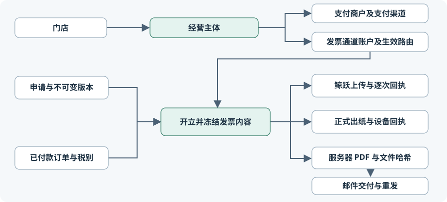

# TDD · 发票申请、正式打印与交付追溯

状态为**P0/P1 首批实现与验收**。本期已覆盖通道进件、绑定路由和显式申请版本开立，后续阶段沿用本方案。日期为 2026-11-24。已补充主体支付与发票通道绑定、申请进件及退票闭环。适用首期台湾 v2 门店零售、Android POS 和发票运营查询。需求基线为 [PRD-发票开立与打印](../requirements/PRD-发票开立与打印.md)，既有税制、字轨和证明联口径沿用 [TDD-发票模块](./TDD-发票模块.md)，设备派送沿用 [TDD-统一打印域兼容整合](./TDD-统一打印域兼容整合.md)。

## §0 定位与验收映射

门店隶属经营主体，由该主体分别关联支付商户和发票通道。门店发票开立绑定一次具体申请版本及当时生效的发票账户。正式出纸、服务器 PDF、鲸跃上传及后续邮件交付均可从同一张发票追溯。首个实地验收使用同一张票贯通申请、开立、设备出纸、PDF 留档和补印。

| 编号 | 验收结果 | 设计落点 |
| --- | --- | --- |
| A1 | 初次提交、修改、驳回后重提都有可查询的版本或事件 | §3.1 申请主表、不可变版本、事件 |
| A2 | 开票只采用请求指定的有效版本；重复提交、同时开立与同时修改均有确定结果 | §3.2 绑定、来源锁和幂等 |
| A3 | 一张测试票实际出纸，设备回执、版面和服务器 PDF 可互相查询 | §3.3 正式打印、制品关联 |
| A4 | 补印有原因、原任务、设备与新回执；正本结果未知时先核实 | §3.3 补印和回执 |
| A5 | PDF 可查、可核对哈希、可过期清理；重建可区分原件和新文件 | §3.3 生命周期和重放 |
| A6 | 邮件发送、查询、退信、重发均可追溯，失败可恢复 | §3.4 邮件任务、尝试和回执 |
| A7 | 能区分鲸跃上传、出纸、PDF、邮件四种结果，保留逐次处置依据 | §3.4、§3.5 时间线 |
| A8 | 存量客户端、存量发票及消费者的旧申请查询仍可使用，主体和门店隔离 | §4 接口兼容、§6 上线 |
| A9 | 不同主体可同时用不同发票通道，门店继承其主体的有效绑定，支付商户可独立查询 | §3.6 归属与路由 |
| A10 | 通道申请、补件、审核、核验、号段准备、启用和切换全程留痕 | §3.7 进件及路由数据 |
| A11 | 旧票在切换通道后仍用原账户查核、作废或折让，退款结果独立可查 | §3.8 退票与对账 |

## §1 系统结构与现状



申请保存提交人当时的选择，订单提供已支付交易事实，发票开立后成为打印和交付的数据来源。订单金额和税额由服务端计算。交付失败可以重试某个动作，票号和发票原始数据保持可追溯。

| 当前组件 | 已有能力 | 本期扩展 |
| --- | --- | --- |
| 门店与经营主体、NearPay | 门店归属、主体与支付商户关联、支付渠道进件及门店授权 | 发票继承同一个经营主体入口；支付绑定和发票绑定分别查询及授权 |
| `ivc_regime_profile`、发票通道 SPI | 主体开票资料、市场默认或主体选定通道、账户验证、领号和供应商能力 | 增加通道申请、多个已验证账户、显式生效路由及历史账户版本冻结 |
| `ord_invoice_request` | 线上消费者按主单申请、运营回填外部票号，驳回后可重提 | 保留旧职责。首期门店使用发票域申请版本；后续按明确业务映射接入旧申请 |
| `ivc_buyer_preference` | 付款前记录载具、企业买受人或捐赠偏好 | 自动开立时转成一版实际采用的申请，记录来源；偏好变更遵循既有流程 |
| `ivc_invoice`、`ivc_invoice_line` | 门店按子单开立、税额和打印快照、同来源有效票唯一 | 增加申请号和版本关联 |
| 打印中心 | 真实设备任务、模拟、导出、补印、派送回执 | POS 使用正式任务；从发票串起任务、制品和归档 |
| 鲸跃及平台通知 | 发票上传任务可重试；通用 SMTP 返回通道消息号 | 上传逐次尝试；发票邮件交付与重发 |

线上基线为 Oscar 店四张已作废测试票。HR-22644552 至 HR-22644554 有模拟 PDF，HR-22644555 无模拟 PDF，四张均无正式出纸任务。这些票用于回归查询。正式打印验收使用一张新的获准测试票及已配对的门店设备。现有上传代码保存通道码，运行时还会查当前税制档案。切换后原账户的身份、凭据版本和持有状态需要显式解析。支付归属参考 [TDD-商户迁移同步与渠道关联](./TDD-商户迁移同步与渠道关联.md)，供应商能力参考 [TDD-发票-供应商能力定义完善](./TDD-发票-供应商能力定义完善.md)。

## §2 模块、代码与实施计划

下列接口和类名为实施约定。生产版本配合可用序号追加迁移。Android 路径相对于 `handheld-pos/android`，后端路径相对于 `backend`。

| 阶段 | 改动文件和职责 | 验证出口 |
| --- | --- | --- |
| P0 主体通道 | 新增 `InvoiceChannelOnboardingService.java`、`InvoiceChannelRoutingService.java`、`BizInvoiceChannelController.java`、运营审核端点和通道迁移。扩展 `InvoiceSetupServiceImpl.java`、`InvoiceGatewayPolicy.java`、`InvoiceTransmissionServiceImpl.java` 及供应商能力目录。认证与支付商户查询复用既有主体和门店上下文。 | 两主体各绑定不同通道并行开票；切换后可查原票与退票回执 |
| P1 申请版本 | `invoice/invoice-domain/src/main/resources/db/invoice/V<next>__invoice_application.sql` 建三表与发票关联列。新增 `invoice/api/biz/BizInvoiceApplicationController.java`、`invoice/dto/InvoiceApplicationDtos.java`、`invoice/service/InvoiceApplicationService.java`、`invoice/service/impl/InvoiceApplicationServiceImpl.java`、`invoice/entity/IvcInvoiceApplication*.java`、`invoice/mapper/InvoiceApplicationMappers.java`。这些 Java 路径位于模块的 `src/main/java/ai/neargo/shop/`。 | 独立跑通提交、修改、查询历史和驳回反馈 |
| P1 申请开立 | 扩展 `InvoiceService.java`、`InvoiceServiceImpl.java`、`IvcInvoice.java`、`InvoiceDtos.java` 和现有买受人偏好入口。扩展 `shop-app` 的 `invoicebridge/InvoiceAutoIssueConsumer.java` 及门店来源适配。Android 修改 `feature/invoice` 的 `InvoiceData.kt`、`RemoteInvoices.kt` 和 `app/.../di/InvoiceBridge.kt`，通过申请引用进入人工开立。 | 申请第 2 版开立，详情可反查第 2 版和第 1 版，退款竞态与重复开立通过 |
| P2 正式打印 | 复用 `DefaultPrintFacade.java`、`PrintFactReadyConsumer.java`、`PrintReprintServiceImpl.java`、`PrintAgentProtocolServiceImpl.java` 和既有打印 API。扩展导出关联、实际派送回执查询和设备能力校验。Android 修改 `InvoiceControllers.kt`、`InvoiceScreens.kt`、`RemoteInvoices.kt` 和 `InvoiceBridge.kt`，显示出纸状态、原任务和补印操作。 | 同一张票登记一次正本派送并取得实体纸和设备回执，再通过正式补印出一张标记补印的纸 |
| P2 PDF 留档 | 新增 `IvcInvoiceDocumentArtifact.java`、`InvoiceDocumentArchiveService.java`、`BizInvoiceDocumentController.java` 和对应迁移。在应用桥接层投影打印导出结果，扩展 `DefaultPrintExportFacade.java` 和 v2 的 `deploy/tencent/invoice-pdf-retention/`。 | 可从发票查到正本、补印 PDF、哈希和保存状态；清理覆盖正式批次 |
| P3 邮件 | 新增 `InvoiceDeliveryService.java`、`InvoiceDeliveryWorker.java`、`InvoiceDeliveryPort.java`、`BizInvoiceDeliveryController.java` 及派送表。邮件适配放在现有通知模块，复用 SMTP 连接和通用通知日志。Android 增加发送、回执查询及重发入口。 | 以 P2 验收票发给获准测试邮箱，记录接受、回执和手动重发 |
| P3 上传回执与时间线 | 扩展 `InvoiceTransmissionServiceImpl.java`、`IvcTransmission.java`，新增逐次尝试表。由发票查询服务聚合申请、上传、打印、PDF、邮件的权威记录。 | 一张票可按时间查到操作、尝试、回执和关联编号 |

### §2.1 任务顺序

- [ ] P0a 接通主体开票账户进件、核验及路由管理，先以历史数据做兼容匹配。
- [ ] P0b 开票冻结原账户，跑两主体多通道、渠道切换和原账户退票查询。
- [ ] P1a 落地申请版本及迁移。验证首次提交、修改、驳回重提、失败回滚、版本冲突、跨店隔离。
- [ ] P1b 接入人工、自动开立和历史查询。验证旧客户端、同来源幂等、旧版开立冲突、申请与发票原子提交。
- [ ] P2a 接通 POS 正式打印并确认当前门店的设备、场景、模板和路由。验证重复触发、缺纸或超时、补印和标记。
- [ ] P2b 建立服务器留档投影和到期清理。对 P2a 的同一张票查原任务、补印和两份 PDF，核对哈希、纸宽和设备回执。
- [ ] P3a 跑通邮件派送、权限、重发和退信；按配置选择可用回执。采用同一张仍有效的验收票，邮件发送前核对收件人。
- [ ] P3b 补全鲸跃逐次尝试和统一时间线，验证每条状态能回到原始记录。

### §2.2 关键 Java 契约和事务示意

```java
record ApplicationRevisionRef(String applicationNo, int revisionNo) {}
record IssueApplicationCmd(ApplicationRevisionRef application, String idempotencyKey) {}
record IssuanceResult(String invoiceNo, String fiscalNumber, ApplicationRevisionRef application) {}

interface InvoiceApplicationService {
    ApplicationView submit(Scope scope, SubmitApplicationCmd command);
    ApplicationView revise(Scope scope, String applicationNo, ReviseApplicationCmd command);
    ApplicationView get(Scope scope, String applicationNo);
    IssuanceResult issue(Scope scope, IssueApplicationCmd command);
}
```

```java
// 公共事务入口。issueFromSource 复用现有来源校验、冻结和取号方法。
@Transactional
public IssuanceResult issue(Scope scope, IssueApplicationCmd command) {
    var application = applications.lock(scope, command.application().applicationNo());
    var prior = operations.replayOrReserve(scope, command);
    if (prior.isPresent()) return prior.get();

    var revision = application.requireSubmittableRevision(command.application().revisionNo());
    var invoice = invoiceService.issueFromSource(scope, application.source(), revision.buyer(),
            revision.reference(), revision.sourceFingerprint());
    applications.markIssued(application, revision, invoice.invoiceNo());
    operations.complete(scope, command, invoice.invoiceNo());
    return new IssuanceResult(invoice.invoiceNo(), invoice.fiscalNumber(), revision.reference());
}
```

申请和发票放在同一数据源、同一事务管理器。当前实现的开立调用额外接收 `expectedSourceFingerprint`，冻结买方版本后在读取并锁定订单来源时二次比较。锁顺序固定为申请主行、适用的订单来源行、主体路由、字轨。外部上传、打印和邮件在提交后执行。沿用已有打印 outbox 事件。补偿可从打印请求或邮件任务自身认领和恢复，避免重复建任务。邮件首期由持久化派送任务驱动。

## §3 数据库、状态与后台处理

### §3.1 申请和版本

逻辑 DDL 使用 MySQL 9。各业务号沿用现有业务编号工具，并保持租户、主体、门店的作用域。新表的主键、字符集和审计列以发票迁移规范为准。迁移时按实际迁移目录选择下一个版本号。

```sql
CREATE TABLE ivc_invoice_application (
  id BIGINT NOT NULL AUTO_INCREMENT PRIMARY KEY,
  tenant_no VARCHAR(32) NOT NULL,
  entity_no VARCHAR(32) NOT NULL,
  store_no VARCHAR(32) NOT NULL,
  application_no VARCHAR(64) NOT NULL,
  source_type VARCHAR(32) NOT NULL,
  source_no VARCHAR(64) NOT NULL,
  origin VARCHAR(24) NOT NULL,
  legacy_request_no VARCHAR(64) NULL,
  current_revision INT NOT NULL,
  status VARCHAR(24) NOT NULL,
  initial_invoice_no VARCHAR(64) NULL,
  created_by VARCHAR(64) NOT NULL,
  created_at DATETIME(3) NOT NULL,
  updated_at DATETIME(3) NOT NULL,
  UNIQUE KEY uk_app_no (tenant_no, application_no),
  UNIQUE KEY uk_app_source (tenant_no, entity_no, source_type, source_no),
  KEY idx_app_store (tenant_no, entity_no, store_no, status, created_at, id)
);

CREATE TABLE ivc_invoice_application_revision (
  id BIGINT NOT NULL AUTO_INCREMENT PRIMARY KEY,
  tenant_no VARCHAR(32) NOT NULL,
  application_no VARCHAR(64) NOT NULL,
  revision_no INT NOT NULL,
  buyer_kind VARCHAR(24) NOT NULL,
  buyer_name VARCHAR(256) NULL,
  buyer_tax_id VARCHAR(32) NULL,
  carrier_type VARCHAR(16) NULL,
  carrier_id VARCHAR(128) NULL,
  donate_code VARCHAR(16) NULL,
  delivery_mode VARCHAR(24) NOT NULL,
  recipient_cipher VARBINARY(2048) NULL,
  recipient_key_version VARCHAR(64) NULL,
  recipient_mask VARCHAR(128) NULL,
  currency CHAR(3) NULL,
  source_amount_minor BIGINT NULL,
  source_fingerprint CHAR(64) NULL,
  source_snapshot JSON NULL,
  snapshot_hash CHAR(64) NOT NULL,
  submitted_by VARCHAR(64) NOT NULL,
  submitted_at DATETIME(3) NOT NULL,
  UNIQUE KEY uk_app_revision (tenant_no, application_no, revision_no)
);

CREATE TABLE ivc_invoice_application_event (
  id BIGINT NOT NULL AUTO_INCREMENT PRIMARY KEY,
  tenant_no VARCHAR(32) NOT NULL,
  entity_no VARCHAR(32) NOT NULL,
  store_no VARCHAR(32) NOT NULL,
  application_no VARCHAR(64) NOT NULL,
  revision_no INT NOT NULL,
  action VARCHAR(32) NOT NULL,
  from_status VARCHAR(24) NULL,
  to_status VARCHAR(24) NOT NULL,
  actor_type VARCHAR(16) NOT NULL,
  actor_no VARCHAR(64) NOT NULL,
  reason VARCHAR(256) NULL,
  trace_id VARCHAR(64) NULL,
  command_key_hash CHAR(64) NULL,
  command_payload_hash CHAR(64) NULL,
  related_invoice_no VARCHAR(64) NULL,
  occurred_at DATETIME(3) NOT NULL,
  UNIQUE KEY uk_app_command (tenant_no, entity_no, store_no, action, command_key_hash),
  KEY idx_app_event (tenant_no, application_no, id)
);

ALTER TABLE ivc_invoice
  ADD COLUMN application_no VARCHAR(64) NULL,
  ADD COLUMN application_revision_no INT NULL,
  ADD KEY idx_invoice_application (tenant_no, application_no, application_revision_no);
```

| 项目 | 规则 |
| --- | --- |
| 主单与子单 | 首期每个发票主体和开票来源对应一个申请主记录。门店零售来源是 `SUB_ORDER`。主体、门店由上下文和来源单核验。未来接旧线上主单时先确认卖方和主子单对应关系。 |
| 申请状态 | 首次提交为 `SUBMITTED`。修改追加版本并更新主记录。驳回为 `REJECTED`，重提追加一版后回到 `SUBMITTED`。撤回为 `CANCELLED`；同一来源重新申请时追加版本。开立成功为 `ISSUED`。 |
| 快照 | 每版冻结买方、交付选择及当时可用的来源摘要。付款前的交易金额和指纹可空。开立前服务端重新验已付、退款、订单行和税别；若申请冻结了交易指纹且事实变化，返回冲突，重新提交一版。 |
| 金额和税别 | `source_snapshot` 可存币别、来源修订、行标识、名称、数量、单位、金额及税别摘要。按规范化顺序计算哈希。最终法定票面仍由发票域冻结，客户端传入金额只可用于对照显示。 |
| 驳回和更正 | 驳回追加事件，保留该版原值。重提增加版本，事件记录操作者、时间、原因和前后状态。申请详情按角色返回脱敏交付字段。 |
| 版本和重开 | 限当前可开立版本。作废或注销由发票状态跟踪，申请保留已开立事实。重开经既有重开权限和规则，记录前后发票关系。沿用买方时继承申请版本；更正买方的流程先追加更正版，再由重开命令明确采用。P1 保留现有重开路径，继承已有关联。 |
| 幂等 | 相同操作、作用域、幂等键和请求哈希返回同一次结果。同键不同内容或过期 `expectedRevision` 返回冲突。版本插入、申请主行更新、开立关联及操作结果同事务提交。回滚后原键可重试。并发插入唯一键冲突后在新事务读取赢家。 |

### §3.2 开立兼容和交易竞态

- 新 POS 显式提交申请，再按 `applicationNo + revisionNo` 开立。旧 `POST /biz/invoices` 进入同一服务。首次开立无申请时在事务内生成兼容申请版本。若已有申请，验证旧请求买方与当前版本一致；不一致时提示客户端读取申请。已存在有效发票时按原 API 返回，并沿用实际已有的关联。
- 自动开立以已付款事件和来源为幂等依据。按既有优先规则取买受人偏好，冻结 `AUTO_PAID` 版本；已有有效人工申请时使用其当前版本。开立失败返回可诊断结果，未提交的票号和快照回滚。
- 门店现金退款与开票共用子单行锁。申请通过后仍检查最新支付事实。显式按申请开立时，若已有票采用另一版，返回关联冲突和可查询的原票引用。
- 历史发票的申请关联可空。只有证据能精确对应来源、主体和开立内容时才回填；运营回填的外部票号保留其外部来源。存量 `ord_invoice_request` 保持可读，独立报表统计待迁数据。

### §3.3 正式打印、制品和清理

**出纸路径。** `BUSINESS_PRINT_FACT_READY` 或人工打印请求进入同一场景策略。证明联依据开立时的打印标记，载具或捐赠场景可使用交易明细。使用 `prn_request`、`prn_batch`、`prn_job`、`prn_attempt`、`prn_receipt` 和 `prn_action_log` 记录策略、设备、模板、版面、尝试及回执。热感代理按设备能力输出，PDF 由共享渲染器并行生成。正本唯一性沿用正式打印中心的来源、场景和正本规则，自动与手动共用来源幂等约束。实际设备结果由回执或人工核实决定，PDF 已生成只更新留档状态。

| 新表及键 | 字段与责任 |
| --- | --- |
| `ivc_invoice_document_artifact` | 主键 `id BIGINT`。作用域 `tenant_no/entity_no/store_no VARCHAR(32)`。`artifact_no/invoice_no VARCHAR(64)`、`scene VARCHAR(32)`、`kind VARCHAR(24)`（`ORIGINAL/REPRINT/PREVIEW/REBUILT/DELIVERY`）、`request_no/batch_no/job_no/export_no/parent_artifact_no VARCHAR(64)` 可空，其中已登记导出的 `export_no` 必填。 |
| 版面与留存字段 | `snapshot_hash/layout_hash/content_sha256 CHAR(64)`，`template_version_no/render_version/font_bundle_version VARCHAR(64)`，`paper_width_mm DECIMAL(6,2)`，`pdf_profile VARCHAR(24)`，`file_size BIGINT`，`page_count INT`，`status VARCHAR(24)`，`created_at/ready_at/expires_at/deleted_at DATETIME(3)`。文件位置由 `prn_export_task` 持有，归档获取必要摘要。 |
| 唯一性与索引 | `UNIQUE(tenant_no, artifact_no)`、`UNIQUE(tenant_no, export_no)`、`INDEX(tenant_no,entity_no,store_no,invoice_no,created_at,id)`、`INDEX(status,expires_at,id)`。打印一个多份批次时用同一发票与批次关联；跨发票批次按单任务导出，避免授予另一张票的查看权限。 |

**放行、补印和重建。** 真实设备完成或回报缺纸、失败、未知均留下尝试。补印引用原任务、按权限核对设备和理由，结果未知时先查询，仍未知则需具备处置权限并记录重复出纸风险确认。补印有新的任务和带补印标记的冻结版面与 PDF。票已作废时仅查询已留存制品，页面注明状态，阻止新的正式出纸和客户交付。重建仅在业务允许时由冻结版面与指定版本生成新制品，记录父制品和新哈希；缺少历史版面、字体或模板版本时返回明确原因。

**留存。** 台湾 v2 私有存储根为 `/data0/app/ai-shop-v2/print-private/`，默认保存七天，台湾时间每日 03:30 清理。制品记录保留到期及删除事实与哈希。正式 `BATCH` 导出按批次归属和冻结任务确认属于本发票后纳入清理。复用应用清理服务时校验本机对象归属并更新 `deleted_at`；当前主机任务只读数据库并删除到期文件，切换时以单一入口执行，验证批次范围、其他场景隔离和存储错误重试。App 取件申请短时下载许可，许可发放与实际读取各有事件或访问记录。

### §3.4 邮件交付、重发与鲸跃记录

首期交付经授权的查看链接。邮件链接兑换访问权限，再申请打印中心短时下载授权。邮件链接凭证只存摘要，期限取交付配置与 PDF 剩余时间的较小值。首期采用收件人验证或登录身份绑定，链接扫描与实际下载可区分。附件方式作为可配置扩展，按发送时选定的 PDF 版本、文件哈希和限制记录。

| 新表 | 主字段、唯一约束与索引 |
| --- | --- |
| `ivc_invoice_delivery` | `id BIGINT`，`tenant_no/entity_no/store_no VARCHAR(32)`，`delivery_no/invoice_no/application_no/artifact_no/parent_delivery_no VARCHAR(64)`，`application_revision_no INT`，`channel/status VARCHAR(24)`，`recipient_cipher VARBINARY(2048)`，`recipient_key_version VARCHAR(64)`，`recipient_mask VARCHAR(128)`，`template_version VARCHAR(64)`，`content_hash/idempotency_key_hash/request_hash CHAR(64)`，`reason VARCHAR(256)`，`actor_no/trace_id VARCHAR(64)`，`next_attempt_at/created_at/updated_at DATETIME(3)`，`revision BIGINT`。`UNIQUE(tenant_no,delivery_no)`，`UNIQUE(tenant_no,entity_no,store_no,idempotency_key_hash)`，按票号和待派送状态索引。 |
| `ivc_invoice_delivery_attempt` | `id BIGINT`，`tenant_no VARCHAR(32)`，`delivery_no/attempt_no/trace_id/provider_config_version VARCHAR(64)`，`attempt_index INT`，`provider/status VARCHAR(24)`，`provider_message_id VARCHAR(256)`，`request_hash CHAR(64)`，`error_code VARCHAR(64)`，`error_summary VARCHAR(512)`，`lease_until/started_at/finished_at DATETIME(3)`。唯一键为租户内尝试号和 `(tenant_no,delivery_no,attempt_index)`。按服务商配置与消息号索引以核对回执。 |
| `ivc_invoice_delivery_event` | `id BIGINT`，`tenant_no VARCHAR(32)`，`delivery_no/attempt_no/actor_no/trace_id VARCHAR(64)`，`event_type VARCHAR(32)`，`provider_event_key VARCHAR(128)`，`payload_hash CHAR(64)`，`summary VARCHAR(512)`，`occurred_at/received_at DATETIME(3)`。内部和外部事件追加写，回执以服务商配置与事件标识去重，按派送号和 ID 查历史。 |
| `ivc_invoice_delivery_grant` | `id BIGINT`，`tenant_no VARCHAR(32)`，`delivery_no/artifact_no VARCHAR(64)`，`token_hash CHAR(64)`，`expires_at/revoked_at/created_at DATETIME(3)`。令牌摘要唯一，按派送号索引。授权访问、撤销及失效写交付事件。 |
| `ivc_transmission_attempt` | `id BIGINT`，`tenant_no VARCHAR(32)`，`transmission_no/trace_id/profile_version VARCHAR(64)`，`attempt_index INT`，`gateway_code/outcome VARCHAR(32)`，`business_payload_hash/transport_hash CHAR(64)`，`gateway_ref VARCHAR(128)`，`error_code VARCHAR(64)`，`safe_response_summary VARCHAR(512)`，`started_at/finished_at DATETIME(3)`，`actor_no VARCHAR(64)`。唯一键为租户、上传号、尝试序号；报文规则或配置修订可追查。 |

派送任务的业务状态为 `PENDING → SENDING → ACCEPTED → DELIVERED/BOUNCED`，失败可进入 `FAILED`，证据不完整进入 `UNKNOWN`。SMTP 接受只记为 `ACCEPTED`。回执需要验签，重复忽略，乱序按尝试归并并保留原事件。发送前写入尝试和租约，超时后先对账。只有明确未接受或服务商支持同键幂等时自动重试。已接受但状态不明的任务由授权人员处理，避免无条件再次发送。

重发建立新交付任务并记录 `parent_delivery_no`、原因、操作人与目标制品。收件人更正需要授权并写事件，原收件记录保留。重发前重新检查票状态、制品期限和授权。旧链接经续期策略发新授权或失效；文件已过期时，按 §3.3 重建后再派送。SMTP 凭证、签名密钥、登录令牌和完整邮箱均使用现有受控配置或密钥能力。审计视图只展示必要的脱敏信息，重放操作读取授权范围内的冻结数据。

上传尝试在实际调用前登记，再记录受理、拒收、网络不明和脱敏回执。沿用既有发票上传任务作为重试入口。鲸跃接受表示上传通道接受，时间线单独展示，邮件送达由邮件回执决定。

### §3.5 时间线与操作语义

统一查询聚合各模块权威记录，通用返回包含 `category/event/status/occurredAt/actor/traceId/refType/refNo/parentRefNo`。分页排序使用时间与稳定键，支持申请版本、票号、打印任务和邮件单号反查。

| 操作 | 证据与结果 |
| --- | --- |
| 查看原 PDF | 读取已有制品，核对文件哈希并记授权或读取事件。 |
| 重建 PDF | 读取冻结版面，生成新制品和哈希，关联原制品，标记重建。 |
| 正式补印 | 进入打印中心，产生新任务与回执并绑定原任务。 |
| 邮件重发 | 新建交付任务和尝试，关联上次邮件。 |
| 鲸跃重传 | 复用原票及上传业务报文，追加通道执行尝试。 |

### §3.6 主体、支付商户和发票通道

经营主体是两类服务的归属根。门店先绑定经营主体，支付按现有主体和门店授权解析支付商户及支付渠道，发票按该主体解析税制和发票通道。支付商户号、支付渠道账户号、发票通道账户号分别保存。门店级覆盖项只管理开立时机、默认课税别、打印路由等门店策略。发票卖方统编由主体开票资料核定，买方统编来自发票申请版本。

| 场景 | 解析规则 |
| --- | --- |
| 同一平台的不同主体 | 各自申请、核验、启用发票账户。例如 A 主体用鲸跃，B 主体用汎宇，两者可同时服务，账户、凭据、号段与访问记录分别管理。 |
| 同一主体的多家门店 | 从认证会话和订单核对门店归属，同税制和环境下继承主体生效的发票路由。门店看本店发票；主体管理人在授权范围内可跨所属门店筛选。 |
| 同一主体有多个已验证账户 | 支持并存、准备切换和处理历史票。首期每 `tenant + entity + regime + environment` 设一条新票主路由，按有效期切换。渠道架构保留账户并存能力，门店分流和自动容灾列为后续策略。切换生效后仍保留能结清历史动作的旧账户。 |
| 支付商户绑定 | 沿用 NearPay 的主体与支付服务关联、渠道进件和门店授权。发票绑定的建立、暂停与切换有自己的审批及状态。现金订单一样以已支付的受信事实作为开票依据。 |
| 无可用路由 | 说明主体、卖方、通道验证、凭据、号段或能力缺在哪一项。号码分配前阻断。市场默认只用于申请页推荐及存量迁移判断。 |

**通道能力。** 复用已有供应商目录、账户核验、号段、查票和注销能力 SPI。开通方式按渠道声明，支持有正式接口的渠道进件、运营代办和已开户账户绑定。渠道未提供或系统未实现的动作走补件或人工确认，有记录可回查。鲸跃、汎宇沿用已有能力声明及环境配置，每项能力以当前账户和通道实际核验结果为准。收银端根据可用能力展示动作和失败原因。

### §3.7 通道进件、账户版本和路由数据

以下为补充迁移设计，和申请版本表同属发票模块。实体归属采用现有主体编号与作用域规则。申请材料通过现有资质文件或受控文件引用保存。

| 表或改动 | 主要字段、索引与约束 |
| --- | --- |
| `ivc_channel_application` | `id BIGINT PK`，`tenant_no/entity_no VARCHAR(32)`，`application_no VARCHAR(64)`，`regime_code/channel_code/environment VARCHAR(32)`，`intake_mode VARCHAR(24)`，`seller_tax_id VARCHAR(32)`，`seller_name VARCHAR(256)`，`current_revision INT`，`status VARCHAR(24)`，`external_application_ref VARCHAR(128)`，`created_by/updated_by VARCHAR(64)`，`created_at/updated_at DATETIME(3)`。租户内申请号唯一，按主体、状态和渠道查询。 |
| `ivc_channel_application_revision` | `tenant_no/application_no/revision_no` 唯一；`materials_ref JSON`、`snapshot_hash CHAR(64)`、`contact_ref/actor_no VARCHAR(64)`、`submitted_at DATETIME(3)`。补件新增版本，审批引用实际审查的版本。 |
| `ivc_channel_application_event` | 追加事件，记录 `application_no/revision_no/action/from_status/to_status/actor_no/reason/trace_id/occurred_at`、服务商请求及回执号、请求哈希、供应商事件去重标识。按申请和序号查历史。提交、审批、核验及生效重试采用作用域内幂等键和请求哈希。 |
| `ivc_channel_account` | `tenant_no/entity_no/regime_code/environment/channel_code/account_no/provider_account_identity/seller_tax_id/application_no/status`、`current_revision`、激活、暂停和退役时间。租户内账户号唯一；生产下对渠道与环境的外部账户归属去重，以适配器定义的规范化账户标识为准。存在经合同确认的共享服务商账号时，标识加入渠道侧卖方分户号。 |
| `ivc_channel_account_revision` | `tenant_no/account_no/revision_no` 唯一。保存身份核验摘要、凭据引用及版本、端点配置引用及版本、已验证能力、卖方统编、核验时间和经办人。敏感值沿用 Secret 管理，日志及查询返回脱敏摘要。更换凭据创建新版本。外部办公室或分户身份改变时创建新账户。 |
| `ivc_channel_route`、`ivc_channel_route_event` | 路由按 `tenant_no/entity_no/regime_code/environment` 唯一，保存 `active_account_no/route_version/effective_at/updated_by`。准备中的新账户可在账户列表查询。切换以预期路由版本做条件更新，在同一事务追加旧新账户、原因、操作者、生效与回滚依据。 |
| `ivc_regime_profile`、`ivc_number_range` | 税制档案保留卖方、税制和 QR 规则。号段记录导入来源、可用账户、税制与环境；首期以一段号授权一个账户领用。仍以主体、税制和期别控制号段冲突，并保留有效财政票号唯一约束，跨账户切换时检验重叠和已分配号码。旧配置字段进入迁移兼容期。 |
| `ivc_invoice`、`ivc_transmission`、`ivc_transmission_attempt` | 发票冻结 `channel_code/account_no/opening_account_revision/route_version/environment` 及号段、卖方。各上传动作记录 `account_no`；每次发送另记实际 `account_revision/credential_version/endpoint_config_version`、报文哈希和回执。新路由切换后，历史查询和补偿从原发票的账户解析。 |

**申请状态。** `DRAFT → SUBMITTED → UNDER_REVIEW`，补件进入 `NEEDS_INFO` 并重提新版本。审核通过进入 `APPROVED`，渠道自动进件可进入 `PROVIDER_PENDING` 后回传结果。已有账号可进入 `VERIFY_PENDING` 做绑定。核验通过为 `VERIFIED`，满足号段及配置检查后事务内激活账户和路由。另有 `REJECTED/CANCELLED`。账户采用 `PENDING_VERIFICATION/VERIFIED/ACTIVE/SUSPENDED/RETIRED`；短期停发与历史查询、处置权限独立展现。审核、验证、发布在时间线上各有事件。未知的外部响应先按外部申请号或请求键查询，避免重复进件。账户暂停记录原因；历史账户可按能力开放查票或退票，直至未完动作处理完毕。

**核验与发布。** 审核主体资质并核对渠道返回的卖方统编、办公室或分户号、必要终端字段，再检查端点环境、凭据版本、该税制允许的能力和可用号段。支持指明账户进行的验证，与提交/保存分开。生产只能绑定生产账户，测试请求不能借用生产绑定。应用通道的激活操作可经既有运营审批基础设施实现，申请人、审核人和生效操作人分别留痕。

**开票与切换。** 人工和自动开票都先解析一次主体路由，并在取号及写入发票前校验路由版本和号段仍可用。开立和切换共享主体路由行锁，固定顺序为申请、订单来源、主体路由、号段。付款后的自动开立和较早开始的人工请求都按拿到路由锁时的有效版本处理。同一来源的重复请求返回既有发票和原通道。超时、拒收和账号暂停按冻结账户恢复，换渠道只影响切换后尚未开出的票。旧凭据失效时，可使用**同一外部账户身份**的新凭据版本重试并记录实际版本。改用另一个外部账户时，需要既有撤销、同号重开或其他受控流程及渠道能力确认。没有原通道或证据不完整的历史票进入运营核对队列。

路由服务提供两种入口。前者只供新开立，后者供已开票的上传、查验和处置。

```java
record IssuanceChannelRef(
        String channelCode, String accountNo, long accountRevision, long routeVersion, String environment) {}

interface InvoiceChannelRoutingService {
    IssuanceChannelRef lockForIssue(Scope scope, String regimeCode);
    GatewayAccount resolveForExistingInvoice(Scope scope, String invoiceNo, InvoiceAction action);
}
```

新开立的 `environment` 取服务端受控环境。历史票按开立写入的通道和环境解析，`action` 映射该账户的已验证能力及当前权限。服务返回的凭据限通道适配器使用。

### §3.8 退票、查票和运营闭环

前台的「退票」入口由服务端读取发票状态、原通道能力、作废期别、已有折让和退款事实，返回可用动作及原因。退款任务继续从原订单和原支付路径核查；发票处置从原发票和原发票账户核查。业务服务通过主子单号、发票号、退款号和退票动作号关联两边的记录。各动作分开确认和重试。

| 业务动作 | 状态、处理及记录 |
| --- | --- |
| 全额退款和作废 | 已付订单按原支付方式授权退款，按既有规则选择发票作废。记录请求人、原因、退款金额和凭证、原票、本地状态、上传动作、原渠道回执。界面分别展示退款、票状态和通道回执。 |
| 注销与同号重开 | 只有税制及原渠道支持时提供。记录注销申请和回执。处于注销中时可从原账户查进度；满足既有完成条件后再开放重开，记录原票、新票及各自的账户和申请版本。 |
| 部分退款或需折让 | 用既有折让流程验证可折让余额、金额与明细，使用原票通道，记折让编号、金额、回执和后续折让作废。 |
| 单边成功或结果未知 | 创建待处理记录，显示已经完成的动作与尚待确认的动作。支付退款失败只恢复退款动作，税务动作失败只恢复对应上传或核查。重复点按以业务动作幂等号拦截；结果未知先向原通道核实。 |
| 查看与对账 | 门店按时间、订单号、票号、申请或退票号查本店单据；主体授权范围内可按门店、渠道、账户、开立与回执状态筛选。发票详情含卖方、来源、申请版本、开立账户、上传记录、退款和退票结果、出纸任务、PDF 和后续邮件。渠道查核的回执另留请求人、时间、通道账户、结果码和脱敏说明。 |

P1 沿用已有发票作废、注销、折让和重传端点，扩展账户归属与可用动作查询。门店已付单的退款锁与发票保护继续按现有业务规则执行；需要将退款和退票协调的一键流程，可在两个动作均已分别支持后通过现有任务机制串接。

## §4 接口清单

以下为合同草案。写请求使用 `Idempotency-Key`，版本或设备修订采用明确的期望值。端点权限注册到现有权限目录。路径中的申请号、票号和任务号均需二次校验归属。

| 方法和路径 | 主要参数或返回 | 权限及说明 |
| --- | --- | --- |
| **复用** `GET /biz/invoice-setup/providers`、`GET /biz/invoice-setup/ranges` | 渠道目录、账户能力、号段清单；扩展按账户区分 | 主体开票设置权限 |
| **新增** `GET /biz/invoice-channels/overview` | 由当前门店解析主体，返回支付商户服务状态、发票账户和生效路由的脱敏投影 | 各部分按既有支付和发票查询权限裁剪 |
| **新增** `POST /biz/invoice-channel-applications`、`GET /biz/invoice-channel-applications/{applicationNo}` | 申请渠道与环境、入驻方式、材料引用；详情返回版本和进度 | 主体开票设置权限及主体归属检查 |
| **新增** `GET /biz/invoice-channel-applications`、`GET /ops/invoice-channel-applications` | 商家看名下申请；运营按主体、渠道、进件状态分页 | 各自的申请查询权限 |
| **新增** `POST /biz/invoice-channel-applications/{applicationNo}/revisions` | 补件、材料引用、期望版本 → 新版本及核验要求 | 主体申请权限 |
| **新增** `POST /biz/invoice-channel-applications/{applicationNo}/submissions` | 指定版本提交或补件重提，响应申请状态 | 主体申请权限，相同版本重复提交幂等 |
| **新增** `POST /ops/invoice-channel-applications/{applicationNo}/reviews` | 审核版本、结果、原因、补件项 | 运营审核权限及主体范围 |
| **新增** `POST /ops/invoice-channel-applications/{applicationNo}/account-bindings` | 审核通过后创建绑定；外部账户、终端资料和 Secret 写入句柄，返回内部账户号 | 有主体范围的受控绑定权限 |
| **新增** `POST /biz/invoice-channel-accounts/{accountNo}/credential-versions` | 同一账户轮换凭据；给定期望版本，回新版本及验证状态 | 主体开票设置权限及敏感凭据写权限 |
| **新增** `POST /biz/invoice-channel-accounts/{accountNo}/verifications` | 核验指定账户版本及卖方、环境、能力和号段准备状态 | 主体开票设置权限，运营可按授权代办 |
| **新增** `GET /biz/invoice-channel-accounts`、`GET /biz/invoice-channel-routes` | 账户、当前路由、验证、暂停和历史版本摘要 | 主体开票设置权限 |
| **新增** `POST /ops/invoice-channel-routes/activations` | 主体、税制、环境、已核验账户和期望路由版本 → 生效版本 | 受控发布权限，幂等并记录切换原因 |
| **新增** `POST /ops/invoice-channel-accounts/{accountNo}/suspensions`、`POST /ops/invoice-channel-accounts/{accountNo}/resumptions` | 账户状态、原因、期望版本和活动任务影响摘要 | 受控账户处置权限 |
| **按渠道启用** `POST /callbacks/invoice-channel-applications/{provider}` | 渠道审核或补件结果，外部申请引用与验签后的事件号 | 仅供应商已确认具备回调契约时启用 |
| **新增** `GET /biz/invoices/{invoiceNo}/return-options` | 原渠道、发票和退款状态、可用作废／注销／折让动作及限制 | 发票读取权限，执行动作各自鉴权 |
| **复用** `POST /biz/invoices/{invoiceNo}/void`、`POST /biz/invoices/{invoiceNo}/revocation`、`POST /biz/invoices/{invoiceNo}/reissue`、`POST /biz/invoices/{invoiceNo}/allowances` | 使用原票账户，返回本地业务状态及上传引用 | 沿用各动作的既有权限 |
| **复用** `GET /biz/invoices`、`POST /biz/invoices/{invoiceNo}/provider-checks` | 列表新增门店、通道、账户和退票状态筛选；厂商查验从原账户执行 | 门店或主体授权范围及既有查核权限 |
| **新增** `POST /biz/invoice-applications` | `sourceType/sourceNo/buyer/delivery` → `applicationNo/revisionNo/status` | `biz:invoice:issue` |
| **新增** `GET /biz/invoice-applications` | 来源、状态、日期和分页 | `biz:invoice:read`，门店范围 |
| **新增** `GET /biz/invoice-applications/{applicationNo}` | 状态、当前版本、来源、关联票、可执行动作 | `biz:invoice:read` |
| **新增** `GET /biz/invoice-applications/{applicationNo}/revisions` | 版本列表和一版的必要快照，可指定 `revisionNo` | `biz:invoice:read`，邮箱脱敏 |
| **新增** `POST /biz/invoice-applications/{applicationNo}/revisions` | `expectedRevision/buyer/delivery/changeReason` → 新版本 | `biz:invoice:issue` |
| **新增** `POST /biz/invoice-applications/{applicationNo}/rejections` | `expectedRevision/reason` | 申请管理权限，建议 `biz:invoice:application:manage` |
| **新增** `POST /biz/invoice-applications/{applicationNo}/cancellations` | `expectedRevision/reason` | 申请管理权限 |
| **新增** `POST /biz/invoice-applications/{applicationNo}/issuances` | `expectedRevision` → 发票、申请引用、开立和上传状态 | `biz:invoice:issue`，异版冲突可反查 |
| **兼容** `POST /biz/invoices`、`PUT /biz/invoices/buyer-preferences` | 保持既有载荷；发票查询增加可空申请引用 | 沿用权限及旧客户端响应 |
| **兼容** `GET /biz/invoices/{invoiceNo}`、`GET /biz/invoices/{invoiceNo}/print-facts` | 发票明细包含申请关联；按既有状态和印制资格返回事实引用 | `biz:invoice:read` |
| **复用** `POST /biz/print/requests` | `sourceRef` 指向发票，带场景、版本、PDF 输出选项 → 正式请求 | `biz:print:submit` |
| **复用** `GET /biz/print/requests/{requestNo}`、`GET /biz/print/jobs/{jobNo}` | 正式任务、设备、确认和任务汇总 | `biz:print:read` 及关联资料域 |
| **复用** `GET /biz/print/jobs/{jobNo}/attempts`、`GET /biz/print/jobs/{jobNo}/receipts` | 派送尝试、设备回执及结果 | `biz:print:read` 及关联资料域 |
| **复用** `POST /biz/print/jobs/{jobNo}/reprints` | `expectedRevision/reason/targetPrinterNo/riskAcknowledged` | `biz:print:reprint`，未知时同时需处置权限 |
| **复用** `POST /device/print/v1/claims`、`POST /device/print/v1/events` | 代理认领、执行及上报；断线恢复沿用现有设备 API | 设备会话与设备授权 |
| **新增** `GET /biz/invoices/{invoiceNo}/documents` | PDF 类型、状态、原任务、版式、哈希、到期时间 | 发票可见及打印导出权限 |
| **新增** `POST /biz/invoices/{invoiceNo}/documents/{artifactNo}/rebuilds` | 原制品、原因 → 新制品 | 打印导出权限及发票状态校验 |
| **复用** `POST /biz/print/exports/{exportNo}/download-grants` | 短时签名 URL，禁止在业务日志保存完整 URL | 打印导出及资料域授权 |
| **新增** `GET /biz/invoices/{invoiceNo}/timeline` | 按模块、日期游标查询，可从事件跳转原记录 | 发票读取权限及关联资料域 |
| **新增** `POST /biz/invoices/{invoiceNo}/deliveries`、`GET /biz/invoices/{invoiceNo}/deliveries` | 首次派送创建与历史读取，写入指定申请版和制品 | 建议 `biz:invoice:deliver`，读取按发票授权 |
| **新增** `POST /biz/invoices/{invoiceNo}/deliveries/{deliveryNo}/resends` | 理由、父交付、可选受控更正邮箱 → 新派送 | `biz:invoice:deliver`，更正收件人需独立确认授权 |
| **新增** `POST /callbacks/invoice-deliveries/{provider}` | 服务商验签事件，按唯一回执标识去重 | 服务商签名与重放保护 |
| **新增** `POST /public/invoice-deliveries/accesses` | 受限授权兑换下载许可，令牌在请求体中 | 收件人校验、令牌到期和撤销检查 |
| **复用** `POST /biz/invoices/{invoiceNo}/retransmissions` | 上传重传原业务报文 | 沿用发票权限，递增尝试历史 |

```http
POST /biz/invoice-applications/IVA-TEST-1/issuances
Idempotency-Key: issue-IVA-TEST-1-v2
Content-Type: application/json

{"expectedRevision":2}
```

```json
{
  "applicationNo": "IVA-TEST-1",
  "applicationRevisionNo": 2,
  "invoiceNo": "IVC-TEST-1",
  "fiscalNumber": "ZZ00000001",
  "status": "ISSUED",
  "uploadStatus": "PENDING"
}
```

正式列印请求示例。来源类型与修订取自 `print-facts`。提交结果的 `requestNo` 用于查询任务和回执。

```http
POST /biz/print/requests
Idempotency-Key: proof-IVC-TEST-1
Content-Type: application/json

{
  "storeNo": "ST-TEST-1",
  "sourceRef": {
    "type": "INVOICE",
    "no": "IVC-TEST-1",
    "factNo": "IVC-TEST-1",
    "revision": "1",
    "scene": "INVOICE_PROOF"
  },
  "scene": "INVOICE_PROOF",
  "expectedSourceRevision": "1",
  "printMode": "EXISTING_FACT",
  "outputOptions": {"pdfEnabled": true, "pdfProfile": "ORIGINAL_ROLL"}
}
```

新增业务错误先统一语义，代码和三语文案在实施时登记。至少覆盖版本冲突、相同幂等键内容不同、申请状态不允许、交易事实变化、发票已关联其他版本、制品到期、设备结果待核实、邮件交付结果未知。权限与归属错误遵循现有端点约定。

## §5 实施验收与证据

| 验收 | 计划测试及预期 |
| --- | --- |
| A1、A2 版本与事务 | `InvoiceApplicationMysqlTest#keepsRejectedAndCorrectedRevisions`，`#issuesOnlyCurrentRevision`，`#sameKeyReturnsSameReceiptAndDifferentPayloadConflicts`，`#editAndIssueCannotAdoptDifferentRevision`，`#cashRefundAndIssueSerialize`。失败后申请、冻结数据和号码状态符合原子性。 |
| A3、A4 正式打印 | `InvoicePrintDeliveryFlowTest#archivesOnePhysicalJobAndItsReprint`，`#uncertainOutcomeRequiresExplicitResolution`。断线任务有可查回执或待核实状态，正式出纸由实体纸与设备回执共同验收。 |
| A5 PDF | `InvoicePrintDeliveryFlowTest#retainsArtifactHashAfterCleanup`，`#cleansInvoiceBatchWithoutDeletingOtherDocuments`。覆盖混合批次、过期授权、原制品与重建关联及作废后的查询。 |
| A6 邮件 | `InvoiceMailDeliveryFlowTest#tracksAcceptedBounceAndAuthorizedResend`，`#doesNotBlindlyResendUnknownAttempt`，`#handlesDuplicatedAndOutOfOrderReceipts`。校验签名、脱敏、过期、变更邮箱权限和回执幂等。 |
| A7、A8 联查和兼容 | `InvoiceLifecycleTimelineFlowTest#linksAllEvidenceByInvoice`，`#keepsLegacyIssueCompatibleAndRejectsCrossStoreAccess`。核对事件引用、分页顺序、存量空关联和设备权限。 |
| A9 多主体及环境隔离 | `InvoiceChannelFlowTest#usesIndependentBindingsForTwoEntities`，`#blocksCrossEntityAccountAndEnvironmentMismatch`。支付仍按各自既有支付商户处理。 |
| A10 通道申请与切换 | `InvoiceChannelFlowTest#tracksSubmissionSupplementReviewAndActivation`，`#blocksUnverifiedAccountAndConflictingRanges`，`#serializesActivationAndIssuance`。并发取号锁定正确路由版本。 |
| A11 原通道退票与查核 | `InvoiceChannelFlowTest#keepsOriginalAccountAfterRouteSwitch`，`#tracksRefundAndTaxActionSeparately`，`#recordsCredentialRotationWithoutChangingAccountIdentity`。覆盖查核、重传、作废、折让和可用能力差异。 |

### §5.1 同一张测试票的现场步骤

1. 在验证门店确认归属主体、支付商户及环境。完成发票通道申请、核验和启用，记录账户号、路由版本和号段。确定已配对且能打印证明联的设备，登记打印策略、纸宽、设备号和受控测试单号。
2. 建立金额明确的测试单，提交申请第 1 版，修改测试抬头形成第 2 版。核对版本列表和变更事件。
3. 按第 2 版开立，记录申请号、主子单号、发票号、财政票号和上传任务。重复请求校验取得同一张票。
4. 等正式设备结果，核对 `requestNo/batchNo/jobNo/attemptNo/receiptNo`、门店、设备和实际出纸。保存经脱敏的验收记录。
5. 打开对应服务器 PDF，核对发票号、卖方、买方统编和抬头、金额、条码、版式、哈希及到期时间。
6. 从原任务发起正式补印，核对原因、操作人、原新任务关系、设备回执、纸面补印标记与另一份 PDF。作废及其他收尾动作按测试环境和用户授权执行。
7. P3 接入后，同一张仍有效的测试发票发送到获准邮箱，再检查服务商回执、链接有效期和手动重发关系。实际收件与服务商状态分别记录。如果该票已作废，邮件验收在重新授权的新测试票上执行。

验证按阶段运行相关后端测试、MySQL 迁移和 Android 模块测试。上线前的测试汇总至少记录申请版本、发票号、出纸及补印任务号、PDF 导出号和摘要、邮件及上传回执、验证环境与时间。

### §5.2 双主体、多通道补充验收

1. 用两个已授权主体及各自门店，在同一时段分别启用不同渠道。核对支付商户与发票账户独立解析，两边开出的票显示正确卖方、账户、号段和回执。
2. 对其中一主体按审批切换通道。新票走新路由；旧票的查询、重传和选定退票动作走原账户。同时回归另一主体的开立与查看。
3. 对有真实退款需求的测试单记录退款号与发票处置号。验收发票查询、退票进度、失败重试和最终对账。支持的渠道动作在原账户上验证；缺少生产授权的分支用受控测试环境验证。

## §6 上线、回滚与待决项

- **迁移顺序**。先追加数据库迁移及兼容后端。从现有主体档案、已验证账户及上传记录建立兼容投影。旧票只有在证据能唯一确认原账户时才回填，缺少证据的进入核对队列。分主体确认路由后开启新解析，再发布 Android。旧包可以使用现有开票和 PDF 入口。下线兼容入口前用日志确认旧客户端和调用方切换完成。已有生产迁移保持冻结。
- **部署范围**。先在验证门店打开正式打印路由与所需权限；检查 v2 的设备派送方式及任务恢复能力。使用现有设备认领或有明确作用域的执行配置，沿用 v2 当前运维限制。常规发版保留 OpsKit 能力。
- **回滚**。暂停新 POS 入口、邮件派送或指定打印场景。保留已开立发票、已发邮件和打印尝试的证据，已排队任务可查询和处置。在恢复旧版本前先核对新增迁移向后兼容和进行中任务。
- **默认决策**。首期采用门店零售子单、现有打印中心、私有 PDF 七天保留、邮件发送受授权保护的链接。暂按同库模块设计，沿用已有服务边界。
- **待定项**。正式验收设备及其可查询回执能力，邮件通道是否具备送达与退信回调，外部收件人验证方式，以及 PDF 七天之外的业务留存需求。旧 C 端主单申请接入时，需要确认开票主体映射和分单规则。渠道是否支持 API 进件取决于已确认的合作和接口能力；同主体的门店分流和自动切换仍作为后续策略。
- **本次交付范围**。数据库 DDL、后端契约、Android 改动和测试名称为评审与实施依据。代码实施、迁移执行及现场验收在对应阶段记录实际结果。


## §7 首批开发落地清单

本节记录 P0/P1 首批实装。表中未列出的 §4 草案端点待相应阶段实现。Android 的[交互原型](./prototypes/invoice-channel-pos.html)可在浏览器离线打开，内置两个主体、两家通道和示例单据。原型覆盖补件与审核、账户核验、生效和切换、买方申请版本、开立及旧票原账户查核和作废。正式 Android 接入沿用原型页和本节契约。

| 实装范围 | 迁移或契约 |
| --- | --- |
| 主体通道和审计 | `db/invoice/V16__invoice_channel_binding.sql` 新增七张通道申请、版本、事件、账户、账户版本、路由及路由事件表。发票存 `channel_code/channel_account_no/channel_account_revision/channel_route_version/channel_environment`；上传任务及号段存 `channel_account_no`。 |
| 发票申请与版本 | `db/invoice/V17__invoice_application_versions.sql` 新增申请、版本与事件表；发票存 `application_no/application_revision_no`。当前仅接收已付款且具备开票资料的来源，历史和旧开票入口允许空申请引用。 |
| B 端通道 | `GET/POST /biz/invoice-channel-applications`、`GET /biz/invoice-channel-applications/{applicationNo}`、`POST /biz/invoice-channel-applications/{applicationNo}/revisions`、`GET /biz/invoice-channel-accounts`、`GET /biz/invoice-channel-routes`。 |
| 运营审核和绑定 | `GET /ops/invoice-channel-applications?entityNo=…`、`GET /ops/invoice-channel-applications/{applicationNo}?entityNo=…`、`POST /ops/invoice-channel-applications/{applicationNo}/reviews`、`POST /ops/invoice-channel-applications/{applicationNo}/account-bindings`、`POST /ops/invoice-channel-routes/activations`。使用既有发票查询／核验权限和运营主体范围。 |
| 发票申请 | `GET/POST /biz/invoice-applications`、`GET /biz/invoice-applications/{applicationNo}`、`GET /revisions`、`GET /events`。在申请路径下 POST `/revisions`、`/rejections`、`/cancellations`、`/issuances`。`issuances` 返回既有发票详情及新增关联字段。 |
| 历史票 | 已绑定票的开立、查核、作废、注销、折让和重传使用对应任务或发票保存的账户标识。原账户可核验同一外部身份的新凭据版本。旧记录无账户引用时沿用现有兼容逻辑，补齐原账户的运营核对另行实施。 |

### §7.1 接口与操作样例

1. 门店提交 `POST /biz/invoice-channel-applications`，带 `Idempotency-Key` 和 `{"regimeCode":"TW_EGUI","channelCode":"CETUSTEK","materialRefs":["DOC-DEMO-1"]}`。服务端从店铺会话解析主体及卖方。运营按申请版本审核，选择 `APPROVED`、`NEEDS_INFO` 或 `REJECTED`。补件端点追加版本。
2. 运营绑定已批准申请。请求包含 `entityNo/expectedRevision` 及可选只写 `credentials`。可以直接核验候选账户，也可以引用现有配置校验后导入。返回 `accountNo`、主体、通道、环境和验证时间。后续同外部账户的新凭据走重新验证并追加账户版本。
3. 提交 `POST /ops/invoice-channel-routes/activations`，包含 `entityNo/accountNo/expectedRouteVersion/rangeNo/reason`。安装首个主路由时预期版本为 0；切换使用已读取版本。号段需在本期、可用，且是尚未使用的未绑定号段或已经归该账户的号段。后台仅将已验证且归属匹配的账户设为新票路由。
4. 向 `POST /biz/invoice-applications` 发送 `sourceType/sourceNo/buyer`，或在现有申请上修订。指定 `expectedRevision` 开立，服务端二次核对来源指纹。通过 `GET /biz/invoices/{invoiceNo}` 查看申请版本、开立通道账户和路由版本。
5. 作废使用既有 `POST /biz/invoices/{invoiceNo}/void`。用 `POST /biz/invoices/{invoiceNo}/provider-checks` 按原账户查询厂商状态。当前原型的退款信息为演示数据，生产退款仍由原订单及支付路径处理。

### §7.2 环境与边界

- `shop.invoice.channel.environment` 在受控实例显式配置为 `TEST` 或 `PRODUCTION`。空值保留未迁移实例的旧配置。账户核验依赖该环境对应的通道端点，开启生产前分别核对服务器端点、凭据环境和卖方统编。
- 绑定时可核验只写的候选凭据，凭据经 Secret 封存。激活采用绑定账户与号段，兼容的旧税制配置保存动作不直接切换新路由。
- 已绑定主体的旧版自动领号会暂停，后续号段通过核验和账户绑定流程管理。空白字轨上报区分号段或发票的原账户；缺少账户证据的历史号段进运营核对。
- 本期账户审核采用已开户绑定模式。供应商 API 进件、账户暂停恢复界面、完整投递时间线、设备实打、PDF 和邮件继续按 §2 分期。Android 接入进度见 §7.4。
- 本地验收使用隔离 MySQL 9、两个主体和两个可观察的供应商适配器。模拟通道证明应用选择了正确账户及动作，真实供应商开票和退票需两个获准主体及各自匹配的真实账号和环境才能复验。

### §7.3 首批验证记录

| 验证 | 结果 |
| --- | --- |
| MySQL 9 发票域 | 56 项通过。双主体用两个可观测的测试适配器，包含补件重审、申请两版本、旧版本冲突、重复开立、跨主体查票隔离，以及切换后新票、旧票查核和作废回执的账户核对。 |
| 应用层权限与结构 | 端点权限 12 项、Schema 漂移 6 项通过。架构检查 26 项通过，1 项为需显式开启的内嵌美业检查。 |
| 两家渠道适配器 | 鲸跃 10 项、汎宇 30 项通过，使用模拟供应商响应核对协议与映射。 |
| Android UI 原型 | Chrome 桌面及 393 px 移动尺寸验证双主体、补件审核、绑定切换、版本开立、旧票原账户查核和作废。演示数据仅在本浏览器使用。 |

首批未上线。部署前使用两个获准主体的独立账户、匹配环境及号段，重复 §5.2 的真实通道验收并留存查验凭证。

### §7.4 Android 接入验证

- 发票设定加入发票通道与进件、发票申请两个入口。门店可提交与补件、查看审核和绑定状态、查阅申请版本及按选定版本开立。审核、凭据核验及启用仍由运营接口处理。
- 已付款零售子单的结账流程接入申请与版本开立。申请经修订时，需在申请详情确认要开立的版本。请求重试保留幂等键，供应商查核按既有发票标识发起。发票详情展示开立时的通道、账户及关联版本，以便切换后查核旧票。
- Android 发票、零售和订单模块共 150 项单元测试通过。真实后端模式的 Android debug APK 与包含 OpsKit 的后端候选包已构建。模拟器在「發票設定」中打开两个新入口。当前台湾 v2 下，通道页显示权限错误，申请列表返回 `http_503`，追踪号 `266f60cee5024ebf`。台湾 v2 部署、门店权限核对及 §5.2 真实双主体验收待完成。

## §8 正式证明联与服务器留档

### §8.1 Android I03 发票详情

原生 Android 手持 POS 在 I03「發票詳情」增加「證明聯列印紀錄」分组。沿用 L02 `PosScaffold`、N04 `PosCard`、N06 `KeyValue`、N07 `PosListItem`、状态标签和 O05 `PosDialog`。留档 PDF 使用现有查看器。保持原订单、发票、作废与折让导航。正本可提交列印，补印从具体列印工作发起，作废后已存 PDF 可在留存期内查看。

### §8.2 实际接口和留存

| 操作 | 入口及权威记录 |
| --- | --- |
| 正本 | `POST /biz/print/requests` 使用发票来源及既有正本约束，与自动生成共用请求。工作进入打印中心后才报告已送出。 |
| 列印记录 | `GET /biz/print/invoices/{invoiceNo}/proof-history?page=1&size=20` 按租户、主体、门店及发票号查询。返回请求、工作、设备、当前尝试、父工作、补印原因、出纸证据及已授权的 PDF 摘要。打印读取和发票读取权限均必需，PDF 摘要另外需要导出权限。完整尝试与回执沿用现有打印中心接口。 |
| 补印 | `POST /biz/print/jobs/{jobNo}/reprints` 复用原工作修订号和补印权限。结果未知时需要确认重复出纸风险并具备处置权限。作废及已注销票据拒绝生成新工作。 |
| PDF | 每个正本或补印工作分别登记一个 `prn_export_task`，来源为 `JOB`，以冻结布局渲染。原工作和补印关联由 `prn_job` 保存，哈希、期限、清理时间由既有导出表保存。现阶段直接查询权威记录，免建重复的制品表。下载仍按原导出权限发短期授权。 |

默认保留七天。到期后应用清理保留正式证明联的导出摘要，私有文件由清理任务移除。现有台湾 v2 主机清理脚本也支持按工作判断正式证明联归属，批次只在全部工作属于发票时纳入。

### §8.3 验证记录

- 后端 `PrintDatabaseAcceptanceTest#invoiceOriginalAndReprintKeepSeparateServerArchives` 用模拟设备接受、查核及回执处理验证正本与补印，检查两份 PDF 的独立哈希、归属和到期删除记录，并验证停用票的补印被拦截。打印中心共 12 项通过。
- Android 发票及零售模块共 114 项通过，包括正式请求契约、阻塞反馈、留档状态与补印关联。模拟器从原发票记录进入 HR-22644554 的现有详情，确认可查看既有 PDF，作废提示可见。新列印记录分组可显示当前台湾 v2 的接口未启用状态。
- 台湾 v2 尚未部署本批变更。Oscar 模拟器当前默认使用 58 mm PDF 模拟印表机，内建热感设备显示离线。门店设备的实际出纸、配对路由和正式回执需在单主体现场验收中核对。第二个主体按当前安排暂缓。邮件与统一交付时间线在正式出纸验收之后继续。

## §9 邮件交付与统一历程

- 门店从 Android 原生发票详情选择有效的正本 PDF，输入并确认收件地址。V18 保存开立所用申请版本、正本导出号、封存后的收件地址引用、脱敏显示、模板版本、正文摘要、幂等键、派送状态和通道消息号。补寄新建记录，关联上次交付并保存原因。结果不明需要操作员确认，派送工作不自动补发。作废及注销票据拒绝交付和领用。
- SMTP 接受记录为 `ACCEPTED`。邮件链接凭证仅存摘要，浏览器主动取得原收件地址的验证码，再兑换限时 PDF 下载。交付列表仅显示遮罩地址。OTP 通过后记录下载授权时间。SMTP 当前没有可接入的投递或退信回调，状态不会被推断为已送达。
- V19 保存鲸跃等通道的每次上传尝试和主动查核。任务号、账户标识、账户版本、报文哈希、受理结果与时间可查。长时间未返回的尝试标记为 `UNKNOWN`，迟到旧回执受认领序号约束。
- `GET /biz/invoices/{invoiceNo}/timeline` 用既有发票读取权限，按发票号聚合申请版本、通道尝试、正式打印、PDF 摘要和邮件交付。打印及 PDF 分别继承打印读取与导出权限。Android 在 I03 使用现有组件实现按需展开、刷新和分页。
- 邮件 API 在 `shop.invoice.delivery.enabled` 启用后注册。台湾 v2 单独启用 `shop.invoice.delivery.local-worker` 派送该任务。公开入口只代理 `/shop-api-v2/public/invoice-deliveries/` 前缀，既有签名 PDF 路由继续使用。回滚恢复旧 JAR 与环境，保留已成功执行的追加迁移。
