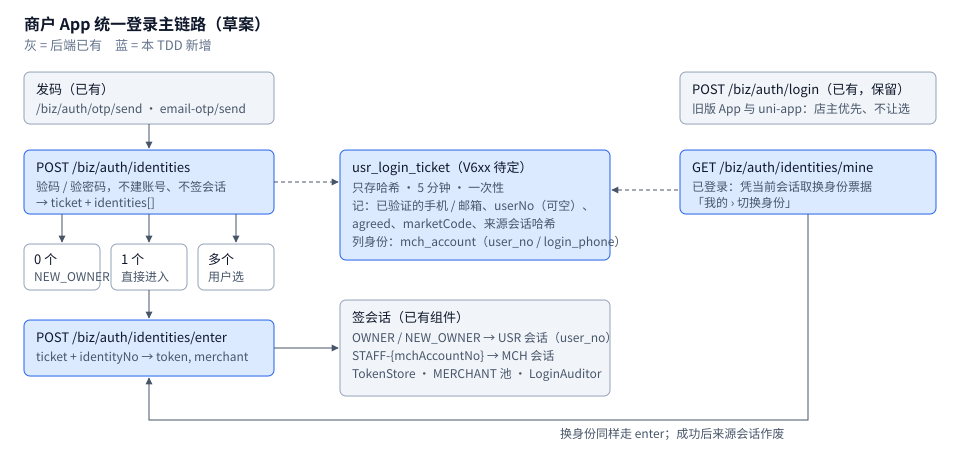

# TDD-商户App统一登录与账号

状态：**草稿**（文末「待用户拍板」各条定下后改「已确认」）
档位：**2**（跨端：后端 + Flutter 商户 App；新增账号范围端点与两张表；部分推翻 2026-08-15「登录页不让人先选身份」的拍板；注销不可逆）。**需要另开 ADR**（见 §3 末尾，本文不写）
关联需求：商户 App 交接文档（ai-shop-bapp 仓库 `docs/implementation/功能矩阵与API交接文档.md`（main `31a56c1`），2026-11-08）§3 通用约定、第 1 模块「账号与登录」、第 5 模块 5-05 / 5-06 / 5-14、附录 A 末行、附录 B `/biz/auth/identities` 行。本仓库 `docs/requirements/` 没有对应 PRD（见待用户拍板 D1）。
关联评审：ai-shop-bapp `docs/implementation/TDD评审-商户App.md`「最需要先定的」#2、#3 与「第二组 · 一」（2026-11-08，本文已按它修订，逐条对应见 §2「按商户 App 评审的修订」）
关联设计：[TDD-账户登录与选店校验](./TDD-账户登录与选店校验.md)（第二步「登录语义收口」）· [TDD-B端邮箱验证码注册登录](./TDD-B端邮箱验证码注册登录.md) · [ADR-051](./ADR/ADR-051-B端账号允许邮箱作为独立登录身份.md) · [TDD-测试身份白名单登录](./TDD-测试身份白名单登录.md) · [注册登录-方案梳理](./reference/注册登录-方案梳理.md)
创建：2026-11-08 · 最后更新：2026-11-08

---

## L1 定位

商户 App 已按 mock 做完「统一登录」（一个人可能既是自己店的店主、又是别家店的员工，登录后列出身份让他选）、
「更换登录手机」「绑定电子信箱」「注销账号」四块界面，正式包里都被拦着，因为后端没有接口。
本文给出这四块的**后端最终建议契约**和实现计划：能复用的全部复用（发码、验码、白名单、会话签发、C 端注销、推播设备抢占），
新增的只有身份列举与进入、账号凭证变更、商户注销前置检查三件事，外加给 `/biz/merchant/profile` 补一个 `currentIdentity` 字段（冷启动用）。

## L2 结构



图上最要紧的是中间那张票据表：登录前**先验证、后进入**拆成两步，两步之间要记住「这个人已经证明过哪个手机号 / 邮箱」，
否则第二步只能再要一次验证码（验证码是一次性的，`OtpStore.verifyAndConsume` 验完即删）。
右上角的 `/biz/auth/login` 原样保留：旧版 App 和 uni-app B 端还在用它，它的「店主优先、不让选」语义不变。
图上「列身份」读的是 `mch_account` 的 `user_no` 与 `login_phone` 两列：员工身份**只能经手机号认出来**——
邮箱登录的人要列出员工身份，前提是他的账号绑过手机（端点 1 规则 ③）；台湾员工没有可收码的手机，这是产品问题，见待用户拍板 D4。

| 部分 | 现状（均可在代码里找到） | 本 TDD |
|---|---|---|
| 登录 | `POST /biz/auth/login`：店主优先；名下无主体且是手机验证码时改签员工会话（`BizAuthController#login`） | 保留不改（响应里的 `merchant` 多一个字段 `currentIdentity`，见端点 9） |
| 身份列举 / 进入 / 切换 | 后端没有 | 新增 `/biz/auth/identities`、`/identities/enter`、`/identities/mine` |
| 冷启动取当前身份 | `GET /biz/merchant/profile` 不带身份信息（`BizMerchantController.MerchantProfileVO`） | 加 `currentIdentity` |
| 账号凭证读 | `GET /biz/merchant/profile` 的 `phone`、`account`（有手机给手机，否则给邮箱）；**没有单独的邮箱字段，也没有 `userNo`** | 新增 `GET /biz/auth/account` |
| 换手机 | 后端没有 B 端接口；C 端有 `POST /mp/user/phone/bind`（只绑，不换） | 新增 `POST /biz/auth/phone/change` |
| 绑邮箱 | 后端没有 | 新增 `POST /biz/auth/email/bind` |
| 注销 | 后端没有 B 端接口；C 端有 `POST /mp/user/deregister`（只查买家在途单） | 新增 `GET /biz/auth/deregister/precheck`、`POST /biz/auth/deregister` |

---

## §0 对账一 · 需求 → 设计

需求原文来自交接文档（以下简称「交接」）与商户 App 评审（以下简称「评审」）。「落点」里的类名，带「新增」的是计划，其余是现有代码。

| AC | 需求（Given / When / Then） | 出处 | 落点 |
|---|---|---|---|
| AC1 | Given 合法手机号 / 邮箱验证码或密码 When `POST /biz/auth/identities` Then 返回 `ticket` 与 `identities[]`，**不建账号、不签会话**；验证码被消费 | 交接 1-05 | 新增 `BizIdentityController#list` → 新增 `LoginIdentityService#verifyAndList`（验码复用 `AuthServiceImpl#verifyOtp`、`EmailOtpService#verify`、`loginByPassword` 的校验部分） |
| AC2 | Given 这个人名下有主体 Then 列出一个 `OWNER` 身份；只有一个主体时带主体名，**多个主体时 `merchantName` 为 null、另给 `entityCount`**；`storeCount` 为名下全部门店数 | 交接 1-05；评审 R5 | `mch_account` 按 `user_no` 查在职成员行（同 `MerchantMemberships.active(userNo, USR)` 口径） |
| AC3 | Given 这个人的已验证手机号是若干主体的在职员工 Then 每个主体列一个 `STAFF-{mchAccountNo}` 身份；`storeCount` 为该员工被授权的门店数，`roleCodes` 为他在这些门店上的角色 | 交接 1-05、1-08；评审 L4 | `mch_account` 按 `login_phone` 查 ACTIVE 行（同 `MerchantStaffServiceImpl#findActiveStaff` 口径，但取全部而非 `limit 1`）；门店数与角色读 `mch_store_role`（`MchStoreRole.mchAccountNo / storeNo / role`） |
| AC4 | Given 已验证的是邮箱（邮箱验证码或邮箱 + 密码）Then **同样列员工身份**：用该邮箱账号在 `usr_identity` 里已绑定的手机号去匹配 `login_phone`；账号没绑手机就列不出员工身份 | 评审「最需要先定的」#2、R1；**修订 ADR-051 决策 3** | 同 AC3，匹配用的手机号来自账号而非本次输入 |
| AC5 | Given 零个身份 Then `identities=[]`，App 进 E09c；`identityNo=NEW_OWNER` 进入时，有账号用旧账号、没有才建（首次建号须 `agreed=true`） | 交接 1-05、1-06 | 新增 `LoginIdentityService#enter`；建号复用 `AuthServiceImpl#findOrCreate`（经新增的「凭已验证凭证登录」入口） |
| AC6 | Given 有效票据 + 票据里的 `identityNo` When `POST /biz/auth/identities/enter` Then 返回与 `/biz/auth/login` 同形的 `{token, merchant}`；店主签 USR 会话、员工签该行的 MCH 会话；票据作废。**进入失败（10404 身份已失效）时票据不作废**，响应 `data.identities` 带重算后的身份列表，App 可在原票据上改选 | 交接 1-06；评审 L2 | `TokenStore.issue` + `LoginUser.merchantByUser` / `LoginUser.merchant`；`BizMerchantController#profileOf`；新表 `usr_login_ticket` |
| AC7 | Given 票据过期 / 已用 / 不存在 Then 拒绝，App 回登录页 | 交接 1-06 | 新错误码 `LOGIN_TICKET_INVALID`（建议 10474） |
| AC8 | Given 已登录 When `GET /biz/auth/identities/mine` Then 返回当前这个人的全部身份 + 换身份票据 + `currentIdentityNo`；用它进入新身份成功后，**来源会话作废** | 交接 1-07 | 新增 `BizIdentityController#mine`；票据记来源会话哈希，`enter` 成功后 `TokenStore.revoke` |
| AC9 | 登录限制照旧：10450 / 10451 / 10429 / 10454 / 10455 / 10456 / 10457 / 60001 的语义与 `/biz/auth/login` 一致 | 交接 1-10 – 1-12 | 复用 `OtpSendGuard`、`OtpStore` 失败闸、`PWD_TRY_RULE`、`RISK_BLOCKED` 判定 |
| AC10 | 测试身份白名单在新入口同样生效（统一码 / 统一密码） | 交接 §2、TDD-测试身份白名单登录 | 复用 `TestIdentityService#acceptsCode`（已接在 `verifyOtp` / `EmailOtpServiceImpl#verify` / `loginByPassword` 里） |
| AC11 | Given 已登录 When `GET /biz/auth/account` Then 返回本人的 `userNo`、`principalNo`、`phone`、`email`、`hasPassword`、三项能力开关、`phoneChangeVerifyBy` 与 `smsUnavailablePrefixes`；**员工会话（MCH）只读可用**（能力开关全为 false） | 交接 5-02、5-05、5-06；评审 R12、L5、R2 | 新增 `BizAccountController#account`；`usr_identity` 读 PHONE / EMAIL；`AuthService#hasPassword`；MCH 读 `mch_account.login_phone` / `user_no` |
| AC12 | Given 账号有手机号 When 换手机，提交当前凭证验证码 + 新手机 + 新手机验证码 Then 新号成为登录号，旧号不能再登录；门店「店主登录手机」随之改为新号 | 交接 5-05、App 文案 `mePhoneWarn` | 新增 `AccountCredentialService#changePhone`：`usr_identity`、`usr_account.phone`、店主 `mch_account.login_phone`（`MerchantStaffPortImpl#ownerPhone` 读的就是它） |
| AC13 | 新手机已属于别的账号 → 10409，不合并；新手机就是当前号 → 10458；新手机号段没有短信通道 → 10505 | 同上；`UserServiceImpl#attachPhone` 既有口径；评审 R2 | 同上 |
| AC14 | 换手机 / 绑邮箱成功后，**发起这次变更的会话保持有效**（令牌不换），这个人在 MERCHANT 池的其它会话与 CONSUMER 池的全部会话作废 | 安全基线（凭证变更后其它会话不可继续用）；评审 R6 | 新增 `TokenStore#revokeUserExcept(userNo, keepToken)`（MERCHANT 池）+ 既有 `TokenStores.of(CONSUMER).revokeUser` |
| AC15 | Given 已登录 When 绑邮箱（邮箱 + 该邮箱验证码）Then 账号多一条 EMAIL 凭证，之后可用邮箱登录；已有邮箱时为换绑 | 交接 5-06、App 文案 `meEmailNote` | 新增 `AccountCredentialService#bindEmail` |
| AC16 | 新邮箱已属于别的账号 → 10409，不合并 | ADR-051 决策 2 | 同上 |
| AC17 | Given 店主 When 打开注销页 Then 服务器逐项给出未满足的前置条件，并给出**可直接用来发码的完整验证目标** | 交接 5-14、App 文案 `delOrders` / `delStores` / `delFunds` / `delPlan`；评审 R8 | 新增 `GET /biz/auth/deregister/precheck` → 新增 `MerchantDeregisterPrecheck` |
| AC18 | Given 前置条件全部满足 + 当前登录标识的验证码 When 注销 Then 账号匿名化、凭证全部解绑、两池会话作废；门店、主体与交易记录保留 | 交接 5-14、`delWarn` | 新增 `POST /biz/auth/deregister`：复用 `UserServiceImpl#deregister` 的匿名化与解绑主体；另把本人的 `mch_account` 行置 DISABLED |
| AC19 | Given 前置条件未满足 When 直接调注销 Then 拒绝并带同一份 blockers | 交接 5-14 | 新错误码 `DEREGISTER_BLOCKED`（建议 70100） |
| AC20 | 员工会话（MCH）不能换手机、绑邮箱、注销（可以读 `/biz/auth/account`，见 AC11） | 交接 `delStaffNote`；`BizAuthController#personalUser` 既有口径 | 写操作走 `personalUser()` → 10403 |
| AC21 | 以上账号范围接口不带门店头也能用；在新模型门店账号上不被 70006 `CONTACT_ADMIN` 拦 | 交接 §3「账号范围的接口不带」、TDD-账户登录与选店校验 | `CommerceRoutePolicy` ACCOUNT 通道登记（见 §2「路由登记」） |
| AC22 | 换手机、绑邮箱、注销逐笔留痕（谁、何时、改了什么，号码只存脱敏） | 支持与纠纷需要；仓库既有「写操作要审计」惯例（`StaffAuditLogger`） | 新表 `usr_account_change_log` |
| AC23 | Given 已登录（店主或员工）When 冷启动调 `GET /biz/merchant/profile` Then 响应带 `currentIdentity{identityNo, type, merchantNo, merchantName, role, roleCodes, storeCount}`，与 `/identities/mine` 的 `currentIdentityNo` 同一口径 | 评审「最需要先定的」#3、L3 | `BizMerchantController#profile` / `profileOf` 调新增 `LoginIdentityService#current(LoginUser)` |
| AC24 | Given 设备已用身份 A 绑定推播 When 换到身份 B 后用新令牌重新绑定同一 `clientId` Then 推播归 B，A 不再收到 | 评审 R7 | **后端已有**：`PushTokenBinder#register` 按 `clientId + provider` 抢占（`PushNotifyFlowTest#reRegisterTakesOverDevice` 已钉住）；本文不改，只补一条换身份场景的测试 |

**孤立项**

- 没落点的 AC：无。
- 挂不上 AC 的设计：
  - `GET /biz/auth/account`（AC11）是本文**新提出**的，App 的建议契约里没有；评审已接受并要求加 `userNo`、对员工只读开放（R12、L5），本次已改。
  - `usr_account_change_log`（AC22）不是交接里的需求，是设计自加的留痕；如果产品认为 `LoginAuditor` 日志够用可删。
  - `TokenStore#revokeUserExcept`（AC14）是会话 SPI 的新方法，交接没提；它是评审 R6「在途请求不能被当成登录结束」的落点。
- 交接里有、本文**不做**的（不算孤立，列出免得被当成漏了）：
  - 1-09 冷启动的会话校验、1-13 会话结束、1-14 权限收回、1-15 登出：后端已有，契约不变（冷启动「当前身份」由 AC23 补上）。
  - 交接 1 模块「10450 / 10454 的等待时间从 `msg` 里抽数字，建议另给 `retryAfterSeconds`」：属于错误响应结构变更，影响所有发码与登录接口，单独开 0/1 档处理，建议见 D9。
  - 5-03 改用户名的路由登记问题见 §1「顺带发现」，不在本 TDD 的接口范围内；员工能不能改用户名 / 密码见 D15。
  - 交接 5 模块提到的「头像」：交接说没有接口，但功能矩阵 5-01 – 5-14 没有头像行，本文不处理。

---

## §1 现状与影响面

### 相关现有模块（每条都能在代码里找到）

| 模块 | 路径 | 与本文的关系 |
|---|---|---|
| B 端认证端点 | `backend/shop-app/src/main/java/ai/neargo/shop/portal/biz/BizAuthController.java` | `login`、`otp/send`、`email-otp/send`、`password`（GET/POST）、`logout`、`staff-login`（`@Deprecated`）。`personalUser()` 只放行 `realm=MERCHANT && subjectKind=USR` |
| 商家资料 | `backend/shop-app/src/main/java/ai/neargo/shop/portal/biz/BizMerchantController.java` | `GET /biz/merchant/profile` 与登录响应共用的 `MerchantProfileVO`（`profileOf` / `profile` / `build`）；`account` 字段由 `AuthService#loginIdentifier` 给出，员工会话为 null |
| 登录建户 | `backend/shop-core/src/main/java/ai/neargo/shop/user/service/impl/AuthServiceImpl.java` | `login` → `resolveCredentials` / `findOrCreate` / `loginByPassword`；`verifyOtp`（白名单统一码先认）；`hasPassword`；`accountMarket`；`loginIdentifier`；`setMockSmsPrefixes`（`shop.sms.mock-prefixes`）；`sendOtp` 对模拟号段**只存码、不报错**（`mockedSmsRegion`） |
| 邮箱验证码 | `backend/shop-core/src/main/java/ai/neargo/shop/user/service/EmailOtpService.java`、`impl/EmailOtpServiceImpl.java` | `send` / `verify` / `normalize` / `key`；`Delivery(expiresInSeconds, resendAfterSeconds)`；`shop.mail.stub=true` 且 `shop.mail.otp-stub-allowed=false` 时发码回 10505 |
| 验证码存储 | `backend/shop-base/src/main/java/ai/neargo/shop/common/OtpStore.java` | 内存；手机 5 分钟、邮箱 10 分钟；失败闸 15 分钟 5 次；`verifyAndConsume` 验完即删 |
| 发码限流 | `backend/shop-base-auth/src/main/java/ai/neargo/shop/common/ratelimit/OtpSendGuard.java` | 间隔 / 日上限 / 发起人 |
| 测试身份白名单 | `backend/shop-core/src/main/java/ai/neargo/shop/user/service/TestIdentityService.java`、`impl/TestIdentityServiceImpl.java` | 已接入手机验码、邮箱验码、统一密码三处 |
| 会话存储 | `backend/shop-base-auth/src/main/java/ai/neargo/shop/auth/TokenStore.java` 及 `store/DbTokenStore.java`、`EhcacheTokenStore.java`、`RedisTokenStore.java`、`MemoryTokenStore.java`、`RealmRoutingTokenStore.java` | `issue` / `get` / `refresh` / `revoke` / `revokeUser`；**没有「踢掉除当前外的全部」**；`RealmRoutingTokenStore#revokeUser` 直接拒绝（要求指明池） |
| 员工会话 | `backend/shop-merchant/src/main/java/ai/neargo/shop/merchant/service/MerchantStaffService.java`、`impl/MerchantStaffServiceImpl.java` | `issueStaffSession(phone)` 只取 `is_primary` 优先的**一条**；`findActiveStaff` 是私有方法；`add` 只收 `\d{11}` 的手机号 |
| 成员关系 | `backend/shop-merchant/src/main/java/ai/neargo/shop/merchant/entity/MchAccount.java`、`entity/MchStoreRole.java`、`service/impl/MerchantMemberships.java`、`service/impl/BizIdentityResolverImpl.java` | 一行 = 一个人在一个主体里的身份：`user_no`（可空，V46 起员工不必有 C 端账号）、`login_phone`、`is_owner`、`is_primary`、`status`；**没有登录邮箱列**。员工按门店授权在 `mch_store_role(mch_account_no, store_no, role)` |
| 店主登录手机 | `backend/shop-merchant/src/main/java/ai/neargo/shop/merchant/port/MerchantStaffPortImpl.java#ownerPhone` | 读店主那行 `mch_account.login_phone`，订单短信与 `/biz/notify/setting` 的 `ownerPhone` 都靠它 |
| 门店停用 | `BizMerchantController` `POST /biz/store/{storeNo}/status` → `backend/shop-merchant/src/main/java/ai/neargo/shop/merchant/service/impl/StoreAdminServiceImpl.java#setStatus` | 停用 = `READONLY`；**默认店不能停用**（10400）；平台下线 `SUSPENDED` 商家自己解不了 |
| 推播设备 | `backend/shop-core/src/main/java/ai/neargo/shop/message/api/biz/BizPushTokenController.java`（`/biz/push-token`、`/unregister`）、`message/notify/PushTokenBinder.java` | 绑定时按 `clientId + provider` **抢占**：同一台设备挂在别人名下的那条先删 |
| C 端绑手机 | `backend/shop-core/src/main/java/ai/neargo/shop/user/service/impl/UserServiceImpl.java#bindPhone` / `attachPhone` | 冲突报 10409、同号幂等；**只加不换** |
| C 端注销 | 同上 `#deregister`；`MpUserController` `POST /mp/user/deregister` | 只查买家在途单（`OpenOrderPort#hasOpenOrders(userNo)` → 70028）；物理删 `usr_identity`；`PersonService#deregister`；匿名化 `usr_account`；两池 `revokeUser` |
| 人档 | `backend/shop-core/src/main/java/ai/neargo/shop/user/service/PersonService.java` | `bindOnLogin` / `bindPhone` / `deregister` / `merge`；**没有「换号」方法** |
| 路由准入 | `backend/commerce/commerce-spring-boot-starter/src/main/java/ai/neargo/commerce/starter/security/CommerceRoutePolicy.java` | `ACCOUNT` 集合（写死在 starter 里，已含全部 `/biz/auth/*`）；`isSessionEntry` 集合；未登记 → `DENY` |
| 路由准入（主机侧） | `backend/shop-app/src/main/java/ai/neargo/shop/commercebridge/ShopCommerceEndContextAdapter.java`、`ShopStoreMemberRoutes.java` | `ShopStoreMemberRoutes` 只产 BOOTSTRAP（门店成员）通道，**不适合账号范围接口**；适配器对 `/biz/auth/password` 额外做 `checkFoundationSession` |
| 匿名放行 | `backend/shop-app/src/main/java/ai/neargo/shop/config/SecurityConfig.java`（`permitAll` 四条）、`backend/shop-base-auth/src/main/java/ai/neargo/shop/auth/BizContextFilter.java`（跳过作用域解析的五条） | 新匿名端点要在这两处和 `CommerceRoutePolicy` 两处同时登记 |

### 可直接复用

- 发码：`/biz/auth/otp/send`、`/biz/auth/email-otp/send` 原样复用。换手机、绑邮箱、注销要的验证码都用它们发，**不新增发码端点**（理由见 §3 选型 C）。
- 验码与白名单：`AuthServiceImpl#verifyOtp`（私有，需提出一个包内可调的入口）、`EmailOtpService#verify`、`TestIdentityService#acceptsCode`。
- 密码校验：`AuthServiceImpl#loginByPassword` 的限流与比对（同上，需拆出「只校验不签会话」的部分）。
- 会话：`TokenStore.issue`、`TokenStores.of(Realm).revokeUser`、`LoginUser.merchantByUser` / `LoginUser.merchant`、`LoginAuditor`。
- 登录响应：`BizAuthController.MerchantLoginResp(token, merchant)` 与 `BizMerchantController#profileOf`。
- 注销主体：`UserServiceImpl#deregister` 的「删凭证 + 人档解绑 + 匿名化 + 两池踢人」整段。
- 冲突口径：`UserServiceImpl#attachPhone`（属于别人 10409，同号幂等）。
- 换身份后的推播归属：`PushTokenBinder#register` 的抢占（AC24）。
- 在 `docs/technical/reference/` 搜过「身份 / 注销 / 绑定」：[注册登录-方案梳理](./reference/注册登录-方案梳理.md) 是现状投影，其「待办 5 注销账号」已由 C 端 `/mp/user/deregister` 落地；没有另一份 B 端身份切换的实现。

### 会被改到的已在跑的功能

| 功能 | 怎么受影响 |
|---|---|
| `AuthServiceImpl` 登录 | 把「验码 / 验密码」与「找人建户签会话」拆开成两个可单独调用的步骤；`login` 本身行为不变（回归测试兜） |
| `MerchantStaffService` | 新增「列出若干手机号的全部在职员工行（含授权门店数与角色）」「按 `mchAccountNo` 签会话」等方法；`issueStaffSession(phone)` 不改 |
| `MerchantProfileVO`（`/biz/merchant/profile` 与 `/biz/auth/login` 响应的 `merchant`） | **加一个字段** `currentIdentity`（AC23）。只加不改，uni-app B 端与旧版 App 忽略未知字段 |
| `TokenStore` 及其五个实现 | 加 `revokeUserExcept(userNo, keepToken)`（AC14）；`RealmRoutingTokenStore` 与 `revokeUser` 一样直接拒绝（要求指明池） |
| `UserServiceImpl#deregister` | 拆出与入口无关的核心（删凭证、人档、匿名化、踢人），C 端入口行为不变 |
| C 端注销（小程序） | **建议**同时加上「是店主则拒绝」的前置检查（见 D7）——今天一个店主从小程序注销，`usr_identity` 被删、`mch_account` 店主行原样留着，门店成了无人能登录的店 |
| 店主订单短信、`/biz/notify/setting` 的 `ownerPhone` | 换手机后跟着变（AC12），这是 App 文案已经承诺的行为 |
| C 端（小程序 / App）登录 | B 端店主的 `usr_account` 就是 C 端账号（`BizAuthController#login` 走的是同一个 `AuthService#login`）：在商户 App 换手机，**C 端登录号也一起换、C 端会话全部登出**；在商户 App 注销，C 端账号也一起注销 |
| `CommerceRoutePolicy` | `ACCOUNT` 与 `isSessionEntry` 两个集合加行；兜底 DENY 不变 |

### 明确不受影响

- `/biz/auth/login`、`/biz/auth/staff-login` 的请求，以及响应里除 `merchant.currentIdentity` 以外的字段：一字不改。uni-app B 端（`b-app/`）不用跟着改。
- 运营端登录与第二因子、`/ops/test-identities/**`。
- `/mp/user/phone/bind`、`/mp/user/login` 等 C 端登录接口（注销入口见 D7）。
- 门店范围接口与 `ShopStoreMemberRoutes`：本文新接口全部是账号范围，不登记那里。
- `/biz/push-token`：换身份后的推播迁移靠它已有的抢占语义，不改（AC24）。

### 顺带发现（不在本文范围，记一笔）

- `POST /biz/merchant/display-name`（交接 5-03，标「已有」）**不在** `CommerceRoutePolicy.ACCOUNT`，也不在 `ShopStoreMemberRoutes`。按 `ShopCommerceEndContextAdapter#select` 的代码，账号名下有新模型门店时它会落到 DENY → 70006。**这是读代码推断，没有在 166 上验证。** 若属实，修法是把它加进 ACCOUNT（0/1 档，可与本文实施一起做）。
- 员工会话调 `/biz/auth/password` 会被 `personalUser()` 拒成 10403（只认 USR），而交接 5-04 与原型 v21 P02 写的角色是「全部」。这是产品取舍，见 D15。
- `MerchantStaffServiceImpl#add` 只收 `\d{11}` 的手机号：**台湾号码今天连员工都加不进去**，与有没有短信通道无关。台湾员工登录的任何方案都要先过这一关，见 D4。
- `StoreAdminServiceImpl#setStatus` 不让停用默认店：按草案原定义「名下有未停业门店就拦」，**任何有店的店主都永远注销不了**。见 D14。
- `POST /biz/auth/password` 改密码不要旧密码、也不要验证码，是有意为之（`AuthServiceImpl#setPassword` 注释：要旧密码会把「忘了密码」变成死路）。评审 R13 要的「改密码前先验证」是对这个设计的修订，见 D16。

---

## §2 方案

### 按商户 App 评审的修订（2026-11-08）

评审原文：ai-shop-bapp `docs/implementation/TDD评审-商户App.md`「最需要先定的」#2、#3 与「第二组 · 一」。技术问题核对了后端代码后直接改进契约；需要产品定的列进文末「待用户拍板」；与后端事实不符或换了做法的单列在第二张表里。

**已改进契约的**

| 评审条目 | 核对到的后端事实 | 改了什么 | 为什么 |
|---|---|---|---|
| #2 / R1 邮箱登录不列员工身份 | 员工行只有 `login_phone` 与可空的 `user_no`（`MchAccount`），没有登录邮箱列；ADR-051 决策 3「邮箱登录不参与员工匹配」 | 端点 1 规则 ③：员工身份的匹配号码改为「这个人已验证的手机号」——手机登录用本次的号，邮箱登录用该邮箱账号在 `usr_identity` 里绑过的 PHONE；与入口无关（AC4） | 同一个人用邮箱或手机登录，看到的身份应当一样；绑过的手机号在绑定时已验证过，拿它认员工与手机验证码登录同等强度。**这只解决「绑过手机的邮箱账号」**；台湾员工没有可收码的手机、`add` 也不收台湾号码，真正的解法是产品取舍，见 D4 |
| #3 / L3 冷启动不回当前身份 | `MerchantProfileVO` 没有任何身份字段；`/identities/mine` 每次签一张票据；App 冷启动本来就调 `/biz/merchant/profile`（交接 1-09） | 端点 9：`MerchantProfileVO` 加 `currentIdentity`（AC23）；与 `/mine` 的 `currentIdentityNo` 同一方法算 | 采纳评审 L3 的建议。冷启动只读，不该为它写票据；登录与 `enter` 的响应 `merchant` 也自动带上，App 进入后不必再问一次 |
| R12 / L5 `/account` 没有 `userNo`、不对员工开放 | `MerchantProfileVO` 无 `userNo`；员工会话主体是 `mchAccountNo`（`LoginUser.merchant`） | 端点 4 响应加 `userNo`、`principalNo`；MCH 会话只读开放：`phone` 取 `mch_account.login_phone`，能力开关全 false（AC11、AC20） | App 本机缓存、偏好、身份记忆要一个换手机也不变的键：USR 用 `userNo`，员工用 `principalNo`（= `mchAccountNo`，换号时 D5 只改 `login_phone`，这个号不变）。员工的 P02 要显示登录手机，而写操作仍按 AC20 拒绝 |
| R6 凭证变更后在途请求被当成登录结束 | `TokenStore` 只有 `revoke(token)` 与 `revokeUser(userNo)`，没有「除当前外」；USR 会话里只装 `userNo` 与昵称（`LoginUser`），不装手机号——换号不会让当前会话的内容过时 | 端点 5、6：**当前会话不作废、令牌不换**；MERCHANT 池用新增的 `revokeUserExcept(userNo, 当前令牌)` 踢其它会话，CONSUMER 池全踢；响应不再带 `token`（AC14、§3 选型 E） | 当前令牌刚刚提交了两个验证码，是这个人此刻最可信的会话；它不作废，在途请求就不会 401，App 也不必在换令牌期间挡住其它请求。评审给的两个办法（宽限到响应返回 / App 串行化）各有缺点，见选型 E |
| R8 注销验证目标是掩码，App 发不出码 | 发码端点 `/biz/auth/otp/send`、`/email-otp/send` 要完整号码 / 地址；`/account` 本来就回本人完整值 | 端点 7 响应 `verifyTarget` 改为完整值，另加 `verifyTargetMasked` 供显示；`verifyBy` 改为与端点 4 同一判定（AC17） | 这是本人看自己的凭证，与 `/account` 同级，不构成新的泄露面；提交时验哪个地址仍由服务器按账号决定（选型 C1 的前提不变） |
| R2 换手机只看账号地区；新号码收不到码没判 | `AuthServiceImpl#sendOtp` 对 `shop.sms.mock-prefixes` 覆盖的号段**只存码、不报错**；`EmailOtpServiceImpl#send` 在邮件桩下回 10505 | 端点 4：`phoneChangeAvailable` 改为「当前凭证能收到码」（`phoneChangeVerifyBy` 不为 null），不再看账号地区；加 `smsUnavailablePrefixes` 让 App 的区码选择器排除收不到短信的号段；端点 5 规则：新号落在这些号段（且不是白名单测试号）→ 10505（AC13） | 账号地区与「新号能不能收码」是两回事。没有在发码端点上报 10505，理由见下表 |
| R5 多主体时 `merchantName` 与 `storeCount` 不匹配 | USR 会话覆盖名下全部主体（`BizIdentityResolverImpl` 按门店反查主体） | 端点 1 规则 ②：多主体时 `merchantName=null`、加 `entityCount`（AC2） | 采纳评审建议；App 已有「我的商戶」兜底文案 |
| L4 员工的 `storeCount` 没定义 | 员工授权在 `mch_store_role`，按门店一行 | 端点 1 规则 ③：`storeCount` = 该员工行在 `mch_store_role` 的去重门店数；`roleCodes` = 去重角色（AC3） | 与原型 E09b「員工 · 收銀員 · 1 家門店」一致 |
| L2 `enter` 回 10404 后票据还能不能用 | — | 端点 2 规则 ②：10404 不消费票据，`data.identities` 带重算后的列表（AC6） | 验证码已经消费了，票据再作废就只能让用户重新收一次码 |
| L1 新错误码没有数字 | `ErrorCode` 现有 10470–10473、70020–70099 已占满，70100 起空 | 给出建议号：`LOGIN_TICKET_INVALID` 10474、`EMAIL_ALREADY_BOUND` 10475、`DEREGISTER_BLOCKED` 70100 | App 按 `business_<code>` 映射，需要数字才能先写；实施当天再核一次没被并行分支占用 |
| L6 邮箱账号绑上手机后能否马上列出员工身份 | — | 随 R1 的改法：绑定成功即写 `usr_identity(PHONE)`，下一次 `/identities/mine` 就列得出，不必重新登录 | — |
| L8 换手机后 C 端也登出 | `UserServiceImpl#deregister` 的两池踢人是同一模式；B 端店主的 `usr_account` 就是 C 端账号 | §1「会被改到的」写明 C 端会话全部登出（AC14）。`mePhoneWarn` 要不要加一句由 App 定，后端事实如此 | — |
| L9 票据过期后的提示 | 票据 5 分钟（`shop.auth.login-ticket.ttl`） | 不改契约：过期统一回 `LOGIN_TICKET_INVALID`，`expiresInSeconds` 已在响应里，App 可在切回前台时先判本地时钟再决定提示 | 文案归 App |

**没有照改的**

| 评审条目 | 评审的建议 | 没照改的理由（后端事实） | 本文的做法 |
|---|---|---|---|
| R7 换身份时来源会话被吊销，App 没法解绑旧身份的推播 | 服务端在 `enter` 时一并迁移或解绑 | 不需要：`PushTokenBinder#register` 已经按 `clientId + provider` 抢占——新身份用新令牌对同一 `clientId` 调一次 `POST /biz/push-token`，旧身份那条就被删掉（`PushNotifyFlowTest#reRegisterTakesOverDevice` 钉着）。另外来源会话是在 `enter` **成功之后**才吊销的，App 想先解绑也来得及 | App 在 `enter` 成功后用新令牌重新注册推播；后端只补一条换身份场景的测试（AC24），不加新逻辑 |
| R2 后半「发码时按新号码区码回 10505」 | 在 `/biz/auth/otp/send` 上判 | 模拟号段「只存码不报错」是刻意的：本地与 166 靠它从日志取码，登录也走同一个发码端点（`AuthServiceImpl#sendOtp` 注释）。在发码端点上改成 10505，会让这两处的台湾 / 阿联酋号码登录一起失效 | 改为 `/account` 下发 `smsUnavailablePrefixes`，App 事先排除；提交时端点 5 再兜一道 10505 |
| R6 「旧会话宽限到响应返回，或 App 串行化」 | 二选一 | 两者都可行但都比「当前会话不作废」复杂，见选型 E | 当前会话保留，其它会话作废 |
| R13 改密码前先验证手机 | 本文一并给出 `/biz/auth/password` 带 `code` 的口径 | 后端现在**有意**不要旧密码也不要验证码（`AuthServiceImpl#setPassword` 注释）；改它是改已上线端点的语义，uni-app B 端同样受影响，属于安全取舍 | 列入 D16，不在本文擅自改 |

### 契约变更总表

- **端点**：新增 8 条（下文 1–8）；修改 1 条：`GET /biz/merchant/profile` 加字段 `currentIdentity`（端点 9，同一个 VO 也出现在 `/biz/auth/login` 与 `enter` 的响应里）。`/biz/auth/login` 等既有端点的请求不改。
- **库表 / 迁移**：新增 `usr_login_ticket`、`usr_account_change_log`，一个迁移 **V6xx 待定**（当前分支最高是 V635；共享工作区里多会话并行，实施当天再取号）。
- **SPI**：`TokenStore` 加 `int revokeUserExcept(String userNo, String keepToken)`。
- **权限码**：无新增。账号范围接口按会话主体判（USR / MCH），不挂 `biz:*`；进 `BizEndpointPermTest` 的免码清单。
- **i18n**：后端新错误码 3 个（三语 `messages*.properties` 各加一行，`BackendI18nParityTest` 盯着）；身份的本地化角色名复用员工管理已有的角色词条（实施时确认词条键，缺则补三语）；App 侧新增文案由 App 自行处理。
- **配置项**：新增 `shop.auth.login-ticket.ttl`（缺省 `PT5M`）。复用 `shop.sms.mock-prefixes` 判「哪些号段收不到短信」，复用 `shop.mail.stub` / `shop.mail.otp-stub-allowed` 判「邮件能不能发」。

### 端点契约（最终建议）

返回包、鉴权头、语言头照交接 §3。下表「会话」一列：匿名 = 不带 token；USR = 店主 / 未开店的个人账号会话；MCH = 员工会话。

**两处共用的判定**（端点 4、5、7 都用，写成一个方法，不各写一份）：

- 「手机号收得到短信」= 号码不以 `shop.sms.mock-prefixes` 任一前缀开头（`AuthServiceImpl#mockedSmsRegion` 取反），**或**它是测试身份白名单号（`TestIdentityService`）。
- 「邮件发得出去」= 非 `shop.mail.stub=true && shop.mail.otp-stub-allowed=false`（`EmailOtpServiceImpl#send` 回 10505 的同一条件），或该邮箱是白名单邮箱。
- 「当前凭证验证方式」`verifyBy`：账号有手机号且收得到短信 → `PHONE`；否则账号有邮箱且邮件发得出去 → `EMAIL`；都不行 → null。

#### 1. `POST /biz/auth/identities` —— 验证并列出身份

| 项 | 内容 |
|---|---|
| 会话 | 匿名 |
| 请求 | 与 `/biz/auth/login` 相同：`{grantType: PHONE_OTP\|EMAIL_OTP\|PASSWORD, principal, credential, agreed?, marketCode?}` |
| 响应 | `{ticket, expiresInSeconds, identities: [{identityNo, type: OWNER\|STAFF, merchantNo, merchantName, entityCount, role, roleCodes[], storeCount}], canCreateOwner}` |
| 规则 | ① 只验证：验证码被消费，**不建 `usr_account`、不写 `usr_identity`、不签会话**。② `OWNER`：按已验证凭证找到的账号，其 `user_no` 在 `mch_account` 有在职行时出一条，`identityNo` 固定为 `OWNER`；`entityCount` = 这些在职行的去重主体数；`merchantNo` 取默认主体（`is_primary`）；`merchantName`：`entityCount=1` 时取该主体名称，**>1 时为 null**（App 显示「我的商戶」）；`storeCount` 为名下全部主体的门店数。③ `STAFF`：先定「这个人已验证的手机号」——`PHONE_OTP` 为本次号码；`EMAIL_OTP` 或 `PASSWORD` 为凭证所属账号在 `usr_identity` 里的 PHONE（账号不存在或没绑手机则为空）；principal 是手机号的 `PASSWORD` 两者相同。按这些号码取 `login_phone` 匹配、ACTIVE 且 `is_owner=false` 的全部行，排除 `user_no` 等于本人的行（那些已含在 OWNER 会话里），`identityNo = "STAFF-" + mchAccountNo`；`merchantName` 取该行主体名；`storeCount` = 该行在 `mch_store_role` 的去重 `store_no` 数；`roleCodes` = 去重 `role`（`MANAGER` / `CLERK` / `PICKER` / `COURIER` / `CS`）。④ `role` 为按 `Accept-Language` 本地化的展示名（OWNER 为「店主」；STAFF 按 `roleCodes` 顺序用顿号连接），`roleCodes` 给机器读（OWNER 为 `["OWNER"]`，即 `MchStoreRole.OWNER_CODE`）。⑤ `canCreateOwner`：没有 OWNER 身份时为 true（**与员工身份个数无关**；App 在「只有一个员工身份」时要不要停在 E09b 给出开店入口，见 D13）。⑥ 排序：OWNER 在前，STAFF 按 `is_primary` 倒序、`id` 正序（与 `findActiveStaff` 同一确定顺序）。 |
| 错误 | 10400（参数缺失、格式错）、10455 码错或过期、10454 锁定、10456 / 10457 密码错 / 未设、10429 密码试太多、60001 账号被拦截（账号存在且 BANNED 时在这一步就拒） |
| 与 App 建议的差异 | 多了 `expiresInSeconds`、`merchantNo`、`entityCount`、`roleCodes`、`canCreateOwner`；`role` 改为服务端本地化（App mock 里是写死的中文）。全部是**加字段**，App 现有解析不受影响。理由：`identityNo` 必须稳定（App 本机记「上次进入的身份」排第一，交接 1-06），所以用 `OWNER` / `STAFF-{mchAccountNo}` 而不是每次随机号——这与 App mock 的 `OWNER`、`STAFF-MOCK-S1` 恰好同形 |
| 评审修订 | 规则 ② 多主体置空 + `entityCount`（R5）；规则 ③ 邮箱登录也按绑定手机列员工（#2 / R1）、员工 `storeCount` 与 `roleCodes` 的取法（L4） |

#### 2. `POST /biz/auth/identities/enter` —— 进入身份

| 项 | 内容 |
|---|---|
| 会话 | 匿名（凭 `ticket`） |
| 请求 | `{ticket, identityNo}`；`identityNo` 取 `identities[].identityNo`，或 `NEW_OWNER`（仅当票据的 `canCreateOwner=true`） |
| 响应 | 与 `/biz/auth/login` 相同：`{token, merchant{…, currentIdentity}}` |
| 规则 | ① 票据一次性：**成功进入**才标记已用（条件更新 `consumed_at IS NULL`，并发两次只成功一次）。② 进入时**重新校验**身份仍有效（员工可能刚被停用）：失效回 10404，**票据不消费**，`data.identities` 为按票据里的已验证凭证重算的当前列表（`identity_nos` 同步收窄）；App 从列表剔除失效项、留在 E09b 改选，列表变空时按零身份走 E09c。③ `OWNER` / `NEW_OWNER` → USR 会话（`LoginUser.merchantByUser`）；`NEW_OWNER` 且账号不存在时此刻才建号（走 `findOrCreate`，首次建号要 `agreed=true`，`marketCode` 只在建号时生效，与 `/biz/auth/login` 同口径）。④ `STAFF-*` → 该 `mch_account_no` 的 MCH 会话。⑤ 票据来源是 `/identities/mine` 时，成功后吊销来源会话。⑥ 成功 / 失败都记 `LoginAuditor`（MERCHANT 池）。⑦ 推播不在这里处理：App 拿到新令牌后对本机 `clientId` 调一次 `POST /biz/push-token`，旧身份的绑定由 `PushTokenBinder` 抢占删除（AC24）。 |
| 错误 | `LOGIN_TICKET_INVALID`（10474，票据不存在 / 过期 / 已用）、10404（身份不在票里或已失效，带 `data.identities`）、10400（新建号未勾协议）、60001 |
| 与 App 建议的差异 | 10404 时多给 `data.identities` |
| 评审修订 | 规则 ②（L2）、规则 ⑦（R7，不改后端，说明做法） |

#### 3. `GET /biz/auth/identities/mine` —— 已登录者的身份与换身份票据

| 项 | 内容 |
|---|---|
| 会话 | USR 或 MCH |
| 请求 | 无；不带门店头 |
| 响应 | 同 1 的响应，另加 `currentIdentityNo` |
| 规则 | 从当前会话推出「这个人」：USR → `user_no`，及其 `usr_identity` 里的 PHONE（用于列员工身份，同端点 1 规则 ③）；MCH → `mch_account.login_phone`，再按 `usr_identity(PHONE)` 找个人账号（**只找不建**）。票据记下当前会话的哈希。`currentIdentityNo` 由 `LoginIdentityService#current` 算，与端点 9 同一方法。**只在用户要切换身份时调**：它每次写一张票据，冷启动请读端点 9。 |
| 错误 | 10401 / 10402 |
| 与 App 建议的差异 | 多 `currentIdentityNo`（App 现在靠本机记当前身份，服务器给更可靠） |

#### 4. `GET /biz/auth/account` —— 本人登录凭证（本文新增）

| 项 | 内容 |
|---|---|
| 会话 | USR 或 MCH（MCH 只读，见规则） |
| 响应 | `{userNo, principalNo, phone, email, hasPassword, phoneChangeAvailable, phoneChangeVerifyBy, emailBindAvailable, deregisterAvailable, smsUnavailablePrefixes[]}` |
| 规则 | **USR**：`userNo` = `principalNo` = 会话 `user_no`；`phone` / `email` 读 `usr_identity` 的 PHONE / EMAIL（E.164 / 归一化地址，本人看自己的完整值）；`hasPassword` 同 `AuthService#hasPassword`；`phoneChangeVerifyBy` = 本节开头的 `verifyBy`；`phoneChangeAvailable` = `phoneChangeVerifyBy != null`；`emailBindAvailable` = 邮件发得出去；`deregisterAvailable` 恒 true（注销页自己读 precheck）。**MCH**：`principalNo` = `mchAccountNo`；`userNo` = 该行 `user_no`（可空）；`phone` = `login_phone`；`email` = null；`hasPassword` = false；三项能力开关全 false、`phoneChangeVerifyBy` = null（写操作仍按 AC20 回 10403）。两种会话都给 `smsUnavailablePrefixes` = `shop.sms.mock-prefixes` 的列表（App 换手机的区码选择器据此排除；白名单测试号不受它限制）。 |
| 与 App 的差异 | App 没有这条；它现在读 `/biz/merchant/profile.phone`，并在 `OnboardingProfile.userNo` 回落到 `account` / `phone`（评审 R12）。App 本机缓存的键改用 `principalNo` |
| 评审修订 | 加 `userNo` / `principalNo`（R12）；MCH 只读（L5）；`phoneChangeAvailable` 改判据、加 `phoneChangeVerifyBy` 与 `smsUnavailablePrefixes`（R2） |

#### 5. `POST /biz/auth/phone/change` —— 更换 / 绑定登录手机

| 项 | 内容 |
|---|---|
| 会话 | USR（MCH 回 10403） |
| 请求 | `{currentCode, newPhone, newCode}`。`currentCode` 发到端点 4 的 `phoneChangeVerifyBy` 指向的地址：`PHONE` 为当前手机号（App P05 第一步「驗證舊手機」），`EMAIL` 为当前邮箱（邮箱注册的账号，或当前手机号收不到短信的账号）。App 先用 `/biz/auth/otp/send` 或 `/biz/auth/email-otp/send` 给这个地址发码 |
| 响应 | `{account{…同 4}}` —— **不带新令牌**：当前会话继续有效 |
| 规则 | ① 先按服务器算出的 `verifyBy` 验 `currentCode`（目标由服务器按账号决定，不信请求），再验 `newCode`。② 新号 = 当前号 → 10458；新号在 `usr_identity` 属于别人 → 10409，不合并（与 `attachPhone` 同口径；此时新码已验过，不构成「这个号注册过没有」的探测口子）；新号收不到短信（命中 `smsUnavailablePrefixes` 且不是白名单号）→ 10505（App 本应事先排除，这里兜底）。③ 同一事务内：改 `usr_identity` PHONE 行的值（无则插入，`verified_at=now`）、改 `usr_account.phone`（过渡期双写，同 `attachPhone`）、改本人店主行 `mch_account.login_phone`（`user_no=本人 且 is_owner=true`）。④ 员工行与人档的处理见 D5、D6。⑤ 事务提交后：MERCHANT 池 `revokeUserExcept(userNo, 当前令牌)`，CONSUMER 池 `revokeUser(userNo)`；**当前令牌不动**。⑥ 写 `usr_account_change_log(PHONE_CHANGE, 旧号脱敏, 新号脱敏)`。⑦ `phoneChangeVerifyBy` 为 null 时直接 10505（不让用户走完两步才发现收不到码）。 |
| 错误 | 10400、10455 / 10454（任一验证码）、10458、10409、10505、10403 |
| 与 App 建议的差异 | App 没给契约（交接说「连草案都没有」）。本契约与 App P05 页面的两步表单（当前凭证验证码 → 新号 + 新号验证码）一一对应；一次提交而不是两次，理由：两次提交就要在服务器上保存「旧号已验过」的中间态，又是一张票据 |
| 评审修订 | 响应不再带 `token`、当前会话保留（R6）；`currentCode` 的目标按 `phoneChangeVerifyBy`、新号段兜底 10505（R2）。App 侧：成功后只需用响应里的 `account` 刷新本机，`identityMemory` 等改按 `principalNo` 做键（R12），不再需要「换令牌期间挡住其它请求」 |

#### 6. `POST /biz/auth/email/bind` —— 绑定 / 换绑电子信箱

| 项 | 内容 |
|---|---|
| 会话 | USR（MCH 回 10403） |
| 请求 | `{email, code, currentCode?}`。`code` 为发到新邮箱的验证码。`currentCode` 只在**账号已有邮箱（换绑）**时必填，为发到当前邮箱的验证码（见 D3） |
| 响应 | `{account{…}}`，同 5（不带新令牌） |
| 规则 | ① 归一化同 `EmailOtpService.normalize`。② 新邮箱 = 当前邮箱 → `EMAIL_ALREADY_BOUND`（10475）；属于别人 → 10409，不合并（ADR-051 决策 2）。③ 插入或改写 `usr_identity(EMAIL)`。④ 会话处理、变更记录同 5（保留当前会话，其它会话作废）。 |
| 错误 | 10400、10455 / 10454、`EMAIL_ALREADY_BOUND`、10409、10505、10403 |
| 与 App 建议的差异 | App P06 只有「邮箱 + 验证码」两栏，**首次绑定**完全一致；换绑多一个 `currentCode`，App 要加一步（D3，原型 P06「已綁定時先驗舊信箱」已画） |
| 说明 | 这里绑的邮箱**只是登录凭证**。App 文案 `meEmailNote` 说它「也用來接收對帳單與發票」，后端没有这个用途（本店通知邮箱另走 `/biz/notify/email`），见 D17 |

#### 7. `GET /biz/auth/deregister/precheck` —— 注销前置检查

| 项 | 内容 |
|---|---|
| 会话 | USR（MCH 回 10403） |
| 响应 | `{allowed, verifyBy: PHONE\|EMAIL, verifyTarget, verifyTargetMasked, blockers: [{code, count, storeNos[]}], staffMemberships}` |
| blockers.code | `OPEN_ORDERS`（名下门店有进行中的订单或售后）· `ACTIVE_STORES`（名下门店未处理，**判据待 D14 定**）· `PENDING_PAYOUT`（收款账户有待拨款项）· `PAID_PLAN_ACTIVE`（门店方案有未到期的付费期间）· `BUYER_OPEN_ORDERS`（本人作为买家有在途单，即 C 端已有的 70028 那一条）——与 App 的四条文案一一对应，多出的最后一条来自 C 端既有闸 |
| 规则 | `verifyBy` = 本节开头的共用判定；`verifyTarget` 为该地址的**完整值**（E.164 手机号 / 归一化邮箱，App 直接拿去调发码端点），`verifyTargetMasked` 供界面显示（`Masks#phone` / `Masks.email`）。`verifyBy` 为 null 时 `allowed=false`、`verifyTarget=null`，App 引导联系客服。`staffMemberships`：本人在别家主体的在职员工行数，注销时如何处理见 D8。 |
| 后端现状 | `OpenOrderPort#hasOpenOrders(userNo)` 只按**买家**判；按商户 / 门店判「在途单、待拨款、未到期方案」的只读口子**后端没有**，要在订单、资金、方案三个域各补一个只读查询，经 `spi` 端口给 `MerchantDeregisterPrecheck` 用（端口名实施时定）。门店「转让」**后端没有**（没找到任何转让接口）；门店停用有 `POST /biz/store/{storeNo}/status`，但**默认店不能停用**（`StoreAdminServiceImpl#setStatus`）——所以 `ACTIVE_STORES` 不能按「有未停用门店」判，否则有店的人永远注销不了，见 D14 |
| 评审修订 | `verifyTarget` 改完整值 + `verifyTargetMasked`（R8）；`ACTIVE_STORES` 判据挂 D14（R9） |

#### 8. `POST /biz/auth/deregister` —— 注销

| 项 | 内容 |
|---|---|
| 会话 | USR（MCH 回 10403） |
| 请求 | `{code, confirm: true}`；`code` 为发到 `verifyTarget` 的验证码 |
| 响应 | 无（`data: null`）；成功后当前会话已失效，App 清本机回登录页 |
| 规则 | ① 先验码（目标按服务器当下算出的 `verifyBy`，不信请求），再在同一事务里**重跑一次** precheck（防「检查完到提交之间又来了一单」）。② 通过后：本人全部 `mch_account` 行（`user_no=本人`，以及 D8 决定的按 `login_phone` 匹配的行）置 DISABLED；调用从 `UserServiceImpl#deregister` 拆出的核心（删 `usr_identity`、`PersonService#deregister`、匿名化、状态 `DEREGISTERED`、两池 `revokeUser`——注销连当前会话一起作废，与端点 5、6 不同）。③ 主体、门店、订单、结算原样保留（`delWarn`：「門店、主體與交易紀錄依法保留」）。④ 写变更记录（DEREGISTER）。 |
| 错误 | 10400（`confirm` 不是 true）、10455 / 10454、`DEREGISTER_BLOCKED`（70100，`data.blockers` 同 precheck）、10403 |

#### 9. `GET /biz/merchant/profile` 加 `currentIdentity`（修改既有端点）

| 项 | 内容 |
|---|---|
| 会话 | 照旧（USR 或 MCH） |
| 变更 | `MerchantProfileVO` 末尾加 `currentIdentity: {identityNo, type, merchantNo, merchantName, entityCount, role, roleCodes[], storeCount}`，形状与端点 1 的 `identities[]` 元素相同 |
| 规则 | 由 `LoginIdentityService#current(LoginUser)` 算，与端点 3 的 `currentIdentityNo` 同一方法：USR → `identityNo=OWNER`、`type=OWNER`（名下还没有主体时 `merchantNo` 为空串、`storeCount=0`，即 `NEW_OWNER` 进入后的状态）；MCH → `STAFF-{mchAccountNo}`，其余字段按端点 1 规则 ③。`/biz/auth/login`、`/identities/enter` 的响应 `merchant` 经 `profileOf` 同样带上。只读，不写票据。 |
| 兼容 | 只加字段。uni-app B 端与旧版 App 忽略它 |
| 评审修订 | 新增（#3 / L3），App `restore()` 冷启动读它回填 `identity`，`staffSession` / `canSwitchIdentity` 不再恒 false |

### 新错误码（建议号，实施当天在 `ErrorCode` 上复核仍空）

| 名称 | 建议号 | 含义 | App 表现 |
|---|---|---|---|
| `LOGIN_TICKET_INVALID` | **10474**（10470–10473 已占） | 票据不存在、过期或已用 | 回登录页，提示「驗證已逾時」 |
| `EMAIL_ALREADY_BOUND` | **10475** | 新邮箱就是当前邮箱 | 「已經綁定這個信箱」 |
| `DEREGISTER_BLOCKED` | **70100**（70020–70099 已占满，下一段从 70198 起） | 注销前置条件未满足，`data.blockers` 列出 | 刷新注销页清单 |

其余全部复用：10400 / 10403 / 10404 / 10409 / 10429 / 10450 / 10451 / 10454 / 10455 / 10456 / 10457 / 10458 / 10505 / 60001。

### 路由登记（每个新端点要动哪几处）

`ShopStoreMemberRoutes` 只产生 BOOTSTRAP 通道（「令牌 + 该门店成员」），要求带 `X-Store-No`，**账号范围接口不能登记在那里**。全部登记到 `CommerceRoutePolicy` 的 ACCOUNT 通道。端点 9 是既有端点，不动登记。

| 端点 | `SecurityConfig` permitAll | `BizContextFilter` 跳过作用域 | `CommerceRoutePolicy.ACCOUNT` | `isSessionEntry` | `ShopCommerceEndContextAdapter` 走 `checkFoundationSession` |
|---|---|---|---|---|---|
| `POST /biz/auth/identities` | ✅ | ✅ | ✅ | ✅ | — |
| `POST /biz/auth/identities/enter` | ✅ | ✅ | ✅ | ✅ | — |
| `GET /biz/auth/identities/mine` | — | — | ✅ | — | ✅ |
| `GET /biz/auth/account` | — | — | ✅ | — | ✅ |
| `POST /biz/auth/phone/change` | — | — | ✅ | — | ✅ |
| `POST /biz/auth/email/bind` | — | — | ✅ | — | ✅ |
| `GET /biz/auth/deregister/precheck` | — | — | ✅ | — | ✅ |
| `POST /biz/auth/deregister` | — | — | ✅ | — | ✅ |

最后一列：与现有 `/biz/auth/password` 同一处理——对账号级写操作先用 `AccountSessionVerifier#withFresh` 核一次会话主体，防「会话行已被换掉但内存里还是旧身份」。

`ACCOUNT` 写死在可移植的 starter 里，而 [TDD-账户登录与选店校验](./TDD-账户登录与选店校验.md) §6 说过 starter 不应知道主机有哪些接口。本文**沿用现状**（`/biz/auth/*` 本来就全在那个集合里），不借机重构；如果评审要求移到主机侧，做法是仿 `HostRoute` 给 ACCOUNT 也开一个主机登记表，那是独立的 0 档重构。

### 库表（计划，迁移号 V6xx 待定）

**`usr_login_ticket`** —— 先验证后进入之间的一次性票据

| 列 | 类型 | 说明 |
|---|---|---|
| `id` | BIGINT PK | |
| `ticket_hash` | CHAR(64) UNIQUE | 票据明文的 SHA-256；**明文不落库**（库被读走也换不出会话） |
| `purpose` | VARCHAR(16) | `LOGIN` / `SWITCH` |
| `user_no` | VARCHAR(64) NULL | 已有账号时填；新号（还没建户）为空 |
| `verified_type` | VARCHAR(16) | `PHONE` / `EMAIL` / `ACCOUNT`（SWITCH 时） |
| `verified_value` | VARCHAR(191) NULL | 已验证的手机号 / 归一化邮箱。NEW_OWNER 建号与 10404 后重算身份都要用它；与 `usr_identity.identity_value` 同等级别的数据 |
| `agreed` | TINYINT | 请求时是否勾选协议 |
| `market_code` | VARCHAR(16) NULL | 请求带来的注册地区 |
| `origin_token_hash` | CHAR(64) NULL | SWITCH 的来源会话，进入成功后吊销 |
| `identity_nos` | VARCHAR(1024) | 签发时列出的身份号，`enter` 只认这里面的（外加 `NEW_OWNER`）；10404 重算后收窄 |
| `expires_at` / `consumed_at` | DATETIME | 5 分钟；进入成功写 `consumed_at` |
| 公共列 | | `tenant_no`、`created_at`、`updated_at`、`version`、`deleted`，同 `usr_identity` |

清理：过期行由现有定时任务框架每日删除，或懒删（读到过期即删）——实施时看哪种不新增定时任务。

**`usr_account_change_log`** —— 账号凭证变更与注销留痕

| 列 | 说明 |
|---|---|
| `user_no` | 谁 |
| `action` | `PHONE_CHANGE` / `EMAIL_BIND` / `EMAIL_CHANGE` / `DEREGISTER` |
| `before_masked` / `after_masked` | 只存脱敏值（`Masks#phone`、邮箱打码），**不存明文** |
| `actor_kind` | `SELF`（一期只有本人自助；留着给以后客服代办） |
| `client_ip` | 请求来源 IP，取法沿用 [TDD-安全基线P0-运营登录与真实IP](./TDD-安全基线P0-运营登录与真实IP.md)（`LoginAuditor` 现在不记 IP） |
| `created_at` 等公共列 | |

迁移只建表、不带种子。H2 测试库 `backend/shop-app/src/test/resources/schema-test.sql` 要同步加两张表——`SchemaDriftTest` 比对两边的表与列，只改一边会红。

### 模块设计

| 动作 | 路径 | 说明 |
|---|---|---|
| 新增 | `backend/shop-app/src/main/resources/db/migration/V6xx__login_ticket_and_account_change_log.sql` | 两张表 |
| 新增 | `backend/shop-core/src/main/java/ai/neargo/shop/user/entity/UsrLoginTicket.java`、`UsrAccountChangeLog.java` | 实体；Mapper 加进 `UserMappers` |
| 新增 | `backend/shop-core/src/main/java/ai/neargo/shop/user/service/LoginTicketService.java`、`impl/LoginTicketServiceImpl.java` | 签发（随机 32 字节 base64url）、按哈希取、条件更新核销、10404 后收窄 `identity_nos` |
| 修改 | `backend/shop-core/src/main/java/ai/neargo/shop/user/service/AuthService.java`、`impl/AuthServiceImpl.java` | 新增 `VerifiedPrincipal verify(LoginCommand)`（只验不建，返回已验证的类型、值、已有 userNo）与 `UsrAccount enterVerified(VerifiedPrincipal, agreed, marketCode)`（复用 `findOrCreate`）；`login` 改为两者串联，行为不变；把 `mockedSmsRegion` 提成本节开头「收得到短信」判定的包内入口 |
| 修改 | `backend/shop-base-auth/src/main/java/ai/neargo/shop/auth/TokenStore.java` 及 `store/DbTokenStore.java`、`EhcacheTokenStore.java`、`RedisTokenStore.java`、`MemoryTokenStore.java`、`RealmRoutingTokenStore.java` | 新增 `int revokeUserExcept(String userNo, String keepToken)`。`DbTokenStore` 在 `revokeByUser` 的条件上加「令牌哈希不等于 keep」并同样立刻跑一次 `pollRevocations`；`RealmRoutingTokenStore` 与 `revokeUser` 一样拒绝（要求 `tokenStores.of(Realm)`） |
| 新增 | `backend/shop-core/src/main/java/ai/neargo/shop/user/service/AccountCredentialService.java`、`impl/AccountCredentialServiceImpl.java` | `changePhone`、`bindEmail`、`verifyBy`；冲突口径与 `attachPhone` 共用一个私有方法（不各写一份） |
| 修改 | `backend/shop-core/src/main/java/ai/neargo/shop/user/service/UserService.java`、`impl/UserServiceImpl.java` | 把 `deregister()` 的核心拆成 `deregisterCore(userNo)`；C 端入口照旧调它 |
| 修改 | `backend/shop-core/src/main/java/ai/neargo/shop/user/service/PersonService.java` 及实现 | 新增「换号」方法（D6 定口径后实现） |
| 修改 | `backend/shop-merchant/src/main/java/ai/neargo/shop/merchant/service/MerchantStaffService.java`、`impl/MerchantStaffServiceImpl.java` | 新增 `List<StaffIdentity> activeStaffIdentities(Collection<String> phones, @Nullable String excludeUserNo)`（带 `mch_store_role` 的去重门店数与角色）、`Optional<String> issueStaffSessionFor(mchAccountNo)`、`void updateOwnerLoginPhone(userNo, newPhone)`、`int disableAllOf(userNo, phone)`；`findActiveStaff` 与新列表方法共用同一查询条件 |
| 新增 | `backend/shop-merchant/src/main/java/ai/neargo/shop/merchant/service/LoginIdentityService.java`、`impl/LoginIdentityServiceImpl.java` | 列身份、进入身份、换身份、`current(LoginUser)`（组合 AuthService、LoginTicketService、MerchantStaffService、BizIdentityResolver）。放 shop-merchant 而不是 shop-core：要读 `mch_account`，而 shop-core 的 `AuthServiceImpl` 读店员走的是 `StaffSessionPort`，不直接依赖商户模块（实施时以 `ArchitectureTest` 判定为准） |
| 新增 | `backend/shop-merchant/src/main/java/ai/neargo/shop/merchant/service/MerchantDeregisterPrecheck.java` 及实现 | 汇总 blockers；订单 / 资金 / 方案三个只读口子经 `spi` 端口取；`ACTIVE_STORES` 判据按 D14 |
| 新增 | `backend/shop-base/src/main/java/ai/neargo/shop/spi/...` 下三个只读端口（名称实施时定）及各域实现 | 「商户有无进行中订单与售后」「有无待拨款」「门店方案有无未到期付费期」 |
| 新增 | `backend/shop-app/src/main/java/ai/neargo/shop/portal/biz/BizIdentityController.java` | 端点 1–3 |
| 新增 | `backend/shop-app/src/main/java/ai/neargo/shop/portal/biz/BizAccountController.java` | 端点 4–8。不塞进 `BizAuthController`：那个类管「登录与会话」，这几条管「已登录的人改自己的凭证与注销」，分开后各自的测试与注入都更窄（路径前缀同为 `/biz/auth`，不影响 `known-fat-controllers.txt` 的判据） |
| 修改 | `backend/shop-app/src/main/java/ai/neargo/shop/portal/biz/BizMerchantController.java` | 端点 9：`MerchantProfileVO` 末尾加 `currentIdentity`；旧构造保留（不带它的构造补 null），`profile` / `profileOf` 调 `LoginIdentityService#current` |
| 修改 | `backend/shop-app/src/main/java/ai/neargo/shop/config/SecurityConfig.java` | permitAll 加 2 条 |
| 修改 | `backend/shop-base-auth/src/main/java/ai/neargo/shop/auth/BizContextFilter.java` | 跳过集合加 2 条 |
| 修改 | `backend/commerce/commerce-spring-boot-starter/src/main/java/ai/neargo/commerce/starter/security/CommerceRoutePolicy.java` | ACCOUNT 加 8 条，`isSessionEntry` 加 2 条 |
| 修改 | `backend/shop-app/src/main/java/ai/neargo/shop/commercebridge/ShopCommerceEndContextAdapter.java` | `checkFoundationSession` 的路径判断加 6 条（与 `/biz/auth/password` 同列） |
| 修改 | `backend/shop-base/src/main/java/ai/neargo/shop/common/ErrorCode.java`、`backend/shop-app/src/main/resources/messages.properties`、`messages_en.properties`、`messages_ar.properties` | 3 个新码（10474 / 10475 / 70100） |
| 修改 | `backend/shop-app/src/test/java/ai/neargo/shop/arch/BizEndpointPermTest.java` | 免码清单加 8 条（理由同 `/biz/auth/password`：作用对象是调用者本人） |
| 修改 | `backend/shop-app/src/test/java/ai/neargo/shop/contract/ApiContractTest.java` | 游客端点清单加 2 条 |
| 修改 | `backend/shop-app/src/test/resources/schema-test.sql` | H2 侧同步两张表（`SchemaDriftTest` 本身不改） |
| 新增 | 测试类见 §5：`BizIdentityFlowTest`、`BizAccountFlowTest`、`BizDeregisterFlowTest`、`LoginTicketServiceTest`、`MerchantDeregisterPrecheckTest`、`CommerceRoutePolicyTest`（后者 starter 里目前没有同名测试，新建）、`TokenStoreRevokeExceptTest` | |
| 修改（App 仓库，不在本仓库提交） | ai-shop-bapp `features/v5/contracts.dart` 删 `^/biz/auth/identities`；`features/me` 接 P05 / P06 / P14；`onboarding_controller.dart` `restore()` 读 `currentIdentity`；`enter` 后重新注册推播；本机缓存键改 `principalNo`；错误码映射加 10474 / 10475 / 70100 | 冻结后由 App 做 |

### 关键接口

```java
// AuthService（新增两个，login 改为二者串联）
record VerifiedPrincipal(String type /* PHONE|EMAIL */, String value, @Nullable String userNo) {}
VerifiedPrincipal verify(LoginCommand cmd);                       // 验码 / 验密码，不建户；BANNED → 60001
UsrAccount enterVerified(VerifiedPrincipal p, Boolean agreed, String marketCode); // 复用 findOrCreate

// TokenStore（新增）
int revokeUserExcept(String userNo, String keepToken);            // 踢掉该主体除 keepToken 外的全部会话

// LoginIdentityService
record Identity(String identityNo, String type, String merchantNo, @Nullable String merchantName,
                int entityCount, String role, List<String> roleCodes, int storeCount) {}
record IdentityChoice(String ticket, long expiresInSeconds, List<Identity> identities,
                      boolean canCreateOwner, @Nullable String currentIdentityNo) {}
IdentityChoice verifyAndList(LoginCommand cmd, Locale locale);
IdentityChoice mine(LoginUser current, String currentToken, Locale locale);
Identity current(LoginUser current, Locale locale);               // 端点 3 与端点 9 共用
String enter(String ticket, String identityNo);                   // 返回 token；10404 时异常带重算的 identities

// AccountCredentialService
enum VerifyBy { PHONE, EMAIL }
@Nullable VerifyBy verifyBy(String userNo);                        // 端点 4、5、7 共用
void changePhone(String userNo, String currentToken, String currentCode, String newPhone, String newCode);
void bindEmail(String userNo, String currentToken, String email, String code, @Nullable String currentCode);

// MerchantDeregisterPrecheck
record Blocker(String code, int count, List<String> storeNos) {}
List<Blocker> check(String userNo);
```

---

## §3 选型（2 档）

### A. 先验证后进入，还是一步登录后再换身份

| 方案 | 优点 | 缺点 | 结论 |
|---|---|---|---|
| A1 两步：`identities` 只验证 + 票据，`enter` 才签会话 | 与 App 已做的 E09 / E09b / E09c 完全一致；零身份时不预先建账号 | 要一张票据表；多一次往返 | ✅ 采用 |
| A2 沿用 `/biz/auth/login` 签店主会话，响应里附 `identities`，换身份再调 `/mine` + `enter` | 不加匿名端点 | 员工-only 的人会先被签一个空的个人会话、还会被「登录即注册」建一个 C 端账号——员工本来**不需要** C 端账号（`MerchantStaffService` 类注释） | ❌ |
| A3 登录页先选「老板 / 店员」 | 实现最简单 | 2026-08-15 已否：「他可能选错，选错的表现是进去什么都看不到」 | ❌ |

A1 只在「多个身份」时让人选，零个和一个都不选，所以没有回到 A3 的问题；但它确实改变了「后端按身份判、不让人选」这条拍板的字面，**要用 ADR 记下来**。

### B. 票据存哪

| 方案 | 优点 | 缺点 | 结论 |
|---|---|---|---|
| B1 新表 `usr_login_ticket` | 多实例安全；一次性靠条件更新；可审计 | 一张新表 | ✅ 采用 |
| B2 放 `OtpStore` 那种内存缓存 | 不加表 | `OtpStore` 是单实例内存（TDD-B端邮箱验证码 §4 已记风险）；会话已在外置（`DbSessionConfig`），票据退回内存就成了新的单点 | ❌ |
| B3 无状态签名票据（HMAC） | 不加表 | 做不到一次性；要吊销只能等过期 | ❌ |

### C. 换手机 / 绑邮箱 / 注销的验证码怎么发

| 方案 | 优点 | 缺点 | 结论 |
|---|---|---|---|
| C1 复用两个匿名发码端点，App 自己给目标地址发码 | 零新端点；限流、白名单、模拟通道、邮件正文语言全部沿用 | 服务器在提交时才知道码是发给谁的——所以「验哪个地址」必须由服务器按账号决定，不能信请求；App 要拿得到完整目标（端点 4 的 `phone` / `email`、端点 7 的 `verifyTarget`） | ✅ 采用 |
| C2 新增 `POST /biz/auth/account/otp/send {purpose}`，服务器自己选目标 | 目标不可伪造；App 不必知道完整目标 | 要复制一套限流与通道判断，或者改 `OtpSendGuard`；收益只是少一个前端判断 | ❌ 一期不做 |

### D. 注销是匿名化还是删除

沿用 C 端已落地的口径（`UserServiceImpl#deregister`）：匿名化 + 物理删凭证，不删交易数据。B 端多做的只是「前置检查更严」与「停用成员行」。不另立一套。

### E. 凭证变更后，发起变更的那个会话怎么办（评审 R6）

| 方案 | 优点 | 缺点 | 结论 |
|---|---|---|---|
| E1 全部作废，响应带新令牌（原草案） | 实现最简单（现成的 `revokeUser`） | 当前令牌也失效：换令牌之前已发出的请求回 401，App 全局把它当「上次登入已結束」踢回登录页（评审引 `onboarding_controller.dart` 169–172 行） | ❌ |
| E2 全部作废，但旧的当前令牌宽限到响应返回（或宽限 N 秒） | 安全语义与 E1 相同 | 「宽限」要在五个 `TokenStore` 实现里各做一份带时限的撤销；`DbTokenStore` 跨实例靠撤销轮询，宽限窗口和轮询周期互相叠加，难测 | ❌ |
| E3 全部作废，App 在换令牌期间串行化所有请求 | 后端不动 | 问题推给 App，且推播回调、后台刷新等非用户触发的请求也要挡住，漏一处就复现 | ❌ |
| E4 **当前会话保留**，其它会话（MERCHANT 池其余 + CONSUMER 池全部）作废 | 没有在途 401；App 不换令牌；USR 会话只装 `userNo`，换号后内容不过时 | `TokenStore` 加一个方法、五个实现各一份（都是在现有 `revokeUser` 上多一个排除条件） | ✅ 采用 |

E4 的安全性：当前会话刚刚交出了「当前凭证验证码 + 新凭证验证码」，是这个人此刻最可信的会话；要防的是「别处那些可能被别人拿着的会话」，E4 一个不落。注销（端点 8）不适用 E4：注销后人已不存在，当前会话一并作废。

### F. 冷启动的当前身份从哪来（评审 L3）

| 方案 | 优点 | 缺点 | 结论 |
|---|---|---|---|
| F1 `/biz/merchant/profile` 加 `currentIdentity` | App 冷启动本来就调它；只读；登录与 `enter` 的响应自动带上 | 动一个既有 VO（只加字段） | ✅ 采用（评审建议） |
| F2 冷启动调 `/identities/mine` | 不动既有端点 | 每次冷启动写一张票据，且多一次往返 | ❌ |
| F3 `/biz/auth/account` 带当前身份 | 一条账号接口说清「我是谁」 | 原草案它不对 MCH 开放；即便开放，也是冷启动多一次往返 | ❌ |

### 需要的 ADR（本文不写）

- **ADR-0xx 商户 App 统一登录：多身份时让用户选**——记录对 2026-08-15「不让人先选」拍板的修订（只在多身份时选）、`/biz/auth/login` 保留为兼容入口、票据模型；**并修订 ADR-051 决策 3**：员工匹配按「这个人已验证的手机号」，与登录入口（手机 / 邮箱 / 密码）无关（AC4）。D4 若选「员工行加登录邮箱」，那次修订另记。
- **ADR-0xx 商户账号注销口径**——不可逆：注销后同一手机号 / 邮箱再来是全新账号；主体与门店不随人注销而注销；店主注销的前置条件（含 D14 的门店判据）。若 D7 选择「C 端入口也拦店主」，一并记在这里。

## §4 风险（2 档）

| 风险 | 影响 | 缓解 |
|---|---|---|
| 台湾没有短信通道（`shop.sms.mock-prefixes` 覆盖 `+886` 时短信只存不发），且 `MerchantStaffServiceImpl#add` 只收 `\d{11}` | 台湾员工加不进来也登不进来；台湾账号换 / 绑手机做不了 | `phoneChangeAvailable` / `smsUnavailablePrefixes` 让 App 提前隐藏入口；员工登录是产品取舍，见 D4（★，卡上线） |
| 换手机后旧号的员工行、人档没跟上 | 换完号「别家店的员工身份没了」，或会员关系挂在旧号上 | D5、D6 先定口径；测试 `phoneChangeMovesOwnerLoginPhone` 钉住店主行 |
| 换手机后当前会话保留（选型 E4） | 若当前会话本身已被盗用，攻击者需同时拿到当前凭证与新号的两个验证码才能走到这一步，与 E1 下拿到新令牌的门槛相同 | 两个验证码都由服务器决定目标；变更留痕（AC22）；其它会话全部作废 |
| `revokeUserExcept` 某个实现漏了排除条件 | 等于 E1，在途请求 401 | `TokenStoreRevokeExceptTest` 对四个具体实现各跑一遍；`RealmRoutingTokenStore` 拒绝调用的测试 |
| 票据被截获 | 5 分钟内可进入对应身份 | 只存哈希、一次性、5 分钟；与验证码本身同等强度（截获验证码同样能登录） |
| 10404 不消费票据 | 同一票据可被多次尝试进入 | 只能进 `identity_nos` 里的身份，且每次重新校验；5 分钟后照样过期 |
| 注销前置检查漏一个域 | 有待拨款的店主注销后无人能收款 | 提交时在事务里重跑 precheck；三个只读端口各有一条「有数据就拦」的测试 |
| 店主从小程序注销绕过 B 端检查（**现状就存在**） | 门店无人能登录 | D7 建议 C 端入口共用 precheck |
| 换身份时来源会话没吊销 | 一人同时持有两个身份的有效令牌 | AC8 测试拿旧令牌再打一次，必须 401 |
| `ACCOUNT` 集合漏登记一条 | 新模型门店账号上 70006（交接已踩过一次） | `CommerceAccessSecurityFlowTest` 加新模型账号逐条打 8 个端点 |

---

## §5 对账三 · 实现 → 需求（测试）

计划的测试方法，**均未编写、未运行**。「跑过」「消融验证」两列实现后填。

| AC | 测试方法 | 跑过 | 消融验证 |
|---|---|---|---|
| AC1 | `BizIdentityFlowTest#listingConsumesCodeButCreatesNoAccountOrSession` | | |
| AC2 | `BizIdentityFlowTest#ownerWithStoresListsOneOwnerIdentity` · `#ownerOfTwoEntitiesHasNullNameAndEntityCount` | | |
| AC3 | `BizIdentityFlowTest#phoneThatIsStaffInTwoMerchantsListsTwoStaffIdentities` · `#staffStoreCountAndRolesComeFromStoreRoles` | | |
| AC4 | `BizIdentityFlowTest#emailLoginListsStaffIdentitiesOfBoundPhone` · `#emailAccountWithoutPhoneListsNoStaffIdentity` | | |
| AC5 | `BizIdentityFlowTest#newPhoneHasNoIdentityAndNewOwnerCreatesAccountOnlyOnEnter` · `#newOwnerWithoutAgreementIsRejected` | | |
| AC6 | `BizIdentityFlowTest#enterOwnerIssuesUsrSessionShapedLikeLogin` · `#enterStaffIssuesMchSessionForThatRow` · `#enterDisabledStaffReturns404KeepsTicketAndRefreshesList` | | |
| AC7 | `BizIdentityFlowTest#ticketIsSingleUse` · `#expiredTicketIsRejected` · `#identityNotInTicketIsRejected` · `LoginTicketServiceTest#concurrentConsumeSucceedsOnce` | | |
| AC8 | `BizIdentityFlowTest#switchingIdentityRevokesOriginToken` · `#staffSessionSeesOwnIdentityViaPhone` · `#mineReportsCurrentIdentityNo` | | |
| AC9 | `BizIdentityFlowTest#wrongCodeLocksAfterFiveAttemptsLikeLogin` · `#bannedAccountIsBlockedAtListing` | | |
| AC10 | `TestIdentityFlowTest#whitelistedIdentityListsWithUnifiedCode` | | |
| AC11 | `BizAccountFlowTest#accountShowsUserNoPhoneEmailAndPassword` · `#phoneChangeVerifiesByEmailWhenPhoneRegionIsMocked` · `#phoneChangeUnavailableWhenNoChannelReachable` · `#staffSessionReadsAccountWithAllCapabilitiesOff` | | |
| AC12 | `BizAccountFlowTest#phoneChangeRequiresCurrentAndNewCodes` · `#phoneChangeMovesOwnerLoginPhone` · `#oldPhoneCannotLoginAfterChange` | | |
| AC13 | `BizAccountFlowTest#phoneOfAnotherAccountConflictsWithoutMerge` · `#samePhoneReportsAlreadyBound` · `#newPhoneInMockedRegionIsRejected` | | |
| AC14 | `BizAccountFlowTest#credentialChangeKeepsCurrentSessionAndRevokesOthersInBothPools` · `TokenStoreRevokeExceptTest`（Db / Ehcache / Redis / Memory 各一组，`RealmRoutingTokenStore` 拒绝） | | |
| AC15 | `BizAccountFlowTest#bindEmailThenLoginWithEmailReachesSameAccount` · `#rebindEmailRequiresCurrentEmailCode` | | |
| AC16 | `BizAccountFlowTest#emailOfAnotherAccountConflictsWithoutMerge` | | |
| AC17 | `MerchantDeregisterPrecheckTest#eachBlockerIsReportedWithStores`（四个域各一组数据） · `BizDeregisterFlowTest#precheckGivesFullTargetUsableForOtpSend` | | |
| AC18 | `BizDeregisterFlowTest#ownerWithNoBlockersIsAnonymizedAndStoresAreKept` · `#deregisteredOwnerCannotLoginAndSameEmailGetsFreshAccount` | | |
| AC19 | `BizDeregisterFlowTest#directCallWithBlockersReturnsSameBlockers` | | |
| AC20 | `BizAccountFlowTest#staffSessionCannotChangeCredentialsOrDeregister` | | |
| AC21 | `CommerceAccessSecurityFlowTest#accountRoutesOpenWithoutStoreOnNewModelAccount` · `CommerceRoutePolicyTest#accountScopeRoutesAreAccountLane` | | |
| AC22 | `BizAccountFlowTest#changesAreLoggedMasked` | | |
| AC23 | `BizIdentityFlowTest#profileCarriesCurrentIdentityForOwnerAndStaff` · `#loginResponseMerchantCarriesCurrentIdentity` | | |
| AC24 | `PushNotifyFlowTest#switchingIdentityThenReRegisteringMovesPushToNewIdentity`（既有 `#reRegisterTakesOverDevice` 保持绿） | | |
| 回归 | `BizAuthEmailLoginTest`、`EmailOtpAuthTest`、`TestIdentityFlowTest`、`DeregisterFlowTest`、`PhoneBindFlowTest`、`IdentityUnificationFlowTest`、`StoreScopedDailyRoutesFlowTest`、`PushNotifyFlowTest`、`MerchantStatusMappingTest`、`ApiContractTest`、`BizEndpointPermTest`、`BackendI18nParityTest`、`SchemaDriftTest`、`ArchitectureTest` | | |

## §6 对账二 · 设计 → 实现（实现完再填）

未实现。实现后贴自己提交的 `git show --stat`，与 §2 模块设计逐行比。

## §7 确认与完成

| 日期 | 事件 |
|---|---|
| 2026-11-08 | 草稿 |
| 2026-11-08 | 按商户 App 评审（TDD评审-商户App.md）修订：邮箱登录按绑定手机列员工身份；`/biz/merchant/profile` 加 `currentIdentity`；`/biz/auth/account` 加 `userNo` / `principalNo`、对员工只读开放；凭证变更保留当前会话（`TokenStore#revokeUserExcept`）；注销预检回完整验证目标；多主体与员工门店数口径；10404 不消费票据；新错误码给出建议号；产品问题并入「待用户拍板」。状态仍为草稿 |

---

## 待用户拍板

需要产品或用户决定的取舍。每条给出选项、后果与建议；带 ★ 的会卡住实现或上线，要在开工前定。D13 起是按商户 App 评审新增的。

### D1 ★ 需求基线：要不要另写 PRD

- **问题**：本文按 2 档写，2 档要 PRD。本仓库没有商户 App 的账号 PRD，需求源是 bapp 的交接文档与原型 v10 / v21 / v23。
- **选项与后果**：A 不另写 PRD，交接第 1、5 模块 + 本文 §0 作基线，产品在本文上签字 —— 最快，需求与设计在一处；B 补一份 PRD —— 多一份要同步的文档，晚至少一轮。
- **建议**：A；两份 ADR 照写。

### D2 ★ 多主体的店主列一个 OWNER 还是每个主体一个

- **问题**：一个店主名下有多张执照（多个主体）。
- **选项与后果**：A 列一个（多主体时 `merchantName` 为 null、给 `entityCount`，本文现行）—— 与会话语义一致；B 每个主体一个 —— USR 会话本来就覆盖名下全部主体（`BizIdentityResolverImpl` 按门店反查主体），点哪条进去都一样，是假选择。
- **建议**：A。

### D3 换绑邮箱要不要验证旧邮箱

- **选项与后果**：A 要（`currentCode`，本文现行，原型 P06 已画）—— App 多一步；B 不要 —— 借来的手机上一分钟就能把账号的登录邮箱永久换掉。首次绑定都不需要。
- **建议**：A。

### D4 ★ 台湾员工怎么登录（评审 #2 / R1）

- **问题**：台湾正式入口是邮箱，短信走模拟通道；员工身份只能经手机号认出（`mch_account` 没有邮箱列），且 `MerchantStaffServiceImpl#add` 只收 11 位大陆手机号——**台湾员工今天连加都加不进来**。本文 AC4 只解决「邮箱账号绑过手机」的情形，而台湾账号绑不了手机（D18），所以对台湾员工无效。原型 v10 E02/E03 写的是「員工用手機號收驗證碼登入」。
- **选项与后果**：
  - A 员工行加登录邮箱：`mch_account` 加 `login_email`，店主按邮箱加员工，员工用邮箱验证码登录即可列出 STAFF 身份 —— 要一个迁移、改员工新增接口与 App E04 表单、修订 ADR-051 决策 3；不依赖短信，台湾能立刻用。
  - B 接入台湾短信通道 + 放开 `add` 的号码格式 —— 与原型一致；要商务对接通道，时间不由研发决定。
  - C 员工用「手机号 + 店主设的初始密码」登录 —— 不依赖通道；但员工账号本来不需要 C 端账号（`MchAccount.userNo` 注释），密码要挂在 `mch_account` 上，等于另造一套凭证，且初始密码由店主转交有泄露面。
  - D 一期不解决，台湾员工只能用测试白名单 —— 台湾员工端整体不可用。
- **建议**：A，另开 1 档 TDD，与统一登录**同一个版本**上线（不能只说「另开 TDD」不给时间）；B 作为长期方向跟进。

### D5 换手机时别家主体的员工行要不要跟着改（含评审 L7）

- **问题**：别家主体按**旧号**把他加成员工的行（`user_no` 为空、`login_phone`=旧号）。
- **选项与后果**：A 跟着改，并在每家主体的员工变更记录（`MchStaffLog`）写一条「员工更换了登录手机」—— 员工身份不丢；店主在员工列表看到的号码会变；B 不改 —— 换完号员工身份全部消失，而他做的只是换号。附带：App 员工详情 E04 要不要显示这条变更记录（评审 L7）。
- **建议**：A；E04 显示最近一条「已更換登入手機」，由 App 决定样式。

### D6 换手机时人档（`usr_person`）怎么跟

- **问题**：新号已有一份**未绑账号**的人档（商家早先录过这个号）。
- **选项与后果**：A 人档跟着换号；新号已有未绑账号的人档时走 `PersonService#merge` 并入（留 `usr_person_merge_log`）；新号的人档已绑别的账号时整单 10409 —— 会员关系不丢；B 只换账号不动人档 —— 会员、积分挂在旧号上，换号后看不到。
- **建议**：A。

### D7 ★ 店主从小程序注销要不要也走商户前置检查

- **问题**：店主从 `/mp/user/deregister` 注销今天**不会被拦**，门店会变成无人能登录的店。
- **选项与后果**：A 要，两个入口共用 `MerchantDeregisterPrecheck`，C 端对店主回同一个 `DEREGISTER_BLOCKED` —— 堵住现存漏洞；小程序要认一个新码；B 不要 —— 漏洞保留。
- **建议**：A。

### D8 注销时本人在别家的员工身份怎么办（含评审 R10）

- **问题**：本人在**别家主体**的在职员工行。App 文案 `delStaffNote`「員工帳號由店主停用，不走這裡」与「注销时一并停用」相反；原型 P14 没画这一条。
- **选项与后果**：A 不拦注销，一并停用并写员工变更记录，precheck 用 `staffMemberships` 提示「註銷後將退出 n 家店的員工身分」—— 需要改 `delStaffNote` 文案、P14 补一条；B 不拦也不停用 —— 员工行留着，人已注销，按 `login_phone` 匹配的行仍能被同号的新账号进入（等于把员工身份留给了「下一个用这个号的人」）；C 有员工身份就拦注销 —— 要先让各店主停用他，用户自己做不到。
- **建议**：A；文案与原型由 App 改。

### D9 10450 / 10454 的等待时间要不要给结构化字段

- **选项与后果**：A 要，单独做：`data` 里加 `retryAfterSeconds` / `lockedMinutes`，`msg` 不动，App 优先读字段 —— 影响全部发码与登录接口，宜单独排期；B 不做 —— App 继续从 `msg` 抽数字，换语言即失效。
- **建议**：A，但不跟本文绑在一起。

### D10 注销要不要冷静期

- **问题**：`需求矩阵-三端.md` 1.3 写过「注销与冷静期」，C 端落地时没做。
- **选项与后果**：A 一期不设，与 C 端一致 —— 前置条件已保证没有在途的钱和货；B 设冷静期 —— 要一张待注销表和一个定时任务，C 端也要跟着补。
- **建议**：A，等法务明确要求再加。

### D11 `/biz/auth/login` 与 `staff-login` 什么时候下线

- **选项与后果**：A `login` 至少保留到 uni-app B 端停用；`staff-login` 在 App 正式包切到统一登录后、看访问日志一个版本周期无调用再删 —— 稳妥；B 随统一登录上线立刻删 —— 旧版 App 立刻登不进。
- **建议**：A。

### D12 `/biz/merchant/display-name` 在新模型账号上 70006 —— 已解决

- 2026-11-08 已修：`POST /biz/merchant/display-name` 与 `POST /biz/push-token(/unregister)` 登记进 `CommerceRoutePolicy` 的 ACCOUNT 通道（提交 `2bdf1c943`，TDD-账户登录与选店校验 §2 第四步），同日在 166 发版，商户 App 用店主令牌验证不再 70006。本文实施时不用再处理，保留编号便于对照。

### D13 只有一个员工身份时，要不要给「自己开店」的入口（评审 R4）

- **问题**：App `login()` 拿到一个身份就直接进入（`onboarding_controller.dart` 249–252 行），E09c 只在零身份时出现；「已是别家员工、想自己开店」的人在 App 里没有路。后端在这种情况下已经回 `canCreateOwner=true`。
- **选项与后果**：A `canCreateOwner=true` 时即使只有一个身份也停在 E09b，列表末尾加「我要開店」—— 员工每次登录多点一下；B 仍直接进入，在「我的」页加「我要開店」入口（调 `/identities/mine` 后用 `NEW_OWNER` 进入）—— 员工登录不多一步，开店入口藏得深一点；C 不提供 —— 这类人只能换号注册。
- **建议**：B。后端不用改（`/mine` 的票据同样支持 `NEW_OWNER`），要确认原型补哪一屏。

### D14 ★ 有门店的店主能不能注销（评审 R9）

- **问题**：草案的 `ACTIVE_STORES` = 「有未停业门店就拦」。后端门店停用不能作用于默认店（`StoreAdminServiceImpl#setStatus`），也没有转让接口；App 也没有停业入口。结果是**任何有店的店主都注销不了**，P14 的「處理 ›」无处可去。
- **选项与后果**：
  - A 有店就不能在 App 内注销，「處理 ›」改为联系客服；客服在运营端处理（关店或转让）后再注销 —— 后端只改判据为「名下有任何未关闭门店」；运营端要有关店 / 转让工具（今天没有，需另开）。
  - B 注销时把名下全部门店（含默认店）一并置为只读，判据只看订单、拨款、方案三项 —— App 内能自助完成；门店随人「冻结」，与 `delWarn`「門店、主體與交易紀錄依法保留」相符；但默认店只读后买家侧找不到店，若日后同一主体要复用需运营恢复。
  - C 给店主加「关店」接口（允许关默认店，主体随之停业）再注销 —— 最完整；要新定「主体停业」状态及其对收款、下单兜底、门店码的影响，范围大。
  - D 做「转让」—— 后端完全没有，牵涉主体与收款账户过户，一期不现实。
- **建议**：B（一期能闭环、改动集中在注销事务里）；App 把 `delStores` 改为「註銷後名下門店將停止營業」并去掉「或轉讓給其他店主」。若产品不接受门店随人冻结，退回 A，并同时立项运营端关店工具。

### D15 员工能不能改自己的密码与用户名（评审 R3）

- **问题**：原型 v21 P02 写「店主、員工都能改自己的使用者名稱與密碼」，App 对员工也显示密码一行；后端 `/biz/auth/password` 对员工会话回 10403（只认 USR）。员工会话背后不一定有个人账号（`MchAccount.userNo` 可空），密码挂在 `usr_identity` 上。（改用户名 `/biz/merchant/display-name` 后端按 principal 改本行，员工可用。）
- **选项与后果**：A 员工不设密码，App 对员工隐藏密码一行 —— 零后端改动，与「员工只按手机号认」一致；B 员工可设密码：有关联个人账号（`user_no` 非空或按手机号找得到）时设在个人账号上，没有就先建个人账号 —— 员工被迫拥有 C 端账号，与 V46 的方向相反；C 密码挂在 `mch_account` 上 —— 另造一套凭证（与 D4 选项 C 同一件事）。
- **建议**：A；若 D4 选了 C，再一并重议。

### D16 改密码前要不要先验证（评审 R13）

- **问题**：交接 5-04 与原型 P04 标了「修改前驗證待後端」；后端现在有意不要旧密码也不要验证码（`AuthServiceImpl#setPassword` 注释）。D3 已对换绑邮箱要求验证旧邮箱，密码同为登录凭证，口径不一致。
- **选项与后果**：A `hasPassword=true` 时改密码须带发到当前凭证（`verifyBy`）的验证码，首次设置不需要 —— 防借来的手机改密码；`/biz/auth/password` 请求加 `code?`，uni-app B 端也要跟着加一步；B 维持现状 —— 与 D3 不一致；C 要旧密码 —— 忘记密码成死路（后端注释的反对理由）。
- **建议**：A，作为本文的增补端点变更（1 档改动），uni-app 同版本跟进。

### D17 绑定的邮箱要不要「也用来收对账单与发票」（评审 R11）

- **问题**：App 文案 `meEmailNote` 这样写，但端点 6 只把它当登录凭证；本店通知邮箱另走 `/biz/notify/email`。
- **选项与后果**：A App 改文案，只说「可用於登入」—— 零后端改动，两个邮箱各管各的；B 后端把登录邮箱作为通知邮箱的缺省值（通知邮箱未设时回落）—— 店主少填一次；但两个概念耦合，改登录邮箱会悄悄改掉收件地址。
- **建议**：A。

### D18 台湾账号的换手机 / 绑手机（评审 R2）

- **问题**：台湾手机号在模拟号段里，收不到验证码；按本文 `smsUnavailablePrefixes`，App 选不了 `+886`，P05 对台湾等于不存在。
- **选项与后果**：A 一期台湾隐藏 P05（`phoneChangeAvailable` / 区码过滤自然实现）—— 零额外工作；台湾账号无手机号，也就无法经 AC4 列出员工身份（与 D4 相关）；B 接入台湾短信通道 —— 与 D4 选项 B 同一件事；C 不验证新号直接绑 —— 任何人能把别人的手机号绑进自己账号、进而认领别人的员工身份，不可接受。
- **建议**：A，随 D4 / B 的通道进展再开放。
