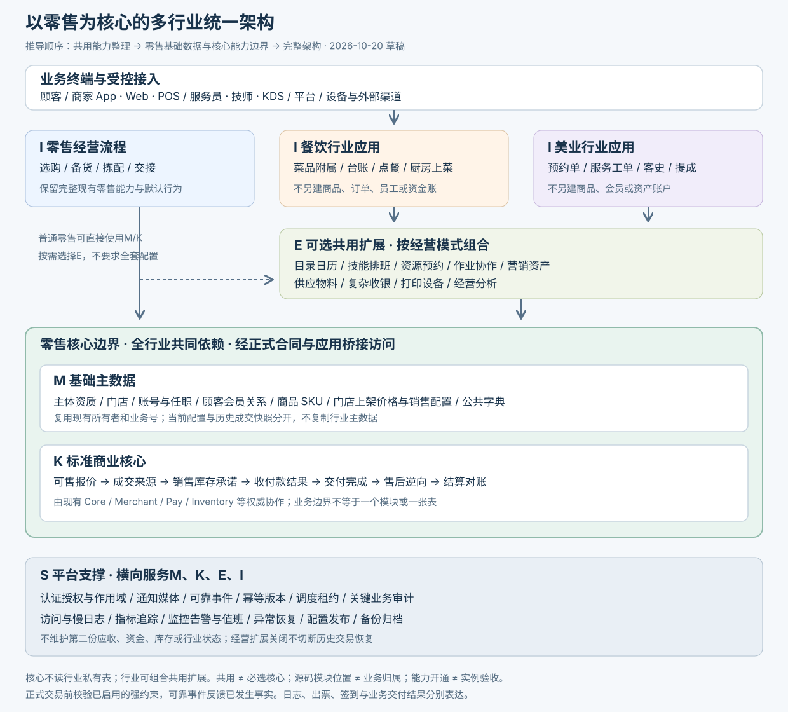

# 零售餐饮美业多行业统一业务架构

> 状态：架构提案，待评审 · 创建：2026-10-20 · 本次仅设计，不执行代码重构、DDL、资金操作或部署。
> 阅读顺序：[第一步：共用能力整理](./design/多行业共用能力整理.md) → [第二步：零售基础数据与核心能力边界](./design/零售基础数据与核心能力边界.md) → 本册第三步完整架构；[能力与现状矩阵](./design/多行业统一业务架构-能力与现状矩阵.md)仅作逐项证据附录。
> 上游：本次多行业统一架构需求；[原总体架构](./design/TDD-基座与行业应用-总体架构.md)、[餐饮扩展契约](./design/餐饮与商品订单基座-扩展边界与契约.md)、[美业新版方案](./TDD-美业系统-共用商品订单与服务工作流.md)。本提案不自动替代既有已确认业务规则。

## §0 目标与架构原则

**以零售基础主数据M和标准商业核心K为中心，行业应用I组合共用扩展E，平台支撑S贯穿全部业务。** 本册按“共用能力整理→零售核心边界→完整架构”的推导顺序重整；不再将所有共用能力直接并列为核心域。

统一的对象是业务语义、所有权、合同与可靠性机制，不要求所有流程同一张表、所有行业同一状态机，也不要求每个能力拆成独立服务。零售是已有运行基线，同时有自己的拣配、称重、交付等业务规则，不能把零售当作“没有工作流”。

### 0.1 需求覆盖与阅读地图

| AC | 本次要求 | 设计落点 |
|---|---|---|
| U01 | 三行业完整经营链路，兼顾线上与门店 | §1、§4、§7 |
| U02 | 商品、菜品、餐牌、项目的共性与差异 | §3.1–§3.3 |
| U03 | 共用订单、支付、权益、售后、库存与结算 | §3.4–§3.6、§5 |
| U04 | 共用预约资源、人员、排班与作业协同 | §3.7–§3.9 |
| U05 | 通知、打印、设备及基础保障 | §6 |
| U06 | 监控、日志、审计、告警与恢复 | §6.4–§6.7 |
| U07 | 业务域、数据归属、接口与部署关系清楚 | §2、§5、§8 |
| U08 | 对齐当前项目，区分已有、部分、设计与缺口 | §8、§9及能力矩阵 |
| U09 | 可渐进落地，保持存量行为和历史可恢复 | §10、§11 |

### 0.2 抽取共用能力的判据

共用需满足相同业务语义、相同不变量、可稳定划分的所有权，并有当前跨行业需求或明确的公共职责。差异能够通过受控配置表达时复用实现；差异改变业务生命周期时保留行业编排。不能只因名称相似合并，也不要求“零售也必须使用”才允许共用。

例如餐饮订包间和美业约床位共享资源仲裁；菜品售卖时间与技师可约时间都使用日历规则，却分别由商品可售和预约资源决定，不能合成一个“是否可用”布尔值。通知和打印可共享事件、任务基础机制，但拥有不同投递状态与回执。

## §1 第一步结果：先整理共用能力

[共用能力整理](./design/多行业共用能力整理.md)先按共同语义形成G01–G12能力组，现有54项共用盘点保留在证据附录。这一步不指定Maven归属、不先画部署图，也不将“共用”自动解释为“零售必选核心”。

| 能力组 | 共用内容 | 下一步必须拆开的职责 |
|---|---|---|
| G01–G03 经营对象 | 主体门店、人员访问、顾客会员 | 基础身份/关系，与认证、技能排班、标签经营分开 |
| G04–G05 售卖 | 商品、上架价格、目录日历、选配组合 | 主数据和核心报价，与展示、时段、收费扩展分开 |
| G06–G08 商业闭环 | 成交收银、库存供应、交付售后 | 标准交易/库存承诺，与跨单收银、采购BOM、行业作业分开 |
| G09–G11 经营扩展 | 营销资产、资源协作、经营财务分析 | 原始经济结果，与可选经营、班次、业绩、报表投影分开 |
| G12 共享支持 | 通知打印、设备媒体、事件调度、日志监控和恢复 | 横向运行保障，与营业设备/打印等按需能力分开 |

同一盘点行可能包含几种职责。例如“员工”同时包含身份、访问控制、排班与任务参与；“收银”同时包含基本收款与跨单资金分配。第二步按职责划边界，不按文档分组或现有包位置整体归类。

## §2 第二步结果：以零售为基础数据和核心能力边界

以完整的现有零售业务为兼容基线；以“谁经营、谁购买、卖什么、在哪卖、怎样成交收款交付及逆向”的标准商业链路确定核心。零售核心不等于只保留最小购物功能，也不等于把现有Pay和库存模块搬回 `shop-core`。

| 边界 | 定义与内容 | 依赖和排除规则 |
|---|---|---|
| M 基础主数据 | 主体资质、门店、账号任职、顾客会员关系、商品SKU、门店销售配置、公共主数据 | 各现有所有者单写；餐饮美业引用，不另建商品/客户/员工身份 |
| K 标准商业核心 | 可售报价、成交来源、销售库存承诺、收付款结果、交付完成、售后逆向、结算对账和基本查询 | 基于M，经正式合同驱动经济事实；不包含厨房或护理状态 |
| S 平台支撑 | 认证作用域、消息媒体、可靠事件/幂等/调度、审计可观测、发布备份恢复 | 服务全部业务；不产生第二份业务账 |
| E 可选共用扩展 | 目录日历、选配计量、技能排班、资源预约、任务队列、营销资产、供应物料、复杂收银、打印设备、经营分析 | 按选择参与；普通零售无须配置整套扩展，已启用的强约束不可绕过 |
| I 行业业务 | 零售作业、餐饮台账/厨房、美业预约单/服务工单与专属政策 | 组合E，引用M，经K成交交付，使用S，不直接写核心表 |

[零售核心边界册](./design/零售基础数据与核心能力边界.md)具体定义M01–M07、K01–K07、S01–S05、E01–E10及边界反例。基础主数据不包括订单、库存余额、收款凭证、预约hold等运行事实；当前价和成交价也不是同一份数据。

依赖方向是I组合E，I/E共同引用M、通过K生效；S横向支撑。核心K通过明确的通用合同接入已启用的强约束或支持能力，不读取行业私有表。未启用扩展不增加普通零售前置条件；现有业务政策要求的积分、营销、库存或资产守卫仍然生效。

## §3 在零售核心之上组织共用扩展与行业差异

本节在第二步边界确定后展开。商品身份/现价属于M，报价和成交属于K；目录、资源、技能、复杂收银等分别属于E。出现同一业务名称时按这些职责判断，不整域并入核心。

### 3.1 商品不是行业，销售语义才是组合条件

商品类型表达实物、服务、权益销售等销售与履约性质；行业表达经营流程。餐馆可卖瓶装饮料，美业门店可卖护肤品，零售门店也可售安装服务。不能用一个 `industry` 字段决定所有库存、价格和支付分支。

共用商品保存名称、图片、SKU、规格、条码/货号、计量单位、门店价格/上下架和支持的履约方式。商品搜索、筛选、门店门户与内容陈列共用商品身份和可见范围，搜索结果不代替提交时可售校验。菜品附属保存菜系、出品特性等行业规则，服务附属保存资源需求等规则；已有 `durationMin` 不再复制。扩展必须有明确字段、版本、校验及所有者，避免无约束的自由JSON属性袋。

### 3.2 陈列目录、时段餐牌与销售日历

建议抽取**门店陈列目录**：目录、分组、条目、排序、门店、端/渠道/履约适用范围、生效版本。条目引用商品/SKU，不复制标题价格作为新真源。平台分类回答“是什么”，门店目录回答“怎样展示”，二者正交。

| 行业 | 共用目录与规则 | 行业保留 |
|---|---|---|
| 零售 | 门店货架、主题陈列、渠道目录、时段可售 | 生鲜截单、预售、称重等业务约束 |
| 餐饮 | 常规/早餐/午市/夜宵/季节目录、时段与例外日 | 餐牌布局、菜序、套餐选择、就餐场景、厨房路由 |
| 美业 | 门店项目分组、服务展示目录、允许销售窗口 | 项目注意事项、服务步骤、预约资源需求 |

餐饮的“时段餐牌”＝共用目录＋销售日历＋餐饮展示规则。应统一目录能力所有权，但当前 `fnb_menu*` 已有设计/初始化记录，不能立即再造一份目录双写：先通过适配提供共用合同，确定迁移映射后切到一个所有者，旧引用保留可追溯。

共用日历原语覆盖时区、日期/周时段、跨午夜、节假日例外及版本；销售可售、资源排班、营业日和提醒分别消费，拥有各自决策。营业截止日不一定等于自然日；23:00–次日02:00必须能还原其原营业日。

### 3.3 选配、组合、计量和售卖限制

稳定有限的价格差异优先复用SKU。包装/加料/精油等真实附加商品可独立下单；任意收费选配必须由共用报价、税费/优惠分摊、库存展开和退款快照共同支持，不能仅在行业表存个加价。

零售礼盒和餐饮套餐可共用组合选择、构成及库存展开机制；美业疗程还包含权益发行、有效期与分次消费，不能视为“十个普通商品组合”就算实现。售卡与扣卡保留不同来源和生命周期。

共用数量及计量协议表达数量、单位、精度、计价数量和实交数量。零售生鲜与餐饮称重使用相同金额/数量合同；服务次数是权益计量，不是实物库存。沽清/临停售、每日销售配额、实物库存、资源容量分别管理；恢复停售不能凭旧值恢复库存。

### 3.4 订单、消费来源与收银

统一交易边界，保留当前已有两类来源：现金购买走普通 `ord_order/ord_sub_order/ord_item`；资产服务消费走 Core 的 `ord_ent_service_order`及Pay使用合同。后者不是普通现金订单，二者尚未自动统一存表、履约和报表。

定义带类型的业务引用，至少区分支付根、门店交易、成交行、服务消费来源和稳定源行。行业保存这些引用与数量分配，不用含混的 `orderNo` 承载不同语义。一次服务/交付任务不能同时绑定两份已生效消费来源；换支付路径必须先确认原来源未成功且已取消，未知状态禁止再收一次。

共用收银负责冻结付款范围、单据版本、应收来源、支付分配、实收、找零和查单；行业“结账”负责决定哪些业务可以进入这个范围。一张台账/工单可以聚合多个交易来源，但展示总额不意味着支持跨单一次收款。

当前先复用普通线上付、受权线下收款确认、已支持的全资产消费。混合支付、AA、多人代付、定金尾款、跨单一次收款逐项补共同合同。一次总流水逐单调用标付、虚构零元订单、用虚拟定金商品规避支付计划均不作为统一方案。

### 3.5 库存、可售和物料耗用

商品负责销售定义，库存负责数量账；资源预约负责时间承诺，Pay负责金额/次数。统一业务上下文可以关联这几种承诺，但账与状态不混用。

现有平台库存与进销存接入存在模式和生命周期差异；统一入口继续经 `StockPort`及实际适配选择唯一权威，不在行业包另扣一份。在启用进销存模式后，销售出库、原料耗用、耗材领用、报损、退回分别用有来源凭证的库存动作，不能以“厨房打印成功”推断物料已出库。

餐饮BOM配方、份量换算、损耗与半成品，美业按项目耗材定额，都属于库存生产/耗用的可选扩展。首期直接按SKU/显式耗材记录；未完成物料映射和实际用量合同前，不承诺“自动精准扣原料”。退款不等于退货；已制作食品和已用耗材不可自动回到可售库存。

### 3.6 客户、营销与资产

统一顾客识别、商家会员关系、标签及触达；餐饮偏好、美业过敏/护理史、零售售后备注可作受控附属资料，不成为另一套会员体系。临客可以预约或开草稿，到真实交易/资产使用时再按合法合同认领，不以手机号匹配替代本人授权。

会员码用于识别，支付/权益授权绑定本人、门店、来源版本、项目金额/数量和有效期。C端展示简明交易结果，不强制展示本金、赠金和批次等内部细节。

营销负责活动和参与，Pay负责券卡和储值执行，商品/交易负责售卡与成交。最新门店独立储值方案是目标，仍需迁移与验收；账户按门店隔离、同店多个方案共用账户，独立方案不依赖营销活动。当前首期不借统一架构重新开放跨店通兑、混合支付或线上退款。

### 3.7 资源、预约与现场占用

预约共用底座拥有资源及容量仲裁；餐饮预约单、美业预约单保存各自业务内容。统一持有凭证引用商家门店、业务来源、资源集合、区间/容量、版本、期限与状态。

| 场景 | 资源约束 | 行业业务 |
|---|---|---|
| 餐饮订桌/包间 | 时间区间、人数容量、资源组合及缓冲 | 人数、到店宽限、包间要求、到店转开台 |
| 美业预约 | 技能∩排班∩技师/床位/设备连续区间 | 项目先后、指定技师、换人、到店转工单 |
| 零售提货或服务柜台 | 门店时段吞吐或指定柜台资源 | 取货预约、现场核验、未到处理 |
| 现场开台/即时服务 | 从开始至显式释放的现场占用 | 转台、清台或服务结束释放 |

**预订与现场占用由同一个资源所有方检查冲突。** 不能用一套预订表和另一套开台占用各自判空闲。现场占用何时结束不确定时，通过预计可用/保留截止与门店政策保护未来预约；无法保证时拒绝或提示人工安排，不能默认为永远不冲突。

底座提供可约查询、资源集合原子hold、confirm、差量replace、占用交接、幂等release及权威结果查询。重叠改约不被自身旧占用误阻；多资源最后一个失败必须全退；到店转换沿同一凭证不再扣容量。

现有 `AppointmentSlotPort` 只有门店单时段名额，不能直接承诺完整资源能力。到店预约仍用 `STORE_VERIFY`加预约关联；当前 `APPOINTMENT`表示上门服务，不能为共用而改其含义。

### 3.8 人员、服务员与岗位

共用人员模型区分四件事：自然人/业务人员档案、登录账号、门店岗位权限、可占用的人员资源。一个人可兼任多个岗位，也可不具备系统登录。现有 `mch_account`员工账号和门店角色复用；服务技能、对客档案及排班尚需补齐，不另建一套重复登录。

| 行业 | 岗位例子 | 差异保留在哪里 |
|---|---|---|
| 零售 | 收银员、理货、拣货、配送、客服 | 拣货区、波次、运单/交接任务 |
| 餐饮 | 服务员、传菜、厨师、收银、值班经理 | 负责桌区、工位、上菜与换班分配 |
| 美业 | 技师、顾问、助理、前台、店长 | 技能、级别、项目参与、提成规则 |

“服务员”是共用人员体系中的行业岗位及任务参与关系，不另建员工域。登录权限“允许完工”与业务资格“会做该项目”必须同时满足；有权限不代表有技能，有技能不代表能看全店顾客。

人员停用需撤会话、阻止新分派，并对未来预约和当前任务形成待办；不删除历史参与。临时请假、跨店排班、换人均经过资源校验，不能只改工单上的人员号。

### 3.9 工作流、作业任务与审批

共用的是任务编号、参与人、分派/领取、交接、期限、幂等、审计与异常待办机制。零售拣货、餐饮制作、美业护理保留各自状态机与动作守卫；统一工作台可用 `待处理/进行中/已完成/异常`读模型聚合，不将这个读模型写回各行业主状态。

不强迫所有业务继承同一个 `Engagement`实体或 `OPEN/SETTLING/CLOSED`生命周期。普通线上零售订单无需额外生成经营会话；餐饮台账与美业工单可共享“关联来源、冻结结账范围、关闭检查”的小合同，具体存表各自所有。

订单流负责经济与交付状态，行业流负责实际作业。付款不等于制作，制作完成不等于上菜，签到不等于履约完成，扣卡不等于服务已做。任务完成通过受控合同提供数量事实，再由履约域推进基础状态；自动确认和超时任务不能越过已启用的业务守卫。

审批共享申请、授权审批人、期限、理由、前后版本与审计；审批结果是受权决策凭证，具体退款、免单、折扣、报损仍由各自所有方执行。首期不引入可任意脚本修改业务状态的通用工作流引擎。

## §4 三行业应用边界

| 行业 | 自有经营对象 | 核心工作流 | 必须复用 |
|---|---|---|---|
| 零售 | 拣配/交接任务、销售场景配置；现有团单/配送等对象沿原所有权 | 选品→报价→下单→付款→备货拣货→交接/自提/配送→确认→售后 | 商品、库存、订单、付款、履约、会员、营销、结算、触达 |
| 餐饮 | 菜品附属、餐牌展示规则、桌区/座位映射、预约业务单、就餐台账、点单批次、做法快照、制作/上菜任务 | 订桌/入座→点餐/加菜→制作→上菜→结账→清台；快餐可无台账 | 商品和目录合同、资源、人员、交易、库存、收银、打印、营业日 |
| 美业 | 服务资源需求、预约业务单、服务工单/任务、人员参与、客史、业绩及提成规则 | 预约/直客→识别→报价/授权→到店→服务→完工→关闭；付款顺序由获准模式决定 | 商品、资源、人员、交易/消费来源、资产、收银、通知打印、报表 |

销售来源、收款方式、履约方式、网络状态四维独立：店员开单不等于现金付款，顾客线上预约不等于线上支付，门店线下营业不等于断网营业。

同店混合经营只组合已启用能力和合法履约，单笔订单是否可混合由基座的交易分组与报价合同决定，不能把餐饮制作单、普通快递商品和多次疗程硬放同一履约组。

## §5 数据、合同与一致性

### 5.1 权威事实与关联

| 事实 | 唯一所有者 | 其他域可保存什么 |
|---|---|---|
| 商品身份、SKU、门店售价 | 商品域 | 引用与不可变展示/成交快照 |
| 应收、优惠、成交行、消费来源版本 | 交易域 | 带类型来源、数量分配、报价引用；不能自行改应收 |
| 现金/余额/次数执行结果 | Pay及其相应账本 | 凭证号和只读结果；不能复制余额维护 |
| 物理库存/预留/实发 | 当前启用的库存权威 | 只读可售投影和原始凭证引用 |
| 人员身份、岗位与技能 | 商户人员域 | 任务参与及发生时快照 |
| 可预约容量与占用 | 资源域 | 业务预约内容、hold/occupancy引用 |
| 行业业务进度 | 相应行业应用 | 公共工作台的可重建状态投影 |
| 消息/打印投递结果 | 各业务支持能力 | 结果查询、重试/补打引用；不能据此推断业务完成 |
| 指标报表 | 报表投影 | 来源、水位与计算版本；不能反向作为收款真源 |

行业可保存只读金额快照用于历史展示，或保存提成基数、业务预算等自有业务数值；禁止的是维护第二份应收/支付/余额真源，不能机械规定“行业表一分钱都不能出现”。

### 5.2 通用合同元数据

新增合同统一表达租户、主体/门店范围、调用方身份、实际操作者、目标客户/代办凭证、来源类型/编号/行/版本、幂等键、参数摘要、期望修订、币种/单位、关联请求号。可信身份从认证与正式委托中取得，不能信任客户端传入的主体或权限声明。

读写按业务主语进入所有者，行业入口可以编排多个正式服务，不能直写它们的表。聚合读取仍需权限过滤、数据版本/时效与部分失败标识，不能把缺资金结果当余额零、缺资源结果当可预约。

`accepted`只表示已受理；响应区分成功、拒绝、处理中、结果未知，并提供原操作查询与恢复方式。客户端不得通过换幂等键“重试”。同键异参冲突；业务事实的唯一性不能只靠HTTP短期缓存。

下列为需要统一语义的合同族，名称用于架构讨论，不是已存在的Java接口或HTTP端点；实际复用情况见能力矩阵。

| 合同族 | 输入与结果要点 | 执行所有者 |
|---|---|---|
| 目录及可售查询 | 门店、渠道、履约、时刻→目录版本、SKU与限制；价格引用权威报价 | 商品/陈列 |
| 报价、提交及原提交查询 | 买家/代办、SKU数量、业务约束引用、幂等键→报价或类型化来源与稳定行 | 交易及提交守卫 |
| 人员资格和资源承诺 | 项目需求、区间与资源集合→资格、hold/占用凭证；改约按原凭证替换 | 人员/资源 |
| 支付/权益使用及查单 | 真实来源、本人授权、版本→受理或权威经济结果，不接客户端最终金额 | 交易/Pay |
| 库存预留、实发与退回 | 来源与数量单位、生命周期→预留/出入库凭证及真实状态 | 库存 |
| 作业分派和交付确认 | 源行分配、操作者、实际完成数量→行业任务事实及合法履约结果 | 行业/任务/履约各自所有 |
| 售后及逆向进度 | 原来源/分摊/实收或处置事实→退款、资产回补、库存处理分别状态 | 售后/Pay/库存 |
| 通知、打印与恢复 | 原事实引用、场景、目标范围→任务号/状态/原号重试或补打 | 消息/打印/对应恢复服务 |

### 5.3 同步守卫与异步事实

建单前的可售、强制资源、本人授权、来源版本、库存和能力条件在对应权威所有方校验。并发提交以条件更新/锁/版本裁决，不能只在预览或前端校验。

跨Core、Pay、库存和行业流程采用本地事务、持久意图、Outbox、消费去重与恢复，不假定同库或同进程就共享事务。事件定义事件号、来源、聚合号/序、版本、发生时间及业务关联；订阅者按自身键去重，不假设全局有序或“恰好一次”。具体信封复用当前Outbox合同，不另造平行消息总线。

创建成功但行业绑定失败时按原键恢复关联；事件先于绑定到达则持久待关联记录；扣款成功但订单确认中时重试同步，不再扣款。未知结果先查原操作，未查明不得释放已成功付款依赖的预占。

支付后付、非付款触发的库存耗用、履约后结清、部分售后和资产冲正必须有明确合同再启用。行业只能提供事实和申请，不直接改订单状态或调用内部标付绕过支付协议。

### 5.4 统一模型不等于统一物理库

既有表沿现有公共字段、业务号、审计与版本规范。行业迁移仅维护自有对象；共用能力迁移由其所有者执行。跨库不建外键、不直接JOIN；分析使用投影，桥接使用正式查询合同。

已应用迁移冻结。归属调整先定义旧新映射、未完单与预占处理、校验总额/数量、切写和回退条件；保留原业务编号和历史凭证。不能以“抽取共用”为理由删除 `fnb_*`配置、复制门店余额或重放历史销售造成二次扣库。

## §6 通知、打印与运行保障

### 6.1 统一通知与触达

共用通知编排拥有业务场景、受众解析、模板与语言、订阅/频控、站内消息、发送任务、回执、去重和重试。当前编排在 `shop-core/message`，外发适配已在 `shop-notify`；保留实际结构，不能照旧文档认定推送通道全部不存在。

行业产生已发生事实或合法待办，受众按门店、岗位、实际参与者和本人关系解析。通知类型分交易结果、营业作业、异常待办、预约提醒、营销；营销需要独立授权和频控。短信等付费兜底按场景显式配置，不因任意通道失败自动广播。

站内结果可持久查询，外部送达尽力推进并暴露状态；供应商受理不等于用户已读。厨房实时任务、服务员待办不只依赖一条推送，必须可从正式任务列表补查。金融告警与基础故障告警也不只依赖业务应用内的一条通知链。

### 6.2 统一打印

共用打印应用拥有设备/驱动引用、模板版本、路由、任务、分件/份数、尝试、回执、补打与审计；渠道适配只实现云端、LAN、USB/蓝牙等实际协议。首次支持哪些连接方式以真机验收为准，不因列出协议就宣称支持。

零售提供收银票、标签、拣货/交接单；餐饮提供后厨分单、饮品标签、预结单、撤菜条；美业提供服务单和消费凭条。内容来自冻结业务事实，金额来自相应交易/支付来源，不允许打印模板自行计算应收。

幂等键包含源事件、场景、设备、文档分件和份次；补打引用原文档并单独审计。超时可能已经出纸，先查原任务再处理，不能无限自动补打。出票失败不回滚已付交易，出票成功不代表已出餐、已服务或顾客已收货。

### 6.3 设备、文件与基础服务

设备身份、门店绑定、能力、配置版本、心跳、凭据轮换和撤销共用；KDS、POS、打印机、自助终端的业务权限各自最小化。电子秤/扫码器提供采集事实，正式计价和收款由核心校验；设备时间、缓存金额或离线显示不是权威结果。

图片、菜单/项目资料、服务照片、收款凭据使用现有媒体/对象存储合同。私密照片及凭据不使用长期公共链接；资料访问与业务岗位、客户关系和用途关联。导入/导出、二维码、字典、多语、币种、计量、地址与区域等基础工具集中复用。

### 6.4 日志、审计和账务分开

| 类别 | 用途 | 生命周期与可靠性 |
|---|---|---|
| 访问/慢日志、错误日志 | 查请求耗时、异常与技术问题 | 可采样/轮转/压缩/归档；有限容量，禁循环堆栈洪水 |
| 业务状态/操作审计 | 谁在何时以何权限做了什么、理由与前后版本 | 追加事实、分权查询；关键动作审计不能只靠可能失败的普通logger |
| 资金/库存/资产凭证 | 证明钱、货、次数怎样变化 | 与对应业务过账同事务；不可被日志清理或观测故障替代 |

当前 `AuditLogPort`是通用运营审计口子，不能据此推断所有关键操作都具备原子审计。新增资金确认、改权、资源强制调整等动作，其必要业务证据要与所有者状态同事务/可靠出站提交；一般诊断日志失败不回滚正常交易。

共用关联上下文包含请求号、操作号、来源号、事件号、设备号以及经验证的数据范围。门店请求头只作观测输入，不能当受权范围；现有访问日志短 `rid`不代表跨服务分布式追踪已经完成。不记录完整令牌、会员码、支付敏感字段和默认请求体。

### 6.5 监控指标与告警

| 层次 | 共用监控项 | 行业扩展 |
|---|---|---|
| 基础设施 | 存活、CPU/内存、磁盘容量与增速、数据库连接/锁、证书、备份新鲜度 | 门店网络与边缘节点状态 |
| 应用服务 | 请求量、错误率、延迟分位、超时、线程/连接池、任务成功率 | 业务入口按受控场景分组 |
| 可靠消息 | Outbox最老积压时长、失败/重试、投递租约、待关联、投影水位 | 厨房/服务任务分派积压 |
| 交易资产 | 已付未确认、已收未入账、预占超期、退款未知、对账差异、重复事实 | 后付未结、资产确认中 |
| 营业作业 | 打印失败/未知、资源冲突、预约未签到、队列等待、完工未交付 | 超时菜、未上菜、超时服务、未交接包裹 |

监控无数据、采集失败、报告解析不到日志必须报“不明/失联”，不能显示业务正常。指标标签使用服务、接口模板、场景、结果等低基数维度，订单/顾客/请求号进入日志和追踪查询，不成为全量时序标签。

告警按严重度、门店/服务范围、值班责任、去重、静默、升级、恢复和处置链接定义。除显式要求定期报告外，正常且未变化保持安静；从失败恢复时发送恢复事实。主机/应用不可用需独立外部探针，不能只靠同机定时脚本。

当前已有访问慢日志与聚合脚本、本机logwatch和云监控配置说明；完整跨服务指标、追踪与告警收件配置需验收。先沿现有日志、健康和巡检补齐，后续规模或排障需要再评审指标/追踪后端，不强制本轮部署ELK、MQ或监控集群。

### 6.6 调度、异常恢复与运维

共用作业调度负责任务身份、分片/互斥、租约、重试、运行记录和水位；业务Job调用其所有者的正式命令。预约提醒、hold到期、未结巡检、报表生成、对账、通知重试均沿现有job体系，不在每个行业加一组无管理的定时器。

统一异常工作台聚合按类型受权的待办，保留来源、权威状态、发生时间、责任人、重试与处置轨迹。重试必须复用原号；查单失败不能将款标成功；运维恢复权限不等于商家退款或顾客扣款权限。

部署配置、密钥轮换、备份、恢复演练、迁移、兼容版本、灰度和回滚纳入同一发布流程。业务回滚不能用恢复旧jar撤销已发生资金、库存或服务事实；停新单后保留原单收尾，备份恢复需核对所有相关账本及事件水位。

### 6.7 统一报表与数据治理

报表复用租户、主体、门店、商品、来源类型、渠道、履约、人员、自然日、营业日、币种/单位及规则版本。共享报表存投影和水位，不反向读取所有业务库做无边界JOIN。

分别统计商品销量、现金实收、充值实收、资产消耗、服务产出、制作损耗与员工提成；充值一次后服务十次不能重复记现金收入。免费赠品、资产服务和撤销数量保留分类；本架构不裁定法定会计收入确认政策。

日结签核记录范围、水位和版本，迟到事件形成差异/更正版本，不悄悄覆盖已签报表。共享保留策略区分运行日志、客户资料、凭证、审计及业务快照，删除/脱敏不能破坏仍需履约或核对的证据。

## §7 贯穿三行业的完整流程

| 阶段 | 零售 | 餐饮 | 美业 | 共用执行方 |
|---|---|---|---|---|
| 准备 | 建品、采购入库、上架、分配人员 | 菜品、餐牌时段、桌区、工位、备料 | 项目、技能、班表、床位/设备 | 商品、库存、门店人员、目录日历、资源 |
| 接待 | 逛店/扫码购/提货预约 | 订桌、入座、扫码/服务员点餐 | 预约/代约、直客、会员识别 | 客户识别、资源、行业业务单 |
| 成交 | 报价、落店/拆单、付款 | 按批点餐/加菜、合法付款顺序 | 单次购买或资产消费授权 | 核心报价/来源、Pay、库存/资源承诺 |
| 作业 | 备货、拣货、称重、交接 | 下达制作、出品、上菜 | 签到、派工、服务、换人、完工 | 行业状态＋共用任务/人员/设备 |
| 交付 | 自提/配送/快递交付 | 上菜/取餐/配送 | 实际服务完成 | 履约合同、数量事实、订单守卫 |
| 结清 | 单笔或获准收银范围结清 | 台账结账、清台独立 | 工单来源结清、资源释放 | 收银/Pay/资源，行业关闭守卫 |
| 逆向 | 退货实收、质量判断、退款 | 撤菜/退菜、损耗、退款申请 | 未做撤项、争议、受支持资产纠错 | 售后、库存、Pay各自执行 |
| 收尾 | 交班、对账、评价、复购 | 班次、日结、报表、设备异常 | 产出、业绩、提成、回访 | 结算、营业日、报表、通知、审计 |

付款时点可以不同，但只有基座支持且验收的时序才能启用。先做后付需要受理与取消守卫、库存/资源承诺及履约后结清合同；延长付款超时不等于实现后付。定金、团体、多单收款及离线业务按独立能力验收。

## §8 第三步结果：完整架构与项目落点

图的中心是零售M/K核心，周边为可组合的E和行业I，S提供横向保障。它不是把零售、餐饮、美业各建一套基础数据，再用网关汇总。三行业共用核心引用和经济事实，只在业务流程和可选经营能力上扩展。

### 8.1 架构协作

| 位置 | 职责与调用关系 |
|---|---|
| 业务终端与接入 | C端、B App、商家Web/POS、岗位作业端、平台、设备及外部渠道；认证、代办身份和数据范围受控 |
| I 行业应用 | 零售可以直接运行M/K，按需组合E；餐饮、美业保留各自业务单据和工作流，不复制M/K |
| E 共用扩展 | 向行业提供目录、资源、人员、作业和经营能力，经K/Pay/库存等权威合同生效 |
| M/K 零售核心 | 统一经营身份、商品与销售数据，执行标准报价、成交、库存、收付款、交付和逆向 |
| 应用桥接 | 适配真实服务与来源、身份和稳定行关联，执行原号恢复；本地和远程保持同一合同 |
| S 共享支撑 | 事件、通知、鉴权、审计、日志、监控、调度、告警和恢复，服务所有业务层 |

提交前强约束在权威所有方同步校验；已发生事实用可靠事件返回行业和投影。通知发送、打印完成、行业关闭均不能反向冒充交易或资金成功。具体状态、合同与数据所有权见§3–§7。

### 8.2 当前实物结构与目标逻辑的对应

| 当前代码/构建位置 | 对应逻辑职责 | 本提案处理 |
|---|---|---|
| `shop-base`、`shop-base-auth`、`shop-auth-store`、`shop-store-mybatis` | 公共语言、SPI、认证/会话、持久化基础 | 复用，业务逻辑不因“公共”就堆入base |
| `shop-core/{product,trade,fulfillment,member,promotion,platform,message}` | 商品交易履约、会员营销、治理与消息 | 先按包/合同固定边界，不先拆成一排微服务 |
| `shop-merchant` | 主体、门店、账号角色、门店时段 | 扩展人员业务档案、技能排班和资源所有权；旧账号不重造 |
| `pay/{pay-domain,pay-channel,pay-svc}` | 支付、积分、储值、权益及通道 | 沿实际接口和本地/远程边界调用，不回搬到会员 |
| `shop-inventory`＋`shop-app/invbridge` | 库存业务与跨域适配 | 保留模式迁移及实际生命周期；行业经正式库存合同 |
| `logistics/*`、`shop-channel`、`shop-notify` | 物流能力、外部适配、通知外发 | 区分业务服务与纯通道，禁止塞入行业经营决策 |
| `shop-report`、`job/*` | 报表投影与作业执行 | 复用；仅有DAO或调度模块不代表全部指标已上线 |
| `shop-app/{portal,config,paybridge,invbridge}` | 对外认证入口、装配与跨域编排 | 接入行业桥接，逐步收口原分散入口，不一次性迁移所有Controller |
| 餐饮设计源与 `db/industry/food` | 已有餐饮设计/DDL产物 | 表初始化记录不当业务API已实现；共用抽取有迁移映射后再切换 |
| 行业包与共享打印/资源新增实现 | 目标边界 | 按已评审合同建设，不能将目标目录列为现状 |

目标可沿既有行业包提案使用独立构建、受控契约和应用适配；具体 `shop-industry-spi`/food/service 的Maven装配仍需实施前验证，不把旧 `-Pcore-only`草案当已存在构建能力。契约保持窄DTO/接口，不暴露实体、Mapper、事务或Spring上下文。

### 8.3 部署策略

优先使用当前模块化应用＋已有Pay、job及其他实际装配，按流量和故障域决定后续拆部署。逻辑域、Maven模块、进程、数据源四个维度分别登记；同进程不授予跨域写表权，独立进程不自动获得断网能力。

平台可同时装配多行业，按门店实际能力启用；私有化可裁剪行业应用。能力生效同时取决于代码装配/版本、实际执行能力、配置开通、商家准入及操作权限。行业模板只是能力推荐，不是运行时遍布代码的 `if industry`分支。

第三方商品/预约/订单和门店边缘适配进入正式合同，保存外部来源号、映射和幂等。离线营业需写者租约、预分配库存/资源、资金可信结果及恢复认领协议；不能把离线同步重新作为普通下单、扣资产和出厨票。

## §9 与现有架构文档的收口

| 原设计方向 | 继承 | 本轮修订建议 |
|---|---|---|
| 一个基座＋行业包 | 所有权与可裁剪方向 | 共用能力可选启用；逻辑边界不与模块/服务一一绑定 |
| 零售为基线 | 存量零售不受新增行业影响 | 不以“零售不用”为由否定餐饮美业共享预约，也不强迫零售生成经营会话 |
| 商品统一 | 商品/SKU与价格权威 | 平台分类与门店目录分开；可售日历与预约容量分开；沽清不改库存 |
| 预约资源统一 | 原子集合占位与公共资源 | 预订与现场占用共同仲裁，不能各自判空闲 |
| Engagement继承工作流 | 聚合来源与关闭检查有复用价值 | 采用小合同/组合；不强制所有行业状态和持久化继承同一实体 |
| 事件是行业回路 | 已发生事实异步传播 | 提交前强约束要同步受控校验；“读无一致性风险”也需修正 |
| 会员资产在基座 | 不在行业重复建余额账 | 按当前Pay归属及Core消费来源接线，弃用零元单标付假设 |
| 打印在channel | 共用设备和外部驱动 | 打印应用任务/路由/审计与协议驱动分开 |
| 附属表与核心同事务 | 单所有者内可原子 | 跨Pay/库存/行业按实际事务恢复，不能承诺一张跨库大事务 |
| 日志与监控 | 复用轮转、慢日志、巡检 | 增加业务一致性监控、原号恢复、独立外部告警及关键审计证据 |

旧文档保留追溯；本提案获确认后，由对应域逐册修订真源与ADR。本次不修改已应用DDL、生成的餐饮设计源或共享中的旧稿，也不声明旧提案全部作废。

## §10 分阶段交付建议

本节是架构演进顺序，不是已批准的逐文件实施计划。每阶段交付一条可用链路，避免先搭大平台而商家长期无功能可用。

| 阶段 | 交付重点 | 退出条件 |
|---|---|---|
| A 能力与零售核心边界 | 共用能力目录→M/K/S/E/I归属→当前合同和证据 | 先确定主数据与标准交易写权；不能将全部共用能力平铺为核心 |
| B 零售基线与运行保障 | 现有交易/库存生命周期对齐，日志审计、慢请求、消息积压及恢复 | 单笔购买到交付及逆向能追踪；不开新行业仍可运行 |
| C 三行业共用经营能力 | 目录日历、人员、原子资源、共享打印及作业工作台最小接入 | 同一资源不重复预订；同一任务不重复执行；真机打印验证 |
| D 两条行业先付闭环 | 餐饮点餐→制作→交付；美业预约/直客→服务→完工 | 相同底座报价/来源/资产合同；普通单与资产源不重复记账 |
| E 营业运营完善 | 储值门店目标、班次营业日、权限审批、报表、行业客史/业绩 | 历史资金归属可对账；日结水位、审计及隐私范围通过验收 |
| F 高级能力逐项开放 | 后付、定金、混合/跨单收款、疗程销售、复杂BOM、第三方与离线 | 每项有权威执行合同、异常恢复、存量兼容和独立验收，不整包假开通 |

## §11 验收约束与待决事项

### 11.1 架构必须证明的场景

1. 同一SKU由零售、餐饮或美业入口购买时，共用价格、落店、优惠与库存；行业限制不可被普通入口绕过。
2. 餐饮时段餐牌正确处理跨午夜和例外日；美业可约还须满足资源条件，不能以可售代可约。
3. 预约与现场占用并发同一资源只有合法的一方成功；多资源失败零残留，换约失败保留原约。
4. 服务员、技师、收银岗位只操作受权门店/任务；手机号或会员码识别不等于扣款授权。
5. 重复提交、乱序事件、响应丢失、跨服务中断都按原号恢复，不重复收款/扣次/扣库/出票。
6. 签到、出票、制作、上菜、服务完成、支付、核销和结算互不冒充；未完成数量不整单提前完结。
7. 现金交易、充值、储值消耗、次卡消费、赠品和提成分别核对，原始事实与报表水位可追溯。
8. 数据库或消息异常可形成受权待办；监控采集失联不报正常；同机失效由外部告警发现。
9. 关闭新业务入口后，已受理来源的查询、履约、恢复与合法售后仍可完成；已发生经济事实不能配置回滚。
10. 行业应用可裁剪，共用业务无反向实体依赖；存量API、权限、三语与原客户端保持约定兼容。

以上为后续业务验收，不代表本次已运行。只针对本次文档执行链接、索引、SVG和现有文档规范检查。

### 11.2 需要在实施阶段作出的决策

先确认共用能力归属和首条交付链路，再决定模块拆分与部署；目录从 `fnb_menu*`适配到共用所有者的时间、资源现场占用保护策略、后付与退款政策、人员技能来源、提成规则、运维值班与告警时限，分别由对应域冻结合同。

不在本架构中预设未经测量的服务拆分、第三方监控产品或已开通资金能力。涉及不可逆数据迁移、所有权切换和正式部署拆分时补充ADR及演练，不以本册的逻辑图代替批准。

## §12 来源与本次交付

推导入口为[共用能力整理](./design/多行业共用能力整理.md)及[零售核心边界](./design/零售基础数据与核心能力边界.md)；主要设计依据与源码证据见[能力矩阵及来源索引](./design/多行业统一业务架构-能力与现状矩阵.md)。资料优先级：本次已明确需求及最近具体修订→实际代码/迁移/定向验证→旧架构提案；代码存在也需区分运行配置与实例验收，文档旧数字不作为当前统计。

本轮按新顺序形成共用能力整理、零售核心边界、完整架构三份正文，保留能力现状矩阵为证据附录，并更新架构SVG及技术索引。未变更业务代码、库表、权限码、配置或运行环境；未访问生产状态，不将历史初始化和测试记录当作本次实测。

本次文档校验（2026-10-20，按新阅读顺序重整后）：四份文档的相对链接、索引登记、状态行、空白与占位检查通过；M/K/S/E编号连续性及三步推导顺序通过检查；架构SVG结构、PNG渲染和图面检查通过，四篇HTML投影已生成。执行 `npm run test -w @ai-shop/shared -- tests/doc-standard.test.ts` 为5项通过、3项失败：其他文档Mermaid总数20超过基线14，9份其他文档未登记索引，以及缺状态行文档28篇超过基线27。本轮四份设计文档均有状态行并已登记，未修改检查基线或其他工作内容。
