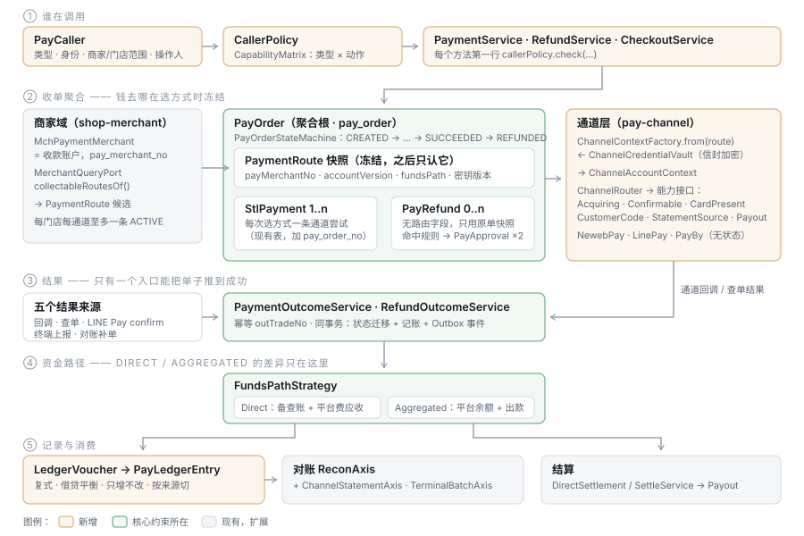

# TDD-支付服务-代码结构与类清单

状态：**草稿 · 已并入 [TDD-支付服务-完整设计方案](./TDD-支付服务-完整设计方案.md)**（冲突时以完整方案为准；**本篇 §0 F3「收款账户归商家域」已被完整方案 D2 推翻**——进件与收款商户归支付系统；controller 改放 `pay-portal` 模块，见完整方案 §12）
规范依据：[java.md §七 包规划、类名与业务边界](../../.claude/skills/ai-shop-dev-standards/references/java.md) ·
[全域命名基准](./reference/全域命名基准.md) · `PayHasNoControllerTest` · `ArchitectureTest`
创建：2026-10-24

---

## §0 读之前：对主 TDD v4 的四处修正

写类清单时对照了仓库现状，主 TDD 有四处与现有代码和规范冲突，**以本篇为准**，主 TDD 已加注：

| # | 主 TDD v4 写法 | 现状 / 规范 | 本篇做法 |
|---|---|---|---|
| F1 | `OpenPayController`、`TerminalAuthFilter` 等放在 `pay-svc` | **`PayHasNoControllerTest`：支付域里没有 controller**，只允许 `/internal`、`/callback`；鉴权、判权在主应用做完，传给支付域的是**收窄过的条件** | 六类入口的 controller 与过滤器全部在 `shop-app` 的 `portal.<端>.pay`；支付域只收 `PayCaller` |
| F2 | 资金模式 `DIRECT` / `PLATFORM` | 支付域已有 `FundsPath { DIRECT, AGGREGATED }`，`PaymentLedgerServiceImpl`、积分链路都在用 | **用 `FundsPath.AGGREGATED`**，不另造 `PLATFORM`；并把它从 `PointsFundsGateway` 里提到 `spi.pay` |
| F3 | 收款账户由支付域解析，新列 `collection_account_no` | `mch_payment_merchant` 在 **`shop-merchant` 模块（主库）**；业务键已是 `pay_merchant_no`；`MerchantQueryPort#paymentRouteOf` 已返回「交易时冻结、退款不得重查」的 `PaymentRoute` | 收款账户**归商家域**，支付域经 `MerchantQueryPort` 读、把 `PaymentRoute` 快照冻结到收单单；列名用 `pay_merchant_no` |
| F4 | 「商户端」、`merchant_no` 指经营主体 | 命名基准原则 1：**`merchant` 只用于收款商户号**，经营主体一律 `entity` | 商户端 → **商家端（Biz）**；`merchant_no` → `entity_no`；`pay_app_merchant` → `pay_app_grant` |

---

## §1 抽象业务模式

### 1.1 一句话

> **一个调用方，替一个收款方，向顾客收（或退）一笔钱；钱走一条资金路径，经一个通道能力完成；结果统一入账成流水，再被对账与结算消费。**

把这句话里的每个名词抽出来，就是整套类设计：

| 业务概念 | 抽象 | 设计模式 | 承载类（主） |
|---|---|---|---|
| 谁在调用 | **调用方** | 值对象 + 数据驱动的策略（能力矩阵） | `PayCaller` · `CallerPolicy` |
| 替谁收 | **收款路由快照** | 不可变快照（Snapshot） | `PaymentRoute`（扩展现有） |
| 钱走哪条路 | **资金路径** | 策略（Strategy） | `FundsPath` · `FundsPathStrategy` |
| 收 / 退一笔钱 | **收单单 / 退款单** | 聚合 + 显式状态机 | `PayOrder` · `PayRefund` · `*StateMachine` |
| 结果从哪来 | **结果统一入口** | 单一写入点（多来源 → 一个 applier） | `PaymentOutcomeService` |
| 怎么跟通道说话 | **通道能力** | 能力接口拆分 + 无状态网关 + 上下文注入 | `AcquiringGateway` 等 · `ChannelAccountContext` |
| 钱的记录 | **复式凭证** | 只增不改的分录（Append-only） | `LedgerVoucher` · `PayLedgerEntry` |
| 谁来放行 | **审批** | 通用双人复核（主题可扩展） | `ApprovalService` · `ApprovalSubject` |
| 对不对得上 | **对账轴** | 已有 `ReconAxis` 扩展 | `ChannelStatementAxis` · `TerminalBatchAxis` |
| 怎么结 | **结算方式** | 由资金路径策略选择 | `DirectSettlementService` / 现有 `SettleService` |



### 1.2 五条贯穿全局的规则（类设计就是为了让它们写不错）

| # | 规则 | 由哪个类结构保证 |
|---|---|---|
| P1 | **入口不做业务判断，应用层不认路径** | 六个入口只产出 `PayCaller`；`PaymentService` 等每个方法第一行 `callerPolicy.check(...)` |
| P2 | **钱去哪在建单时冻结，之后只认冻结值** | `PayOrder` 内嵌 `PaymentRoute` 快照列；`PayRefund` 没有路由字段，只能从原单取 |
| P3 | **资金路径的差异只在一个地方** | 所有「DIRECT 怎样 / AGGREGATED 怎样」的分支收进 `FundsPathStrategy` 两个实现；别处出现 `if (path == DIRECT)` 视为缺陷（架构测试） |
| P4 | **成功只有一条写入路径** | 回调、查单、LINE Pay confirm、终端上报、对账补单全部调 `PaymentOutcomeService#apply`；只有它能把单子推到 `SUCCEEDED`（架构测试） |
| P5 | **网关无状态、不持密钥** | 网关方法第一个参数是 `ChannelAccountContext`；网关类禁止有密钥类型字段（架构测试） |

---

## §2 模块与包总图

| 模块 | 包 | 职责 | 新 / 改 |
|---|---|---|---|
| `shop-base` | `ai.neargo.shop.spi.pay` | 跨域契约：`FundsPath`、支付 / 退款事件 | 改 |
| `shop-base` | `ai.neargo.shop.spi.user` | `MerchantQueryPort#paymentRoutesOf`、`PaymentRoute` 扩展 | 改 |
| `shop-merchant` | `ai.neargo.shop.merchant.{entity,service,service.impl,port}` | 收款账户（`mch_payment_merchant`）生命周期、路由候选 | 改 |
| `pay-channel` | `ai.neargo.shop.pay.channel.gateway` | 通道能力接口、`ChannelAccountContext`、命令 / 结果 record | 新 |
| `pay-channel` | `ai.neargo.shop.pay.channel` | `ChannelRouter`（替 `PayGatewayRouter`） | 改 |
| `pay-channel` | `ai.neargo.shop.pay.channel.{newebpay,linepay,payby}` | 三家适配 | 新 |
| `pay-channel` | `ai.neargo.shop.pay.channel.credential` | 通道密钥信封加密 | 新 |
| `pay-domain` | `ai.neargo.shop.pay.access` | 调用方模型与能力矩阵 | 新 |
| `pay-domain` | `ai.neargo.shop.pay.acquiring` | 收单单、退款单、收银会话、静态码、复核规则 | 新 |
| `pay-domain` | `ai.neargo.shop.pay.funds` | 资金路径策略 | 新 |
| `pay-domain` | `ai.neargo.shop.pay.ledger` | 复式流水 | 新 |
| `pay-domain` | `ai.neargo.shop.pay.approval` | 双人复核 | 新 |
| `pay-domain` | `ai.neargo.shop.pay.terminal` | 刷卡机身份、日结 | 新 |
| `pay-domain` | `ai.neargo.shop.pay.openapp` | 接入方、凭证、webhook | 新 |
| `pay-domain` | `ai.neargo.shop.pay.settle` · `ai.neargo.shop.pay.service.recon` | DIRECT 结算与平台费应收、两条新对账轴 | 改 |
| `pay-domain` | `ai.neargo.shop.pay.callback` | 通道回调端点（`/callback/pay/**`，`PayHasNoControllerTest` 允许） | 新 |
| `pay-domain` | `ai.neargo.shop.pay.mapper.{acquiring,ledger,terminal,openapp,approval}` | **Mapper 必须在 `pay.mapper` 下** —— `PayDataSourceConfig` 只扫这里，主应用 `@MapperScan` 排除 `pay.*` | 新 |
| `pay-domain` | `ai.neargo.shop.pay.client` | 独立形态的内部契约 record（`PayInternalApi` 扩展） | 改 |
| `pay-svc` | `ai.neargo.shop.pay.svc` | `/internal/pay/**` 端点（只在独立形态存在） | 改 |
| `shop-app` | `ai.neargo.shop.payclient` | `*AppService`：从会话取操作人、写审计、组 `PayCaller`；内嵌 / 远程两种实现 | 改 |
| `shop-app` | `ai.neargo.shop.portal.{open,terminal,biz,ops,checkout}.pay` | 六类入口中五类的 controller（内部系统不走 HTTP） | 新 |
| `shop-app` | `ai.neargo.shop.auth.pay` | 三个新过滤器：开放签名、终端签名、收银令牌 | 新 |

**依赖方向**（与现状一致）：`portal → payclient → pay-domain → pay-channel`；
`pay-domain → spi`（读商家、发事件）；`shop-merchant → spi`；**`pay-*` 不依赖 `shop-merchant`、`shop-app`**。

---

## §3 跨域契约（`shop-base`）

### 3.1 `ai.neargo.shop.spi.pay`

| 类 | 种类 | 说明 |
|---|---|---|
| `FundsPath` | enum `DIRECT, AGGREGATED` | **从 `PointsFundsGateway.FundsPath` 提出**；积分链路改引用这里（值不变，字符串不变，库里存量无需迁移） |
| `PaymentSucceededEvent` | record | `payOrderNo, bizType, bizNo, entityNo, storeNo, payMerchantNo, fundsPath, amountMinor, currency, payChannel, tradeNo, source, succeededAt`；经 Outbox 发 |
| `RefundSucceededEvent` | record | `payRefundNo, payOrderNo, bizType, bizNo, amountMinor, currency, refundMode, succeededAt` |
| `PaymentClosedEvent` | record | 关单（含超时），订单侧据此释放库存 |

### 3.2 `ai.neargo.shop.spi.user.MerchantQueryPort`（扩展，不新建 Port）

```java
/** 已有 record，新增五个字段；保留旧构造器，存量调用点不动 */
record PaymentRoute(String merchantNo, String storeNo, String payMerchantNo, String channel,
                    String subMerchantId, String accountVersion, String fundsPath,
                    // ↓ 新增
                    String market, String channelMerchantId, String credentialRef,
                    int credentialVersion, int priority) { ... }

/**
 * 新增：某门店在某市场下「当前可收款」的全部路由（每通道至多一条 ACTIVE）。
 * 支付域据此按支付方式与通道能力挑一条 —— 商家域只知道账户，不知道通道能做什么。
 */
List<PaymentRoute> collectableRoutesOf(String entityNo, String storeNo, String market);

/** 新增：按冻结的 payMerchantNo 回读（退款、查单、对账用），状态为 REFUND_ONLY 也返回 */
Optional<PaymentRoute> routeByPayMerchantNo(String payMerchantNo, String accountVersion);
```

> `merchantNo` 字段名是历史兼容名，语义是 `entity_no`（java.md §7.2 第 7 条：适配处说明，不顺手重命名已实现接口）。

---

## §4 商家域：收款账户（`shop-merchant`）

| 类（完整名） | 种类 | 改动 |
|---|---|---|
| `ai.neargo.shop.merchant.entity.MchPaymentMerchant` | Entity | 加 `market`、`fundsPath`、`accountStatus`、`channelMerchantId`、`subMerchantRef`、`credentialRef`、`credentialVersion`、`priority`、`settleAccountRef`；唯一键与生成列见主 TDD §2.5 |
| `ai.neargo.shop.merchant.service.PaymentMerchantService` | interface | 新增生命周期方法（下） |
| `ai.neargo.shop.merchant.service.impl.PaymentMerchantServiceImpl` | class | 实现；**`activate` 在同一事务里把同门店同通道的旧 ACTIVE 转 `REFUND_ONLY`** |
| `ai.neargo.shop.merchant.statemachine.PaymentMerchantStatus` | enum | `ONBOARDING, ACTIVE, REFUND_ONLY, SUSPENDED, CLOSED` + `canTransitTo` |
| `ai.neargo.shop.merchant.port.MerchantQueryPortImpl` | class | 实现 `collectableRoutesOf` / `routeByPayMerchantNo` |
| `ai.neargo.shop.merchant.policy.FundsPathPolicy` | class | `allowed(market, payChannel)`：TW 的 `NEWEBPAY` / `LINEPAY` 只允许 `DIRECT`（AC4）。**取值来自通道能力**：经 `PayChannelMasterPort#allowedFundsPaths` 读，不在商家域写死 |

```java
public interface PaymentMerchantService {
    /** 进件通过后启用。若同 (entity, store, channel) 已有 ACTIVE，旧的转 REFUND_ONLY（AC6/AC8） */
    void activate(String payMerchantNo, String operatorNo);
    void suspend(String payMerchantNo, String reason, String operatorNo);
    /** 定时任务调用：退款窗口已过且支付域确认无待结余额 */
    void close(String payMerchantNo, String operatorNo);
    /** 密钥轮换后支付域回写新版本号 */
    void bumpCredentialVersion(String payMerchantNo, int newVersion);
}
```

`close` 需要「无待结余额」—— 那是支付域的知识，由 `paybridge` 里的 `PaymentMerchantCloseJob` 先问支付域、再调本方法，**商家域不反查支付库**。

---

## §5 通道层（`pay-channel`）

### 5.1 `ai.neargo.shop.pay.channel.gateway` —— 能力接口

| 类 | 种类 | 说明 |
|---|---|---|
| `ChannelAccountContext` | record | 每次调用的账户上下文（下）；`toString()` 脱敏 |
| `ChannelSecrets` | final class | 解密后的密钥，仅内存；`toString()` 恒返回 `***`；不实现 `Serializable` |
| `PaymentScene` | enum | `ONLINE_REDIRECT, ONLINE_SDK, IN_STORE_CARD, IN_STORE_SCAN_CUSTOMER, IN_STORE_SHOW_CODE` |
| `AcquiringGateway` | interface | 收单：所有新通道必实现 |
| `ConfirmableGateway` | interface | 只有 LINE Pay：用户授权后服务端 confirm |
| `CardPresentGateway` | interface | 卡片在场：服务端把读卡套件的**加密卡数据**透传给通道 |
| `CustomerCodeGateway` | interface | B 扫 C：扫顾客付款码（LINE Pay Offline、PayBy 被扫） |
| `StatementSource` | interface | 对账单：`fetch(ctx, billDate)` → 原件；`parse(原件)` → 标准行 |
| `MerchantPayoutGateway` | interface | AGGREGATED 出款（PayBy Transfer to Bank） |
| `MarketplaceSplitGateway` | interface | CN 补差 + 分账（现有 `subsidy/split/...` 原样搬入） |
| `AmountSpec` · `CreateCmd` · `CreateResult` · `RefundCmd` · `ChannelResult` · `NotifyParseResult` · `StatementLine` … | record | 命令与结果；金额一律 `long amountMinor` + `String currency` |

```java
public record ChannelAccountContext(
        String payMerchantNo, String accountVersion, String payChannel, String market,
        FundsPath fundsPath, String channelMerchantId, String subMerchantRef,
        ChannelSecrets secrets, int credentialVersion) {
    @Override public String toString() { return "ChannelAccountContext[" + payMerchantNo + "/" + payChannel + "]"; }
}

public interface AcquiringGateway {
    String payChannel();
    Set<FundsPath> allowedFundsPaths(String market);
    Set<PaymentScene> scenes();
    AmountSpec amountSpec(String currency);                         // TWD → 整数元（AC22）
    RefundMode refundMode(String channelPayMethod);                 // ONLINE / OFFLINE / UNSUPPORTED
    CreateResult create(ChannelAccountContext ctx, CreateCmd cmd);
    QueryResult query(ChannelAccountContext ctx, String outTradeNo);   // 沿用 paid / notFound / failed 三态
    ChannelResult close(ChannelAccountContext ctx, String outTradeNo);
    ChannelResult refund(ChannelAccountContext ctx, RefundCmd cmd);
    RefundQueryResult queryRefund(ChannelAccountContext ctx, String outRefundNo);
    NotifyParseResult parseNotify(ChannelAccountContext ctx, Map<String, String> headers, byte[] body);
}

public interface ConfirmableGateway {
    ChannelResult confirm(ChannelAccountContext ctx, String channelTradeNo, long amountMinor, String currency);
}
```

**能力 = 实现了哪个接口**。`ChannelCapabilities.of(AcquiringGateway g)` 用 `instanceof` 推出能力集，
启动时与 `sys_pay_channel` 的运营开关比对：表里开了而代码没实现 → 启动失败。

### 5.2 `ai.neargo.shop.pay.channel` —— 路由

| 类 | 说明 |
|---|---|
| `ChannelRouter` | 替 `PayGatewayRouter`。`acquiring(payChannel)`、`<T> Optional<T> capability(payChannel, Class<T>)`、`statementSources()`。保留「同名两实现启动即炸、找不到不回退」 |
| `PayGateway`（`@Deprecated`） | `extends AcquiringGateway, MarketplaceSplitGateway`；微信、支付宝、Stub、Test、Free 五个实现通过它零改动接入（老方法签名经默认方法桥接到带 ctx 的新签名，ctx 由平台级配置构造） |

### 5.3 三家适配

| 包 | 类 | 实现的接口 / 职责 |
|---|---|---|
| `…channel.newebpay` | `NewebPayAcquiringGateway` | `AcquiringGateway`, `CardPresentGateway`（Q12 定后） |
| | `NewebPayCrypto` | AES-256-CBC `TradeInfo` 加解密、`TradeSha` / `CheckValue`（纯函数，单测覆盖官方样例） |
| | `NewebPayApis` | 端点常量（sandbox / production 由配置选） |
| | `NewebPayStatementSource` | `StatementSource` |
| `…channel.linepay` | `LinePayAcquiringGateway` | `AcquiringGateway`, `ConfirmableGateway` |
| | `LinePayOfflineGateway` | `CustomerCodeGateway` |
| | `LinePaySigner` | v3 HMAC 签名（`X-LINE-Authorization`） |
| | `LinePayDetailsStatementSource` | `StatementSource` 的退化实现：按日逐笔 Payment Details（Q6 定前） |
| `…channel.payby` | `PayByAcquiringGateway` | `AcquiringGateway`, `CardPresentGateway`, `CustomerCodeGateway` |
| | `PayBySigner` | RSA 请求签名 / 响应验签、`requestTime` |
| | `PayByStatementSource` | `StatementSource` |
| | `PayByPayoutGateway` | `MerchantPayoutGateway`（AGGREGATED 才装配） |

协议细节（HTTP、签名、报文映射）只在这三个包里；**它们不知道收单单、不知道资金路径的业务含义**，只按 ctx 调。

### 5.4 `ai.neargo.shop.pay.channel.credential` —— 通道密钥

| 类 | 种类 | 说明 |
|---|---|---|
| `ChannelCredentialVault` | interface | `ChannelSecrets open(String credentialRef, int version)`；`String seal(String payMerchantNo, Map<String,String> plain)` → 新 ref；`fingerprint(ref)` |
| `EnvelopeCredentialVault` | class | 每条一把数据密钥（AES-GCM），数据密钥由主密钥加密 |
| `MasterKeyProvider` | interface | `EnvMasterKeyProvider`（部署注入）；以后可换 KMS 实现 |
| `PayChannelCredential` | Entity（表 `pay_channel_credential`） | 放 `ai.neargo.shop.pay.channel.entity`；Mapper 在 `ai.neargo.shop.pay.mapper.ChannelMappers` 里加一条 |
| `ChannelContextFactory` | class | `ChannelAccountContext from(PaymentRoute route)`：读快照 + 开密钥 —— **构造 ctx 的唯一地方** |

---

## §6 支付域（`pay-domain`）

### 6.1 `ai.neargo.shop.pay.access` —— 调用方与能力矩阵

| 类 | 种类 | 说明 |
|---|---|---|
| `CallerType` | enum | `PARTNER, INTERNAL, TERMINAL, BIZ, OPS, CHECKOUT` |
| `PayAction` | enum | `QUERY_METHODS, CREATE_ONLINE, CREATE_IN_STORE, START_PAYMENT, QUERY, CLOSE, VOID, REQUEST_REFUND, REVIEW_REFUND, OFFLINE_REFUND_PROOF, READ_LEDGER, TERMINAL_BATCH, READ_SETTLEMENT, PAYOUT, …`（与主 TDD §2.8.2 矩阵逐行对应） |
| `PayCaller` | record | 见下；**只能由 `payclient` 层构造**（包私有工厂 + 架构测试） |
| `PaySource` | record | `type, id, operatorNo` —— 写进收单单、退款单、流水（AC25） |
| `policy.CallerPolicy` | interface | `void check(PayCaller c, PayAction a, String entityNo, String storeNo)`，不过即抛 `BizException(PAY_FORBIDDEN)` |
| `policy.CapabilityMatrix` | final class | 矩阵本体：`Map<CallerType, Set<PayAction>>`，**一处定义**；`CallerPolicyMatrixTest` 逐格参数化 |
| `policy.impl.MatrixCallerPolicy` | class | 矩阵 ∩ `PayCaller.grantedActions` ∩ 范围（`entityScope` / `storeScope`） |

```java
public record PayCaller(CallerType type, String callerId,
                        Set<String> entityScope, Set<String> storeScope,
                        Set<PayAction> grantedActions,
                        String operatorNo,        // 收银员 / 商家操作员 / 运营人员；PARTNER 为空
                        String authorizerNo,      // 店长授权码校验通过时的店长账号（终端退款 / 撤销）
                        String userNo) {          // CHECKOUT 且顾客已登录时
    public PaySource source() { return new PaySource(type, callerId, operatorNo); }
}
```

### 6.2 `ai.neargo.shop.pay.acquiring` —— 收单（核心聚合）

**Entity**（`…acquiring.entity`，表名驼峰，沿 `BaseEntity`）

| 类 | 表 | 要点 |
|---|---|---|
| `PayOrder` | `pay_order` | 业务键 `payOrderNo`；`appId + outOrderNo` 唯一；`bizType/bizNo`；`entityNo/storeNo`；**路由快照**：`payMerchantNo, accountVersion, payChannel, fundsPath, market, credentialVersion`（选定方式后写入，此后不改）；`currency, amountMinor, refundedMinor, reservedRefundMinor`；`scene, payMethod`；`status`；`source*`、`userNo`；`expireAt, succeededAt` |
| `PayRefund` | `pay_refund` | `payRefundNo`；`payOrderNo`；`appId + outRefundNo` 唯一；`amountMinor`；`refundMode`；`status`；`requestedBy, authorizedBy`；`reviewRuleNo, reviewRuleVersion, hitReasons`；`offlineProofRef`；`source*`。**没有路由字段** —— 只能从原单取（P2） |
| `PayCheckoutSession` | `pay_checkout_session` | `tokenHash`（只存哈希）、`payOrderNo`、`status`、`expireAt` |
| `PayQrCode` | `pay_qr_code` | `qrCode`（随机不可枚举）、`entityNo/storeNo`、`kind(STORE/TABLE)`、`singleLimitMinor, dailyLimitMinor`、`status` |
| `PayRefundReviewRule` | `pay_refund_review_rule` | 主 TDD §2.8.8 全部列 |

**状态机**（`…acquiring.statemachine`）

| 类 | 内容 |
|---|---|
| `PayOrderStatus` | `CREATED, AWAITING_PAYMENT, AUTHORIZED, AWAITING_CONFIRM, SUCCEEDED, PARTIALLY_REFUNDED, REFUNDED, CLOSED, FAILED` |
| `PayOrderStateMachine` | 迁移表 + `transit(order, event)`；**`→ SUCCEEDED` 的迁移只接受 `OutcomeEvent`**，且只有 `PaymentOutcomeServiceImpl` 能构造它（包私有） |
| `PayRefundStatus` | `REQUESTED, PENDING_REVIEW, PENDING_SECOND_REVIEW, APPROVED, DISPATCHED, SUCCEEDED, FAILED, REJECTED, OFFLINE_PENDING_PROOF` |
| `PayRefundStateMachine` | 同上；`APPROVED` 只能从「未命中规则」或「第二人通过」两条边进入 |

**Service**（`…acquiring.service` / `…service.impl`）

| 接口 | 关键方法 | 说明 |
|---|---|---|
| `PaymentService` | `PaymentVO create(PayCaller, CreatePaymentCmd)` · `List<PayMethodVO> methods(PayCaller, String payOrderNo)` · `StartPaymentVO start(PayCaller, String payOrderNo, String payMethod)` · `PaymentVO query(PayCaller, String payOrderNo)` · `PaymentVO close(PayCaller, String payOrderNo)` | `start` 是「选方式 → 挑路由 → 冻结快照 → 调通道 create」；一张单可多次 `start`（换方式），每次一条 `stl_payment` 尝试，**快照以最后一次成功的尝试为准** |
| `PaymentOutcomeService` | `void apply(ChannelOutcome outcome)` | **唯一**把单子推向 `SUCCEEDED / FAILED` 的地方（P4）；幂等键 `outTradeNo`；同事务写流水、发 `PaymentSucceededEvent` |
| `RefundService` | `RefundVO request(PayCaller, RefundRequestCmd)` · `RefundVO review(PayCaller, String payRefundNo, boolean approve, String reason)` · `RefundVO submitOfflineProof(PayCaller, String payRefundNo, String proofRef)` · `RefundVO query(PayCaller, String payRefundNo)` | `request` = 校验 → 占用可退余额 → 规则判定 → `APPROVED` 则交给 `RefundDispatcher`（事务外发通道） |
| `RefundDispatcher` | `void dispatch(String payRefundNo)` | 事务外调通道；结果经 `RefundOutcomeService#apply` 落地（与 P4 同构） |
| `RefundOutcomeService` | `void apply(ChannelRefundOutcome)` | 退款结果唯一入口 |
| `CheckoutService` | `CheckoutVO open(String token)` · `StartPaymentVO pay(String token, String payMethod, String userNo)` · `CheckoutVO createFromQr(String qrCode, long amountMinor, String userNo)` · `ResultVO result(String token)` | 收银台；`PayCaller` 由它内部按 token 构造（`CHECKOUT` 类型、范围只有一张单） |
| `QrCodeService` | `create` / `disable` / `list` | 静态码 |
| `RefundReviewRuleService` | `draft` / `activate(ruleNo, approverNo)` / `retire` / `effectiveFor(market, currency, entityNo, sourceType, payMethod)` | 规则版本化；`activate` 走 `ApprovalService` |

**Policy**（`…acquiring.policy`）

| 类 | 职责 |
|---|---|
| `RouteSelectionPolicy` | 输入 `collectableRoutesOf(...)` 的候选 + `payMethod`，按通道能力（`ChannelRouter`）、账户 `payMethods`、`priority` 挑一条；无则 `PAY_METHOD_NOT_AVAILABLE`（AC1/AC3/AC5） |
| `RefundablePolicy` | 可退余额 = 已付 − 已退 − 已占用；通道部分退款次数与间隔（`sys_pay_channel.max_partial_refunds / refund_interval_seconds`） |
| `RefundReviewPolicy` | `ReviewDecision decide(PayOrder, RefundRequestCmd, PaySource)`：取最具体规则；**无 ACTIVE 规则 → 需复核**；返回命中原因与规则版本（AC32/33） |
| `AmountCodec` | 内部 minor ↔ 通道金额；有余数抛 `PAY_AMOUNT_PRECISION`（AC22） |
| `StaticQrLimitPolicy` | 静态码单笔 / 日累计（AC27） |

### 6.3 `ai.neargo.shop.pay.funds` —— 资金路径策略（P3 的落点）

```java
public interface FundsPathStrategy {
    FundsPath path();
    /** 收款成功的分录：DIRECT 记 MERCHANT_CHANNEL（平台外备查），AGGREGATED 记 PLATFORM_CHANNEL + MERCHANT_PAYABLE */
    LedgerVoucher onPaymentSucceeded(PayOrder order, long channelFeeMinor);
    LedgerVoucher onRefundSucceeded(PayOrder order, PayRefund refund);
    /** 平台费：DIRECT 生成应收单分录；AGGREGATED 在结算时直接扣 */
    LedgerVoucher onPlatformFee(PayOrder order, long feeMinor);
    /** 选哪种结算产物 */
    SettlementKind settlementKind();          // RECONCILE_ONLY / PAYOUT
    /** 退款的钱从哪出：DIRECT = 商户通道余额（不足由通道拒绝）；AGGREGATED = 平台通道余额并冲减待结 */
    RefundFunding refundFunding();
}
```

| 类 | 说明 |
|---|---|
| `DirectFundsPathStrategy` | 钱不经过平台：只记备查账户；平台费 → `PayFeeReceivable` |
| `AggregatedFundsPathStrategy` | 钱在平台：记平台余额与对商家应付；结算走现有 `SettleService` → `PayoutService` |
| `FundsPathStrategies` | `of(FundsPath)`；启动时校验两个实现都在 |

### 6.4 `ai.neargo.shop.pay.ledger` —— 复式流水

| 类 | 种类 | 说明 |
|---|---|---|
| `LedgerAccount` | enum | `MERCHANT_CHANNEL, PLATFORM_CHANNEL, MERCHANT_PAYABLE, FEE_RECEIVABLE, PLATFORM_REVENUE, CHANNEL_FEE_EXPENSE` |
| `LedgerVoucher` | record | `voucherNo, refType, refNo, source, bizDate, List<Line>`；构造时校验**借贷平衡**与**不跨越 MERCHANT_CHANNEL ↔ PLATFORM_* 直接对转**（AC18） |
| `PayLedgerEntry` | Entity（`pay_ledger_entry`） | 一行一个分录；只有 insert（Mapper 不暴露 update / delete 方法） |
| `LedgerService` | interface | `void post(LedgerVoucher v)`（幂等键 `voucherNo`）· `void reverse(String voucherNo, String reason)`（追加冲正）· 查询 |
| `LedgerServiceImpl` | class | 实现；查询按 `source_*` 过滤（AC25） |

`FundInvariantService`（现有）新增两条：凭证平衡、`PLATFORM_CHANNEL` 期末 = 通道余额。

### 6.5 `ai.neargo.shop.pay.approval` —— 双人复核

| 类 | 说明 |
|---|---|
| `ApprovalSubject` | enum `REFUND, PAYOUT, CREDENTIAL_ENABLE, FUNDS_PATH_SWITCH, REVIEW_RULE_ACTIVATE` |
| `PayApproval` | Entity `pay_approval`：`subject, subjectNo, amountMinor, requestedBy, firstBy, secondBy, status, reasons` |
| `ApprovalService` | `open(subject, subjectNo, requestedBy)` · `approve(approvalNo, reviewerNo)` · `reject(...)`；**同一人不能既申请又复核、不能两次复核**；第二人通过时回调 `ApprovalCompletionHandler` |
| `ApprovalCompletionHandler` | interface，每个主题一个实现（退款 → `RefundDispatcher`；规则 → `RefundReviewRuleService#activate`…） |

### 6.6 `ai.neargo.shop.pay.terminal` —— 刷卡机

| 类 | 说明 |
|---|---|
| `PayTerminal` / `PayTerminalCredential` / `PayTerminalBatch` | Entity；终端绑定 `payMerchantNo + storeNo` |
| `TerminalService` | `register` · `issueActivationCode` · `activate(code, deviceFingerprint) → 一次性返回设备密钥` · `heartbeat` · `revoke` |
| `TerminalAuthService` | `PayCaller authenticate(SignedTerminalRequest req)` —— 给主应用过滤器用：**验签是纯数据校验，不是会话**，所以可以在支付域（密钥在支付库） |
| `ManagerCodeVerifier` | 店长授权码校验（码由商家端设置，存哈希） |
| `TerminalBatchService` | `submit(PayCaller, BatchReport)` → 与服务端汇总比对，不一致交 `TerminalBatchAxis` |

### 6.7 `ai.neargo.shop.pay.openapp` —— 第三方接入

| 类 | 说明 |
|---|---|
| `PayApp` · `PayAppGrant`（原 `pay_app_merchant`，F4）· `PayAppCredential` · `PayWebhookDelivery` | Entity |
| `PayAppService` | 接入方 CRUD、授权（商家授权某 app 代本店收款 / 退款） |
| `AppCredentialService` | 发放（明文只返回一次）、轮换、吊销 |
| `AppAuthService` | `PayCaller authenticate(SignedOpenRequest req)`：时间窗、nonce、逐把凭证验签、scope、grant → 组 `PayCaller(PARTNER)` |
| `NonceStore` | interface；`RedisNonceStore`（有 Redis 时）/ `DbNonceStore`（兜底） |
| `WebhookPublisher` | 订阅 `PaymentSucceededEvent` 等 → 写 `pay_webhook_delivery` → Outbox 投递，接入方密钥签名 |

### 6.8 结算、对账、回调

| 类（完整名） | 说明 |
|---|---|
| `ai.neargo.shop.pay.settle.DirectSettlementService` (+impl) | 核对型结算单：应收 vs 通道撥款 |
| `ai.neargo.shop.pay.settle.FeeReceivableService` (+impl) · `…settle.entity.PayFeeReceivable` | 平台费应收、账龄、同币种抵扣 |
| `ai.neargo.shop.pay.service.recon.ChannelStatementAxis` | 实现现有 `ReconAxis`；按 `payMerchantNo` 扇出拉对账单 |
| `ai.neargo.shop.pay.service.recon.TerminalBatchAxis` | 实现 `ReconAxis` |
| `ai.neargo.shop.pay.entity.StlChannelStatement` / `StlChannelStatementLine` | 原件留档 + 标准行 |
| `ai.neargo.shop.pay.callback.PayCallbackEndpoint` | `POST /callback/pay/{channel}/{payMerchantNo}`：取路由 → `ChannelContextFactory` → `gateway.parseNotify` → 校验报文商户号 = 路由 `channelMerchantId`（AC9）→ `PaymentOutcomeService#apply`。**只做这一串，不含业务** |

### 6.9 Mapper（必须在 `ai.neargo.shop.pay.mapper` 下）

| 集合 | 成员 |
|---|---|
| `…pay.mapper.acquiring.AcquiringMappers` | `PayOrderMapper`, `PayRefundMapper`, `CheckoutSessionMapper`, `QrCodeMapper`, `RefundReviewRuleMapper` |
| `…pay.mapper.ledger.LedgerMappers` | `LedgerEntryMapper`（**只声明 insert 与查询**；通用 `BaseMapper` 的 update/delete 由架构测试禁止调用） |
| `…pay.mapper.terminal.TerminalMappers` | `TerminalMapper`, `TerminalCredentialMapper`, `TerminalBatchMapper` |
| `…pay.mapper.openapp.OpenAppMappers` | `AppMapper`, `AppGrantMapper`, `AppCredentialMapper`, `WebhookDeliveryMapper` |
| `…pay.mapper.approval.ApprovalMappers` | `ApprovalMapper` |
| `…pay.mapper.ChannelMappers`（现有） | 加 `ChannelCredentialMapper`、`ChannelStatementMapper`、`ChannelStatementLineMapper` |

> 2026-09-01 有过一次把 Mapper 放在 `pay.channel.master` 下、两边都扫不到、整个上下文起不来的事故（`ChannelMappers` 类注释）。

---

## §7 主应用（`shop-app`）

### 7.1 `ai.neargo.shop.auth.pay` —— 三个新过滤器

| 类 | 挂载 | 做什么 |
|---|---|---|
| `OpenApiSignatureFilter` | `/open/pay/**` | 读请求头与 body 哈希 → `AppAuthService#authenticate`（内嵌直调 / 独立形态走 `/internal`）→ 把 `PayCaller` 放进请求属性 |
| `TerminalSignatureFilter` | `/terminal/pay/**` | 同上 → `TerminalAuthService#authenticate` |
| `CheckoutTokenFilter` | `/checkout/**` | 限流（IP + token）；可选识别 C 端登录令牌 → `userNo`；**不做身份鉴别**（令牌由 `CheckoutService` 校验） |

`/biz/**`、`/ops/**` 沿用现有会话鉴权与 `@PreAuthorize("@perm.can(...)")`。
`SecurityConfig` 为三个新前缀各加一条 `securityMatcher`；**任一前缀只挂一个过滤器**（AC23）。

### 7.2 `ai.neargo.shop.payclient` —— AppService（会话 → `PayCaller`、审计）

| 接口（`payclient`） | 实现（`payclient.impl`） | 用途 |
|---|---|---|
| `PaymentAppService` | `PaymentAppServiceImpl`（内嵌）/ `RemotePaymentAppService`（独立） | 六类入口共用的收单入口；第一个参数是 `PayCaller` |
| `RefundAppService` | 同上两种 | 商家侧发起、运营复核 |
| `CheckoutAppService` | 同上两种 | 落地页 |
| `TerminalAppService` | 同上两种 | 激活、日结、挂失 |
| `PayAppAdminAppService` | 同上两种 | 接入方、凭证、授权 |
| `PayMerchantAdminAppService` | 内嵌 | 收款账户启停 / 切换 / 密钥录入：编排 `PaymentMerchantService`（商家域）+ `ChannelCredentialVault`（支付域）+ `ApprovalService` |
| `PayStatementAppService` | 同上两种 | 流水、对账单、结算单、应收 |
| `PayCallers` | final class | **`PayCaller` 的唯一工厂**：`fromBizSession()`、`fromOpsSession()`、`internal(systemName, onBehalfOf)` |

内嵌 / 远程切换沿用 `shop.pay.deployment=embedded|standalone`（`PayClientConfig`）。

### 7.3 `ai.neargo.shop.portal.<端>.pay` —— Controller

命名：`<端前缀> + 资源 + Controller`（java.md §7.2）。新增端前缀 **`Open` / `Terminal` / `Checkout`** 需在 `ArchitectureTest` 的 Controller 命名与位置规则里登记。

| 包 | Controller | 资源路径 |
|---|---|---|
| `portal.open.pay` | `OpenPaymentController` · `OpenRefundController` · `OpenLedgerController` · `OpenSettlementController` · `OpenTerminalController` | `/open/pay/v1/{orders,refunds,ledger,statements,settlements,fee-receivables,terminals}` |
| `portal.terminal.pay` | `TerminalActivationController` · `TerminalPaymentController` · `TerminalRefundController` · `TerminalBatchController` | `/terminal/pay/v1/{activation,heartbeat,payments,voids,refunds,batches}` |
| `portal.biz.pay` | `BizCollectController`（代客收款）· `BizRefundController` · `BizPayStatementController` · `BizTerminalController` · `BizPayQrCodeController` · `BizPayAppGrantController` · `BizPayCredentialController` · `BizManagerCodeController` | `/biz/pay/{collections,refunds,statements,terminals,qr-codes,app-grants,credentials,manager-code}` |
| `portal.ops.pay` | `OpsRefundReviewController` · `OpsRefundReviewRuleController` · `OpsPayMerchantController` · `OpsPayCredentialController` · `OpsTerminalController` · `OpsPayAppController` · `OpsPayQrCodeController` · `OpsFeeReceivableController` · `OpsApprovalController` | `/ops/pay/{refund-reviews,refund-review-rules,pay-merchants,credentials,terminals,apps,qr-codes,fee-receivables,approvals}` |
| `portal.checkout.pay` | `CheckoutSessionController` · `CheckoutQrCodeController` · `CheckoutLinePayController` | `/checkout/v1/{sessions,codes,linepay}` |

**`OpsRefundReviewController` 没有「发起退款」端点** —— 运营端不发起（AC30/31），矩阵与路由两处同时保证。

### 7.4 `ai.neargo.shop.paybridge` —— 跨域编排与任务

| 类 | 说明 |
|---|---|
| `PaymentSucceededConsumer` | 订阅 `PaymentSucceededEvent` → 按 `bizType` 分发（商城订单、餐饮账单、储值…） |
| `StalePaymentSweepJob` | 掉单巡检：对超时 `PENDING` 查单 → `PaymentOutcomeService#apply`（AC10） |
| `ChannelStatementFetchJob` | T+1 扇出拉对账单（分片、限速） |
| `PaymentMerchantCloseJob` | `REFUND_ONLY` 账户满足条件后关闭（§4） |
| `RefundReviewTimeoutJob` | 复核超时提醒 |
| `FeeReceivableAgingJob` | 平台费账龄 → 逾期则 `PaymentMerchantService#suspend` |

---

## §8 关键调用链（类级）

**建单并付款（第三方 / 动态码）**

```
OpenPaymentController.create ── PayCaller(PARTNER) ──▶ PaymentAppService.create
  └▶ PaymentService.create        callerPolicy.check(CREATE_ONLINE) · 幂等(appId,outOrderNo) · 写 PayOrder(CREATED)
       → 返回 checkout_url（CheckoutService 签发 token）
顾客打开落地页 → CheckoutSessionController.pay
  └▶ CheckoutService.pay → PaymentService.start
       ├ MerchantQueryPort.collectableRoutesOf(entity, store, market)
       ├ RouteSelectionPolicy.select(routes, payMethod)          → PaymentRoute
       ├ PayOrder 写入路由快照（payMerchantNo, accountVersion, fundsPath, credentialVersion）
       ├ ChannelContextFactory.from(route)                       → ChannelAccountContext
       └ ChannelRouter.acquiring(channel).create(ctx, cmd)        → 通道收银台参数
通道回调 → PayCallbackEndpoint → gateway.parseNotify → PaymentOutcomeService.apply
  └ PayOrderStateMachine(→SUCCEEDED) · FundsPathStrategies.of(path).onPaymentSucceeded → LedgerService.post
    · Outbox(PaymentSucceededEvent) → WebhookPublisher / PaymentSucceededConsumer
```

**退款（商家发起，命中规则）**

```
BizRefundController.request ── PayCaller(BIZ, operatorNo) ──▶ RefundAppService.request
  └▶ RefundService.request  callerPolicy.check(REQUEST_REFUND) · RefundablePolicy · 占用余额
       · RefundReviewPolicy.decide → 命中 → PayRefund(PENDING_REVIEW) + ApprovalService.open(REFUND)
OpsRefundReviewController.approve ×2（不同人）──▶ ApprovalService.approve
  └ 第二人通过 → ApprovalCompletionHandler(REFUND) → PayRefund(APPROVED) → RefundDispatcher.dispatch
       ├ MerchantQueryPort.routeByPayMerchantNo(order.payMerchantNo, order.accountVersion)  ← 用原单冻结值
       └ gateway.refund(ctx, cmd) → … → RefundOutcomeService.apply → 流水 · RefundSucceededEvent
```

**AE 商家从 AGGREGATED 切到 DIRECT**

```
OpsPayMerchantController.activate(DIRECT 账户) → PayMerchantAdminAppService
  └ ApprovalService.open(FUNDS_PATH_SWITCH) → 第二人通过
     → PaymentMerchantService.activate：DIRECT→ACTIVE，同事务 AGGREGATED→REFUND_ONLY
在途单：PayOrder 快照仍指向 AGGREGATED 账户 → 退款、查单、对账照旧（P2）
```

---

## §9 架构守卫（新增，进 `ArchitectureTest` 或独立测试类）

| 守卫 | 防什么 |
|---|---|
| `PayHasNoControllerTest`（现有） | 新增的支付能力不得在 `pay-domain` 里出 `@RestController`（除 `/internal`、`/callback`） |
| `GatewayStatelessTest` | `…channel.gateway` 的实现类不得有 `ChannelSecrets` / `String *secret*` / `*key*` 字段；公开方法第一个参数必须是 `ChannelAccountContext`（P5） |
| `SingleOutcomeWriterTest` | 只有 `PaymentOutcomeServiceImpl` / `RefundOutcomeServiceImpl` 引用 `OutcomeEvent` 构造器（P4） |
| `FundsPathBranchTest` | 除 `…pay.funds` 与 `…merchant.policy.FundsPathPolicy` 外，任何类出现对 `FundsPath.DIRECT/AGGREGATED` 的比较即失败（P3） |
| `PayCallerFactoryTest` | `PayCaller` 只在 `payclient.PayCallers`、`TerminalAuthService`、`AppAuthService`、`CheckoutService` 中被构造 |
| `LedgerAppendOnlyTest` | 不得调用 `LedgerEntryMapper` 的 update / delete |
| `CallerPolicyMatrixTest` | 矩阵逐格（含全部 ❌ 格）参数化；改矩阵必改测试 |
| `PayMapperPackageTest` | `pay-*` 里所有 `BaseMapper` 子接口都在 `ai.neargo.shop.pay.mapper` 下 |
| `ControllerNamingTest`（扩展） | 登记 `Open` / `Terminal` / `Checkout` 三个前缀与 `portal.{open,terminal,checkout}` 位置 |

**扫描面声明**（java.md §四）：`ArchitectureTest` 今天只扫 `shop-app`；上面涉及 `pay-*` 的守卫要在 `pay-domain` / `pay-channel` 的测试里**显式**加，不能凭 `shop-app` 绿就声明通过。

---

## §10 与主 TDD 的对应

| 主 TDD | 本篇 |
|---|---|
| §2.3 通道 SPI | §5.1–5.3 |
| §2.5 收款账户 | §3.2、§4（归商家域，F3） |
| §2.6 密钥 | §5.4、§6.7 |
| §2.7 收单与刷卡 | §6.2、§6.6 |
| §2.8 接入端 / 能力矩阵 | §6.1、§7（controller 在主应用，F1） |
| §2.8.8 退款复核 | §6.2 policy、§6.5 |
| §2.9 流水 | §6.3、§6.4 |
| §2.10 对账 · §2.11 结算 | §6.8 |
| §5 分期 | P0 = §3、§4、§5.1–5.2、§5.4、§6.1–6.4、§9；P1/P2 = §5.3；P3 = §6.5、§6.7、§7；P4 = §6.8；P5 = §6.6 |
