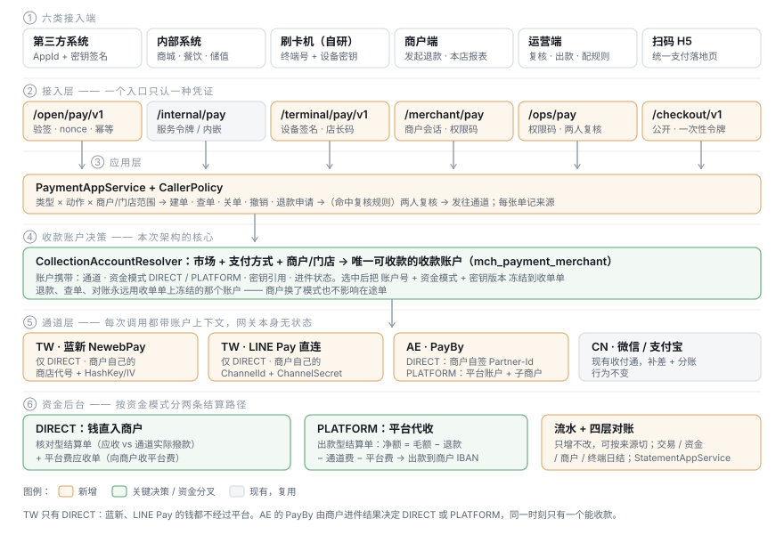
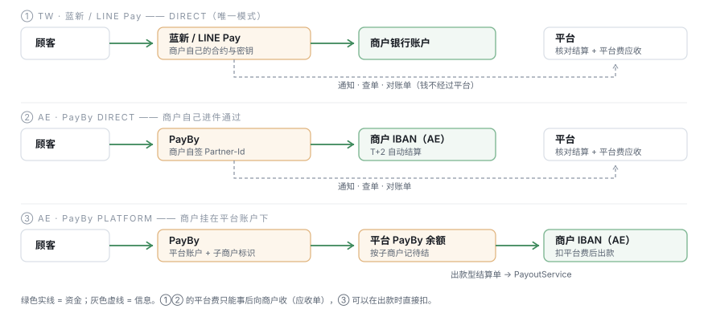

# TDD-支付服务-台湾阿联酋通道与开放API

状态：**背景**（已并入完整设计方案，2026-10-26 起不再单独演进）· 原 **草稿 v4**（2026-10-24：v2 资金路径 · v3 接入端 · v4 统一落地页、商户发起退款、复核门槛可配、刷卡机自研；AC 待确认后转「已确认」）
档位：**2**（新通道 × 3、资金模式分叉、对外开放接口、跨市场）→ 本 TDD + 另开 ADR-043（§3 末尾）
关联需求：[PRD-支付域](../requirements/PRD-支付域.md) S1 进件 / S2 收单 / S4 账期与放款 / S5 退款 / S6 对账；
本次口头需求尚无 PRD 落点，§0 先写成 AC，确认后回写 PRD-支付域 §1.1 与 §3
相关：[ADR-021 支付域独立为服务与独立库](./ADR/ADR-021-支付域独立为服务与独立库.md) ·
[ADR-039 Outbox 统一投递](./ADR/ADR-039-Outbox统一投递与双库适配.md) ·
[ADR-022 资金风控拦截点](./ADR/ADR-022-资金风控的拦截点与误伤代价.md) ·
[TDD-资金到账可见性与四轴对账](./TDD-资金到账可见性与四轴对账.md) ·
TDD-餐饮POS点餐收银界面（`TDD-餐饮POS点餐收银界面.md`，在途、尚未入库）（刷卡的第一个调用方）
创建：2026-10-24 · 最后更新：2026-10-24

> **📌 2026-10-26**：路径前缀以 `PortalFace` 为准 —— 本篇的 `/merchant/pay/**`、`/ops/pay/**` 已改为 `/biz/pay/**`、`/pay-ops/v1/**`（见[接口清单](./支付服务-接口清单.md)）；§2.6 的 `pay_channel_credential` / `pay_app_credential` 不再建表，密钥归平台级 `secret` 模块（[完成度复核](./支付服务-完成度复核与剩余开发计划.md) D-5）。
>
> **📌 本篇已并入 [TDD-支付服务-完整设计方案](./TDD-支付服务-完整设计方案.md)，作为背景与推导保留；冲突时以完整方案为准。**
> 其中下方 F3 已被完整方案 D2 推翻：进件资料与收款商户归**支付系统**（`pay_merchant`），不归商家域。
>
> **⚠️ 类设计阶段的四处修正（2026-10-24，以 [代码结构与类清单](./TDD-支付服务-代码结构与类清单.md) §0 为准）**
> - **F1**：支付域里不允许有 controller（`PayHasNoControllerTest`）→ 本文提到的 `OpenPayController`、`*AuthFilter` 等都在 `shop-app` 的 `portal.<端>.pay` / `auth.pay`，**不在 `pay-svc`**
> - **F2**：本文的资金模式 `PLATFORM` 在代码里是现有的 **`FundsPath.AGGREGATED`**
> - **F3**：收款账户就是 `mch_payment_merchant`，**归商家域（`shop-merchant`）**；本文的 `collection_account_no` 即 **`pay_merchant_no`**，支付域经 `MerchantQueryPort#paymentRouteOf` 读取并冻结快照
> - **F4**：`merchant` 只指收款商户号 → 本文的「商户端」= **商家端（Biz）**，`merchant_no`（经营主体）= **`entity_no`**，`pay_app_merchant` = **`pay_app_grant`**

### v2 改了什么（相对 v1）

| 输入 | v1 | v2 |
|---|---|---|
| 台湾还有 LINE Pay | 只当作蓝新 MPG 里的一种支付方式 | **独立通道 `LINEPAY`**（直连 LINE Pay v3）；蓝新内的 LINE Pay 作为备选路由 |
| 台湾（含蓝新）资金直接进商户 | 结算默认「通道直结」，代收作为选项 | **TW 只有 DIRECT**，由通道能力约束，不是配置默认值 |
| PayBy 两种方式按进件择一 | 未区分 | **收款账户带资金模式**；按进件结果选出唯一可收款账户，模式冻结到收单单 |
| 由此推出 | 密钥是平台级配置 | **密钥按收款账户存**（每个商户自己的商店代号 / ChannelSecret / Partner-Id），网关无状态 |
| 由此推出 | 结算一条路径 | **两条结算路径**：DIRECT = 核对 + 平台费应收；PLATFORM = 扣费出款 |

### v3 改了什么（相对 v2）

| 输入 | v2 | v3 |
|---|---|---|
| 接入端包含第三方、内部系统、刷卡机、运营端、扫码 H5 | 只有「第三方签名」与「内部令牌」两个入口，刷卡机挂在门店形态里，H5 与运营端未建模 | **五类接入端（v4 加商户端成六类），各自独立入口与鉴权**，统一解析成 `PayCaller`，由一张**能力矩阵**决定谁能做什么（§2.8） |
| 由此推出 | 收单单不记来源 | 收单单记 `source_type + source_id`，流水、对账、结算可按来源拆 |
| 由此推出 | 刷卡机只是终端登记 | 刷卡机有**设备身份**：激活绑定、设备密钥签名、当日撤销需店长授权、**终端日结**参与对账 |
| 由此推出 | 无 H5 | 扫码 H5 = 公开收银台：**动态码**（单笔，金额服务端定）与**静态码**（门店/桌台，顾客输金额），凭一次性收银令牌，不持任何密钥 |
| 由此推出 | 运营端只有管理页 | 运营端是**资金操作入口**：退款、线下退款、出款、密钥录入按权限码，大额操作双人复核，全量审计 |

### v4 改了什么（相对 v3）

| 输入 | v3 | v4 |
|---|---|---|
| 扫码 H5 用独立前端项目 | 待确认 Q9 | **定了**：`checkout-h5/` 独立工程，且是**全平台唯一的支付落地页**（§2.8.6） |
| 后端要支持注册登录 | 未涉及 | **消费者账号归统一鉴权域**，另开 TDD；支付域只记可选 `user_no`，**付款不强制登录**（§2.8.6） |
| 刷卡机平台自研，对接蓝新与 PayBy 网关 | T1 / T2 两种机型待选 | **只有自研机型**：我方终端 App → 我方服务端 → 通道网关；读卡段必须用通道认证的读卡套件（§2.8.5，Q12） |
| 退款由商家发起 | 运营端、第三方、刷卡机都能发起 | **发起方只有商户**（商户端 / 商户授权的刷卡机 / 商户授权的第三方）；运营端**不发起，只复核**。新增第六类接入端「商户端」 |
| 由此推出 | 线下退款由运营处理 | DIRECT 模式钱在商户账户 → **线下退款由商户自己退，平台只登记凭证** |
| 平台退款两人复核的门槛可定义 | 写死「超阈值」 | **复核规则表** `pay_refund_review_rule`：按市场 / 币种 / 商户 / 来源，单笔、日累计、退款比例三类门槛（§2.8.8） |

---

## L1 · 一句话

支付服务的核心对象从「通道」换成**收款账户**：
**钱落在谁的账户、用谁的密钥、按哪种方式结算，都由收款账户决定**。
台湾的蓝新、LINE Pay 只有「直入商户」一种；阿联酋的 PayBy 有「直收」「平台代收」两种，
按商户进件结果自动选其一。
**第三方、内部系统、刷卡机、商户端、运营端、扫码 H5 六类接入端**各走各的入口与鉴权，
进来之后是同一个收单服务、同一张能力矩阵、同一套流水。
顾客付款只有一个落地页；退款只有商户能发起，超过门槛由平台两人复核。

---

## 需求范围

### 在里面

| # | 需求 | 说明 |
|---|---|---|
| R1 | TW · 蓝新 | 线上：信用卡（含分期）、Apple Pay / Google Pay、ATM 虚拟账号、超商代码/条码、台湾Pay（以及 MPG 内的 LINE Pay 作为备选）。**资金直入商户** |
| R2 | TW · LINE Pay | 直连 LINE Pay v3：线上 Request → Confirm；门店扫顾客付款码（Offline API）。**资金直入商户** |
| R3 | AE · PayBy | 两种资金模式：**DIRECT**（商户自签 PayBy，钱直入商户）/ **PLATFORM**（商户挂在平台 PayBy 账户下，平台代收后出款）。**系统按进件结果择一** |
| R4 | 刷卡 / 门店收款 | 刷卡机或 POS 发起，终端刷卡或扫码完成，结果回到同一张收单单 |
| R5 | 六类接入端 | **第三方**（`/open/pay/v1`，签名）· **内部系统**（内嵌 / `/internal/pay`，服务令牌）· **刷卡机**（`/terminal/pay/v1`，设备密钥）· **商户端**（`/merchant/pay`，商户会话 + 权限码）· **运营端**（`/ops/pay`，运营会话 + 权限码）· **扫码 H5**（`/checkout/v1`，公开 + 一次性收银令牌，可选消费者登录）；一套应用服务 |
| R5b | 统一支付落地页 | 所有「顾客在手机上付款」的场景都落到同一个 `checkout-h5`：动态码、静态码、第三方托管收银台、通道支付返回、LINE Pay 确认 |
| R5c | 退款由商户发起 | 商户端、商户授权的刷卡机、商户授权的第三方可发起；运营端只复核 |
| R5d | 复核门槛可配置 | 运营端维护规则，命中即需平台两人复核 |
| R6 | 第三方用支付密钥 | 每个接入方一个 AppId，HMAC-SHA256 密钥或 RSA 公钥；可轮换、可吊销、限 IP、限权限、限商户 |
| R6b | 每类接入端能做的事不同 | 由能力矩阵（§2.8.2）统一定义，不散在各入口的代码里 |
| R7 | 流水 | 每一笔资金动作写只增不改的流水，**区分「钱在平台」与「钱在商户」两类账户** |
| R8 | 对账 | 交易层（我方 ↔ 通道，按收款账户逐个拉）、资金层（通道撥款 / 平台出款 ↔ 银行） |
| R9 | 结算 | DIRECT：核对型结算单 + 平台费应收单；PLATFORM：出款型结算单 |

### 不在里面（明确不做）

- **不碰卡号**：只用通道托管页 / SDK 令牌 / 终端，不存 PAN、CVV
- 台湾统一发票、阿联酋 VAT 发票的开立（税务域），收单单只留 `invoice_ref`
- 跨币种换汇；每市场本币收、本币结
- 一笔交易分账给多个收款方（CN 收付通的分账链路保持现状）
- **TW 平台代收**：通道能力直接禁止，不是「暂不开放」

---

## §0 对账一 · 需求 → 设计

| AC | 需求（Given / When / Then 压成一句） | 落点（模块 / 接口 / 表） |
|---|---|---|
| AC1 | TW 商户付款时，只出现该商户**已进件成功**的通道与方式；蓝新付款成功后收单单 `SUCCEEDED` 且仅入账一次 | `CollectionAccountResolver` · `NewebPayAcquiringGateway` · `pay_order` |
| AC2 | TW 走 LINE Pay 直连：用户授权后**我方调 Confirm 成功才算成功**；Confirm 超时由查单（Payment Details）确认，不重复 Confirm 扣款 | `LinePayAcquiringGateway#confirm/query` · 状态 `AUTHORIZED→SUCCEEDED` |
| AC3 | 商户同时有 LINE Pay 直连账户与「蓝新内 LINE Pay」时，按账户优先级选一个；直连不可用（停用/冻结）时才落到蓝新 | `CollectionAccountResolver` 候选排序 · `mch_payment_merchant.priority` |
| AC4 | TW 市场的收款账户**不能**被保存为 PLATFORM 模式（保存即拒绝） | 通道能力 `allowedFundModes(TW·NEWEBPAY/LINEPAY)={DIRECT}` · 校验在账户保存与建单两处 |
| AC5 | AE 商户：自签 PayBy 已生效 → 走 DIRECT；否则挂平台账户已生效 → 走 PLATFORM；都没有 → 收银台不出现 PayBy，并提示去进件 | `FundModeResolver` · `mch_payment_merchant.fund_mode/account_status` |
| AC6 | 同一商户（门店）× 同一通道，**同一时刻只有一个可收款账户**；第二个试图生效时拒绝 | 生成列唯一键 `uk_collectable`（§2.5） |
| AC7 | 收单单在建单时冻结 `收款账户号 + 资金模式 + 密钥版本`；之后商户从 PLATFORM 切到 DIRECT，在途单的查单、退款、对账仍用原账户 | `pay_order.collection_account_no/fund_mode/credential_version` |
| AC8 | 切换模式：新账户生效 → 旧账户自动转 `REFUND_ONLY`（不收新单、可退款）；旧账户的未结余额结清、退款窗口过后才 `CLOSED` | `CollectionAccountLifecycle` · 定时任务 |
| AC9 | 每个通道调用、每个回调验签都使用**该收款账户自己的密钥**；回调地址带账户号，与报文内商户号交叉校验，不一致即拒绝 | `ChannelCredentialVault` · `/callback/pay/{channel}/{accountNo}` |
| AC10 | 回调丢失时，掉单巡检 10 分钟内经查单补齐，与回调走同一条入账链路 | `AcquiringGateway#query` · 复用 `ReconService#checkStalePayments` |
| AC11 | 门店刷卡/扫码：终端或扫码结果回到收单单；POS 取消时先查单，绝不出现「终端已扣、我方已关」 | `CardPresentGateway` · `pay_terminal` |
| AC12 | 退款永远原路、原账户：信用卡/LINE Pay/PayBy 走通道退款；ATM/超商无原路退 → 线下退款单，**DIRECT 由商户自行退款并上传凭证**，平台只登记 | `AcquiringGateway#refund` · `refund_mode` · `pay_refund` |
| AC13 | 第三方签名错 / 时间戳偏差 > 5 分钟 / nonce 重放 / 无该商户授权 → 401/403，且不落任何业务数据 | `OpenApiSignatureFilter` · `pay_app*` |
| AC14 | 相同 `out_order_no` / `Idempotency-Key` 重复请求返回同一张收单单，不重复向通道下单 | `pay_order` 唯一键 `(app_id, out_order_no)` |
| AC15 | 支付/退款结果按接入方 webhook 推送，签名可验，失败退避重试 ≥ 24h，可手动重推 | `pay_webhook_delivery`（Outbox，ADR-039） |
| AC16 | 接入方密钥轮换重叠期内两把都可验签；吊销即失效；明文只在生成时展示一次 | `pay_app_credential` · `CredentialCipher` |
| AC17 | 内部订单与第三方订单走同一个 `PaymentAppService` | ArchUnit 守卫 |
| AC18 | 每次资金状态变化写流水；DIRECT 的收款记在「商户通道余额（平台外）」，PLATFORM 记在「平台通道余额」，两类账户不可互相转账 | `pay_ledger_entry.account_type` · `FundInvariantService` |
| AC19 | T+1 按**收款账户**逐个拉对账单逐笔核对，五类差异入差异单；拉不到对账单的通道退化为逐笔查单核对，并在覆盖率上标出 | `StatementSource` · `ChannelStatementAxis` · `stl_recon_diff` |
| AC20 | DIRECT：按周期出核对型结算单（应收 vs 通道撥款）+ 平台费应收单；应收单可被同商户 PLATFORM 出款抵扣，或单独收取 | `DirectSettlementService` · `pay_fee_receivable` |
| AC21 | PLATFORM：出款型结算单，净额 = 毛额 − 退款 − 通道费 − 平台费 − 已抵扣应收；出款进流水与资金对账 | `PlatformSettlementService` · 复用 `PayoutService` |
| AC22 | 金额出通道时按通道精度换算（蓝新、LINE Pay TWD 为整数元），有余数直接拒绝而非四舍五入 | `MoneyCodec` · `AcquiringGateway#amountSpec` |
| AC23 | 六类接入端各有独立入口与鉴权；任一类的凭证拿到别的入口一律 401（如设备密钥调 `/open`、收银令牌调 `/terminal`、商户会话调 `/ops`） | 六个 `*AuthFilter` · `PayCaller.type` 与路径前缀强绑定 |
| AC24 | 每个操作先按能力矩阵放行：调用方类型 × 动作 × 商户/门店范围，矩阵外一律 403 | `CallerPolicy` · 能力矩阵（§2.8.2） |
| AC25 | 每张收单单 / 退款单记录 `source_type + source_id`（AppId / 系统名 / 终端号 / 操作员 / 码号）；流水、对账单、结算明细可按来源筛 | `pay_order.source_*` · `pay_ledger_entry.source_*` |
| AC26 | 扫码 H5 动态码：金额、商户、可用方式全部由服务端按收单单给出；H5 改金额无效；收银令牌过期、已付、已关单后不可再付 | `/checkout/v1` · `pay_checkout_session` |
| AC27 | 扫码 H5 静态码（门店 / 桌台）：顾客输入金额建单；单笔与单码日累计限额、码停用即失效；收款方始终是码绑定的收款账户 | `pay_qr_code` · `CheckoutAppService#createFromStaticCode` |
| AC28 | 刷卡机：未激活不能收款；请求用设备密钥签名；当日撤销与退款都需店长授权码，并受单终端日限额；设备挂失后其密钥立即失效 | `pay_terminal` · `pay_terminal_credential` · `TerminalAuthFilter` |
| AC29 | 刷卡机日结：终端上报当日笔数 / 金额，与服务端该终端汇总比对，不一致生成差异单 | `pay_terminal_batch` · `TerminalBatchAxis` |
| AC30 | 运营端：出款、通道密钥启用、资金模式切换需第二人复核；运营端**不能发起退款**；所有资金操作写审计 | 权限码（§契约）· `pay_approval` · 审计日志 |
| AC31 | 退款只能由商户侧发起（商户端 / 该商户的刷卡机 / 有 `pay:refund` 且被该商户授权的第三方）；运营会话、内部系统、扫码 H5 调退款一律 403 | `CallerPolicy` · `RefundAppService#request` |
| AC32 | 退款请求按复核规则判定：命中任一门槛 → `PENDING_REVIEW`，需两名不同的运营人员先后通过才发往通道；未命中 → 直接发往通道；任一人驳回即终止并通知商户 | `RefundReviewPolicy` · `pay_refund_review_rule` · `pay_approval` |
| AC33 | 复核规则可在运营端按市场 / 币种 / 商户 / 来源配置单笔金额、商户日累计、退款占原单比例三类门槛；规则变更留版本，**退款单记录命中的规则版本** | `pay_refund_review_rule` · `pay_refund.review_rule_version` |
| AC34 | 所有顾客付款场景落到同一个 `checkout-h5`：动态码、静态码、第三方托管收银台、蓝新 / PayBy 支付返回、LINE Pay 确认；通道侧只登记这一个域名 | `checkout-h5` 路由表（§2.8.6）· `checkout_url` |
| AC35 | 顾客不登录也能付款；登录后收单单记 `user_no`，可查自己的付款记录；登录与否不影响金额与可用方式 | `pay_order.user_no`（可空）· 统一鉴权域 |

**孤立项**：
- 没落点的 AC：无。AC11 的读卡段与 AC5 的 PayBy PLATFORM 具体机制 **取决于 §6 Q2/Q3/Q12**，设计按可替换来做
- 挂不上 AC 的设计：通道 SPI 拆分（§2.3）是 AC1/AC2/AC12 的共同前置，不单列

---

## §1 现状与影响面

### 1.1 可直接复用

| 现有 | 位置 | 本次怎么用 |
|---|---|---|
| **商家支付进件，每通道一条**（主体 × 门店 × 通道，带进件状态、通道回执写入的支付方式、额度） | `mch_payment_merchant`（实体 `MchPaymentMerchant`） | **升级为「收款账户」**：加资金模式、市场、密钥引用、账户状态、优先级（§2.5）。它本来就是「钱打给谁的真源」（ADR-021 §3.2），不另起一张 |
| 通道路由（注入自动成表、同名双实现即炸、找不到不回退） | `PayGatewayRouter` | 保留判据，升级为 `ChannelRouter`，路由键变成「收款账户」 |
| 通道 × 市场 | `sys_pay_channel_market`（V295） | 加 `TW→NEWEBPAY`、`TW→LINEPAY`、`AE→PAYBY` |
| 市场主数据（TW/AE 已预置、关闭） | `sys_market`（V294） | 开市场是运营动作 |
| 报文留痕 + 脱敏、回调验签 | `ChannelMessageRecorder` · `PayloadMasker` · `channel/verify/*` | 新通道照形状接入；脱敏加卡号与 ChannelSecret 规则 |
| 掉单巡检、四轴对账、银行流水解析 | `ReconService` · `service/recon/*Axis` · `BankFlowCsvParser` | 加 `ChannelStatementAxis` |
| 结算 / 批次 / 出款 | `SettleService` · `SettleBatchService` · `PayoutService` | PLATFORM 路径直接用；DIRECT 路径新增核对与应收 |
| 开放凭证（吊销不删行、`last_used_at`、scopes） | `InvOpenCredential` | 照抄管理形状；**不照抄 bcrypt**（HMAC 需要可取回的密钥） |
| 内网入口（共享令牌、未配即 401） | `InternalPayEndpoint` | 内部调用继续用 |

### 1.2 会被改到的（已在跑）

| 改动点 | 影响 | 处理 |
|---|---|---|
| `PayGateway` | 微信 / 支付宝 / Stub / Test / Free | 拆成能力接口，`PayGateway` 保留为兼容组合；CN 实现零行为变化 |
| 网关从配置读平台级密钥（`WechatPayChannelConfig` 等） | CN 两通道 | CN 保持现状（服务商模式下密钥本就是平台级）；新通道一律从 `ChannelCredentialVault` 按账户取 |
| `mch_payment_merchant` 唯一键 `(entity_no, store_no, pay_channel)` | 进件、门店收款号选择 | 改为 `(entity_no, store_no, pay_channel, fund_mode)`，另加「可收款唯一」生成列（AC6）。**影响面：读这张表的查询要补 `account_status` 条件** —— 实现前 grep 全部读点逐个过 |
| `PaymentLedgerService` 以 `orderNo` 为中心 | 商城下单、退款、对账 | 新增 `pay_order` 作为上游；商城订单是 `biz_type=MALL_ORDER` 的调用方，旧方法转调，分期迁移 |
| `QueryResult` / `TxContext` 默认 `CNY` | 新通道漏传币种即被当人民币 | 新代码只用带币种构造；守卫测试拦截 |

### 1.3 设计必须绕开的四个坑

1. **`PayGateway` 是收付通形状**：补差、分账是抽象方法。蓝新、LINE Pay、PayBy 都没有 → 拆能力接口。
2. **密钥是平台级的假设不成立了**：TW 两通道与 PayBy DIRECT 都是**商户自己的合约**，
   每个商户一套商店代号 / HashKey / HashIV / ChannelSecret / 私钥。网关若仍从全局配置读密钥，
   第二个商户接入那天就会用 A 的密钥给 B 下单 —— 钱进 A 的账户。
3. **回调不知道是谁的**：蓝新通知里 `TradeInfo` 是用**该商户的** HashKey 加密的，
   不知道是哪个商户就解不开。→ 回调地址带收款账户号，解密后再与报文内 `MerchantID` 交叉校验。
4. **TWD 精度**：库里 TWD 两位小数（ISO 口径），蓝新 `Amt`、LINE Pay `amount` 都是整数元 → 余数拒绝。

### 1.4 明确不受影响的

- CN 微信 / 支付宝全链路（服务商模式、平台级密钥、补差分账）
- 积分、储值、权益：TW/AE 通道不支持补差，`canPoints()` 判否，**这是预期**
- 订单状态机、售后规则：只消费「支付成功 / 退款成功」事件，形状不变

---

## §2 方案

### 2.1 架构总览



第①②层是六类接入端与各自入口（v3 建模、v4 加商户端，§2.8）；**第④层是资金侧的核心**。v1 的思路是「市场 → 通道」，v2 改成「市场 + 方式 + 商户 → **收款账户**」：

- 通道决定**能做什么**（下单、退款、刷卡、对账单、允许的资金模式）；
- 收款账户决定**钱去哪、用谁的密钥、怎么结算**；
- 收单单在建单时把账户与模式**冻结**下来，之后的一切（查单、退款、对账、结算）只认冻结值。

为什么必须冻结：AE 商户从 PLATFORM 切到 DIRECT 的那天，前一天的单还在平台账户里、还可能退款。
如果退款时重新「解析」账户，就会拿商户自己的密钥去退一笔在平台账户里的交易 —— 通道会拒绝，
更坏的情况是部分成功。

### 2.2 资金路径



| 路径 | 通道 | 钱在哪 | 平台怎么拿到平台费 | 平台对资金的责任 |
|---|---|---|---|---|
| ① TW DIRECT | 蓝新、LINE Pay | 通道 → 商户银行账户 | **应收单**，事后向商户收 | 只有核对，没有出款 |
| ② AE DIRECT | PayBy（商户自签） | PayBy → 商户 IBAN，T+2 | 同上 | 同上 |
| ③ AE PLATFORM | PayBy（平台账户 + 子商户） | PayBy → 平台 PayBy 余额 → 平台出款 → 商户 IBAN | **出款时直接扣** | 出款、资金池对账、待结余额 |

**图上看不出的两点**：
- ①② 里平台没有资金，所以「平台费收不回来」是真实风险（§4），应收单要有账龄与催收、可停收款
- ③ 的平台费可以顺带抵扣同一商户在 ①② 产生的应收 —— 但 TW 与 AE 币种不同，**只能同币种抵扣**，实际上只在 AE 内部抵

### 2.3 通道 SPI：按能力拆接口，网关无状态

```java
/** 每次调用都带账户上下文；网关不持有任何商户密钥 */
public record ChannelAccountContext(
        String collectionAccountNo, String payChannel, String market, FundMode fundMode,
        String channelMerchantId,      // 蓝新 MerchantID / LINE Pay ChannelId / PayBy Partner-Id
        String subMerchantRef,         // PLATFORM 模式下的子商户标识；DIRECT 为空
        ChannelSecrets secrets,        // 从 Vault 取出，仅在内存，toString() 脱敏
        int credentialVersion) { }

public interface AcquiringGateway {
    String payChannel();
    Set<FundMode> allowedFundModes(String market);              // TW 通道只返回 DIRECT（AC4）
    CreateResult create(ChannelAccountContext acc, CreateCommand cmd);
    default ConfirmResult confirm(ChannelAccountContext acc, ConfirmCommand cmd) { ... }  // LINE Pay 需要；其余不实现
    QueryResult query(ChannelAccountContext acc, String outTradeNo);
    Result close(ChannelAccountContext acc, String outTradeNo);
    Result refund(ChannelAccountContext acc, RefundCommand cmd);
    RefundQueryResult queryRefund(ChannelAccountContext acc, String outRefundNo);
    NotifyParseResult parseNotify(ChannelAccountContext acc, HttpHeaders h, byte[] body);
    AmountSpec amountSpec(String currency);
    RefundCapability refundCapability(String payMethod);        // ONLINE / OFFLINE / NOT_SUPPORTED
}

public interface CardPresentGateway { ... }      // 门店：推单到终端 / 扫顾客付款码
public interface StatementSource { ... }         // fetch(acc, billDate) → 原件；parse(原件) → 标准行
public interface MerchantPayoutGateway { ... }   // PLATFORM 出款（PayBy Transfer to Bank）
public interface MarketplaceSplitGateway { ... } // CN 补差 + 分账，原方法搬入
@Deprecated public interface PayGateway extends AcquiringGateway, MarketplaceSplitGateway { }  // CN 兼容
```

**能力 = 实现了哪个接口**。`sys_pay_channel` 上的能力位降级为**运营开关**（只能关、不能开出代码里没有的能力），
启动时比对两者，表里开了而代码没实现即启动失败。

### 2.4 三家通道适配要点

#### 蓝新 NewebPay（TW · 仅 DIRECT）

| 项 | 做法 |
|---|---|
| 账户 | 每个商户自己的商店代号 `MerchantID` + HashKey + HashIV（存 Vault）；资金由蓝新撥款给该商户。是否经「平台商」API 代开子商店见 Q4 |
| 下单 | MPG 幕前：`TradeInfo`（AES-256-CBC）+ `TradeSha`（SHA256 大写）；`create` 返回自动提交表单参数 |
| 方式 | `CREDIT`（含分期）、`APPLEPAY`/`ANDROIDPAY`、`VACC`、`CVS`/`BARCODE`、`TAIWANPAY`、`LINEPAY`（备选路由，AC3） |
| 结果 | `NotifyURL` = `/callback/pay/newebpay/{accountNo}` 为准；`ReturnURL` 只展示不入账 |
| ATM / 超商 | 两段式：取号 → `AWAITING_PAYMENT`（带缴费期限）→ 缴费通知 → `SUCCEEDED`；过期巡检关单 |
| 查单 | `QueryTradeInfo`（`CheckValue`） |
| 请款 / 退款 | 信用卡 `CreditCard/Close`：`CloseType=1` 请款、`=2` 退款；未请款的走取消授权；按商户「自动 / 手动请款」设定区分 |
| 无原路退 | ATM / 超商 → `refund_mode=OFFLINE`：线下退款单；钱在商户账户，**由商户自行退给顾客并在商户端上传凭证**，平台只登记（§2.8.8） |

#### LINE Pay 直连（TW · 仅 DIRECT）

| 项 | 做法 |
|---|---|
| 账户 | 每个商户自己的 `ChannelId` + `ChannelSecret`（存 Vault），资金由 LINE Pay 结给该商户 |
| 签名 | v3：`X-LINE-ChannelId`、`X-LINE-Authorization-Nonce`、`X-LINE-Authorization` = Base64(HMAC-SHA256(ChannelSecret, ChannelSecret + URI + body/query + nonce)) |
| 线上 | `POST /v3/payments/request` → 用户在 LINE 内授权 → 跳回 `confirmUrl` → **我方调 `POST /v3/payments/{transactionId}/confirm`**。没 confirm 就不算付款（AC2） |
| 状态 | 新增 `AUTHORIZED`（用户已授权、待 confirm）；confirm 超时 → 用 Payment Details 查，**查到已扣款就置成功，绝不重发 confirm** |
| 退款 | `POST /v3/payments/{transactionId}/refund`，支持部分退款 |
| 门店 | Offline API：POS 扫顾客 LINE 付款码（一次性码）直接扣款 → 作为 `CardPresentGateway` 的「扫码」形态 |
| 对账 | 是否有对账单下载接口未确认（Q6）→ 先用 Payment Details 逐笔核对 |
| 与蓝新内 LINE Pay 的关系 | 同一个支付方式两条路由；账户优先级决定（AC3）。两者资金都进商户，但**手续费与撥款时间不同**，对账要按实际路由走 |

#### PayBy（AE · DIRECT 或 PLATFORM，按进件择一）

| 项 | DIRECT（商户自签） | PLATFORM（挂平台账户） |
|---|---|---|
| 合约 | 商户与 PayBy 直接签约，有自己的 Partner-Id | 商户在平台的 PayBy 账户下以子商户身份收款 |
| 密钥 | 商户自己的私钥 + PayBy 公钥（Vault，按账户） | 平台私钥（Vault，平台级账户） |
| 下单 | `acquire2/placeOrder`，`Partner-Id` = 商户 | 同接口，`Partner-Id` = 平台，报文带子商户标识（**字段待确认 Q2**） |
| 资金 | PayBy T+2 结到商户 IBAN | 进平台 PayBy 余额 → 平台结算后出款（`MerchantPayoutGateway`，PayBy Transfer to Bank 或银行转账，Q2） |
| 退款 | `acquire2/refund/placeOrder`，部分退款，原路退卡；用**原单冻结的账户**发起 | 同左，用平台账户发起，并冲减该子商户待结 |
| 对账单 | 每个商户账户各拉一份 | 平台账户一份，按子商户标识拆分 |
| 共同约束 | 请求头 `sign` / `Partner-Id` / `Content-Language`；**与 PayBy 时间偏差 > 15 分钟被拒** → 服务器 NTP 对时；AED 只能结到 `AE` 开头的 IBAN（进件校验） | |

### 2.5 收款账户模型（核心）

**载体：升级现有 `mch_payment_merchant`**，不新建。它已经是「主体 × 门店 × 通道」一条、进件状态与通道回执写在上面。新增列：

| 列 | 说明 |
|---|---|
| `market` | 账户所属市场，必须在 `sys_pay_channel_market` 里 |
| `fund_mode` | `DIRECT` / `PLATFORM`；保存时校验 `allowedFundModes`（AC4） |
| `account_status` | `ONBOARDING` → `ACTIVE` → `REFUND_ONLY` → `CLOSED`；另有 `SUSPENDED`（风控 / 平台费逾期）。与 `apply_status`（进件本身）分开：进件过了 ≠ 已启用收款 |
| `channel_merchant_id` | 蓝新 MerchantID / LINE Pay ChannelId / PayBy Partner-Id（DIRECT 时为商户的，PLATFORM 时为平台的） |
| `sub_merchant_ref` | PLATFORM 下的子商户标识 |
| `credential_ref` · `credential_version` | 指向 `pay_channel_credential`，**本表不存任何密钥** |
| `priority` | 同一支付方式多条路由时的选择顺序（AC3） |
| `settle_account_ref` | 结算账户（IBAN / 银行账号）的脱敏引用 |
| `collectable_key`（生成列） | `IF(account_status='ACTIVE', CONCAT(entity_no,'|',store_no,'|',pay_channel), NULL)` 上建唯一索引 → **同一时刻只有一个可收款账户**（AC6）。MariaDB 与 H2 的生成列语法差异要过 `known-sql-dialect` 闸门 |

唯一键从 `(entity_no, store_no, pay_channel)` 改为 `(entity_no, store_no, pay_channel, fund_mode)`：
PayBy 商户在 PLATFORM 收款期间可以同时有一条 DIRECT 进件中的记录。

**选择规则（`CollectionAccountResolver` + `FundModeResolver`）**

```
输入：market, pay_method, entity_no, store_no
1. 候选通道 = sys_pay_channel_market(market) ∩ 支持 pay_method 的通道 ∩ 运营开关开启
2. 每个候选通道，找门店级 ACTIVE 账户，没有再找主体级（store_no = ''）—— 沿用现有「空串 = 主体级默认号」
3. 账户的 pay_methods（通道回执写入）必须包含 pay_method
4. 多条命中按 priority 取第一（例：LINEPAY 直连 优先于 NEWEBPAY 内 LINE Pay）
5. 一条都没有 → 这个方式不出现在收银台；建单接口返回「商户未开通此收款方式」
```

PayBy 的「按进件择一」不需要单独的 if：同一 `(entity, store, PAYBY)` 只可能有一条 `ACTIVE`，
DIRECT 生效时由生命周期把 PLATFORM 转 `REFUND_ONLY`（下面）。**决策写在状态里，不写在代码分支里**。

**生命周期（`CollectionAccountLifecycle`）**

| 事件 | 动作 |
|---|---|
| 进件通过（通道回执） | `apply_status=APPROVED`，账户 `ONBOARDING`；运营或自动规则启用 → `ACTIVE` |
| PayBy DIRECT 启用，且已有 PLATFORM `ACTIVE` | 同一事务：PLATFORM → `REFUND_ONLY`，DIRECT → `ACTIVE`；写变更流水，通知商户 |
| `REFUND_ONLY` 期间 | 不收新单；退款、查单、对账、结算照常；PLATFORM 未结余额照常出款 |
| 退款窗口到期 且 待结余额 = 0 | → `CLOSED`（定时任务判断，人工可提前确认） |
| 风控 / 平台费逾期 | → `SUSPENDED`：不收新单，退款照常 |
| DIRECT 被通道停用 | 不自动回退到 PLATFORM（那意味着钱的去向在商户不知情时改变）；提示商户 + 运营决定 |

### 2.6 密钥管理：两类密钥分开

| 类 | 谁的 | 用途 | 存储 |
|---|---|---|---|
| **通道密钥** `pay_channel_credential` | 商户（DIRECT）或平台（PLATFORM / CN） | 我方调通道、验通道回调 | 信封加密：每条一把数据密钥（AES-GCM）加密内容，数据密钥再由主密钥加密；主密钥来自 KMS / 部署注入，**不落库不进日志** |
| **接入方密钥** `pay_app_credential` | 第三方接入方 | 第三方调我方、我方推 webhook | HMAC：同上信封加密；RSA：只存对方公钥 |

通道密钥的录入：商户在 B 端 / 运营在运营端录入（蓝新 HashKey/IV、LINE Pay ChannelSecret、PayBy 私钥），
**写入后只回显指纹**；录入后立即做一次「测试查单」验证可用，失败不允许启用账户。
轮换：新增一条 `credential_version+1`，账户切到新版本；**旧版本保留到所有引用它的在途单终结**（AC7 冻结的是版本号）。

### 2.7 收单与刷卡

**收单单状态机**：

```
CREATED → (AWAITING_PAYMENT: ATM/超商取号) → (AUTHORIZED: LINE Pay 已授权待 confirm) → SUCCEEDED
        ↘ CLOSED（超时/取消，关前必查单）      ↘ FAILED
SUCCEEDED → PARTIALLY_REFUNDED → REFUNDED
```

**门店收款**（v4：刷卡机自研，见 §2.8.5），都收敛到同一张 `scene=IN_STORE` 的收单单：

| 方式 | TW | AE | 关键约束 |
|---|---|---|---|
| 刷卡（插 / 刷 / 挥） | 蓝新卡片在场接口 + 认证读卡套件（Q12） | PayBy 卡片在场接口 + 认证读卡套件（Q12） | 取消前必查单 |
| B 扫 C（扫顾客付款码） | **LINE Pay Offline** | PayBy 被扫（Q3） | 扫码即扣，超时必查单 |
| C 扫 B（终端屏显动态码） | 落到 `checkout-h5` | 同左 | 与线上动态码完全同一条链路 |

刷卡机作为**接入端**的身份、鉴权、日结见 §2.8.5。

### 2.8 接入端：六类入口，一个收单服务

#### 2.8.1 接入端总表

| 接入端 | 是谁 | 入口 | 身份与鉴权 | 凭证存哪 | 信任程度 |
|---|---|---|---|---|---|
| **第三方** | 外部系统（ISV、合作方商城） | `/open/pay/v1/**` | AppId + HMAC/RSA 签名 + 时间窗 + nonce | `pay_app_credential` | 不受信，签名防篡改 |
| **内部系统** | 本仓库商城订单、餐饮 POS 后台、储值等 | 内嵌直调 / `/internal/pay/**` | 服务令牌（现有 `InternalPayEndpoint`）；内嵌形态无 HTTP | 部署注入 | 受信，但**仍过能力矩阵** |
| **刷卡机** | 门店的智能 POS / 刷卡终端 | `/terminal/pay/v1/**` | 终端号 + **设备密钥签名**（激活时下发，一机一钥） | `pay_terminal_credential` | 半受信：设备会丢、会被拆 |
| **商户端** | 商户老板、店长、财务（b-app） | `/merchant/pay/**` | 商户会话（ADR-015 商户令牌池）+ 商户内权限码；`merchantScope` 恒为本商户 | 会话库 | 受信的人，但**只对自己的钱** |
| **运营端** | 平台运营、财务 | `/ops/pay/**`（ops-web） | 运营会话（ADR-015 令牌分池）+ 权限码 + 关键操作双人复核 | 会话库 | 受信的人，按最小权限 |
| **扫码 H5** | 消费者手机浏览器 | `/checkout/v1/**`（公开） | **一次性收银令牌**（动态码）或**码号**（静态码）；**可选**消费者登录令牌（C 端令牌池） | `pay_checkout_session` / `pay_qr_code` | **完全不受信**：只能付自己面前这一单 |

> v4 把商户端从「运营端同类」拆出来单列：退款由商户发起之后，商户端就是退款的主入口，
> 它与运营端的权限方向正好相反（商户发起、平台复核），混在一类里矩阵写不清楚。

**一个入口只认一种凭证**：六个过滤器各自挂在自己的路径前缀上，解析成同一个对象：

```java
public record PayCaller(
        CallerType type,          // PARTNER / INTERNAL / TERMINAL / MERCHANT / OPS / CHECKOUT
        String callerId,          // AppId / 系统名 / 终端号 / 商户账号 / 操作员号 / 收银会话号
        Set<String> merchantScope, Set<String> storeScope,   // 能动哪些商户、门店；CHECKOUT 只有一张单
        Set<PayAction> grantedActions,                      // 矩阵 ∩ 该调用方自身配置（scope / 权限码）
        String onBehalfOf) { }    // 刷卡机上的收银员、运营端的操作员
```

`PaymentAppService` 的每个方法第一行是 `callerPolicy.check(caller, action, merchant, store)`（AC24）。
**入口不做业务判断，应用层不认路径** —— 新增一类接入端只加一个过滤器和矩阵里的一列。

#### 2.8.2 能力矩阵

| 动作 | 第三方 | 内部系统 | 刷卡机 | 商户端 | 运营端 | 扫码 H5 |
|---|---|---|---|---|---|---|
| 查可用支付方式 | ✅ | ✅ | ✅ 本机绑定账户 | ✅ 本商户 | ✅ | ✅ 仅本单 / 本码 |
| 建收单单（线上） | ✅ | ✅ | — | ✅ 代客收款（生成动态码） | — | ✅ 仅静态码，金额顾客输 |
| 建收单单（门店：刷卡 / B 扫 C） | — | ✅（POS 后台推到终端） | ✅ | — | — | — |
| 选方式并发起支付 | ✅ | ✅ | ✅ | — | — | ✅ 仅本单 |
| 查单 | ✅ 自己建的 | ✅ | ✅ 本机当日 | ✅ 本商户 | ✅ | ✅ 仅本单，只返回状态 |
| 关单 | ✅ 自己建的 | ✅ | ✅ 本机未付单 | ✅ 本商户未付单 | ✅（异常处置） | — |
| 当日撤销 | — | — | ✅ 店长授权码 | ✅ | — | — |
| **发起退款（原路）** | ✅ 需商户授权 + `pay:refund` + 日限额 | ❌ 由商户在业务系统里点，经商户身份调 | ✅ 店长授权码 + 日限额 | ✅ `mch:pay:refund` | ❌ | ❌ |
| **退款复核** | — | — | — | — | ✅ 命中规则时两人（§2.8.8） | — |
| 线下退款（ATM/超商） | — | — | — | ✅ 商户自退 + 上传凭证 | ✅ 查看凭证、标记异常 | ❌ |
| 查流水 / 下载对账单 | ✅ 自己来源 | ✅ | ✅ 本机当日汇总 | ✅ 本商户 | ✅ | ❌ |
| 终端日结 | — | — | ✅ | ✅ 查看本店 | ✅ 查看 / 处理差异 | ❌ |
| 结算单 / 平台费应收 | ✅ 只读 | ✅ 只读 | — | ✅ 本商户只读、可确认 | ✅ 生成、审批 | ❌ |
| 出款（PLATFORM） | ❌ | ❌ | ❌ | ❌ | ✅ 必须双人复核 | ❌ |
| 收款账户 / 通道密钥录入 | ❌ | ❌ | ❌ | ✅ 录入本商户密钥（Q8） | ✅ 启用需复核 | ❌ |
| 终端激活 / 挂失 | ❌ | ❌ | 激活时提交激活码 | ✅ 挂失本店终端 | ✅ 登记 / 激活码 / 挂失 | ❌ |
| 店长授权码 / 静态码 | ❌ | ❌ | ❌ | ✅ 设置授权码、生成 / 停用本店码 | ✅ 停用（风控） | ❌ |
| 接入方与密钥管理 | ❌ | ❌ | ❌ | ✅ 授权第三方代本商户操作 | ✅ 发放接入方密钥 | ❌ |
| 复核规则配置 | ❌ | ❌ | ❌ | ❌ | ✅ `pay:refund-rule:manage` | ❌ |

**四条读矩阵时容易漏的**：
- **退款的发起方只有商户侧**（商户端、该商户的刷卡机、该商户授权的第三方）；**运营端只复核不发起** —— 发起与复核分属两方，平台内部人员无法单方面把商户的钱退出去
- 内部系统**不能自己发起退款**：商城售后、餐饮 POS 的退款按钮，背后是商户身份调用（`onBehalfOf` = 商户操作员），不是系统身份 —— 否则一个代码 bug 就能批量退款
- 出款只有运营端，且必须两人；扫码 H5 永远不能退款、看不到任何别的单
- 内部系统受信但**不是全能**：也受 `merchantScope` 约束，防的是代码 bug 而不是恶意

#### 2.8.3 第三方（签名，v1 一旦发布不可改，进 ADR-043）

接入方模型：`pay_app`（`owner_type=INTERNAL|PARTNER`）、`pay_app_merchant`（能代哪些商户/门店收款）、`pay_app_credential`。

```
X-App-Id · X-Timestamp(毫秒, ±300s) · X-Nonce(300s 内不可重复) · X-Signature · Idempotency-Key(建单/退款建议必带)
stringToSign = METHOD\nPATH\nCANONICAL_QUERY\nX-App-Id\nX-Timestamp\nX-Nonce\nhex(SHA256(body))
X-Signature  = base64(HMAC_SHA256(secret, stringToSign))  或  base64(RSA_SHA256(privateKey, stringToSign))
```

校验顺序：AppId 启用 → IP 白名单 → 时间窗 → nonce → 签名（逐把有效凭证）→ scope → `pay_app_merchant`。全部在落库之前（AC13）。

**端点 `/open/pay/v1`**

| 端点 | scope | 说明 |
|---|---|---|
| `GET /merchants/{merchant_no}/pay-methods?market=&scene=` | `pay:read` | 该商户当前可用的支付方式（即 Resolver 的结果），收银台用 |
| `POST /orders` | `pay:create` | 建收单单。**接入方不指定通道与资金模式**，只给 `pay_method`；响应回带 `pay_channel` 与 `fund_mode` 供展示 |
| `GET /orders/{no}` · `GET /orders?out_order_no=` | `pay:read` | 查单 |
| `POST /orders/{no}/close` | `pay:create` | 关单（关前查单） |
| `POST /orders/{no}/refunds` · `GET /refunds/{no}` | `pay:refund` / `pay:read` | 退款（原账户原路）；退款单独 scope 与日限额 |
| `GET /ledger` · `GET /statements/{bill_date}` | `ledger:read` | 流水、日对账单 |
| `GET /settlements` · `GET /fee-receivables` | `settle:read` | 结算单（两种）、平台费应收 |
| `GET /terminals` | `pay:read` | 可用终端 |

webhook 用接入方密钥签名，经 Outbox 投递，退避重试 ≥ 24h（AC15）。文档 `docs/api/openapi-pay-open.yaml`，沙箱路由到 `TestPayGateway`。

#### 2.8.4 内部系统

- 内嵌形态直调 `PaymentAppService`；独立形态走 `InternalPayEndpoint`（服务令牌，不验签）。内外同一服务（AC17）
- **每个内部系统也注册成一个 `pay_app`（`owner_type=INTERNAL`）**：商城订单、餐饮 POS、储值各一个。
  不是为了鉴权，是为了**来源可拆**：流水、对账、结算能分清哪笔是商城的、哪笔是餐饮的（AC25）
- 内部调用不走 webhook，走领域事件（Outbox）；事件形状与 webhook 同构，便于以后把某个内部系统挪到外部

#### 2.8.5 刷卡机（平台自研）

**结论（v4）**：刷卡机软件由平台自研，经**我方服务端**对接蓝新与 PayBy 的网关。不采用通道自管终端，因此 v3 的 T2 机型取消。

```
终端 App（自研）                     我方服务端                         通道网关
 收银 / 选方式 / 屏显码 ──签名──▶ /terminal/pay/v1 ──收款账户上下文──▶ 蓝新 / PayBy / LINE Pay
 读卡段（通道认证套件）─── 加密卡数据，我方不可解 ───────────────────────▶ 通道
```

**分三段，只有中间一段完全由我们写**：

| 段 | 谁写 | 说明 |
|---|---|---|
| 收银流程（金额、方式、收银员、撤销、日结、打印、屏显动态码） | **自研** | 终端 App，安卓优先 |
| 下单 / 查单 / 撤销 / 退款 | **自研服务端** | 终端只调我方 `/terminal/pay/v1`，**终端不直连通道、不持有任何通道密钥**；由服务端带收款账户上下文调通道网关（与线上同一个 `AcquiringGateway`） |
| **读卡（插 / 刷 / 挥卡、PIN）** | **必须用通道认证的读卡套件**（通道 SDK、认证的 PIN pad 或 SoftPOS 内核） | 卡号、磁道、PIN 只能以通道加密的形式离开读卡段。**我方 App 与服务端任何位置都不能出现明文卡号** —— 否则整个终端与服务端进 PCI DSS / PTS 认证范围。两家通道各给什么套件见 Q12 |

所以刷卡机的支付方式分两类：
- **卡**（信用卡 / 借记卡 / Apple Pay 碰一碰）：读卡套件产出加密卡数据 → 我方服务端透传给通道的「卡片在场」交易接口
- **码**（LINE Pay 付款码 B 扫 C、屏显动态码 C 扫 B）：不涉及卡数据，完全由我方实现，**可以先于读卡上线**

**终端生命周期**：

| 步骤 | 做什么 |
|---|---|
| 登记 | 运营端录入终端号、机型、绑定 **收款账户 + 门店**，生成一次性激活码（10 分钟有效） |
| 激活 | 终端提交激活码 + 设备指纹 → 服务端下发**设备密钥**（只此一次），状态 `ACTIVE` |
| 收款 | 每个请求带 `X-Terminal-Sn` · `X-Timestamp` · `X-Nonce` · `X-Signature`（HMAC，规则同 §2.8.3）；收银员登录终端 App 后，请求再带 `X-Operator`（`onBehalfOf`） |
| 心跳 | 每 5 分钟；超 24h 无心跳在运营端标「失联」 |
| 撤销 / 退款 | 终端代表**商户**发起（`onBehalfOf` = 收银员，授权人 = 店长）：当日撤销与隔日退款都要**店长授权码**（店长在商户端设置，服务端校验，不存终端），受「单终端日退款限额」约束；**退款同样过复核规则**（§2.8.8），命中时终端显示「已提交，待平台复核」 |
| 日结 | 收银员「日结」时终端上报 `{日期, 笔数, 金额, 撤销笔数, 撤销金额}` → 写 `pay_terminal_batch`，与服务端该终端汇总比对（AC29） |
| 挂失 / 换机 | 运营端挂失 → 设备密钥立即 `REVOKED`，在途未付单关单（关前查单）；换机走重新登记 + 激活 |

终端被拆，拿到的只是一把可吊销、受限额约束的设备密钥；卡数据在读卡套件里已经加密，我方没有能解密它的东西。

`pay_terminal` 增加 `reader_kit`（读卡套件型号 / 版本，按通道认证清单校验）与 `app_version`（灰度与强制升级）；
终端 App 的发版走与 b-app 同样的渠道，**强制升级**只用于安全修复。

#### 2.8.6 扫码 H5 = 统一支付落地页（`checkout-h5`）

**两种码**：

| 码 | 码里是什么 | 谁生成 | 金额 | 典型场景 |
|---|---|---|---|---|
| **动态码** | `https://pay.{域名}/c/{checkout_token}` | 建单方（第三方 / 内部 / 刷卡机屏显 / 运营端代客）在建单时可要求返回 | 服务端定，H5 只展示 | POS 屏显付款码、订单付款链接、发给顾客的付款链接 |
| **静态码** | `https://pay.{域名}/q/{qr_code}` | 运营端或 B 端为门店 / 桌台生成，打印张贴 | 顾客输入（或桌台码带出未结账单） | 门店柜台码、餐桌码 |

**收银令牌** `pay_checkout_session`：随机 32 字节，库里只存哈希；绑定一张收单单；15 分钟有效（不超过收单单过期时间）；
状态 `OPEN → PAYING → DONE / EXPIRED`。**不是 JWT** —— 要能在关单、退款、风控时立即作废。

**H5 流程**（动态码）：

```
打开链接 → GET /checkout/v1/sessions/{token}        → 商户名、金额、币种、可用方式（服务端按收款账户算）
选方式   → POST /checkout/v1/sessions/{token}/pay   → 返回通道收银台参数（蓝新表单 / LINE Pay 跳转 / PayBy 收银台）
跳转通道 → 付款 → 通道回调（入账以回调/查单为准）
回到 H5  → GET /checkout/v1/sessions/{token}/result → 只返回「成功 / 处理中 / 失败」
```

静态码：`GET /checkout/v1/codes/{qr_code}` 拿门店信息与限额 → 顾客输金额 → `POST /checkout/v1/codes/{qr_code}/orders`
由服务端以该码的 `source` 建收单单并签发收银令牌，之后同动态码。

**H5 的安全边界**（它是唯一对陌生人开放的入口）：
- 金额、商户、收款账户**全部来自服务端**；H5 提交的只有「选了哪个方式」与（静态码的）金额（AC26/27）
- 静态码：单笔上限、单码日累计上限、单 IP / 设备频率；码可一键停用；**码被换贴**是线下最常见的诈骗 → H5 顶部醒目显示「收款方：{商户名}·{门店名}」，金额确认页再显示一次
- 公开接口限流（按 IP + 令牌）、无 CORS 放开、只返回最小字段；结果页不显示通道交易号以外的任何个人信息
- 环境识别：LINE 内置浏览器优先展示 LINE Pay；iOS Safari 才展示 Apple Pay；AE 默认英文与阿拉伯语（**RTL**，过仓库 RTL 闸门），TW 默认繁体中文

**要不要一个统一的支付落地页：要。** 定为独立前端工程 `checkout-h5/`（v4 定，原 Q9），
**所有「顾客在手机上付款」的场景都落到它**，任何业务端不再自己做收银页：

| 路由 | 谁把顾客带过来 | 页面做什么 |
|---|---|---|
| `/c/{checkout_token}` | 动态码：刷卡机屏显、商户端代客收款、第三方、内部系统的付款链接 | 收银台：商户 · 金额 · 选方式 |
| `/q/{qr_code}` | 静态码：门店 / 桌台码 | 输金额（或带出桌台未结账单）→ 收银台 |
| `/checkout/{pay_order_no}?t=` | **第三方托管收银台**：`POST /orders` 返回 `checkout_url`，第三方不想自己做收银页时直接跳 | 同 `/c` |
| `/return/{pay_order_no}` | 蓝新 `ReturnURL`、PayBy 返回地址 | 只展示结果（轮询 `/result`），**不入账** |
| `/linepay/confirm/{pay_order_no}` | LINE Pay `confirmUrl` | 调服务端 confirm → 跳结果页（AC2） |
| `/result/{pay_order_no}` | 以上全部的终点 | 成功 / 处理中 / 失败；成功后可跳回商户提供的 `return_url`（白名单） |
| `/me/payments` | 已登录顾客 | 我的付款记录（AC35） |

**为什么必须统一，而不是各端各做一个**：

| 理由 | 各做一个会怎样 |
|---|---|
| **通道只认登记过的域名** | LINE Pay `confirmUrl`、蓝新 `ReturnURL`、PayBy 返回地址都要在通道侧登记或白名单；**Apple Pay 要在域名根放验证文件** —— N 个收银页就是 N 套登记，漏一个就是那个场景付不了 |
| 防换贴码 / 防钓鱼 | 顾客只需要认一个域名；「收款方：商户名 · 门店名」的展示规则只写一次 |
| 三语 + 阿拉伯语 RTL + LINE 内置浏览器 / Safari 识别 | 每个收银页各写一遍，必然有一个漏掉 RTL 或漏掉 Apple Pay 判断 |
| 结果页不入账 | 收银页越多，越可能有人把「跳回结果页」当成支付成功 |
| 第三方接入成本 | 第三方只需建单 + 跳转，不必各自对接三家通道的前端差异 |

**不走它的只有两处**：CN 的 c-app 小程序（微信支付在小程序内唤起，保持现状）；刷卡机的刷卡与 B 扫 C（在终端上完成，但 C 扫 B 的屏显码仍指向它）。

**工程约束**：独立部署域名（如 `pay.{品牌域名}`）；无业务依赖，只调 `/checkout/v1/**` 与登录接口；首屏 < 100KB；
`zh-TW` / `en` / `ar`（RTL，过仓库 RTL 闸门）；不并进 c-app（国内小程序优先的工程，体积、语言、域名都不同）。
**新增工程与页面要登记到 `ui-catalog.json`，重跑 `gen-ui-catalog.py`**（CLAUDE.md）；需要在生成器里加一个 `checkout` 端。

**消费者注册登录 —— 放在哪个项目**

| 层 | 归属 | 说明 |
|---|---|---|
| 前端登录页 | `checkout-h5`（本项目） | 付款前后都可登录，**不强制** |
| 后端注册 / 登录 / 会话 | **统一鉴权域**（`shop-base-auth` + ADR-015 C 端令牌池），**不放进支付域** | 另开 `TDD-海外C端注册登录`：手机号 OTP / 邮箱，及 LINE Login（TW）、Apple / Google（AE）等三方登录；同一个人在 TW、AE 是不是同一个账号要在那份 TDD 里定 |
| 支付域 | 只消费身份 | `pay_order.user_no` 可空；`/checkout/v1` 识别到 C 端令牌就记 `user_no`；`/me/payments` 按 `user_no` 查 |

**支付域不碰账号**的理由：支付服务要能独立部署（ADR-021），账号是全平台共用的；
付款必须能匿名完成（静态码、第三方托管收银台的顾客多数不会注册），登录只是增值能力。
分期上：登录**不阻塞**支付上线，`checkout-h5` 先上匿名付款，登录随统一鉴权的 TDD 并行推进（§5）。

#### 2.8.7 运营端

| 功能 | 权限码 | 复核 |
|---|---|---|
| 收款账户：查看 / 启用 / 停用 / 切换资金模式 | `pay:account:view` / `pay:account:manage` | 切换资金模式需复核 |
| 通道密钥录入 / 轮换 | `pay:credential:write` | 录入人 ≠ 启用人 |
| 退款复核（**不发起**） | `pay:refund:review` | 命中规则的退款，两名不同人员先后通过（§2.8.8） |
| 退款复核规则配置 | `pay:refund-rule:manage` | 规则变更需第二人确认后生效 |
| 线下退款（查看商户凭证、标记异常） | `pay:offline-refund:view` | — |
| 对账差异处理 | `pay:recon:handle` | 调账类结论需复核 |
| 结算单生成 / 平台费应收 | `pay:settle:manage` · `pay:fee-receivable:manage` | — |
| 出款（PLATFORM） | `pay:payout:submit` / `pay:payout:approve` | **必须**两人 |
| 终端登记 / 激活码 / 挂失 | `pay:terminal:manage` | — |
| 接入方 / 接入方密钥 | `pay:app:manage` / `pay:app-credential:issue` | — |
| 静态码生成 / 停用 | `pay:qr:manage` | — |

复核用 `pay_approval`（申请人、动作、对象、金额、复核人、结论、时间）；**同一人不能复核自己的申请**。
所有资金动作与密钥动作写审计（操作人、IP、前后值、原因），审计只增不改。
**运营端加菜单 → 改 `ops-web/lib/nav.ts` → 重跑 `gen-ui-catalog.py`**。

**商户端（b-app，`/merchant/pay/**`）**：退款发起与查询、线下退款凭证上传、代客收款（生成动态码）、本店流水 / 对账单 / 结算单 /
平台费应收、终端挂失、店长授权码、静态码、授权第三方。商户内权限码（`mch:pay:refund`、`mch:pay:refund-offline`、
`mch:pay:statement`、`mch:pay:terminal`、`mch:pay:qr`、`mch:pay:app-grant`）沿用 b-app 现有的商户内角色体系。
**b-app 加页面 → 改 `b-app/src/pages.json` → 重跑 `gen-ui-catalog.py`**。

#### 2.8.8 退款：商户发起，命中门槛平台两人复核

**流程**

```
商户侧发起（商户端 / 刷卡机 + 店长授权码 / 授权第三方）
  → 基础校验：原单已成功 · 可退余额 · 通道退款次数与间隔 · 账户未 CLOSED
  → RefundReviewPolicy 按规则判定
      ├─ 未命中 ─────────────────────────────▶ APPROVED → 发往通道（原账户原路）
      └─ 命中任一 → PENDING_REVIEW
            → 复核人 A 通过 → PENDING_SECOND_REVIEW
            → 复核人 B（≠ A，≠ 规则最近修改人）通过 → APPROVED → 发往通道
            任一人驳回 → REJECTED（写原因，通知商户）
            超时未复核（规则可配，默认 24h）→ 提醒，不自动通过
```

- 线下退款（ATM / 超商）同样先过规则：命中时，平台复核通过后商户才能标记「已线下退款」并上传凭证
- 复核期间**可退余额先占用**，防止同一笔被重复申请；驳回后释放
- DIRECT 模式退款的钱从商户的通道余额出，余额不足时通道拒绝 → 退款单 `FAILED`，原因原样告知商户

**复核规则** `pay_refund_review_rule`：

| 列 | 说明 |
|---|---|
| `rule_no` · `version` · `status`（`DRAFT` / `ACTIVE` / `RETIRED`） | 规则变更 = 新版本；需第二人确认才 `ACTIVE`；旧版本保留 |
| 作用范围：`market`（必填）· `currency`（必填）· `merchant_no`（空 = 全市场）· `source_type`（空 = 全来源）· `pay_method`（空 = 全方式） | **取最具体的一条**：商户级 > 市场级；同级多条时任一命中即需复核 |
| `single_amount_minor` | 单笔退款金额 ≥ 此值 |
| `daily_amount_minor` | 该商户当日（市场时区）已退 + 本笔 ≥ 此值 |
| `refund_ratio_bp` | 本笔退款占原单比例 ≥ 此值（万分比，如 10000 = 全额退） |
| `after_days` | 原单支付后超过 N 天才退款（老单退款更可疑） |
| `always_review` | 强制全部复核（新商户观察期、风控名单） |
| `review_timeout_minutes` | 复核超时提醒阈值 |

每条门槛为空即不启用；**一条规则内多个门槛是「或」**。
退款单记录 `review_rule_no + review_rule_version + hit_reasons`（AC33）—— 事后能回答「这笔当时为什么要复核 / 为什么没复核」。

**默认种子**（只是起点，上线前财务给数，Q11）：每个市场一条 `DRAFT` 市场级规则，门槛留空待填。
**某市场没有任何 `ACTIVE` 规则时，该市场的退款一律需复核**，而不是一律放行 —— 漏配规则不能等于关掉复核；
同理，`ACTIVE` 规则不允许所有门槛都为空（保存时拒绝），否则它等于「不复核」却看起来像配过了。
要真正放行某类退款，只能显式把门槛设大，留下谁在什么时候设的记录。

### 2.9 流水：按「钱在哪」分账户

| 账户类型 | 含义 | 出现在 |
|---|---|---|
| `MERCHANT_CHANNEL`（**平台外，备查**） | 商户在通道那边的钱 | DIRECT 的收款、退款、通道费 |
| `PLATFORM_CHANNEL` | 平台在通道的余额 | PLATFORM 的收款、退款、通道费 |
| `MERCHANT_PAYABLE` | 平台欠商户（待结） | PLATFORM |
| `FEE_RECEIVABLE` | 商户欠平台（平台费应收） | DIRECT |
| `PLATFORM_REVENUE` | 平台费收入 | 两者 |

`pay_ledger_entry` 复式记账、只增不改，更正只能追加冲正。每行带 `source_type + source_id`（从收单单继承），
因此同一份流水可以切成「某第三方的」「某台刷卡机今天的」「某张静态码的」。守卫（`FundInvariantService` 增加）：
- 每笔凭证借贷平衡；
- `MERCHANT_CHANNEL` 与 `PLATFORM_*` 之间**不允许直接转账分录**（AC18）—— 出现即说明有一笔 DIRECT 的钱被当成了平台的钱；
- `Σ PLATFORM_CHANNEL 期末` = 通道实际余额（资金对账）。

### 2.10 对账

| 层 | 比什么 | 粒度 | 实现 |
|---|---|---|---|
| ① 交易 | 我方 `stl_payment` ↔ 通道逐笔 | **每个收款账户一份**（DIRECT 有 N 个商户就拉 N 份；PLATFORM 一份按子商户拆） | `StatementSource.fetch(acc, date)`；拉不到的通道（LINE Pay 待确认）退化为逐笔查单；`ChannelStatementAxis` |
| ② 资金 | DIRECT：通道撥款 ↔ 应结（商户的钱，**只核不管**，异常提示商户）；PLATFORM：平台 PayBy 余额 / 出款 ↔ 银行流水 | 账户 × 日 | 复用 `PayoutReconAxis` + `stl_bank_flow` |
| ③ 商户 | 结算单 / 应收单 ↔ 接入方自己的账 | 商户 × 周期 | 对外接口下载 |
| ④ 终端 | 刷卡机日结上报 ↔ 服务端该终端当日汇总 | 终端 × 营业日 | `TerminalBatchAxis`（AC29）；常见差异是「终端离线时刷的卡未上送」，先查单补单 |

N 个商户账户的拉取是扇出任务：按账户分片、限速（通道限频）、失败单独重试，覆盖率（拉到 / 应拉）进 `ReconService.coverage()`。
原件先落档（hash 不可变）再解析。差异五类：`LOCAL_ONLY` / `CHANNEL_ONLY`（先查单补单） / `AMOUNT_DIFF` / `STATUS_DIFF` / `FEE_DIFF`。

### 2.11 结算：两条路径

| | DIRECT（TW 全部、AE 直收） | PLATFORM（AE 代收） |
|---|---|---|
| 服务 | `DirectSettlementService` | `PlatformSettlementService`（基于现有 `SettleService` + `PayoutService`） |
| 产物 | **核对型结算单**：应收（我方计算）vs 通道实际撥款；**平台费应收单** `pay_fee_receivable` | **出款型结算单**：净额 = 毛额 − 退款 − 通道费 − 平台费 − 抵扣的应收 |
| 平台费收取 | 依次：① 同商户 AE PLATFORM 出款中抵扣（同币种）② 商户预存余额扣（若开通）③ 账单 + 商户付款（用平台自己的收款账户收） | 出款时直接扣 |
| 逾期 | 账龄 > N 天 → 提醒；> M 天 → 收款账户 `SUSPENDED`（Q5 确认 N/M 与是否允许停收款） | 不存在 |
| 周期 | 沿用 `SettleCycles`，按市场时区切日（`Asia/Taipei` / `Asia/Dubai`），单币种 | 同左 |

### 契约变更汇总

- **端点**（六个前缀，六个过滤器）：`/open/pay/v1/**`（第三方）· `/internal/pay/**`（内部）· `/terminal/pay/v1/**`（刷卡机：激活、心跳、建单、查单、撤销、退款申请、日结）·
  `/merchant/pay/**`（商户端：退款申请与查询、线下退款凭证、代客收款、本店报表、终端挂失、授权码、静态码、第三方授权）·
  `/ops/pay/**`（运营端，§2.8.7；退款只有复核端点）· `/checkout/v1/**`（落地页：会话、发起支付、LINE Pay confirm、结果、静态码建单、我的付款）；
  回调 `/callback/pay/{newebpay|linepay|payby}/{accountNo}`；前端路由见 §2.8.6
- **库表**：`mch_payment_merchant` 加列与改唯一键；新增 `pay_order`（含 `source_type`/`source_id`/`operator_no`/`user_no` 可空）、
  `pay_refund`（含 `source_*`、`requested_by`、`authorized_by`、`review_status`、`review_rule_no`/`review_rule_version`/`hit_reasons`、`reserved_minor`）、
  `pay_refund_review_rule`、`pay_ledger_entry`（含 `source_*`）、`pay_channel_credential`、
  `pay_app`、`pay_app_merchant`、`pay_app_credential`、`pay_webhook_delivery`、`pay_terminal`（含 `reader_kit`/`app_version`）、`pay_terminal_credential`、`pay_terminal_batch`、
  `pay_qr_code`、`pay_checkout_session`、`pay_approval`、`pay_fee_receivable`、
  `stl_channel_statement`、`stl_channel_statement_line`；`stl_payment` 加 `pay_order_no`/`collection_account_no`/`fund_mode`/`market`；
  `sys_pay_channel` 种子 `NEWEBPAY`/`LINEPAY`/`PAYBY`；`sys_pay_channel_market` 三行；`sys_market` TW/AE 仍关闭。
  ADR-021 阶段 2 前随主库迁移（`V548+`），按支付库边界命名
- **权限码 · 运营端**（§2.8.7）：`pay:account:view`、`pay:account:manage`、`pay:credential:write`、`pay:refund:review`、`pay:refund-rule:manage`、
  `pay:offline-refund:view`、`pay:recon:handle`、`pay:settle:manage`、`pay:fee-receivable:manage`、`pay:payout:submit`、`pay:payout:approve`、
  `pay:terminal:manage`、`pay:app:manage`、`pay:app-credential:issue`、`pay:qr:manage`、`pay:statement:view`
- **权限码 · 商户端**：`mch:pay:refund`、`mch:pay:refund-offline`、`mch:pay:statement`、`mch:pay:terminal`、`mch:pay:qr`、`mch:pay:app-grant`、`mch:pay:credential`（Q8）
- **第三方 scope**：`pay:refund` 保留，但仅在该商户对该 AppId 授权了退款时生效
- **i18n**：开放 API / 终端 / 收银台错误码、收款账户状态、资金模式、终端状态、支付方式名（ATM 虚拟账号、超商代码、LINE Pay、台湾Pay、PayBy）三语；
  扫码 H5 另需 `zh-TW` / `en` / `ar` 三语界面文案（与后端三语不是同一套，见 §2.8.6）
- **配置项**：`shop.pay.vault.master-key-ref`、`shop.pay.open.{clock-skew-seconds,nonce-ttl-seconds}`、
  `shop.pay.{newebpay|linepay|payby}.env`（sandbox / production 主机）、`shop.pay.payby.platform-account-no`。
  **商户密钥不是配置项**

### 模块设计

| 动作 | 路径 | 说明 |
|---|---|---|
| 新增 | `pay-channel/.../channel/spi/*` | 能力接口 + `ChannelAccountContext` |
| 修改 | `PayGateway` · `PayGatewayRouter` → `ChannelRouter` | 兼容组合；按账户路由 |
| 新增 | `pay-channel/.../channel/{newebpay,linepay,payby}/*` | 各自的 Gateway / Signer或Crypto / CallbackVerifier / StatementSource；PayBy 另有 `PayByPayoutGateway` |
| 新增 | `pay-channel/.../credential/ChannelCredentialVault` | 信封加密、按版本取 |
| 新增 | `pay-domain/.../account/{CollectionAccountResolver,FundModeResolver,CollectionAccountLifecycle}` | 收款账户决策与生命周期 |
| 修改 | `MchPaymentMerchant` 实体 + 读它的全部查询 | 补 `account_status` 条件 |
| 新增 | `pay-domain/.../order/{PaymentAppService,PayOrderStateMachine,MoneyCodec}` | 收单 |
| 新增 | `pay-domain/.../open/*` | 接入方、签名、nonce |
| 新增 | `pay-domain/.../ledger/LedgerEntryService` · 修改 `FundInvariantService` | 复式流水与守卫 |
| 新增 | `pay-domain/.../settle/{DirectSettlementService,FeeReceivableService}` · 修改 `SettleService` | 两条结算路径 |
| 新增 | `pay-domain/.../service/recon/ChannelStatementAxis` | 交易对账 |
| 新增 | `pay-domain/.../access/{PayCaller,CallerPolicy,PayAction}` | 调用方模型与能力矩阵（矩阵写成数据表驱动的测试，改矩阵必改测试） |
| 新增 | `pay-svc/.../open/{OpenPayController,OpenApiSignatureFilter}` | 第三方入口 |
| 新增 | `pay-svc/.../terminal/{TerminalPayController,TerminalAuthFilter}` · `pay-domain/.../terminal/{TerminalService,TerminalBatchService}` | 刷卡机入口、激活、日结 |
| 新增 | `pay-svc/.../checkout/{CheckoutController,CheckoutSessionFilter}` · `pay-domain/.../checkout/{CheckoutAppService,QrCodeService}` | 扫码 H5 入口 |
| 新增 | `pay-domain/.../approval/ApprovalService` | 双人复核（出款、密钥启用、模式切换、规则生效、退款） |
| 新增 | `pay-domain/.../refund/{RefundAppService,RefundReviewPolicy,RefundReviewRuleService}` | 商户发起、规则判定、两人复核 |
| 新增 | `pay-svc/.../merchant/{MerchantPayController,MerchantSessionFilter}` | 商户端入口；内嵌形态由主应用 b 端控制器转调 |
| 新增 | `b-app` 退款申请 / 复核进度 / 线下退款凭证 / 代客收款 / 终端 / 授权码 / 静态码页面 | 改 `pages.json` → 重跑 `gen-ui-catalog.py` |
| 新增 | 刷卡机终端 App（新工程，安卓） | 收银流程自研，读卡段接通道认证套件（Q12） |
| 新增 | `pay-domain/.../service/recon/TerminalBatchAxis` | 终端日结对账 |
| 新增 | `checkout-h5/`（新前端工程，加入 workspaces） | 统一支付落地页（§2.8.6）；`gen-ui-catalog.py` 加 `checkout` 端 |
| 关联 | `shop-base-auth`（另开 `TDD-海外C端注册登录`） | 消费者注册登录，不在本 TDD 实现 |
| 新增 | 迁移 `V548+`（按 §5 分期拆） | |
| 新增 | ops-web / b-app 收款账户、密钥、终端、接入方、对账、应收页面 | **改了运营端菜单 / 加了页面 → 重跑 `gen-ui-catalog.py`** |
| 新增 | `docs/api/openapi-pay-open.yaml` | |

---

## §3 选型

| 决策点 | 方案 | 结论 |
|---|---|---|
| 路由核心 | A 市场 → 通道（v1） | ❌ 表达不了「同通道两种资金模式」与「每商户自己的密钥」 |
| | B **市场 + 方式 + 商户 → 收款账户** | ✅ |
| 收款账户载体 | A 新表 `pay_merchant_channel` | ❌ 与 `mch_payment_merchant`（已是「每通道一条进件」且被门店收款号引用）重复，又一份「同一个东西两份实现」 |
| | B **升级 `mch_payment_merchant`** | ✅ 代价：唯一键变更与读点排查（§1.2） |
| PayBy 择一 | A 建单时 if 判断进件状态 | ❌ 决策散在代码里，切换当天在途单会被重新判断 |
| | B **状态 + 唯一可收款约束 + 建单冻结** | ✅ |
| 通道密钥 | A 部署配置 | ❌ 只适用于平台级合约（CN 服务商）；TW/AE DIRECT 每商户一套 |
| | B **库内信封加密 + KMS 主密钥** | ✅ |
| | C 外部 Vault（HashiCorp 等） | 后续可替换，`ChannelCredentialVault` 是接口；ADR-023「先不装中间件」的口径下一期不引入 |
| 平台费（DIRECT） | A 通道侧分润（蓝新平台商手续费等） | 待 Q4；能用就用，作为 `FeeReceivableService` 的一种收取方式 |
| | B **应收单 + 抵扣 + 账单** | ✅ 一期必做，三家通用 |
| 第三方鉴权 | HMAC + 可选 RSA；不做 OAuth2 | ✅ 同 v1 |
| 通道 SPI | 按能力拆接口，网关无状态 | ✅ |

**ADR-043《支付以收款账户为核心与对外开放》** 记录不可逆部分：
收款账户冻结到收单单、TW 只允许 DIRECT、对外签名规则 v1、通道密钥入库加密。

## §4 风险

| 风险 | 影响 | 缓解 |
|---|---|---|
| 用错商户密钥 | 钱进错商户账户（最严重） | 网关无状态、只接收账户上下文；回调 URL 账户号与报文商户号交叉校验；测试覆盖「两商户并发建单」 |
| DIRECT 平台费收不回 | 平台收入损失 | 应收账龄、抵扣、`SUSPENDED`；上线前与商户合同约定 |
| PayBy 模式切换当天的在途单 | 退款失败或部分成功 | 冻结账户 + `REFUND_ONLY`；切换演练纳入验收 |
| PLATFORM 代收的牌照 | 阿联酋央行监管 | 上线前法务确认（Q2）；不确认则 AE 先只开 DIRECT |
| N 个商户账户的对账单拉取 | 通道限频、任务量线性增长 | 分片、限速、单账户重试、覆盖率告警 |
| LINE Pay confirm 超时 | 重复扣款或漏单 | 不重发 confirm，只查单 |
| 商户密钥录错 | 收款失败但账户已启用 | 录入后测试查单通过才能启用 |
| PCI DSS | 接触卡号即全量认证 | 只用托管页 / SDK / 终端；`PayloadMasker` 卡号正则兜底 |
| TWD 精度 / PayBy 15 分钟时间窗 | 对账不平 / 全量下单失败 | `MoneyCodec` 余数拒绝；NTP + 签名失败告警 |
| 第三方密钥泄露 | 被冒用退款 | 退款独立 scope、IP 白名单、日限额、资金风控拦截（ADR-022） |
| 多会话同改 `pay/` | 冲突 | 按 §5 分期，每期只碰本期文件 |
| 扫码 H5 被篡改金额 | 少付 | 金额只来自服务端；入账前比对通道金额与收单单金额，不符即 `AMOUNT_DIFF` 并不发货 |
| 静态码被换贴 | 顾客付给骗子 | H5 两处显示收款方商户 + 门店；码可一键停用；码号不可枚举（随机、非自增） |
| 刷卡机丢失 / 被拆 | 冒用退款 | 一机一钥可吊销；退款需店长授权码 + 单终端日限额；挂失即关在途单 |
| 刷卡机离线刷卡未上送 | 漏单 | 终端日结对账 + 查单补单 |
| 运营内部人员作恶 | 出款 / 改密钥 | 出款、密钥启用、资金模式切换全部双人；审计只增不改；告警发给第三人 |
| 六个入口凭证串用 | 越权 | 路径前缀与 `PayCaller.type` 强绑定；AC23 全组合测试 |
| 自研刷卡机触碰明文卡号 | 全量进 PCI DSS / PTS 认证 | 读卡段只用通道认证套件；代码审查与日志扫描禁止卡号字段；先上「码」后上「卡」 |
| 退款复核规则漏配 / 配成全空 | 复核形同虚设 | 无 `ACTIVE` 规则 = 全部复核；全空门槛不能保存；规则生效需第二人 |
| 复核积压 | 顾客等退款、商户投诉 | 超时提醒；按市场排班；规则命中率进运营看板，过高说明门槛该调 |
| 商户批量恶意退款（DIRECT） | 钱从商户自己账户出，平台无损但有纠纷 | 日累计门槛 + 新商户 `always_review` 观察期 |

## §5 分期与测试

| 期 | 内容 | 可停下的完整状态 |
|---|---|---|
| **P0** 地基 | 能力接口拆分、`ChannelAccountContext`、`ChannelCredentialVault`、收款账户改造（列 + 唯一键 + Resolver + 生命周期）、`pay_order`/`pay_refund`/`pay_ledger_entry`，`TestPayGateway` 跑通 | CN 行为不变；沙箱可走通新模型（含模拟 PayBy 切换） |
| **P1** TW | 蓝新 + LINE Pay 直连线上；ATM/超商两段式；线下退款；DIRECT 核对结算 + 平台费应收 | TW 可收款、可结算核对 |
| **P2** AE | PayBy DIRECT + PLATFORM；模式切换；PLATFORM 出款结算 | AE 可收款 |
| **P3** 接入端 | `PayCaller` + 能力矩阵；第三方（签名、webhook、OpenAPI、沙箱、托管收银台）；内部系统注册 app、商城订单改走 `PaymentAppService`；**商户端退款发起 + 复核规则 + 运营端两人复核**；运营端其余资金操作 + 审计；`checkout-h5` 完整版（静态码、托管收银台、结果页） | 六类中除刷卡机外的五类可用 |
| **P4** 对账 | 三家 `StatementSource`（或逐笔查单兜底）、扇出拉取、`ChannelStatementAxis`、资金对账 | 三层对账跑起来 |
| **P5** 刷卡机 | 终端 App 收银流程 + `pay_terminal*` 激活 / 设备密钥 / 心跳 / 日结；**先上码（LINE Pay B 扫 C、屏显动态码），后上卡**（等 Q12 读卡套件）；`TerminalBatchAxis` | 门店可扫码、可刷卡、可日结对账 |
| 并行 | `TDD-海外C端注册登录`（统一鉴权域）→ `checkout-h5` 接登录与「我的付款」 | 不阻塞任何一期；登录上线前落地页只支持匿名付款 |

> v1 把开放 API 放在通道之前；v2 调到 P3：收款账户与密钥模型是开放 API 的前提（接入方要拿到的「可用支付方式」就是 Resolver 的结果），先做开放 API 会在 P1/P2 返工。
> P1/P2 期间各通道的联调先用「测试商户代客收款 + 动态码落地页」跑通真实付款 —— 所以 `checkout-h5` 的**最小版本（只有 `/c` 动态码与结果页）提前到 P1 末尾**，完整版在 P3。
> 联调期的退款同样由测试商户发起，复核规则先配 `always_review`，顺带把两人复核走一遍。

| AC | 测试方法 | 跑过 | 消融验证 |
|---|---|---|---|
| AC1 | `CollectionAccountResolverTest#only_active_accounts_with_method_are_offered` · `PaymentAppServiceTest#notify_twice_books_once` | | |
| AC2 | `LinePayFlowTest#success_only_after_confirm` · `#confirm_timeout_queries_not_reconfirms` | | |
| AC3 | `CollectionAccountResolverTest#linepay_direct_before_newebpay_linepay` | | |
| AC4 | `CollectionAccountTest#tw_platform_mode_rejected` | | |
| AC5 | `FundModeResolverTest#direct_over_platform_none_hides_method` | | |
| AC6 | `CollectionAccountMapperTest#second_active_account_violates_unique` | | |
| AC7 | `PaymentAppServiceTest#refund_uses_frozen_account_after_switch` | | |
| AC8 | `CollectionAccountLifecycleTest#switch_moves_old_to_refund_only_then_closed` | | |
| AC9 | `NewebPayCallbackTest#account_in_url_must_match_merchant_id` · `GatewayIsolationTest#two_merchants_concurrent_use_own_keys` | | |
| AC10 | `StaleOrderSweeperTest#query_paid_uses_same_success_path` | | |
| AC11 | `InStoreFlowTest#cancel_queries_first_and_books_if_paid` | | |
| AC12 | `RefundFlowTest#cvs_refund_goes_offline` · `#partial_refund_cannot_exceed_refundable` | | |
| AC13 | `OpenApiSignatureVerifierTest#{bad_sig,skew,replay,merchant_not_granted}_rejected_before_persist` | | |
| AC14 | `OpenPayControllerTest#same_out_order_no_returns_same_order` | | |
| AC15 | `WebhookDeliveryTest#signed_and_retried_with_backoff` | | |
| AC16 | `AppCredentialRotationTest#overlap_both_valid_revoked_fails` | | |
| AC17 | `PaymentAppServiceArchTest#open_and_internal_share_one_service` | | |
| AC18 | `LedgerInvariantTest#no_transfer_between_merchant_channel_and_platform` | | |
| AC19 | `ChannelStatementAxisTest#five_diff_types` · `#coverage_counts_unfetched_accounts` | | |
| AC20 | `DirectSettlementServiceTest#receivable_offset_same_currency_only` | | |
| AC21 | `PlatformSettlementServiceTest#net_identity_holds` | | |
| AC22 | `MoneyCodecTest#twd_non_integer_dollar_rejected` | | |
| AC23 | `AccessEntryIsolationTest#credential_of_one_entry_rejected_by_others`（5 × 4 组合全覆盖） | | |
| AC24 | `CallerPolicyMatrixTest`（矩阵逐格参数化，含全部 ❌ 格） | | |
| AC25 | `PaymentAppServiceTest#source_propagates_to_order_refund_and_ledger` | | |
| AC26 | `CheckoutFlowTest#client_amount_ignored` · `#expired_or_done_session_cannot_pay` | | |
| AC27 | `StaticQrFlowTest#per_tx_and_daily_limits` · `#disabled_code_rejected` | | |
| AC28 | `TerminalAuthTest#inactive_or_revoked_terminal_rejected` · `TerminalRefundTest#same_day_void_requires_manager_code` | | |
| AC29 | `TerminalBatchAxisTest#mismatch_creates_diff` | | |
| AC30 | `ApprovalServiceTest#payout_requires_second_person_not_self` · `OpsPayPermissionTest#ops_cannot_request_refund` | | |
| AC31 | `CallerPolicyMatrixTest#refund_request_only_from_merchant_side`（六类 × 发起退款） | | |
| AC32 | `RefundReviewFlowTest#hit_requires_two_distinct_reviewers` · `#miss_dispatches_directly` · `#reject_releases_reserved` | | |
| AC33 | `RefundReviewPolicyTest#most_specific_rule_wins` · `#no_active_rule_means_review_all` · `#active_rule_with_all_empty_thresholds_rejected` · `#refund_records_rule_version` | | |
| AC34 | `checkout-h5` 路由测试（vitest）· `OpenPayControllerTest#create_returns_checkout_url_on_registered_domain` | | |
| AC35 | `CheckoutFlowTest#anonymous_pay_ok_logged_in_records_user_no` | | |

## §6 待确认

| # | 问题 | 卡住什么 | 建议 |
|---|---|---|---|
| ~~Q1~~ | 蓝新实体刷卡接口 | — | v4 并入 Q12（刷卡机自研后，问题变成「卡片在场接口 + 认证读卡套件」） |
| Q2 | PayBy PLATFORM 的具体机制：子商户怎么标识、平台出款用 Transfer to Bank 还是银行转账、是否需要额外牌照 | P2 PLATFORM | 找 PayBy 商务 + 法务；未确认前 AE 先只开 DIRECT |
| Q3 | PayBy 门店（POS 终端 / 被扫）接口规格 | P5 AE 门店 | 要文档 |
| Q4 | 蓝新商户是自己去签约后把密钥给我们，还是走平台商 API 代开子商店？平台商模式能否由通道代扣平台费？ | P1 进件流程、平台费收取方式 | 倾向平台商模式（进件可在系统内完成） |
| Q5 | DIRECT 平台费：账期 N、停收款阈值 M、是否允许因欠费停收款 | P1 应收 | 财务 + 法务 |
| Q6 | LINE Pay 是否有对账单下载接口 | P4 | 没有就保持逐笔查单核对 |
| Q7 | LINE Pay 直连与蓝新内 LINE Pay 都有时，默认优先哪个 | AC3 默认值 | 倾向直连（费率通常更低，待商务核对） |
| Q8 | 密钥由商户在 B 端自行录入，还是只能运营录入 | 权限设计 | 倾向商户录入 + 运营审核启用 |
| ~~Q9~~ | 扫码 H5 放哪 | — | **已定（v4）**：独立工程 `checkout-h5/`，且为统一支付落地页；**待定的只剩收银域名** |
| ~~Q10~~ | 刷卡机机型 | — | **已定（v4）**：平台自研，经我方服务端对接蓝新 / PayBy 网关 |
| Q11 | 复核规则的初始门槛数值（每市场：单笔、日累计、退款比例、老单天数） | P3 上线前 | **机制已定（v4，规则表可配）**，数值由财务给 |
| Q12 | 蓝新、PayBy 的「卡片在场」交易接口与认证读卡套件（SDK / PIN pad / SoftPOS）各是什么、支持哪些安卓机型 | P5 刷卡（扫码不受影响） | 找两家商务要清单；拿到前 P5 只上码 |
| Q13 | 消费者账号：TW 与 AE 是否同一账号体系；与 CN 的 C 端账号是否打通 | `TDD-海外C端注册登录` | 在那份 TDD 定；支付域只依赖 `user_no` |
| Q14 | 第三方代商户发起退款，是否也要商户逐笔确认，还是授权一次即可 | AC31 | 倾向授权一次 + 日限额，命中复核规则照常复核 |

## §7 对账二 · 设计 → 实现（实现完再填）

（每期完成后贴 `git show --stat`，与 §2 模块设计逐行比对，偏差写在此处。）

---

**参考**（外部资料，接入前以官方文档为准）：
蓝新查单、请退款、代收与闸道模式口径来自第三方 SDK 与插件说明（[laravel-newebpay](https://packagist.org/packages/ycs77/laravel-newebpay)、[Newebpay Payment 插件](https://wordpress.org/plugins/newebpay-payment/)）；
LINE Pay v3 签名头与 Request / Confirm / Refund 路径来自 [LINE Pay Appendix](https://developers.line.biz/en/docs/line-pay/appendix/) 与 [Classmethod 实践文](https://dev.classmethod.jp/articles/line-pay-v3-lambda)；
PayBy 签名头、退款接口、对账下载入口来自 [PayBy 开发者文档 · Refund](https://developers.payby.com/docs/refund/)，T+2 与 IBAN 约束来自 [PayBy Support](https://support.payby.com/en/)。
PayBy「平台代收」模式没有查到公开文档，§2.4 的 PLATFORM 列是按需求描述推定的形状，以 Q2 结论为准。
