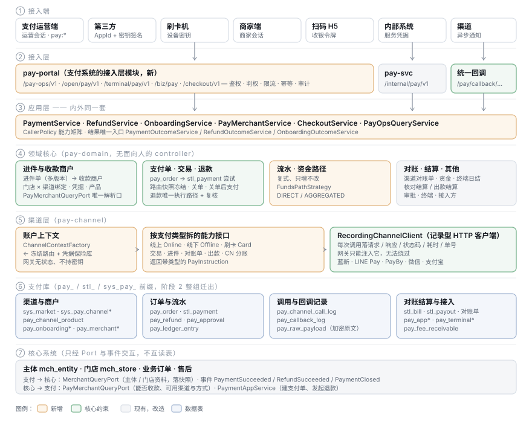

# TDD-支付服务-完整设计方案

状态：**已确认**（2026-10-26：§3 D1–D3 已由开发计划 P1 拍板、ADR-043 / ADR-044 接受；§15 逐条关闭记录见该节；实现进度见[完成度复核](./支付服务-完成度复核与剩余开发计划.md)）
档位：**2**（新表族、跨域归属变更、对外接口、不可逆决策）→ 本 TDD + ADR-043、ADR-044（§3）
创建：2026-10-24

**文档关系（先读）**

| 文档 | 角色 |
|---|---|
| **本篇** | **唯一权威的完整设计**。与下面两篇冲突时以本篇为准 |
| [TDD-支付服务-台湾阿联酋通道与开放API](./TDD-支付服务-台湾阿联酋通道与开放API.md)（v4） | 背景与推导：资金路径、六类接入端、能力矩阵、退款复核、统一落地页、自研刷卡机。本篇引用其结论，不重复推导 |
| [TDD-支付服务-代码结构与类清单](./TDD-支付服务-代码结构与类清单.md) | 类级清单。**其 §0 F3（收款账户归商家域）被本篇 D2 推翻**，其余仍有效，按本篇 §12 更新 |
| [支付服务-代码Review-2026-10-24](./支付服务-代码Review-2026-10-24.md) | 现状与 36 条缺陷（R01–R36），本篇以 `R##` 引用 |
| [任务表-支付服务](./任务表-支付服务.md) | 本篇的实施拆解 |

---

## L1 · 一句话

**核心系统管「谁在经营」（主体、门店），支付系统管「钱怎么收、收到哪、怎么记」**：
进件资料与收款商户存在支付系统，一个主体对多个收款商户，每个收款商户就是某个渠道里的商户；
渠道关联国家地区，按「线上 / 线下 / 刷卡」实现不同支付类型；
所有渠道回调走同一个入口，按子路径区分；支付订单、流水、每次渠道调用、每次回调原文都入库；
支付运营接口由支付系统提供，供支付运营端调用。

---

## §0 需求与验收

### 0.1 需求（本轮 N1–N8 + 前序已确认）

| # | 需求 | 来源 |
|---|---|---|
| N1 | 基于核心系统的主体与门店；支付系统只存引用与快照 | 本轮 |
| N2 | 进件资料、收款商户信息保存在支付系统 | 本轮 |
| N3 | 一个主体对多个收款商户；每个收款商户 = 渠道中的商户，关联渠道；可绑定门店 | 本轮 |
| N4 | 渠道关联国家 / 地区 | 本轮 |
| N5 | 基于渠道实现线上、线下、刷卡等不同支付类型 | 本轮 |
| N6 | 统一回调地址，以子路径（或参数）区分 | 本轮 |
| N7 | 数据库保存支付订单、流水、渠道调用记录、回调参数记录 | 本轮 |
| N8 | 支付系统提供支付运营接口，供支付运营端调用 | 本轮 |
| N9 | TW：蓝新、LINE Pay 直连，资金直入商户；AE：PayBy，按进件结果择一 DIRECT / AGGREGATED | v2 |
| N10 | 六类接入端：第三方（支付密钥）、内部系统、刷卡机、商家端、运营端、扫码 H5 | v3/v4 |
| N11 | 退款由商家侧发起，命中可配置门槛时平台两人复核 | v4 |
| N12 | 统一支付落地页 `checkout-h5`；消费者登录归统一鉴权域 | v4 |
| N13 | 刷卡机自研，经支付服务端对接渠道网关 | v4 |
| N14 | 流水、对账、结算 | v1 |

### 0.2 验收条目（AC → 落点）

| AC | 验收（Given/When/Then 压成一句） | 落点 |
|---|---|---|
| AC1 | 主体、门店的名称、市场等只在核心系统维护；支付系统单据存 `entity_no`/`store_no` 与成交时快照，核心改名不改历史单据 | §2.2、§7 快照列 |
| AC2 | 进件单（资料、版本、状态、驳回原因）与收款商户分两张表；进件可多次提交，每次提交是新版本，外部单号每次唯一（修 R04） | `pay_onboarding` · `pay_onboarding_material` |
| AC3 | 进件资料中的敏感字段（证件号、银行账号、手机号）加密存储，只回显掩码；图片 / 文件存对象存储，库里只存引用与哈希 | §5.2 |
| AC4 | 一个主体可有 N 个收款商户；每个收款商户恰属一个渠道、一个市场、一种资金路径、一种接入模式 | `pay_merchant` |
| AC5 | 门店与收款商户按「门店 × 渠道」唯一绑定；绑定时校验同主体、同市场、收款商户 ACTIVE（修 R03） | `pay_merchant_store` |
| AC6 | 「这家店这个渠道收到哪个商户」只有一个解析口；结算、额度、能力、资金路径都经它，且都带渠道（修 R01/R02/R26） | `PayMerchantQueryPort#routeOf` |
| AC7 | 渠道与国家地区显式关联；无关联行 = 不可用（取消「无行即全市场」）；改关联原子完成（修 R22） | `sys_pay_channel_market` |
| AC8 | 渠道的支付能力登记为「渠道 × 支付类型 × 支付方式」，收款商户开通的方式只能取自其渠道登记的方式，且以渠道回执为准 | `pay_channel_product` · `pay_merchant_product` |
| AC9 | 线上（跳转 / 表单 / SDK / 二维码）、线下（扫顾客码 / 屏显码）、刷卡三类支付各有能力接口；建单返回带类型的支付指令，而非扁平 Map | §6.2 `PayInstruction` |
| AC10 | 全部渠道回调只走 `/pay/callback/{channel}/{notifyType}/{payMerchantNo}`；用该商户凭据验签、回查；报文内商户号与路径商户不一致即拒 | §8.1 |
| AC11 | 每条回调先落原文（完整、加密存储）再处理；处理结果、关联单号回写；可按支付单号、通道单号检索；运营端可对失败回调重放 | `pay_callback_log` |
| AC12 | 每次渠道 HTTP 调用（下单、查单、关单、退款、查退款、进件、对账单、出款）都记请求、响应、HTTP 状态、耗时、关联单号；记录在 HTTP 客户端层完成，网关无法绕过（修 R16） | `pay_channel_call_log` · `RecordingChannelClient` |
| AC13 | 支付订单独立于业务单；`(app_id, out_order_no)` 唯一；同一请求重放返回同一单 | `pay_order` |
| AC14 | 一张支付订单可有多次通道尝试；`out_trade_no` 全局唯一（修 R07）；通道实收金额另列记录，不覆盖请求金额（修 R20） | `stl_payment` 加列 |
| AC15 | 成功只有一条写入路径（回调、查单、confirm、终端上报、对账补单 → 同一 applier），幂等 | `PaymentOutcomeService` |
| AC16 | 关单同步关闭通道尝试并调通道关单；关单后到达的成功回调进入「关单后支付」处理（自动退款或人工），不静默成功（修 R18） | §7.4 |
| AC17 | 退款只有一条执行路径；带原交易冻结的收款商户与子商户号（修 R08/R21） | `RefundExecutionService` 统一 |
| AC18 | 退款由商家侧发起；命中复核规则时两名不同运营人员通过后才发往渠道 | `pay_refund` · `pay_refund_review_rule` · `pay_approval` |
| AC19 | 每一笔资金变化写只增不改的复式流水；更正只能追加冲正 | `pay_ledger_entry` |
| AC20 | 支付运营接口统一前缀 `/pay-ops/v1/**`、独立 `pay:*` 权限码，由支付系统的 `pay-portal` 模块提供；`pay-domain` 仍无 controller | §9 · ADR-044 |
| AC21 | 第三方以 AppId + 支付密钥签名调用 `/open/pay/v1/**`；内部系统以「按调用方区分的服务凭据」调用 `/internal/pay/**`，并按路径授权（修 R12） | §9.3 |
| AC22 | 对账：渠道对账单逐笔核对（按收款商户扇出）；出款对账比金额（修 R09）；差异去重不按天（修 R19） | §10 |
| AC23 | 结算：DIRECT 出核对型结算单 + 平台费应收；AGGREGATED 出出款型结算单 | §10 |
| AC24 | 进件单、收款商户、支付订单、退款、调用、回调、流水都可在支付运营端按主体 / 门店 / 渠道 / 市场 / 时间查询 | §9.2 |

---

## §1 现状摘要

详见 [代码 Review](./支付服务-代码Review-2026-10-24.md)。要点：

- 渠道层是「一个渠道一套 yml 凭据」，**没有「渠道里的商户」这一层**；支付类型只有扁平字符串
- 进件与收款商户号在 `shop-merchant`（主库），**进件单与商户号合成一行**，门店解析有三套规则
- `stl_payment` 一表兼任支付单 / 通道尝试 / 流水；无调用方幂等；退款两条路径
- 回调在 `shop-core` 的 `/pay/callback/{channel}`；调用记录不记响应、不记查单
- 生产为内嵌形态；**ADR-021 阶段 1、2 的闸门均未达成**；运营接口散在十余前缀
- **S1 级缺陷 12 条**，其中 R01–R08 直接关系到钱打给谁、记几次 → 第 0 阶段先修

---

## §2 总体架构



### 2.1 七层

| 层 | 组件 | 说明 |
|---|---|---|
| ① 接入端 | 第三方 · 内部系统 · 刷卡机 · 商家端（b-app）· **支付运营端** · 扫码 H5 | 见前序 v3/v4 |
| ② 接入层 | **`pay-portal`**（新模块）：`/pay-ops/v1`、`/open/pay/v1`、`/terminal/pay/v1`、`/biz/pay`、`/checkout/v1`；`pay-svc`：`/internal/pay` | 鉴权、判权、限流、幂等、审计都在这一层（D1） |
| ③ 应用层 | `PaymentService`、`RefundService`、`OnboardingService`、`PayMerchantService`、`CheckoutService`、`PayOpsQueryService` … | 内外同一套；第一个参数是 `PayCaller` |
| ④ 领域核心 | 进件与商户 · 支付单 / 交易 / 退款 · 资金路径策略 · 流水 · 审批 · 终端 · 接入方 | `pay-domain` |
| ⑤ 渠道层 | 能力接口（线上 / 线下 / 刷卡 / 退款 / 进件 / 对账单 / 出款）· 三家 + CN 两家适配 · **记录型 HTTP 客户端** · 凭据保险库 | `pay-channel` |
| ⑥ 统一回调 | `/pay/callback/{channel}/{notifyType}/{payMerchantNo}` | `pay-domain` 的 `callback` 包（`PayHasNoControllerTest` 允许） |
| ⑦ 后台 | 掉单巡检、对账单拉取、对账、结算、出款、webhook 投递、进件轮询 | `pay-domain` 任务 + `paybridge` 编排 |

### 2.2 核心系统与支付系统的边界

| 数据 / 能力 | 归属 | 另一方怎么用 |
|---|---|---|
| 主体 `mch_entity`、门店 `mch_store`、商家账号与角色 | **核心** | 支付经 `MerchantQueryPort` 读（名称、市场、法律形态、门店归属），落快照 |
| 进件单与资料、收款商户、门店绑定、商户凭据、开通的支付方式 | **支付**（D2） | 核心经新 `PayMerchantQueryPort` 读（是否可收款、可用渠道 / 方式、开票能力、资金路径） |
| 渠道、渠道 × 地区、支付产品、费率 | **支付** | 核心经 `PayChannelMasterPort` 读 |
| 业务订单、售后 | **核心** | 支付经 `PaymentSucceededEvent` / `RefundSucceededEvent` 回传；核心经 `PaymentAppService` 建支付单、发起退款 |
| 支付订单、交易、退款、流水、调用 / 回调记录、对账、结算 | **支付** | 核心只读结果事件与查询接口 |
| 市场 `sys_market` | **支付**（已在 pay 边界） | 核心经 `MarketPort` 读 |

**不变的原则**：支付不读核心表、核心不读支付表，全部经 `spi` Port；跨库只存业务键 + 快照（ADR-021 §3.3）。

---

## §3 关键决策（需确认）

### D1 · 支付运营接口由谁提供 → 推荐：新建 `pay-portal` 模块（ADR-044）

| 方案 | 说明 | 结论 |
|---|---|---|
| A 留在 `shop-app` 的 `portal.ops.pay`，统一前缀 | 改动最小 | ❌ 不满足 N8「支付系统提供」；独立部署后每个接口都要补 Remote |
| **B 新建 `backend/pay/pay-portal`** | 支付系统自己的接入层模块：放全部面向人和第三方的 controller 与鉴权；**`pay-domain` 仍无 controller**（保住 ADR-021 §L1 的四条收益：领域不鉴权、AOT、不读会话、判权在接入层） | ✅ |
| C 直接在 `pay-svc` 加 `/ops`、`/open` | 把鉴权链拖进领域进程 | ❌ 推翻 ADR-021 §L1 |

`pay-portal` 的两种装配，与现有 `payclient` 的双形态一致：

| 形态 | 装配 | 会话 / 鉴权 |
|---|---|---|
| **内嵌**（今天生产） | `pay-portal` 作为依赖装进 `shop-app`，直调 `pay-domain` 的应用服务 | 运营端沿用平台运营会话（ADR-015 运营令牌池）+ 新的 `pay:*` 权限码；商家端沿用商家会话 |
| **独立** | `pay-portal` 单独成进程（`pay-gateway`），经 `/internal/pay` 调 `pay-svc` | 令牌经统一鉴权的内省接口校验；`pay:*` 权限点随令牌下发，不跨库读 `sys_role_point` |

需要随之修订：ADR-021 §L1「运营端也不给」改为「领域进程不给；支付系统的接入层模块给」；
`PayHasNoControllerTest` 改为按 mapping 注解值判断、`pay-svc` 只允许 `/internal/**`、`pay-portal` 是唯一允许面向人的 pay 模块（同时修 R27）。

**支付运营端前端**：先作为 ops-web 内一个独立分区（路由 `/pay-ops/*`、独立菜单与契约文件），复用运营登录；
需要彻底独立时再拆成单独工程，**接口不变**。是否一开始就拆独立前端见 Q1。

### D2 · 进件资料与收款商户迁入支付系统（ADR-043）

- ADR-021 §3.2 本就把 `mch_payment_merchant` 划入支付边界；本次落地
- 拆成**进件单**（`pay_onboarding`，可多版本）与**收款商户**（`pay_merchant`，进件成功的产物）
- `mch_payment_merchant` 的数据迁到 `pay_merchant`，**`pay_merchant_no` 原值保留**（结算单、交易快照都引用它）
- `mch_store.pay_merchant_no` 由 `pay_merchant_store`（门店 × 渠道）取代
- `mch_entity.funds_mode` 下沉到收款商户（R34）
- 迁移按「双写 → 回填 → 读切 Port → 删旧」四步（§13）

### D3 · 统一回调地址沿用 `/pay/callback` 前缀

需求示例是 `/callback/pay/...`，但现网 nginx 只放行 `/pay/callback/`，且 2026-09-04 刻意从前者搬过来（R29 附注）。
**推荐保留 `/pay/callback`**，在其后用子路径区分（§8.1）；旧的 `/pay/callback/{channel}` 保留为兼容别名，直到 CN 两家在渠道后台改完登记地址。

### 其余决策（本篇直接定，理由在对应章节）

| # | 决策 |
|---|---|
| D4 | 资金路径 = 钱结算到谁的账户：`DIRECT`（商户自己的结算账户，**含微信二级商户**）/ `AGGREGATED`（平台账户）。接入模式另立一维（§4.3）。统一 R33 的三处口径 |
| D5 | 「渠道」= 支付机构（WECHAT / ALIPAY / NEWEBPAY / LINEPAY / PAYBY）；渠道 × 接入模式 × 支付方式在「支付产品」表登记，不再拆多个渠道码 |
| D6 | 调用记录在 HTTP 客户端层（装饰器）落库，网关无法绕过；回调原文加密全量入库，脱敏副本用于展示 |
| D7 | 退款收敛到 `RefundExecutionService` 一条路径，旧 `SettleServiceImpl#refund` 系列改为转调 |
| D8 | `stl_payment` 不改名、不拆表，降为「通道交易尝试」并加列 |

---

## §4 渠道、地区与支付产品

### 4.1 模型

```
sys_market（国家/地区，已有）
    │ N:M  sys_pay_channel_market（显式关联，无行 = 不可用）
sys_pay_channel（渠道 = 支付机构）
    │ 1:N  pay_channel_product（渠道 × 接入模式 × 支付类型 × 支付方式 × 适用地区）
    │
pay_merchant（渠道中的商户）── 1:N ── pay_merchant_product（该商户开通的产品，取自渠道回执）
```

### 4.2 表

| 表 | 动作 | 要点 |
|---|---|---|
| `sys_market` | 不变 | TW / AE 已预置、关闭 |
| `sys_pay_channel` | 改 | 种子加 `NEWEBPAY`、`LINEPAY`、`PAYBY`；能力位降为**运营开关**（实际能力以代码实现为准，启动比对）；加 `sandbox_host` / `prod_host` 配置引用 |
| `sys_pay_channel_market` | 改语义 | **无行 = 不可用**（AC7）；`TEST` 通道改为显式配全部市场；`replaceMarkets` 包事务、拒绝空集（R22） |
| `pay_channel_product` | 新 | `channel, access_mode, pay_type(ONLINE/OFFLINE/CARD), pay_method, markets, currencies, allowed_funds_paths, refund_mode, enabled` |
| `pay_merchant_product` | 新 | `pay_merchant_no, product_id, status, quota_*`；**只能由渠道回执或运营确认写入**（沿用「禁止按主体类型推断」） |

### 4.3 三个维度不要混

| 维度 | 取值 | 决定什么 |
|---|---|---|
| **支付类型** `pay_type` | `ONLINE` · `OFFLINE` · `CARD` | 走哪种能力接口（§6.2） |
| **接入模式** `access_mode` | `MERCHANT_OWN`（商户自己的合约与凭据：蓝新、LINE Pay、PayBy 直收）· `SERVICE_PROVIDER`（平台服务商凭据 + 子商户号：微信收付通、支付宝直付通）· `PLATFORM_SUB`（平台账户下的子商户标识：PayBy 代收） | **用谁的凭据调渠道** |
| **资金路径** `funds_path` | `DIRECT` · `AGGREGATED` | **钱结算到谁**、怎么记账、怎么结算 |

| 场景 | access_mode | funds_path |
|---|---|---|
| 微信收付通二级商户 | SERVICE_PROVIDER | DIRECT |
| 微信直连（平台商户号收） | MERCHANT_OWN（平台自己） | AGGREGATED |
| 蓝新 / LINE Pay | MERCHANT_OWN | DIRECT |
| PayBy 商户自签 | MERCHANT_OWN | DIRECT |
| PayBy 挂平台账户 | PLATFORM_SUB | AGGREGATED |

合法组合由 `pay_channel_product.allowed_funds_paths` 约束（TW 两家只允许 DIRECT）。

---

## §5 进件与收款商户

### 5.1 模型

```
mch_entity（核心）──1:N──▶ pay_onboarding（进件单，每次提交一个版本）
                                   │ 成功产出
                                   ▼
                           pay_merchant（收款商户 = 渠道中的商户）──▶ pay_merchant_credential（加密凭据，版本化）
                                   │ 1:N                              
                                   ├──▶ pay_merchant_product（开通的支付方式）
                                   └──▶ pay_merchant_store（门店 × 渠道 唯一绑定）◀── mch_store（核心）
AGGREGATED 的 pay_merchant 引用 parent_pay_merchant_no = 平台自己的 pay_merchant
```

### 5.2 表

| 表 | 关键列 | 约束 |
|---|---|---|
| `pay_onboarding` | `onboarding_no`、`entity_no`、`store_no`（空串 = 主体级）、`pay_channel`、`access_mode`、`funds_path`、`market`、`version`、`status`（DRAFT/SUBMITTED/CHANNEL_REVIEW/NEED_SIGN/APPROVED/REJECTED/CANCELLED）、`channel_apply_no`、`out_request_no`（**每次提交唯一**，R04）、`reject_reason`、`submitted_by`、`pay_merchant_no`（成功后回填）、主体名 / 法律形态快照 | 同一 `(entity, store, channel)` 只允许一张在途单（R06） |
| `pay_onboarding_material` | `onboarding_no`、`version`、`field_code`、`value_cipher`（敏感字段信封加密）、`value_masked`、`file_ref` + `file_sha256`（对象存储）、`channel_media_id`（已上传到渠道的媒体号） | 只增：改资料 = 新版本 |
| `pay_merchant` | `pay_merchant_no`（**沿用 `mch_payment_merchant` 原值**）、`entity_no`、`owner_type`（ENTITY/PLATFORM）、`pay_channel`、`market`、`currency`、`access_mode`、`funds_path`、`channel_merchant_id`（渠道商户号）、`sub_merchant_id`（子商户号）、`parent_pay_merchant_no`、`credential_ref`、`credential_version`、`status`（ONBOARDING/ACTIVE/REFUND_ONLY/SUSPENDED/CLOSED）、`legal_form`、`invoice_capable`、`settle_account_masked`、`settle_cycle`、`fee_bearer`、`split_reversible`、`priority`、`onboarding_no` | `(entity_no, pay_channel, funds_path, status=ACTIVE)` 由生成列唯一索引保证「同主体同渠道同路径至多一个 ACTIVE」 |
| `pay_merchant_credential` | `credential_ref`、`version`、`pay_merchant_no`、`cipher`（信封加密）、`fingerprint`、`status`、`created_by`、`enabled_by` | 录入人 ≠ 启用人；旧版本保留到在途单终结 |
| `pay_merchant_store` | `store_no`、`pay_channel`、`pay_merchant_no`、`entity_no`、`bound_by` | **唯一 `(store_no, pay_channel)`**；绑定校验同主体、同市场、ACTIVE（AC5） |
| `pay_merchant_product` | 见 §4.2 | — |

**敏感数据**（AC3）：证件号、银行账号、手机号、邮箱用 `ChannelCredentialVault` 同一套信封加密；只回显掩码；
资料图片存对象存储私有桶，库里存 `file_ref + sha256`；向渠道提交时按渠道要求先上传换 `channel_media_id`（补现有缺失的媒体上传流程）。

### 5.3 进件流程

```
商家端 / 运营端 填资料 → pay_onboarding(DRAFT, v1)
  → submit：生成唯一 out_request_no → OnboardingGateway.submit（调用全部记 pay_channel_call_log）→ SUBMITTED
  → 渠道回调（/pay/callback/{channel}/onboarding/{onboardingNo}）或轮询 → CHANNEL_REVIEW / NEED_SIGN / REJECTED / APPROVED
  → APPROVED：同事务 建 pay_merchant(ONBOARDING) + pay_merchant_product（取渠道回执）
  → 录入 / 校验凭据（MERCHANT_OWN 时）→ 测试查单通过 → 运营启用（两人）→ ACTIVE
     若同主体同渠道已有 ACTIVE 且资金路径不同（PayBy 切换），旧的同事务转 REFUND_ONLY
被驳回 → 改资料 → 新版本 v2 → 再 submit（新 out_request_no，旧原因随版本保留，不靠清空字段，修 R23）
```

修 R05：**未接通的渠道一律失败，不回落 Stub**；Stub 只在显式选择 `TEST` 渠道时可用。

### 5.4 唯一解析口 `PayMerchantQueryPort`（spi.pay，新）

```java
public interface PayMerchantQueryPort {
    /** 这家店在这个渠道当前收到哪个商户。门店绑定优先，无绑定取主体级 ACTIVE；全程带渠道（AC6） */
    Optional<PayRoute> routeOf(String entityNo, String storeNo, String payChannel);
    /** 这家店在该市场当前可用的全部路由（每渠道至多一条），收银台据此出支付方式 */
    List<PayRoute> collectableRoutes(String entityNo, String storeNo, String market);
    /** 按冻结值回读（退款、查单、对账）；REFUND_ONLY 也返回 */
    Optional<PayRoute> routeByPayMerchantNo(String payMerchantNo, int credentialVersion);
    PayCapability capabilityOf(String payMerchantNo);   // 开票、可用方式、额度
}
record PayRoute(String entityNo, String storeNo, String payMerchantNo, String payChannel, String market,
                String currency, String accessMode, String fundsPath, String channelMerchantId,
                String subMerchantId, String parentPayMerchantNo, int credentialVersion, int priority) { }
```

替换现有 `MerchantQueryPort` 上的 `payMerchantNoOf` / `paymentRouteOf` / `resolvePayment` / `activeChannelsOf` / `payCapabilityOf` /
`feeBearerOf` / `settleCycleOf` / `fundsModeOf` / `accruePayQuota` 九个方法，以及两处直读表的原生 SQL（review §进件 4.3 列出全部调用方）。
**`payMerchantNoOf` 无渠道的重载删除**（R01 根因）。

---

## §6 渠道层

### 6.1 账户上下文与凭据

每次渠道调用携带 `ChannelAccountContext`（由冻结的 `PayRoute` + 凭据保险库构造，**唯一构造点 `ChannelContextFactory`**）。**凭据保险库 = 平台级 `secret` 模块**（2026-10-26 定，[完成度复核](./支付服务-完成度复核与剩余开发计划.md) D-5 / §3.5；支付只存 `sec_key` 引用）：

| access_mode | 凭据取自 | 额外参数 |
|---|---|---|
| MERCHANT_OWN | 该 `pay_merchant` 的凭据 | — |
| SERVICE_PROVIDER | 平台服务商凭据（`parent_pay_merchant_no` 的凭据） | `sub_merchant_id` |
| PLATFORM_SUB | 平台账户凭据 | `sub_merchant_ref` |

网关**无状态、不持密钥**；CN 现有的 yml 凭据迁为 `owner_type=PLATFORM` 的 `pay_merchant` + 凭据行（修「一个渠道一套凭据」）。

### 6.2 按支付类型拆能力接口

| 接口 | 支付类型 | 方法 | 返回 |
|---|---|---|---|
| `OnlinePaymentGateway` | ONLINE | `create(ctx, cmd)` | `PayInstruction` |
| `ConfirmableGateway` | ONLINE（LINE Pay） | `confirm(ctx, …)` | `ChannelResult` |
| `OfflinePaymentGateway` | OFFLINE | `chargeCustomerCode(ctx, cmd, authCode)`（扫顾客码，同步扣款 + 轮询 + 撤销）· `createStoreQr(ctx, cmd)`（屏显码） | `ChannelResult` / `PayInstruction` |
| `CardPaymentGateway` | CARD | `charge(ctx, cmd, EncryptedCardData)`（读卡套件加密数据透传）· `void(ctx, …)` | `ChannelResult` |
| `TransactionGateway` | 全部 | `query` · `close` · `refund` · `queryRefund` · `parseNotify` | — |
| `OnboardingGateway` | — | `uploadMedia` · `submit` · `query` · `parseNotify` | — |
| `StatementSource` | — | `fetch(ctx, billDate)` · `parse` | — |
| `MerchantPayoutGateway` | — | AGGREGATED 出款 | — |
| `MarketplaceSplitGateway` | — | CN 补差 / 分账（现有方法搬入） | — |

```java
/** 建单后给端上的指令：带类型的联合体，取代 Map<String,String>（AC9） */
public sealed interface PayInstruction {
    record Redirect(String url) implements PayInstruction {}                       // LINE Pay、PayBy 收银台
    record AutoPostForm(String action, Map<String,String> fields) implements PayInstruction {} // 蓝新 MPG
    record SdkParams(Map<String,String> params) implements PayInstruction {}       // 微信 JSAPI / APP
    record QrCode(String content, long expireAt) implements PayInstruction {}      // 屏显码 / NATIVE
    record AwaitResult(long pollAfterMillis) implements PayInstruction {}          // 扫顾客码 / 刷卡处理中
}
```

能力 = 实现了哪个接口；启动时与 `pay_channel_product` 比对，表里开了而代码没实现 → 启动失败。
CN 现有 `PayGateway` 作为兼容组合接口保留；顺带修 R13（补 `alipayChannelClient` 或在未接通前移除装配）、R14、R32。

### 6.3 记录型 HTTP 客户端（AC12）

```
网关 ──▶ RecordingChannelClient（装饰器，包住现有 ChannelClient）──▶ 渠道
             │ 调用前：分配 call_no，落 pay_channel_call_log(SENT, request 脱敏副本 + 加密原文)
             │ 调用后：回写 http_status、response（同上）、elapsed_ms、channel_trade_no、outcome
             └ 异常 / 超时：outcome=UNKNOWN，绝不当失败
```

网关拿不到裸 `ChannelClient`（只注入装饰器），因此**无法绕过记录**；查单、查退款、进件、对账单下载、出款全部覆盖。
记录写入用独立事务、失败不阻断业务（沿用 `ChannelMessageRecorder` 的做法）。

### 6.4 三家要点

沿用 v4 §2.4：蓝新 MPG（AES + SHA256，ATM / 超商两段式，信用卡 Close 请退款）；LINE Pay v3（HMAC，Request → Confirm，Offline 扫码）；
PayBy（RSA 签名头、15 分钟时间窗、部分退款、T+2、AGGREGATED 出款）。脱敏规则补上 `TradeSha`、`CheckCode`、`X-LINE-Authorization`、`sign`，并递归处理嵌套结构（R30）。

---

## §7 支付订单、交易、退款与流水

### 7.1 四层单据

| 表 | 是什么 | 粒度 |
|---|---|---|
| `pay_order`（新） | **支付订单**：调用方要收的一笔钱 | `(app_id, out_order_no)` 唯一 |
| `stl_payment`（现有，降级） | **通道交易尝试**：一次向渠道下单 / 退款 | `out_trade_no` 唯一 |
| `pay_refund`（新） | **退款单**：商家发起的一次退款申请（含复核） | `(app_id, out_refund_no)` 唯一 |
| `pay_ledger_entry`（新） | **流水**：每一笔资金变化的复式分录 | 只增不改 |

### 7.2 `pay_order`

`pay_order_no`、`app_id`、`out_order_no`、`biz_type`、`biz_no`、`entity_no`、`store_no`、**成交快照**（主体名、门店名）、
`market`、`currency`、`amount_minor`、`paid_minor`（通道实收）、`refunded_minor`、`reserved_refund_minor`、`scene`、`pay_type`、`pay_method`、
**路由快照**（`pay_merchant_no`、`pay_channel`、`access_mode`、`funds_path`、`sub_merchant_id`、`credential_version`，选定方式时写入，此后不改）、
`status`（CREATED / AWAITING_PAYMENT / AUTHORIZED / AWAITING_CONFIRM / SUCCEEDED / PARTIALLY_REFUNDED / REFUNDED / CLOSED / FAILED）、
`source_type`、`source_id`、`operator_no`、`user_no`、`expire_at`、`succeeded_at`、`closed_at`。

### 7.3 `stl_payment` 加列（D8）

| 新列 | 用途 |
|---|---|
| `pay_order_no` / `pay_refund_no` | 归属 |
| `pay_merchant_no`、`sub_merchant_id`、`funds_path`、`market`、`credential_version` | 冻结路由（修 R08） |
| `channel_amount_minor`、`channel_currency` | 通道实收，**不再覆盖** `amount_minor` / `currency`（修 R20） |
| `uk_stl_payment_out_trade (out_trade_no)` | 唯一（修 R07）；加之前先查存量重复 |

保留「首次支付 `out_trade_no` = 订单号」的规则（存量 20 余个测试类依赖）。
新渠道接入前确认 `uk_stl_payment_trade (pay_channel, trade_no)` 不会跨 PAY / REFUND 方向撞键。

### 7.4 状态与关单

- **成功只有一条写入路径**：`PaymentOutcomeService#apply`（回调、查单、confirm、终端、对账补单都调它），同事务完成：交易尝试 → SUCCESS、支付单 → SUCCEEDED、写流水、Outbox 发 `PaymentSucceededEvent`；核心系统订单的 `markPaid` 改为**消费事件**，不再由回调 controller 直接调（R29 一并收口）
- **关单**（修 R18）：`PaymentService#close` → 先查单 → 未付则调渠道关单（`TransactionGateway#close`）→ 交易尝试 CLOSED → 支付单 CLOSED → `PaymentClosedEvent`；核心系统超时关单改为调它
- **关单后支付**：关单后到达的成功结果不改支付单为成功，而是建一条 `LATE_PAYMENT` 异常 → 按渠道能力自动原路退款，或进入运营处理
- 掉单巡检改为分页、带上限、按渠道限速

### 7.5 退款（D7）

```
商家侧发起（商家端 / 刷卡机 + 店长授权码 / 授权第三方）→ RefundService.request
  → 可退余额校验与占用 → 复核规则判定 → [两人复核] → APPROVED
  → RefundExecutionService.request（唯一执行路径；TxContext 取原交易冻结的 pay_merchant 与 sub_merchant_id）
  → 先落 stl_payment(REFUND) → 抢发送权 → 调渠道 → 结果不明只查不重发 → RefundOutcomeService.apply
```

旧 `SettleServiceImpl#refund / prepareRefund / dispatchRefund` 改为转调上面这条；`AS-{subOrderNo}` 合成单号改为真实售后单号（R21）。

### 7.6 流水 `pay_ledger_entry`

复式、只增不改；账户：`MERCHANT_CHANNEL`（DIRECT，平台外备查）、`PLATFORM_CHANNEL`、`MERCHANT_PAYABLE`、`FEE_RECEIVABLE`、`PLATFORM_REVENUE`、`CHANNEL_FEE_EXPENSE`；
每行带 `entity_no / store_no / pay_merchant_no / pay_channel / market / currency / source_* / ref_type / ref_no / voucher_no / biz_date（按市场时区）`。
DIRECT 与 AGGREGATED 的分录规则只在 `FundsPathStrategy` 两个实现里。

---

## §8 统一回调与报文记录

### 8.1 统一回调地址（D3，AC10）

```
POST|GET  /pay/callback/{channel}/{notifyType}/{refNo}
  channel     WECHAT | ALIPAY | NEWEBPAY | LINEPAY | PAYBY
  notifyType  pay | refund | onboarding | payout | return（浏览器跳回，GET，只展示不入账）
  refNo       pay / refund / payout / return → pay_merchant_no；onboarding → onboarding_no
```

- 下单、退款、进件时由 `CallbackUrlBuilder` 统一生成（取代 `notifyUrl + "/refund"` 拼接，R32），渠道不支持路径变量时退化为查询参数 `?m={payMerchantNo}&t={notifyType}`，由同一个 controller 解析
- 兼容：旧 `/pay/callback/{channel}` 与 `/pay/callback/{channel}/refund` 保留为别名，按平台级 `pay_merchant` 处理，直到 CN 渠道后台改登记地址
- 位置：`ai.neargo.shop.pay.callback.PayCallbackEndpoint`（`pay-domain`，`PayHasNoControllerTest` 允许 `/callback`）；`shop-core` 的 `ChannelPayCallbackController` 迁出后删除

**处理顺序**（沿用现有、补两步）：

```
① 落 pay_callback_log（加密全量原文 + headers；脱敏副本）── 永远先于一切
② 按 refNo 取 pay_merchant → ChannelContextFactory → verifier.verify（该商户凭据；补时间戳新鲜度 R31）
③ parseNotify → 校验报文内商户号 / app_id / seller_id == 路由的 channel_merchant_id（R31）
④ 回查（该商户凭据）
⑤ PaymentOutcomeService / RefundOutcomeService / OnboardingOutcomeService .apply
⑥ 回写 pay_callback_log：verify_result、outcome、pay_order_no、out_trade_no、channel_trade_no
⑦ 按渠道要求回 ack（每渠道自定义，沿用）
```

### 8.2 记录表（AC11 / AC12）

| 表 | 关键列 | 保留 |
|---|---|---|
| `pay_channel_call_log` | `call_no`、`pay_channel`、`api`、`pay_merchant_no`、`market`、`ref_type`（PAY/REFUND/QUERY/CLOSE/ONBOARDING/STATEMENT/PAYOUT）、`ref_no`、`pay_order_no`、`out_trade_no`、`attempt`、`request_masked`、`request_cipher_ref`、`response_masked`、`response_cipher_ref`、`http_status`、`elapsed_ms`、`channel_trade_no`、`outcome`（OK/FAIL/UNKNOWN）、`error_code`、`created_at` | 脱敏列长期；加密原文按合规期限（Q4） |
| `pay_callback_log` | `callback_no`、`pay_channel`、`notify_type`、`ref_no`、`pay_merchant_no`、`http_method`、`headers_masked`、`body_masked`、`raw_cipher_ref`、`raw_sha256`、`verify_result`、`outcome`、`pay_order_no`、`pay_refund_no`、`out_trade_no`、`channel_trade_no`、`replay_of`、`received_at`、`handled_at` | 同上 |
| `pay_raw_payload` | `cipher_ref`、`cipher`（信封加密）、`sha256`、`expire_at` | 原文单独一张，便于按期限清理与权限隔离 |

- 现有 `stl_channel_message` 改为只读、停止写入，查询页切到新表；90 天物理删除任务停用（R17）
- 运营端可对 `pay_callback_log` 中处理失败的记录**重放**（用原文重走 ②–⑥，新记录 `replay_of` 指向原记录），需权限 `pay:callback:replay`

---

## §9 接入层与运营接口

### 9.1 接入端与入口（D1）

| 接入端 | 入口 | 所在模块 | 鉴权 |
|---|---|---|---|
| 支付运营端 | `/pay-ops/v1/**` | `pay-portal` | 运营会话 + `pay:*` 权限码 + 关键操作两人复核 |
| 第三方 | `/open/pay/v1/**` | `pay-portal` | AppId + HMAC/RSA 签名、时间窗、nonce |
| 刷卡机 | `/terminal/pay/v1/**` | `pay-portal` | 终端号 + 设备密钥签名 + 店长授权码 |
| 商家端 | `/biz/pay/**` | `pay-portal` | 商家会话 + 商家内权限码 |
| 扫码 H5 | `/checkout/v1/**` | `pay-portal` | 一次性收银令牌 / 码号；可选 C 端登录 |
| 内部系统 | `/internal/pay/**` · 内嵌直调 | `pay-svc` | **按调用方区分的服务凭据** + 路径授权（R12） |
| 渠道 | `/pay/callback/**` | `pay-domain` | 渠道签名 |

六类接入端的能力矩阵沿用 v4 §2.8.2（新增一列「支付运营端」= 原「运营端」）。

### 9.2 支付运营接口目录（`/pay-ops/v1`，AC20 / AC24）

| 资源 | 端点（摘要） | 权限码 |
|---|---|---|
| 国家地区 | `GET /markets` · `PUT /markets/{market}/enabled` | `pay:market:view` / `manage` |
| 渠道 | `GET /channels` · `PUT /channels/{ch}` · `PUT /channels/{ch}/markets`（原子替换） | `pay:channel:view` / `manage` |
| 支付产品 | `GET/POST/PUT /channel-products` | `pay:product:manage` |
| 进件单 | `GET /onboardings?entityNo&channel&status` · `GET /onboardings/{no}`（含版本与资料掩码）· `POST /onboardings`（代商家建）· `POST /onboardings/{no}/submit` · `POST /onboardings/{no}/refresh` · `POST /onboardings/{no}/cancel` | `pay:onboarding:view` / `manage` |
| 进件资料原文 | `GET /onboardings/{no}/materials/{field}/plain` | `pay:onboarding:sensitive`（单独授予、全程审计） |
| 收款商户 | `GET /merchants?entityNo&channel&market&status` · `GET /merchants/{payMerchantNo}` · `POST /merchants/{no}/activate`（复核）· `/suspend` · `/close` | `pay:merchant:view` / `manage` |
| 商户凭据 | `POST /merchants/{no}/credentials`（录入，只回指纹）· `POST /credentials/{ref}/enable`（复核）· `POST /credentials/{ref}/verify`（测试查单） | `pay:credential:write` / `enable` |
| 门店绑定 | `GET /merchants/{no}/stores` · `PUT /stores/{storeNo}/bindings/{channel}` | `pay:merchant:manage` |
| 支付订单 | `GET /orders?…` · `GET /orders/{payOrderNo}`（含交易尝试、退款、流水、调用、回调时间线）· `POST /orders/{no}/query`（主动查单）· `POST /orders/{no}/close` | `pay:order:view` / `manage` |
| 退款 | `GET /refunds?…` · `GET /refunds/{no}` · `POST /refunds/{no}/reviews`（通过 / 驳回）· 线下退款凭证查看 | `pay:refund:view` / `review` |
| 复核规则 | `GET/POST /refund-review-rules` · `POST /refund-review-rules/{no}/activate`（复核） | `pay:refund-rule:manage` |
| 渠道调用记录 | `GET /channel-calls?payOrderNo&outTradeNo&channel&outcome&from&to` · `GET /channel-calls/{callNo}`（脱敏）· `GET /channel-calls/{callNo}/raw`（原文） | `pay:log:view` / `pay:log:raw` |
| 回调记录 | `GET /callbacks?…` · `GET /callbacks/{no}` · `GET /callbacks/{no}/raw` · `POST /callbacks/{no}/replay` | `pay:log:view` / `raw` · `pay:callback:replay` |
| 流水 | `GET /ledger?…` · 导出 | `pay:ledger:view` |
| 对账 | `GET /recon/axes` · `GET /recon/diffs` · `POST /recon/diffs/{no}/decide` · `POST /statements/{channel}/{payMerchantNo}/{date}/fetch` | `pay:recon:view` / `handle` |
| 结算与出款 | 现有 `/ops/settle*`、`/ops/payouts` 迁入 `/pay-ops/v1/settlements`、`/payouts`；出款两人 | `pay:settle:*` · `pay:payout:submit` / `approve` |
| 平台费应收 | `GET /fee-receivables` · 抵扣 / 核销 | `pay:fee:manage` |
| 接入方 | `GET/POST /apps` · `POST /apps/{id}/credentials` · 吊销 | `pay:app:manage` / `pay:app-credential:issue` |
| 终端 | `GET/POST /terminals` · 激活码 · 挂失 | `pay:terminal:manage` |
| 静态码 | `GET /qr-codes` · 停用 | `pay:qr:manage` |
| 审批 | `GET /approvals?mine` · 通过 / 驳回 | 随主题 |

- 现有 `portal/ops/pay/**` 24 个 controller **分批迁入** `pay-portal`，旧路径保留转发一个版本周期；积分、权益运营拆出各自的 `pay:points:*`、`pay:entitlement:*` 权限码（R35）
- 所有写操作经 `payclient`（或 `pay-portal` 内的应用服务）取操作人、写审计；**数据域条件在接入层算好并显式传入**，`pay-svc` 侧强制校验（修 R10）

### 9.3 第三方与内部接口

- 第三方：沿用 v4 §2.8.3（签名、端点、webhook）；`pay_app` / `pay_app_grant` / `pay_app_credential`
- 内部：`/internal/pay/v1/**` 加版本；每个调用方一把凭据（PLATFORM、FOOD…），按路径前缀授权；统一用 `InternalServiceResponses` 常量时间比较（R12）；未接流量的独立 `pay-svc` 在生产停用或改只读，直到切独立形态（R11）

---

## §10 对账与结算

| 项 | 做法 |
|---|---|
| 交易对账 | `ChannelStatementAxis`：按 `pay_merchant` 扇出拉对账单（`StatementSource`），原件存 `pay_raw_payload`、标准行存 `stl_channel_statement_line`；拉不到的渠道退化为逐笔查单；覆盖率进 `ReconService.coverage()`；启用 `reconciled_at` / `reconcile_batch`（R36） |
| 资金对账 | `PayoutReconAxis` 增加金额比对（R09）；`stl_bank_flow` 补币种、本方账号 |
| 终端对账 | `TerminalBatchAxis` |
| 差异去重 | 去重键不含 `bill_date`；说明另列，`resolution` 只放处置结论（R19） |
| 结算 | DIRECT：`DirectSettlementService` 核对型结算单 + `pay_fee_receivable`；AGGREGATED：现有 `SettleBatchService` → `PayoutService`，经 `MerchantPayoutGateway` 出款；按市场时区切日，单币种 |

---

## §11 数据库总表

> 逐表字段（中英文）、ER 图、键、约束、密钥管理、迁移映射见 [TDD-支付服务-数据库表结构说明](./TDD-支付服务-数据库表结构说明.md)（结构化模型 `design/schema/pay-service-database.json` 为唯一真源）。
> 表结构说明为 **v4**，与本节有以下差异（以表结构说明为准）：
> - **v4 四向记录与渠道运行**（来自[渠道接入统一封装设计](./支付服务-渠道接入统一封装设计.md) §11）：新增 `pay_api_request_log`、`pay_biz_notify`、`pay_biz_notify_attempt`、`pay_channel_followup`、`pay_channel_lifecycle_log`；`pay_channel_call_log`、`pay_callback_log` 扩列（追踪号、五段金额、来源与来源端、四态结果）；`pay_webhook_delivery` 取消；
> - **无 `tenant_no`**：新表不带租户列，实体改继承不含 `tenantNo` 的基类；现有表不动；
> - **主键与关联一律 `BIGINT` 自增 id**（Java `Long`），关联列为 `<对方表>_id`；业务号只保留对外可见的那些，不用于关联；
> - **关联核心系统一律按门店 id**（`store_id` → `mch_store.id`）；门店绑定表 **`pay_merchant_binding`** 只按门店 × 渠道，**取消主体级默认收款商户**（取代本节的 `pay_merchant_store`）；ADR-021 §3.3「跨库存业务键」需修订；
> - **密钥管理独立为平台级 `secret` 模块（推荐，待确认）**：`sec_master_key`、`sec_secret_blob`、`sec_key_policy`、`sec_key`、`sec_key_version`、`sec_key_event`、`sec_access_log`，按命名空间隔离，以库形式内嵌各进程；支付只保留 `pay_merchant.sec_key_id`、`pay_terminal.sec_key_id` 等绑定。

| 表 | 动作 | 归属 | 章节 |
|---|---|---|---|
| `sys_market` | 不变 | 支付 | §4 |
| `sys_pay_channel` | 改 | 支付 | §4 |
| `sys_pay_channel_market` | 改语义 | 支付 | §4 |
| `pay_channel_product` | 新 | 支付 | §4 |
| `pay_onboarding` · `pay_onboarding_material` | 新 | 支付 | §5 |
| `pay_merchant` | 新（自 `mch_payment_merchant` 迁移） | 支付 | §5 |
| `pay_merchant_credential` · `pay_merchant_product` · `pay_merchant_store` | 新 | 支付 | §5 |
| `mch_payment_merchant` · `mch_store.pay_merchant_no` · `mch_entity.funds_mode` | 迁移后删除 | 核心 | §13 |
| `pay_order` · `pay_refund` · `pay_refund_review_rule` · `pay_approval` | 新 | 支付 | §7 |
| `stl_payment` | 加列 + 唯一键 | 支付 | §7.3 |
| `pay_ledger_entry` | 新 | 支付 | §7.6 |
| `pay_channel_call_log` · `pay_callback_log` · `pay_raw_payload` | 新 | 支付 | §8 |
| `stl_channel_message` | 停写、只读 | 支付 | §8 |
| `pay_app` · `pay_app_grant` · `pay_app_credential` · ~~`pay_webhook_delivery`~~（v4 改为 `pay_biz_notify`） | 新 | 支付 | §9 |
| `pay_terminal` · `pay_terminal_credential` · `pay_terminal_batch` · `pay_qr_code` · `pay_checkout_session` | 新 | 支付 | v4 |
| `stl_channel_statement` · `stl_channel_statement_line` · `pay_fee_receivable` | 新 | 支付 | §10 |
| `stl_bank_flow` | 加列 | 支付 | §10 |

**物理位置**：ADR-021 阶段 2 未完成前，新表仍随主库迁移（`V548+`），但**全部用 `pay_` / `stl_` / `sys_pay_` 前缀、不与核心表建外键、不被核心代码直读**，切库时整组搬走。
是否借本次先建独立的 `db/pay` 迁移目录，见 Q3。

---

## §12 代码结构（对类清单的更新）

在 [代码结构与类清单](./TDD-支付服务-代码结构与类清单.md) 基础上：

| 变化 | 内容 |
|---|---|
| 新模块 | **`backend/pay/pay-portal`**：`ai.neargo.shop.pay.portal.{ops,open,terminal,biz,checkout}` 的 controller，`ai.neargo.shop.pay.portal.auth` 的五个鉴权过滤器；依赖 `pay-domain` 的应用服务接口（内嵌）或 `PayInternalApi`（独立）。原类清单 §7.3 的 controller 改放这里 |
| 新包 | `ai.neargo.shop.pay.onboarding`（`PayOnboarding`、`OnboardingService`、`OnboardingOutcomeService`、`OnboardingStateMachine`）· `ai.neargo.shop.pay.merchant`（`PayMerchant`、`PayMerchantService`、`PayMerchantLifecycle`、`port.PayMerchantQueryPortImpl`）· `ai.neargo.shop.pay.log`（`PayChannelCallLog`、`PayCallbackLog`、`PayRawPayload`、`PayLogService`、`CallbackReplayService`） |
| 渠道层 | `ai.neargo.shop.pay.channel.gateway` 按 §6.2 拆接口；`ai.neargo.shop.pay.channel.http.RecordingChannelClient`；`ai.neargo.shop.pay.channel.callback.CallbackUrlBuilder` |
| 回调 | `ai.neargo.shop.pay.callback.PayCallbackEndpoint`（自 `shop-core` 迁入） |
| 商家域 | `shop-merchant` 删除支付商户与进件相关的实体、Mapper、Service、`ApplymentPollJob`、`OpsOnboardingController`；`MerchantQueryPort` 删除 §5.4 列出的九个方法 |
| spi | 新 `spi.pay.PayMerchantQueryPort`、`spi.pay.FundsPath`、支付 / 退款 / 关单事件 |
| Mapper | 一律 `ai.neargo.shop.pay.mapper.<子域>` |
| 守卫 | 类清单 §9 全部 + `PayHasNoControllerTest` 重写（按注解值、pay-svc 只 `/internal`、pay-portal 白名单）+ `PayReverseDependencyBudgetTest` 扫全部 spi Port（R28）+ `RecordingClientOnlyTest`（网关不得注入裸 `ChannelClient`） |

---

## §13 迁移与兼容

| 步 | 内容 | 可回退 |
|---|---|---|
| M0 | 修 S1 缺陷（R01–R12）——与迁移无关、是现有资金风险 | 是 |
| M1 | 建支付侧新表；`pay_merchant` 等**双写**：`shop-merchant` 写旧表的同时经 Port 写新表 | 是（停双写） |
| M2 | **回填**：`mch_payment_merchant` → `pay_merchant`（`pay_merchant_no` 原值）；`store_no` 行与 `mch_store.pay_merchant_no` → `pay_merchant_store`（冲突的逐条列出人工确认）；`mch_entity.funds_mode` → 各 `pay_merchant.funds_path`；在途进件 → `pay_onboarding` | 是 |
| M3 | 校验：新旧两套解析对全量门店 × 渠道比对，差异为 0（或全部人工确认）才进下一步 | — |
| M4 | **读切**：全部调用方改走 `PayMerchantQueryPort`；进件入口迁到 `pay-portal` | 是（开关） |
| M5 | 停双写；一个版本周期后删旧表、旧列、旧方法 | 否 → 先备份 |
| 并行 | 回调新地址上线 → CN 渠道后台改登记地址 → 旧别名观察 30 天无流量后删除 | 是 |
| 并行 | `stl_channel_message` 停写 → 新记录表上线 → 旧表只读保留 | 是 |

---

## §14 风险

| 风险 | 缓解 |
|---|---|
| 迁移期两套解析不一致，钱打错户 | M3 全量比对；M0 先修 R01/R02 让旧解析本身正确 |
| 回调地址切换期间漏回调 | 新旧并存；掉单巡检兜底；切换窗口加密巡检频率 |
| 原文加密入库的密钥管理 | 与渠道凭据同一保险库；主密钥不落库；原文表访问单独权限 + 审计 |
| `pay-portal` 内嵌形态下与主应用会话耦合 | 鉴权以接口隔离（`PortalAuthenticator`），独立形态换实现不改 controller |
| 运营接口迁移打断现有运营 | 旧路径转发一个版本周期；ops-web 契约同步登记（五处登记，java.md §四） |
| 多会话同时改 `pay/`、`shop-merchant` | 按任务表分阶段，每阶段只碰本阶段文件 |

---

## §15 待确认

| # | 问题 | 推荐 |
|---|---|---|
| Q1 | 支付运营端前端：ops-web 内独立分区，还是一开始就独立工程 | 先分区，接口按 `/pay-ops/v1` 一次定好，以后拆工程不改接口 |
| Q2 | D1（`pay-portal`）、D2（进件迁入支付）、D3（回调前缀）三项确认 | 按本篇推荐 |
| Q3 | 本次是否先建独立的 `db/pay` 迁移目录（同库、独立 Flyway 历史表） | 推荐建：新表从第一天就在支付迁移目录，阶段 2 只剩「换连接」 |
| Q4 | 调用 / 回调原文的保留期限 | 按合规：建议 5 年，脱敏副本长期 |
| Q5 | 进件资料原文查看权限授予谁 | 仅风控 / 合规岗，单独权限码，逐次审计 |
| Q6 | 前序未决：PayBy AGGREGATED 机制、两家读卡套件、复核门槛数值、蓝新进件方式 | 见 v4 §6 |

**关闭记录（2026-10-26）**：Q2 → 开发计划 P1 拍板（ADR-043 / ADR-044）· Q3 → P2 拍板（`db/pay` 已建，V1–V10）· Q1 → 转 [I5 TDD](./TDD-支付服务-I5接入层.md) §7 Q1（推荐先分区）· Q4 → 仍开，归合规（安全规范 §6 先按 180 天请求留痕、原文加密全量）· Q5 → 仍开，随 I5 S9 授予 `pay:onboarding:sensitive` 时定 · Q6 → 仍开，归 I8（渠道与厂商）。

---

## §16 对账三 · 实现 → 需求（实现时填）

| AC | 测试 | 跑过 | 消融 |
|---|---|---|---|
| AC1–AC24 | 每期在任务表对应任务里列出测试方法名；实现后回填此表 | | |
