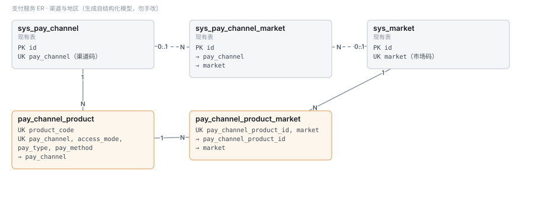
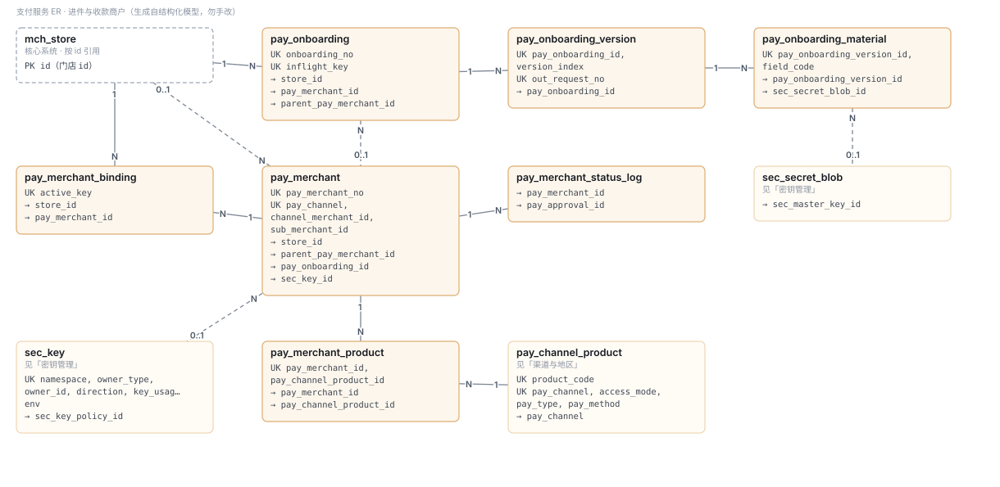
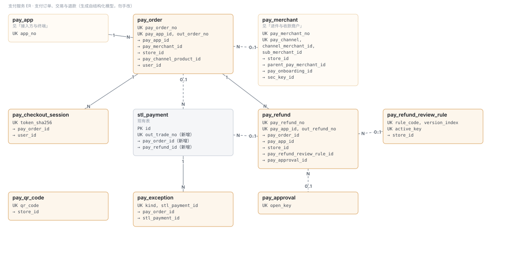
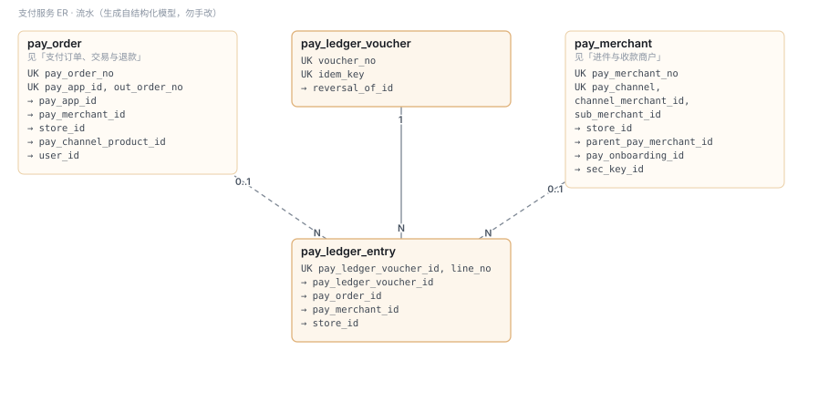
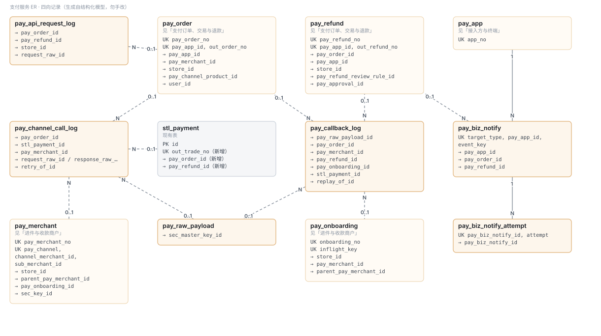
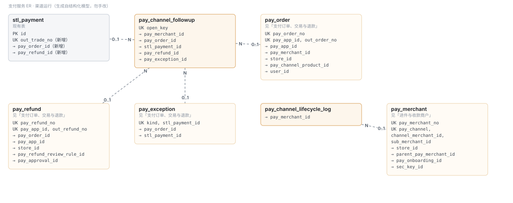
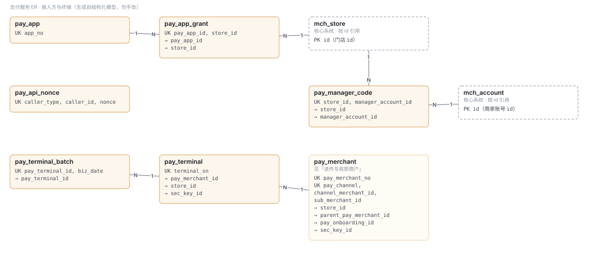
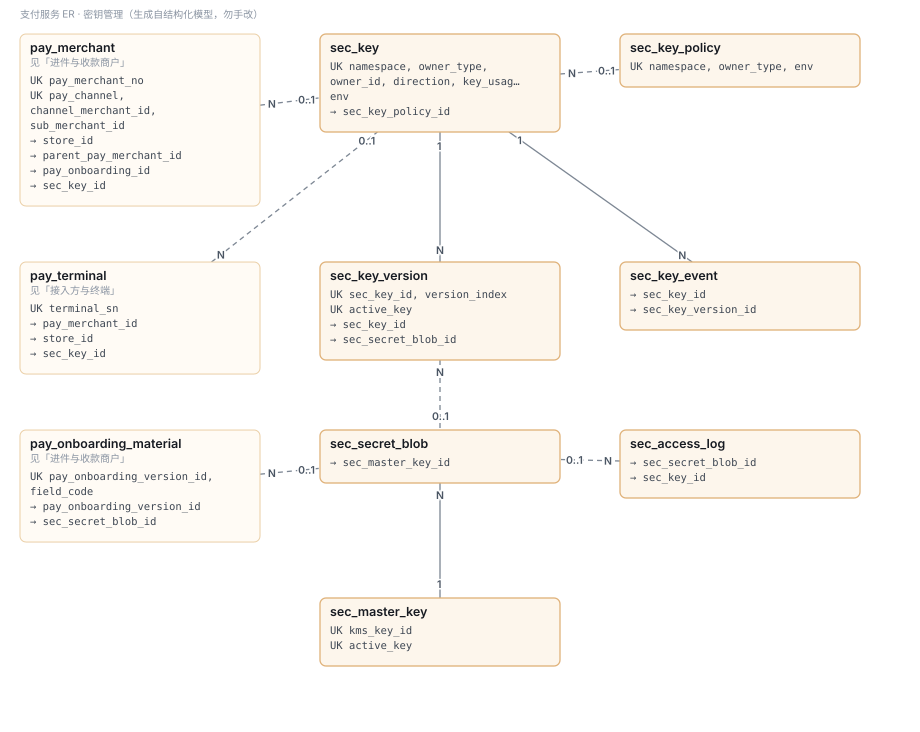
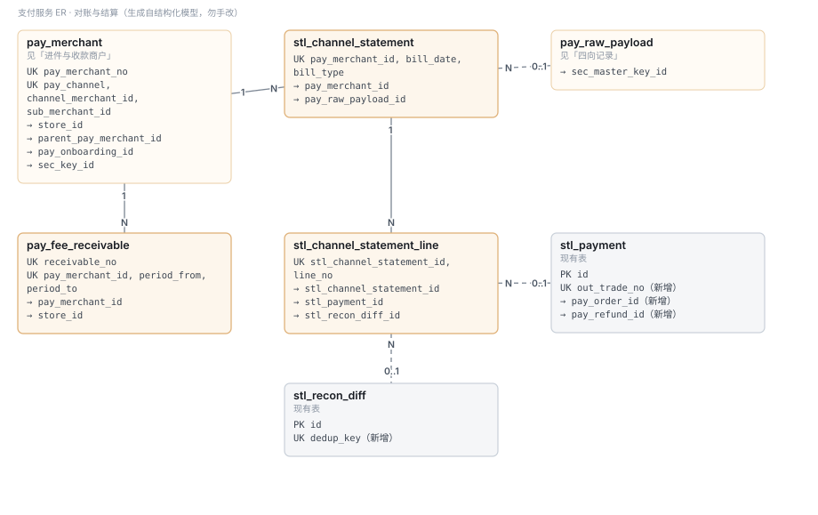

# 支付服务 · 数据库表结构说明
# Payment Service · Database Schema Reference (v4)

| 项 Item | 内容 Value |
|---|---|
| 状态 Status | 评审草案，未实现、未执行 DDL · *Review draft — not implemented, no DDL applied* |
| 规模 Scope | 42 张新表 + 6 张现有表改造（22 处加列）· 107 条关系 · *42 new tables, 6 existing tables altered, 107 relations* |
| 唯一真源 Source of truth | [结构化模型 pay-service-database.json](./design/schema/pay-service-database.json)；本文、[评审 DDL](./design/schema/pay-service-review.sql)、ER 图均由它生成，**勿手改** · *generated, do not edit by hand* |
| 依据 Based on | [完整设计方案](./TDD-支付服务-完整设计方案.md) · [代码 Review](./支付服务-代码Review-2026-10-24.md) · [任务表](./任务表-支付服务.md) |
| 数据库 Database | MariaDB 12（生产）/ H2（单测）；现有迁移读至 V547，本文不预占迁移号 |
| 版本 Version | v4：并入渠道接入统一封装的四向记录（请求 `pay_api_request_log`、调用与回调扩列、答复 `pay_biz_notify` 取代 `pay_webhook_delivery`）与渠道运行（补查、生命周期）；v3：去 `tenant_no`、BIGINT 自增 id 关联、门店 id 关联核心系统、密钥独立为 sec 模块（推荐，待确认）· *v4 adds the four-way records and channel runtime tables from the channel integration design* |
| 相关设计 Related | [渠道接入统一封装设计](./支付服务-渠道接入统一封装设计.md) §11 |
| 更新 Updated | 2026-10-25 |

## 目录 · Contents

1. [概述 · Overview](#1-概述--overview)
2. [设计约定 · Conventions](#2-设计约定--conventions)
3. [密钥管理 · Key Management](#3-密钥管理--key-management)
4. [ER 图 · ER Diagrams](#4-er-图--er-diagrams)
5. [表清单 · Table Catalog](#5-表清单--table-catalog)
6. [表结构详细说明 · Table Details](#6-表结构详细说明--table-details)
7. [现有表改造 · Changes to Existing Tables](#7-现有表改造--changes-to-existing-tables)
8. [迁移映射 · Migration Mapping](#8-迁移映射--migration-mapping)
9. [容量与归档 · Capacity & Archiving](#9-容量与归档--capacity--archiving)
10. [待确认 · Open Questions](#10-待确认--open-questions)

## 1 概述 · Overview

支付系统的数据分九组：渠道与地区、进件与收款商户、支付订单 / 交易 / 退款、流水、四向记录（请求 · 调用 · 回调 · 答复）、渠道运行、接入方与终端、密钥管理、对账与结算。核心系统的门店（`mch_store`）、商家账号（`mch_account`）、消费者（`usr_account`）不在支付库；支付表与核心系统**一律按门店 id（`store_id`）关联**，账号类按各自 id。
*Payment data falls into nine groups. The core system is referenced by store id (`store_id`), accounts by their ids; no foreign keys across systems.*

| # | 分组 | Group | 表数 Tables | 表 |
|---|---|---|---|---|
| 1 | 渠道与地区 | Channels & Markets | 2 | `pay_channel_product` `pay_channel_product_market` |
| 2 | 进件与收款商户 | Onboarding & Payment Merchants | 7 | `pay_onboarding` `pay_onboarding_version` `pay_onboarding_material` `pay_merchant` `pay_merchant_binding` `pay_merchant_product` `pay_merchant_status_log` |
| 3 | 支付订单、交易与退款 | Payment Orders, Transactions & Refunds | 7 | `pay_order` `pay_refund` `pay_refund_review_rule` `pay_approval` `pay_exception` `pay_checkout_session` `pay_qr_code` |
| 4 | 流水 | Ledger | 2 | `pay_ledger_voucher` `pay_ledger_entry` |
| 5 | 四向记录 | Four-way Records (request · call · callback · notification) | 6 | `pay_api_request_log` `pay_channel_call_log` `pay_callback_log` `pay_raw_payload` `pay_biz_notify` `pay_biz_notify_attempt` |
| 6 | 渠道运行 | Channel Runtime | 2 | `pay_channel_followup` `pay_channel_lifecycle_log` |
| 7 | 接入方与终端 | API Clients & Terminals | 6 | `pay_app` `pay_app_grant` `pay_api_nonce` `pay_terminal` `pay_manager_code` `pay_terminal_batch` |
| 8 | 密钥管理 | Key Management (sec module) | 7 | `sec_master_key` `sec_secret_blob` `sec_key_policy` `sec_key` `sec_key_version` `sec_key_event` `sec_access_log` |
| 9 | 对账与结算 | Reconciliation & Settlement | 3 | `stl_channel_statement` `stl_channel_statement_line` `pay_fee_receivable` |

## 2 设计约定 · Conventions

### 2.1 主键与关联 · Keys & references

| 约定 Convention | 说明 | Description |
|---|---|---|
| 主键 Primary key | 每张表 `id BIGINT NOT NULL AUTO_INCREMENT`，Java 侧 `Long` | Every table: `id BIGINT AUTO_INCREMENT`, `Long` in Java |
| 关联 References | **一律 `<对方表名>_id BIGINT` 指向对方的 `id`**（如 `pay_order_id`、`pay_merchant_id`、`sec_key_id`）；不按业务号关联 | Always `<parent_table>_id` → parent `id`; never by business number |
| 关联核心系统 Core system | **一律按门店 id**：`store_id` → `mch_store.id`；账号类按各自 id：`manager_account_id` → `mch_account.id`、`user_id` → `usr_account.id`。主体不直接关联，经门店在核心系统里取 | Core system is always referenced by `store_id`; accounts by their own ids; entities only via stores |
| 外键约束 FK constraints | 不建数据库外键；引用完整性由服务写入时校验 + 后台扫描孤立 id | No DB foreign keys; integrity by service validation and orphan scans |
| 对外业务号 External numbers | 只保留**要给外部看的**：`pay_order_no`、`pay_refund_no`、`pay_merchant_no`（回调地址、结算单）、`onboarding_no`（进件回调地址）、`out_trade_no` / `out_request_no`（发给渠道）、`out_order_no` / `out_refund_no`（调用方幂等键）、`app_no`（AppId）、`terminal_sn`、`qr_code`、`voucher_no`、`receivable_no`。**它们只用于对外与检索，不用于关联** | Kept only where an outside party sees them; never used for joins |
| 值域码 Value codes | `pay_channel`、`market`、`currency` 与各枚举列是**值域码**（取值登记在 `sys_pay_channel` / `sys_market` / shared 值域），不是关联 | Channel / market / currency codes and enums are value domains, not references |
| 审计字段 Audit fields | `*_by`、`operator_no`、`initiator_no` 等操作人字段与标准列 `created_by` 同口径（账号号字符串），**不作关联** | Operator fields follow `created_by` (account code string) and are not references |

### 2.2 无租户 · No tenant column

- **新表不带 `tenant_no`**，唯一键也不再以它打头。现有表（`stl_payment`、`stl_bill`、`sys_pay_channel` 等）保留原有 `tenant_no`，不动。
  *New tables have no `tenant_no`; existing tables keep theirs.*
- **实现上的必要改动**：仓库的 `BaseEntity` 带 `tenantNo`，且 `AuditMetaObjectHandler` 插入时会 `strictInsertFill` 它 —— 新表实体继承 `BaseEntity` 会往不存在的列写值。
  新实体改继承**不含 `tenantNo` 的基类**（建议 `PayBaseEntity`：`id` `createdAt` `createdBy` `updatedAt` `updatedBy` `version` `deleted`）。
  *`BaseEntity` carries `tenantNo` and the audit handler fills it on insert, so new entities need a base class without it.*
- 新表上的查询不得再拼 `tenant_no` 条件；与现有表 join 时，现有表一侧照旧带。

### 2.3 跨系统按 id 引用的前提 · Preconditions for cross-system ids

[ADR-021 §3.3](./ADR/ADR-021-支付域独立为服务与独立库.md) 原规定跨库「存业务键、不存自增 id」，本设计改为**按门店 id 关联**，需同步修订该条，并守住三条前提：

| 前提 Precondition | 为什么 | 怎么守 |
|---|---|---|
| 核心系统的 `mch_store.id` / `mch_account.id` / `usr_account.id` **永不变更、永不复用** | 支付单据、流水上的 `store_id` 是历史事实，id 一变，去年的账就挂到了另一家店 | 核心系统禁止重建这几张表重新编号；合并 / 迁移数据保留原 id；删除只做逻辑删除 |
| 历史展示用快照，不回查 | 门店改名后，历史单据仍显示成交时的名字（审计要求，ADR-021 原理由不变） | 保留 `entity_name_snapshot`、`store_name_snapshot` |
| 孤立 id 可被发现 | 没有外键，引用错误不会在写入时报错 | 写入经核心系统 Port 校验门店存在且归属正确；后台每日扫描孤立 `store_id` |

### 2.4 类型 · Types

| 约定 Convention | 说明 | Description |
|---|---|---|
| 金额 Money | `BIGINT` 最小单位，恒为正，方向另列；比例用万分比 `*_bp`；不用浮点 | Minor units, always positive; basis points for ratios; no floats |
| 币种 / 市场 | `CHAR(3)` ISO 4217 / `VARCHAR(8)`；出通道精度由 `pay_channel_product_market.amount_scale` 规定，有余数即拒 | Channel-side scale from `amount_scale`; remainders rejected |
| 时间 Time | `DATETIME(3)` 存 UTC；业务日 `DATE` 按市场时区切日；现有 `stl_payment` 的 BIGINT 毫秒列不动 | UTC `DATETIME(3)`; business dates by market time zone |
| 枚举 Enums | `VARCHAR(24)` 大写码，取值写在列说明里 | Upper-case codes, values in the description |
| JSON | 只存快照 / 审计，不承载查询与唯一性 | Snapshots / audit only |

### 2.5 库方言 · SQL dialect

生产 MariaDB 12，单测 H2。建表不写 `ENGINE/CHARSET/COLLATE`，跟随库默认（与老表 join 不会 *Illegal mix of collations*，V284 教训）。评审 DDL 已过仓库全部 10 条方言规则（0 命中），列名已避开 MariaDB / H2 保留字（如不用 `usage`，改 `key_usage`）。
*Follow the database default collation; DDL passes all 10 portability rules; no reserved words as column names.*

### 2.6 「同一时刻至多一个」· At most one at a time

用普通可空列 `active_key` / `inflight_key` / `open_key` + 唯一索引：满足条件时服务在**同一事务**写入组合键（由 id 组成，如 `store_id|pay_channel`），否则置 NULL。不用生成列（H2 与 MariaDB 语法不一致）。
*A nullable helper column plus a unique index, maintained in the same transaction.*

### 2.7 只增不改 · Append-only

流水、调用 / 回调记录、进件版本与资料、密钥版本与事件、明文接触记录、状态日志：只 insert，更正靠追加；Mapper 不暴露 update / delete。资金与历史事实不物理删除。
*Ledger, logs, versions and audit tables are insert-only.*

### 2.8 CHECK 约束 · CHECK constraints

DDL 里的 CHECK 是意图声明；H2 不执行 CHECK，每条都在服务层同样校验并有单测。
*CHECKs document intent; each is also enforced and unit-tested in the service layer.*


## 3 密钥管理 · Key Management

> **推荐方案（待确认）：密钥管理独立为平台级模块 `secret`，表前缀 `sec_`，不放在支付模块。** 支付只保留「谁用哪把密钥」的绑定（`pay_merchant.sec_key_id`、`pay_terminal.sec_key_id`、接入方经 `sec_key.owner_id`）。
> *Recommended (to be confirmed): key management becomes a platform-level `secret` module with `sec_` tables; payment keeps only the bindings.*
> 相关表：`sec_master_key` · `sec_secret_blob` · `sec_key_policy` · `sec_key` · `sec_key_version` · `sec_key_event` · `sec_access_log`（ER 见 §4.8，字段见 §6.8）。

### 3.0 归属：为什么不放在支付模块 · Why a separate module

| 维度 Aspect | 放在支付模块 In payment | 独立 `secret` 模块（推荐）Separate module |
|---|---|---|
| 谁需要 Who needs it | 只解决支付；而物流（快递100、圆通）、库存开放接口（`inv_open_credential`）、企微通知、小程序 AppSecret 都在调外部 API，今天各存在 yml 或各自的表里 | 全平台一处登记、一套轮换与审计 |
| 依赖方向 Dependencies | 其他域要用就得依赖支付，与 ADR-021「支付不被业务域反向依赖」相反 | 各域依赖它，它不依赖任何业务域 |
| 隔离 Isolation | 支付进程能解开库里所有密文 | 按**命名空间**（PAY / LOGISTICS / INVENTORY / NOTIFY / PLATFORM）分主密钥；KMS 授权按命名空间下发，支付进程只能解 PAY |
| 部署 Deployment | — | **以库的形式内嵌在各进程**，进程内解密；不做成返回明文的远程服务（那会让明文走网络） |
| 形状 Shape | — | 照 `job` 模块：`secret-api`（`SecretVault`、`KeyRegistry` 接口）/ `secret-core`（信封加密、轮换、到期任务）/ `secret-store`（`sec_*` 表）；运营界面由各域接入层调 `secret-api` |
| 支付保留什么 Payment keeps | — | 业务语义与绑定：收款商户 / 终端 / 接入方用哪把密钥；测试调用（查一笔单）由支付执行，结果写回 `sec_key_version.verify_evidence` |

**代价**：多一个模块与一套表；KMS 要按命名空间配授权。**不拆的后果**：第二个域需要密钥那天，要么复制一套（三份实现），要么反向依赖支付。

### 3.1 支付命名空间里的密钥 · Keys in the PAY namespace

| 类别 Category | `owner_type` | `direction` | 例子 Examples | 材料 Material | 私密部分在谁手里 Secret held by |
|---|---|---|---|---|---|
| 我方调渠道 Our calls to channels | `PAY_MERCHANT` | `OUTBOUND` | 蓝新 HashKey + HashIV；LINE Pay ChannelSecret；PayBy 商户私钥；微信 APIv3 密钥与商户私钥；支付宝应用私钥 | `COMPOSITE` / `SYMMETRIC_SECRET` / `PRIVATE_KEY` | 平台（密文存 `sec_secret_blob`） |
| 渠道平台公钥 Channel platform keys | `CHANNEL_PLATFORM` | `COUNTERPARTY_VERIFY` | 微信平台证书（定期轮换，可自动下载）；支付宝公钥；PayBy 公钥 | `PUBLIC_KEY` / `CERTIFICATE` | 渠道（我方只存公开部分） |
| 第三方调我方 Partners calling us | `PARTNER_APP` | `INBOUND` | HMAC 密钥（平台生成）或对方 RSA 公钥；webhook 推送签名复用此密钥 | `SYMMETRIC_SECRET` / `PUBLIC_KEY` | HMAC：双方；RSA：对方 |
| 内部系统调我方 Internal systems | `INTERNAL_APP` | `INBOUND` | 每个内部系统一把服务密钥（取代全局共享令牌，修 R12） | `SYMMETRIC_SECRET` | 平台 + 该系统部署环境 |
| 刷卡机 Terminals | `TERMINAL` | `INBOUND` | 设备密钥（激活时下发一次） | `SYMMETRIC_SECRET` | 平台 + 该终端 |

其他命名空间（物流的快递100 密钥、库存开放接口凭证等）用同一套表，`owner_type = PROVIDER` 等，由各域迁入时登记。

**一把密钥 = 一个命名空间 × 一个归属 × 一种用途 × 一个环境**（`sec_key` 唯一键）；轮换是在它下面加版本，不是新建密钥。
*One key per owner × usage × environment; rotation adds versions under the same key.*

### 3.2 存储架构 · Storage architecture

| 层 Layer | 存在哪 Where | 说明 Notes |
|---|---|---|
| 主密钥 Master key | KMS / HSM / 部署环境注入；库里只有元数据 `sec_master_key` | 每个命名空间每个环境一个 `ACTIVE`；沙箱与生产、各命名空间之间主密钥都不同。*Never stored in the database.* |
| 数据密钥 Data key | 每条密文一把，被主密钥包裹后存 `sec_secret_blob.data_key_cipher` | 信封加密；主密钥轮换只需重新包裹数据密钥，不动密文。*Envelope encryption.* |
| 密文 Ciphertext | `sec_secret_blob.cipher_text`（AES-256-GCM） | 附加认证数据绑定 `id + namespace + owner_type + owner_id + env`：密文被挪到别的行即解密失败。*AAD binds ciphertext to its row.* |
| 公开材料 Public material | `sec_key_version.public_material`（PEM） | 公钥与证书不加密，但只能经密钥管理接口写入 |

**明文永不出现在**：数据库、应用日志、`pay_channel_call_log` / `pay_callback_log`（`PayloadMasker` 递归脱敏）、接口响应、配置仓库、导出文件。唯一的解密点是进程内的 `SecretVault`（secret 模块的库）。
*Plaintext never appears in the database, logs, call / callback records, API responses, config repositories or exports. The only decryption point is the in-process `SecretVault` library.*

### 3.3 生命周期 · Lifecycle

**版本状态 Version states**

```
DRAFT ──测试调用通过──▶ VERIFIED ──启用（两人）──▶ ACTIVE ──新版本启用──▶ ROTATING ──重叠期结束──▶ RETIRED
  │                        │                         │                       │                      │
  └────────────────────────┴──────────── 吊销 REVOKED（任意状态，立即失效）─────────────────────────┘
```

| 状态 State | 新交易可用 New calls | 在途单 / 验旧签 In-flight & old signatures | 说明 |
|---|---|---|---|
| `DRAFT` | ✗ | ✗ | 已录入，未验证 |
| `VERIFIED` | ✗ | ✗ | 测试调用通过（`verify_evidence` 记录调用方模块的调用记录引用） |
| `ACTIVE` | ✓ | ✓ | 每把密钥同一时刻一个（`active_key` 唯一） |
| `ROTATING` | INBOUND：✓（两把都可验签）；OUTBOUND：✗ | ✓ | 重叠期至 `overlap_until` |
| `RETIRED` | ✗ | ✓ | 只用于冻结了该版本的退款、查单、验旧回调 |
| `REVOKED` | ✗ | ✗ | 泄露等场景；冻结了它的在途操作停止并告警，转人工 |

**轮换步骤 Rotation**
1. 新增版本（`UPLOADED` 录入 / `GENERATED` 平台生成 / `FETCHED` 自动下载），状态 `DRAFT`
2. 测试调用（渠道：查一笔单；接入方：对方用新密钥调沙箱接口）→ `VERIFIED`
3. 第二人启用 → 新版本 `ACTIVE`，旧版本 `ROTATING`，`overlap_until = now + overlap_days`
4. 到期任务把 `ROTATING` 转 `RETIRED`；旧版本保留到所有冻结它的单据终结
5. 每一步写 `sec_key_event`

**渠道平台证书**（微信）：定时任务调用渠道的证书下载接口，新证书以 `FETCHED` 进入 `VERIFIED`，验签同时接受新旧证书直到旧证书到期 —— 无需人工。

### 3.4 使用与冻结 · Usage & freezing

- 建单选方式时，支付单与通道尝试冻结 `pay_merchant.sec_key_id` 对应密钥的版本号（`pay_order.sec_key_version`、`stl_payment.sec_key_version`）
- 退款、查单、关单、验该单的回调**一律用冻结版本**，不取「当前密钥」—— 与收款路由快照同一原则
- 冻结版本为 `REVOKED` 时操作失败并告警，不自动换用新版本（换版本意味着身份可能已变）
- `sec_key.last_used_at` / `use_count` 异步刷新，用于发现长期不用的密钥与异常调用量

### 3.5 访问控制 · Access control

| 动作 Action | 权限码 Permission | 两人 Dual control | 记录 Audit |
|---|---|---|---|
| 查看密钥元数据、指纹 View metadata / fingerprint | `sec:key:view` | — | — |
| 录入 / 生成版本 Add version | `sec:key:write` | — | `sec_key_event` |
| 启用版本 Enable | `sec:key:enable`（≠ 录入人） | ✓ | `sec_key_event` + `pay_approval` |
| 吊销 Revoke | `sec:key:revoke` | ✓（应急时先吊销、事后补复核） | `sec_key_event` |
| 发放时查看明文 Reveal on issue | 发放人本人，仅一次 | — | `sec_access_log` |
| 查看进件敏感字段 Sensitive onboarding field | `pay:onboarding:sensitive` | — | `sec_access_log` |
| 查看报文原文 Raw payload | `pay:log:raw` | — | `sec_access_log` |
| 应急调阅 Break-glass | `sec:key:break-glass` | ✓（必须有复核单） | `sec_access_log` |
| 主密钥轮换 Master key rotation | `sec:master-key:rotate`（运维） | ✓ | `sec_key_event(REWRAPPED)` |

已入库的私密密钥材料**没有任何查看明文的入口**（`reveal_on_issue_only`）；忘了就轮换，不找回。
*Stored secret key material can never be revealed again; lost means rotate, not recover.*

### 3.6 到期、告警与监控 · Expiry, alerts & monitoring

| 检查 Check | 频率 | 动作 |
|---|---|---|
| `valid_to` / `max_age_days` 将到期 | 每日 | `warn_before_days` 前写 `EXPIRING_SOON`，通知运营与商家 |
| 已到期 | 每日 | `EXPIRED`；该密钥的新调用失败并告警 |
| 测试调用 / 验签连续失败 | 实时 | 告警；连续 N 次验签失败可能是密钥被换或被冒用 |
| `last_used_at` 超 180 天 | 每周 | 建议吊销（不自动） |
| `use_count` 突增 | 实时 | 告警（可能泄露被滥用） |
| 明文接触记录 | 每日 | 汇总发给安全负责人 |

### 3.7 主密钥轮换与灾备 · Master key rotation & DR

1. 在 KMS 新建主密钥，登记 `sec_master_key`（`ACTIVE`），旧主密钥改 `DECRYPT_ONLY`
2. 后台任务逐条用旧主密钥解开数据密钥、用新主密钥重新包裹，回写 `data_key_cipher`、`sec_master_key_id`、`rewrapped_at`（密文不动）
3. 旧主密钥无引用后 `RETIRED`，在 KMS 计划删除（保留期按 KMS 默认）
4. 主密钥的备份与恢复走 KMS 自身机制；**沙箱与生产主密钥分离**，生产数据导入沙箱前必须清空 `sec_secret_blob`

### 3.8 泄露应急 · Leak response

1. 吊销对应版本（`REVOKED`，立即生效），必要时同步到渠道后台重置密钥
2. 查 `pay_channel_call_log` / `pay_callback_log`（按 `pay_merchant_id`）中该密钥在可疑时段的调用，及 `sec_access_log` 中的明文接触
3. 生成并启用新版本；冻结了被吊销版本的在途操作按「停止 + 告警 + 人工」处理
4. 事后补两人复核单，写事件原因


## 4 ER 图 · ER Diagrams

> 图为 SVG（[文档规范 §二](../文档规范.md)：图一律 SVG、结构图从真源生成，不用 mermaid），嵌在本文直接显示；关系同时以表格列出。
> *Diagrams are generated SVG embedded in this document; every relation is also listed as a table.*

| 图上 Mark | 含义 Meaning |
|---|---|
| 橙色框 | 本组的表 · *table of this group* |
| 浅橙框，表名下「见 X」 | 其他分组的表 · *table of another group* |
| 灰框「现有表」 | 已有表（本次加列或改语义）· *existing table* |
| 虚线框「核心系统」 | 核心系统的表，按 id 引用，不建外键 · *core-system table, referenced by id* |
| 实线 / 虚线 | 必填 / 可空引用 · *required / nullable reference* |
| `N` … `1` / `0..1` | 子表端多、父表端一 · *child many, parent one* |
| `PK` / `UK` / `→` | 主键 / 唯一键 / 引用列（`*_id` 指向对方的 `id`）· *primary key / unique key / reference column* |

### 4.1 渠道与地区 · Channels & Markets



| 子表 Child | 引用列 Column | 父表 Parent | 父列 Parent column | 基数 Cardinality | 方式 Kind | 说明 Note |
|---|---|---|---|---|---|---|
| `pay_channel_product` | `pay_channel` | `sys_pay_channel` | `pay_channel` | N : 1 | 值域码引用 *value-domain code* |  |
| `pay_channel_product_market` | `pay_channel_product_id` | `pay_channel_product` | `id` | N : 1 | 同模块 id 引用 *same-module id* |  |
| `pay_channel_product_market` | `market` | `sys_market` | `market` | N : 1 | 值域码引用 *value-domain code* |  |

### 4.2 进件与收款商户 · Onboarding & Payment Merchants



| 子表 Child | 引用列 Column | 父表 Parent | 父列 Parent column | 基数 Cardinality | 方式 Kind | 说明 Note |
|---|---|---|---|---|---|---|
| `pay_onboarding` | `store_id` | `mch_store` | `id` | N : 1 | 核心系统 id 引用 *core-system id* | 申请门店 |
| `pay_onboarding` | `pay_merchant_id` | `pay_merchant` | `id` | N : 0..1 | 同模块 id 引用 *same-module id* | APPROVED 后产出 |
| `pay_onboarding` | `parent_pay_merchant_id` | `pay_merchant` | `id` | N : 0..1 | 同模块 id 引用 *same-module id* | 挂在平台级商户下 |
| `pay_onboarding_version` | `pay_onboarding_id` | `pay_onboarding` | `id` | N : 1 | 同模块 id 引用 *same-module id* |  |
| `pay_onboarding_material` | `pay_onboarding_version_id` | `pay_onboarding_version` | `id` | N : 1 | 同模块 id 引用 *same-module id* |  |
| `pay_onboarding_material` | `sec_secret_blob_id` | `sec_secret_blob` | `id` | N : 0..1 | 跨模块 id 引用 *cross-module id* | 仅 SENSITIVE 字段 |
| `pay_merchant` | `store_id` | `mch_store` | `id` | N : 0..1 | 核心系统 id 引用 *core-system id* | 开户门店；PLATFORM 为空 |
| `pay_merchant` | `parent_pay_merchant_id` | `pay_merchant` | `id` | N : 0..1 | 自引用 *self* | SP / 平台子商户 → 平台级商户 |
| `pay_merchant` | `pay_onboarding_id` | `pay_onboarding` | `id` | N : 0..1 | 同模块 id 引用 *same-module id* | 与 pay_onboarding.pay_merchant_id 互指，图上只画一条 |
| `pay_merchant` | `sec_key_id` | `sec_key` | `id` | N : 0..1 | 跨模块 id 引用 *cross-module id* | 调用渠道用的密钥 |
| `pay_merchant_binding` | `store_id` | `mch_store` | `id` | N : 1 | 核心系统 id 引用 *core-system id* |  |
| `pay_merchant_binding` | `pay_merchant_id` | `pay_merchant` | `id` | N : 1 | 同模块 id 引用 *same-module id* |  |
| `pay_merchant_product` | `pay_merchant_id` | `pay_merchant` | `id` | N : 1 | 同模块 id 引用 *same-module id* |  |
| `pay_merchant_product` | `pay_channel_product_id` | `pay_channel_product` | `id` | N : 1 | 同模块 id 引用 *same-module id* |  |
| `pay_merchant_status_log` | `pay_merchant_id` | `pay_merchant` | `id` | N : 1 | 同模块 id 引用 *same-module id* |  |
| `pay_merchant_status_log` | `pay_approval_id` | `pay_approval` | `id` | N : 0..1 | 同模块 id 引用 *same-module id* |  |

### 4.3 支付订单、交易与退款 · Payment Orders, Transactions & Refunds



| 子表 Child | 引用列 Column | 父表 Parent | 父列 Parent column | 基数 Cardinality | 方式 Kind | 说明 Note |
|---|---|---|---|---|---|---|
| `pay_order` | `pay_app_id` | `pay_app` | `id` | N : 1 | 同模块 id 引用 *same-module id* |  |
| `pay_order` | `pay_merchant_id` | `pay_merchant` | `id` | N : 0..1 | 同模块 id 引用 *same-module id* | 路由快照，选定方式时冻结 |
| `pay_order` | `store_id` | `mch_store` | `id` | N : 1 | 核心系统 id 引用 *core-system id* |  |
| `pay_order` | `pay_channel_product_id` | `pay_channel_product` | `id` | N : 0..1 | 同模块 id 引用 *same-module id* |  |
| `pay_order` | `user_id` | `usr_account` | `id` | N : 0..1 | 核心系统 id 引用 *core-system id* |  |
| `pay_order` | `source_id` | `pay_app / pay_terminal / pay_qr_code / pay_checkout_session / 账号` | `id` | N : 1 (poly) | 多态 id 引用 *polymorphic id* | 按 source_type 区分 |
| `stl_payment` | `pay_order_id` | `pay_order` | `id` | N : 0..1 | 同模块 id 引用 *same-module id* | PAY 方向：一单多次尝试 |
| `stl_payment` | `pay_refund_id` | `pay_refund` | `id` | N : 0..1 | 同模块 id 引用 *same-module id* | REFUND 方向 |
| `pay_refund` | `pay_order_id` | `pay_order` | `id` | N : 1 | 同模块 id 引用 *same-module id* | 路由一律取原单快照 |
| `pay_refund` | `pay_app_id` | `pay_app` | `id` | N : 1 | 同模块 id 引用 *same-module id* |  |
| `pay_refund` | `store_id` | `mch_store` | `id` | N : 1 | 核心系统 id 引用 *core-system id* |  |
| `pay_refund` | `pay_refund_review_rule_id` | `pay_refund_review_rule` | `id` | N : 0..1 | 同模块 id 引用 *same-module id* | 命中的规则版本 |
| `pay_refund` | `pay_approval_id` | `pay_approval` | `id` | N : 0..1 | 同模块 id 引用 *same-module id* |  |
| `pay_refund` | `stl_payment_id` | `stl_payment` | `id` | N : 0..1 | 同模块 id 引用 *same-module id* | 执行生成的通道交易，与 stl_payment.pay_refund_id 互指 |
| `pay_refund` | `source_id` | `pay_app / pay_terminal / 账号` | `id` | N : 1 (poly) | 多态 id 引用 *polymorphic id* | 按 source_type 区分 |
| `pay_exception` | `pay_order_id` | `pay_order` | `id` | N : 1 | 同模块 id 引用 *same-module id* | 经 stl_payment 可达，图上不画 |
| `pay_exception` | `stl_payment_id` | `stl_payment` | `id` | N : 1 | 同模块 id 引用 *same-module id* |  |
| `pay_checkout_session` | `pay_order_id` | `pay_order` | `id` | N : 1 | 同模块 id 引用 *same-module id* |  |
| `pay_checkout_session` | `user_id` | `usr_account` | `id` | N : 0..1 | 核心系统 id 引用 *core-system id* |  |
| `pay_qr_code` | `store_id` | `mch_store` | `id` | N : 1 | 核心系统 id 引用 *core-system id* |  |
| `pay_refund_review_rule` | `store_id` | `mch_store` | `id` | N : 0..1 | 核心系统 id 引用 *core-system id* | NULL = 全市场规则 |
| `pay_approval` | `subject_id` | `pay_refund / stl_payout / sec_key_version / pay_merchant / pay_refund_review_rule` | `id` | N : 1 (poly) | 多态 id 引用 *polymorphic id* | 按 subject_type 区分 |

### 4.4 流水 · Ledger



| 子表 Child | 引用列 Column | 父表 Parent | 父列 Parent column | 基数 Cardinality | 方式 Kind | 说明 Note |
|---|---|---|---|---|---|---|
| `pay_ledger_entry` | `pay_ledger_voucher_id` | `pay_ledger_voucher` | `id` | N : 1 | 同模块 id 引用 *same-module id* |  |
| `pay_ledger_entry` | `pay_order_id` | `pay_order` | `id` | N : 0..1 | 同模块 id 引用 *same-module id* |  |
| `pay_ledger_entry` | `pay_merchant_id` | `pay_merchant` | `id` | N : 0..1 | 同模块 id 引用 *same-module id* |  |
| `pay_ledger_entry` | `store_id` | `mch_store` | `id` | N : 1 | 核心系统 id 引用 *core-system id* |  |
| `pay_ledger_voucher` | `reversal_of_id` | `pay_ledger_voucher` | `id` | N : 0..1 | 自引用 *self* | 冲正凭证 |
| `pay_ledger_voucher` | `source_id` | `pay_app / pay_terminal / 账号` | `id` | N : 1 (poly) | 多态 id 引用 *polymorphic id* | 按 source_type 区分 |
| `pay_ledger_voucher` | `ref_id` | `pay_order / pay_refund / stl_bill / stl_payout / pay_fee_receivable` | `id` | N : 1 (poly) | 多态 id 引用 *polymorphic id* | 按 ref_type 区分 |

### 4.5 四向记录 · Four-way Records (request · call · callback · notification)



| 子表 Child | 引用列 Column | 父表 Parent | 父列 Parent column | 基数 Cardinality | 方式 Kind | 说明 Note |
|---|---|---|---|---|---|---|
| `pay_channel_call_log` | `pay_order_id` | `pay_order` | `id` | N : 0..1 | 同模块 id 引用 *same-module id* |  |
| `pay_channel_call_log` | `stl_payment_id` | `stl_payment` | `id` | N : 0..1 | 同模块 id 引用 *same-module id* |  |
| `pay_channel_call_log` | `pay_merchant_id` | `pay_merchant` | `id` | N : 0..1 | 同模块 id 引用 *same-module id* | 以哪个商户身份调 |
| `pay_channel_call_log` | `request_raw_id / response_raw_id` | `pay_raw_payload` | `id` | N : 0..1 | 同模块 id 引用 *same-module id* |  |
| `pay_channel_call_log` | `ref_id` | `pay_order / pay_refund / pay_onboarding / stl_channel_statement / stl_payout / sec_key` | `id` | N : 1 (poly) | 多态 id 引用 *polymorphic id* | 按 ref_type 区分 |
| `pay_callback_log` | `pay_raw_payload_id` | `pay_raw_payload` | `id` | N : 0..1 | 同模块 id 引用 *same-module id* |  |
| `pay_callback_log` | `pay_order_id` | `pay_order` | `id` | N : 0..1 | 同模块 id 引用 *same-module id* |  |
| `pay_callback_log` | `pay_merchant_id` | `pay_merchant` | `id` | N : 0..1 | 同模块 id 引用 *same-module id* | 图上不画（避免穿框） |
| `pay_callback_log` | `pay_refund_id` | `pay_refund` | `id` | N : 0..1 | 同模块 id 引用 *same-module id* |  |
| `pay_callback_log` | `pay_onboarding_id` | `pay_onboarding` | `id` | N : 0..1 | 同模块 id 引用 *same-module id* |  |
| `pay_callback_log` | `stl_payment_id` | `stl_payment` | `id` | N : 0..1 | 同模块 id 引用 *same-module id* |  |
| `pay_callback_log` | `replay_of_id` | `pay_callback_log` | `id` | N : 0..1 | 自引用 *self* | 重放来源 |
| `pay_channel_call_log` | `retry_of_id` | `pay_channel_call_log` | `id` | N : 0..1 | 自引用 *self* | 重试链 |
| `pay_channel_call_log` | `source_id` | `pay_app / pay_terminal / 账号` | `id` | N : 1 (poly) | 多态 id 引用 *polymorphic id* | 按 source_type 区分 |
| `pay_api_request_log` | `pay_order_id` | `pay_order` | `id` | N : 0..1 | 同模块 id 引用 *same-module id* | 处理后关联 |
| `pay_api_request_log` | `pay_refund_id` | `pay_refund` | `id` | N : 0..1 | 同模块 id 引用 *same-module id* |  |
| `pay_api_request_log` | `store_id` | `mch_store` | `id` | N : 0..1 | 核心系统 id 引用 *core-system id* |  |
| `pay_api_request_log` | `request_raw_id` | `pay_raw_payload` | `id` | N : 0..1 | 同模块 id 引用 *same-module id* |  |
| `pay_api_request_log` | `source_id` | `pay_app / pay_terminal / 账号` | `id` | N : 1 (poly) | 多态 id 引用 *polymorphic id* | 按 source_type 区分 |
| `pay_biz_notify` | `pay_app_id` | `pay_app` | `id` | N : 1 | 同模块 id 引用 *same-module id* | 接收方 |
| `pay_biz_notify` | `pay_order_id` | `pay_order` | `id` | N : 0..1 | 同模块 id 引用 *same-module id* | 经 trace_id 与支付单时间线关联，图上不画 |
| `pay_biz_notify` | `pay_refund_id` | `pay_refund` | `id` | N : 0..1 | 同模块 id 引用 *same-module id* |  |
| `pay_biz_notify_attempt` | `pay_biz_notify_id` | `pay_biz_notify` | `id` | N : 1 | 同模块 id 引用 *same-module id* |  |
| `pay_raw_payload` | `sec_master_key_id` | `sec_master_key` | `id` | N : 1 | 跨模块 id 引用 *cross-module id* | 数据密钥经密钥模块包裹 |

### 4.6 渠道运行 · Channel Runtime



| 子表 Child | 引用列 Column | 父表 Parent | 父列 Parent column | 基数 Cardinality | 方式 Kind | 说明 Note |
|---|---|---|---|---|---|---|
| `pay_channel_followup` | `pay_merchant_id` | `pay_merchant` | `id` | N : 0..1 | 同模块 id 引用 *same-module id* |  |
| `pay_channel_followup` | `pay_order_id` | `pay_order` | `id` | N : 0..1 | 同模块 id 引用 *same-module id* |  |
| `pay_channel_followup` | `stl_payment_id` | `stl_payment` | `id` | N : 0..1 | 同模块 id 引用 *same-module id* |  |
| `pay_channel_followup` | `pay_refund_id` | `pay_refund` | `id` | N : 0..1 | 同模块 id 引用 *same-module id* |  |
| `pay_channel_followup` | `pay_exception_id` | `pay_exception` | `id` | N : 0..1 | 同模块 id 引用 *same-module id* | 超过上限转人工 |
| `pay_channel_lifecycle_log` | `pay_merchant_id` | `pay_merchant` | `id` | N : 0..1 | 同模块 id 引用 *same-module id* | 渠道级状态为空 |

### 4.7 接入方与终端 · API Clients & Terminals



| 子表 Child | 引用列 Column | 父表 Parent | 父列 Parent column | 基数 Cardinality | 方式 Kind | 说明 Note |
|---|---|---|---|---|---|---|
| `pay_app_grant` | `pay_app_id` | `pay_app` | `id` | N : 1 | 同模块 id 引用 *same-module id* |  |
| `pay_app_grant` | `store_id` | `mch_store` | `id` | N : 1 | 核心系统 id 引用 *core-system id* |  |
| `pay_api_nonce` | `caller_id` | `pay_app / pay_terminal` | `id` | N : 1 (poly) | 多态 id 引用 *polymorphic id* | 按 caller_type 区分 |
| `pay_terminal` | `pay_merchant_id` | `pay_merchant` | `id` | N : 1 | 同模块 id 引用 *same-module id* |  |
| `pay_terminal` | `store_id` | `mch_store` | `id` | N : 1 | 核心系统 id 引用 *core-system id* |  |
| `pay_terminal` | `sec_key_id` | `sec_key` | `id` | N : 0..1 | 跨模块 id 引用 *cross-module id* | 设备密钥 |
| `pay_manager_code` | `store_id` | `mch_store` | `id` | N : 1 | 核心系统 id 引用 *core-system id* |  |
| `pay_manager_code` | `manager_account_id` | `mch_account` | `id` | N : 1 | 核心系统 id 引用 *core-system id* |  |
| `pay_terminal_batch` | `pay_terminal_id` | `pay_terminal` | `id` | N : 1 | 同模块 id 引用 *same-module id* |  |

### 4.8 密钥管理 · Key Management (sec module)



| 子表 Child | 引用列 Column | 父表 Parent | 父列 Parent column | 基数 Cardinality | 方式 Kind | 说明 Note |
|---|---|---|---|---|---|---|
| `sec_secret_blob` | `sec_master_key_id` | `sec_master_key` | `id` | N : 1 | 同模块 id 引用 *same-module id* |  |
| `sec_secret_blob` | `owner_id` | `sec_key_version / pay_onboarding_material / …` | `id` | N : 1 (poly) | 多态 id 引用 *polymorphic id* | 按 owner_type 区分 |
| `sec_key` | `owner_id` | `pay_merchant / pay_app / pay_terminal / …` | `id` | N : 1 (poly) | 多态 id 引用 *polymorphic id* | 按 owner_type 区分 |
| `sec_key` | `sec_key_policy_id` | `sec_key_policy` | `id` | N : 0..1 | 同模块 id 引用 *same-module id* |  |
| `sec_key_version` | `sec_key_id` | `sec_key` | `id` | N : 1 | 同模块 id 引用 *same-module id* |  |
| `sec_key_version` | `sec_secret_blob_id` | `sec_secret_blob` | `id` | N : 0..1 | 同模块 id 引用 *same-module id* | 私密材料；公开材料存本表 public_material |
| `sec_key_event` | `sec_key_id` | `sec_key` | `id` | N : 1 | 同模块 id 引用 *same-module id* |  |
| `sec_key_event` | `sec_key_version_id` | `sec_key_version` | `id` | N : 0..1 | 同模块 id 引用 *same-module id* |  |
| `sec_access_log` | `sec_secret_blob_id` | `sec_secret_blob` | `id` | N : 0..1 | 同模块 id 引用 *same-module id* |  |
| `sec_access_log` | `sec_key_id` | `sec_key` | `id` | N : 0..1 | 同模块 id 引用 *same-module id* | 经 sec_secret_blob 可达，图上不画 |
| `sec_access_log` | `target_id` | `pay_raw_payload / …` | `id` | N : 1 (poly) | 多态 id 引用 *polymorphic id* | 按 target_type 区分 |

### 4.9 对账与结算 · Reconciliation & Settlement



| 子表 Child | 引用列 Column | 父表 Parent | 父列 Parent column | 基数 Cardinality | 方式 Kind | 说明 Note |
|---|---|---|---|---|---|---|
| `stl_channel_statement` | `pay_merchant_id` | `pay_merchant` | `id` | N : 1 | 同模块 id 引用 *same-module id* |  |
| `stl_channel_statement` | `pay_raw_payload_id` | `pay_raw_payload` | `id` | N : 0..1 | 同模块 id 引用 *same-module id* |  |
| `stl_channel_statement_line` | `stl_channel_statement_id` | `stl_channel_statement` | `id` | N : 1 | 同模块 id 引用 *same-module id* |  |
| `stl_channel_statement_line` | `stl_payment_id` | `stl_payment` | `id` | N : 0..1 | 同模块 id 引用 *same-module id* | 匹配上的交易 |
| `stl_channel_statement_line` | `stl_recon_diff_id` | `stl_recon_diff` | `id` | N : 0..1 | 同模块 id 引用 *same-module id* |  |
| `pay_fee_receivable` | `pay_merchant_id` | `pay_merchant` | `id` | N : 1 | 同模块 id 引用 *same-module id* |  |
| `pay_fee_receivable` | `store_id` | `mch_store` | `id` | N : 1 | 核心系统 id 引用 *core-system id* |  |

**图上不画线的引用 · References not drawn**：维表引用（`sys_pay_channel`、`sys_market` 等）、自引用、多态引用（`*.source_id`、`pay_approval.subject_id`、`pay_ledger_voucher.ref_id`、`pay_channel_call_log.ref_id`、`pay_api_nonce.caller_id`、`sec_key.owner_id`、`sec_secret_blob.owner_id`、`sec_access_log.target_id`）只列在表格里；多态目标由同行的类型列决定，写入时校验。渠道码 / 市场码只在 §4.1 画出，其余表里的 `pay_channel`、`market` 都是值域码，不是关联。

## 5 表清单 · Table Catalog

| 表名 Table | 中文名 | English name | 分组 Group | 模块 Module |
|---|---|---|---|---|
| [`pay_channel_product`](#pay_channel_product) | 支付产品 | Channel Product | 渠道与地区 | `pay-channel` |
| [`pay_channel_product_market`](#pay_channel_product_market) | 支付产品地区 | Channel Product Market | 渠道与地区 | `pay-channel` |
| [`pay_onboarding`](#pay_onboarding) | 进件单 | Onboarding Application | 进件与收款商户 | `pay-domain/onboarding` |
| [`pay_onboarding_version`](#pay_onboarding_version) | 进件提交版本 | Onboarding Submission Version | 进件与收款商户 | `pay-domain/onboarding` |
| [`pay_onboarding_material`](#pay_onboarding_material) | 进件资料 | Onboarding Material | 进件与收款商户 | `pay-domain/onboarding` |
| [`pay_merchant`](#pay_merchant) | 收款商户 | Payment Merchant | 进件与收款商户 | `pay-domain/merchant` |
| [`pay_merchant_binding`](#pay_merchant_binding) | 收款路由绑定 | Payment Merchant Binding | 进件与收款商户 | `pay-domain/merchant` |
| [`pay_merchant_product`](#pay_merchant_product) | 商户开通产品 | Merchant Product | 进件与收款商户 | `pay-domain/merchant` |
| [`pay_merchant_status_log`](#pay_merchant_status_log) | 收款商户状态日志 | Payment Merchant Status Log | 进件与收款商户 | `pay-domain/merchant` |
| [`pay_order`](#pay_order) | 支付订单 | Payment Order | 支付订单、交易与退款 | `pay-domain/acquiring` |
| [`pay_refund`](#pay_refund) | 退款单 | Refund | 支付订单、交易与退款 | `pay-domain/acquiring` |
| [`pay_refund_review_rule`](#pay_refund_review_rule) | 退款复核规则 | Refund Review Rule | 支付订单、交易与退款 | `pay-domain/acquiring` |
| [`pay_approval`](#pay_approval) | 两人复核单 | Approval | 支付订单、交易与退款 | `pay-domain/approval` |
| [`pay_exception`](#pay_exception) | 支付异常 | Payment Exception | 支付订单、交易与退款 | `pay-domain/acquiring` |
| [`pay_checkout_session`](#pay_checkout_session) | 收银会话 | Checkout Session | 支付订单、交易与退款 | `pay-domain/acquiring` |
| [`pay_qr_code`](#pay_qr_code) | 静态收款码 | Static QR Code | 支付订单、交易与退款 | `pay-domain/acquiring` |
| [`pay_ledger_voucher`](#pay_ledger_voucher) | 记账凭证 | Ledger Voucher | 流水 | `pay-domain/ledger` |
| [`pay_ledger_entry`](#pay_ledger_entry) | 流水分录 | Ledger Entry | 流水 | `pay-domain/ledger` |
| [`pay_api_request_log`](#pay_api_request_log) | 请求记录 | API Request Log | 四向记录 | `pay-portal / pay-domain/log` |
| [`pay_channel_call_log`](#pay_channel_call_log) | 渠道调用记录 | Channel Call Log | 四向记录 | `pay-channel/http` |
| [`pay_callback_log`](#pay_callback_log) | 回调记录 | Callback Log | 四向记录 | `pay-domain/callback` |
| [`pay_raw_payload`](#pay_raw_payload) | 报文原文 | Raw Payload | 四向记录 | `pay-domain/log` |
| [`pay_biz_notify`](#pay_biz_notify) | 答复记录 | Business Notification | 四向记录 | `pay-domain/notify` |
| [`pay_biz_notify_attempt`](#pay_biz_notify_attempt) | 答复投递记录 | Notification Attempt | 四向记录 | `pay-domain/notify` |
| [`pay_channel_followup`](#pay_channel_followup) | 补查任务 | Channel Follow-up | 渠道运行 | `pay-channel/fault` |
| [`pay_channel_lifecycle_log`](#pay_channel_lifecycle_log) | 渠道生命周期日志 | Channel Lifecycle Log | 渠道运行 | `pay-channel/lifecycle` |
| [`pay_app`](#pay_app) | 接入方 | API Client App | 接入方与终端 | `pay-domain/openapp` |
| [`pay_app_grant`](#pay_app_grant) | 接入方授权 | App Grant | 接入方与终端 | `pay-domain/openapp` |
| [`pay_api_nonce`](#pay_api_nonce) | 签名防重放 | API Nonce | 接入方与终端 | `pay-domain/openapp` |
| [`pay_terminal`](#pay_terminal) | 刷卡机终端 | Terminal | 接入方与终端 | `pay-domain/terminal` |
| [`pay_manager_code`](#pay_manager_code) | 店长授权码 | Manager Code | 接入方与终端 | `pay-domain/terminal` |
| [`pay_terminal_batch`](#pay_terminal_batch) | 终端日结 | Terminal Batch | 接入方与终端 | `pay-domain/terminal` |
| [`sec_master_key`](#sec_master_key) | 主密钥登记 | Master Key | 密钥管理 | `secret（独立模块）` |
| [`sec_secret_blob`](#sec_secret_blob) | 密文存储 | Secret Blob | 密钥管理 | `secret（独立模块）` |
| [`sec_key_policy`](#sec_key_policy) | 密钥策略 | Key Policy | 密钥管理 | `secret（独立模块）` |
| [`sec_key`](#sec_key) | 密钥 | Key | 密钥管理 | `secret（独立模块）` |
| [`sec_key_version`](#sec_key_version) | 密钥版本 | Key Version | 密钥管理 | `secret（独立模块）` |
| [`sec_key_event`](#sec_key_event) | 密钥生命周期事件 | Key Event | 密钥管理 | `secret（独立模块）` |
| [`sec_access_log`](#sec_access_log) | 明文接触记录 | Plaintext Access Log | 密钥管理 | `secret（独立模块）` |
| [`stl_channel_statement`](#stl_channel_statement) | 渠道对账单 | Channel Statement | 对账与结算 | `pay-domain/recon` |
| [`stl_channel_statement_line`](#stl_channel_statement_line) | 对账单明细 | Channel Statement Line | 对账与结算 | `pay-domain/recon` |
| [`pay_fee_receivable`](#pay_fee_receivable) | 平台费应收 | Platform Fee Receivable | 对账与结算 | `pay-domain/settle` |

被引用的现有表 / 核心系统表 · *Existing and core tables referenced*：`sys_market` 国家地区 *Market*；`sys_pay_channel` 支付渠道 *Pay Channel*；`sys_pay_channel_market` 渠道地区 *Pay Channel Market*；`stl_payment` 通道交易 *Channel Transaction*；`stl_recon_diff` 对账差异 *Reconciliation Diff*；`stl_bank_flow` 银行流水 *Bank Flow*；`stl_bill` 结算单 *Settlement Bill*；`mch_store` 门店 *Store*；`mch_account` 商家账号 *Merchant Account*；`usr_account` 消费者账号 *Consumer Account*

## 6 表结构详细说明 · Table Details

每张表另有标准列 `id`（BIGINT 自增，Java Long）`created_at` `created_by` `updated_at` `updated_by` `version` `deleted`（§2.2），下表不重复列出。**新表没有 `tenant_no`。**
*Standard columns (§2.2) exist on every table and are not repeated below.* 「可空」列：N = NOT NULL，Y = 可空。

### 6.1 渠道与地区 · Channels & Markets

<a id="pay_channel_product"></a>

#### `pay_channel_product` · 支付产品 · Channel Product

- **用途**：支付产品：渠道 × 接入模式 × 支付类型 × 支付方式。运营开关；实际能力以代码实现的接口为准，启动比对
- **Purpose**: Payment product = channel × access mode × payment type × payment method. An ops switch; real capability is whatever the code implements, compared at startup.
- **模块 Module**：`pay-channel`

| 字段 Column | 类型 Type | 可空 Null | 默认 Default | 说明 | Description |
|---|---|---|---|---|---|
| `product_code` | `VARCHAR(64)` | N |  | 产品码（种子数据的自然键），如 NEWEBPAY_CREDIT、LINEPAY_ONLINE、PAYBY_POS_CARD | Product code (natural key of seed data) |
| `pay_channel` | `VARCHAR(32)` | N |  | 渠道码（值域，见 sys_pay_channel） | Channel code |
| `access_mode` | `VARCHAR(24)` | N |  | MERCHANT_OWN / SERVICE_PROVIDER / PLATFORM_SUB：用谁的凭据调渠道 | Whose credentials call the channel — values: MERCHANT_OWN / SERVICE_PROVIDER / PLATFORM_SUB |
| `pay_type` | `VARCHAR(24)` | N |  | ONLINE / OFFLINE / CARD：走哪类能力接口 | Payment type — values: ONLINE / OFFLINE / CARD |
| `pay_method` | `VARCHAR(32)` | N |  | 统一支付方式码：CARD_ONLINE / APPLE_PAY / ATM / CVS / LINE_PAY / TAIWAN_PAY / WALLET / JSAPI / SCAN_CUSTOMER / STORE_QR / CARD_PRESENT … | Unified payment method code |
| `channel_method` | `VARCHAR(32)` | N |  | 渠道侧方式码：蓝新 CREDIT / VACC / CVS，微信 JSAPI，PayBy 产品码 | Channel-side method code |
| `allowed_funds_paths` | `VARCHAR(32)` | N |  | 逗号分隔：DIRECT / AGGREGATED；TW 两家只允许 DIRECT | Allowed funds paths, comma separated |
| `refund_mode` | `VARCHAR(24)` | N |  | ONLINE 原路退 / OFFLINE 无原路退需线下 / UNSUPPORTED | Refund mode — values: ONLINE / OFFLINE / UNSUPPORTED |
| `partial_refund` | `TINYINT(1)` | N | `0` | 是否支持部分退款 | Supports partial refunds |
| `max_partial_refunds` | `INT` | N | `0` | 单笔最多部分退款次数；0 = 未知 / 不限 | Max partial refunds per payment; 0 = unknown / unlimited |
| `refund_interval_seconds` | `INT` | N | `0` | 两次退款最小间隔 | Minimum seconds between two refunds |
| `refund_window_days` | `INT` | N | `0` | 可退款天数；0 = 未知 | Refundable days; 0 = unknown |
| `two_phase` | `TINYINT(1)` | N | `0` | 是否两段式（ATM / 超商取号后再缴费；LINE Pay 授权后 confirm） | Two-phase flow (ATM / CVS code then payment; LINE Pay authorise then confirm) |
| `status` | `VARCHAR(24)` | N |  | ENABLED / DISABLED | Status — values: ENABLED / DISABLED |
| `sort_no` | `INT` | N | `0` | 收银台排序 | Sort order at checkout |

| 索引 Index | 类型 Kind | 字段 Columns |
|---|---|---|
| `PRIMARY` | 主键 PK | `id` |
| `uk_pay_channel_product_1` | 唯一 Unique | `product_code` |
| `uk_pay_channel_product_2` | 唯一 Unique | `pay_channel, access_mode, pay_type, pay_method` |
| `idx_pay_channel_product_1` | 普通 Index | `pay_channel, status` |

**引用 · References**：`pay_channel` → `sys_pay_channel`

<a id="pay_channel_product_market"></a>

#### `pay_channel_product_market` · 支付产品地区 · Channel Product Market

- **用途**：支付产品在哪些国家地区可用，及该地区的币种与金额范围。无行 = 该产品在该地区不可用
- **Purpose**: Countries / regions where a product is available, with currency and amount limits. No row = unavailable in that market.
- **模块 Module**：`pay-channel`

| 字段 Column | 类型 Type | 可空 Null | 默认 Default | 说明 | Description |
|---|---|---|---|---|---|
| `pay_channel_product_id` | `BIGINT` | N |  | 支付产品 pay_channel_product.id | Channel product (pay_channel_product.id) |
| `market` | `VARCHAR(8)` | N |  | 市场码（值域，见 sys_market） | Market code |
| `currency` | `CHAR(3)` | N |  | 该地区收款币种 | Currency (ISO 4217) |
| `single_min_minor` | `BIGINT` | N | `0` | 单笔下限（最小单位） | Single payment minimum |
| `single_max_minor` | `BIGINT` | N | `0` | 单笔上限；0 = 不限 | Single payment maximum; 0 = unlimited |
| `amount_scale` | `TINYINT` | N |  | 出通道金额精度：TWD 在蓝新 / LINE Pay 为 0（整数元），AED 为 2；有余数即拒 | Decimal scale sent to the channel; a remainder is rejected, never rounded |
| `status` | `VARCHAR(24)` | N |  | ENABLED / DISABLED | Status — values: ENABLED / DISABLED |

| 索引 Index | 类型 Kind | 字段 Columns |
|---|---|---|
| `PRIMARY` | 主键 PK | `id` |
| `uk_pay_channel_product_market_1` | 唯一 Unique | `pay_channel_product_id, market` |
| `idx_pay_channel_product_market_1` | 普通 Index | `market, status` |

**引用 · References**：`pay_channel_product_id` → `pay_channel_product`；`market` → `sys_market`

### 6.2 进件与收款商户 · Onboarding & Payment Merchants

<a id="pay_onboarding"></a>

#### `pay_onboarding` · 进件单 · Onboarding Application

- **用途**：进件单：某门店向某渠道申请收款能力。资料与每次提交是版本；成功产出 pay_merchant
- **Purpose**: A store applying to a channel for collection capability. Materials and each submission are versioned; success produces a pay_merchant.
- **模块 Module**：`pay-domain/onboarding`

| 字段 Column | 类型 Type | 可空 Null | 默认 Default | 说明 | Description |
|---|---|---|---|---|---|
| `onboarding_no` | `VARCHAR(64)` | N |  | 进件单号（对外：进件回调地址里使用） | Onboarding application number |
| `store_id` | `BIGINT` | N |  | 门店 mch_store.id（核心系统；关联核心系统一律用门店 id） | Store (mch_store.id, core system); the core system is always referenced by store id |
| `pay_channel` | `VARCHAR(32)` | N |  | 渠道码 | Channel code |
| `market` | `VARCHAR(8)` | N |  | 市场码 | Market code |
| `access_mode` | `VARCHAR(24)` | N |  | MERCHANT_OWN / SERVICE_PROVIDER / PLATFORM_SUB | Whose credentials call the channel — values: MERCHANT_OWN / SERVICE_PROVIDER / PLATFORM_SUB |
| `funds_path` | `VARCHAR(24)` | N |  | DIRECT / AGGREGATED | Where funds settle — values: DIRECT / AGGREGATED |
| `parent_pay_merchant_id` | `BIGINT` | Y |  | SERVICE_PROVIDER / PLATFORM_SUB 时挂在哪个平台级收款商户下（pay_merchant.id） | Parent platform-level payment merchant (pay_merchant.id) |
| `legal_form` | `VARCHAR(24)` | Y |  | 通道进件档位（小微 / 个体户 / 企业…），不是法律形态真源 | Channel onboarding tier (not the legal-form source of truth) |
| `current_version` | `INT` | N | `1` | 当前资料版本 | Current version |
| `status` | `VARCHAR(24)` | N |  | DRAFT / SUBMITTED / CHANNEL_REVIEW / NEED_SIGN / APPROVED / REJECTED / CANCELLED | Status — values: DRAFT / SUBMITTED / CHANNEL_REVIEW / NEED_SIGN / APPROVED / REJECTED / CANCELLED |
| `channel_apply_no` | `VARCHAR(64)` | Y |  | 渠道侧申请单号（当前版本） | Channel-side application number |
| `sign_url` | `VARCHAR(512)` | Y |  | NEED_SIGN 时渠道给的签约链接 | Signing URL from the channel (NEED_SIGN) |
| `reject_reason` | `VARCHAR(512)` | Y |  | 当前版本驳回原因，原样给商家看；历史原因在版本表 | Rejection reason, shown to the merchant as is |
| `pay_merchant_id` | `BIGINT` | Y |  | APPROVED 后产出的收款商户 pay_merchant.id | Payment merchant (pay_merchant.id) |
| `entity_name_snapshot` | `VARCHAR(128)` | N |  | 建单时门店所属主体名快照 | Entity name snapshot at creation |
| `store_name_snapshot` | `VARCHAR(128)` | N |  | 建单时门店名快照 | Store name snapshot |
| `initiator_type` | `VARCHAR(24)` | N |  | BIZ 商家自助 / OPS 运营代办 | Initiator type — values: BIZ / OPS |
| `initiator_no` | `VARCHAR(64)` | N |  | 发起人（审计字段，与 created_by 同口径，不作关联） | Initiated by (audit field, not a reference) |
| `submitted_at` | `DATETIME(3)` | Y |  | 最近一次提交（UTC） | Submitted at |
| `decided_at` | `DATETIME(3)` | Y |  | 渠道给出终态的时间 | Final decision at |
| `inflight_key` | `VARCHAR(100)` | Y |  | 在途唯一键：SUBMITTED / CHANNEL_REVIEW / NEED_SIGN 时 = store_id\|pay_channel，否则 NULL；服务同事务维护（防 R06 重复进件） | Uniqueness helper while in flight, otherwise NULL |

| 索引 Index | 类型 Kind | 字段 Columns |
|---|---|---|
| `PRIMARY` | 主键 PK | `id` |
| `uk_pay_onboarding_1` | 唯一 Unique | `onboarding_no` |
| `uk_pay_onboarding_2` | 唯一 Unique | `inflight_key` |
| `idx_pay_onboarding_1` | 普通 Index | `store_id, pay_channel` |
| `idx_pay_onboarding_2` | 普通 Index | `status, submitted_at` |

**引用 · References**：`store_id` → `mch_store`；`pay_merchant_id` → `pay_merchant`；`parent_pay_merchant_id` → `pay_merchant`

<a id="pay_onboarding_version"></a>

#### `pay_onboarding_version` · 进件提交版本 · Onboarding Submission Version

- **用途**：进件提交版本：每次提交一行，外部单号每次唯一（修 R04）；驳回原因随版本保留（修 R23）
- **Purpose**: One row per submission; the external request number is unique per submission and the rejection reason is kept with its version.
- **模块 Module**：`pay-domain/onboarding`

| 字段 Column | 类型 Type | 可空 Null | 默认 Default | 说明 | Description |
|---|---|---|---|---|---|
| `pay_onboarding_id` | `BIGINT` | N |  | 进件单 pay_onboarding.id | Onboarding application (pay_onboarding.id) |
| `version_index` | `INT` | N |  | 版本序号，从 1 起 | Version number, from 1 |
| `out_request_no` | `VARCHAR(64)` | N |  | 提交给渠道的外部单号（out_request_no / out_biz_no），每版本唯一 | External request number sent to the channel, unique per submission |
| `materials_sha256` | `CHAR(64)` | N |  | 本版资料规范化摘要，防止提交后资料被改 | Canonical digest of this version's materials |
| `status` | `VARCHAR(24)` | N |  | DRAFT / SUBMITTED / CHANNEL_REVIEW / NEED_SIGN / APPROVED / REJECTED / SUPERSEDED | Status — values: DRAFT / SUBMITTED / CHANNEL_REVIEW / NEED_SIGN / APPROVED / REJECTED / SUPERSEDED |
| `channel_apply_no` | `VARCHAR(64)` | Y |  | 渠道申请单号 | Channel-side application number |
| `result_code` | `VARCHAR(64)` | Y |  | 渠道结果码 | Channel result code |
| `reject_reason` | `VARCHAR(512)` | Y |  | 该版本驳回原因 | Rejection reason, shown to the merchant as is |
| `submitted_by` | `VARCHAR(64)` | Y |  | 提交人（审计字段） | Submitted by |
| `submitted_at` | `DATETIME(3)` | Y |  | 提交时间 | Submitted at |
| `decided_at` | `DATETIME(3)` | Y |  | 终态时间 | Final decision at |

| 索引 Index | 类型 Kind | 字段 Columns |
|---|---|---|
| `PRIMARY` | 主键 PK | `id` |
| `uk_pay_onboarding_version_1` | 唯一 Unique | `pay_onboarding_id, version_index` |
| `uk_pay_onboarding_version_2` | 唯一 Unique | `out_request_no` |
| `idx_pay_onboarding_version_1` | 普通 Index | `channel_apply_no` |

**引用 · References**：`pay_onboarding_id` → `pay_onboarding`

<a id="pay_onboarding_material"></a>

#### `pay_onboarding_material` · 进件资料 · Onboarding Material

- **用途**：进件资料：一字段一行、按版本只增。敏感字段只存密文 id 与掩码；文件存对象存储，库里只存引用与哈希
- **Purpose**: One field per row, append-only by version. Sensitive values are stored only as cipher references and masks; files live in object storage.
- **模块 Module**：`pay-domain/onboarding`

| 字段 Column | 类型 Type | 可空 Null | 默认 Default | 说明 | Description |
|---|---|---|---|---|---|
| `pay_onboarding_version_id` | `BIGINT` | N |  | 所属版本 pay_onboarding_version.id | Onboarding version (pay_onboarding_version.id) |
| `field_code` | `VARCHAR(64)` | N |  | 字段码：LEGAL_NAME / LICENSE_NO / ID_NUMBER / BANK_ACCOUNT / CONTACT_MOBILE / LICENSE_IMAGE …（字段字典按渠道维护） | Field code |
| `field_kind` | `VARCHAR(24)` | N |  | TEXT 普通 / SENSITIVE 敏感 / FILE 文件 | Field kind — values: TEXT / SENSITIVE / FILE |
| `value_text` | `VARCHAR(1024)` | Y |  | 仅 TEXT：明文值 | TEXT only: plain value |
| `value_masked` | `VARCHAR(255)` | Y |  | SENSITIVE / FILE：展示用掩码或文件名 | Masked value or file name |
| `sec_secret_blob_id` | `BIGINT` | Y |  | 仅 SENSITIVE：密文 sec_secret_blob.id（密钥模块，命名空间 PAY）；查看明文写 sec_access_log | Ciphertext (sec_secret_blob.id, key module) |
| `file_ref` | `VARCHAR(255)` | Y |  | 仅 FILE：对象存储私有桶键 | Object storage key (private bucket) |
| `file_sha256` | `CHAR(64)` | Y |  | 仅 FILE：内容哈希 | File content hash |
| `channel_media_id` | `VARCHAR(255)` | Y |  | 已上传渠道换得的媒体号（微信 media_id 等） | Media ID returned after uploading to the channel |
| `channel_media_expire_at` | `DATETIME(3)` | Y |  | 渠道媒体号过期时间 | Channel media ID expiry |

| 索引 Index | 类型 Kind | 字段 Columns |
|---|---|---|
| `PRIMARY` | 主键 PK | `id` |
| `uk_pay_onboarding_material_1` | 唯一 Unique | `pay_onboarding_version_id, field_code` |

**约束 · Constraints**（H2 不执行，服务层同样校验 · *also enforced in service*）：
- `ck_pay_onboarding_material_1`：`field_kind <> 'SENSITIVE' OR (sec_secret_blob_id IS NOT NULL AND value_text IS NULL)`
- `ck_pay_onboarding_material_2`：`field_kind <> 'FILE' OR file_ref IS NOT NULL`

**引用 · References**：`pay_onboarding_version_id` → `pay_onboarding_version`；`sec_secret_blob_id` → `sec_secret_blob`

<a id="pay_merchant"></a>

#### `pay_merchant` · 收款商户 · Payment Merchant

- **用途**：收款商户 = 渠道中的商户。一个主体（经其门店）对多个收款商户；每个只属于一个渠道、一个市场、一种接入模式、一种资金路径。取代 mch_payment_merchant
- **Purpose**: A merchant account inside a channel, opened by a store (or owned by the platform). Each belongs to exactly one channel, market, access mode and funds path. Replaces mch_payment_merchant.
- **模块 Module**：`pay-domain/merchant`

| 字段 Column | 类型 Type | 可空 Null | 默认 Default | 说明 | Description |
|---|---|---|---|---|---|
| `pay_merchant_no` | `VARCHAR(64)` | N |  | 收款商户号（对外：回调地址、结算单）。**迁移时沿用 mch_payment_merchant.pay_merchant_no 原值** | Payment merchant number |
| `owner_type` | `VARCHAR(24)` | N |  | STORE 商家门店开的 / PLATFORM 平台自己的（服务商号、平台账户、CN 平台直连号） | Owner type — values: STORE / PLATFORM / CN |
| `store_id` | `BIGINT` | Y |  | 开户门店 mch_store.id；owner_type=PLATFORM 时为 NULL。其他门店共用经 pay_merchant_binding | Store (mch_store.id, core system); the core system is always referenced by store id |
| `pay_channel` | `VARCHAR(32)` | N |  | 渠道码 | Channel code |
| `market` | `VARCHAR(8)` | N |  | 市场码 | Market code |
| `currency` | `CHAR(3)` | N |  | 收款与结算币种 | Currency (ISO 4217) |
| `access_mode` | `VARCHAR(24)` | N |  | MERCHANT_OWN / SERVICE_PROVIDER / PLATFORM_SUB | Whose credentials call the channel — values: MERCHANT_OWN / SERVICE_PROVIDER / PLATFORM_SUB |
| `funds_path` | `VARCHAR(24)` | N |  | DIRECT 结算到商户自己的账户（含微信二级商户）/ AGGREGATED 结算到平台账户 | Where funds settle — values: DIRECT / AGGREGATED |
| `channel_merchant_id` | `VARCHAR(64)` | N |  | 渠道商户号：蓝新 MerchantID / LINE Pay ChannelId / PayBy Partner-Id / 微信 mchid（SP 模式为服务商号） | Merchant ID inside the channel |
| `sub_merchant_id` | `VARCHAR(64)` | N | `''` | 子商户号：微信 sub_mchid / 支付宝 smid / PayBy 子商户标识；无则空串（参与唯一键） | Sub-merchant ID inside the channel; empty string if none |
| `parent_pay_merchant_id` | `BIGINT` | Y |  | SERVICE_PROVIDER / PLATFORM_SUB 时引用平台级收款商户 pay_merchant.id（取其密钥） | Parent platform-level payment merchant (pay_merchant.id) |
| `pay_onboarding_id` | `BIGINT` | Y |  | 产出它的进件单 pay_onboarding.id；存量迁移行可空 | Onboarding application (pay_onboarding.id) |
| `sec_key_id` | `BIGINT` | Y |  | 调用渠道用的密钥 sec_key.id（MERCHANT_OWN 必填；SP / 平台子商户取父商户的） | Key (sec_key.id, key module) |
| `sec_key_version` | `INT` | N | `0` | 当前密钥版本号；交易冻结此值 | Key version number frozen for this record |
| `status` | `VARCHAR(24)` | N |  | ONBOARDING / ACTIVE / REFUND_ONLY / SUSPENDED / CLOSED | Status — values: ONBOARDING / ACTIVE / REFUND_ONLY / SUSPENDED / CLOSED |
| `legal_form` | `VARCHAR(24)` | Y |  | 通道档位 | Channel onboarding tier (not the legal-form source of truth) |
| `invoice_capable` | `TINYINT(1)` | N | `0` | 能否开票（下单前必须披露） | Can issue invoices (must be disclosed before ordering) |
| `settle_account_type` | `VARCHAR(24)` | Y |  | PERSONAL_BANK_CARD / CORPORATE_BANK / MERCHANT_ID / IBAN | Settlement account type — values: PERSONAL_BANK_CARD / CORPORATE_BANK / MERCHANT_ID / IBAN |
| `settle_account_masked` | `VARCHAR(64)` | Y |  | 结算账户掩码；明文只在渠道 | Masked settlement account |
| `settle_cycle` | `VARCHAR(24)` | Y |  | 渠道结算周期：T1 / T2 / WEEKLY … | Channel settlement cycle — values: T1 / T2 / WEEKLY |
| `fee_bearer` | `VARCHAR(24)` | Y |  | 通道费承担方：MERCHANT / PLATFORM | Who bears the channel fee — values: MERCHANT / PLATFORM |
| `split_reversible` | `TINYINT(1)` | Y |  | 分账可回退授权；NULL = 未知按未授权 | Split reversal authorised; NULL = unknown, treated as not authorised |
| `priority` | `INT` | N | `100` | 同一支付方式多条可用路由时的选择顺序，小者优先 | Route priority; smaller wins |
| `entity_name_snapshot` | `VARCHAR(128)` | Y |  | 开户时主体名快照（PLATFORM 为空） | Entity name snapshot at creation |
| `activated_at` | `DATETIME(3)` | Y |  | 启用时间 | Activated at |
| `activated_by` | `VARCHAR(64)` | Y |  | 启用人（审计字段） | Activated by |
| `refund_only_at` | `DATETIME(3)` | Y |  | 转 REFUND_ONLY 时间 | Moved to REFUND_ONLY at |
| `closed_at` | `DATETIME(3)` | Y |  | 关闭时间 | Closed at |

| 索引 Index | 类型 Kind | 字段 Columns |
|---|---|---|
| `PRIMARY` | 主键 PK | `id` |
| `uk_pay_merchant_1` | 唯一 Unique | `pay_merchant_no` |
| `uk_pay_merchant_2` | 唯一 Unique | `pay_channel, channel_merchant_id, sub_merchant_id` |
| `idx_pay_merchant_1` | 普通 Index | `store_id, pay_channel, status` |
| `idx_pay_merchant_2` | 普通 Index | `market, status` |
| `idx_pay_merchant_3` | 普通 Index | `parent_pay_merchant_id` |

**约束 · Constraints**（H2 不执行，服务层同样校验 · *also enforced in service*）：
- `ck_pay_merchant_1`：`owner_type = 'PLATFORM' OR store_id IS NOT NULL`
- `ck_pay_merchant_2`：`access_mode <> 'MERCHANT_OWN' OR sec_key_id IS NOT NULL OR status IN ('ONBOARDING','CLOSED')`
- `ck_pay_merchant_3`：`access_mode = 'MERCHANT_OWN' OR parent_pay_merchant_id IS NOT NULL`

**引用 · References**：`store_id` → `mch_store`；`parent_pay_merchant_id` → `pay_merchant`；`pay_onboarding_id` → `pay_onboarding`；`sec_key_id` → `sec_key`

> 「这家门店这个渠道收到哪个商户」不在本表约束，由 pay_merchant_binding 的 active_key 唯一索引保证

<a id="pay_merchant_binding"></a>

#### `pay_merchant_binding` · 收款路由绑定 · Payment Merchant Binding

- **用途**：收款路由绑定：门店 × 渠道同一时刻一条 ACTIVE。取代 mch_store.pay_merchant_no 与旧表的 store_no 维度（修 R02/R03/R26）
- **Purpose**: Store × channel routing binding; at most one ACTIVE per store per channel. No entity-level default.
- **模块 Module**：`pay-domain/merchant`

| 字段 Column | 类型 Type | 可空 Null | 默认 Default | 说明 | Description |
|---|---|---|---|---|---|
| `store_id` | `BIGINT` | N |  | 门店 mch_store.id（核心系统；关联核心系统一律用门店 id） | Store (mch_store.id, core system); the core system is always referenced by store id |
| `pay_channel` | `VARCHAR(32)` | N |  | 渠道码 | Channel code |
| `pay_merchant_id` | `BIGINT` | N |  | 收款商户 pay_merchant.id | Payment merchant (pay_merchant.id) |
| `status` | `VARCHAR(24)` | N |  | ACTIVE / INACTIVE | Status — values: ACTIVE / INACTIVE |
| `active_key` | `VARCHAR(64)` | Y |  | ACTIVE 时 = store_id\|pay_channel，否则 NULL；服务同事务维护 | Uniqueness helper: composite key while ACTIVE, otherwise NULL; maintained by the service in the same transaction |
| `bound_by` | `VARCHAR(64)` | N |  | 绑定人（审计字段） | Bound by |
| `bound_at` | `DATETIME(3)` | N |  | 绑定时间 | Bound at |
| `unbound_at` | `DATETIME(3)` | Y |  | 解绑时间 | Unbound at |

| 索引 Index | 类型 Kind | 字段 Columns |
|---|---|---|
| `PRIMARY` | 主键 PK | `id` |
| `uk_pay_merchant_binding_1` | 唯一 Unique | `active_key` |
| `idx_pay_merchant_binding_1` | 普通 Index | `pay_merchant_id, status` |
| `idx_pay_merchant_binding_2` | 普通 Index | `store_id, pay_channel` |

**引用 · References**：`store_id` → `mch_store`；`pay_merchant_id` → `pay_merchant`

> 只按门店绑定，**没有主体级默认号**：一个收款商户给多家店用，就给每家店各建一条绑定。解析无绑定即不可收款，不做「取第一个可用号」兜底（R01 根因）
> 绑定时校验：收款商户 ACTIVE、市场与门店一致、开户门店与本门店同属一个主体（经核心系统 Port 判断）

<a id="pay_merchant_product"></a>

#### `pay_merchant_product` · 商户开通产品 · Merchant Product

- **用途**：收款商户开通的支付产品。只能由渠道回执或运营确认写入，禁止按主体类型推断
- **Purpose**: Products a payment merchant has opened; written only from channel receipts or ops confirmation, never inferred.
- **模块 Module**：`pay-domain/merchant`

| 字段 Column | 类型 Type | 可空 Null | 默认 Default | 说明 | Description |
|---|---|---|---|---|---|
| `pay_merchant_id` | `BIGINT` | N |  | 收款商户 pay_merchant.id | Payment merchant (pay_merchant.id) |
| `pay_channel_product_id` | `BIGINT` | N |  | 支付产品 pay_channel_product.id | Channel product (pay_channel_product.id) |
| `status` | `VARCHAR(24)` | N |  | OPEN / CLOSED | Status — values: OPEN / CLOSED |
| `source` | `VARCHAR(24)` | N |  | CHANNEL_RECEIPT / OPS_CONFIRMED | Source — values: CHANNEL_RECEIPT / OPS_CONFIRMED |
| `quota_limit_minor` | `BIGINT` | N | `0` | 累计收款额度；0 = 未设置（不是额度为零） | Cumulative collection quota; 0 = not set (not zero quota) |
| `quota_period` | `VARCHAR(16)` | Y |  | 额度周期标识，如 2026 / 2026-10 | Quota period, e.g. 2026 / 2026-10 |
| `quota_used_minor` | `BIGINT` | N | `0` | 本周期已用；累加必须检查乐观锁返回值（修 R24） | Used in current period; updates must check the optimistic lock result |
| `opened_at` | `DATETIME(3)` | Y |  | 开通时间 | Opened at |

| 索引 Index | 类型 Kind | 字段 Columns |
|---|---|---|
| `PRIMARY` | 主键 PK | `id` |
| `uk_pay_merchant_product_1` | 唯一 Unique | `pay_merchant_id, pay_channel_product_id` |
| `idx_pay_merchant_product_1` | 普通 Index | `pay_channel_product_id, status` |

**引用 · References**：`pay_merchant_id` → `pay_merchant`；`pay_channel_product_id` → `pay_channel_product`

<a id="pay_merchant_status_log"></a>

#### `pay_merchant_status_log` · 收款商户状态日志 · Payment Merchant Status Log

- **用途**：收款商户状态变更留痕（启用、切换资金路径、暂停、关闭）
- **Purpose**: Audit trail of payment merchant status changes (activation, funds path switch, suspension, closing).
- **模块 Module**：`pay-domain/merchant`

| 字段 Column | 类型 Type | 可空 Null | 默认 Default | 说明 | Description |
|---|---|---|---|---|---|
| `pay_merchant_id` | `BIGINT` | N |  | 收款商户 pay_merchant.id | Payment merchant (pay_merchant.id) |
| `from_status` | `VARCHAR(24)` | N |  | 原状态 | Previous status |
| `to_status` | `VARCHAR(24)` | N |  | 新状态 | New status |
| `reason` | `VARCHAR(255)` | N |  | 原因 | Reason |
| `pay_approval_id` | `BIGINT` | Y |  | 对应复核单 pay_approval.id | Approval (pay_approval.id) |
| `operator_no` | `VARCHAR(64)` | N |  | 操作人（审计字段） | Operator |
| `changed_at` | `DATETIME(3)` | N |  | 时间 | Changed at |

| 索引 Index | 类型 Kind | 字段 Columns |
|---|---|---|
| `PRIMARY` | 主键 PK | `id` |
| `idx_pay_merchant_status_log_1` | 普通 Index | `pay_merchant_id, changed_at` |

**引用 · References**：`pay_merchant_id` → `pay_merchant`；`pay_approval_id` → `pay_approval`

### 6.3 支付订单、交易与退款 · Payment Orders, Transactions & Refunds

<a id="pay_order"></a>

#### `pay_order` · 支付订单 · Payment Order

- **用途**：支付订单：调用方要收的一笔钱，独立于业务订单。一张支付单可有多次通道尝试（stl_payment）
- **Purpose**: An amount a caller wants to collect, independent of the business order. One payment order can have several channel attempts (stl_payment).
- **模块 Module**：`pay-domain/acquiring`

| 字段 Column | 类型 Type | 可空 Null | 默认 Default | 说明 | Description |
|---|---|---|---|---|---|
| `pay_order_no` | `VARCHAR(64)` | N |  | 支付单号（对外：接口响应、收银台、对账） | Payment order number |
| `pay_app_id` | `BIGINT` | N |  | 调用方 pay_app.id（内部系统也注册 app，如 MALL / FOOD） | App (pay_app.id) |
| `out_order_no` | `VARCHAR(64)` | N |  | 调用方订单号；与 pay_app_id 联合唯一（幂等） | Caller's order number; unique with app_id (idempotency) |
| `biz_type` | `VARCHAR(24)` | N |  | MALL_ORDER / FOOD_CHECK / STORED_VALUE / PARTNER / COLLECT … | Business type of the caller — values: MALL_ORDER / FOOD_CHECK / STORED_VALUE / PARTNER / COLLECT |
| `biz_no` | `VARCHAR(64)` | N |  | 调用方业务单号（字符串，由调用方给出，不作关联） | Business document number |
| `store_id` | `BIGINT` | N |  | 门店 mch_store.id（核心系统；关联核心系统一律用门店 id） | Store (mch_store.id, core system); the core system is always referenced by store id |
| `entity_name_snapshot` | `VARCHAR(128)` | N |  | 成交时主体名 | Entity name snapshot at creation |
| `store_name_snapshot` | `VARCHAR(128)` | N |  | 成交时门店名 | Store name snapshot |
| `market` | `VARCHAR(8)` | N |  | 市场码 | Market code |
| `currency` | `CHAR(3)` | N |  | 币种 | Currency (ISO 4217) |
| `amount_minor` | `BIGINT` | N |  | 应付金额（最小单位），建单后不改 | Amount in minor units |
| `paid_minor` | `BIGINT` | N | `0` | 通道实收 | Amount actually collected |
| `refunded_minor` | `BIGINT` | N | `0` | 已退 | Refunded so far |
| `reserved_refund_minor` | `BIGINT` | N | `0` | 退款复核 / 在途占用 | Reserved by refunds under review / in flight |
| `subject` | `VARCHAR(128)` | N |  | 商品标题（展示在通道收银台） | Subject shown on the channel cashier |
| `scene` | `VARCHAR(24)` | N |  | ONLINE / IN_STORE | Scene — values: ONLINE / IN_STORE |
| `pay_type` | `VARCHAR(24)` | Y |  | 选定方式后写入：ONLINE / OFFLINE / CARD | Payment type — values: ONLINE / OFFLINE / CARD |
| `pay_method` | `VARCHAR(32)` | Y |  | 选定的统一支付方式码 | Unified payment method code |
| `pay_channel_product_id` | `BIGINT` | Y |  | 选定的支付产品 pay_channel_product.id | Channel product (pay_channel_product.id) |
| `pay_merchant_id` | `BIGINT` | Y |  | **路由快照**：收款商户 pay_merchant.id（选定方式时冻结，此后不改） | Payment merchant (pay_merchant.id) |
| `pay_channel` | `VARCHAR(32)` | Y |  | 路由快照：渠道码 | Channel code |
| `access_mode` | `VARCHAR(24)` | Y |  | 路由快照：接入模式 | Whose credentials call the channel |
| `funds_path` | `VARCHAR(24)` | Y |  | 路由快照：资金路径 | Where funds settle |
| `sub_merchant_id` | `VARCHAR(64)` | Y |  | 路由快照：渠道子商户号（渠道侧字符串） | Sub-merchant ID inside the channel; empty string if none |
| `sec_key_version` | `INT` | Y |  | 路由快照：密钥版本号 | Key version number frozen for this record |
| `status` | `VARCHAR(24)` | N |  | CREATED / AWAITING_PAYMENT / AUTHORIZED / AWAITING_CONFIRM / SUCCEEDED / PARTIALLY_REFUNDED / REFUNDED / CLOSED / FAILED | Status — values: CREATED / AWAITING_PAYMENT / AUTHORIZED / AWAITING_CONFIRM / SUCCEEDED / PARTIALLY_REFUNDED / REFUNDED / CLOSED / FAILED |
| `notify_url` | `VARCHAR(512)` | Y |  | 第三方 webhook 覆盖地址（白名单内） | Per-order webhook URL override (allow-listed) |
| `return_url` | `VARCHAR(512)` | Y |  | 付款后跳回（白名单内） | Return URL after payment (allow-listed) |
| `source_type` | `VARCHAR(24)` | N |  | PARTNER / INTERNAL / TERMINAL / BIZ / OPS / CHECKOUT | Source type — values: PARTNER / INTERNAL / TERMINAL / BIZ / OPS / CHECKOUT |
| `source_id` | `BIGINT` | N |  | 来源 id：PARTNER / INTERNAL → pay_app.id；TERMINAL → pay_terminal.id；CHECKOUT → pay_qr_code.id 或 pay_checkout_session.id；BIZ / OPS → 账号 id | Source id, resolved by source_type |
| `operator_no` | `VARCHAR(64)` | Y |  | 收银员 / 商家操作员（审计字段） | Operator |
| `user_id` | `BIGINT` | Y |  | 顾客 usr_account.id（已登录时） | Customer (usr_account.id, when logged in) |
| `request_sha256` | `CHAR(64)` | N |  | 建单请求规范化摘要：同幂等键不同内容 → 拒绝 | Canonical request digest: same idempotency key with different content is rejected |
| `expire_at` | `DATETIME(3)` | N |  | 支付截止 | Expires at |
| `succeeded_at` | `DATETIME(3)` | Y |  | 成功时间 | Succeeded at |
| `closed_at` | `DATETIME(3)` | Y |  | 关单时间 | Closed at |

| 索引 Index | 类型 Kind | 字段 Columns |
|---|---|---|
| `PRIMARY` | 主键 PK | `id` |
| `uk_pay_order_1` | 唯一 Unique | `pay_order_no` |
| `uk_pay_order_2` | 唯一 Unique | `pay_app_id, out_order_no` |
| `idx_pay_order_1` | 普通 Index | `biz_type, biz_no` |
| `idx_pay_order_2` | 普通 Index | `store_id, created_at` |
| `idx_pay_order_3` | 普通 Index | `status, expire_at` |
| `idx_pay_order_4` | 普通 Index | `pay_merchant_id, succeeded_at` |
| `idx_pay_order_5` | 普通 Index | `user_id, created_at` |

**约束 · Constraints**（H2 不执行，服务层同样校验 · *also enforced in service*）：
- `ck_pay_order_1`：`paid_minor >= 0 AND refunded_minor >= 0 AND reserved_refund_minor >= 0`
- `ck_pay_order_2`：`refunded_minor + reserved_refund_minor <= paid_minor`

**引用 · References**：`pay_app_id` → `pay_app`；`pay_merchant_id` → `pay_merchant`；`store_id` → `mch_store`；`pay_channel_product_id` → `pay_channel_product`；`user_id` → `usr_account`；`source_id` → `pay_app / pay_terminal / pay_qr_code / pay_checkout_session / 账号`

<a id="pay_refund"></a>

#### `pay_refund` · 退款单 · Refund

- **用途**：退款单：商家侧发起的一次退款申请，含复核。执行由 RefundExecutionService 落 stl_payment(direction=REFUND)
- **Purpose**: A refund requested by the merchant side, including review. Execution writes stl_payment(direction=REFUND).
- **模块 Module**：`pay-domain/acquiring`

| 字段 Column | 类型 Type | 可空 Null | 默认 Default | 说明 | Description |
|---|---|---|---|---|---|
| `pay_refund_no` | `VARCHAR(64)` | N |  | 退款单号（对外） | Refund number |
| `pay_order_id` | `BIGINT` | N |  | 原支付单 pay_order.id（路由一律取原单快照；本表无路由列） | Payment order (pay_order.id) |
| `pay_app_id` | `BIGINT` | N |  | 发起方 pay_app.id | App (pay_app.id) |
| `out_refund_no` | `VARCHAR(64)` | N |  | 发起方退款单号（幂等） | Caller's refund number (idempotency) |
| `biz_refund_no` | `VARCHAR(64)` | Y |  | 业务售后单号（字符串，取代合成的 AS-{subOrderNo}，R21） | Business after-sale number |
| `store_id` | `BIGINT` | N |  | 门店 mch_store.id（核心系统；关联核心系统一律用门店 id） | Store (mch_store.id, core system); the core system is always referenced by store id |
| `currency` | `CHAR(3)` | N |  | 币种（= 原单） | Currency (ISO 4217) |
| `amount_minor` | `BIGINT` | N |  | 退款金额 | Amount in minor units |
| `refund_mode` | `VARCHAR(24)` | N |  | ONLINE 原路 / OFFLINE 线下（商家自退并上传凭证） | Refund mode — values: ONLINE / OFFLINE |
| `reason` | `VARCHAR(255)` | N |  | 退款原因 | Reason |
| `status` | `VARCHAR(24)` | N |  | REQUESTED / PENDING_REVIEW / PENDING_SECOND_REVIEW / APPROVED / DISPATCHED / SUCCEEDED / FAILED / REJECTED / OFFLINE_PENDING_PROOF | Status — values: REQUESTED / PENDING_REVIEW / PENDING_SECOND_REVIEW / APPROVED / DISPATCHED / SUCCEEDED / FAILED / REJECTED / OFFLINE_PENDING_PROOF |
| `requested_by` | `VARCHAR(64)` | N |  | 发起人（审计字段） | Requested by |
| `authorized_by` | `VARCHAR(64)` | Y |  | 店长授权人（终端发起时，审计字段） | Store manager who authorised (terminal requests) |
| `pay_refund_review_rule_id` | `BIGINT` | Y |  | 命中的复核规则版本 pay_refund_review_rule.id（一行即一个版本） | Matched rule version (pay_refund_review_rule.id) |
| `hit_reasons` | `VARCHAR(255)` | Y |  | 命中原因：SINGLE_AMOUNT / DAILY_AMOUNT / RATIO / AFTER_DAYS / ALWAYS / NO_ACTIVE_RULE | Review rule hit reasons |
| `pay_approval_id` | `BIGINT` | Y |  | 复核单 pay_approval.id | Approval (pay_approval.id) |
| `stl_payment_id` | `BIGINT` | Y |  | 执行时生成的通道交易 stl_payment.id | Channel transaction (stl_payment.id) |
| `offline_proof_ref` | `VARCHAR(255)` | Y |  | 线下退款凭证文件引用 | Offline refund proof file |
| `source_type` | `VARCHAR(24)` | N |  | BIZ / TERMINAL / PARTNER | Source type — values: BIZ / TERMINAL / PARTNER |
| `source_id` | `BIGINT` | N |  | 来源 id（同 pay_order.source_id） | Source id, resolved by source_type |
| `failed_reason` | `VARCHAR(255)` | Y |  | 失败原因（原样告知商家） | Failure reason (shown to the merchant as is) |
| `succeeded_at` | `DATETIME(3)` | Y |  | 成功时间 | Succeeded at |

| 索引 Index | 类型 Kind | 字段 Columns |
|---|---|---|
| `PRIMARY` | 主键 PK | `id` |
| `uk_pay_refund_1` | 唯一 Unique | `pay_refund_no` |
| `uk_pay_refund_2` | 唯一 Unique | `pay_app_id, out_refund_no` |
| `idx_pay_refund_1` | 普通 Index | `pay_order_id` |
| `idx_pay_refund_2` | 普通 Index | `status, created_at` |
| `idx_pay_refund_3` | 普通 Index | `store_id, created_at` |
| `idx_pay_refund_4` | 普通 Index | `biz_refund_no` |

**约束 · Constraints**（H2 不执行，服务层同样校验 · *also enforced in service*）：
- `ck_pay_refund_1`：`amount_minor > 0`

**引用 · References**：`pay_order_id` → `pay_order`；`pay_app_id` → `pay_app`；`store_id` → `mch_store`；`pay_refund_review_rule_id` → `pay_refund_review_rule`；`pay_approval_id` → `pay_approval`；`stl_payment_id` → `stl_payment`；`source_id` → `pay_app / pay_terminal / 账号`

<a id="pay_refund_review_rule"></a>

#### `pay_refund_review_rule` · 退款复核规则 · Refund Review Rule

- **用途**：退款复核规则（一行一个版本）：命中任一门槛 → 平台两人复核。某市场无 ACTIVE 规则 = 该市场全部复核
- **Purpose**: One row per rule version; hitting any threshold requires two-person platform review. A market without an ACTIVE rule reviews every refund.
- **模块 Module**：`pay-domain/acquiring`

| 字段 Column | 类型 Type | 可空 Null | 默认 Default | 说明 | Description |
|---|---|---|---|---|---|
| `rule_code` | `VARCHAR(64)` | N |  | 规则码：同一规则的各版本共用 | Rule code shared by all versions of a rule |
| `version_index` | `INT` | N |  | 版本 | Version number, from 1 |
| `status` | `VARCHAR(24)` | N |  | DRAFT / ACTIVE / RETIRED | Status — values: DRAFT / ACTIVE / RETIRED |
| `active_key` | `VARCHAR(64)` | Y |  | ACTIVE 时 = rule_code：一条规则同一时刻一个生效版本 | Uniqueness helper: composite key while ACTIVE, otherwise NULL; maintained by the service in the same transaction |
| `market` | `VARCHAR(8)` | N |  | 市场（必填） | Market code |
| `currency` | `CHAR(3)` | N |  | 币种（必填） | Currency (ISO 4217) |
| `store_id` | `BIGINT` | Y |  | 门店 mch_store.id；NULL = 全市场（门店级更具体者优先） | Store (mch_store.id, core system); the core system is always referenced by store id |
| `source_type` | `VARCHAR(24)` | N | `''` | 空串 = 全来源 | Source type |
| `pay_method` | `VARCHAR(32)` | N | `''` | 空串 = 全方式 | Unified payment method code |
| `single_amount_minor` | `BIGINT` | Y |  | 单笔 ≥ 此值 | Single refund ≥ value |
| `daily_amount_minor` | `BIGINT` | Y |  | 门店当日（市场时区）累计 + 本笔 ≥ 此值 | Merchant's daily total incl. this refund ≥ value |
| `refund_ratio_bp` | `INT` | Y |  | 本笔占原单比例 ≥ 此值（万分比） | Refund / original amount ≥ value (basis points) |
| `after_days` | `INT` | Y |  | 原单支付超过 N 天 | Original payment older than N days |
| `always_review` | `TINYINT(1)` | N | `0` | 强制全部复核 | Always require review |
| `review_timeout_minutes` | `INT` | N | `1440` | 超时提醒（不自动通过） | Review timeout reminder (never auto-approves) |
| `drafted_by` | `VARCHAR(64)` | N |  | 起草人（审计字段） | Drafted by |
| `activated_by` | `VARCHAR(64)` | Y |  | 生效确认人，必须 ≠ 起草人 | Activated by |
| `activated_at` | `DATETIME(3)` | Y |  | 生效时间 | Activated at |
| `retired_at` | `DATETIME(3)` | Y |  | 退役时间 | Retired at |

| 索引 Index | 类型 Kind | 字段 Columns |
|---|---|---|
| `PRIMARY` | 主键 PK | `id` |
| `uk_pay_refund_review_rule_1` | 唯一 Unique | `rule_code, version_index` |
| `uk_pay_refund_review_rule_2` | 唯一 Unique | `active_key` |
| `idx_pay_refund_review_rule_1` | 普通 Index | `market, currency, status` |

**约束 · Constraints**（H2 不执行，服务层同样校验 · *also enforced in service*）：
- `ck_pay_refund_review_rule_1`：`status <> 'ACTIVE' OR always_review = 1 OR single_amount_minor IS NOT NULL OR daily_amount_minor IS NOT NULL OR refund_ratio_bp IS NOT NULL OR after_days IS NOT NULL`
- `ck_pay_refund_review_rule_2`：`activated_by IS NULL OR activated_by <> drafted_by`

**引用 · References**：`store_id` → `mch_store`

<a id="pay_approval"></a>

#### `pay_approval` · 两人复核单 · Approval

- **用途**：两人复核单（通用）：退款、出款、密钥启用、资金路径切换、收款商户启用、复核规则生效
- **Purpose**: Generic two-person review for refunds, payouts, key enablement, funds path switch and rule activation.
- **模块 Module**：`pay-domain/approval`

| 字段 Column | 类型 Type | 可空 Null | 默认 Default | 说明 | Description |
|---|---|---|---|---|---|
| `subject_type` | `VARCHAR(24)` | N |  | REFUND / PAYOUT / KEY_ENABLE / FUNDS_PATH_SWITCH / MERCHANT_ACTIVATE / REVIEW_RULE_ACTIVATE | Subject type — values: REFUND / PAYOUT / KEY_ENABLE / FUNDS_PATH_SWITCH / MERCHANT_ACTIVATE / REVIEW_RULE_ACTIVATE |
| `subject_id` | `BIGINT` | N |  | 对象 id（按 subject_type：pay_refund / stl_payout / sec_key_version / pay_merchant / pay_refund_review_rule） | Subject id, resolved by subject_type |
| `subject_sha256` | `CHAR(64)` | N |  | 提交复核时对象内容摘要；复核时对象被改动即失效 | Digest of the subject when submitted; any later change invalidates the approval |
| `amount_minor` | `BIGINT` | Y |  | 涉及金额 | Amount in minor units |
| `currency` | `CHAR(3)` | Y |  | 币种 | Currency (ISO 4217) |
| `requested_by` | `VARCHAR(64)` | N |  | 申请人 | Requested by |
| `status` | `VARCHAR(24)` | N |  | PENDING_FIRST / PENDING_SECOND / APPROVED / REJECTED / CANCELLED / EXPIRED | Status — values: PENDING_FIRST / PENDING_SECOND / APPROVED / REJECTED / CANCELLED / EXPIRED |
| `open_key` | `VARCHAR(64)` | Y |  | 进行中时 = subject_type\|subject_id：一个对象同时只有一张进行中复核单 | Uniqueness helper while open, otherwise NULL |
| `first_reviewer` | `VARCHAR(64)` | Y |  | 第一复核人 | First reviewer |
| `first_decided_at` | `DATETIME(3)` | Y |  | 时间 | First review at |
| `second_reviewer` | `VARCHAR(64)` | Y |  | 第二复核人 | Second reviewer |
| `second_decided_at` | `DATETIME(3)` | Y |  | 时间 | Second review at |
| `reject_reason` | `VARCHAR(255)` | Y |  | 驳回原因 | Rejection reason, shown to the merchant as is |

| 索引 Index | 类型 Kind | 字段 Columns |
|---|---|---|
| `PRIMARY` | 主键 PK | `id` |
| `uk_pay_approval_1` | 唯一 Unique | `open_key` |
| `idx_pay_approval_1` | 普通 Index | `status, created_at` |
| `idx_pay_approval_2` | 普通 Index | `subject_type, subject_id` |

**约束 · Constraints**（H2 不执行，服务层同样校验 · *also enforced in service*）：
- `ck_pay_approval_1`：`first_reviewer IS NULL OR first_reviewer <> requested_by`
- `ck_pay_approval_2`：`second_reviewer IS NULL OR (second_reviewer <> requested_by AND second_reviewer <> first_reviewer)`

**引用 · References**：`subject_id` → `pay_refund / stl_payout / sec_key_version / pay_merchant / pay_refund_review_rule`

<a id="pay_exception"></a>

#### `pay_exception` · 支付异常 · Payment Exception

- **用途**：支付异常：关单后支付、金额不符、重复支付等需要处置的事实（修 R18：关单后成功不再静默改成功）
- **Purpose**: Facts that need handling: payment after close, amount mismatch, duplicate payment, currency mismatch.
- **模块 Module**：`pay-domain/acquiring`

| 字段 Column | 类型 Type | 可空 Null | 默认 Default | 说明 | Description |
|---|---|---|---|---|---|
| `kind` | `VARCHAR(24)` | N |  | LATE_PAYMENT / AMOUNT_MISMATCH / DUPLICATE_PAYMENT / CURRENCY_MISMATCH | Kind — values: LATE_PAYMENT / AMOUNT_MISMATCH / DUPLICATE_PAYMENT / CURRENCY_MISMATCH |
| `pay_order_id` | `BIGINT` | N |  | 支付单 pay_order.id | Payment order (pay_order.id) |
| `stl_payment_id` | `BIGINT` | N |  | 通道尝试 stl_payment.id | Channel transaction (stl_payment.id) |
| `amount_minor` | `BIGINT` | N |  | 涉及金额 | Amount in minor units |
| `currency` | `CHAR(3)` | N |  | 币种 | Currency (ISO 4217) |
| `status` | `VARCHAR(24)` | N |  | OPEN / AUTO_REFUNDING / RESOLVED / IGNORED | Status — values: OPEN / AUTO_REFUNDING / RESOLVED / IGNORED |
| `resolution` | `VARCHAR(255)` | Y |  | 处置结论（只放结论） | Resolution (conclusion only) |
| `note` | `VARCHAR(512)` | Y |  | 说明 | Note |
| `handled_by` | `VARCHAR(64)` | Y |  | 处置人 | Handled by |
| `handled_at` | `DATETIME(3)` | Y |  | 处置时间 | Handled at |

| 索引 Index | 类型 Kind | 字段 Columns |
|---|---|---|
| `PRIMARY` | 主键 PK | `id` |
| `uk_pay_exception_1` | 唯一 Unique | `kind, stl_payment_id` |
| `idx_pay_exception_1` | 普通 Index | `status, created_at` |
| `idx_pay_exception_2` | 普通 Index | `pay_order_id` |

**引用 · References**：`pay_order_id` → `pay_order`；`stl_payment_id` → `stl_payment`

<a id="pay_checkout_session"></a>

#### `pay_checkout_session` · 收银会话 · Checkout Session

- **用途**：收银会话：扫码 H5 / 托管收银台的一次性令牌，绑定一张支付单
- **Purpose**: One-time token for the H5 / hosted checkout, bound to one payment order.
- **模块 Module**：`pay-domain/acquiring`

| 字段 Column | 类型 Type | 可空 Null | 默认 Default | 说明 | Description |
|---|---|---|---|---|---|
| `token_sha256` | `CHAR(64)` | N |  | 令牌哈希；明文只在链接里 | Token hash; plaintext only in the link |
| `pay_order_id` | `BIGINT` | N |  | 支付单 pay_order.id | Payment order (pay_order.id) |
| `status` | `VARCHAR(24)` | N |  | OPEN / PAYING / DONE / EXPIRED / REVOKED | Status — values: OPEN / PAYING / DONE / EXPIRED / REVOKED |
| `expire_at` | `DATETIME(3)` | N |  | 过期（≤ 支付单过期） | Expires at |
| `user_id` | `BIGINT` | Y |  | 顾客 usr_account.id（登录后回填） | Customer (usr_account.id, when logged in) |

| 索引 Index | 类型 Kind | 字段 Columns |
|---|---|---|
| `PRIMARY` | 主键 PK | `id` |
| `uk_pay_checkout_session_1` | 唯一 Unique | `token_sha256` |
| `idx_pay_checkout_session_1` | 普通 Index | `pay_order_id` |

**引用 · References**：`pay_order_id` → `pay_order`；`user_id` → `usr_account`

<a id="pay_qr_code"></a>

#### `pay_qr_code` · 静态收款码 · Static QR Code

- **用途**：静态码：门店 / 桌台码，顾客输金额建单。码值随机不可枚举
- **Purpose**: Store / table QR code where the customer enters the amount. Codes are random and not enumerable.
- **模块 Module**：`pay-domain/acquiring`

| 字段 Column | 类型 Type | 可空 Null | 默认 Default | 说明 | Description |
|---|---|---|---|---|---|
| `qr_code` | `VARCHAR(64)` | N |  | 码值（随机，出现在 URL 里） | QR code value (random) |
| `store_id` | `BIGINT` | N |  | 门店 mch_store.id（核心系统；关联核心系统一律用门店 id） | Store (mch_store.id, core system); the core system is always referenced by store id |
| `kind` | `VARCHAR(24)` | N |  | STORE / TABLE | Kind — values: STORE / TABLE |
| `table_ref` | `VARCHAR(64)` | Y |  | 桌台（餐饮） | Dining table reference |
| `currency` | `CHAR(3)` | N |  | 币种 | Currency (ISO 4217) |
| `single_limit_minor` | `BIGINT` | N |  | 单笔上限 | Single payment limit |
| `daily_limit_minor` | `BIGINT` | N |  | 单码日累计上限 | Daily limit per code |
| `status` | `VARCHAR(24)` | N |  | ACTIVE / DISABLED | Status — values: ACTIVE / DISABLED |
| `created_by_type` | `VARCHAR(24)` | N |  | BIZ / OPS | Created from (merchant / ops) — values: BIZ / OPS |

| 索引 Index | 类型 Kind | 字段 Columns |
|---|---|---|
| `PRIMARY` | 主键 PK | `id` |
| `uk_pay_qr_code_1` | 唯一 Unique | `qr_code` |
| `idx_pay_qr_code_1` | 普通 Index | `store_id, status` |

**引用 · References**：`store_id` → `mch_store`

### 6.4 流水 · Ledger

<a id="pay_ledger_voucher"></a>

#### `pay_ledger_voucher` · 记账凭证 · Ledger Voucher

- **用途**：记账凭证：一次资金事件一张，下挂借贷平衡的分录。只增不改，更正只能追加冲正凭证
- **Purpose**: One voucher per money event with balanced entries. Append-only; corrections only by reversal vouchers.
- **模块 Module**：`pay-domain/ledger`

| 字段 Column | 类型 Type | 可空 Null | 默认 Default | 说明 | Description |
|---|---|---|---|---|---|
| `voucher_no` | `VARCHAR(64)` | N |  | 凭证号（给财务看的编号） | Voucher number |
| `voucher_type` | `VARCHAR(24)` | N |  | PAY_SUCCEEDED / REFUND_SUCCEEDED / CHANNEL_FEE / PLATFORM_FEE / SETTLEMENT / PAYOUT / FEE_OFFSET / ADJUST / REVERSAL | Voucher type — values: PAY_SUCCEEDED / REFUND_SUCCEEDED / CHANNEL_FEE / PLATFORM_FEE / SETTLEMENT / PAYOUT / FEE_OFFSET / ADJUST / REVERSAL |
| `ref_type` | `VARCHAR(24)` | N |  | PAY_ORDER / PAY_REFUND / STL_BILL / STL_PAYOUT / FEE_RECEIVABLE / MANUAL | Referenced document type — values: PAY_ORDER / PAY_REFUND / STL_BILL / STL_PAYOUT / FEE_RECEIVABLE / MANUAL |
| `ref_id` | `BIGINT` | Y |  | 引用对象 id（按 ref_type）；MANUAL 为空 | Referenced object id, resolved by ref_type |
| `idem_key` | `VARCHAR(128)` | N |  | 幂等键：voucher_type\|ref_type\|ref_id[\|序号]，同一事件只记一次 | Idempotency key: one money event is booked once |
| `reversal_of_id` | `BIGINT` | Y |  | 冲正哪张凭证 pay_ledger_voucher.id | Voucher being reversed (pay_ledger_voucher.id) |
| `market` | `VARCHAR(8)` | N |  | 市场 | Market code |
| `currency` | `CHAR(3)` | N |  | 币种（一张凭证单币种） | Currency (ISO 4217) |
| `total_minor` | `BIGINT` | N |  | 借方合计 = 贷方合计 | Debit total = credit total |
| `biz_date` | `DATE` | N |  | 业务日（按市场时区切日） | Business date, cut by market time zone |
| `funds_path` | `VARCHAR(24)` | Y |  | 资金路径 | Where funds settle |
| `source_type` | `VARCHAR(24)` | Y |  | 来源类型（继承支付单） | Source type |
| `source_id` | `BIGINT` | Y |  | 来源 id | Source id, resolved by source_type |
| `operator_no` | `VARCHAR(64)` | Y |  | 人工凭证的操作人 | Operator |
| `memo` | `VARCHAR(255)` | Y |  | 摘要 | Memo |

| 索引 Index | 类型 Kind | 字段 Columns |
|---|---|---|
| `PRIMARY` | 主键 PK | `id` |
| `uk_pay_ledger_voucher_1` | 唯一 Unique | `voucher_no` |
| `uk_pay_ledger_voucher_2` | 唯一 Unique | `idem_key` |
| `idx_pay_ledger_voucher_1` | 普通 Index | `ref_type, ref_id` |
| `idx_pay_ledger_voucher_2` | 普通 Index | `biz_date, voucher_type` |

**引用 · References**：`reversal_of_id` → `pay_ledger_voucher`；`source_id` → `pay_app / pay_terminal / 账号`；`ref_id` → `pay_order / pay_refund / stl_bill / stl_payout / pay_fee_receivable`

> Mapper 只提供 insert 与查询；update / delete 由架构测试禁止

<a id="pay_ledger_entry"></a>

#### `pay_ledger_entry` · 流水分录 · Ledger Entry

- **用途**：流水分录：每一笔资金变化的复式分录行
- **Purpose**: Double-entry line for every change of money.
- **模块 Module**：`pay-domain/ledger`

| 字段 Column | 类型 Type | 可空 Null | 默认 Default | 说明 | Description |
|---|---|---|---|---|---|
| `pay_ledger_voucher_id` | `BIGINT` | N |  | 所属凭证 pay_ledger_voucher.id | Voucher (pay_ledger_voucher.id) |
| `line_no` | `INT` | N |  | 行号 | Line number |
| `account` | `VARCHAR(24)` | N |  | MERCHANT_CHANNEL（DIRECT，平台外备查）/ PLATFORM_CHANNEL / MERCHANT_PAYABLE / FEE_RECEIVABLE / PLATFORM_REVENUE / CHANNEL_FEE_EXPENSE / REFUND_CLEARING | Ledger account — values: MERCHANT_CHANNEL / DIRECT / PLATFORM_CHANNEL / MERCHANT_PAYABLE / FEE_RECEIVABLE / PLATFORM_REVENUE / CHANNEL_FEE_EXPENSE / REFUND_CLEARING |
| `direction` | `CHAR(2)` | N |  | DR / CR | Direction — values: DR / CR |
| `amount_minor` | `BIGINT` | N |  | 金额，恒为正 | Amount in minor units |
| `currency` | `CHAR(3)` | N |  | 币种 | Currency (ISO 4217) |
| `store_id` | `BIGINT` | N |  | 门店 mch_store.id（核心系统；关联核心系统一律用门店 id） | Store (mch_store.id, core system); the core system is always referenced by store id |
| `pay_merchant_id` | `BIGINT` | Y |  | 收款商户 pay_merchant.id | Payment merchant (pay_merchant.id) |
| `pay_channel` | `VARCHAR(32)` | Y |  | 渠道码 | Channel code |
| `market` | `VARCHAR(8)` | N |  | 市场 | Market code |
| `funds_path` | `VARCHAR(24)` | Y |  | 资金路径 | Where funds settle |
| `pay_order_id` | `BIGINT` | Y |  | 支付单 pay_order.id（便于按单拉流水） | Payment order (pay_order.id) |
| `biz_date` | `DATE` | N |  | 业务日 | Business date, cut by market time zone |

| 索引 Index | 类型 Kind | 字段 Columns |
|---|---|---|
| `PRIMARY` | 主键 PK | `id` |
| `uk_pay_ledger_entry_1` | 唯一 Unique | `pay_ledger_voucher_id, line_no` |
| `idx_pay_ledger_entry_1` | 普通 Index | `store_id, biz_date` |
| `idx_pay_ledger_entry_2` | 普通 Index | `pay_merchant_id, biz_date` |
| `idx_pay_ledger_entry_3` | 普通 Index | `account, biz_date` |
| `idx_pay_ledger_entry_4` | 普通 Index | `pay_order_id` |

**约束 · Constraints**（H2 不执行，服务层同样校验 · *also enforced in service*）：
- `ck_pay_ledger_entry_1`：`amount_minor > 0`
- `ck_pay_ledger_entry_2`：`direction IN ('DR','CR')`

**引用 · References**：`pay_ledger_voucher_id` → `pay_ledger_voucher`；`pay_order_id` → `pay_order`；`pay_merchant_id` → `pay_merchant`；`store_id` → `mch_store`

> 凭证构造时校验：借贷平衡；MERCHANT_CHANNEL 不得与 PLATFORM_* 直接对转

### 6.5 四向记录 · Four-way Records (request · call · callback · notification)

<a id="pay_api_request_log"></a>

#### `pay_api_request_log` · 请求记录 · API Request Log

- **用途**：请求记录（① 业务方 → 支付）：第三方、内部系统、终端、商家端、运营端、收银台对支付的每一次接口调用，含鉴权失败的请求
- **Purpose**: ① Business side → payment: every API call from partners, internal systems, terminals, merchant / ops consoles and checkout, including rejected ones.
- **模块 Module**：`pay-portal / pay-domain/log`

| 字段 Column | 类型 Type | 可空 Null | 默认 Default | 说明 | Description |
|---|---|---|---|---|---|
| `trace_id` | `VARCHAR(64)` | N |  | 追踪号：本次请求生成，向下传给渠道调用、回调、答复三张记录 | Trace id generated at the entry and shared by request, call, callback and notification records |
| `entry` | `VARCHAR(24)` | N |  | 入口：OPEN_API / TERMINAL_API / INTERNAL_PORT / INTERNAL_HTTP / BIZ_API / OPS_API / CHECKOUT | Entry point — values: OPEN_API / TERMINAL_API / INTERNAL_PORT / INTERNAL_HTTP / BIZ_API / OPS_API / CHECKOUT |
| `api` | `VARCHAR(128)` | N |  | 接口标识，如 POST /open/pay/v1/orders、PaymentPort#createPayment | Channel API name |
| `pay_action` | `VARCHAR(32)` | N |  | 动作（PayAction；不叫 action，避开 SQL 关键字）：CREATE_ONLINE / START_PAYMENT / QUERY / CLOSE / REQUEST_REFUND / VOID … | Action (PayAction; not named action to avoid the SQL keyword) |
| `source_type` | `VARCHAR(24)` | N |  | 来源：PARTNER / INTERNAL / TERMINAL / BIZ / OPS / CHECKOUT | Source type — values: PARTNER / INTERNAL / TERMINAL / BIZ / OPS / CHECKOUT |
| `source_id` | `BIGINT` | Y |  | 来源 id：pay_app.id / pay_terminal.id / 账号 id（按 source_type） | Source id, resolved by source_type |
| `app_no` | `VARCHAR(64)` | Y |  | 对外 AppId（展示用，鉴权失败时也记） | Public AppId (sent in the X-App-Id header) |
| `client_type` | `VARCHAR(24)` | N |  | 来源端：H5 / APP_IOS / APP_ANDROID / MINI_PROGRAM / POS / SERVER / OPS_WEB / BIZ_APP | Client end (H5 / iOS / Android / mini program / POS / server / ops web / merchant app) — values: H5 / APP_IOS / APP_ANDROID / MINI_PROGRAM / POS / SERVER / OPS_WEB / BIZ_APP |
| `client_ip` | `VARCHAR(64)` | Y |  | 来源 IP（经可信代理头） | Client IP |
| `user_agent_digest` | `CHAR(64)` | Y |  | User-Agent 摘要 | User-Agent digest |
| `device_id` | `VARCHAR(64)` | Y |  | 设备：终端号或设备指纹 | Device: terminal SN or device fingerprint |
| `operator_no` | `VARCHAR(64)` | Y |  | 收银员 / 商家操作员 / 运营（审计字段） | Operator |
| `biz_type` | `VARCHAR(24)` | Y |  | 业务类型：MALL_ORDER / FOOD_CHECK / PARTNER … | Business type of the caller — values: MALL_ORDER / FOOD_CHECK / PARTNER |
| `biz_no` | `VARCHAR(64)` | Y |  | 调用方业务单号（原样） | Business document number |
| `idempotency_key` | `VARCHAR(128)` | Y |  | 幂等键（Idempotency-Key 或 out_order_no / out_refund_no） | Idempotency key |
| `store_id` | `BIGINT` | Y |  | 门店 mch_store.id；鉴权失败或与门店无关的请求为空 | Store (mch_store.id, core system); the core system is always referenced by store id |
| `request_amount_minor` | `BIGINT` | Y |  | 请求金额（最小单位） | Requested amount in minor units |
| `request_currency` | `CHAR(3)` | Y |  | 请求币种 | Requested currency |
| `pay_order_id` | `BIGINT` | Y |  | 处理后关联的支付单 pay_order.id | Payment order (pay_order.id) |
| `pay_refund_id` | `BIGINT` | Y |  | 处理后关联的退款单 pay_refund.id | Refund (pay_refund.id) |
| `request_masked` | `TEXT` | Y |  | 请求参数脱敏副本（头部 + 体，递归脱敏） | Masked request (recursively masked) |
| `request_raw_id` | `BIGINT` | Y |  | 请求加密原文 pay_raw_payload.id（密钥模块就绪前为空） | Encrypted raw request (pay_raw_payload.id) |
| `response_masked` | `TEXT` | Y |  | 返回给业务方的内容脱敏副本 | Masked response |
| `http_status` | `INT` | Y |  | 返回的 HTTP 状态（进程内调用为空） | HTTP status; empty on timeout |
| `result_code` | `VARCHAR(64)` | Y |  | 统一结果码 PayErrorCode（成功为 OK） | Unified result code returned to the caller |
| `outcome` | `VARCHAR(24)` | N |  | ACCEPTED / REJECTED_AUTH / REJECTED_PARAM / REJECTED_FORBIDDEN / DUPLICATE / ERROR | Request outcome — values: ACCEPTED / REJECTED_AUTH / REJECTED_PARAM / REJECTED_FORBIDDEN / DUPLICATE / ERROR |
| `elapsed_ms` | `INT` | Y |  | 处理耗时 | Elapsed milliseconds |
| `received_at` | `DATETIME(3)` | N |  | 收到时间 | Received at |

| 索引 Index | 类型 Kind | 字段 Columns |
|---|---|---|
| `PRIMARY` | 主键 PK | `id` |
| `idx_pay_api_request_log_1` | 普通 Index | `trace_id` |
| `idx_pay_api_request_log_2` | 普通 Index | `pay_order_id` |
| `idx_pay_api_request_log_3` | 普通 Index | `source_type, source_id, received_at` |
| `idx_pay_api_request_log_4` | 普通 Index | `biz_type, biz_no` |
| `idx_pay_api_request_log_5` | 普通 Index | `outcome, received_at` |

**引用 · References**：`pay_order_id` → `pay_order`；`pay_refund_id` → `pay_refund`；`store_id` → `mch_store`；`request_raw_id` → `pay_raw_payload`；`source_id` → `pay_app / pay_terminal / 账号`

> 鉴权失败的请求也记（outcome=REJECTED_AUTH，只记脱敏后的头部与指纹），用于发现撞库与重放
> 查询类请求同样记录；量大时按月归档

<a id="pay_channel_call_log"></a>

#### `pay_channel_call_log` · 渠道调用记录 · Channel Call Log

- **用途**：渠道调用记录（② 支付 → 渠道）：每一次对渠道的 HTTP 调用，重试每次一行。由管线的 RecordingInterceptor 与 RecordingChannelClient 写，处理器无法绕过
- **Purpose**: ② Payment → channel: every HTTP call to a channel, one row per retry. Written by the pipeline's RecordingInterceptor and RecordingChannelClient; handlers cannot bypass it.
- **模块 Module**：`pay-channel/http`

| 字段 Column | 类型 Type | 可空 Null | 默认 Default | 说明 | Description |
|---|---|---|---|---|---|
| `trace_id` | `VARCHAR(64)` | N |  | 追踪号（来自请求记录，补查任务沿用原追踪号） | Trace id generated at the entry and shared by request, call, callback and notification records |
| `invocation_no` | `VARCHAR(64)` | N |  | 单次调用号：同一次调用的多次重试共用 | Invocation number shared by the retries of one call |
| `market` | `VARCHAR(8)` | Y |  | 市场 | Market code |
| `pay_channel` | `VARCHAR(32)` | N |  | 渠道码 | Channel code |
| `access_mode` | `VARCHAR(24)` | Y |  | 接入模式 | Whose credentials call the channel |
| `scene` | `VARCHAR(24)` | N |  | 场景：ONLINE_REDIRECT / ONLINE_SDK / ONLINE_QR / IN_STORE_CARD / IN_STORE_SCAN_CUSTOMER / IN_STORE_SHOW_QR / ANY | Scene — values: ONLINE_REDIRECT / ONLINE_SDK / ONLINE_QR / IN_STORE_CARD / IN_STORE_SCAN_CUSTOMER / IN_STORE_SHOW_QR / ANY |
| `operation` | `VARCHAR(24)` | N |  | 操作：PAY / CONFIRM / QUERY / CLOSE / VOID / REFUND / REFUND_QUERY / ONBOARDING_SUBMIT / ONBOARDING_QUERY / MEDIA_UPLOAD / STATEMENT_FETCH / PAYOUT / KEY_VERIFY | Channel operation — values: PAY / CONFIRM / QUERY / CLOSE / VOID / REFUND / REFUND_QUERY / ONBOARDING_SUBMIT / ONBOARDING_QUERY / MEDIA_UPLOAD / STATEMENT_FETCH / PAYOUT / KEY_VERIFY |
| `api` | `VARCHAR(64)` | N |  | 渠道接口名，如 MPG_GATEWAY / QUERY_TRADE / CREDIT_CLOSE / V3_REQUEST / V3_CONFIRM / ACQUIRE2_PLACE_ORDER | Channel API name |
| `pay_merchant_id` | `BIGINT` | Y |  | 以哪个收款商户的身份调 pay_merchant.id | Payment merchant (pay_merchant.id) |
| `ref_type` | `VARCHAR(24)` | Y |  | PAY_ORDER / PAY_REFUND / ONBOARDING / STATEMENT / PAYOUT / KEY | Referenced document type — values: PAY_ORDER / PAY_REFUND / ONBOARDING / STATEMENT / PAYOUT / KEY |
| `ref_id` | `BIGINT` | Y |  | 业务对象 id（按 ref_type） | Referenced object id, resolved by ref_type |
| `pay_order_id` | `BIGINT` | Y |  | 支付单 pay_order.id | Payment order (pay_order.id) |
| `stl_payment_id` | `BIGINT` | Y |  | 通道尝试 stl_payment.id | Channel transaction (stl_payment.id) |
| `out_trade_no` | `VARCHAR(64)` | Y |  | 发给渠道的单号（字符串原样，便于按用户报障单号检索） | Our trade number sent to the channel |
| `attempt` | `INT` | N | `1` | 本次调用的第几次发送 | Send attempt number within this invocation |
| `retry_of_id` | `BIGINT` | Y |  | 重试自哪一行 pay_channel_call_log.id | Previous attempt (pay_channel_call_log.id) |
| `source_type` | `VARCHAR(24)` | N |  | 来源：PARTNER / INTERNAL / TERMINAL / BIZ / OPS / CHECKOUT | Source type — values: PARTNER / INTERNAL / TERMINAL / BIZ / OPS / CHECKOUT |
| `source_id` | `BIGINT` | Y |  | 来源 id：pay_app.id / pay_terminal.id / 账号 id（按 source_type） | Source id, resolved by source_type |
| `client_type` | `VARCHAR(24)` | N |  | 来源端：H5 / APP_IOS / APP_ANDROID / MINI_PROGRAM / POS / SERVER / OPS_WEB / BIZ_APP | Client end (H5 / iOS / Android / mini program / POS / server / ops web / merchant app) — values: H5 / APP_IOS / APP_ANDROID / MINI_PROGRAM / POS / SERVER / OPS_WEB / BIZ_APP |
| `request_amount_minor` | `BIGINT` | Y |  | 请求金额（最小单位） | Requested amount in minor units |
| `request_currency` | `CHAR(3)` | Y |  | 请求币种 | Requested currency |
| `channel_amount_text` | `VARCHAR(32)` | Y |  | 按渠道精度换算后实际发给渠道的金额字符串，如 TWD "1200"、AED "35.50" | Amount string actually sent to the channel after scale conversion |
| `amount_scale` | `TINYINT` | Y |  | 换算所用精度（pay_channel_product_market.amount_scale） | Decimal scale sent to the channel; a remainder is rejected, never rounded |
| `response_amount_minor` | `BIGINT` | Y |  | 渠道响应声明的金额（最小单位） | Amount declared in the channel response (minor units) |
| `response_currency` | `CHAR(3)` | Y |  | 渠道响应币种 | Currency in the channel response |
| `fee_minor` | `BIGINT` | Y |  | 渠道手续费（以回执为准） | Fee in minor units |
| `http_method` | `VARCHAR(8)` | N |  | GET / POST | HTTP method |
| `url_path` | `VARCHAR(255)` | N |  | 路径（不含主机与查询串里的密钥） | Path (no host, no secrets in query) |
| `request_masked` | `TEXT` | Y |  | 请求脱敏副本（递归脱敏） | Masked request (recursively masked) |
| `request_raw_id` | `BIGINT` | Y |  | 请求加密原文 pay_raw_payload.id | Encrypted raw request (pay_raw_payload.id) |
| `response_masked` | `TEXT` | Y |  | 响应脱敏副本 | Masked response |
| `response_raw_id` | `BIGINT` | Y |  | 响应加密原文 pay_raw_payload.id | Encrypted raw response (pay_raw_payload.id) |
| `http_status` | `INT` | Y |  | HTTP 状态码；超时为空 | HTTP status; empty on timeout |
| `elapsed_ms` | `INT` | Y |  | 耗时 | Elapsed milliseconds |
| `channel_trade_no` | `VARCHAR(64)` | Y |  | 响应里的通道单号 | Channel transaction number |
| `outcome` | `VARCHAR(24)` | N |  | 传输结果：SENT / RESPONDED / TIMEOUT / CONNECT_FAILED / REJECTED_BEFORE_SEND | Transport outcome — values: SENT / RESPONDED / TIMEOUT / CONNECT_FAILED / REJECTED_BEFORE_SEND |
| `outcome_class` | `VARCHAR(24)` | Y |  | 统一结果：SUCCEEDED / PENDING / FAILED / UNKNOWN（超时、5xx、未登记渠道码一律 UNKNOWN） | Unified outcome; timeouts, 5xx and unregistered codes are always UNKNOWN — values: SUCCEEDED / PENDING / FAILED / UNKNOWN |
| `unified_error_code` | `VARCHAR(64)` | Y |  | 统一错误码 PayErrorCode | Unified error code (PayErrorCode) |
| `error_code` | `VARCHAR(64)` | Y |  | 渠道原始错误码 | Channel error code |
| `error_msg` | `VARCHAR(255)` | Y |  | 渠道原始错误信息 | Error message |
| `fault_policy` | `VARCHAR(128)` | Y |  | 本次生效的容错策略摘要（超时 / 重试次数 / 是否可重发） | Effective fault policy summary (timeouts / retries / resend allowed) |
| `breaker_state` | `VARCHAR(24)` | Y |  | 发送时熔断器状态：CLOSED / HALF_OPEN / OPEN | Circuit breaker state at send time — values: CLOSED / HALF_OPEN / OPEN |
| `sent_at` | `DATETIME(3)` | N |  | 发出时间 | Sent at |

| 索引 Index | 类型 Kind | 字段 Columns |
|---|---|---|
| `PRIMARY` | 主键 PK | `id` |
| `idx_pay_channel_call_log_1` | 普通 Index | `trace_id` |
| `idx_pay_channel_call_log_2` | 普通 Index | `invocation_no` |
| `idx_pay_channel_call_log_3` | 普通 Index | `pay_order_id` |
| `idx_pay_channel_call_log_4` | 普通 Index | `stl_payment_id` |
| `idx_pay_channel_call_log_5` | 普通 Index | `out_trade_no` |
| `idx_pay_channel_call_log_6` | 普通 Index | `ref_type, ref_id` |
| `idx_pay_channel_call_log_7` | 普通 Index | `pay_channel, sent_at` |
| `idx_pay_channel_call_log_8` | 普通 Index | `outcome_class, sent_at` |

**引用 · References**：`pay_order_id` → `pay_order`；`stl_payment_id` → `stl_payment`；`pay_merchant_id` → `pay_merchant`；`request_raw_id / response_raw_id` → `pay_raw_payload`；`ref_id` → `pay_order / pay_refund / pay_onboarding / stl_channel_statement / stl_payout / sec_key`；`retry_of_id` → `pay_channel_call_log`；`source_id` → `pay_app / pay_terminal / 账号`

> 独立事务写入，失败不阻断业务；写入失败计数进监控
> 按月归档（数据量最大的表之一）
> 发出前先写一行（outcome=SENT），返回后回写：超时时也能证明「发出去了」

<a id="pay_callback_log"></a>

#### `pay_callback_log` · 回调记录 · Callback Log

- **用途**：回调记录（③ 渠道 → 支付）：统一回调入口收到的每一条通知（含浏览器跳回）。先落库、再验签处理
- **Purpose**: ③ Channel → payment: every notification received on the unified callback endpoint (including browser returns). Persisted before verification.
- **模块 Module**：`pay-domain/callback`

| 字段 Column | 类型 Type | 可空 Null | 默认 Default | 说明 | Description |
|---|---|---|---|---|---|
| `trace_id` | `VARCHAR(64)` | Y |  | 追踪号：按单回查到原支付单的追踪号（解析不出时为空） | Trace id generated at the entry and shared by request, call, callback and notification records |
| `pay_channel` | `VARCHAR(32)` | N |  | 路径里的渠道码 | Channel code |
| `notify_type` | `VARCHAR(24)` | N |  | PAY / REFUND / ONBOARDING / PAYOUT / RETURN | Notification type — values: PAY / REFUND / ONBOARDING / PAYOUT / RETURN |
| `path_ref` | `VARCHAR(64)` | N |  | 路径里的引用原文（pay_merchant_no 或 onboarding_no，对外单号） | Reference as received in the callback path (external number) |
| `route_style` | `VARCHAR(24)` | N |  | PATH 子路径 / QUERY 参数 / LEGACY 旧地址别名 | How the callback was routed — values: PATH / QUERY / LEGACY |
| `pay_merchant_id` | `BIGINT` | Y |  | 解析出的收款商户 pay_merchant.id | Payment merchant (pay_merchant.id) |
| `pay_onboarding_id` | `BIGINT` | Y |  | 解析出的进件单 pay_onboarding.id | Onboarding application (pay_onboarding.id) |
| `http_method` | `VARCHAR(8)` | N |  | GET / POST | HTTP method |
| `remote_ip` | `VARCHAR(64)` | Y |  | 来源 IP（经可信代理头） | Source IP (via trusted proxy header) |
| `headers_masked` | `TEXT` | Y |  | 请求头脱敏副本 | Masked request headers |
| `body_masked` | `TEXT` | Y |  | 报文脱敏副本（验签前仅存指纹 + 前缀） | Masked body (fingerprint + prefix before verification) |
| `pay_raw_payload_id` | `BIGINT` | Y |  | 完整原文 pay_raw_payload.id（含头与体；密钥模块就绪前为空） | Raw payload (pay_raw_payload.id) |
| `raw_sha256` | `CHAR(64)` | N |  | 原文哈希（重复通知识别） | Raw payload hash (detects duplicate notifications) |
| `verify_result` | `VARCHAR(24)` | N |  | PENDING / PASSED / FAILED / MERCHANT_MISMATCH / STALE | Signature verification result — values: PENDING / PASSED / FAILED / MERCHANT_MISMATCH / STALE |
| `notify_amount_minor` | `BIGINT` | Y |  | 通知里声明的金额（最小单位） | Notified amount in minor units |
| `notify_currency` | `CHAR(3)` | Y |  | 通知币种 | Notified currency |
| `fee_minor` | `BIGINT` | Y |  | 通知里的手续费 | Fee in minor units |
| `amount_matched` | `TINYINT(1)` | Y |  | 通知金额与支付单 / 退款单是否一致；不一致记 pay_exception 且不推进成功 | Whether the notified amount matches the order / refund |
| `unified_status` | `VARCHAR(24)` | Y |  | 映射后的统一状态：SUCCEEDED / FAILED / CLOSED / REFUNDED … | Mapped unified status — values: SUCCEEDED / FAILED / CLOSED / REFUNDED |
| `outcome` | `VARCHAR(24)` | N |  | RECEIVED / APPLIED / DUPLICATE / REJECTED / ERROR | Handling outcome — values: RECEIVED / APPLIED / DUPLICATE / REJECTED / ERROR |
| `outcome_reason` | `VARCHAR(255)` | Y |  | 原因 | Outcome reason |
| `pay_order_id` | `BIGINT` | Y |  | 关联支付单 pay_order.id | Payment order (pay_order.id) |
| `pay_refund_id` | `BIGINT` | Y |  | 关联退款单 pay_refund.id | Refund (pay_refund.id) |
| `stl_payment_id` | `BIGINT` | Y |  | 关联通道尝试 stl_payment.id | Channel transaction (stl_payment.id) |
| `out_trade_no` | `VARCHAR(64)` | Y |  | 报文里的我方单号（原样） | Our trade number sent to the channel |
| `channel_trade_no` | `VARCHAR(64)` | Y |  | 通道单号 | Channel transaction number |
| `ack_body` | `VARCHAR(255)` | Y |  | 回给渠道的应答 | Acknowledgement returned to the channel |
| `replay_of_id` | `BIGINT` | Y |  | 重放自哪条回调 pay_callback_log.id | Replayed from callback (pay_callback_log.id) |
| `replayed_by` | `VARCHAR(64)` | Y |  | 重放操作人 | Replayed by |
| `received_at` | `DATETIME(3)` | N |  | 收到时间 | Received at |
| `handled_at` | `DATETIME(3)` | Y |  | 处理完成时间 | Handled at |

| 索引 Index | 类型 Kind | 字段 Columns |
|---|---|---|
| `PRIMARY` | 主键 PK | `id` |
| `idx_pay_callback_log_1` | 普通 Index | `trace_id` |
| `idx_pay_callback_log_2` | 普通 Index | `pay_order_id` |
| `idx_pay_callback_log_3` | 普通 Index | `stl_payment_id` |
| `idx_pay_callback_log_4` | 普通 Index | `out_trade_no` |
| `idx_pay_callback_log_5` | 普通 Index | `channel_trade_no` |
| `idx_pay_callback_log_6` | 普通 Index | `pay_channel, received_at` |
| `idx_pay_callback_log_7` | 普通 Index | `outcome, received_at` |
| `idx_pay_callback_log_8` | 普通 Index | `raw_sha256` |

**引用 · References**：`pay_raw_payload_id` → `pay_raw_payload`；`pay_order_id` → `pay_order`；`pay_merchant_id` → `pay_merchant`；`pay_refund_id` → `pay_refund`；`pay_onboarding_id` → `pay_onboarding`；`stl_payment_id` → `stl_payment`；`replay_of_id` → `pay_callback_log`

> 取代 stl_channel_message 的回调部分；旧表停写只读

<a id="pay_raw_payload"></a>

#### `pay_raw_payload` · 报文原文 · Raw Payload

- **用途**：加密原文：调用请求 / 响应、回调原文、对账单原件。与记录表分开，便于按期限清理与单独授权
- **Purpose**: Encrypted originals of call requests / responses, callbacks and statements, kept apart from logs for retention and access control.
- **模块 Module**：`pay-domain/log`

| 字段 Column | 类型 Type | 可空 Null | 默认 Default | 说明 | Description |
|---|---|---|---|---|---|
| `kind` | `VARCHAR(24)` | N |  | CALL_REQUEST / CALL_RESPONSE / CALLBACK / STATEMENT | Kind — values: CALL_REQUEST / CALL_RESPONSE / CALLBACK / STATEMENT |
| `storage` | `VARCHAR(24)` | N |  | DB / OBJECT（大文件如对账单走对象存储） | Storage location — values: DB / OBJECT |
| `cipher_text` | `MEDIUMTEXT` | Y |  | storage=DB：AES-GCM 密文 | AES-256-GCM ciphertext (Base64, incl. IV and tag) |
| `object_key` | `VARCHAR(255)` | Y |  | storage=OBJECT：对象存储键（对象本身加密） | Object storage key (object encrypted) |
| `data_key_cipher` | `VARCHAR(512)` | N |  | 被主密钥包裹的数据密钥（经密钥模块 API 加解密） | Data key wrapped by the master key |
| `sec_master_key_id` | `BIGINT` | N |  | 包裹所用主密钥 sec_master_key.id | Master key (sec_master_key.id) |
| `sha256` | `CHAR(64)` | N |  | 明文哈希（举证用） | Plaintext hash (evidence) |
| `size_bytes` | `INT` | N |  | 明文字节数 | Plaintext size in bytes |
| `retain_until` | `DATE` | N |  | 保留至（合规期限，Q4） | Retain until (compliance period) |

| 索引 Index | 类型 Kind | 字段 Columns |
|---|---|---|
| `PRIMARY` | 主键 PK | `id` |
| `idx_pay_raw_payload_1` | 普通 Index | `retain_until` |
| `idx_pay_raw_payload_2` | 普通 Index | `sec_master_key_id` |

**约束 · Constraints**（H2 不执行，服务层同样校验 · *also enforced in service*）：
- `ck_pay_raw_payload_1`：`(storage = 'DB' AND cipher_text IS NOT NULL) OR (storage = 'OBJECT' AND object_key IS NOT NULL)`

**引用 · References**：`sec_master_key_id` → `sec_master_key`

> 读取原文需 pay:log:raw，每次写 sec_access_log(RAW_PAYLOAD_VIEW)

<a id="pay_biz_notify"></a>

#### `pay_biz_notify` · 答复记录 · Business Notification

- **用途**：答复记录（④ 支付 → 业务方）：一次对业务方的通知，内部系统走领域事件、外部系统走签名 webhook、终端走推送。取代 pay_webhook_delivery
- **Purpose**: ④ Payment → business side: one notification to a receiver — domain event for internal systems, signed webhook for partners, push for terminals. Replaces pay_webhook_delivery.
- **模块 Module**：`pay-domain/notify`

| 字段 Column | 类型 Type | 可空 Null | 默认 Default | 说明 | Description |
|---|---|---|---|---|---|
| `trace_id` | `VARCHAR(64)` | N |  | 触发它的那次请求 / 回调 / 补查的追踪号 | Trace id generated at the entry and shared by request, call, callback and notification records |
| `event_type` | `VARCHAR(32)` | N |  | PAYMENT_SUCCEEDED / PAYMENT_FAILED / PAYMENT_CLOSED / REFUND_SUCCEEDED / REFUND_FAILED / REFUND_REVIEW_REJECTED | Business event type |
| `event_key` | `VARCHAR(128)` | N |  | 事件幂等键：event_type\|对象 id\|状态版本；推送体里同样带上，供业务方去重 | Event idempotency key (event type \| object id \| state version) |
| `state_version` | `INT` | N |  | 对象状态版本：业务方据此丢弃旧通知，保证顺序 | Object state version; receivers drop older notifications |
| `target_type` | `VARCHAR(24)` | N |  | INTERNAL_EVENT 内部系统（Outbox 领域事件）/ WEBHOOK 外部系统 / TERMINAL 终端推送 | Receiver type: INTERNAL_EVENT / WEBHOOK / TERMINAL — values: INTERNAL_EVENT / WEBHOOK / TERMINAL |
| `pay_app_id` | `BIGINT` | N |  | 接收方 pay_app.id | App (pay_app.id) |
| `target_url` | `VARCHAR(512)` | Y |  | WEBHOOK 的目标地址（支付单 notify_url 优先，否则接入方 webhook_url） | Target URL |
| `pay_order_id` | `BIGINT` | Y |  | 支付单 pay_order.id | Payment order (pay_order.id) |
| `pay_refund_id` | `BIGINT` | Y |  | 退款单 pay_refund.id | Refund (pay_refund.id) |
| `notify_amount_minor` | `BIGINT` | Y |  | 告诉业务方的金额（最小单位） | Notified amount in minor units |
| `notify_currency` | `CHAR(3)` | Y |  | 币种 | Notified currency |
| `payload_masked` | `TEXT` | N |  | 推送内容（脱敏） | Pushed payload |
| `status` | `VARCHAR(24)` | N |  | PENDING / DELIVERED / FAILED / GIVEN_UP | Status — values: PENDING / DELIVERED / FAILED / GIVEN_UP |
| `attempts` | `INT` | N | `0` | 已投递次数 | Delivery attempts so far |
| `next_at` | `DATETIME(3)` | Y |  | 下次投递时间（指数退避） | Next attempt at |
| `delivered_at` | `DATETIME(3)` | Y |  | 送达时间 | Delivered at |
| `given_up_at` | `DATETIME(3)` | Y |  | 放弃时间（≥ 24h 仍失败） | Given up at (still failing after ≥ 24h) |

| 索引 Index | 类型 Kind | 字段 Columns |
|---|---|---|
| `PRIMARY` | 主键 PK | `id` |
| `uk_pay_biz_notify_1` | 唯一 Unique | `target_type, pay_app_id, event_key` |
| `idx_pay_biz_notify_1` | 普通 Index | `status, next_at` |
| `idx_pay_biz_notify_2` | 普通 Index | `pay_order_id` |
| `idx_pay_biz_notify_3` | 普通 Index | `trace_id` |

**引用 · References**：`pay_app_id` → `pay_app`；`pay_order_id` → `pay_order`；`pay_refund_id` → `pay_refund`

> 至少一次 + 幂等：同一 event_key 只建一条；业务方可能收到多次，以 event_key 去重、以 state_version 保序
> 外部系统以查询为准：推送只是提醒

<a id="pay_biz_notify_attempt"></a>

#### `pay_biz_notify_attempt` · 答复投递记录 · Notification Attempt

- **用途**：答复投递记录：pay_biz_notify 的每一次投递一行（含手动重推）
- **Purpose**: One row per delivery attempt of a business notification, including manual re-sends.
- **模块 Module**：`pay-domain/notify`

| 字段 Column | 类型 Type | 可空 Null | 默认 Default | 说明 | Description |
|---|---|---|---|---|---|
| `pay_biz_notify_id` | `BIGINT` | N |  | 所属通知 pay_biz_notify.id | Notification (pay_biz_notify.id) |
| `attempt` | `INT` | N |  | 第几次投递 | Delivery attempt number |
| `trigger_type` | `VARCHAR(24)` | N |  | AUTO 自动 / MANUAL 运营手动重推 | Trigger type — values: AUTO / MANUAL |
| `triggered_by` | `VARCHAR(64)` | Y |  | 手动重推的操作人 | Manually re-sent by |
| `sent_at` | `DATETIME(3)` | N |  | 发出时间 | Sent at |
| `http_status` | `INT` | Y |  | 对方返回的 HTTP 状态（INTERNAL_EVENT 为空） | HTTP status; empty on timeout |
| `response_masked` | `VARCHAR(1024)` | Y |  | 对方响应（截断、脱敏） | Masked response |
| `elapsed_ms` | `INT` | Y |  | 耗时 | Elapsed milliseconds |
| `outcome` | `VARCHAR(24)` | N |  | DELIVERED / REJECTED / TIMEOUT / ERROR | Delivery outcome — values: DELIVERED / REJECTED / TIMEOUT / ERROR |

| 索引 Index | 类型 Kind | 字段 Columns |
|---|---|---|
| `PRIMARY` | 主键 PK | `id` |
| `uk_pay_biz_notify_attempt_1` | 唯一 Unique | `pay_biz_notify_id, attempt` |

**引用 · References**：`pay_biz_notify_id` → `pay_biz_notify`

### 6.6 渠道运行 · Channel Runtime

<a id="pay_channel_followup"></a>

#### `pay_channel_followup` · 补查任务 · Channel Follow-up

- **用途**：「未知」补查任务：渠道调用结果不明（超时、5xx、未登记渠道码）时登记，按退避自动查询，直到有结论或转人工
- **Purpose**: Follow-up task for an UNKNOWN channel outcome (timeout, 5xx, unregistered code): queried with backoff until resolved or escalated.
- **模块 Module**：`pay-channel/fault`

| 字段 Column | 类型 Type | 可空 Null | 默认 Default | 说明 | Description |
|---|---|---|---|---|---|
| `invocation_no` | `VARCHAR(64)` | N |  | 原调用号（pay_channel_call_log.invocation_no） | Invocation number shared by the retries of one call |
| `trace_id` | `VARCHAR(64)` | N |  | 原追踪号：补查产生的调用记录沿用它 | Trace id generated at the entry and shared by request, call, callback and notification records |
| `operation` | `VARCHAR(24)` | N |  | 原操作：PAY / CONFIRM / REFUND / CLOSE / VOID / PAYOUT | Channel operation — values: PAY / CONFIRM / REFUND / CLOSE / VOID / PAYOUT |
| `pay_channel` | `VARCHAR(32)` | N |  | 渠道码 | Channel code |
| `pay_merchant_id` | `BIGINT` | Y |  | 收款商户 pay_merchant.id | Payment merchant (pay_merchant.id) |
| `pay_order_id` | `BIGINT` | Y |  | 支付单 pay_order.id | Payment order (pay_order.id) |
| `stl_payment_id` | `BIGINT` | Y |  | 通道尝试 stl_payment.id | Channel transaction (stl_payment.id) |
| `pay_refund_id` | `BIGINT` | Y |  | 退款单 pay_refund.id | Refund (pay_refund.id) |
| `status` | `VARCHAR(24)` | N |  | PENDING / RESOLVED / ESCALATED / CANCELLED | Status — values: PENDING / RESOLVED / ESCALATED / CANCELLED |
| `open_key` | `VARCHAR(100)` | Y |  | PENDING 时 = operation\|stl_payment_id\|pay_refund_id：同一对象同一操作只有一个进行中补查 | Uniqueness helper while open, otherwise NULL |
| `attempts` | `INT` | N | `0` | 已补查次数 | Follow-up attempts so far |
| `next_at` | `DATETIME(3)` | N |  | 下次补查时间（指数退避） | Next follow-up at (exponential backoff) |
| `last_result` | `VARCHAR(255)` | Y |  | 最近一次补查结果摘要 | Last follow-up result |
| `resolved_at` | `DATETIME(3)` | Y |  | 得出结论的时间 | Resolved at |
| `pay_exception_id` | `BIGINT` | Y |  | 超过上限转人工时建的 pay_exception.id | Escalated exception (pay_exception.id) |

| 索引 Index | 类型 Kind | 字段 Columns |
|---|---|---|
| `PRIMARY` | 主键 PK | `id` |
| `uk_pay_channel_followup_1` | 唯一 Unique | `open_key` |
| `idx_pay_channel_followup_1` | 普通 Index | `status, next_at` |
| `idx_pay_channel_followup_2` | 普通 Index | `pay_order_id` |
| `idx_pay_channel_followup_3` | 普通 Index | `invocation_no` |

**引用 · References**：`pay_merchant_id` → `pay_merchant`；`pay_order_id` → `pay_order`；`stl_payment_id` → `stl_payment`；`pay_refund_id` → `pay_refund`；`pay_exception_id` → `pay_exception`

> 补查结论与回调、对账补单进同一个结果入口，哪条先到都只入账一次

<a id="pay_channel_lifecycle_log"></a>

#### `pay_channel_lifecycle_log` · 渠道生命周期日志 · Channel Lifecycle Log

- **用途**：渠道适配器生命周期日志：每个「渠道 × 收款商户」运行时实例的一次状态变化
- **Purpose**: State changes of each channel × payment-merchant runtime instance.
- **模块 Module**：`pay-channel/lifecycle`

| 字段 Column | 类型 Type | 可空 Null | 默认 Default | 说明 | Description |
|---|---|---|---|---|---|
| `pay_channel` | `VARCHAR(32)` | N |  | 渠道码 | Channel code |
| `pay_merchant_id` | `BIGINT` | Y |  | 收款商户 pay_merchant.id；渠道级状态（整个渠道停用）为空 | Payment merchant (pay_merchant.id) |
| `from_state` | `VARCHAR(24)` | N |  | 原状态：REGISTERED / INITIALIZED / ACTIVE / DEGRADED / SUSPENDED / DRAINING / STOPPED | Previous state — values: REGISTERED / INITIALIZED / ACTIVE / DEGRADED / SUSPENDED / DRAINING / STOPPED |
| `to_state` | `VARCHAR(24)` | N |  | 新状态 | New state |
| `reason` | `VARCHAR(255)` | N |  | 原因：熔断打开、健康检查失败、运营停用、凭据吊销、应用关闭… | Reason |
| `operator_no` | `VARCHAR(64)` | N |  | 操作人（系统触发为 SYSTEM） | Operator (SYSTEM when automatic) |
| `occurred_at` | `DATETIME(3)` | N |  | 发生时间 | Occurred at |

| 索引 Index | 类型 Kind | 字段 Columns |
|---|---|---|
| `PRIMARY` | 主键 PK | `id` |
| `idx_pay_channel_lifecycle_log_1` | 普通 Index | `pay_channel, occurred_at` |
| `idx_pay_channel_lifecycle_log_2` | 普通 Index | `pay_merchant_id, occurred_at` |

**引用 · References**：`pay_merchant_id` → `pay_merchant`

### 6.7 接入方与终端 · API Clients & Terminals

<a id="pay_app"></a>

#### `pay_app` · 接入方 · API Client App

- **用途**：接入方：第三方系统或内部系统（内部系统也注册，用于来源可拆）
- **Purpose**: A third-party or internal system calling the payment API (internal systems are registered too, so sources can be told apart).
- **模块 Module**：`pay-domain/openapp`

| 字段 Column | 类型 Type | 可空 Null | 默认 Default | 说明 | Description |
|---|---|---|---|---|---|
| `app_no` | `VARCHAR(64)` | N |  | 对外 AppId（请求头 X-App-Id 传的就是它） | Public AppId (sent in the X-App-Id header) |
| `name` | `VARCHAR(128)` | N |  | 名称 | Display name |
| `owner_type` | `VARCHAR(24)` | N |  | PARTNER / INTERNAL | Owner type — values: PARTNER / INTERNAL |
| `status` | `VARCHAR(24)` | N |  | ACTIVE / SUSPENDED / REVOKED | Status — values: ACTIVE / SUSPENDED / REVOKED |
| `scopes` | `VARCHAR(255)` | N |  | 逗号分隔：pay:create,pay:read,pay:refund,ledger:read,settle:read | API scopes, comma separated |
| `ip_whitelist` | `VARCHAR(1024)` | Y |  | IP / CIDR 白名单 | IP / CIDR allow-list |
| `webhook_url` | `VARCHAR(512)` | Y |  | 结果推送地址 | Webhook URL |
| `return_url_whitelist` | `VARCHAR(1024)` | Y |  | 允许的跳回域名 | Allowed return domains |
| `rate_limit_qps` | `INT` | N | `20` | 限流 | Rate limit (QPS) |
| `daily_refund_limit_minor` | `BIGINT` | N | `0` | 日退款上限；0 = 不允许退款 | Daily refund limit; 0 = refunds not allowed |
| `sandbox` | `TINYINT(1)` | N | `0` | 沙箱 app（路由到 TEST 渠道） | Sandbox app (routed to TEST channel) |

| 索引 Index | 类型 Kind | 字段 Columns |
|---|---|---|
| `PRIMARY` | 主键 PK | `id` |
| `uk_pay_app_1` | 唯一 Unique | `app_no` |
| `idx_pay_app_1` | 普通 Index | `owner_type, status` |

> 接入方的签名密钥在密钥模块 sec_key（owner_type=PARTNER_APP / INTERNAL_APP，owner_id = pay_app.id，direction=INBOUND）

<a id="pay_app_grant"></a>

#### `pay_app_grant` · 接入方授权 · App Grant

- **用途**：接入方授权：门店授权某 app 代本店收款或退款（原 pay_app_merchant，按命名基准改名）
- **Purpose**: A store authorises an app to collect / refund on its behalf.
- **模块 Module**：`pay-domain/openapp`

| 字段 Column | 类型 Type | 可空 Null | 默认 Default | 说明 | Description |
|---|---|---|---|---|---|
| `pay_app_id` | `BIGINT` | N |  | 接入方 pay_app.id | App (pay_app.id) |
| `store_id` | `BIGINT` | N |  | 门店 mch_store.id（核心系统；关联核心系统一律用门店 id） | Store (mch_store.id, core system); the core system is always referenced by store id |
| `actions` | `VARCHAR(128)` | N |  | 逗号分隔：COLLECT,REFUND,READ | Granted actions, comma separated |
| `status` | `VARCHAR(24)` | N |  | ACTIVE / REVOKED | Status — values: ACTIVE / REVOKED |
| `granted_by` | `VARCHAR(64)` | N |  | 授权人（商家，审计字段） | Granted by (merchant) |
| `granted_at` | `DATETIME(3)` | N |  | 授权时间 | Granted at |
| `revoked_at` | `DATETIME(3)` | Y |  | 撤销时间 | Revoked at |

| 索引 Index | 类型 Kind | 字段 Columns |
|---|---|---|
| `PRIMARY` | 主键 PK | `id` |
| `uk_pay_app_grant_1` | 唯一 Unique | `pay_app_id, store_id` |
| `idx_pay_app_grant_1` | 普通 Index | `store_id, status` |

**引用 · References**：`pay_app_id` → `pay_app`；`store_id` → `mch_store`

<a id="pay_api_nonce"></a>

#### `pay_api_nonce` · 签名防重放 · API Nonce

- **用途**：签名 nonce 防重放（无 Redis 时的落库实现）；按 expire_at 定期清理
- **Purpose**: Nonce store against replay of signed requests (DB fallback when Redis is absent); purged by expire_at.
- **模块 Module**：`pay-domain/openapp`

| 字段 Column | 类型 Type | 可空 Null | 默认 Default | 说明 | Description |
|---|---|---|---|---|---|
| `caller_type` | `VARCHAR(24)` | N |  | APP / TERMINAL | Caller type — values: APP / TERMINAL |
| `caller_id` | `BIGINT` | N |  | pay_app.id 或 pay_terminal.id | pay_app.id or pay_terminal.id |
| `nonce` | `VARCHAR(64)` | N |  | 随机串 | Random nonce |
| `expire_at` | `DATETIME(3)` | N |  | 过期（= 请求时间 + 300s） | Expires at |

| 索引 Index | 类型 Kind | 字段 Columns |
|---|---|---|
| `PRIMARY` | 主键 PK | `id` |
| `uk_pay_api_nonce_1` | 唯一 Unique | `caller_type, caller_id, nonce` |
| `idx_pay_api_nonce_1` | 普通 Index | `expire_at` |

**引用 · References**：`caller_id` → `pay_app / pay_terminal`

<a id="pay_terminal"></a>

#### `pay_terminal` · 刷卡机终端 · Terminal

- **用途**：刷卡机终端（自研 App）：绑定收款商户与门店
- **Purpose**: In-house card terminal app, bound to a payment merchant and a store.
- **模块 Module**：`pay-domain/terminal`

| 字段 Column | 类型 Type | 可空 Null | 默认 Default | 说明 | Description |
|---|---|---|---|---|---|
| `terminal_sn` | `VARCHAR(64)` | N |  | 终端序列号（设备上可见，对外） | Terminal serial number |
| `store_id` | `BIGINT` | N |  | 门店 mch_store.id（核心系统；关联核心系统一律用门店 id） | Store (mch_store.id, core system); the core system is always referenced by store id |
| `pay_merchant_id` | `BIGINT` | N |  | 绑定的收款商户 pay_merchant.id | Payment merchant (pay_merchant.id) |
| `model` | `VARCHAR(64)` | N |  | 机型 | Device model |
| `reader_kit` | `VARCHAR(64)` | Y |  | 读卡套件型号 / 版本（按渠道认证清单校验） | Card reader kit model / version (checked against channel certification) |
| `app_version` | `VARCHAR(32)` | Y |  | 终端 App 版本 | Terminal app version |
| `status` | `VARCHAR(24)` | N |  | REGISTERED / ACTIVE / LOST / RETIRED | Status — values: REGISTERED / ACTIVE / LOST / RETIRED |
| `activation_code_sha256` | `CHAR(64)` | Y |  | 一次性激活码哈希 | Hash of the one-time activation code |
| `activation_expire_at` | `DATETIME(3)` | Y |  | 激活码过期（10 分钟） | Activation code expiry (10 minutes) |
| `device_fingerprint` | `VARCHAR(128)` | Y |  | 激活时设备指纹 | Device fingerprint at activation |
| `sec_key_id` | `BIGINT` | Y |  | 设备密钥 sec_key.id（owner_type=TERMINAL），激活时生成 | Key (sec_key.id, key module) |
| `daily_refund_limit_minor` | `BIGINT` | N | `0` | 单终端日退款上限 | Daily refund limit; 0 = refunds not allowed |
| `last_seen_at` | `DATETIME(3)` | Y |  | 最近心跳 | Last heartbeat |
| `activated_at` | `DATETIME(3)` | Y |  | 激活时间 | Activated at |

| 索引 Index | 类型 Kind | 字段 Columns |
|---|---|---|
| `PRIMARY` | 主键 PK | `id` |
| `uk_pay_terminal_1` | 唯一 Unique | `terminal_sn` |
| `idx_pay_terminal_1` | 普通 Index | `store_id, status` |
| `idx_pay_terminal_2` | 普通 Index | `pay_merchant_id` |

**引用 · References**：`pay_merchant_id` → `pay_merchant`；`store_id` → `mch_store`；`sec_key_id` → `sec_key`

<a id="pay_manager_code"></a>

#### `pay_manager_code` · 店长授权码 · Manager Code

- **用途**：店长授权码：终端撤销 / 退款的授权，由商家端设置，只存哈希
- **Purpose**: Store manager authorisation code for terminal voids / refunds; hash only.
- **模块 Module**：`pay-domain/terminal`

| 字段 Column | 类型 Type | 可空 Null | 默认 Default | 说明 | Description |
|---|---|---|---|---|---|
| `store_id` | `BIGINT` | N |  | 门店 mch_store.id（核心系统；关联核心系统一律用门店 id） | Store (mch_store.id, core system); the core system is always referenced by store id |
| `manager_account_id` | `BIGINT` | N |  | 店长账号 mch_account.id（核心系统） | Store manager account (mch_account.id, core system) |
| `code_hash` | `VARCHAR(128)` | N |  | 授权码哈希（加盐慢哈希） | Salted slow hash of the code |
| `status` | `VARCHAR(24)` | N |  | ACTIVE / REVOKED | Status — values: ACTIVE / REVOKED |
| `failed_attempts` | `INT` | N | `0` | 连续失败次数（超限锁定） | Consecutive failed attempts (locks when exceeded) |
| `locked_until` | `DATETIME(3)` | Y |  | 锁定至 | Locked until |

| 索引 Index | 类型 Kind | 字段 Columns |
|---|---|---|
| `PRIMARY` | 主键 PK | `id` |
| `uk_pay_manager_code_1` | 唯一 Unique | `store_id, manager_account_id` |

**引用 · References**：`store_id` → `mch_store`；`manager_account_id` → `mch_account`

<a id="pay_terminal_batch"></a>

#### `pay_terminal_batch` · 终端日结 · Terminal Batch

- **用途**：终端日结：终端上报与服务端汇总比对
- **Purpose**: End-of-day settlement reported by a terminal, compared with the server-side totals.
- **模块 Module**：`pay-domain/terminal`

| 字段 Column | 类型 Type | 可空 Null | 默认 Default | 说明 | Description |
|---|---|---|---|---|---|
| `pay_terminal_id` | `BIGINT` | N |  | 终端 pay_terminal.id | Terminal (pay_terminal.id) |
| `biz_date` | `DATE` | N |  | 营业日 | Business date, cut by market time zone |
| `currency` | `CHAR(3)` | N |  | 币种 | Currency (ISO 4217) |
| `reported_count` | `INT` | N |  | 终端上报笔数 | Count reported by terminal |
| `reported_minor` | `BIGINT` | N |  | 终端上报金额 | Amount reported by terminal |
| `reported_void_count` | `INT` | N | `0` | 撤销笔数 | Void count reported |
| `reported_void_minor` | `BIGINT` | N | `0` | 撤销金额 | Void amount reported |
| `server_count` | `INT` | Y |  | 服务端汇总笔数 | Server-side count |
| `server_minor` | `BIGINT` | Y |  | 服务端汇总金额 | Server-side amount |
| `status` | `VARCHAR(24)` | N |  | REPORTED / MATCHED / MISMATCHED | Status — values: REPORTED / MATCHED / MISMATCHED |
| `operator_no` | `VARCHAR(64)` | N |  | 日结收银员（审计字段） | Operator |

| 索引 Index | 类型 Kind | 字段 Columns |
|---|---|---|
| `PRIMARY` | 主键 PK | `id` |
| `uk_pay_terminal_batch_1` | 唯一 Unique | `pay_terminal_id, biz_date` |

**引用 · References**：`pay_terminal_id` → `pay_terminal`

### 6.8 密钥管理 · Key Management (sec module)

<a id="sec_master_key"></a>

#### `sec_master_key` · 主密钥登记 · Master Key

- **用途**：主密钥登记：按命名空间与环境登记包裹数据密钥的主密钥元数据。本表不存任何密钥材料
- **Purpose**: Master key metadata per namespace and environment. No key material here; material stays in KMS / HSM or the deployment environment.
- **模块 Module**：`secret（独立模块）`

| 字段 Column | 类型 Type | 可空 Null | 默认 Default | 说明 | Description |
|---|---|---|---|---|---|
| `kms_key_id` | `VARCHAR(128)` | N |  | KMS key id 或环境注入别名（是名字，不是密钥） | KMS key id or injected alias (a name, not a key) |
| `provider` | `VARCHAR(24)` | N |  | ENV 部署注入 / KMS 云 KMS / HSM 硬件 | Key provider — values: ENV / KMS / HSM |
| `namespace` | `VARCHAR(24)` | N |  | PAY / LOGISTICS / INVENTORY / NOTIFY / PLATFORM：每个域一套主密钥，进程只能解本域 | Namespace: one set of master keys per domain; a process can only decrypt its own — values: PAY / LOGISTICS / INVENTORY / NOTIFY / PLATFORM |
| `env` | `VARCHAR(24)` | N |  | SANDBOX / PRODUCTION：两套环境主密钥必须不同 | Environment — values: SANDBOX / PRODUCTION |
| `status` | `VARCHAR(24)` | N |  | ACTIVE 用于新加密 / DECRYPT_ONLY 只解密（轮换后的旧主密钥）/ RETIRED 已无密文引用 | Status — values: ACTIVE / DECRYPT_ONLY / RETIRED |
| `active_key` | `VARCHAR(48)` | Y |  | ACTIVE 时 = namespace\|env：每个命名空间每个环境同一时刻一个 ACTIVE | Uniqueness helper: composite key while ACTIVE, otherwise NULL; maintained by the service in the same transaction |
| `activated_at` | `DATETIME(3)` | Y |  | 启用时间 | Activated at |
| `rotated_at` | `DATETIME(3)` | Y |  | 被新主密钥替换的时间 | Replaced by a new master key at |
| `retired_at` | `DATETIME(3)` | Y |  | 退役时间（全部密文已重新包裹） | Retired at |

| 索引 Index | 类型 Kind | 字段 Columns |
|---|---|---|
| `PRIMARY` | 主键 PK | `id` |
| `uk_sec_master_key_1` | 唯一 Unique | `kms_key_id` |
| `uk_sec_master_key_2` | 唯一 Unique | `active_key` |

<a id="sec_secret_blob"></a>

#### `sec_secret_blob` · 密文存储 · Secret Blob

- **用途**：密文存储：密钥私密材料与各域敏感字段的信封加密密文。数据密钥由主密钥包裹，主密钥不落库
- **Purpose**: Envelope-encrypted ciphertext of key material and sensitive fields of any domain. Data keys are wrapped by a master key that never touches the database.
- **模块 Module**：`secret（独立模块）`

| 字段 Column | 类型 Type | 可空 Null | 默认 Default | 说明 | Description |
|---|---|---|---|---|---|
| `namespace` | `VARCHAR(24)` | N |  | 命名空间（同 sec_master_key.namespace） | Namespace: one set of master keys per domain; a process can only decrypt its own |
| `purpose` | `VARCHAR(24)` | N |  | KEY_MATERIAL 密钥材料 / SENSITIVE_FIELD 敏感字段（如进件证件号、银行账号） | Purpose — values: KEY_MATERIAL / SENSITIVE_FIELD |
| `owner_type` | `VARCHAR(24)` | N |  | KEY_VERSION / ONBOARDING_MATERIAL / …（调用方模块的对象类型） | Owner type — values: KEY_VERSION / ONBOARDING_MATERIAL |
| `owner_id` | `BIGINT` | N |  | 归属对象 id（sec_key_version.id 或 pay_onboarding_material.id 等） | Owner object id, resolved by owner_type |
| `env` | `VARCHAR(24)` | N |  | SANDBOX / PRODUCTION | Environment — values: SANDBOX / PRODUCTION |
| `cipher_text` | `TEXT` | N |  | AES-256-GCM 密文（Base64，含 IV 与认证标签） | AES-256-GCM ciphertext (Base64, incl. IV and tag) |
| `data_key_cipher` | `VARCHAR(512)` | N |  | 被主密钥包裹的数据密钥 | Data key wrapped by the master key |
| `sec_master_key_id` | `BIGINT` | N |  | 包裹所用主密钥 sec_master_key.id | Master key (sec_master_key.id) |
| `algorithm` | `VARCHAR(32)` | N |  | AES-256-GCM | Algorithm |
| `aad_sha256` | `CHAR(64)` | N |  | 附加认证数据（id + namespace + owner_type + owner_id + env）的摘要：密文被挪到别的行即解密失败 | Digest of additional authenticated data (id + namespace + owner_type + owner_id + env); moving ciphertext to another row breaks decryption |
| `rewrapped_at` | `DATETIME(3)` | Y |  | 最近一次主密钥轮换重新包裹的时间 | Last re-wrapped by master key rotation |

| 索引 Index | 类型 Kind | 字段 Columns |
|---|---|---|
| `PRIMARY` | 主键 PK | `id` |
| `idx_sec_secret_blob_1` | 普通 Index | `namespace, owner_type, owner_id` |
| `idx_sec_secret_blob_2` | 普通 Index | `sec_master_key_id` |

**引用 · References**：`sec_master_key_id` → `sec_master_key`；`owner_id` → `sec_key_version / pay_onboarding_material / …`

> 只有密钥模块的 SecretVault（进程内库）读写；任何接口、日志、导出都不出现 cipher_text

<a id="sec_key_policy"></a>

#### `sec_key_policy` · 密钥策略 · Key Policy

- **用途**：密钥策略：按命名空间、归属类型与环境规定有效期、到期提醒、轮换重叠期、双人控制
- **Purpose**: Lifetime, expiry warning, rotation overlap and dual control by namespace, owner type and environment.
- **模块 Module**：`secret（独立模块）`

| 字段 Column | 类型 Type | 可空 Null | 默认 Default | 说明 | Description |
|---|---|---|---|---|---|
| `namespace` | `VARCHAR(24)` | N |  | 命名空间 | Namespace: one set of master keys per domain; a process can only decrypt its own |
| `owner_type` | `VARCHAR(24)` | N |  | PAY_MERCHANT / CHANNEL_PLATFORM / PARTNER_APP / INTERNAL_APP / TERMINAL / PROVIDER … | Owner type — values: PAY_MERCHANT / CHANNEL_PLATFORM / PARTNER_APP / INTERNAL_APP / TERMINAL / PROVIDER |
| `env` | `VARCHAR(24)` | N |  | SANDBOX / PRODUCTION | Environment — values: SANDBOX / PRODUCTION |
| `max_age_days` | `INT` | N | `0` | 版本最长使用天数；0 = 不强制（以证书有效期为准） | Maximum days a version may be used; 0 = not enforced |
| `warn_before_days` | `INT` | N | `30` | 到期前多少天提醒 | Warn N days before expiry |
| `overlap_days` | `INT` | N | `7` | 轮换重叠期：新版本启用后旧版本仍可用的天数 | Rotation overlap: days the old version stays usable |
| `dual_control` | `TINYINT(1)` | N | `1` | 启用 / 吊销是否需要两人 | Enable / revoke requires two people |
| `verify_before_enable` | `TINYINT(1)` | N | `1` | 启用前是否必须测试调用通过 | A test call must pass before enabling |
| `reveal_on_issue_only` | `TINYINT(1)` | N | `1` | 平台生成的密钥明文是否只在发放时展示一次 | Generated key plaintext is shown only once at issue |

| 索引 Index | 类型 Kind | 字段 Columns |
|---|---|---|
| `PRIMARY` | 主键 PK | `id` |
| `uk_sec_key_policy_1` | 唯一 Unique | `namespace, owner_type, env` |

<a id="sec_key"></a>

#### `sec_key` · 密钥 · Key

- **用途**：密钥：调用外部 API 与被外部调用的每一把密钥。支付命名空间下包括：我方调渠道、渠道平台公钥、第三方与内部系统调我方、刷卡机。材料在版本表
- **Purpose**: Every key for calling external APIs or being called by them. In the PAY namespace: our channel calls, channel platform keys, partner / internal apps, terminals. Material lives in versions.
- **模块 Module**：`secret（独立模块）`

| 字段 Column | 类型 Type | 可空 Null | 默认 Default | 说明 | Description |
|---|---|---|---|---|---|
| `namespace` | `VARCHAR(24)` | N |  | PAY / LOGISTICS / INVENTORY / NOTIFY / PLATFORM | Namespace: one set of master keys per domain; a process can only decrypt its own — values: PAY / LOGISTICS / INVENTORY / NOTIFY / PLATFORM |
| `name` | `VARCHAR(128)` | N |  | 名称（给人看） | Display name |
| `owner_type` | `VARCHAR(24)` | N |  | PAY_MERCHANT 收款商户调渠道 / CHANNEL_PLATFORM 渠道平台公钥与证书 / PARTNER_APP 第三方接入方 / INTERNAL_APP 内部系统 / TERMINAL 刷卡机 / PROVIDER 其他域的外部服务商 | Owner type — values: PAY_MERCHANT / CHANNEL_PLATFORM / PARTNER_APP / INTERNAL_APP / TERMINAL / PROVIDER |
| `owner_id` | `BIGINT` | N |  | 归属对象 id：pay_merchant.id / pay_app.id / pay_terminal.id … | Owner object id, resolved by owner_type |
| `counterparty` | `VARCHAR(32)` | Y |  | 对端系统码：NEWEBPAY / LINEPAY / PAYBY / WECHAT / ALIPAY / KUAIDI100 … | Counterparty system code |
| `direction` | `VARCHAR(24)` | N |  | OUTBOUND 我方调外部时使用 / INBOUND 外部调我方时我方验证 / COUNTERPARTY_VERIFY 验对端响应与回调 | Direction — values: OUTBOUND / INBOUND / COUNTERPARTY_VERIFY |
| `key_usage` | `VARCHAR(24)` | N |  | SIGN 签名 / VERIFY 验签 / HMAC / ENCRYPT 加解密 / MTLS 双向证书 | Key usage (column not named usage: USAGE is a MariaDB reserved word) — values: SIGN / VERIFY / HMAC / ENCRYPT / MTLS |
| `algorithm` | `VARCHAR(32)` | N |  | HMAC_SHA256 / RSA_SHA256 / AES_256_CBC / AES_256_GCM / ECDSA_P256 … | Algorithm |
| `material_type` | `VARCHAR(24)` | N |  | SYMMETRIC_SECRET / PRIVATE_KEY / PUBLIC_KEY / CERTIFICATE / COMPOSITE（蓝新 HashKey + HashIV） | Key material type — values: SYMMETRIC_SECRET / PRIVATE_KEY / PUBLIC_KEY / CERTIFICATE / COMPOSITE |
| `env` | `VARCHAR(24)` | N |  | SANDBOX / PRODUCTION：生产密钥永不进入沙箱 | Environment — values: SANDBOX / PRODUCTION |
| `status` | `VARCHAR(24)` | N |  | DRAFT / ACTIVE / SUSPENDED / REVOKED / EXPIRED | Status — values: DRAFT / ACTIVE / SUSPENDED / REVOKED / EXPIRED |
| `current_version` | `INT` | N | `0` | 当前 ACTIVE 版本号；0 = 尚无 | Current version |
| `sec_key_policy_id` | `BIGINT` | Y |  | 适用策略 sec_key_policy.id；空 = 按 namespace + owner_type + env 取默认 | Policy (sec_key_policy.id) |
| `expires_at` | `DATETIME(3)` | Y |  | 当前版本到期时间（证书有效期或策略最长使用期，取早者） | Expires at |
| `last_used_at` | `DATETIME(3)` | Y |  | 最近使用（异步刷新） | Last used (refreshed asynchronously) |
| `use_count` | `BIGINT` | N | `0` | 累计使用次数（异步累加，近似值） | Use count (approximate, accumulated asynchronously) |

| 索引 Index | 类型 Kind | 字段 Columns |
|---|---|---|
| `PRIMARY` | 主键 PK | `id` |
| `uk_sec_key_1` | 唯一 Unique | `namespace, owner_type, owner_id, direction, key_usage, env` |
| `idx_sec_key_1` | 普通 Index | `status, expires_at` |
| `idx_sec_key_2` | 普通 Index | `counterparty, status` |

**引用 · References**：`owner_id` → `pay_merchant / pay_app / pay_terminal / …`；`sec_key_policy_id` → `sec_key_policy`

> 同一归属、同一用途、同一环境只有一把密钥；轮换是在它下面加版本，而不是新建密钥
> webhook 推送签名复用接入方的 INBOUND HMAC 密钥（对称），不单独建

<a id="sec_key_version"></a>

#### `sec_key_version` · 密钥版本 · Key Version

- **用途**：密钥版本：一把密钥的每一份材料。私密材料只存密文 id，公钥与证书可明文存放
- **Purpose**: Each piece of material of a key. Secret material is stored only as a ciphertext id; public keys and certificates may be stored in clear.
- **模块 Module**：`secret（独立模块）`

| 字段 Column | 类型 Type | 可空 Null | 默认 Default | 说明 | Description |
|---|---|---|---|---|---|
| `sec_key_id` | `BIGINT` | N |  | 所属密钥 sec_key.id | Key (sec_key.id, key module) |
| `version_index` | `INT` | N |  | 版本号，从 1 起（交易冻结的是这个号） | Version number, from 1 |
| `status` | `VARCHAR(24)` | N |  | DRAFT 已录入 / VERIFIED 测试通过 / ACTIVE 当前 / ROTATING 重叠期仍可用 / RETIRED 仅验旧签与在途单 / REVOKED 立即失效 | Status — values: DRAFT / VERIFIED / ACTIVE / ROTATING / RETIRED / REVOKED |
| `active_key` | `VARCHAR(32)` | Y |  | ACTIVE 时 = sec_key_id：一把密钥同一时刻一个 ACTIVE 版本 | Uniqueness helper: composite key while ACTIVE, otherwise NULL; maintained by the service in the same transaction |
| `sec_secret_blob_id` | `BIGINT` | Y |  | 私密材料的密文 sec_secret_blob.id（对称密钥、私钥） | Ciphertext (sec_secret_blob.id, key module) |
| `public_material` | `TEXT` | Y |  | 公钥或证书 PEM（可公开，不加密） | Public key or certificate PEM (public, not encrypted) |
| `fingerprint` | `VARCHAR(64)` | N |  | 指纹：公钥 / 证书为 SHA-256，对称密钥为 HMAC 派生前缀；唯一可回显的信息 | Fingerprint — the only key information ever shown |
| `external_key_id` | `VARCHAR(64)` | Y |  | 外部密钥标识：微信平台证书序列号、PayBy 公钥 ID、接入方 key id | External key identifier (WeChat platform cert serial, PayBy key ID, app key ID) |
| `source` | `VARCHAR(24)` | N |  | GENERATED 平台生成 / UPLOADED 人工录入 / FETCHED 从对端下载（微信平台证书） | Source — values: GENERATED / UPLOADED / FETCHED |
| `valid_from` | `DATETIME(3)` | Y |  | 生效起（证书 notBefore） | Valid from (certificate notBefore) |
| `valid_to` | `DATETIME(3)` | Y |  | 生效止（证书 notAfter / 策略最长使用期） | Valid to (certificate notAfter / policy max age) |
| `entered_by` | `VARCHAR(64)` | N |  | 录入或生成人 | Entered / generated by |
| `verified_at` | `DATETIME(3)` | Y |  | 测试调用通过时间 | Test call passed at |
| `verify_evidence` | `VARCHAR(128)` | Y |  | 测试调用证据：调用方模块写入的记录引用，如 PAY:pay_channel_call_log:123（不作关联） | Test-call evidence written by the calling module (not a reference) |
| `enabled_by` | `VARCHAR(64)` | Y |  | 启用人，必须 ≠ 录入人 | Enabled by; must differ from the person who entered it |
| `enabled_at` | `DATETIME(3)` | Y |  | 启用时间 | Enabled at |
| `overlap_until` | `DATETIME(3)` | Y |  | 轮换后旧版本仍可用至 | Old version usable until (after rotation) |
| `retired_at` | `DATETIME(3)` | Y |  | 退役时间 | Retired at |
| `revoked_by` | `VARCHAR(64)` | Y |  | 吊销人 | Revoked by |
| `revoked_at` | `DATETIME(3)` | Y |  | 吊销时间 | Revoked at |
| `revoke_reason` | `VARCHAR(255)` | Y |  | 吊销原因（泄露、离职、商户解约…） | Revocation reason (leak, staff exit, merchant termination…) |

| 索引 Index | 类型 Kind | 字段 Columns |
|---|---|---|
| `PRIMARY` | 主键 PK | `id` |
| `uk_sec_key_version_1` | 唯一 Unique | `sec_key_id, version_index` |
| `uk_sec_key_version_2` | 唯一 Unique | `active_key` |
| `idx_sec_key_version_1` | 普通 Index | `sec_key_id, status` |
| `idx_sec_key_version_2` | 普通 Index | `external_key_id` |
| `idx_sec_key_version_3` | 普通 Index | `status, valid_to` |

**约束 · Constraints**（H2 不执行，服务层同样校验 · *also enforced in service*）：
- `ck_sec_key_version_1`：`sec_secret_blob_id IS NOT NULL OR public_material IS NOT NULL`
- `ck_sec_key_version_2`：`enabled_by IS NULL OR enabled_by <> entered_by`

**引用 · References**：`sec_key_id` → `sec_key`；`sec_secret_blob_id` → `sec_secret_blob`

> 交易冻结的是 (sec_key_id, version_index)：退款、查单、验旧回调用冻结版本，RETIRED 也可用，REVOKED 不可用

<a id="sec_key_event"></a>

#### `sec_key_event` · 密钥生命周期事件 · Key Event

- **用途**：密钥生命周期事件：创建、录入、测试、启用、轮换、退役、吊销、到期提醒、重新包裹。只增不改
- **Purpose**: Lifecycle events: created, material added, verified, enabled, rotated, retired, revoked, expiry warnings, re-wrapped. Append-only.
- **模块 Module**：`secret（独立模块）`

| 字段 Column | 类型 Type | 可空 Null | 默认 Default | 说明 | Description |
|---|---|---|---|---|---|
| `sec_key_id` | `BIGINT` | N |  | 密钥 sec_key.id | Key (sec_key.id, key module) |
| `sec_key_version_id` | `BIGINT` | Y |  | 版本 sec_key_version.id（密钥级事件为空） | Key version (sec_key_version.id) |
| `event_type` | `VARCHAR(24)` | N |  | CREATED / MATERIAL_ADDED / VERIFIED / VERIFY_FAILED / ENABLED / ROTATION_STARTED / RETIRED / REVOKED / SUSPENDED / RESUMED / EXPIRING_SOON / EXPIRED / REWRAPPED | Event type — values: CREATED / MATERIAL_ADDED / VERIFIED / VERIFY_FAILED / ENABLED / ROTATION_STARTED / RETIRED / REVOKED / SUSPENDED / RESUMED / EXPIRING_SOON / EXPIRED / REWRAPPED |
| `operator_type` | `VARCHAR(24)` | N |  | OPS 运营 / BIZ 商家 / SYSTEM 系统任务 | Operator type — values: OPS / BIZ / SYSTEM |
| `operator_no` | `VARCHAR(64)` | N |  | 操作人（审计字段） | Operator |
| `approval_ref` | `VARCHAR(128)` | Y |  | 两人复核证据：调用方模块的复核单引用，如 PAY:pay_approval:88（不作关联） | Approval evidence from the calling module (not a reference) |
| `reason` | `VARCHAR(255)` | Y |  | 原因 | Reason |
| `client_ip` | `VARCHAR(64)` | Y |  | 操作来源 IP | Client IP |
| `occurred_at` | `DATETIME(3)` | N |  | 发生时间 | Occurred at |

| 索引 Index | 类型 Kind | 字段 Columns |
|---|---|---|
| `PRIMARY` | 主键 PK | `id` |
| `idx_sec_key_event_1` | 普通 Index | `sec_key_id, occurred_at` |
| `idx_sec_key_event_2` | 普通 Index | `event_type, occurred_at` |

**引用 · References**：`sec_key_id` → `sec_key`；`sec_key_version_id` → `sec_key_version`

<a id="sec_access_log"></a>

#### `sec_access_log` · 明文接触记录 · Plaintext Access Log

- **用途**：明文接触记录：任何人看到明文（发放时展示、查看敏感字段、查看报文原文、应急调阅）逐次记录。只增不改
- **Purpose**: Every time a person sees plaintext (reveal on issue, sensitive field, raw payload, break-glass). Append-only.
- **模块 Module**：`secret（独立模块）`

| 字段 Column | 类型 Type | 可空 Null | 默认 Default | 说明 | Description |
|---|---|---|---|---|---|
| `access_type` | `VARCHAR(24)` | N |  | REVEAL_ON_ISSUE 发放时展示 / SENSITIVE_FIELD_VIEW / RAW_PAYLOAD_VIEW / BREAK_GLASS 应急调阅 | Type of plaintext access — values: REVEAL_ON_ISSUE / SENSITIVE_FIELD_VIEW / RAW_PAYLOAD_VIEW / BREAK_GLASS |
| `namespace` | `VARCHAR(24)` | N |  | 命名空间 | Namespace: one set of master keys per domain; a process can only decrypt its own |
| `sec_key_id` | `BIGINT` | Y |  | 涉及的密钥 sec_key.id | Key (sec_key.id, key module) |
| `sec_secret_blob_id` | `BIGINT` | Y |  | 涉及的密文 sec_secret_blob.id | Ciphertext (sec_secret_blob.id, key module) |
| `target_type` | `VARCHAR(24)` | Y |  | 其他对象类型：RAW_PAYLOAD … | Other object type |
| `target_id` | `BIGINT` | Y |  | 其他对象 id（如 pay_raw_payload.id） | Other object id (e.g. pay_raw_payload.id) |
| `accessor_no` | `VARCHAR(64)` | N |  | 查看人 | Who accessed |
| `accessor_role` | `VARCHAR(64)` | N |  | 查看时的岗位 / 权限码 | Role / permission code at access time |
| `reason` | `VARCHAR(255)` | N |  | 查看理由（必填） | Reason |
| `approval_ref` | `VARCHAR(128)` | Y |  | BREAK_GLASS 必须有复核单引用 | Approval evidence from the calling module (not a reference) |
| `client_ip` | `VARCHAR(64)` | Y |  | 来源 IP | Client IP |
| `accessed_at` | `DATETIME(3)` | N |  | 时间 | Accessed at |

| 索引 Index | 类型 Kind | 字段 Columns |
|---|---|---|
| `PRIMARY` | 主键 PK | `id` |
| `idx_sec_access_log_1` | 普通 Index | `accessor_no, accessed_at` |
| `idx_sec_access_log_2` | 普通 Index | `access_type, accessed_at` |

**约束 · Constraints**（H2 不执行，服务层同样校验 · *also enforced in service*）：
- `ck_sec_access_log_1`：`sec_key_id IS NOT NULL OR sec_secret_blob_id IS NOT NULL OR target_id IS NOT NULL`
- `ck_sec_access_log_2`：`access_type <> 'BREAK_GLASS' OR approval_ref IS NOT NULL`

**引用 · References**：`sec_secret_blob_id` → `sec_secret_blob`；`sec_key_id` → `sec_key`；`target_id` → `pay_raw_payload / …`

> 服务进程的常规解密不逐次记（量太大），由 sec_key.use_count / last_used_at 与监控覆盖；人接触明文一律逐次记

### 6.9 对账与结算 · Reconciliation & Settlement

<a id="stl_channel_statement"></a>

#### `stl_channel_statement` · 渠道对账单 · Channel Statement

- **用途**：渠道对账单原件：按收款商户 × 账单日一份
- **Purpose**: Original channel statement per payment merchant per bill date.
- **模块 Module**：`pay-domain/recon`

| 字段 Column | 类型 Type | 可空 Null | 默认 Default | 说明 | Description |
|---|---|---|---|---|---|
| `pay_channel` | `VARCHAR(32)` | N |  | 渠道码 | Channel code |
| `pay_merchant_id` | `BIGINT` | N |  | 收款商户 pay_merchant.id（AGGREGATED 为平台账户） | Payment merchant (pay_merchant.id) |
| `bill_date` | `DATE` | N |  | 账单日（渠道口径） | Bill date (channel's calendar) |
| `bill_type` | `VARCHAR(24)` | N |  | TRADE / SETTLEMENT / FEE | Statement type — values: TRADE / SETTLEMENT / FEE |
| `pay_raw_payload_id` | `BIGINT` | Y |  | 原件 pay_raw_payload.id | Raw payload (pay_raw_payload.id) |
| `source` | `VARCHAR(24)` | N |  | DOWNLOAD / QUERY_FALLBACK（逐笔查单退化）/ MANUAL_UPLOAD | Source — values: DOWNLOAD / QUERY_FALLBACK / MANUAL_UPLOAD |
| `line_count` | `INT` | N | `0` | 行数 | Line count |
| `status` | `VARCHAR(24)` | N |  | FETCHING / FETCHED / PARSED / RECONCILED / FAILED | Status — values: FETCHING / FETCHED / PARSED / RECONCILED / FAILED |
| `fetch_attempts` | `INT` | N | `0` | 拉取次数 | Fetch attempts |
| `error_msg` | `VARCHAR(255)` | Y |  | 失败原因 | Error message |

| 索引 Index | 类型 Kind | 字段 Columns |
|---|---|---|
| `PRIMARY` | 主键 PK | `id` |
| `uk_stl_channel_statement_1` | 唯一 Unique | `pay_merchant_id, bill_date, bill_type` |
| `idx_stl_channel_statement_1` | 普通 Index | `status, bill_date` |

**引用 · References**：`pay_merchant_id` → `pay_merchant`；`pay_raw_payload_id` → `pay_raw_payload`

<a id="stl_channel_statement_line"></a>

#### `stl_channel_statement_line` · 对账单明细 · Channel Statement Line

- **用途**：对账单标准行：各渠道格式统一后的逐笔记录
- **Purpose**: Normalised line of a channel statement.
- **模块 Module**：`pay-domain/recon`

| 字段 Column | 类型 Type | 可空 Null | 默认 Default | 说明 | Description |
|---|---|---|---|---|---|
| `stl_channel_statement_id` | `BIGINT` | N |  | 对账单 stl_channel_statement.id | Channel statement (stl_channel_statement.id) |
| `line_no` | `INT` | N |  | 行号 | Line number |
| `direction` | `VARCHAR(24)` | N |  | PAY / REFUND | Direction — values: PAY / REFUND |
| `out_trade_no` | `VARCHAR(64)` | Y |  | 对账单里的我方单号（原样） | Our trade number sent to the channel |
| `channel_trade_no` | `VARCHAR(64)` | N |  | 通道单号 | Channel transaction number |
| `amount_minor` | `BIGINT` | N |  | 金额 | Amount in minor units |
| `fee_minor` | `BIGINT` | N | `0` | 手续费 | Fee in minor units |
| `currency` | `CHAR(3)` | N |  | 币种 | Currency (ISO 4217) |
| `channel_status` | `VARCHAR(32)` | N |  | 渠道状态 | Channel-side status |
| `trade_at` | `DATETIME(3)` | Y |  | 交易时间 | Trade time |
| `match_status` | `VARCHAR(24)` | N |  | PENDING / MATCHED / DIFF | Match status — values: PENDING / MATCHED / DIFF |
| `stl_payment_id` | `BIGINT` | Y |  | 匹配上的通道交易 stl_payment.id | Channel transaction (stl_payment.id) |
| `stl_recon_diff_id` | `BIGINT` | Y |  | 差异单 stl_recon_diff.id | Reconciliation diff (stl_recon_diff.id) |

| 索引 Index | 类型 Kind | 字段 Columns |
|---|---|---|
| `PRIMARY` | 主键 PK | `id` |
| `uk_stl_channel_statement_line_1` | 唯一 Unique | `stl_channel_statement_id, line_no` |
| `idx_stl_channel_statement_line_1` | 普通 Index | `out_trade_no` |
| `idx_stl_channel_statement_line_2` | 普通 Index | `channel_trade_no` |
| `idx_stl_channel_statement_line_3` | 普通 Index | `stl_payment_id` |

**引用 · References**：`stl_channel_statement_id` → `stl_channel_statement`；`stl_payment_id` → `stl_payment`；`stl_recon_diff_id` → `stl_recon_diff`

<a id="pay_fee_receivable"></a>

#### `pay_fee_receivable` · 平台费应收 · Platform Fee Receivable

- **用途**：平台费应收（DIRECT 路径：钱不经过平台，平台费事后向商家收）
- **Purpose**: Platform fee owed by the merchant on the DIRECT path, where money does not pass through the platform.
- **模块 Module**：`pay-domain/settle`

| 字段 Column | 类型 Type | 可空 Null | 默认 Default | 说明 | Description |
|---|---|---|---|---|---|
| `receivable_no` | `VARCHAR(64)` | N |  | 应收单号（对外：给商家的账单编号） | Receivable number |
| `store_id` | `BIGINT` | N |  | 门店 mch_store.id（核心系统；关联核心系统一律用门店 id） | Store (mch_store.id, core system); the core system is always referenced by store id |
| `pay_merchant_id` | `BIGINT` | N |  | 产生该费用的收款商户 pay_merchant.id | Payment merchant (pay_merchant.id) |
| `period_from` | `DATE` | N |  | 账期起（含） | Period start (inclusive) |
| `period_to` | `DATE` | N |  | 账期止（不含） | Period end (exclusive) |
| `currency` | `CHAR(3)` | N |  | 币种 | Currency (ISO 4217) |
| `amount_minor` | `BIGINT` | N |  | 应收 | Amount in minor units |
| `offset_minor` | `BIGINT` | N | `0` | 已抵扣（同币种 AGGREGATED 出款中扣） | Offset against AGGREGATED payouts (same currency) |
| `collected_minor` | `BIGINT` | N | `0` | 已收 | Collected so far |
| `status` | `VARCHAR(24)` | N |  | OPEN / PARTIAL / SETTLED / WRITTEN_OFF | Status — values: OPEN / PARTIAL / SETTLED / WRITTEN_OFF |
| `due_date` | `DATE` | N |  | 到期日 | Due date |
| `overdue_days` | `INT` | N | `0` | 逾期天数（任务每日刷新） | Days overdue (refreshed daily) |

| 索引 Index | 类型 Kind | 字段 Columns |
|---|---|---|
| `PRIMARY` | 主键 PK | `id` |
| `uk_pay_fee_receivable_1` | 唯一 Unique | `receivable_no` |
| `uk_pay_fee_receivable_2` | 唯一 Unique | `pay_merchant_id, period_from, period_to` |
| `idx_pay_fee_receivable_1` | 普通 Index | `store_id, status` |
| `idx_pay_fee_receivable_2` | 普通 Index | `status, due_date` |

**约束 · Constraints**（H2 不执行，服务层同样校验 · *also enforced in service*）：
- `ck_pay_fee_receivable_1`：`offset_minor + collected_minor <= amount_minor`

**引用 · References**：`pay_merchant_id` → `pay_merchant`；`store_id` → `mch_store`

## 7 现有表改造 · Changes to Existing Tables

| 表 Table | 变更 Change | 类型 Type | 说明 | Description |
|---|---|---|---|---|
| `sys_pay_channel` | 加列 `callback_style` | `VARCHAR(16)` NOT NULL DEFAULT 'PATH' | PATH 子路径 / QUERY 参数：渠道是否接受带路径变量的回调地址 | PATH sub-path / QUERY parameters: whether the channel accepts path variables in callback URLs |
| `sys_pay_channel` | 加列 `sandbox_host` | `VARCHAR(128)` | 沙箱主机（不含密钥） | Sandbox host (no secrets) |
| `sys_pay_channel` | 加列 `prod_host` | `VARCHAR(128)` | 正式主机 | Production host |
| `sys_pay_channel` | 加列 `supports_statement` | `TINYINT(1)` NOT NULL DEFAULT 0 | 是否有对账单下载接口（无则退化逐笔查单） | Channel offers statement download (otherwise falls back to per-trade query) |
| `sys_pay_channel_market` | 加列 `status` | `VARCHAR(24)` NOT NULL DEFAULT 'ENABLED' | ENABLED / DISABLED；**语义改为无行 = 不可用**，TEST 通道补显式行 | Status |
| `stl_payment` | 加列 `pay_order_id` | `BIGINT` | 所属支付单 pay_order.id（回填后对新数据必填） | Payment order (pay_order.id) |
| `stl_payment` | 加列 `pay_refund_id` | `BIGINT` | REFUND 方向：所属退款单 pay_refund.id | Refund (pay_refund.id) |
| `stl_payment` | 加列 `pay_merchant_id` | `BIGINT` | 冻结的收款商户 pay_merchant.id（修 R08） | Payment merchant (pay_merchant.id) |
| `stl_payment` | 加列 `sub_merchant_id` | `VARCHAR(64)` | 冻结的渠道子商户号；退款从这里取（修 R08） | Sub-merchant ID inside the channel; empty string if none |
| `stl_payment` | 加列 `funds_path` | `VARCHAR(24)` | 冻结的资金路径 | Where funds settle |
| `stl_payment` | 加列 `market` | `VARCHAR(8)` | 市场 | Market code |
| `stl_payment` | 加列 `sec_key_version` | `INT` | 冻结的密钥版本号 | Key version number frozen for this record |
| `stl_payment` | 加列 `channel_amount_minor` | `BIGINT` | 通道回执金额；**不再覆盖 amount_minor**（修 R20） | Amount on the channel receipt; no longer overwrites amount_minor |
| `stl_payment` | 加列 `channel_currency` | `CHAR(3)` | 通道回执币种 | Currency on the channel receipt |
| `stl_payment` | 加唯一键 `(out_trade_no)` | | 先查存量重复再加 | Check existing duplicates first |
| `stl_payment` | 加索引 `(pay_order_id)` | | | |
| `stl_payment` | 加索引 `(pay_merchant_id, succeeded_at)` | | | |
| `stl_recon_diff` | 加列 `dedup_key` | `VARCHAR(160)` | 去重键（不含账单日），同一异常不每天新建（修 R19） | Dedup key without bill date, so one anomaly is not re-created daily |
| `stl_recon_diff` | 加列 `note` | `VARCHAR(512)` | 说明；resolution 只放处置结论 | Note |
| `stl_recon_diff` | 加列 `pay_merchant_id` | `BIGINT` | 收款商户 pay_merchant.id | Payment merchant (pay_merchant.id) |
| `stl_recon_diff` | 加列 `stl_channel_statement_id` | `BIGINT` | 来源对账单 stl_channel_statement.id | Channel statement (stl_channel_statement.id) |
| `stl_recon_diff` | 加唯一键 `(dedup_key)` | | 先查存量重复再加 | Check existing duplicates first |
| `stl_bank_flow` | 加列 `currency` | `CHAR(3)` | 币种（多市场） | Currency (ISO 4217) |
| `stl_bank_flow` | 加列 `own_account_ref` | `VARCHAR(64)` | 本方账户引用 | Our account reference |
| `stl_bill` | 加列 `market` | `VARCHAR(8)` | 市场 | Market code |
| `stl_bill` | 加列 `pay_order_id` | `BIGINT` | 来源支付单 pay_order.id | Payment order (pay_order.id) |

| 表 Table | 处理 Treatment |
|---|---|
| `sys_pay_channel_market` | 语义改为「无行 = 不可用」，TEST 通道补显式行 · *no row now means unavailable* |
| `stl_channel_message` | 停写、只读保留，由 `pay_channel_call_log` / `pay_callback_log` / `pay_raw_payload` 取代 · *frozen, superseded* |
| `mch_payment_merchant` · `mch_store.pay_merchant_no` · `mch_entity.funds_mode` | 迁入支付系统后删除（§8）· *dropped after migration* |

## 8 迁移映射 · Migration Mapping

> 回填时旧表只有业务号，新表要 id：每一步先按业务号查出对方的 `id` 再写入（`mch_store.store_no → id`、`pay_merchant_no → pay_merchant.id` …）。查不到的行列入冲突报告，不写 NULL 了事。
> *Old tables carry business numbers; backfill resolves each to the target `id` first. Unresolvable rows go to a conflict report.*

### 8.1 `mch_payment_merchant` → `pay_onboarding*` + `pay_merchant`

| 旧列 Old | 新位置 New | 规则 Rule |
|---|---|---|
| `pay_merchant_no` | `pay_merchant.pay_merchant_no` | **原值保留**；为空（未开户成功）的行不建 `pay_merchant`，只建 `pay_onboarding` |
| `entity_no` + `store_no` | `pay_merchant.store_id` · `pay_onboarding.store_id` | `store_no` 非空 → 该门店 id；**空串（主体级）→ 该主体的默认门店 id**（核心系统给出；没有默认门店的列入冲突报告） |
| `pay_channel` | `pay_merchant.pay_channel` | 原值 |
| — | `pay_merchant.market` / `currency` | 取 `mch_entity.market` 与 `sys_market.currency` |
| `mch_entity.funds_mode` | `pay_merchant.funds_path` | 主体值下沉到它名下每个收款商户 |
| — | `pay_merchant.access_mode` | 微信收付通 / 支付宝直付通 → `SERVICE_PROVIDER`；微信直连 → `MERCHANT_OWN` |
| `sub_mchid` | `pay_merchant.sub_merchant_id` | 空 → 空串 |
| — | `channel_merchant_id` / `parent_pay_merchant_id` | 服务商号来自 yml：先建平台级 `pay_merchant(owner_type=PLATFORM)`，再回填父 id |
| `channel_apply_no` · `apply_status` · `reject_reason` · `applied_at` | `pay_onboarding` + `pay_onboarding_version(v1)` | `APPLYING` → `CHANNEL_REVIEW`；`ACTIVE` → `APPROVED`；`REJECTED` → `REJECTED`；`NONE` → `DRAFT`；`FROZEN` → onboarding `APPROVED` 且 merchant `SUSPENDED` |
| `apply_status = ACTIVE` | `pay_merchant.status = ACTIVE` | 其余 → `ONBOARDING` / `SUSPENDED` |
| `legal_form` · `invoice_capable` · `settle_account_*` · `settle_cycle` · `fee_bearer` · `split_reversible` | `pay_merchant` 同名列 | `settle_account_type` 统一值域 |
| `pay_methods` | `pay_merchant_product` | 逐个方式映射到 `pay_channel_product.id`；映射不到的列入冲突报告 |
| `quota_*` | `pay_merchant_product.quota_*` | 落到该商户的主产品（JSAPI） |

### 8.2 门店绑定（取消主体级默认号）· Store bindings

| 来源 Source | 生成 Generated |
|---|---|
| `mch_store.pay_merchant_no` 非空 | `pay_merchant_binding(store_id, 该号的渠道, pay_merchant_id)` |
| `mch_payment_merchant.store_no` 非空且 ACTIVE | `pay_merchant_binding(store_id, pay_channel, pay_merchant_id)` |
| 主体级 ACTIVE 号（`store_no = ''`） | **展开**：给该主体下每个「该渠道还没有门店级绑定」的门店各建一条绑定 —— 新模型没有主体级默认，今天靠默认号收款的门店必须逐店落成绑定 |
| 两个来源对同一 `(store, channel)` 给出不同号 | **不自动取舍**，列入冲突报告人工确认（R02 的历史后果） |

之后**新开门店不会自动继承**主体的收款商户 —— 开店流程要多一步「选择收款商户」（或由运营批量绑定），这是取消主体级默认的直接代价（Q-v3-1）。
回填完成后跑「新旧解析全量比对」（任务 C07）：每个门店 × 渠道，旧解析与新 `PayMerchantQueryPort#routeOf` 结果一致或已人工确认，才允许读切。

### 8.3 记录与交易 · Records & transactions

| 旧 Old | 新 New | 规则 Rule |
|---|---|---|
| `stl_channel_message` | `pay_channel_call_log` / `pay_callback_log` | **不回填**（旧数据不完整、已脱敏）；旧表停写、只读保留 |
| `stl_payment(PAY)` 每个 `order_no` | `pay_order`（`pay_app_id` = 内部 app「MALL」的 id，`out_order_no = order_no`，`store_id` 由子单门店解析） | 回填后 `stl_payment.pay_order_id` 补齐 |
| `stl_payment(REFUND)` | `pay_refund`（`biz_refund_no = after_sale_no`，`stl_payment_id` = 该行 id） | — |
| `stl_payment.raw_notify` | — | 从未写过，不迁；列标注废弃 |
| 存量成功交易 | `pay_ledger_*` | 按 `succeeded_at` 补记期初凭证（`ADJUST`，memo 注明期初），之后实时记 |

### 8.4 密钥 → `secret` 模块 · Keys

| 现在在哪 Today | 迁到 Target | 规则 |
|---|---|---|
| yml 里的 CN 微信 / 支付宝商户号、APIv3 密钥、商户私钥 | `pay_merchant(owner_type=PLATFORM)` + `sec_key(namespace=PAY, owner_type=PAY_MERCHANT, owner_id=pay_merchant.id, OUTBOUND)` + `sec_key_version(UPLOADED)` | 运维录入、测试查单通过、第二人启用后，**从 yml 删除** |
| yml 里的微信平台公钥 / 支付宝公钥 | `sec_key(owner_type=CHANNEL_PLATFORM, COUNTERPARTY_VERIFY)` | 微信平台证书改为定时下载（`FETCHED`） |
| `shop.services.internal-token`（全局共享） | 每个内部系统一把 `sec_key(owner_type=INTERNAL_APP, owner_id=pay_app.id, INBOUND)` | 按调用方逐个切换；全部切完后停用共享令牌（修 R12） |
| 物流、库存开放接口、通知等其他域的外部密钥 | `sec_key(namespace=LOGISTICS / INVENTORY / NOTIFY, owner_type=PROVIDER …)` | **不在本期**；secret 模块就绪后各域按自己的节奏迁入 |

## 9 容量与归档 · Capacity & Archiving

| 表 Table | 增长 Growth | 处理 Handling |
|---|---|---|
| `pay_api_request_log` | 每次接口调用 1 行（含查询、含鉴权失败） | 按月归档；查询类量大，必要时只保留 90 天明细 + 汇总 |
| `pay_channel_call_log` | 每笔支付 3–8 行（含重试、补查） | 按月归档；脱敏列长期保留 |
| `pay_callback_log` | 每笔支付 1–3 行（重复通知） | 同上；`raw_sha256` 识别重复 |
| `pay_raw_payload` | 与调用、回调记录同量级，单行较大 | `retain_until` 到期清理；对账单原件走对象存储 |
| `pay_ledger_entry` | 每笔支付 2–6 行 | 不删不归档（资金事实） |
| `pay_biz_notify` · `pay_biz_notify_attempt` | 每笔终态 1–3 条通知；投递失败时每次重试 1 行 | 送达后按月归档；`GIVEN_UP` 的长期保留 |
| `pay_channel_followup` | 只在结果「未知」时产生，量小 | 已结论的按月归档 |
| `pay_channel_lifecycle_log` | 只在适配器状态变化时产生，量小 | 不删（运维审计） |
| `sec_key_event` · `sec_access_log` | 与密钥操作、人工查看次数线性，量小 | 不删不归档（审计事实） |
| `pay_api_nonce` | 每个签名请求 1 行 | 有 Redis 时不落库；落库时按 `expire_at` 每小时清理 |
| 其余 | 与门店数、订单数线性 | 无特殊处理 |

主键全部 `BIGINT`，按上表最大的调用记录每天百万行估算，上限远不构成问题。

## 10 待确认 · Open Questions

| # | 问题 Question | 影响 Impact | 推荐 Recommendation |
|---|---|---|---|
| Q-v3-1 | 取消主体级默认收款商户后，新开门店怎么得到收款商户：开店时手选 / 运营批量绑定 / 自动继承同主体某店的绑定 | `pay_merchant_binding`、开店流程 | 开店时手选，默认带出同主体最近一次绑定（仍落成门店级绑定行，不恢复主体级默认） |
| Q-v3-2 | 密钥管理独立为 `secret` 模块（§3.0）是否接受；若接受，是否本期只建支付命名空间 | `sec_*` 七张表的归属与位置 | 接受；本期只落 PAY 命名空间，其他域后续迁入 |
| Q-v3-3 | 去掉 `tenant_no` 后，若将来需要多租户隔离，隔离键用什么 | 全部新表 | 届时以「门店 → 主体 → 租户」在核心系统解析，支付表不加列 |
| Q-v3-4 | ADR-021 §3.3「跨库存业务键、不存自增 id」修订为「按门店 id」，并写入核心系统 id 永不变更 / 不复用的承诺 | 核心系统迁移规范 | 随 ADR-041 一并修订 |
| DB1 | 新表物理上进主库迁移目录，还是建独立 `db/pay`（及 `db/secret`）目录 | 全部 | 建独立目录：切库时只换连接 |
| DB2 | 原文保留期限 | `pay_raw_payload` | 5 年；脱敏副本长期 |
| DB3 | 进件字段字典放表还是放代码 | `pay_onboarding_material.field_code` | 放代码，表只存值 |
| DB4 | 流水是否需要日余额快照表 | `pay_ledger_*` | 一期不做 |
| DB5 | 调用记录分区方式 | `pay_channel_call_log` · `pay_callback_log` | 应用层按月归档（H2 不支持分区语法） |
| DB6 | 主密钥提供方：部署环境注入，还是 KMS / HSM | `sec_master_key.provider` | 一期 ENV，接口按 KMS 设计 |

