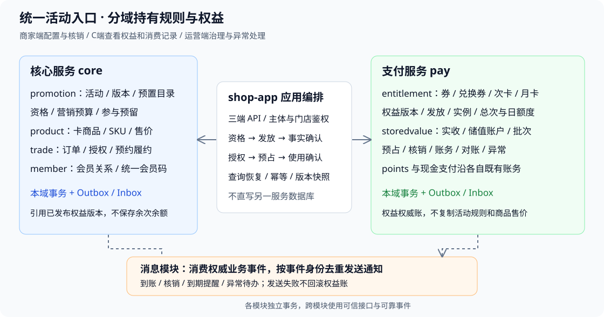

# 活动卡券储值模块化系统设计

状态：实施中（目录基础已接入持久化，整体未上线） · 档位：2 · 2026-10-18

本期目标架构明确：活动类归核心服务，权益类归支付服务。活动管理规则、参与资格及营销预算；支付管理券模板及版本、用户券、付费次卡/月卡、储值账户、权益发放与核销账。商品、订单、会员、预约/履约继续属于核心业务。HTTP入口可以仍在shop-app，入口所在工程不代表业务/数据所有权。

本文是本轮目标架构入口。既有储值设计、统一活动扩展和UI稿中“券在promotion”“次卡在会员资产”的归属与本文冲突时，以本文提案为准；这不意味着运行代码已完成迁移。实施按用户授权的D01–D07推进，实际进度与版本号见§6。

## 文档包

- [D01源码盘点](./design/活动权益-D01-现状盘点.md)：旧券读写链路、部署约束与环境待核对项。

- [代码结构与类清单](./TDD-活动卡券储值-代码结构与类清单.md)：物理包、服务/策略/端口/Controller、逐表实体Mapper及旧类迁移。

- [功能矩阵](../requirements/活动卡券储值-模块功能矩阵.md)：三端、模块、模板、接口及数据映射。
- [数据库设计](./TDD-活动卡券储值-数据库设计.md)：核心/支付分别拥有的数据字典、约束、迁移。
- [API契约](./TDD-活动卡券储值-API契约.md)：沿用接口和新增接口、请求响应、权限与内部协议。
- [核心建表草案](./design/活动权益-core-schema.sql)、[支付建表草案](./design/活动权益-pay-schema.sql)：仅设计DDL，不是Flyway迁移。
- [ADR-038](./ADR/ADR-038-活动归核心权益归支付.md)。
- [40项活动及6项产品模板](../requirements/预期活动预置清单.md)、[预置JSON](./design/活动预置模板-目录草案.json)。
- [统一UI功能矩阵](../requirements/活动卡券储值-统一入口功能矩阵.md)、[29屏原型](../../prototypes/marketing-assets-unified.html)。原型未覆盖6项付费卡完整购买/激活/核销界面，其页面补齐列为设计交付后的独立工作，不冒充已画完。

## §0 现状核对

| 当前源码/契约 | 当前职责 | 目标处理 |
|---|---|---|
| shop-core/promotion/PmtActivity、PmtActivityRule、ActivityService | 统一活动、排期、范围、规则 | 保留，补scene、版本、参与预留 |
| shop-core/promotion/PmtCoupon、PmtUserCoupon、PmtCouponIssue、CouponService、CouponRedeemService | 核心内的券模板/实例/发放/核销 | 目标移至pay.entitlement，契约入口兼容，不能重复建写入口 |
| pmt_apply | 混合活动减价与券使用记录，供营销统计 | 核心保留订单活动优惠事实；券权威使用账迁pay，营销订阅派生统计 |
| marketing旧mkt_*和promotion新pmt_* | 当前逐笔owns路由并存 | 清点两类真实数据及调用，建立精确迁移映射，不只迁新表 |
| pay-domain、payTxManager、stl_payment | 支付事务/收退款流水 | 复用；权益子包统一用pay工厂和事务 |
| 储值sv_*草案 | 未实现的储值设计 | 改为本次pay表族，不在core保存余额 |
| CARD商品、订单、会员 | 商品与交易、身份 | core持有，商品引用已发布权益版本；支付不查core库 |
| /biz/activities、/biz/coupons、/mp/coupon等 | shop-app现有HTTP入口 | 原URL保留或显式新增，内部委派按业务所有者改造 |

本次按本地源码核对，没有查询生产券数量、发行余额、真实通道、统一会员码可用性或部署开关；实施前必须核实。

## §1 模块边界与代码结构



应用层协调本域事务和事件，不建立core/pay跨库事务。

| 模块 | 权威数据与行为 | 只能读取/引用 |
|---|---|---|
| core.promotion | 活动头/版本/规则、资格、参与名额、营销预算预留、活动参与、营销效果投影 | pay权益模板引用/发放结果，不能写用户余次/余额 |
| core.product | CARD可售商品、SKU售价、销售范围与上架 | 已发布权益版本，不自行定义另一份余次规则 |
| core.trade | 订单定价、销售、本人授权意图、履约/预约与售后政策 | 调pay预占、确认、释放，按回执推进订单 |
| core.member | 会员关系、统一会员码、顾客识别 | 通过pay查询权益，不存余额/余次副本 |
| pay.entitlement | 券/兑换券/付费卡模板与版本、库存/发行授权预算、发放、用户权益实例、次数与周期计数、使用账 | 活动资格凭证、订单支付/履约可信事实 |
| pay.storedvalue | 充值/实收确认、金额账户/批次、预占、记账、核销 | core活动权益快照 |
| pay.points | 既有积分改造边界 | 活动若发分调用已验证资金支持的积分协议，不借发券发行积分 |
| shop-app编排/消息 | 跨模块快照、事件协调、对外API、鉴权；消息发送 | 不直写另一模块业务表 |

```text
backend/shop-core/.../promotion/
  activity/{model,service,policy,store}     活动类型与版本、规则
  participation/{service,store,event}     reserve/confirm/release
  preset/                                40项预置玩法目录与能力过滤
  projection/                            营销效果，来自权威事件
backend/shop-core/.../{product,trade,member}/  商品售价、销售订单、身份与履约
backend/shop-base/.../spi/
  promotion/ActivityParticipationPort.java
  entitlement/{EntitlementCatalogPort,EntitlementGrantPort,EntitlementUsePort}.java
  storedvalue/StoredValuePort.java
backend/pay/pay-domain/.../pay/
  entitlement/
    catalog/ grant/ account/ hold/ use/ lifecycle/ query/ recon/ event/
    model/ policy/ posting/ store/ port/
  storedvalue/
    recharge/ account/ posting/ redemption/ query/ recon/ event/
  mapper/{entitlement,storedvalue}/         扫描归paySqlSessionFactory
backend/shop-app/.../
  portal/{biz,mp,ops}/                      保留既有风格的HTTP入口
  payclient/                               三端pay门面
  paybridge/ActivityBenefitCoordinator.java
  paybridge/CardSaleCoordinator.java
  paybridge/EntitlementOrderCoordinator.java
```

model/policy无Spring/MyBatis；业务接口与实现分开；资金/余次变化仅经posting，Controller不访问Mapper。core不import pay实体，pay不依赖shop-core；内部SPI放shop-base。pay可本地或独立部署，远程适配沿用已有内部API承载方式，不能把本地调用成功当成远程组合已通过。

## §2 预置模板与UI

四类活动模板仍归core：成交优惠、权益发放、协同成交、储值激励。40项AP模板只负责创建活动草稿，权益类活动引用pay已发布的模板版本；商品赠品仍走商品库存履约，积分走pay.points，赠金走pay.storedvalue，不把所有benefit都强塞进券账户。

6项EP产品预置：core保存可售CARD商品/售价/模板引用；pay保存权益定义与售出实例。COUNT、PERIOD_COUNT、PERIOD_DAILY分别表示总次、周期总次、每日额度。赠送多次兑换券与付费卡业务源分开。

预置目录只保存推荐标签与schema，不复制业务权威模板。默认关闭，不自动发布。40活动模板和6产品模板都有capability gates；业态标签须映射现有入驻主数据，尤其餐饮、健身、宠物等不因列入目录就开放。金额示例不直接转成正式售价或预算。

商家仍从营销→活动中心进入：活动管理由core；卡券模板、发放/核销操作委派pay；储值办理委派pay并引用core资格；付费卡售卖去商品/订单，管理余次去pay。运营同一入口按权限聚合，资金异常独立入口。C端“我的券/我的卡/会员码/储值核销记录”展示本人权益，储值列表先门店按最近成功储值/核销倒序，不显示内部双池、不单设储值码。

### 2.1 分阶段落地任务

| 阶段 | 主要修改模块 | 交付与闸门 |
|---|---|---|
| D01 契约核对 | shop-base、shop-app、core/pay | 盘点全部券来源与URL，冻结DTO、错误码、权限、迁移映射；明确会员码与订单授权可用性 |
| D02 权益基础 | pay.entitlement | 模板/版本、发行控制、实例、幂等和事件；并发限额、来源唯一性验收 |
| D03 存量迁移 | core.promotion、pay、兼容门面 | 按批迁移，逐资产核对，owner单写与老URL回归 |
| D04 统一活动 | core.promotion | 活动版本、预置目录、资格/预算预留、效果投影；未实现玩法禁用 |
| D05 储值闭环 | pay.storedvalue、应用编排 | 商家收款、到账、使用、门店目录和通知；实收/取消竞争与账实对账 |
| D06 付费卡 | core.product/trade、pay.entitlement | 售价绑定、付款后发卡、首用激活、总次/每日额度；先补UI及经营条款再开放 |
| D07 三端与上线 | biz/mp/ops、消息 | 按U01–U30验收，权限/旧契约/故障恢复、迁移演练、灰度和回滚条件 |

各阶段保留明确能力开关，先验收支付权益底座，再让活动或商品调用。DDL须转正式增量迁移后实施，不能把设计草案直接部署。

### 2.2 执行基线与已核实落点

计划状态：可分解执行，业务代码尚未实施。独立开发分支为codex/stored-value-entitlement-dev，工作区为/Users/robin/.codex/worktrees/stored-value-entitlement-dev，基线00d04e580。需求/设计文档目前在原工作区有未提交文件；启动代码任务前须把本方案与关联文档同步至开发分支，核对差异并提交限定范围的设计基线，不夹带原工作区其他修改。

档位：2；依据为本TDD、ADR-038与U01–U30。计划不预分配Flyway版本，也不将线上数据盘点视为已完成。

| 已核实事实 | 代码落点与执行决定 |
|---|---|
| shop-app配置Flyway locations=classpath:db/migration | 增量迁移位于backend/shop-app/src/main/resources/db/migration；执行前重新查询版本占用，不能直接运行设计CREATE |
| pay-svc/application.yml关闭Flyway，当前仍连接共享主库 | 首期继续由主应用跑迁移；进程独立不等于数据库已独立；不新增第二个迁移执行者 |
| PayDataSourceConfig与PayApplication只扫描ai.neargo.shop.pay.mapper | 权益和储值Mapper放pay/mapper/entitlement及pay/mapper/storedvalue；实体/服务仍按pay/entitlement、pay/storedvalue划分 |
| payTxManager与核心事务独立 | 写服务显式指定payTxManager；编排方法无跨库事务；本地调用也走相同分阶段协议 |
| CouponPortRouter按owns在新旧模型间路由，release会调用两侧 | 迁移前登记旧模型精确owner；取消/售后按原使用事实分派，已迁资产不能再次写旧模型 |
| PayInternalApi/PayInternalPaths与InternalPayEndpoint已存在 | 沿既有内部HTTP承载方式扩展，所有新方法同时提供本地/远程契约与查询恢复 |

下面任务的类全名与方法以[类清单](./TDD-活动卡券储值-代码结构与类清单.md)为准；DTO字段以[API契约](./TDD-活动卡券储值-API契约.md)为准。表名均为[数据库目标模型](./TDD-活动卡券储值-数据库设计.md)，实施时拆为可独立验证的增量迁移。

### 2.3 可领取任务与依赖

任务状态统一使用TODO/DOING/BLOCKED/DONE；下列初始均为TODO。完成条件必须有代码差异与真实验收证据，设计文件存在不算实现完成。每行建议形成一个范围明确的提交或PR；任务过大时按相同编号增加子任务，不改所属模块。

| 编号/依赖 | 责任模块与主要类/文件 | 实施步骤与接口/表 | 完成证据 |
|---|---|---|---|
| D01.1 / 无 | shop-app配置、core promotion/marketing、pay | 记录mkt/pmt表与所有读写入口；列支付事件、会员码、授权意图、Outbox能力；完成源表→目标表/owner映射 | 盘点清单含源码路径、存量环境待查项；未知项有明确处置，不虚构生产数据 |
| D01.2 / D01.1 | shop-base SPI、payclient、PayInternalApi/Paths | 固定SourceRef/DecisionRef、内部命令、状态与query结果；每条API登记新增/兼容、权限、错误码、三语文案与DTO | 外部47条与内部12项均有负责人/阶段；旧接口样例和字段兼容对照 |
| D01.3 / D01.1 | core.trade/member、CardSaleSnapshotService、EntitlementAuthorizationService | 核实本人码识别、授权持久化、源支付/履约决策与查询；列出订单意图、Outbox所需正式字段/表扩展 | 可信源号/状态/修订号可查询；缺少机制时补DDL/API，不以字符串引用代替授权 |
| D01.4 / D01.2 | 数据源配置、pay-svc装配、迁移脚本 | 冻结Mapper路径与事务；核实目标MySQL/MariaDB版本、JSON/CHECK/字符集；修复编译闸门脚本变量问题 | 真实编译基线、已有失败清单、迁移执行与装配方案记录 |
| D02.1 / D01.2/D01.4 | pay实体/Mapper、公共幂等与事件适配 | 建模板/版本、issue_policy/recipient、grant/instance、dedup、outbox/inbox目标表与实体；迁移先扩展不删旧列 | 全新库与存量升级均可运行；Mapper在pay工厂；重跑迁移无数据破坏 |
| D02.2 / D02.1 | EntitlementCatalogService、EntitlementRuleValidator | 模板草稿→发布版本→停发；校验kind/使用模型/范围/币种；P01–P06及内部目录查询 | 老实例规则不随模板改版；停发不撤销历史；发行上限不能低于held+used |
| D02.3 / D02.2/D01.3 | GrantService、IssueBatchService、PostingService | prepare/commit/abort/query；来源唯一、批量预检与容量预留；P07/P08/P11、I05–I07 | 同源重试同实例、异参冲突、并发不超发；跨服务未知不释放营销占用 |
| D02.4 / D02.3 | UseService、CouponQuotePolicy、CodeService | intent/allocation/usage/ledger/code/reversal；迁移报价算法，preview/hold/commit/release/reverse/query；P12–P15/P30、I08–I11 | 只试算不扣、确认释放互斥、原码使用规则兼容、部分售后不超原分配 |
| D02.5 / D02.3/D02.4 | Query/Lifecycle/Exception/ReconService | 本人券包与记录、冻结、异常、恢复、对账；P09/P10/P25/P26/P29、O01–O05/O07 | 跨租户/门店/用户拒绝；余次/分录一致；异常不任意调平 |
| D02.6 / D02.2–D02.5 | payclient本地/远程Impl、InternalPayEndpoint | 新SPI全部接通两种部署；注册内部鉴权、序列化与超时处理；query覆盖在途操作 | 本地与远程同输入同状态语义；关停/超时不产生假成功 |
| D03.1 / D02.6 | EntitlementMigrationService、ent_owner_registry | 构建离线导入/比对工具，保存源号/版本/核销/余次/券码；无真实存量则记录空迁移证据 | 导入幂等，不发通知、不增加发行量；逐资产差异报告 |
| D03.2 / D03.1 | CouponPortRouter、LegacyCouponCompatibilityService | 将旧B/C入口及CouponPort映射唯一owner；release/reverse按原使用事实路由；保留旧DTO | 旧入口回归；未迁只写旧、已迁只写pay；未知owner阻止变更并报异常 |
| D03.3 / D03.2 | 数据迁移作业与运营流程 | 演练冻结批次/排空在途/回填/核对/切换；源表只读；不立即清理旧表 | 迁移前后逐资产次数/历史/码一致；切换后无旧写入证据 |
| D04.1 / D01.2，可与D02并行 | core ActivityVersionService、RuleValidator | 扩展活动版本、scope/audience、recharge_tier；C03–C06 | ORDER与RECHARGE隔离；发布不可变，暂停不撤销已参与 |
| D04.2 / D04.1/D02.2 | ParticipationService/Port、budget/participant/reservation | reserve/confirm/release/query，校验pay已发布版本；I01–I04 | 营销预算与个人限额并发不超；ABORTED后才释放；跨版本限购累计 |
| D04.3 / D04.1 | PresetService、pmt_preset_template、预置JSON | 幂等加载40项AP+6项EP目录，业态标签与能力过滤，C01/C02；只建推荐草稿 | 重复加载不重复建活动；缺能力不可发布；不自动上架/发权益 |
| D04.4 / D04.2/D02.6 | ActivityBenefitCoordinator、MarketingEffectProjector | core资格→pay发行→core确认；事件派生分项统计，C10 | 重投不多发；事件乱序不倒退；储值赠金不计订单折扣 |
| D05.1 / D04.2/D02.1/D01.3 | RechargeService/Coordinator | sv_recharge、account、lot、voucher、entry；P18–P21/P27，保存活动快照与实收证据 | 未实收可取消，实收/取消竞争唯一结果；客户端不能指定赠金 |
| D05.2 / D05.1 | CreditService、StoredValuePostingService | I12到账；余额/批次/双池分录/事件同事务，营销按成功事实确认 | 重复receive/credit不重复到账；实收后异常持续恢复；账户=批次=分录 |
| D05.3 / D05.2/D02.4/D01.3 | RedemptionService、AllocationPolicy | sv_hold_allocation接统一intent/usage；P22/P28，校验本人授权与真实服务订单 | 同源并发不重复扣；金额不超余额；释放回原批次；未知不盲目重扣 |
| D05.4 / D05.3 | StoredValueQueryService/StoreProjector | sv_user_store_index；P23/P24及C明细 | 只列有成功储值历史门店；max储值/核销时间倒序；耗尽保留、等时稳定 |
| D05.5 / D05.2/D05.3 | NotificationSubscriber、既有MessageService | 到账/核销/异常待办通知，O06复用；订阅模板和通道授权接线 | 提交后发送、事件去重、失败只重试消息；C通知无内部双池/明码 |
| D06.1 / D02.2/D04.3 | CARD商品UI、core.product、CardProductBindingService | C07，商品SKU售价引用pay已发布版本；补售卡/激活/余次/日额度原型 | 6种产品预置字段明确；不以储值余额购买冒充真实现金付款 |
| D06.2 / D06.1/D02.3/D01.3 | CardSaleCoordinator、core订单Outbox | 付款事实按订单行/单件/件内序号发卡；订单取消/付款竞争按源决策处理 | 买多件不漏发不多发；迟到支付事件不改变原付款起算时间 |
| D06.3 / D06.2/D02.4 | LifecycleService、三种UsagePolicy、period_bucket | COUNT/PERIOD_COUNT/PERIOD_DAILY；P16/P17，首用激活、总次/每日额度与预约日核销 | 自然月/滚动天数、跨日释放、月底、过期边界正确；并发首用只激活一次 |
| D07.1 / D04.3/D04.4/D05.4/D05.5 | B端/C端/运营端页面与API适配 | 统一活动入口、券管理、储值办理/核销、C记录、运营异常与对账；按功能逐段联调 | U01–U30与页面/API逐项映射，未覆盖有能力开关，不用Mock冒充接通 |
| D07.2 / D06.3/D07.1/D03.3 | 前后端集成与发布 | 双部署装配、目标数据库、兼容/权限/并发/故障恢复；灰度试点 | 全部发布门槛有真实证据；试点账实一致；付费卡条款和能力就绪才开放 |

D07.1应随各功能开发同步推进，不能等后端全部结束才开始UI；D07.2为整体收口。D03.3是生产切换任务，必须在D03.1/2演练后按窗口执行，不随迁移工具提交自动执行。

### 2.4 每个任务统一执行步骤

1. **定位与收敛**：读取对应API/表/类，确认现有可复用路径，列出实际修改文件；超出设计的契约先更新TDD与ADR取舍。
2. **定义失败场景**：从矩阵验收条件选行为，例如同源重投、异参、越权、取消竞争；写有意义的用例并确认失败确实到达目标行为，记录原因。
3. **数据与实现**：读取当前最大迁移版本后分配新号，新增增量脚本、实体与Mapper；实现业务状态机/幂等/事务，然后接端口和API；不得修改已应用脚本。
4. **接通读写与部署**：核对写后查询、C字段白名单、错误码三语、权限及菜单/OpenAPI登记；HTTP与内部服务都接真实实现，验证本地/远程选择互斥。
5. **验证与回填**：运行受影响用例与适当守卫；关键事务另在目标数据库验证；将真实命令、退出码、用例名称、未通过项回填§6，不填预计通过。
6. **限定提交**：审查diff与本任务文件清单，只提交相关变化；更新任务状态。上线、存量切换与代码提交分别记录，不以合并代替上线成功。

### 2.5 验证方案与证据登记

本节为后续实施的验证要求，本轮整理计划不运行业务测试。JDK21、离线Maven和具体模块选择遵守仓库Java规范。用例名下表为拟新增，不能当作已有或已经执行。

| 场景 | 拟新增用例/验收记录 | 实施位置/依赖 |
|---|---|---|
| 模板版本与发行限额 | EntitlementCatalogFlowTest、EntitlementGrantFlowTest | pay-domain纯规则+shop-app真实Mapper场景；目标数据库并发 |
| 幂等/回滚/预占竞争 | EntitlementUseFlowTest、EntitlementRecoveryFlowTest | pay事务及源决策替身；补真实HTTP超时/重复投递场景 |
| 活动预算 | ActivityParticipationFlowTest | core真实Mapper；预算/个人行条件更新 |
| 旧券兼容与迁移 | EntitlementMigrationFlowTest，扩展现有CouponModelCompatTest/CouponIssueFlowTest | 旧mkt/pmt样本、owner及历史券码 |
| 储值到账和金额使用 | StoredValueRechargeFlowTest、StoredValueConsumptionFlowTest | pay账户/批次/分录同事务；实收取消与同源并发 |
| 付费卡 | PaidCardSaleFlowTest、PaidCardAllowanceFlowTest | 订单支付事件、多件发卡、时区/月末/跨日释放 |
| C端隐私/排序/权限 | StoredValueConsumerQueryTest | 本人身份、DTO白名单、乱序事件与稳定分页 |
| 双部署与通知 | EntitlementInternalApiRoundTripTest、EntitlementNotificationFlowTest | pay-svc内部HTTP与shop-app门面、消息去重 |

现有ArchitectureTest、PayTxManagerConventionTest、PayStandaloneAssemblyTest、PayDeploymentModePairingTest按受影响范围执行；修复基线编译脚本错误后用真实退出码记录。SQL portability、entity alignment、接口/权限/i18n/生成物守卫按变更运行；H2不替代目标数据库DDL/CHECK/锁竞争。前端组件使用端侧既有测试方式，补交互与权限行为验证，不写只镜像实现的用例。

每个DONE任务附：提交号、修改文件、U/AP/EP/API映射、验证命令与结果、目标数据库/部署形态、已知问题。失败可按已确认基线分别登记，但不得为了通过修改失败棘轮或跳过校验。

### 2.6 交付批次、估算与上线条件

| 里程碑 | 包含任务 | 可交付能力 | 开放条件 |
|---|---|---|---|
| M0 实施基线 | D01全部 | 契约/迁移路径/可信源决策落点确定 | 未查清真实存量不执行迁移切换 |
| M1 权益底座 | D02全部、D03.1/2 | pay券模板/发行/使用、旧URL兼容及迁移工具 | 双部署、幂等、账户边界验证；旧券按批演练后切换 |
| M2 美业储值试点 | D04、D05、对应D07.1 | 商家收款、活动充赠、核销、C消费记录、通知和运营异常 | 每项功能对应真实接口，账实一致、未知状态可恢复、成员授权接通 |
| M3 次卡/月卡 | D06、剩余D07 | 餐卡/游泳等6类产品、售价绑定、发卡、每日额度 | 产品条款/原型、支付来源与履约能力齐备；无自动续费/无限次 |

初步排期只作容量参考：按2名后端+1名前端+1名QA、相关产品/运营可及时参与估计，M0约3–5工作日，M1约10–15工作日，M2约10–15工作日，M3约10–15工作日；总周期约7–10周并预留约20%集成/迁移缓冲。不是工期承诺，D01完成后按实际存量和基础设施重新估算。若只有单人实施按同样依赖串行推进，不套用此日历周期。

首批可领取顺序：D01.1→D01.2/1.3/1.4→D02.1→D02.2；D04.1可在契约确定后并行。能力开关名称在D01.2登记，未实现不新造可点击入口。40项预置可先完整入目录，按底层能力逐项开放，不因目录齐全承诺40玩法都可运行。生产迁移与新能力发布分别控制。

灰度先选一个明确商家/门店和受控参与人群，按活动/充值/发放/使用原号核对；发现超扣、重复发放、跨主体访问或无法解释的账差立即停止新增受理并保留查询与恢复。具体告警阈值、观察时长与值班人于D07发布单确定，不能缺省放行。

回退采用扩展优先：未切owner可退应用保留新表；已切但目标无新写、已证明一致时方可切回；目标已有发放/核销则停止新增受理、继续查询和恢复，前滚修复或执行审计迁移，禁止直接翻回旧账。关闭活动不影响已到账权益，通知失败不回滚账务。


## §3 完整调用流程

### 3.1 活动配置与发券

1. B/O界面经shop-app调用core创建活动草稿；若利益为券，查询pay已发布权益模板，选定templateVersionNo。
2. core发布不可变活动版本，保存pay模板引用及必要展示摘要。发布时通过内部端口验证引用属于该主体、出资方/币种兼容，不能只相信客户端传的名称。
3. C主动领取或B选人发放，core校验活动/受众/限购并预留营销预算，返回绑定sourceBizNo的资格凭证。
4. 应用层调pay grant.prepare：校验模板版本、发放途径、数量及发行授权额度，持久保留发行容量；commit以同一grantNo发放实例/流水/事件。pay自身发行额度与core营销预算分别有独立上限，不互相重复扣同一个预算。
5. pay发放成功事实回core，将营销占用转已用，创建统计投影；消息域通知。重复请求/事件不多发。
6. 无活动的独立券领取/定向发放，pay依据模板自身发行规则、经签名受众选择事实执行，不强造空活动。core提供会员受众查询，不拥有权益发行账。

### 3.2 储值活动与充值

1. core储值活动选择档位、参与门店、使用范围、预算及每人次数；充值源号由应用层预生成。
2. core.reserve保存参与及预算占用、不可变本金/赠金及范围快照。
3. pay创建充值单并绑定reservationNo；商家实收确认在pay串行推进，确认金额与快照本金一致。
4. pay按来源唯一过账，写账户、批次、凭证、分录、门店投影、Credited事件，原子提交。
5. core消费成功事实确认预算，消息发送总额到账通知。消费核销以后只看pay历史快照，不再实时问core活动是否仍有效。
6. 未实收取消必须先在pay提交取消决定，再凭事件释放core占用。超时或服务不可达只查不释放；收到实收的充值禁止取消。线下已收钱但源单已关闭是人工异常，不伪造自动退款。

### 3.3 付费次卡/月卡购买与使用

1. pay发布卡权益版本：可用服务、总次/日额度、有效期/起算、预约范围；core CARD商品引用该版本并设置商家售价。
2. 消费者购买沿现有商品订单与真实现金支付；core源事务保存订单权益行快照及Outbox，携带orderLineNo、unitIndex、件内entitlementIndex和paidFactNo。
3. pay按订单行+单件序号+件内权益序号唯一发卡（unitsPerItem=1时，同一行买2张发2个实例），记录原支付引用，不伪造重复收款。未付款、无可信支付事实不发卡。
4. 激活起算方式首期选择PAY_SUCCESS或FIRST_USE：前者以权威支付成功时间起算，即使发卡延迟也不重置；后者首次确认使用时原子固定窗口。自然月按商家市场时区确定当月起止，滚动30天按本地日历规则明示；不把自然月写成固定30天。
5. 会员码识别本人后，core订单/预约核验服务和资源，生成本人授权意图；pay preview确认可用权益、prepare占用次数及日额度，commit扣次并写统一使用流水。查结果可恢复，不因网络超时再扣一次。
6. 商品券原有券码仍可定位该券，统一会员码不是全部权益的万能扣款凭证。新增付费卡不新增储值专用码，仍经本人授权和明确选卡。

### 3.4 订单用券及核销

订单券报价由core提供可信行项与门店/币种/优惠后计价基数，pay返回具体实例的试算金额及quoteRef。core先活动后券，试算不扣权益；下单重新核验并hold。支付成功确认使用，取消且未成功则release。合法售后按原订单分摊做内部reverse，累计不超原使用；不因本次储值无线上退款而删除既有订单券售后行为。

STORE_CODE兑换券只能到店核销，不允许同时进入订单抵扣；付费次卡走明确服务订单来源，不能把兑换当成赠品订单折扣额。兑换次数与储值金额使用各自分配行，使用记录统一查询时注明assetKind，不能直接相加为收入。

### 3.5 跨服务一致性与授权

每个源模块自己的状态/Outbox同源事务；目标模块Inbox/账/出站同目标事务。core营销事务与payTxManager不共享，禁止跨库事务或在长事务里HTTP。reserve/prepare/commit/release/query所有命令有稳定业务号、幂等键和payloadHash；重投同参返回原结果，异参409。

core营销预留RESERVED→COMMITTED/RELEASED；pay发放PREPARED→COMMITTED/ABORTED。只有pay持久确认未发放且已禁止后续提交的ABORTED事实，才可释放core预算，不能由TTL直接释放。支付已实收/订单已支付的在途义务须继续发放或进入人工待办，不能通过活动结束撤销。反向confirm使用eventNo+权威业务号去重。

使用预占HELD→COMMITTED/RELEASED互斥。core先持久化订单/本人授权决策，冻结版本；pay按可信decisionNo提交。超时任务查询core决策：明确取消才释放，成功决策只确认，未知继续挂账。伪造普通HTTP authorizationRef不获得授权；内部调用服务鉴权、主体及消费人一致性都必须校验。

### 3.6 通知节点与事件协议

| 时机（只以事务提交后的权威事实触发） | 事件所有者 | 收件人/通知类型 | 展示与动作 |
|---|---|---|---|
| 充值提交待实收 | pay.storedvalue / RechargeSubmitted | 商家有权确认人，业务待办 | 金额、门店、充值单；跳P27，禁止在待办中宣称到账 |
| 充值到账 | pay.storedvalue / RechargeCredited | C服务通知；商家结果通知 | 到账总额、门店、时间、记录入口，不拆本金赠金 |
| 券/卡发放成功 | pay.entitlement / EntitlementGranted | C权益到账通知 | 券/卡名称、次数/期限、使用说明；活动仅提供来源展示 |
| 核销成功 | pay / EntitlementUsed、StoredValueConsumed | C消费通知；商家操作回执 | 项目、门店、金额或次数、时间、详情入口；付费卡展示剩余次数 |
| 首次使用激活 | pay.entitlement / EntitlementActivated | C使用成功消息附激活信息 | 起止日期、每日额度；与同次核销合并一条，避免重复打扰 |
| 即将到期 | pay.entitlement / EntitlementExpiring | C提醒（默认提前3个服务日一次） | 仅有剩余且尚有效卡券；储值本金不套券有效期提醒 |
| 发放/入账/核销长期未知或对账差异 | pay / ExceptionOpened | 商家或运营异常待办 | 原业务号、状态、允许动作；不得给C发失败通知诱导再次付款 |
| 未实收取消/驳回 | pay.storedvalue / RechargeCancelled | 商家经办人结果通知 | 原因；未承诺到账不发“退款成功”通知 |
| 活动暂停/结束/预算不足 | core.promotion / ActivityStateChanged | 活动负责人管理通知 | 影响后续参与，不撤销已到账权益 |

消息发送由现有消息模块执行，core/pay只发布业务事件。最低事件信封：eventNo、eventType、schemaVersion、tenantNo、entityNo、aggregateNo、aggregateRevision、sourceRef、occurredAt、traceId、payload；消费者按tenant+eventNo幂等。收件人由主体关系与岗位计算，不接受外部任意手机号。消息载荷不带明码、授权引用或内部资金拆分。

站内消息作为首期可控通道，小程序订阅消息按用户授权及已配置模板发送；短信仅按商家已开通配置及授权发送，不默认开通营销短信。消息失败仅重试发送，不回滚到账/核销；失败可在既有通知日志查询。消息去重键为业务事件+接收人+模板+渠道，业务重试沿用原事件身份；提醒按instance+截止版本+提醒批次去重。通道模板未接入前明确标记能力缺失，不宣称实际送达。

## §4 月卡/次卡规则与账务

COUNT以整数totalUnits计数，可有期限；PERIOD_COUNT同时限制有效期与总次数；PERIOD_DAILY按serviceDay+periodKey独立记每日quota，未使用额度不结转。30次餐卡可以一次扣多次，但请求units必须>0、在服务订单数量与限额内。不限总次数月卡本期不开放。

每日预占计入reserved，commit转used；释放在原服务日计数器回补，不按释放时的日期操作。hold过期且跨日须核对原源决策；不能把昨天的未结单在今天免费再占。预约日期可不同于下单日期，serviceDay来自可信预约/核销意图并由模板决定允许范围；提前预占、改约需新版本重新占用。

锁顺序：先持久业务头/幂等操作，再账户或权益实例，再period bucket，再稳定排序批次/分配；grant预算计数在固定顺序内，不与核销反向获取core活动锁。账户/实例余额与分录/流水同事务提交。pay使用同一dataSource可对券/金额组合做短事务，但首期储值不叠积分或券，不能擅自开放组合支付。

首期不提供储值线上退款，付费卡线上退款也不在当前UI范围；新售卡的退卡/停业处理/到期剩余规则是开放售卖前必须确认的经营条款。既有券业务已承诺的订单取消/售后继续支持受限内部补偿。冻结/到期不允许新用，历史查询保留；金额账户本金不因券/卡到期清零。

## §5 迁移与兼容

原pmt_coupon*及旧mkt_coupon*的模板、实例、余次、核销码、发放来源和历史核销事实都需盘点。不得只建立新pay表然后仍允许core继续改旧余次。

1. 清点来源表及URL/SPI/统计消费者，记录样本总量、剩余权利与原始关联；是否存在真实存量在实施前确认。
2. pay建新目标表及映射，保留全部业务号；发生同号冲突时内部使用(sourceSystem,sourceNo)区分，兼容层记录精确映射。迁移凭证标明历史来源，不编造付款或发卡日期。
3. 在明确截止水位冻结本批实例写入、排空源在途操作，快照迁移；增量应用及校验按sourceSeq幂等。导入过程不发新权益或新通知。
4. 校验模板、状态、余额/次数、冻结、日额度、核销流水、券码查询全部一致；切换精确owner registry后pay成为该批唯一写者。不同批可逐步迁移，但同实例不双写/双扣。
5. 原HTTP入口继续通过鉴权门面按明确迁移归属访问；不是按“查不到新表就回旧表”猜归属。旧core账务表只读归档，原pmt_apply券记录不再被订单优惠汇总重复累计。
6. 回退只能在目标无新写且可证明一致时切回；pay已经产生新承诺/核销后不能直接翻开关回旧表，要以前滚修复或可审计迁移处理。

未应用的sv_campaign草案取消；已应用Flyway不修改。权益模板管理API运行入口仍可保留，内部owner改为pay；不要把重命名包当作完成资金迁移。

## §6 验收与交付边界

功能验收见矩阵U01–U30及API端点映射；每个矩阵项在实施时对应真实测试方法。必须验证：模板改版不变历史、core预算与pay发行额度并发不超发、同订单行多件幂等发卡、卡余次与每日额度条件非负、过期码及越权拒绝、源取消与confirm竞争、迁移后无双写、事件乱序不倒退门店排序、C DTO和通知无本金赠金内部拆分。

目标数据库须执行DDL/JSON/CHECK、索引与事务并发测试，不能仅凭H2。后端编译闸门脚本现有变量报错须先修复并以真实退出码验收。按本地/远程pay、既有会员授权、订单事件和凭据存储分别验收。

设计阶段先交付文档、设计DDL和契约清单；代码实施进度见下方记录，生产上线与存量切换独立执行。预置模板可见不等于能力可用。涉及付费卡的购买/激活/余次/每日额度原型，以及统一活动模板四类目录，列为后续原型补齐工作。

### 设计阶段静态校验记录（2026-10-18，早于下方实施记录）

已检查文档包相对链接、U01–U30/AP001–AP040/EP001–EP006编号、47条外部接口与12条内部操作编号及表格列数、核心12张/支付26张逻辑表的主键/租户/索引字段与字典对应、预置JSON的模块归属，以及模块图SVG XML。`node scripts/check-v2-docs.mjs`通过；`git diff --check`通过。这些均为静态校验，未执行目标MySQL DDL、Java编译、并发事务或真实通道通知测试。

### 第一批实施记录（2026-10-18）

| 任务 | 状态 | 实际落点/证据 | 尚未完成 |
|---|---|---|---|
| D01.1 | 源码盘点DONE | design/活动权益-D01-现状盘点.md；包括mkt/pmt、活动/邀请奖励/交易/售后与旧URL | 生产存量核查留到迁移前，不宣称已查 |
| D01.2 | DOING | shop-base/spi/entitlement/SourceRef；4条测试RED→GREEN | 其他SPI/DTO、权限/i18n与OpenAPI尚未接通 |
| D01.3 | DOING | 确认OrderServiceImpl用事务Outbox发布OrderPaid | 本人授权、售卡快照、源决策query待实现 |
| D01.4 | DOING | JDK21离线pay-domain及依赖test-compile退出0；编译闸门变量展开回归1条RED→GREEN | 完整后端闸门与双部署验收未完成 |
| D02基础规则预研 | 纯规则已实现 | UsageQuota.Count/Daily；5条测试RED→GREEN | 未接数据库状态机/接口，不代表D02完成 |

SourceRef提供grantKey/useIntentKey/settledKey，按长度前缀SHA256编码，数据库唯一键仍需含tenant。unitIndex和entitlementIndex从1开始，必须带父级身份；修订号只进入预占意图键。UsageQuota是不可变纯计算模型，不替代持久化条件更新和状态机。

目标38张设计表已在隔离MySQL 9.7.2新库执行成功，不代表存量增量升级完成。正式迁移前仍需对齐BaseEntity的version/deleted与目标revision、审计时区及主体数据域登记。

数据库约束自动回归：`node --test scripts/tests/entitlement-schema.test.mjs scripts/tests/head-compiles-ref.test.mjs`通过2项检查；验证日额度CHECK、租户复合唯一、条件预占返回1后0、非法JSON拒绝，以及闸门变量展开。容器每次独立创建并清理，不连接已配置业务数据库。

### 对齐补充

已用失败检查复现模板无草稿持久字段与公共version列缺失，再补齐ent_template.draft_snapshot及全部目标表version/deleted。MySQL目标表检查恢复通过。数据库设计中的version/deleted对齐已完成；正式增量迁移、领域审计UTC/actor填充和实体Mapper集成仍待D02.1实现。SourceRef消融验证：临时忽略useIntent修订号后用例失败，恢复实现后4项通过；Count/Daily另5项通过。

### 编译与全量回归结果

验证代码提交97dc22b22：`bash scripts/check-head-compiles.sh HEAD`从干净副本test-compile成功；全量20模块3513用例，9项失败，退出1。失败为M6bCouponFlowTest.funderIsRecordedSeparately及ProxyOrderFlowTest的8项，均返回FULFILLMENT_NOT_SUPPORTED(70013)，不能宣称全量通过。

在未修改基线00d04e580隔离工作区复跑`mvn -o -q -f backend/pom.xml -pl shop-app -am -Dtest=M6bCouponFlowTest,ProxyOrderFlowTest -Dsurefire.failIfNoSpecifiedTests=false test`：27+10=37项全部通过。说明单独执行可通过，组合执行状态污染仍待定位；未把这9项加入known-failures，未修改其他业务功能。D01.4继续DOING。后续3e58086fe仅调整设计DDL及对应独立数据库检查，Node两项回归已通过。

实际交付为源码盘点、SourceRef协议身份、UsageQuota纯规则、闸门修复及设计对齐；运行API、正式增量迁移、余额/次数持久账与三端功能均尚未完成。下一实施点仍是D01.2/1.3/1.4和D02.1，不跳过可信授权、存量核对或幂等持久化。

### 第二批实施记录（2026-10-18）

| 任务 | 实际交付 | 未完成边界 |
|---|---|---|
| D01.4 全量失败定位 | 按字母序组合AddressSalutationTest/M6bCouponFlowTest/ProxyOrderFlowTest，41项复现9红；AddressSalutationTest恢复G0001原履约配置后41项全绿 | 全量干净副本重验另记结果，不能只凭组合绿宣称全量绿 |
| D01.2 目录端口 | shop-base EntitlementDefinition/EntitlementCatalogPort；pay本地PortImpl验证发布状态、主体、币种及ACTIVITY_GRANT/PAID_PRODUCT用途，停发仍可读历史 | 新对外权限/HTTP DTO、活动参与/发放/使用端口和独立pay远程接线仍待实现 |
| D02.1 目录表子集 | V425__entitlement_catalog.sql，三张表ent_template/ent_template_version/pay_ent_command_dedup；对应实体/Mapper归pay工厂，H2 schema由生成器更新 | 不包含发行控制、实例、核销账、Outbox/Inbox或存量迁移；未连接生产 |
| D02.2 目录内核 | create/saveDraft/publish/changeStatus/get/getVersion/list；payTxManager原子提交业务与幂等响应；UTC/可信actor；不可变发布快照；终止状态和平台出资守卫 | P01–P05 HTTP入口及P06发行控制未开放。范围refs只做结构校验，对外接线前还须由core核实真实项目/门店归属与权限 |

EntitlementCatalogFlowTest本批12项通过，覆盖持久回读、稳定幂等/异参冲突、发布与历史快照、跨主体/租户、暂停/结束、pay事务回滚、UTC审计、SQL分页、三类卡模型、并发同键、平台出资写权限、本地SPI引用、过期绝对期限不发布与键大小写/空白。已观察缺实现失败、平台状态守卫失败、空白键失败后修复；并发测试验证同键4线程只一份。原有架构/Mapper/Schema/支付部署装配守卫按受影响范围通过。

隔离mysql:9.7.2验证V425可执行/重复执行，三张正式目录表与目标模型列集合、类型及空值约束一致；仍验证38张逻辑设计表及JSON/CHECK/条件更新。新增原生MySQL检查复现默认collation把KeyA/keya合并，修复request_key为utf8mb4_bin；应用拒绝首尾空白，保持键不透明且大小写敏感。该检查不等于Java全服务已在生产数据库完成集成验收。

生成物同步：schema-test.sql、ER图/词汇；ER补ent/pay前缀及表级模板引用，避免与商品/消息template_no误连。实体字段与血缘检查20项通过。原有gen-model-align被MemberSetting错误字段映射阻塞，未修改生成器或伪造模型报告；在未修改基线00d04e580复现同样错误。spec-completeness有3项字段说明失败，基线与本分支相同（C/B/运营字段JSDoc），未加入豁免或改失败清单；本批未改变TS运行契约。

正式迁移版本号V425在本隔离分支分配，集成时须再次检查其他分支版本号占用。绝对期限在发布和新引用时验证未过期；历史读取继续保留，不自动撤销已取得权益。
