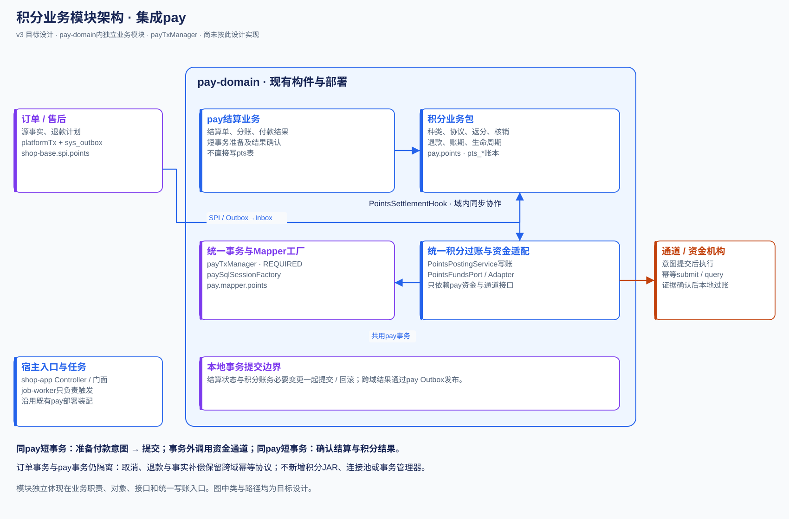

# TDD 积分独立业务模块需求设计与开发计划

状态：v3开发中，用户已授权实施，生产参数待确认 · 档位：2 · 创建与更新：2026-10-14

实施前提：用户确认积分尚未上线；本期直接替换旧实现，首次上线仅使用最新逻辑，不安排旧业务数据迁移、双引擎或旧客户端兼容版本。

积分是`pay/pay-domain`内的独立业务模块，根包`ai.neargo.shop.pay.points`：拥有自己的账本、头寸、退款准备、资金预留及统一写账入口，复用pay事务和数据源。订单/售后经SPI交互，pay内结算经域内Hook协作。采用平台预存 U/C/D/B、R 独立应收、接收户退款预留，形成订单/支付/积分之间可恢复的闭环。

关联：[独立 PRD](../requirements/PRD-积分模块.md) · [资金方案](./design/积分资金方案-平台预存池.md) · [ADR-036](./ADR/ADR-036-积分改为平台出资预存池.md)。本文取代同路径 v2 草稿；v2 DDL/接口不是本期实施依据，历史可从 Git 76e58770a 查询。开发任务在 §2.13；按§2.13执行，实际进展与验证记录见§5/§6。



订单/售后与pay是跨域关系，使用SPI和持久事件；积分与结算是pay内部的业务模块，通过PointsSettlementHook及资金接口协作，可共用pay事务。积分负责分数和账务，外部通道调用在本地付款意图提交后执行。

图册：[完整积分流转与模块类图](./design/积分模块-流转与类图.md)；类结构真源：[设计图契约](./design/积分模块-图契约.json)，由`python3 scripts/gen-points-diagrams.py`生成SVG及图册。图契约具名化核心设计类、方法及SPI适配，非现有源码反射；跨域SPI在`port/`对应Earn/Redeem/Refund/Fact四个实现；域内PointsSettlementHookImpl分别委托付款、生命周期和核销服务。

## §0 对账一 需求到设计

| AC | 需求 | 设计节 | 开发任务 |
|---|---|---|---|
| AC-PTS-01 | 模块边界 | §2.1 | T01 |
| AC-PTS-02 | 种类 | §2.2 | T03 |
| AC-PTS-03 | 运营备款 | §2.3 | T03 |
| AC-PTS-04 | 备付隔离 | §2.3 | T02 |
| AC-PTS-05 | 备款流转 | §2.3 | T03 |
| AC-PTS-06 | 返分规则 | §2.4 | T04 |
| AC-PTS-07 | 发放预算 | §2.4 | T04 |
| AC-PTS-08 | 发放闸门 | §2.4 | T04 |
| AC-PTS-09 | 转正 | §2.7 | T08 |
| AC-PTS-10 | 受理协议 | §2.5 | T05 |
| AC-PTS-11 | 在途承诺 | §2.5 | T05 |
| AC-PTS-12 | 核销计算 | §2.5 | T05 |
| AC-PTS-13 | 退款额度 | §2.3 | T05 |
| AC-PTS-14 | 下单降级 | §2.7 | T08 |
| AC-PTS-15 | 取消与关单 | §2.5 | T05 |
| AC-PTS-16 | 随单兑付 | §2.6 | T06 |
| AC-PTS-17 | 付款结果 | §2.6 | T06 |
| AC-PTS-18 | 路径能力 | §2.1 | T06 |
| AC-PTS-19 | 结算基数 | §2.6 | T06 |
| AC-PTS-20 | 定期出单 | §2.6 | T09 |
| AC-PTS-21 | 草稿修订 | §2.6 | T09 |
| AC-PTS-22 | 定期退款 | §2.6 | T09 |
| AC-PTS-23 | 应收抵销 | §2.6 | T09 |
| AC-PTS-24 | 退款比例 | §2.8 | T07 |
| AC-PTS-25 | 退款准备 | §2.8 | T07 |
| AC-PTS-26 | 现金扣减 | §2.8 | T07 |
| AC-PTS-27 | 退款恢复 | §2.8 | T07 |
| AC-PTS-28 | 备付退款 | §2.3 | T07 |
| AC-PTS-29 | 积分回流 | §2.3 | T10 |
| AC-PTS-30 | 到期 | §2.9 | T10 |
| AC-PTS-31 | 暂停 | §2.9 | T10 |
| AC-PTS-32 | 明细统计 | §2.10 | T11 |
| AC-PTS-33 | 可靠事件 | §2.7 | T08 |
| AC-PTS-34 | 对账 | §2.10 | T11 |
| AC-PTS-35 | 权限 | §2.11 | T12 |
| AC-PTS-36 | 旧方案移除 | §1.1/§2.12 | T13 |
| AC-PTS-37 | 首次上线 | §2.12 | T13 |
| AC-PTS-38 | 审计并发 | §2.2 | T02 |
| AC-PTS-39 | 整数与时区 | §2.2 | T02 |
| AC-PTS-40 | 运营任务 | §2.10 | T11 |

没有未映射需求；付款意图、事件 Inbox/Outbox、接收户预留、账单修订、退款准备分别支撑 AC-17/33/29/21/25，不作为额外业务功能。

## §1 现状与影响面

| 现有位置 | 本期改动 |
|---|---|
| `backend/pay/pay-domain/.../PointsService.java`、`impl/PointsServiceImpl.java`、`PointsConfig.java`、`port/PointsPortImpl.java` | 直接替换并删除旧实现/配置，调用统一改接pay.points；不保留旧写分支 |
| `backend/shop-base/.../spi/settle/PointsPort.java` | 调用统一迁至 `spi/points`，删除旧SPI及其默认空操作；不建立新旧接口路由 |
| `backend/shop-core/.../trade/service/impl/OrderServiceImpl.java` | hold/release 及订单事件快照；支付后的内存调用改为源事务 Outbox |
| `backend/shop-core/.../trade/order/refund/service/AfterSaleRefundExecutor.java` | 在现有退款执行器接入 prepare/confirm/abort，不在 doRefund 再重复一套现金链路 |
| `backend/pay/pay-domain/.../impl/SettleServiceImpl.java`、`PayoutServiceImpl.java` | 原地改造积分成本/付款来源，删除旧商家发分费口径；与积分经域内Hook，共用pay事务提交必要状态 |
| `backend/shop-app/.../payclient/*Points*`、`portal/{mp,biz,ops}/pay/*Points*` | 原地改接或移动现有门面/Controller；统一使用最新DTO及端点，每个URL仅一个处理器，三端同步更新 |
| `backend/shop-app/.../config/{PayDataSourceConfig,DataScopeRegistration}.java` | 复用既有pay Mapper扫描和工厂，积分Mapper归pay.mapper.points，补权限域注册 |
| `backend/shop-store-mybatis/.../event/{OutboxEventBus,OutboxPump,OutboxConsumer}.java` | 复用平台事件接口；积分出站使用自身表/Mapper，不能误用平台事务发布 |
| 三端、API/i18n/权限种子、ui-catalog | T12 接新接口；界面落地时更新清单，规划阶段不登记不存在的页面 |

当前 pay 使用独立连接/`payTxManager`但 URL 仍指主库。job-worker 明确不依赖业务模块；积分任务体驻pay-domain，shop-app/pay宿主按现有调度目标装配，由 worker 通过已有 job API 触发。

可复用：MarketService、BizKey、Outbox 调度框架、RefundLedger 的条件写、OpsAlertPort、JobHandler/JobDeclaration、现有付款/通道能力、权限与国际化规范。复用 API，不复用旧积分资金口径。优惠券、物流、库存、储值卡领域模型不改；订单计价、退款、佣金和结算接缝会改。

### 1.1 现有功能处置清单（积分未上线，直接替换）

实施方式：保留现有pay构件、订单/售后/结算骨架与三端页面，新增pay.points业务内核并直接改接现有调用。删除旧积分业务逻辑、收费口径、任务与配置；开发期间可分任务提交，但发布版本只存在最新实现。

| 已实现功能 / 现有源码 | 本期处置 | 任务 |
|---|---|---|
| PointsServiceImpl、PointsService、PointsConfig、PointsPortImpl；旧积分Entity/Mapper | 新业务内核完成后删除旧实现及旧SPI；清理SettleMappers的积分成员，保留支付/结算其他Mapper | T01/T02/T13 |
| pts_user_account/pts_user_ledger/stl_points_pool | 不导入旧测试余额/流水；建立最新表族。清理旧表/字段时使用新的Flyway脚本，不改已应用脚本 | T02/T13 |
| OrderServiceImpl.deduct/grant/reverse、PointsRuleHandoff、PointsRulePortImpl | 保留券后计价、分摊输入和商品规则来源；统一改为新SPI/可靠事实，删除旧调用 | T04/T05/T08 |
| AfterSaleRefundExecutor、RefundLedger、AfterSaleServiceImpl | 保留现金退款唯一执行器与防超退账本，接入prepare/结果确认；删除旧整单退分/收分AfterCommit回调 | T07/T08 |
| refundMode=POINTS及AFTER_SALE_COMP | 删除积分形式售后退款入口、校验分支与业务实现，前后端枚举/文案/契约同步清理 | T07/T12/T13 |
| SettleServiceImpl、PayoutServiceImpl、BillRefundMapper、BillRefundShare | 保留货款、佣金、通道及退款份额骨架；按最新设计处理核销/补差/兑付，删除商家发分服务费及旧积分资金池写入 | T06/T09/T13 |
| PointsActivateJob、PointsIdentityJob、PointsPoolReconAxis | 用新生命周期任务/对账能力替换；复用调度框架，删除旧任务注册，不让两套任务同时加载 | T10/T11/T13 |
| FundInvariantServiceImpl、shop-app/paybridge/FundInvariantReconciler | 改查新凭证/头寸及源事实；删除旧积分流水查询、清旧发放标志及旧reverse修复路径 | T08/T11 |
| 三端Points Controller、payclient门面、现有页面 | 保留有用入口，直接改接新服务/DTO；删除旧服务费视图和旧策略端点，不保留兼容适配 | T12 |
| points.config、points.client.policy及旧商家开关 | 移除旧配置读写及默认兜底；按最新种类/规则/暂停/受理协议配置，不把旧开关自动当协议 | T03/T05/T12/T13 |
| 现有积分测试/夹具/种子 | 沿用有价值的场景，改为最新业务断言；删除旧收费、允许负余额、旧表和旧接口专属断言，新增真实备款夹具 | T01–T13 |

本期不创建钱包/来源引擎路由、迁移批次、旧账映射、迁移开账或旧读兼容服务。数据库结构变更仍按仓库Flyway规范实施；这是表结构升级，不是积分业务数据迁移。测试环境数据用最新模型重新建立，本次文档修订不执行清库或业务代码删除。

## §2 业务设计与技术方案

### 2.1 独立模块与依赖

积分在现有`backend/pay/pay-domain`中独立为业务包，不修改Maven模块拓扑、不新增JAR。根包`ai.neargo.shop.pay.points`；独立是业务职责、对象、表族、应用服务和写账入口的独立，资金执行与部署继续属于pay。

| 单元 | 路径 / 职责 |
|---|---|
| 纯模型 | `pay.points.model/`：金额比例、持有方、凭证、快照、状态，无Spring/MyBatis |
| 计算 | `pay.points.policy/`：返分、核销、退款、到期、账期，只依赖model |
| 统一写账 | `pay.points.posting/`：校验/幂等/稳定锁序/原子过账 |
| 子能力 | `pay.points.type/pool/agreement/earn/redeem/refund/statement/payout/lifecycle/recon/query/job/event`；各自编排及读端口 |
| 持久化 | `pay.points.store/impl`；Mapper单独放`pay.mapper.points`，使用已有paySqlSessionFactory |
| 跨域SPI实现 | `pay.points.port/`实现shop-base/spi/points的Earn/Redeem/Refund/Fact；HTTP Controller继续在shop-app |
| 域内结算Hook | `pay.points.app.PointsSettlementHook` + `pay.points.port.PointsSettlementHookImpl`；结算只读快照/提交业务动作，不直写积分表 |
| 域内资金接口 | `pay.points.port.PointsFundsGateway` + `pay.points.port.PayPointsFundsAdapter`；只依赖pay资金/通道接口，不依赖pay.impl结算实现 |
| 外部事实适配 | `shop-app/.../payclient/OrderPointsSourceFactsAdapter`实现PointsSourceFactsPort；积分不跨包SQL查订单/售后 |

复用`payTxManager`、`payDataSource`、`paySqlSessionFactory`。已有扫描`ai.neargo.shop.pay.mapper`自动涵盖积分Mapper，不新增工厂/连接池/全局扫描排除规则。shop-app与pay-svc两种宿主均沿既有pay装配；权限/填充器/分页仍须验证，没有新数据源不等于可省数据权限检查。

积分账务服务显式`@Transactional("payTxManager")`，posting默认REQUIRED。结算状态、头寸、凭证、回执结果和pay出站事件需要一起落库时，由pay域短事务加入同一事务；任一失败整体回滚。订单事务仍不能联动回滚pay已提交占用，保留prepare、Outbox/Inbox及事实补偿。

外部付款不放在pay数据库事务内：先用短事务提交结算/积分付款意图，随后无事务编排调用通道，明确结果后另开短pay事务同步修改资金状态与积分。不能把beginPayout嵌在尚未提交的长executeSplit事务后立即调外部。

ArchUnit：model/policy不碰框架；订单/行业仅经SPI调用积分；结算只能经PointsSettlementHook进入积分业务服务；pay其他子模块不能直写pts表。积分不依赖shop-core、shop-merchant或pay.impl结算实现，可以依赖pay资金/通道接口。账务Store写只被posting使用，非账务元数据服务可条件写审计；Mapper仅被store.impl使用。测试确认积分/结算共享pay事务，而platform事务仍隔离。

资金能力接口PointsFundsGateway留在pay.points内；DIRECT补差、AGGREGATED专项回补/付款、现金补收逐项判定。远程pay部署复用既有PayInternalApi及宿主适配扩展，不引入独立积分部署开关；未验证的通道/部署组合禁止开放积分，不能默认成功。

### 2.2 语言、数值与统一过账

四类业务积分户：ISSUE、USER、STORE、RECEIVE；MINT为发行登记。USER有PENDING/AVAILABLE/HELD（订单与退款占用分别在头寸记来源），STORE有PENDING/AVAILABLE，RECEIVE有REFUND_RESERVED/RECIRCULATABLE。种类ACTIVE→DRAINING→RETIRED：DRAINING停止新返分但允许存量余额核销/收尾，仍占active_market，不能同时启用另一种类；用户/门店余额、D、退款预留、R及未知资金/准备全部清偿后才能RETIRED。兑换比例变化的跨种类价值迁移另行设计，本期不在线改比例。

兑换比例为既约 `(pointsUnit, minorUnit)`；每笔分摊、头寸及凭证行均对齐 pointsUnit。中间乘除使用 BigInteger，最终金额/分数转换long前验溢出，不用double。多币种/多种类不能合成一凭证。时间字段统一epoch毫秒，业务日期按Market时区，存量审计列沿仓库规则。

| 不变式 | 校验 |
|---|---|
| V1 | 每凭证积分户变动合计=0，包括发行登记 |
| V2 | ΔU=m(ΔISSUE)；U=m(ISSUE余额) |
| V3 | ΔC=m(ΔUSER+ΔSTORE)；C=m(USER三格+STORE两格) |
| V4 | Δ(U+C+D+B)=经核验的实际现金/专项划拨变动；R不参与 |
| V5 | 非MINT所有格非负；B≥预留总额；占用/付款/退回计数不超原额 |
| V6 | REFUND_RESERVED余额=仍须保留的接收户积分头寸之和 |
| V7 | 原应兑付=未付+付款锁定+已结算价值+付款前退回；已结算价值包括现金与抵销，付款后退回累计不超过已结算价值 |
| V8 | 原发放=仍待生效+已转正累计+待生效收回；已转正的收回按积分收回/现金补收/平台承担分别计数 |

`PointsPostingService.post(Voucher)`唯一账务写入口。Voucher包含bizRef、payloadHash、type/rate/currency快照、PointsMove、FundMove、PositionMove、ReserveMove、EvidenceRef及结果快照；构造校验V1–V4/对齐，执行校验状态/上限。

固定锁序：(typeCode,对象类别,holderType,holderNo,bucket/positionNo)排序，多用户/多门店不能沿请求数组顺序锁。先抢唯一bizRef，冲突读原结果并校验hash；按稳定键锁定并条件更新，任一0行全部回滚；写凭证/明细/出站事件与结果同事务。

同一业务动作键含对象/修订：HOLD:orderNo、GRANT:subOrderNo、REFUND_PREPARE:afterSaleNo、REFUND_CONFIRM:afterSaleNo、PAYOUT:ticketNo、EXPIRE:accountNo:expiryRevision、STATEMENT_CONFIRM:no:revision、RELEASE_RESERVE:positionNo:closureVersion。不能用仅用户号的到期键，否则续期后第二次到期不执行。

### 2.3 资金、退款额度与接收户

专户U未分配/C权益备付/D兑付未付/B退款备付；R保留在应收台账。B预留记录在`pts_refund_reserve`，不是从余额中再减一遍；freeB=B−有效预留之和。hold预留最大可退核销价值，绑定每张核销头寸；取消/付款前退回释放，付款后失败追回时消耗，权威责任关闭后释放。B不足的新hold原子拒绝。

补U：先消费RECEIVE.RECIRCULATABLE，不足部分MINT→ISSUE，U增加实际备款。补B：B增加，不发行分。U转B：U减少/B增加，同时ISSUE→RECEIVE.RECIRCULATABLE；不虚构外部现金。提取U同步ISSUE→接收户；提取B只可提freeB。补款/提取证据唯一、已核验且同币种，双人复核；计划只建申请。

支付随单/定期确认：用户或门店→RECEIVE.REFUND_RESERVED，C→D。付款前退款：预留接收户→用户，D→C，释放相应B额度。付款后资金已追回：预留接收户→用户，实际回款进C，释放B额度；未追回：预留接收户→用户，B→C、消耗B额度、开R。迟到回款统一经退款准备/应收记录归集，已有B垫付的回款回B，不能再进C。

R回款：R减少、B增加（真实现金入专项）；抵销回款见§2.6。每张应收记录保留原退款/垫付证据和已追回额，累计不能超原额。出资不足停止新承诺，不动已有预留。

退款责任解除需订单权威事实：窗口结束、无进行中售后、资金结果明确；结算终局只是转正/门店确认，不是解除。关闭后把剩余RECEIVE预留转可回流，释放B额度。退款prepare与解除操作锁同头寸，恰一笔先成功；关闭后的额外补偿另经审批备款，不自动走已解除的退款头寸。

### 2.4 发放设计

订单记录每行返分规则版本、数量、商品现金实付及赠品标志，购物返分按子单计算（“整单不足不发”明确为整张子单，不要求跨商家主单一起发）。规则取商品键存在→类目→兜底，0不回退；FIXED×qty，RATIO按实付万分比，行分数向下对齐，行价值不超过该行商品现金实付，合计保存逐行GrantLine。

GrantCommand带订单支付事实和行快照。GRANT U→C、ISSUE→USER.P；预算竞争条件写失败转为SKIPPED/POOL_EXHAUSTED，其他失败仍重试，不能把未知故障吞成预算不足。暂停/线下/冻结/规则0记不同原因。转正只转当前剩余P；退款在先的事实减少应发数量，全部退完不再补发。迟到发放逐行固定grant_before_refunded_goods_minor及grant_basis_minor=原商品现金实付−发放时已退商品额；原规则按原下单快照算original_rule_points，实际发放=floorAligned(original_rule_points×grant_basis_minor/原商品现金实付)。grant_basis为0不发；以后收回以实际发放和该剩余基数计算，不能用实际已减发量再乘从下单开始的累计退款比例。

### 2.5 核销与协议

协议按(store,type)唯一生效；entity仅用于归属及签署授权校验，一家门店的签署不自动覆盖其他门店。文本摘要及签署人不可覆盖；方式变更留新版本。hold固定协议和资金路径，在用户可用余额、意愿值、可受理商品券后金额×抵扣比例之间取最小值，再按门店金额分摊且每行对齐，最后余数仍须满足门店上限。

quote/hold用同策略但hold重判余额与freeB；降级返回reason及实际金额，订单计价必须用实际hold结果。券后基数与商品现金实付是不同字段：抵扣上限按券后商品额，返分按积分扣减后的现金商品额；hold先写前者，订单提交后事实补入最终退款分母与逐行快照，未收到最终快照不进入兑付。

未支付释放H→A、释放B预留；支付只用快照和权威事实。迟到取消不释放已支付占用；订单创建失败立即发取消事实，且源事实巡检按订单是否存在/是否提交判断，不能仅凭占用年龄释放。

### 2.6 两种兑付与账单

随单：HELD→PAYABLE→PAYING→PAID；定期：HELD→IN_STORE→SETTLEABLE→IN_STATEMENT→PAYABLE→PAYING→PAID。部分退款用金额/分数累计计数，不靠单一枚举表达“全额退过”。

随单onPaid完成积分预留与C→D；PointsSettlementHook.beginPayout加入调用方的短pay事务，锁定当前应付并建立ticket；准备事务提交后，结算编排拿ticket调用资金执行。外部调用不放进pay事务；明确成功才confirm，失败abort，未知只query。ticket保存用途、资金路径、收款账户/商家快照、gross/offset/cash、通道幂等号、状态及回执。回执/outbox/inbox丢一边均可按ticket补查。

归集随单可在货款确认时创建专项回补意图，但只有内部分录证据确认后扣D；确认货款应付本身不是现金出专项。该划拨给货款资金专项，不新增商家付款来源，实际商家货款仍只付一次。

定期：按[periodFrom,periodTo)固定头寸ID集合，账单头唯一(type,store,periodFrom)，修订明细只增；同一头寸只允许一个有效绑定。原草稿重算保留statementNo、revision+1，旧修订不可确认。CONFIRMED使STORE→RECEIVE预留、C→D、头寸PAYABLE；付款前退款先撤销原确认(未付部分D→C、接收户→STORE)，回DRAFT重算及重新确认。PAYING退款先query，不原地改已提交ticket金额。争议单停自动确认，新修订重设确认时间并通知商家。

抵销先锁具体R记录，未成功不冲销。设本次兑付gross=100、offset=30、cash=70（按最小货币单位同义）：成功凭证D−100/B+30/外部−70，R−30；已结算价值为100。零现金单无需银行流水但须有幂等抵销确认凭证。失败释放R锁，未知保留。超额R只锁min(gross,R)，剩余留应收，绝不创建负付款额。

### 2.7 事件与跨域契约

订单/售后跨域接口Earn/Redeem/Refund/Fact/SourceFacts放shop-base/spi/points，只含纯DTO和业务键。PointsSettlementHook位于pay.points.app，提供beginPayout/acceptResult/onBillFinalized/settleModeOf，PointsFundsGateway位于pay.points.port，仅供pay内协作；其DTO同样为纯record。具体字段是最低必需契约：

| 接口签名 | DTO内容 / 语义 |
|---|---|
| `PointsEarnPort.grant(GrantCommand): GrantOutcome` | eventNo/subOrderNo/userNo/type/支付事实版本/逐行规则与商品现金额；返回GRANTED/SKIPPED及实际/应发量 |
| `PointsRedeemPort.quote(RedeemQuery): RedeemQuote` | market/user/端/支付模式/候选门店；返回type/rate/上限/reason |
| `PointsRedeemPort.hold(HoldCommand): HoldOutcome` | orderNo/user/want/子单与逐行券后金额、协议/能力；返回holdNo/实际分数金额/分摊/原因 |
| `PointsRedeemPort.release(ReleaseCommand): HoldOutcome` | orderNo/事件号/权威取消版本；返回原释放结果 |
| `PointsFactPort.accept(LifecycleFact): void` | eventNo/payloadHash/subOrderNo/sourceVersion/PAID,CANCELLED,REFUND_SUCCEEDED,FINALIZED,REFUND_CLOSED/必要累计快照 |
| `PointsRefundPort.prepare(RefundCommand): RefundPreparation` | afterSaleNo/subOrderNo/退款行/商品业务累计退款/本次现金额/路径/事实版本；返回no/revision/退分/收回/现金扣减/承担差额/hash |
| `PointsRefundPort.confirm(RefundConfirmation): RefundOutcome` | prepareNo/hash/现金退款成功证据/补收及补差追回证据；返回原不可变结果 |
| `PointsRefundPort.abort(RefundAbort): void` | prepareNo/hash/未发生资金或补偿完结证据，未知不允许abort |
| `PointsSettlementHook.beginPayout(PayoutCommand): PayoutTicket` | sourceRef/头寸ID/用途/收款账户版本；返回ticketNo/gross/offset/cash/providerIdem；域内Hook |
| `PointsSettlementHook.acceptResult(FundsResult): PayoutOutcome` | ticketNo/证据号/确切金额/SUCCEEDED,FAILED,UNKNOWN；仅成功过账，同事务更新结算/积分 |
| `PointsSettlementHook.onBillFinalized(LifecycleFact): void`、`settleModeOf(String subOrderNo): SettleMode` | 结算终局同步转正/门店确认；生成结算单读取hold快照，均为pay域内接口 |
| `PointsFundsGateway.capabilities(FundsContext): FundsCapabilities` | path/channel/主体/收款账户；分别返回补差、转账、内部划拨、补收能力 |
| `PointsFundsGateway.submit(FundsCommand): FundsResult`、`query(String ticketNo): FundsResult` | command携ticket/currency/cash/idem/purpose；实现只执行资金并给可信结果，不更新积分表 |

源订单/售后事件写平台sys_outbox；pay跨域出站事件写pay事务绑定的pay_outbox（不能用平台连接伪同事务），积分专属结果也可使用pts_outbox但同样绑定pay事务。跨域消费Inbox唯一(eventNo)与积分过账同pay事务提交，失败抛出供源重试。pay内结算终局、补差回执和本地付款确认直接调用Hook与结算状态同事务，无须人为制造pay→积分异步事务边界；对其他域发布结果仍须Outbox。后台调度覆盖启动补扫，不要求新MQ。

`pts_lifecycle_fact`按子单保存支付/最终行额、累计退款、终局、退款责任关闭各自版本；不同源版本不能相互比较大小。先到终局/退款也存事实，后到grant/onPaid按已知事实补齐或拒绝恢复已取消权益。只有源快照足以完整覆盖前序事件时才跳过旧版本，不盲丢乱序增量。业务结果事件回订单独立Inbox，再推进订单/售后进度。

### 2.8 退款、返分收回与现金补收

接线在AfterSaleRefundExecutor：冻结本次RefundPlan和业务退款账本准备 → points.prepare → 回退分账/补差/补收 → 发现金退款 → 明确成功后points.confirm → 源退款事实与业务终态。原RefundLedger直接记“已退”的动作改为执行准备/成功提交：ord_sub_order.refunded_minor表示业务已完成额，不包括未确认通道请求；净现金额单独记录。源订单事务与pay事务无法一起回滚，使用持久化执行阶段和同一计划重试。

抵扣退回：按该子单累计商品业务退款/原商品现金实付，向下对齐，商品全退精确退满；仅退运费不退积分。返分收回：逐行target=floorAligned(granted_points×max(0,该行累计商品退款−grant_before_refunded_goods_minor)/grant_basis_minor)，本次=target−该行已处理；累计退款达到原商品现金实付时target精确取granted_points，grant_basis为0的行不发也不除。例原商品实付100/规则100分，先退50再发50（basis50），随后再退25只收回25，最后退25再收回25。避免把实际减发50再乘累计75%收回37，也避免退0分商品却扣别行返分。分母0的行返分必0；核销输入无法建立合法退款基线时拒绝，不用除零兜底伪造比例。

prepare锁核销头寸、发放行及需要收回的用户P/A，移动到退款HELD并保留原格来源，准备单保留不可变结果；不足部分=min(缺分折现金额,本次可退现金)，路径不支持补收则为0。平台承担差额记录waived，不计“已收回分”且不增U；用户可用余额不扣负。现金扣减后净现金额≥0，准备时不给用户提前可花的退分。

confirm必须由可信适配器核验真实结果，不信客户端success。收到真实现金补收q后，可回流自由接收分或发行登记提供等额q积分到ISSUE/U；用户实际收回a则USER→ISSUE、C→U。现金补收与发行/回流在同一过账凭证校验，不能偷取其他退款预留积分；修订“只有TOPUP发行”为“核验备款支持的TOPUP/现金补收才能发行”。直连路径若钱留商家而未回平台，q=0。

现金退款成功和补收成功可分阶段：退用户积分及实际收回a先确认；未确认q不恢复ISSUE/U，单独现金补收状态及幂等凭证，补收失败转平台承担。合法零现金退款也必须核验补收/抵销及退款完成事实。晚到回款只落对应资金腿一次。

### 2.9 到期与暂停

按区域日期到期，GRANT/HOLD续期，退款恢复到原有效期；若用户仍无法核销，先应用不可用区间顺延再判断到期。pause日志持久化区间，用户/种类的受影响时间取并集；商家/门店局部暂停但仍有可用受理门店不按全局不可用顺延，端暂停仅在用户没有可用受理端时影响。明确查询可用范围且不重复叠加多个暂停。

EXPIRE先把到期A转到带来源的到期准备HELD，保留C并生成收入划拨意图；明确划拨成功后USER.HELD→RECEIVE可回流并减C。未知/失败保持准备和原意图重试，不假记现金已出。EXPIRE、释放B等重复周期键带revision，退款HELD不被清零。

### 2.10 对账、统计和任务

写入检查不替代外部核对。内部一致性快照按种类核V1–V8、账户/专户流水、账单明细/修订、退款准备与B预留；R与回款/抵销独立核对。外部证据核U+C+D+B实际专项覆盖，同币种所有种类及其他已占用资金一起分配，不能拿同一银行余额重复证明每个专项。

源事实巡检经`PointsSourceFactsPort.scan(SourceCursor): SourcePage`（shop-base/spi/points，业务键/快照/水位）取已付、取消、退款、终局及关闭，points不跨域SQL查ord/stl。补偿按事实版本重投相同命令；不直接改余额。

任务：event-dispatch(5秒)、source-reconcile(5分钟)、payout/refund-query(1分钟)、activate/closure-sweep(1小时)、statement/auto-confirm(按区域日切)、expiry/reminder(按区域日切分页清完)、topup-plan(月)、stats(5分钟)、ledger-recon(1小时)、external-recon(日)。JobHandler/JobDeclaration在shop-app装配，job-worker只调名称；同一任务游标持久化，重入不重复入账。

统计从凭证+grant SKIPPED头寸+资金意图汇总：发放/退分/兑付/现金付款/抵销/回流分别记，汇总可重建。告警：U/freeB低水位、无法预留、R>7天、PAYING/UNKNOWN>30分钟、事件积压>60秒、审批>24小时、账务差异、外部覆盖不足；资金差异最高级，低水位建议7天但不自动设生产参数。

### 2.11 库表、HTTP、权限及配置

库表为目标数据字典，T02落实际DDL并生成ER图；迁移号到实施时查当前最大版本再分配，不预占已存在V406。所有表有仓库审计列，金融明细不软删；索引包含常用主体/时间分页键。

| 表 | 关键字段及唯一/条件约束 |
|---|---|
| pts_point_type | type_code唯一；market/currency/scale/rate_points/rate_minor/deduct_ratio_bp/idle_days/status；active_market在ACTIVE/DRAINING赋值唯一；DRAINING禁止新返分、允许存量余额核销与收尾，完全清偿后才能RETIRED |
| pts_fund_pool | type_code唯一；U/C/D/B、reserved_B_minor、version；B≥reserved_B≥0，R单独统计 |
| pts_account | (type_code,holder_type,holder_no)唯一；格按角色合法；frozen/expire_at/expiry_revision；MINT以外非负 |
| pts_voucher | biz_ref唯一、payload_hash、结果JSON及金额/币种/比例/维度/外部证据；只追加 |
| pts_ledger_entry / pts_pool_flow | entry_no/flow_no唯一，voucher_no、bucket、delta、after、bizRef；按账户/type+id分页 |
| pts_grant_position / pts_grant_line | (type,sub)及(position,item_id)唯一；原发放/转正/收回/现金补收/承担分开累计；rule/原商品实付、original_rule_points、grant_before_refunded_goods_minor、grant_basis_minor快照 |
| pts_redeem_position / pts_redeem_line | (type,sub)及(position,item_id)唯一；协议/路径/rate、券后金额/最终现金基数、held/returned/paid_cash/paid_offset计数、state/statement/ticket引用 |
| pts_refund_reserve | reserve_no/position唯一；original/remaining/consumed/released_minor、version；与pool reserved_B原子更新 |
| pts_merchant_agreement | agreement_no唯一，active_key唯一（非有效NULL）；文本/签署/生效/结算方式和账期，不覆盖历史 |
| pts_store_statement / pts_statement_revision / pts_statement_line | 逻辑(type,store,period_from)唯一；修订(no,revision)唯一；明细(no,revision,position)唯一；确认带expectedRevision |
| pts_payout_ticket | ticket_no/provider_idem唯一；gross/offset/cash/currency/用途/收款账户/状态/回执；gross=offset+cash |
| pts_receivable / pts_receivable_allocation | R原额/追回累计；(ticket,receivable)唯一；allocation状态LOCKED/CONFIRMED/RELEASED，未确认锁不算已追回 |
| pts_refund_preparation / pts_refund_preparation_line | after_sale_no唯一；input_hash/immutable_outcome、每资金腿和points_confirm状态、原格占用、修订/证据引用；单腿幂等 |
| pts_pool_request / pts_topup_plan | request/evidence唯一（资金操作复合动作区别）；审批人≠提交人；计划周期生成键(plan,period)唯一 |
| pts_switch / pts_switch_log / pts_pause_interval | (scope,id)唯一、动作/reason/operator；区间状态与各影响范围审计 |
| pts_lifecycle_fact / pts_inbox / pts_outbox | fact(type,sub)唯一、多源版本；inbox(event_no)唯一；outbox event_no唯一/status/retry/next_attempt |
| pts_fund_transfer / pts_stat_daily / pts_cursor | transfer_no唯一、专项资金意图/确认/证据；维度日汇总；任务名唯一水位 |

EXPIRE收入在pts_fund_transfer保存待划拨额；本期不另设第五现金格，准备时锁C中的对应金额与到期头寸，确认现金划拨才减C及积分清零，避免借出账时序破坏V3。用户到期后不可新用该额但在到期准备HELD展示，失败重试原意图；和退款准备同一类“非订单HELD”来源隔离。

HTTP沿用`/mp/points`、`/biz/points`、`/ops/points`，不要另开point单数路径：

| 端 | 端点和必要行为 |
|---|---|
| C | GET account/records；quote使用POST（候选items结构），移除旧GET deductible并同步修改三端/OpenAPI；订单详情下发实际返分/抵扣/退款明细 |
| B | GET/POST agreement（签署仅主账号）；PUT agreement/mode；GET summary/records/statements及详情；POST statements/{no}/confirm或dispute（revision必传） |
| Ops | types及activate/retire；pools/{type}/flows/reserves/plans；requests及approve/reject；agreements、statements、receivables、payout-tickets、refund-preparations；switches/logs；accounts/freeze；stats/recon/diffs/repair |

B后端强制BizContext主体/门店，C用户来自登录态。Ops权限：points:type、pool:read/submit/approve、agreement:read/terminate、statement:read/manage、account:read/adjust、switch:read/write、stats:read、recon:read/repair；SUPER_ADMIN可读和管理授权但资金自批仍拒绝，approve仅财务权限。具体端点逐项落OpenAPI/API参考/权限种子/功能点/角色五处，不靠prefix推断权限。

错误码至少：RATE_LOCKED、ACTIVE_EXISTS、POOL/B_RESERVE_INSUFFICIENT、SELF_APPROVE、EVIDENCE_REUSED、AGREEMENT_REQUIRED、CAPABILITY_UNSUPPORTED、IDEMPOTENCY_CONFLICT、PAYOUT_UNKNOWN、REFUND_STATE、STATEMENT_STALE、CURRENCY_MISMATCH、OVERFLOW；统一POINTS_前缀按仓库四处登记。不可用理由下发可渲染的i18n键，不只布尔。

配置：shop.points.enabled=false（只禁新增发放/核销，不禁已有收尾）；shop.points.reserve.enabled=true（v3硬要求，不能在线绕过）；不新增积分连接池，沿现有pay池统一核算容量；重试退避1s/5s/30s/5min/30min，资金UNKNOWN始终query，不因次数到顶宣告失败。超期进人工队列继续保留承诺。

### 2.12 旧方案移除与首次上线

前提：积分尚未上线，直接采用最新业务逻辑。开发按任务逐步替换，最终构建只装配最新积分实现；不部署双引擎、不迁旧积分业务数据、不保留旧DTO/API兼容层。

| 步骤 | 开发动作 | 验收结果 |
|---|---|---|
| 替换业务内核 | 建新账户/凭证/头寸/预算/退款准备服务，全部写账经posting | 新模型资金与积分守恒、条件非负、幂等及并发通过 |
| 改现有接线 | 订单改SPI、结算改Hook、退款复用现有执行器；任务/巡检查新账 | 下单/支付/取消/退款/兑付/到期/对账只执行最新链路，无旧调用 |
| 同步三端与契约 | 更新现有页面、Controller/门面、OpenAPI、权限、i18n与种子 | 最新DTO及行为一致；旧收费视图、旧策略接口与积分退款选项移除 |
| 删除旧实现 | 删除旧PointsService/Impl/Config/Port、旧Entity/Mapper、任务/对账轴及注册；清理旧表/积分费字段、测试/夹具 | 无旧类型引用、旧Bean/任务/URL、旧配置读写和旧表访问；其他pay功能不受破坏 |
| 首次上线 | 从最新模型初始化种类/预算/规则/协议，核验资金；完成三端和全链路验收后启用 | 新系统只有一个积分实现，预算不足不超发；新业务关闭仍允许已受理业务完成 |

旧收费字段包括stl_bill.points_fee_minor及对应DTO/公式/退款冲回/统计；移除前查清代码和数据库依赖，仅清理旧积分专属内容，不删除货款、佣金及新的核销成本字段points_cost_minor。pts_user_account/pts_user_ledger/stl_points_pool不转为生产账；旧DDL记录保留原checksum，新脚本负责最新表结构与旧结构清理。

T01登记旧代码引用与有价值的场景；T04–T12在实现新功能时直接替换接线，旧分支随调用消失而删除；T13执行残留检查和首次上线验收。旧文档标记废弃，最新PRD/TDD/ADR为实施依据。上线后暂停仅禁新增，不撤销已提交的付款/退款意图，UNKNOWN仍按原幂等号查询；这属于新系统正常恢复能力。

### 2.13 分阶段开发计划

> **For agentic workers:** REQUIRED SUB-SKILL: Use superpowers:executing-plans for native execution; use superpowers:subagent-driven-development only when the user selects agent execution. Steps use checkbox syntax.

**Goal:** 在现有pay内直接实现最新积分业务模块，改造三端与交易接线，删除旧方案，实现资金闭环并完成首次上线验收，满足AC-PTS-01至40。

**Architecture:** pay-domain内pay.points业务模块/pts账本；订单经SPI和持久事件，结算经域内Hook，资金适配留pay内。U/C/D/B实际备付、R独立应收，退款采用准备与结果确认。

**Tech Stack:** 沿仓库JDK21、Maven父工程、Spring事务、MyBatis-Plus、现有MySQL部署及Outbox/Job；不新增MQ或框架版本。H2仅快速回归，不替代目标MySQL版本的条件写/并发/唯一键验证。

**Spec:** 本文§0至§2.12及独立PRD；计划状态草稿，本文档工作不等于已选择实施方式。

**Global Constraints:** 不改已应用迁移；迁移编号临实施分配；计划不新增docs/plans；只有posting写账；源事务各自Outbox；仅装配最新积分实现；生产参数由审批创建；未完成退款/对账不开放新积分；job-worker不引业务模块；沿用pay-domain依赖，不新增模块或外部版本。

**Review Focus:** 退款关闭与prepare并发（T07/T10）；现金超时但外部成功（T06/T07）；输入相同幂等键却不同金额（T02/T07）；非1:1比例逐子单尾差（T05）；跨主体越权及积分Mapper误归平台事务（T01/T12）。对应测试在任务和§5列明。

每个任务按下面步骤实施；“预期失败/通过”是执行指引，不是本次已运行结果。每任务提交前只stage列明且本人识别的文件，完整读diff；提交后做一次独立评审，修复阻塞项再开展依赖任务。

旧实现清理贯穿任务：T01登记旧引用和有价值的测试场景，T02建立最新账本，T04–T10直接替换原调用，T11改任务/巡检，T12同步三端，T13清理残留并验收首次上线。不增加旧数据迁移任务或新旧路由。

#### 剩余任务快照（2026-10-14，门店维度确认后）

本快照以已提交实现和真实测试证据为准；原任务的未勾选步骤和 §5 实施前验收表不是最新进度。T01 契约已实现，T02 账本基础已实现但目标 MySQL 验收未完成；T03–T06 部分业务已实现，T07–T13 尚未完成。耗时/慢测试日志工具已交付，不列为待开发。当前业务开发仍暂停，本次仅整理任务。

| 任务 | 剩余内容 | 接续位置 |
|---|---|---|
| T03 备款/审批/种类 | 审批原申请内容一致性校验；种类清偿检查及 RETIRED；U/B 提取由 T06.5 完成，不重复新建任务 | 提取随 T06.5；退役在生命周期清偿能力具备后验收 |
| T04 返分 | 商品/类目/默认规则快照与优先级、暂停接线、逐行退款基数及支付/退款/终局事实联动 | 随 T08/T10 接线 |
| T05 协议与核销 | store/type 生效键保持；修正 DRAINING 存量余额核销；订单采用实际 hold 金额、最终逐行快照、源支付/取消竞争 | DRAINING 先修；订单部分随 T08 |
| T06.1 资金通道 | 适配契约和拒绝保护已实现；真实通道实现 PayFundsOperations、能力认证、查询及回执联调仍未完成 | 保持默认关闭；与 T06.4/T13 验收 |
| T06.3 付款结果 | 基础成功/失败/UNKNOWN 恢复已实现；完整付款/退款并发及实际源/结算同步验收未完成 | 随 T07/T08 |
| T06.4 结算接线 | PointsSettlementHook 实现；拆分现有结算长事务为准备/外部执行/确认；移除旧返分费及旧入池动作；资金上下文显式保留/校验 storeNo | 下一阶段核心任务 |
| T06.5 U/B 提取 | 提取意图、审批、额度锁、实际资金结果确认；已预留 B 禁提、UNKNOWN 不重付及失败恢复 | T06.4 后，补齐 T03 |
| T07 退款 | prepare/confirm/abort、返分收回、D/C 退回、B 垫付与独立 R、真实补收、售后阶段接线；删除旧积分退款分支 | 依赖资金结果内核 |
| T08 可靠事实/业务接线 | Outbox/Inbox、乱序/重复/丢失补偿；支付、取消、退款、结算、关闭事实；订单及售后改用最新 SPI | 合并验收 T04/T05/T06.3 接线项 |
| T09 定期账单 | 按门店/种类/账期候选与绑定、原单修订、确认/异议、付款前退款重算、R 抵销、防重复占用 | 依赖 T07/T08 |
| T10 生命周期 | 权威退款关闭、预留解除与回流、到期/收入划拨、暂停/冻结及顺延；种类清偿退出 | 依赖可靠事实及退款内核 |
| T11 运维闭环 | 源事实巡检/补偿、账本与资金对账、统计、告警、任务调度；退出旧任务与旧对账查询 | 依赖新头寸和事实 |
| T12 三端/API | 用户、门店、运营接口与页面；门店权限、审批/用户调账、OpenAPI、i18n、导航和 UI 清单 | 核心业务契约稳定后 |
| T13 旧方案退出/首次上线 | 删除旧服务/SPI/Mapper/任务/积分收费/接口，新增脚本清理旧结构；完整回归与首次初始化 | 无业务数据迁移、无双引擎 |
| 跨任务验收 | 生产同版本隔离 MySQL 的条件写/并发/唯一约束；完整分支 review；全链路、资金、三端及首次上线检查 | 完成前不开放生产 |

协议主体维度修正项已撤销：用户确认门店为基本业务维度，现有 store/type 键与需求一致。商家主体保留归属/授权校验及汇总作用。平台统一积分种类/备付池和用户积分账户不拆为门店资金池。

建议恢复后顺序：T05 的 DRAINING 修正 → T06.4（含门店上下文）→ T06.5 → T07 → T08（补齐 T04/T05/T06.3）→ T09 → T10 → T11 → T12 → T13。真实通道认证和目标数据库验证单独记录环境/人工依赖，不阻塞可用隔离夹具实现的其他工作，也不能被模拟回执替代。

执行继续遵守小项 15 分钟/任务累计 30 分钟硬上限、同根因最多两轮修复、命令超时及人工接入规则；所有后续测试使用逐用例耗时/慢日志入口。只有用户明确恢复并提供新执行预算后继续业务开发。

#### 执行补充：时间预算、分层验证与人工接入（2026-10-14）

用户要求：单任务执行过长须及时中断、汇报进度并请求人工接入。本规则覆盖此前连续执行、不停顿的默认策略；不得以技能中的连续执行要求继续超时任务。当前无真实商家/门店数据，继续使用隔离测试夹具，不以缺少真实数据阻塞开发。

**拆分与时间预算**

- T06–T13 保留业务验收边界，但执行时拆成可单独验证的小项；每项包含具体行为、代码范围、目标测试、完成条件和未解决问题，不以空壳代码或单次构建通过替代交付。
- 每个小项开始前记录墙钟起点，10 分钟未完成汇报预警，15 分钟未完成停止该项并请求人工接入；完成一个小项不能重置所属 Txx 的累计预算。
- 每个 Txx 开始前记录累计有效执行时间（包括分析、编译、测试、失败修复及重跑，不包括等待用户回复的时间）；20 分钟预警，30 分钟仍未达到该任务交付条件则停止本次自动执行并请求人工接入。跨回复/上下文压缩保留计时，不重新起算；人工批准后另记新增预算。
- 单次测试命令 90 秒预警、120 秒强制中断；编译/构建命令 180 秒预警、300 秒强制中断。需要更长的全量回归或目标数据库验证，先提供范围、已有证据和所需预算，由用户明确批准新预算；不自行延长。
- 同一根因自动修复最多 2 轮；环境/依赖/数据库启动故障累计 5 分钟无进展时停止，提供最小复现和所需人工操作，不反复跑完整 Maven reactor。
- 执行期间每 60 秒以内发送进度；进度需包含已完成内容、当前阻塞/剩余工作和累计耗时，不能只说“继续处理中”。

**分层测试，不重复扩大回归**

1. 整数金额、分摊、退款比例和状态规则优先纯单元测试，不启动完整应用。
2. posting、CAS、唯一键、幂等和事务回滚使用最小 pay 测试上下文及隔离数据；服务规则用针对性配置，不加载无关 Web、消息、物流等模块。
3. 订单/售后/SPI/事务管理器实际接线才使用完整应用测试。同配置的相关测试合并为一次执行；为保证隔离必须使用不同库的上下文保留隔离，不为节省启动牺牲数据独立性。
4. 每次行为修改先跑直接相关的失败反例，再跑目标测试。纯排版/文档调整只检查 diff 与对应静态校验，不重跑全应用；命名、依赖、事务配置等变化才立即运行相关架构约束。
5. 相同代码版本、相同命令与环境的通过证据可复用；有新行为变化、失败或未解决疑点才重复验证。消融针对新增的关键保护各验证一次，不重复消融已有且未变化的保护。
6. 任务交付时运行受影响测试组合；里程碑运行跨任务回归，最终仍保留完整财务、订单/支付/售后、架构、三端和目标数据库验收。为时间受限而未运行的检查明确标记待验收，不计为已完成。

**超时必须实际停止与留痕**

- 命令启动后保留本次进程/session 和墙钟截止时间，以短间隔读取输出并检查截止时间；超时仅终止本次启动的进程及其子进程，不使用全局 kill，也不关闭其他会话或数据库。
- 不把 exec 的 yield_time_ms 当作超时限制：它只返回运行中 session，不会终止命令；截止时间到达后必须显式终止并确认退出。
- 对测试/本地编译可终止并保留日志；对于已提交的外部付款/退款不以超时推断失败或重发，保存 ticket/原幂等号，交由查询恢复和人工接入。
- 保留代码、测试夹具、当前分支及日志；回滚未恢复的测试消融/临时诊断改动，不能把异常退出当作测试通过，不能在中断时部署或删除未完成工作。
- 人工接入报告固定列出：任务及耗时、已完成且有证据的内容、未完成内容、卡点/最小复现、日志位置、代码/进程/外部意图状态、需要人工决定或操作的事项（例如提供隔离测试环境、调整方案或批准额外预算）。报告后暂停当前自动开发，收到明确回复再恢复。

**下一步 T06 小项执行顺序**

| 小项 | 行为范围 | 主要验证 |
|---|---|---|
| T06.1 | 明确资金能力与适配，缺能力拒绝新承诺 | 支持/不支持组合、快照及金额不可变；不默认成功 |
| T06.2 | 原子创建兑付意图，外部执行移出事务 | 意图落库再调用、同 pay 事务回滚、重复创建 |
| T06.3 | 成功/失败/UNKNOWN 回执确认及查询恢复 | 回执丢失后只查原命令、D 仅扣一次、退款与付款竞争 |
| T06.4 | 结算 Hook 接线及最新金额口径 | 商家不承担旧返分费、随单/定期口径与结算同步确认 |
| T06.5 | 补齐 T03 的 U/B 提取闭环 | 提取意图、预算锁定、预留 B 禁提、结果和异常恢复 |

小项预算受 T06 累计预算约束；达到任一硬截止即报告并暂停，不以拆分小项规避人工接入。每项只承诺本次预算内实际完成且验证过的行为。

#### T01 pay内业务边界、契约与旧引用清单

依赖：无。

**Files**
- Create：`backend/pay/pay-domain/src/main/java/ai/neargo/shop/pay/points/app/PointsSettlementHook.java`、`points/port/PointsFundsGateway.java`、`points/port/PayPointsFundsAdapter.java`的纯契约与骨架；缩写points路径以`backend/pay/pay-domain/src/main/java/ai/neargo/shop/pay/`为根，只有本节采用此缩写。
- Modify：`backend/shop-app/src/test/java/ai/neargo/shop/arch/PayTxManagerConventionTest.java`（扩大points覆盖）；不改pom.xml、不新建数据源配置。登记§1.1的所有写入口/读入口/任务与现有测试，区分沿用场景、替换断言和删除项。
- Test：`backend/shop-app/src/test/java/ai/neargo/shop/arch/PointsArchitectureTest.java`、`backend/shop-app/src/test/java/ai/neargo/shop/scenario/PointsPayTransactionTest.java`。

**Interfaces**：产生域内Hook/FundsPort纯契约；复用payTxManager/paySqlSessionFactory，T05消费资金能力测试适配，真实实现留T06；不产生引擎路由或兼容契约。

- [ ] 写失败测试：PointsArchitectureTest#business_package_boundary：订单不依赖积分实现，结算不直写积分Store；PointsPayTransactionTest#settlement_and_points_roll_back_together：同pay事务回滚时结算与积分都回滚；#platform_rollback_does_not_rollback_pay_hold验证跨域占用补偿前提。所有积分Mapper均属于paySqlSessionFactory。
- [ ] 跑红：`cd backend && mvn -pl shop-app -am test -Dtest="PointsArchitectureTest,PointsPayTransactionTest" -Dsurefire.failIfNoSpecifiedTests=false`；目标测试非零，失败来自边界或事务行为。
- [ ] 运行PointsDeductFlowTest、PointsRuleFlowTest、PointsConfirmFlowTest、PointsRevokeFlowTest、PointsActivateFlowTest、PointsExpireFlowTest，记录现有行为参考：`cd backend && mvn -pl shop-app -am test -Dtest="PointsDeductFlowTest,PointsRuleFlowTest,PointsConfirmFlowTest,PointsRevokeFlowTest,PointsActivateFlowTest,PointsExpireFlowTest" -Dsurefire.failIfNoSpecifiedTests=false`；结果记录为行为参考；旧收费/负余额/旧接口断言不作为新实现必须通过的验收，替换为最新PRD测试。
- [ ] 建立业务包与上述契约，限定写入口和依赖方向；不得新增JAR、连接池、事务管理器或默认成功的资金适配。
- [ ] 跑绿：同命令，验证shop-app与pay-svc既有宿主装配均可加载points业务包；当前框架约定不能被新的包名漏扫。
- [ ] 消融：将积分写切回平台工厂或绕过Hook，对应反例必须红，再恢复重跑。
- [ ] 检查diff，仅stage本人确认的文件，提交`refactor(points): define business boundary inside pay`，偏差回写本文。

交付门：同pay事务内积分/结算同生共死，订单事务与pay仍有真实边界；没有新增物理模块。

#### T02 数据模型与原子过账

依赖：T01。

**Files**
- Create：backend/pay/pay-domain/src/main/java/ai/neargo/shop/pay/points/model/{RedeemRate,Voucher,PointsMove,FundMove,PositionMove}.java；posting/PointsPostingService.java；store/PostingStore.java；store/impl/MybatisPostingStore.java；backend/pay/pay-domain/src/main/java/ai/neargo/shop/pay/mapper/points/PointsPostingMapper.java；backend/shop-app/src/main/resources/db/migration/V<执行时分配>__points_v3_schema.sql。模块内缩写路径均以`backend/pay/pay-domain/src/main/java/ai/neargo/shop/pay/points/`为根。
- Modify：backend/shop-app/src/test/java/ai/neargo/shop/arch/PayTxManagerConventionTest.java（增加points守卫或单独类）。
- Test：`backend/pay/pay-domain/src/test/java/ai/neargo/shop/pay/points/RedeemRateTest.java`、`backend/pay/pay-domain/src/test/java/ai/neargo/shop/pay/points/VoucherInvariantTest.java`、`backend/shop-app/src/test/java/ai/neargo/shop/scenario/PostingServiceTest.java`。

**Interfaces**：产生post(Voucher):PostingResult(voucherNo,replayed,resultJson)；消费§2.11最新表字典；分阶段列可一次建齐但不给未完成功能开闸，不创建迁移或引擎归属表。

- [ ] 写失败测试：VoucherInvariantTest#receivable_is_not_backing：C=0/R=100/USER=100必须拒绝；PostingServiceTest#replay_conflict_and_stable_lock_order：同bizRef改金额拒绝、并发跨门店锁序稳定。附加断言：目标MySQL上条件写0行整张回滚，不能只用H2证明。
- [ ] 跑红：`cd backend && mvn -pl pay/pay-domain -am test -Dtest="RedeemRateTest,VoucherInvariantTest" -Dsurefire.failIfNoSpecifiedTests=false`；`cd backend && mvn -pl shop-app -am test -Dtest="PostingServiceTest" -Dsurefire.failIfNoSpecifiedTests=false`。所有指定类须有非零执行数；确认失败来自目标行为而非环境/编译故障。
- [ ] 按上列接口/文件和对应设计节实施最小闭环；逐条实现 AC-PTS-04/38/39，不提前放开生产总闸。
- [ ] 跑绿：同一命令的全部目标测试通过；条件写、隔离、并发及unique键同时在生产同版本MySQL测试库执行。目标库配置通过本地未入库配置注入，不复用生产凭证。
- [ ] 消融：撤去本任务保护约束，对应反例必须失败，再恢复并重跑；把命令与结果记入§5，不能填写预计结果。
- [ ] 检查diff、仅stage本任务认得的文件，提交 `feat(points): 数据模型与原子过账`；需求/接口偏差同步回本文，不把变更留在会话中。

交付门：目标MySQL上条件写0行整张回滚，不能只用H2证明。

#### T03 种类、备款、审批及内部调拨

依赖：T02。

**Files**
- Create：backend/pay/pay-domain/src/main/java/ai/neargo/shop/pay/points/type/PointTypeService.java；pool/{PoolService,PoolRequestService}.java。模块内缩写路径均以`backend/pay/pay-domain/src/main/java/ai/neargo/shop/pay/points/`为根。
- Modify：backend/shop-base/src/main/java/ai/neargo/shop/common/BizKey.java（注册新业务编号）。
- Test：`backend/shop-app/src/test/java/ai/neargo/shop/scenario/PointTypeServiceTest.java`、`backend/shop-app/src/test/java/ai/neargo/shop/scenario/PoolRequestServiceTest.java`、`backend/shop-app/src/test/java/ai/neargo/shop/scenario/PoolServiceTest.java`。

**Interfaces**：产生activate(type)、submit(PoolRequest)、approve(no,operator,evidence)、transferIssueToReserve(type,minor)；只由posting修改U/B及积分户。

- [ ] 写失败测试：PoolServiceTest#reserve_funding_does_not_mint：补B100不改MINT；U100转B100同步ISSUE−100/RECEIVE自由+100；PoolRequestServiceTest#approval_and_evidence_are_unique。附加断言：自批、重复证据、已预留B提取全部拒绝。
- [ ] 跑红：`cd backend && mvn -pl shop-app -am test -Dtest="PointTypeServiceTest,PoolRequestServiceTest,PoolServiceTest" -Dsurefire.failIfNoSpecifiedTests=false`。所有指定类须有非零执行数；确认失败来自目标行为而非环境/编译故障。
- [ ] 按上列接口/文件和对应设计节实施最小闭环；逐条实现 AC-PTS-02/03/05，不提前放开生产总闸。
- [ ] 跑绿：同一命令的全部目标测试通过；条件写、隔离、并发及unique键同时在生产同版本MySQL测试库执行。目标库配置通过本地未入库配置注入，不复用生产凭证。
- [ ] 消融：撤去本任务保护约束，对应反例必须失败，再恢复并重跑；把命令与结果记入§5，不能填写预计结果。
- [ ] 检查diff、仅stage本任务认得的文件，提交 `feat(points): 种类、备款、审批及内部调拨`；需求/接口偏差同步回本文，不把变更留在会话中。

交付门：自批、重复证据、已预留B提取全部拒绝。

#### T04 返分规则与发放头寸

依赖：T03。

**Files**
- Create：backend/pay/pay-domain/src/main/java/ai/neargo/shop/pay/points/policy/EarnPolicy.java；earn/EarnService.java；port/PointsEarnPortImpl.java；backend/shop-base/src/main/java/ai/neargo/shop/spi/points/PointsEarnPort.java。模块内缩写路径均以`backend/pay/pay-domain/src/main/java/ai/neargo/shop/pay/points/`为根。
- Modify：backend/shop-core/src/main/java/ai/neargo/shop/product/port/PointsRulePortImpl.java；backend/shop-core/src/main/java/ai/neargo/shop/trade/service/impl/PointsRuleHandoff.java。
- Test：`backend/pay/pay-domain/src/test/java/ai/neargo/shop/pay/points/EarnPolicyTest.java`、`backend/shop-app/src/test/java/ai/neargo/shop/scenario/EarnServiceTest.java`。

**Interfaces**：消费post及规则快照；产生grant(GrantCommand):GrantOutcome及逐行发放头寸；源事件接线在T08。

- [ ] 写失败测试：EarnPolicyTest#quantity_zero_cap_and_alignment：FIXED50×3=150，赠品0、明确0不下落、实付100则最高价值100；EarnServiceTest#race_for_last_budget_only_one_wins。附加断言：双线程抢最后100预算恰一发放一SKIPPED，流水无半笔。
- [ ] 跑红：`cd backend && mvn -pl pay/pay-domain -am test -Dtest="EarnPolicyTest" -Dsurefire.failIfNoSpecifiedTests=false`；`cd backend && mvn -pl shop-app -am test -Dtest="EarnServiceTest" -Dsurefire.failIfNoSpecifiedTests=false`。所有指定类须有非零执行数；确认失败来自目标行为而非环境/编译故障。
- [ ] 按上列接口/文件和对应设计节实施最小闭环；逐条实现 AC-PTS-06/07/08，不提前放开生产总闸。
- [ ] 跑绿：同一命令的全部目标测试通过；条件写、隔离、并发及unique键同时在生产同版本MySQL测试库执行。目标库配置通过本地未入库配置注入，不复用生产凭证。
- [ ] 消融：撤去本任务保护约束，对应反例必须失败，再恢复并重跑；把命令与结果记入§5，不能填写预计结果。
- [ ] 检查diff、仅stage本任务认得的文件，提交 `feat(points): 返分规则与发放头寸`；需求/接口偏差同步回本文，不把变更留在会话中。

交付门：双线程抢最后100预算恰一发放一SKIPPED，流水无半笔。

#### T05 协议、试算、核销占用及释放

测试前提：当前没有真实商家、门店业务数据。协议及核销测试在独立测试库中创建商家、门店、主账号和资金证据夹具，调用现有商家/门店查询接口；不使用真实业务数据，不要求提供生产数据。测试资金证据不代表实际到账，测试通道能力不代表生产通道已接通。测试夹具不作为生产初始化数据。

依赖：T03,T04。

**Files**
- Create：backend/shop-base/src/main/java/ai/neargo/shop/spi/points/PointsRedeemPort.java；backend/pay/pay-domain/src/main/java/ai/neargo/shop/pay/points/agreement/AgreementService.java；policy/RedeemPolicy.java；redeem/RedeemService.java；port/PointsRedeemPortImpl.java。模块内缩写路径均以`backend/pay/pay-domain/src/main/java/ai/neargo/shop/pay/points/`为根。
- Delete（T13统一完成）：旧`backend/shop-base/src/main/java/ai/neargo/shop/spi/settle/PointsPort.java`及`backend/pay/pay-domain/src/main/java/ai/neargo/shop/pay/port/PointsPortImpl.java`；调用方T08改新SPI后清理，不保留兼容实现。
- Test：`backend/pay/pay-domain/src/test/java/ai/neargo/shop/pay/points/RedeemPolicyTest.java`、`backend/shop-app/src/test/java/ai/neargo/shop/scenario/AgreementServiceTest.java`、`backend/shop-app/src/test/java/ai/neargo/shop/scenario/RedeemRaceTest.java`、`backend/shop-app/src/test/java/ai/neargo/shop/scenario/RedeemServiceTest.java`。

**Interfaces**：产生quote/hold/release契约；消费T01的FundsCapabilities纯契约及posting；本任务用显式测试适配，T06真实能力完成前生产保持关闭；hold锁协议快照、用户积分和B，最终行金额由T08事实补入。

- [ ] 写失败测试：RedeemServiceTest#termination_does_not_break_hold；RedeemPolicyTest#eligible_shares_are_aligned：3分=2最小单位时每个子单仍对齐；RedeemRaceTest#paid_vs_release_has_one_outcome。附加断言：B不足或门店不受理时无部分占用；不得静默提高支付金额。
- [ ] 跑红：`cd backend && mvn -pl pay/pay-domain -am test -Dtest="RedeemPolicyTest" -Dsurefire.failIfNoSpecifiedTests=false`；`cd backend && mvn -pl shop-app -am test -Dtest="AgreementServiceTest,RedeemRaceTest,RedeemServiceTest" -Dsurefire.failIfNoSpecifiedTests=false`。所有指定类须有非零执行数；确认失败来自目标行为而非环境/编译故障。
- [ ] 按上列接口/文件和对应设计节实施最小闭环；逐条实现 AC-PTS-10/11/12/13/15，不提前放开生产总闸。
- [ ] 跑绿：同一命令的全部目标测试通过；条件写、隔离、并发及unique键同时在生产同版本MySQL测试库执行。目标库配置通过本地未入库配置注入，不复用生产凭证。
- [ ] 消融：撤去本任务保护约束，对应反例必须失败，再恢复并重跑；把命令与结果记入§5，不能填写预计结果。
- [ ] 检查diff、仅stage本任务认得的文件，提交 `feat(points): 协议、试算、核销占用及释放`；需求/接口偏差同步回本文，不把变更留在会话中。

交付门：B不足或门店不受理时无部分占用；不得静默提高支付金额。

#### T06 资金适配与随单两阶段兑付

依赖：T05。

**Files**
- Create：`backend/pay/pay-domain/src/main/java/ai/neargo/shop/pay/points/payout/PointsPayoutService.java`、`port/PointsSettlementHookImpl.java`。模块内缩写路径均以`backend/pay/pay-domain/src/main/java/ai/neargo/shop/pay/points/`为根。
- Modify：T01已建立的`app/PointsSettlementHook.java`、`port/PointsFundsGateway.java`和`port/PayPointsFundsAdapter.java`，补齐具体实现与契约测试。
- Modify：backend/pay/pay-domain/src/main/java/ai/neargo/shop/pay/impl/{SettleServiceImpl,PayoutServiceImpl}.java；对应支付业务接口/资金证据及pay_outbox发布器；新增pay内SplitPreparationService和SplitResultService，把现有executeSplit的长事务拆成准备/外部调用/结果确认。
- Test：`backend/shop-app/src/test/java/ai/neargo/shop/scenario/PerOrderSettlementTest.java`、`backend/shop-app/src/test/java/ai/neargo/shop/scenario/PointsFundsAdapterTest.java`、`backend/shop-app/src/test/java/ai/neargo/shop/scenario/PointsPayoutRaceTest.java`、`backend/shop-app/src/test/java/ai/neargo/shop/scenario/PointsSettlementBasisTest.java`。

**Interfaces**：消费域内Hook的beginPayout/acceptResult、实现FundsPort能力/submit/query；短pay事务先提交结算与积分付款意图，无事务编排调通道，再用短pay事务一起确认结算与积分；归集专项回补和商家应付分开。

原地替换：SettleServiceImpl/PayoutServiceImpl/BillRefundMapper统一使用最新积分口径，删除旧发分费和旧池写入。PerOrderSettlementTest新增#merchant_is_not_charged_earn_fee及#cash_payout_and_points_confirm_once，用本任务命令验证；保留货款、佣金及最新核销成本计算。

- [ ] 写失败测试：PointsPayoutRaceTest#unknown_external_success_never_repays：外部已成功本地回执丢失重查只扣D一次；PointsSettlementBasisTest#periodic_excludes_points_but_commission_includes。附加断言：付款退款并发、通道明确不支持、同幂等号金额不可变；无远程适配的部署禁启用。
- [ ] 跑红：`cd backend && mvn -pl shop-app -am test -Dtest="PerOrderSettlementTest,PointsFundsAdapterTest,PointsPayoutRaceTest,PointsSettlementBasisTest" -Dsurefire.failIfNoSpecifiedTests=false`。所有指定类须有非零执行数；确认失败来自目标行为而非环境/编译故障。
- [ ] 按上列接口/文件和对应设计节实施最小闭环；逐条实现 AC-PTS-16/17/18/19，不提前放开生产总闸。
- [ ] 跑绿：同一命令的全部目标测试通过；条件写、隔离、并发及unique键同时在生产同版本MySQL测试库执行。目标库配置通过本地未入库配置注入，不复用生产凭证。
- [ ] 消融：撤去本任务保护约束，对应反例必须失败，再恢复并重跑；把命令与结果记入§5，不能填写预计结果。
- [ ] 检查diff、仅stage本任务认得的文件，提交 `feat(points): 资金适配与随单两阶段兑付`；需求/接口偏差同步回本文，不把变更留在会话中。

交付门：付款退款并发、通道明确不支持、同幂等号金额不可变；无远程适配的部署禁启用。

#### T07 退款准备、确认、备付及现金补收

依赖：T04,T05,T06。

**Files**
- Create：backend/shop-base/src/main/java/ai/neargo/shop/spi/points/PointsRefundPort.java；backend/pay/pay-domain/src/main/java/ai/neargo/shop/pay/points/refund/{PointsRefundService,RefundPreparation}.java；policy/RefundRatioPolicy.java。模块内缩写路径均以`backend/pay/pay-domain/src/main/java/ai/neargo/shop/pay/points/`为根。
- Modify：backend/shop-core/src/main/java/ai/neargo/shop/trade/order/refund/service/{AfterSaleRefundExecutor,RefundLedger}.java；backend/shop-core/src/main/java/ai/neargo/shop/trade/service/impl/AfterSaleServiceImpl.java；退款执行阶段表迁移（执行时编号）。
- Test：`backend/pay/pay-domain/src/test/java/ai/neargo/shop/pay/points/RefundRatioPolicyTest.java`、`backend/shop-app/src/test/java/ai/neargo/shop/scenario/CashClawbackTest.java`、`backend/shop-app/src/test/java/ai/neargo/shop/scenario/PointsRefundRecoveryTest.java`、`backend/shop-app/src/test/java/ai/neargo/shop/scenario/PointsRefundServiceTest.java`、`backend/shop-app/src/test/java/ai/neargo/shop/scenario/RefundBackingTest.java`。

**Interfaces**：产生prepare/confirm/abort；消费资金结果与冻结RefundPlan；源账本成功才记已退，阶段结果持久化；cashOffset/净现金/承担额分列。

原地替换：修改AfterSaleRefundExecutor、AfterSaleServiceImpl和积分退款份额策略，复用现金退款唯一执行器；删除旧returnBenefitsIfWholeOrderRefunded中的积分回调和refundMode=POINTS补偿分支。PointsRefundServiceTest新增#refund_confirms_points_once及#points_refund_mode_rejected，用本任务命令验证。

- [ ] 写失败测试：RefundBackingTest#failed_recovery_returns_funded_points：B100→C100/R100后可用余额有钱；PointsRefundRecoveryTest#failed_cash_keeps_recoverable_preparation；CashClawbackTest#refund_nonnegative_and_collection_required；RefundRatioPolicyTest#late_grant_after_partial_refund_uses_remaining_basis断言先退50/后发50/再退25只收25，最后退满精确收完。附加断言：重复prepare输入不同拒绝；货款/运费/规则0行不混算；现金未到不得补U。
- [ ] 跑红：`cd backend && mvn -pl pay/pay-domain -am test -Dtest="RefundRatioPolicyTest" -Dsurefire.failIfNoSpecifiedTests=false`；`cd backend && mvn -pl shop-app -am test -Dtest="CashClawbackTest,PointsRefundRecoveryTest,PointsRefundServiceTest,RefundBackingTest" -Dsurefire.failIfNoSpecifiedTests=false`。所有指定类须有非零执行数；确认失败来自目标行为而非环境/编译故障。
- [ ] 按上列接口/文件和对应设计节实施最小闭环；逐条实现 AC-PTS-24/25/26/27/28，不提前放开生产总闸。
- [ ] 跑绿：同一命令的全部目标测试通过；条件写、隔离、并发及unique键同时在生产同版本MySQL测试库执行。目标库配置通过本地未入库配置注入，不复用生产凭证。
- [ ] 消融：撤去本任务保护约束，对应反例必须失败，再恢复并重跑；把命令与结果记入§5，不能填写预计结果。
- [ ] 检查diff、仅stage本任务认得的文件，提交 `feat(points): 退款准备、确认、备付及现金补收`；需求/接口偏差同步回本文，不把变更留在会话中。

交付门：重复prepare输入不同拒绝；货款/运费/规则0行不混算；现金未到不得补U。

#### T08 源事实、可靠事件、订单与售后接线

依赖：T04,T05,T06,T07。

**Files**
- Create：backend/shop-base/src/main/java/ai/neargo/shop/spi/points/{PointsFactPort,PointsSourceFactsPort}.java；backend/pay/pay-domain/src/main/java/ai/neargo/shop/pay/points/event/{PointsInboxConsumer,PointsOutboxPublisher}.java；lifecycle/PointsLifecycleService.java；backend/shop-app/src/main/java/ai/neargo/shop/payclient/OrderPointsSourceFactsAdapter.java。模块内缩写路径均以`backend/pay/pay-domain/src/main/java/ai/neargo/shop/pay/points/`为根。
- Modify：backend/shop-core/src/main/java/ai/neargo/shop/trade/service/impl/OrderServiceImpl.java；订单/售后DomainEvent定义；支付/结算事实发布点。
- Test：`backend/shop-app/src/test/java/ai/neargo/shop/scenario/PointsInboxTest.java`、`backend/shop-app/src/test/java/ai/neargo/shop/scenario/PointsLifecycleTest.java`、`backend/shop-app/src/test/java/ai/neargo/shop/scenario/PointsOrderIntegrationTest.java`。

**Interfaces**：消费LifecycleFact/SourcePage，订单/售后同源事务写Outbox；pay内事实经Hook同步，同pay事务更新fact/账/结算状态；跨域Inbox与post同pay事务，结果出站持久化。

订单/售后统一调用新SPI，删除旧积分AfterCommit调用；可靠事件按源事实版本与幂等业务键处理。PointsOrderIntegrationTest新增#all_points_actions_use_new_ports及#duplicate_payment_does_not_double_grant，确保直接接入最新逻辑。

- [ ] 写失败测试：PointsInboxTest#commit_then_crash_replays_once；PointsLifecycleTest#finalized_or_refunded_before_grant；PointsOrderIntegrationTest#failed_create_releases_hold_and_updates_price。附加断言：关闭即时泵再启动补扫不丢；重复支付/取消、晚到发放、平台回滚但占用已提交可补偿。
- [ ] 跑红：`cd backend && mvn -pl shop-app -am test -Dtest="PointsInboxTest,PointsLifecycleTest,PointsOrderIntegrationTest" -Dsurefire.failIfNoSpecifiedTests=false`。所有指定类须有非零执行数；确认失败来自目标行为而非环境/编译故障。
- [ ] 按上列接口/文件和对应设计节实施最小闭环；逐条实现 AC-PTS-09/14/33，不提前放开生产总闸。
- [ ] 跑绿：同一命令的全部目标测试通过；条件写、隔离、并发及unique键同时在生产同版本MySQL测试库执行。目标库配置通过本地未入库配置注入，不复用生产凭证。
- [ ] 消融：撤去本任务保护约束，对应反例必须失败，再恢复并重跑；把命令与结果记入§5，不能填写预计结果。
- [ ] 检查diff、仅stage本任务认得的文件，提交 `feat(points): 源事实、可靠事件、订单与售后接线`；需求/接口偏差同步回本文，不把变更留在会话中。

交付门：关闭即时泵再启动补扫不丢；重复支付/取消、晚到发放、平台回滚但占用已提交可补偿。

#### T09 定期结算、修订、异议及抵销

依赖：T06,T07,T08。

**Files**
- Create：backend/pay/pay-domain/src/main/java/ai/neargo/shop/pay/points/statement/{StoreStatementService,StatementPolicy}.java；payout/StatementPayoutService.java；store/StatementStore.java。模块内缩写路径均以`backend/pay/pay-domain/src/main/java/ai/neargo/shop/pay/points/`为根。
- Modify：backend/pay/pay-domain/src/main/java/ai/neargo/shop/pay/impl/PayoutServiceImpl.java（新增应付来源与账单结果事件）。
- Test：`backend/shop-app/src/test/java/ai/neargo/shop/scenario/StatementOffsetTest.java`、`backend/shop-app/src/test/java/ai/neargo/shop/scenario/StoreStatementRefundTest.java`、`backend/shop-app/src/test/java/ai/neargo/shop/scenario/StoreStatementServiceTest.java`。

**Interfaces**：产生draftDue/confirm(no,revision,actor)/dispute/payout；消费ticket与R；积分付款服务命名PointsPayoutService，区分已有pay.PayoutService；账单明细固定ID，确认/撤销确认均经凭证，付款成功才确认抵销。

- [ ] 写失败测试：StoreStatementServiceTest#candidate_set_is_fixed；#redraft_and_stale_confirmation；StoreStatementRefundTest#refund_at_every_statement_stage；StatementOffsetTest#cash_plus_offset_equals_gross。附加断言：同账期草稿重算不插第二逻辑单；两账单不能抵销同一R；100兑付/30抵销/70现金，D−100/B+30。
- [ ] 跑红：`cd backend && mvn -pl shop-app -am test -Dtest="StatementOffsetTest,StoreStatementRefundTest,StoreStatementServiceTest" -Dsurefire.failIfNoSpecifiedTests=false`。所有指定类须有非零执行数；确认失败来自目标行为而非环境/编译故障。
- [ ] 按上列接口/文件和对应设计节实施最小闭环；逐条实现 AC-PTS-20/21/22/23，不提前放开生产总闸。
- [ ] 跑绿：同一命令的全部目标测试通过；条件写、隔离、并发及unique键同时在生产同版本MySQL测试库执行。目标库配置通过本地未入库配置注入，不复用生产凭证。
- [ ] 消融：撤去本任务保护约束，对应反例必须失败，再恢复并重跑；把命令与结果记入§5，不能填写预计结果。
- [ ] 检查diff、仅stage本任务认得的文件，提交 `feat(points): 定期结算、修订、异议及抵销`；需求/接口偏差同步回本文，不把变更留在会话中。

交付门：同账期草稿重算不插第二逻辑单；两账单不能抵销同一R；100兑付/30抵销/70现金，D−100/B+30。

#### T10 退款责任解除、回流、到期与暂停

依赖：T07,T08,T09。

**Files**
- Create：backend/pay/pay-domain/src/main/java/ai/neargo/shop/pay/points/lifecycle/RefundClosureService.java；pool/ReceiveReserveService.java；lifecycle/ExpiryService.java；policy/ExpiryPolicy.java；pool/PointsSwitchService.java。模块内缩写路径均以`backend/pay/pay-domain/src/main/java/ai/neargo/shop/pay/points/`为根。
- Modify：订单域退款窗口关闭事实生产点；用户站内通知适配（现有UserInboxPort）。
- Test：`backend/shop-app/src/test/java/ai/neargo/shop/scenario/ExpiryServiceTest.java`、`backend/shop-app/src/test/java/ai/neargo/shop/scenario/PointsPauseTest.java`、`backend/shop-app/src/test/java/ai/neargo/shop/scenario/ReceiveReserveTest.java`。

**Interfaces**：消费权威REFUND_CLOSED及暂停区间；产生releaseRefundReserve/expire/提醒/收入划拨意图，结果确认后清积分和C；共享HELD需标来源。

- [ ] 写失败测试：ReceiveReserveTest#topup_never_consumes_refundable_points：回流后历史退款仍可退；ExpiryServiceTest#expiry_only_available_and_remind_once；PointsPauseTest#overlap_extends_once_and_preserves_inflight。附加断言：prepare与closure同头寸竞态；延期区间并集、跨区域午夜、A/P/H各格、收入划拨UNKNOWN。
- [ ] 跑红：`cd backend && mvn -pl shop-app -am test -Dtest="ExpiryServiceTest,PointsPauseTest,ReceiveReserveTest" -Dsurefire.failIfNoSpecifiedTests=false`。所有指定类须有非零执行数；确认失败来自目标行为而非环境/编译故障。
- [ ] 按上列接口/文件和对应设计节实施最小闭环；逐条实现 AC-PTS-29/30/31，不提前放开生产总闸。
- [ ] 跑绿：同一命令的全部目标测试通过；条件写、隔离、并发及unique键同时在生产同版本MySQL测试库执行。目标库配置通过本地未入库配置注入，不复用生产凭证。
- [ ] 消融：撤去本任务保护约束，对应反例必须失败，再恢复并重跑；把命令与结果记入§5，不能填写预计结果。
- [ ] 检查diff、仅stage本任务认得的文件，提交 `feat(points): 退款责任解除、回流、到期与暂停`；需求/接口偏差同步回本文，不把变更留在会话中。

交付门：prepare与closure同头寸竞态；延期区间并集、跨区域午夜、A/P/H各格、收入划拨UNKNOWN。

#### T11 事实补偿、对账、统计、任务和告警

依赖：T08,T09,T10。

**Files**
- Create：backend/pay/pay-domain/src/main/java/ai/neargo/shop/pay/points/recon/{PointsReconService,PointsSourceReconciler}.java；query/PointsStatsService.java；job/PointsJobServices.java；backend/shop-app/src/main/java/ai/neargo/shop/pointsclient/PointsJobHandlers.java。模块内缩写路径均以`backend/pay/pay-domain/src/main/java/ai/neargo/shop/pay/points/`为根。
- Modify：backend/shop-app/src/main/java/ai/neargo/shop/config/JobTargetConfig.java；OpsAlertPort及通知实现的积分告警动作；原PointsActivateJob/PointsIdentityJob/PointsPoolReconAxis注册，以及`backend/pay/pay-domain/src/main/java/ai/neargo/shop/pay/service/impl/FundInvariantServiceImpl.java`、`backend/shop-app/src/main/java/ai/neargo/shop/paybridge/FundInvariantReconciler.java`的积分查询/修复分支。
- Test：`backend/shop-app/src/test/java/ai/neargo/shop/scenario/PointsJobWiringTest.java`、`backend/shop-app/src/test/java/ai/neargo/shop/scenario/PointsReconTest.java`、`backend/shop-app/src/test/java/ai/neargo/shop/scenario/PointsStatsTest.java`。

**Interfaces**：消费SourceFactsPort水位/凭证/头寸/资金证据；产生可定位差异及按原命令修复；调度宿主shop-app，worker不引pay-domain业务代码。

PointsJobWiringTest新增#only_new_points_jobs_registered；PointsReconTest新增#source_recon_uses_new_positions：删除旧转正/到期/恒等式任务及旧账修复路径，现有跨域巡检改查新凭证/头寸，不再查询旧积分表。

- [ ] 写失败测试：PointsReconTest#detect_missing_positions_and_orphan_hold；PointsStatsTest#rebuild_includes_skips_without_double_count；PointsJobWiringTest#jobs_registered_and_no_auto_money。附加断言：删除一个源动作而非改余额也须发现；只告警不自动假造资金；每周期事件/计划唯一。
- [ ] 跑红：`cd backend && mvn -pl shop-app -am test -Dtest="PointsJobWiringTest,PointsReconTest,PointsStatsTest" -Dsurefire.failIfNoSpecifiedTests=false`。所有指定类须有非零执行数；确认失败来自目标行为而非环境/编译故障。
- [ ] 按上列接口/文件和对应设计节实施最小闭环；逐条实现 AC-PTS-32/34/40，不提前放开生产总闸。
- [ ] 跑绿：同一命令的全部目标测试通过；条件写、隔离、并发及unique键同时在生产同版本MySQL测试库执行。目标库配置通过本地未入库配置注入，不复用生产凭证。
- [ ] 消融：撤去本任务保护约束，对应反例必须失败，再恢复并重跑；把命令与结果记入§5，不能填写预计结果。
- [ ] 检查diff、仅stage本任务认得的文件，提交 `feat(points): 事实补偿、对账、统计、任务和告警`；需求/接口偏差同步回本文，不把变更留在会话中。

交付门：删除一个源动作而非改余额也须发现；只告警不自动假造资金；每周期事件/计划唯一。

#### T12 三端API、数据权限与体验

依赖：T03至T11。

**Files**
- Move/Modify：现有`backend/shop-app/src/main/java/ai/neargo/shop/portal/{mp,biz,ops}/pay/*Points*Controller.java`及`payclient/*Points*`门面，移入points包或原地改接；每个现有URL只留一个Controller映射，不能复制一份再启用。
- Create：新增种类/备款/协议/账单/对账Controller及门面；`backend/shop-app/src/test/java/ai/neargo/shop/scenario/PointsApiContractTest.java`。
- Modify：docs/api/openapi*.yaml；三端现有积分/结算/售后页面；backend/shop-app/src/main/java/ai/neargo/shop/config/DataScopeRegistration.java；权限/功能点/角色种子；三语词条；docs/technical/design/ui-catalog.json。
- Test：`backend/shop-app/src/test/java/ai/neargo/shop/scenario/PointsPermissionTest.java`。

**Interfaces**：消费§2.11 HTTP与服务接口；产生有原因的不可用信息、余额各格、revision确认和异常处置；改界面时重跑gen-ui-catalog。

契约测试PointsApiContractTest#each_url_has_one_handler、#all_clients_use_latest_dto、#quote_requires_item_candidates、#obsolete_policy_endpoints_absent：三端/OpenAPI统一最新接口，删除旧GET deductible及旧toggle/client-policy写端，不保留旧DTO转换。命令：`cd backend && mvn -pl shop-app -am test -Dtest="PointsApiContractTest" -Dsurefire.failIfNoSpecifiedTests=false`。

- [ ] 写失败测试：PointsPermissionTest#cross_user_store_and_approver_denied；C端金额由实际hold更新；B非主账号签约拒绝；Ops自批/跨主体查询拒绝。附加断言：按功能落具体页面文件先rg当前路径，登记在本任务执行记录再编辑；前端vue-tsc及Ops契约闸门。
- [ ] 跑红：`cd backend && mvn -pl shop-app -am test -Dtest="PointsPermissionTest" -Dsurefire.failIfNoSpecifiedTests=false`。所有指定类须有非零执行数；确认失败来自目标行为而非环境/编译故障。
- [ ] 按上列接口/文件和对应设计节实施最小闭环；逐条实现 AC-PTS-35，不提前放开生产总闸。
- [ ] 跑绿：同一命令的全部目标测试通过；条件写、隔离、并发及unique键同时在生产同版本MySQL测试库执行。目标库配置通过本地未入库配置注入，不复用生产凭证。
- [ ] 消融：撤去本任务保护约束，对应反例必须失败，再恢复并重跑；把命令与结果记入§5，不能填写预计结果。
- [ ] 检查diff、仅stage本任务认得的文件，提交 `feat(points): 三端API、数据权限与体验`；需求/接口偏差同步回本文，不把变更留在会话中。

交付门：按功能落具体页面文件先rg当前路径，登记在本任务执行记录再编辑；前端vue-tsc及Ops契约闸门。

#### T13 旧方案移除、全链路验收与首次上线

依赖：T01至T12。

**Files**
- Delete：旧积分Java文件以`backend/pay/pay-domain/src/main/java/ai/neargo/shop/pay/`为根：`PointsService.java`、`impl/PointsServiceImpl.java`、`PointsConfig.java`、`port/PointsPortImpl.java`、`entity/{PtsUserAccount,PtsUserLedger,StlPointsPool}.java`、`job/{PointsActivateJob,PointsIdentityJob}.java`、`service/recon/PointsPoolReconAxis.java`；以及`backend/shop-base/src/main/java/ai/neargo/shop/spi/settle/PointsPort.java`。前序已删除的文件本任务验证无残留。
- Modify：SettleMappers.java的旧积分成员；FundInvariantServiceImpl/FundInvariantReconciler；配置与job注册、三端/OpenAPI/权限/i18n、旧测试/种子；新增Flyway脚本清理旧积分表与旧积分费字段，不修改已应用脚本。
- Test：`backend/shop-app/src/test/java/ai/neargo/shop/arch/PointsRetirementTest.java`、`backend/shop-app/src/test/java/ai/neargo/shop/scenario/PointsLaunchTest.java`；最新模型的集成夹具。

**Interfaces**：消费最新SPI/Hook/HTTP/任务及全链路测试；交付仅最新实现的应用构建、最新数据库结构和首次初始化流程，不交付数据搬迁、双引擎或旧兼容服务。

- [ ] 写失败测试：PointsRetirementTest#obsolete_points_implementation_absent：无旧类引用/Bean/Mapper/任务注册、旧表SQL、points_fee_minor写入和旧配置读写；以明确的旧实现清单扫描生产源码和装配，排除不可修改的历史Flyway记录。
- [ ] 写失败测试：PointsLaunchTest#latest_logic_only_and_inflight_survives_disable：用真实备款夹具完成发分→转正→核销→随单/定期兑付→部分/全退→关闭→回流/到期；关新增后已有付款/退款仍可完成；同幂等号只执行一次，UNKNOWN不重付。
- [ ] 跑红：`cd backend && mvn -pl shop-app -am test -Dtest="PointsRetirementTest,PointsLaunchTest" -Dsurefire.failIfNoSpecifiedTests=false`；测试非零，失败来自目标行为。
- [ ] 按§1.1/§2.12删除残留并重建测试夹具，逐条实现AC-PTS-36/37；运行前序金融并发/权限/事件测试及PRD容量基线验证，在首次上线前确认参数、预算和受理协议。
- [ ] 跑绿：同命令及仓库相关闸门通过；目标MySQL上验证建表/旧结构清理，未改历史Flyway checksum，其他支付/结算/退款链路回归通过。
- [ ] 消融：恢复一个旧积分装配/旧表访问，PointsRetirementTest必须红；关闭后错误阻断已有退款，PointsLaunchTest必须红，再恢复重跑。
- [ ] 检查diff、仅stage本人文件，提交`refactor(points): retire obsolete design and verify first launch`；把真实输出写入§5/§6。

交付门：旧方案退出运行，新方案形成完整可运营闭环；仅最新积分实现，首次上线前完成全链路与资金验证。

#### 三端精确界面与契约文件清单（T12补充）

以下为T12的具体落点，替代该任务Files中聚合路径的展开；新增文件以页面职责命名，不能未经设计另开平行入口。

- C端修改：`c-app/src/pages/points/index.vue`、`c-app/src/pages/order-confirm/index.vue`、`c-app/src/pages/order/index.vue`、`c-app/src/pages/after-sale/index.vue`、`c-app/src/api/endpoints.ts`；显示实际应付、各格余额、准备中的退款和现金扣减。
- B端修改：`b-app/src/pages/points/index.vue`、`b-app/src/pages/points-records/index.vue`、`b-app/src/pages/after-sale/index.vue`、`b-app/src/api/endpoints.ts`；新增`b-app/src/pages/points-statements/index.vue`与`points-statement/index.vue`，并登记`b-app/src/pages.json`。
- Ops新增：`ops-web/app/points/page.tsx`及同目录`types-tab.tsx`、`pool-tab.tsx`、`requests-tab.tsx`、`merchants-tab.tsx`、`switches-tab.tsx`、`accounts-tab.tsx`、`stats-tab.tsx`；旧`ops-web/app/finance/points-tab.tsx`及`points-policy-tab.tsx`改入口提示/跳转，不保留第二套写配置。
- 后端移动/改造现有MpPointsController、BizPointsController、OpsPointsController、OpsPointsPolicyController；目标包为`backend/shop-app/src/main/java/ai/neargo/shop/portal/{mp,biz,ops}/points/`，不重复注册既有URL。新增`portal/ops/points/`中的`OpsPointTypeController`、`OpsPointsPoolController`、`OpsPointsMerchantController`、`OpsPointsSwitchController`、`OpsPointsAccountController`、`OpsPointsStatsController`、`OpsPointsReconController`；对应应用门面位于`pointsclient/`。后端同根缩写路径不跨模块。
- API修改：`docs/api/openapi.yaml`、`openapi-b.yaml`、`openapi-ops.yaml`、三端endpoints与契约适配；依仓库生成命令同步API清单/详情，手写JSON示例须覆盖revision及不可用原因。
- 权限/配置修改：`ops-web/lib/nav.ts`、`backend/shop-app/src/main/java/ai/neargo/shop/config/DataScopeRegistration.java`、`backend/shop-base/src/main/java/ai/neargo/shop/common/ErrorCode.java`、`backend/shop-app/src/main/resources/i18n/messages.properties`及`messages_en.properties`、`messages_ar.properties`；实际端词条文件由T12首步按现有词条域定位并记录，三语同PR对齐。
- 新页面先补界面/原型设计，再写UI；实现时登记导航及权限种子迁移，重跑`python3 scripts/gen-ui-catalog.py`并校验。未建立页面前不把规划路径写入ui-catalog生成物。

#### 集成里程碑与开放条件

| 里程碑 | 包含任务 | 开放状态 |
|---|---|---|
| M1 账本与规则 | T01–T05 | 建最新内核/契约，登记旧引用；仅离线验收 |
| M2 随单与退款闭环 | T06–T08 | 现有交易接线直接替换，测试环境验证最新链路 |
| M3 定期与生命周期 | T09–T10 | 测试账期、预留释放、到期与资金未知 |
| M4 可运营与首次上线 | T11–T13 | 完成任务/对账/三端/旧代码清理及全链路验收后首次启用 |

若只先开放随单，必须先完成T10–T13对随单所需部分，且PERIODIC签约硬禁；不能以T09延后为理由跳过退款责任解除/对账/三端说明。不存在仅发分先上线的生产里程碑。

## §3 选型与复议条件

| 选择 | 采用理由 | 代价及复议条件 |
|---|---|---|
| pay-domain内独立业务包、复用pay事务 | 符合既有方案，职责与写入口清晰；结算和积分本地原子提交 | 包级依赖守卫及付款短事务；本期不拆JAR/库/进程 |
| B退款备付、R独立应收 | 返分时即有实款，不以商家偿付能力影响用户 | 额外备款占用；不采用临时U垫付或追回后才给可用分 |
| 接收户退款预留 | 补充回流不消耗仍可退款的积分 | 生命周期关闭事件及预留台账 |
| prepared/refund-confirm | 跨域不假装同事务，未知状态可恢复 | 用户在处理中看到准备占用、售后多阶段 |
| 原账期单修订 | 无VOID占用唯一键问题、确认可辨版本 | 增修订明细与重确认 |
| Outbox/Inbox | 利用现有框架，重放与崩溃恢复可验证 | 订单与pay正确绑定各自事务，pay内Hook同步，积分出站与账同pay事务；不新建MQ |

不可逆资金模型及发行例外见ADR-036。目标是可实施合同；本期不附预占迁移号的“完整DDL”，实际DDL在T02按目标库验证并生成ER。

## §4 风险与边界

| 风险 | 处理 |
|---|---|
| 专户热行与pay连接池争用 | 初始容量指标见PRD；积分与结算复用现有pay池，锁持有时间短、调用通道出事务；压测不足先限制新增，不直接引分片改守恒 |
| B锁定占用较大 | hold即计算，局部退款/取消/责任解除释放；显示freeB与可用能力，不隐瞒平台额外预算成本 |
| 直连不支持补收/补差 | 能力拒绝或承担不足；没有通道不得伪记入U |
| 新独立边界使跨域操作不同步 | 准备/事件/资金ticket/inbox和事实补偿全链路；不靠回滚消除另一域提交 |
| 生产调度未启用 | 启动检查任务声明/目标、真实触发一次无资金任务；不得以@Scheduled存在推定生产有运行 |
| 停用种类存量未清 | DRAINING保留存量余额核销、退款、到期和查询且占区域有效种类键；完全清偿才停用，比例迁移不在本期 |
| 源事实不完整/乱序 | 保留事实各自版本/准备单，进入可恢复待处理；不能把空默认实现当无退款 |
| 金融图示过时 | 架构SVG为意图图；ER只从实施DDL生成；旧v2图不再作为新规格依据 |

## §5 对账三 实现到需求测试计划

下表保留实施前规划的验收基线，表中的“未实现、未运行”不是最新进度；当前实现/运行证据以“剩余任务快照”和各实施记录为准。更新文档本身不代表重新运行过产品测试。

| AC | 必须执行的测试方法 | 实施前执行状态 | 消融要求 |
|---|---|---|---|
| AC-PTS-01 | `PointsArchitectureTest#business_package_boundary` | 未实现、未运行 | 去掉对应拒绝/状态/唯一约束，反例必须红；正常输出记录在T01 |
| AC-PTS-02 | `PointTypeServiceTest#active_unique_rate_locked_and_drain` | 未实现、未运行 | 去掉对应拒绝/状态/唯一约束，反例必须红；正常输出记录在T03 |
| AC-PTS-03 | `PoolRequestServiceTest#approval_and_evidence_are_unique` | 未实现、未运行 | 去掉对应拒绝/状态/唯一约束，反例必须红；正常输出记录在T03 |
| AC-PTS-04 | `VoucherInvariantTest#receivable_is_not_backing` | 未实现、未运行 | 去掉对应拒绝/状态/唯一约束，反例必须红；正常输出记录在T02 |
| AC-PTS-05 | `PoolServiceTest#reserve_funding_does_not_mint` | 未实现、未运行 | 去掉对应拒绝/状态/唯一约束，反例必须红；正常输出记录在T03 |
| AC-PTS-06 | `EarnPolicyTest#quantity_zero_cap_and_alignment` | 未实现、未运行 | 去掉对应拒绝/状态/唯一约束，反例必须红；正常输出记录在T04 |
| AC-PTS-07 | `EarnServiceTest#race_for_last_budget_only_one_wins` | 未实现、未运行 | 去掉对应拒绝/状态/唯一约束，反例必须红；正常输出记录在T04 |
| AC-PTS-08 | `EarnServiceTest#offline_paused_frozen_zero_and_unsigned` | 未实现、未运行 | 去掉对应拒绝/状态/唯一约束，反例必须红；正常输出记录在T04 |
| AC-PTS-09 | `PointsLifecycleTest#finalized_or_refunded_before_grant` | 未实现、未运行 | 去掉对应拒绝/状态/唯一约束，反例必须红；正常输出记录在T08 |
| AC-PTS-10 | `AgreementServiceTest#authorized_signer_and_digest` | 未实现、未运行 | 去掉对应拒绝/状态/唯一约束，反例必须红；正常输出记录在T05 |
| AC-PTS-11 | `RedeemServiceTest#termination_does_not_break_hold` | 未实现、未运行 | 去掉对应拒绝/状态/唯一约束，反例必须红；正常输出记录在T05 |
| AC-PTS-12 | `RedeemPolicyTest#eligible_shares_are_aligned` | 未实现、未运行 | 去掉对应拒绝/状态/唯一约束，反例必须红；正常输出记录在T05 |
| AC-PTS-13 | `RedeemServiceTest#reserve_shortage_is_atomic` | 未实现、未运行 | 去掉对应拒绝/状态/唯一约束，反例必须红；正常输出记录在T05 |
| AC-PTS-14 | `PointsOrderIntegrationTest#failed_create_releases_hold_and_updates_price` | 未实现、未运行 | 去掉对应拒绝/状态/唯一约束，反例必须红；正常输出记录在T08 |
| AC-PTS-15 | `RedeemRaceTest#paid_vs_release_has_one_outcome` | 未实现、未运行 | 去掉对应拒绝/状态/唯一约束，反例必须红；正常输出记录在T05 |
| AC-PTS-16 | `PerOrderSettlementTest#payout_uses_current_payable` | 未实现、未运行 | 去掉对应拒绝/状态/唯一约束，反例必须红；正常输出记录在T06 |
| AC-PTS-17 | `PointsPayoutRaceTest#unknown_external_success_never_repays` | 未实现、未运行 | 去掉对应拒绝/状态/唯一约束，反例必须红；正常输出记录在T06 |
| AC-PTS-18 | `PointsFundsAdapterTest#capability_gates_before_acceptance` | 未实现、未运行 | 去掉对应拒绝/状态/唯一约束，反例必须红；正常输出记录在T06 |
| AC-PTS-19 | `PointsSettlementBasisTest#periodic_excludes_points_but_commission_includes` | 未实现、未运行 | 去掉对应拒绝/状态/唯一约束，反例必须红；正常输出记录在T06 |
| AC-PTS-20 | `StoreStatementServiceTest#candidate_set_is_fixed` | 未实现、未运行 | 去掉对应拒绝/状态/唯一约束，反例必须红；正常输出记录在T09 |
| AC-PTS-21 | `StoreStatementServiceTest#redraft_and_stale_confirmation` | 未实现、未运行 | 去掉对应拒绝/状态/唯一约束，反例必须红；正常输出记录在T09 |
| AC-PTS-22 | `StoreStatementRefundTest#refund_at_every_statement_stage` | 未实现、未运行 | 去掉对应拒绝/状态/唯一约束，反例必须红；正常输出记录在T09 |
| AC-PTS-23 | `StatementOffsetTest#cash_plus_offset_equals_gross` | 未实现、未运行 | 去掉对应拒绝/状态/唯一约束，反例必须红；正常输出记录在T09 |
| AC-PTS-24 | `RefundRatioPolicyTest#freight_does_not_distort_goods_ratio` | 未实现、未运行 | 去掉对应拒绝/状态/唯一约束，反例必须红；正常输出记录在T07 |
| AC-PTS-25 | `PointsRefundServiceTest#replay_returns_original_outcome` | 未实现、未运行 | 去掉对应拒绝/状态/唯一约束，反例必须红；正常输出记录在T07 |
| AC-PTS-26 | `CashClawbackTest#refund_nonnegative_and_collection_required` | 未实现、未运行 | 去掉对应拒绝/状态/唯一约束，反例必须红；正常输出记录在T07 |
| AC-PTS-27 | `PointsRefundRecoveryTest#failed_cash_keeps_recoverable_preparation` | 未实现、未运行 | 去掉对应拒绝/状态/唯一约束，反例必须红；正常输出记录在T07 |
| AC-PTS-28 | `RefundBackingTest#failed_recovery_returns_funded_points` | 未实现、未运行 | 去掉对应拒绝/状态/唯一约束，反例必须红；正常输出记录在T07 |
| AC-PTS-29 | `ReceiveReserveTest#topup_never_consumes_refundable_points` | 未实现、未运行 | 去掉对应拒绝/状态/唯一约束，反例必须红；正常输出记录在T10 |
| AC-PTS-30 | `ExpiryServiceTest#expiry_only_available_and_remind_once` | 未实现、未运行 | 去掉对应拒绝/状态/唯一约束，反例必须红；正常输出记录在T10 |
| AC-PTS-31 | `PointsPauseTest#overlap_extends_once_and_preserves_inflight` | 未实现、未运行 | 去掉对应拒绝/状态/唯一约束，反例必须红；正常输出记录在T10 |
| AC-PTS-32 | `PointsStatsTest#rebuild_includes_skips_without_double_count` | 未实现、未运行 | 去掉对应拒绝/状态/唯一约束，反例必须红；正常输出记录在T11 |
| AC-PTS-33 | `PointsInboxTest#commit_then_crash_replays_once` | 未实现、未运行 | 去掉对应拒绝/状态/唯一约束，反例必须红；正常输出记录在T08 |
| AC-PTS-34 | `PointsReconTest#detect_missing_positions_and_orphan_hold` | 未实现、未运行 | 去掉对应拒绝/状态/唯一约束，反例必须红；正常输出记录在T11 |
| AC-PTS-35 | `PointsPermissionTest#cross_user_store_and_approver_denied` | 未实现、未运行 | 去掉对应拒绝/状态/唯一约束，反例必须红；正常输出记录在T12 |
| AC-PTS-36 | `PointsRetirementTest#obsolete_points_implementation_absent` | 未实现、未运行 | 恢复旧装配/旧表访问必须红；正常输出记录在T13 |
| AC-PTS-37 | `PointsLaunchTest#latest_logic_only_and_inflight_survives_disable` | 未实现、未运行 | 错误阻断已受理付款/退款必须红；正常输出记录在T13 |
| AC-PTS-38 | `PostingServiceTest#replay_conflict_and_stable_lock_order` | 未实现、未运行 | 去掉对应拒绝/状态/唯一约束，反例必须红；正常输出记录在T02 |
| AC-PTS-39 | `RedeemRateTest#alignment_overflow_and_currency_rejected` | 未实现、未运行 | 去掉对应拒绝/状态/唯一约束，反例必须红；正常输出记录在T02 |
| AC-PTS-40 | `PointsJobWiringTest#jobs_registered_and_no_auto_money` | 未实现、未运行 | 去掉对应拒绝/状态/唯一约束，反例必须红；正常输出记录在T11 |

补充：PointsPayoutRaceTest增加退款vs付款、成功后回执丢失；ReceiveReserveTest增加TOPUPvs退款；StoreStatementServiceTest增加草稿修订与同时入候选；PointsRefundServiceTest增加prepare/closure竞态及跨域回滚；PointsPayTransactionTest验证积分/结算同pay事务回滚，以及platform回滚不影响已提交pay占用。

执行命令（创建模块及测试后）：
- `cd backend && mvn -pl pay/pay-domain -am test -Dsurefire.failIfNoSpecifiedTests=false`
- `cd backend && mvn -pl shop-app -am test -Dtest="Points*Test" -Dsurefire.failIfNoSpecifiedTests=false`（shell需按环境给通配参数加引号）
- 目标MySQL版本集成测试同类目标，使用明确测试profile与隔离库；H2通过不计为生产库验证。
- `cd b-app && npx vue-tsc --noEmit`；c-app同理；Ops按npm run check:p及五处契约检查。
- `python3 scripts/gen-ui-catalog.py --check`、相关OpenAPI/i18n/权限闸门、全量架构及既有订单/支付/售后场景回归；只有新增失败或更改代码才追加重复验证。

## §6 对账二 设计到实现

当前已实施 T01 契约与 T02 账本基础，T03–T06 已有部分业务实现及测试，逐用例耗时/慢测试日志工具已完成；提现、结算/源事实接线及后续任务仍待完成，不记“全部已实现”。每个实施任务在此登记实际提交SHA、git show --stat、偏差及真实验证输出；不得用全工作区diff替代自己的提交范围。

## §7 待确认与记录

业务参数与外部条款见PRD §5。需评审的结构决策：pay内业务包/结算Hook/共享pay事务边界、B提前预留、R独立应收、现金补收允许有资金发行、退款成功前保持准备占用、账单修订。参数未确认时离线数据由测试夹具显式创建，不能在生产自动兜底。

| 日期 | 记录 |
|---|---|
| 2026-10-14 | v1/v2讨论平台出资、四类户与两种结算 |
| 2026-10-14 | 方案review识别R备付、回流、协议、定期退款、事件、迁移及现金扣减缺口 |
| 2026-10-14 | v3整理为独立业务模块，补独立PRD、技术契约、数据字典、13个开发任务及40条需求映射；待评审 |

2026-10-14 边界修订：按用户明确意见，积分集成pay-domain，业务独立而非独立JAR；取消新数据源/新事务/pom调整，复用payTxManager、paySqlSessionFactory，结算以域内Hook协作，订单跨域可靠性与资金优化继续适用。

| 2026-10-14 | 用户确认积分尚未上线：撤回此前存量迁移/双引擎/兼容设计，直接替换旧实现；T13改为旧方案移除、全链路验收与首次上线。 |

### 实施记录：T01（2026-10-14）

- 本地分支：codex/points-v3，独立工作树执行。
- 已实现：pay.points.app.PointsSettlementHook、pay.points.port.PointsFundsGateway；shop-base.spi.points.PointsFactPort提前作为纯DTO契约建立；PointsArchitectureTest保护包边界与纯契约。
- 基线：6个现有积分测试类，32 tests / 0 failures / 0 errors。
- RED：PointsArchitectureTest 3 failures（业务包/契约缺失），非编译错误。GREEN：PointsArchitectureTest及PayTxManagerConventionTest 4 tests / 0 failures / 0 errors。
- 执行命令均用JDK21、mvn -o -f backend/pom.xml -pl shop-app -am test，指定-Dtest及-Dsurefire.failIfNoSpecifiedTests=false；完整日志在本工作树.superpowers/sdd/points-v3/。
- 计划修正：真实积分/结算事务测试随T02 posting和Mapper落地执行；T01纯契约不建立合成业务写服务。资金适配真实实现留T06，不设默认成功桩。其余任务仍未完成。

### 实施记录：T02（2026-10-14）

- 已实现：整数RedeemRate、不可变Voucher/PointsMove/FundMove/PositionMove/ReserveMove；PointsPostingService接口及posting.impl实现；pay.mapper.points绑定现有pay工厂，原子过账、真实证据一次消费、结果重放/冲突、账户稳定锁序、头寸CAS/上限、B逐头寸预留与aggregate核对；凭证、两类流水及pts_outbox同事务。
- DDL：V407__points_v3_ledger.sql（32张最新表），重新生成schema-test.sql；非索引业务快照用payload_json，金融余额/约束/唯一键显式列；增加pts_fund_evidence以核验及一次消费外部证据。
- RED：整数模型缺失；无守恒校验3条失败；posting缺失2条失败；裸B预留1条失败；不存在核销头寸仍可建预留1条失败。均记录日志，修复后回归。
- GREEN：最新模型8 tests；posting/真实pay事务/并发持久化/架构/schema 32 tests，全部0 failures/0 errors。独立MariaDB 12.2.2的4条原生过账测试通过：抢最后预算、证据复用、反向账户输入顺序、逐头寸预留/释放。
- 消融：posting改用平台transactionManager后，失败过账残留1张凭证，PostingServiceTest变红；恢复payTxManager后相关回归全绿。
- 无新增SQL方言依赖，未改任何历史迁移；生产同版本MySQL验证仍待执行，本机原生实例为MariaDB，不据此声称MySQL验证完成。
- 架构修正：资金域内接口命名PointsFundsGateway（原设计PointsFundsPort与仓库Port仅限SPI规则冲突）；职责仍在pay内，规则未放宽。PointsPostingService采用接口+impl，遵循现有Service规则。
- 后续T03–T13尚未完成，新模块未开放，旧业务接线与旧代码清理将在相应任务执行。

### T05 当前实施证据（2026-10-14）

- `AgreementServiceTest#authorized_signer_and_digest`：隔离 H2 中的商家/门店测试夹具，使用实际 `MerchantQueryPort` / `StoreDirectoryPort`；主账号签署、非主账号拒绝及全文摘要快照通过，1/0。
- `RedeemServiceTest` 首次红：缺少业务服务，1 assertion failure + 1 missing-bean error；新增原子 hold/release 后绿，5/0，包括协议终止保留原承诺、B 不足无部分占用、试算后协议变化重判、幂等金额冲突、付款状态与取消释放竞争。
- 付款竞争在本任务用真实 posting 执行财务状态转换，源支付事实到该转换的可靠接线留 T08；不据此宣称订单全链路完成。计划中的 `RedeemRaceTest#paid_vs_release_has_one_outcome` 归入同名的 `RedeemServiceTest` 方法，共用测试夹具，避免重复启动测试上下文。
- 首轮协议/核销及架构约束组合：23 tests，0 failures / 0 errors。生产同版本 MySQL 验证仍待执行；目前 H2 和自建 MariaDB 均不等同该验证。

- 消融验证：去掉 hold 的原命令比较后，`immutable_hold_rejects_changed_amount_and_release_replays` 失败（未抛出金额冲突）；恢复保护后，最终模型/协议/核销/架构组合 36 tests，0 failures / 0 errors。

### T06.1 实施契约补充（2026-10-14）

- `pay-channel` 新增本地能力扩展 `channel.PayFundsOperations`：由通道实现声明针对资金路径/收款账户快照的可执行及可查询用途；独立于积分 DTO，不新增 JAR。旧 PayGateway 仅有补差标志或调用接口不算完成认证，不提供默认成功/查询成功。
- `pay.points.port.PayPointsFundsAdapter` 使用现有 PayGatewayRouter 与 PayChannelMasterService，映射明确资金命令和回执；缺扩展、通道停用、币种不匹配、能力未经查询支持时拒绝新资金执行。已提交操作的查询不因通道停用或新增能力关闭而丢弃。
- 适配器无积分表写入；提交/查询发生在事务外。传输异常与回执身份/金额/币种不匹配均为 UNKNOWN，不伪造 FAILED 或到账证据。通道本身承担真实账户核验及请求幂等；业务票据固定原命令的校验由 T06.2/T06.3 完成。
- `PointsFundsAdapterTest` 放在 pay-domain 的测试目录，用原生网关测试替身验证适配和边界，不启动 shop-app；生产通道尚未声明/实现该扩展时能力保持关闭。具体通道资金接口认证与真实证据联调未完成不能宣称 T06 全部交付。

T06.1 验证记录：轻量测试首次 RED 3 failures（适配器缺失，4.580 秒）；新增能力扩展/适配后 GREEN 3/0（7.002 秒）。去掉到账证据必填保护后，反例 RED（期待 UNKNOWN，实际 SUCCEEDED，6.128 秒）；恢复后适配 11 tests + 核销/架构 25 tests 全部通过，组合命令 36.811 秒，未超过 120 秒预算。实际生产通道尚未实现/认证资金能力扩展，保持关闭；资金意图、回执入账和结算接线仍属未完成 T06 小项。

### T06.2 实施契约补充（2026-10-14）

- 新增 `payout.PointsPayoutService` / `impl.PointsPayoutServiceImpl` / `PayoutSnapshot`。`beginPayout` 只处理已具备最终订单快照的随单 PAYABLE 头寸，冻结原用途/路径/币种/收款信息，头寸转 PAYING、ticket 转 READY；D 在真实成功前保持不变。定期付款须待 T09 的已确认账单入口，不能绕过确认直接付款。
- 唯一 ticket 与 providerIdem 基于原业务键；位置排序归一化，重复位置拒绝，同业务键输入变化拒绝。`commandFor` 只返回冻结的原命令；资金执行及回执确认另在 T06.3。
- financial projection `provider_idem/gross_minor/offset_minor/cash_minor/currency` 由 posting 写入已有 payout 表字段，保留唯一约束；无新 DDL。准备事务复用 payTxManager，随调用方结算事务一起回滚；准备服务无资金网关依赖。
- 新测试 `PointsPayoutPreparationTest` 用最小 pay 上下文和独立 H2 库，使用实际 BillMapper、posting 及事务工厂；商家/订单和资金事实为明确测试夹具。

T06.2 验证记录：首次 RED 3 failures（缺少付款准备服务，18.476 秒）；初步 GREEN 3/0（23.960 秒）。新增票据金额与资金命令不一致的反例 RED（19.680 秒），补齐金额/币种/票据/幂等号及原分数价值核对后，准备 4 + 原子过账 4 + 架构 20 = 28 tests 全部通过，组合命令 31.205 秒。回执确认及外部执行编排未实现，不将 READY 意图计为实际付款成功。

### T06.3 当前实施范围（2026-10-14）

- 增加事务内 dispatch claim / acceptResult 与事务外 `PointsPayoutExecutionService`；READY 先持久化为 DISPATCHING 再提交原命令，DISPATCHING/UNKNOWN 后续仅查询原命令，终态本地重放。查询未找到或传输异常不是明确失败，保持 UNKNOWN。
- 已核验成功回执需金额/票据匹配，到账证据经 posting 入口登记并一次消费；成功 D 扣减、来源转 PAID、ticket/凭证/outbox 同 pay 事务。失败只释放来源付款锁、D 不变；未知继续占用。证据及原命令/结果在同一原始票据快照可追溯；这些服务不直接暴露 HTTP。
- 部分退款、抵销及结算 Hook 完整接线不在本小项宣称完成，后续分别归 T07/T09/T06.4；生产资金通道仍待认证，测试回执来自明确资金模拟器。

T06.3 验证记录：首次 RED 2 failures（执行服务缺失，22.187 秒）；初步 GREEN 准备/执行 6 tests（21.575 秒）。错误票据回执反例 RED（错误进入另一票据确认入口，20.535 秒）；恢复为原票据 UNKNOWN 后，适配 11 + 准备/执行 7 + 过账 4 + 架构 20 = 42 tests 全部通过，组合命令 29.527 秒。证明外部调用无实际数据库事务、回执丢失后只查询原命令、D 只扣一次、明确失败保留 D 并释放付款锁、错误回执不触发资金确认。

2026-10-14 执行预算检查点：T06 自 13:26:53 UTC 开始，本轮在接近 30 分钟上限时停止自动开发并请求用户批准下一轮预算。T06.1 已实现适配边界（生产通道认证尚未完成）；T06.2 已实现准备；T06.3 已实现上述基础成功/失败/未知恢复路径，完整付款/退款竞争需 T07 接线后验收。T06.4 结算 Hook/事务拆分/旧返分费清理与 T06.5 U/B 提取闭环尚未实施，不能将 T06 记为全部完成。无需真实商家、门店数据，继续使用隔离夹具。所有 Maven 命令已退出，无远程资金执行；下一步需批准新增执行预算，随后先处理 T06.4。

### 执行工具：逐用例耗时与慢测试日志（2026-10-14）

用户要求记录每条测试用例耗时，超过阈值写入慢日志；本项只改测试执行工具，不恢复已暂停的 T06 业务开发。

- 新增 `scripts/run-backend-tests.py`，通过标准 Surefire/Failsafe XML 的 `testcase@time` 采集所有已完成用例（含失败、出错、跳过、参数化名称）。默认慢用例阈值为 ≥1 秒，CLI `--slow-seconds` 可覆盖。
- 每轮生成独立目录 `backend/target/test-timings/<run-id>/`：`test-timings.log`（JSONL 全用例）、`slow-tests.log`（JSONL 仅慢用例）、`suite-timings.log`（测试类总时间、用例累计时间及未归属时间）、`summary.json`，执行模式另保存 `maven.log`。不记录 XML 中的环境属性、日志正文和凭据。
- 正常模式包装明确给出的 Maven 命令；只采集本轮开始后生成/更新的报告，避免旧测试混入；保留原命令退出码。默认命令 120 秒截止，只终止自己启动的进程组，超时返回 124。测试未结束/未写出 XML 的用例不能伪记耗时或通过，汇总标记报告不完整。
- `--collect-only` 可分析已有报告，不启动测试；标记为历史报告采集，不用其宣称本轮测试执行通过。可用 `--report` 指定报告避免扩大历史范围。
- 测试类总耗时减去用例累计时间仅表示未归属到用例的时间，可能含初始化及生命周期；不直接将差值声称为 Spring 启动耗时。并行导致累计超过类时间时不计算该差值。
- XML 日志在报告写出后生成，不是实时 JUnit 生命周期日志；卡住且尚无报告的用例需要依据 Maven 日志定位类，不能伪造精确方法时长。本项不增加逐用例强制中断，也不更改原测试语义。
- 小项预算：13:57:57 UTC 起，14:07:57 预警，14:12:57 截止。先以标准库快速测试验证采集、慢阈值、失败状态、旧报告过滤、原退出码及命令超时，再跑一次小范围 Maven 验证自动产物；不跑全量应用回归。

后续测试统一入口（沿用 JDK21，Maven 离线）：

```bash
JAVA_HOME=/opt/homebrew/Cellar/openjdk@21/21.0.11/libexec/openjdk.jdk/Contents/Home \
python3 scripts/run-backend-tests.py --slow-seconds 1 --timeout 120 -- \
mvn -o -f backend/pom.xml -pl pay/pay-domain -am test \
-Dtest=PointsFundsAdapterTest -Dsurefire.failIfNoSpecifiedTests=false
```

已有报告分析示例：`python3 scripts/run-backend-tests.py --collect-only --report backend/shop-app/target/surefire-reports/TEST-ai.neargo.shop.arch.ArchitectureTest.xml`。修改慢阈值只调整 `--slow-seconds`，不改变用例运行或断言。日志工具快速验证：`python3 scripts/test-test-timings.py`。

验证记录：工具缺失 RED 5 failures；超时后忽略 SIGTERM 的子进程仍运行以及启动器先退出的两个反例分别 RED，修复进程组清理后工具 7 tests 全部通过（5.284 秒）。经新入口实际运行 `PointsFundsAdapterTest` 11 tests 全部通过，命令和采集总耗时 3.855 秒，自动生成 11 条用例日志，没有 ≥1 秒用例，旧报告未混入。单独分析此前付款/架构报告共 23 条，历史慢日志 2 条（1.499 / 1.013 秒）；不把历史采集标记为新一轮测试执行。

本项产出：`scripts/run-backend-tests.py`、`scripts/test-test-timings.py` 和本节执行说明；未改 Maven 依赖/业务实现。测试报告及日志位于已忽略的 target 目录，不入库。T06 业务执行继续保持用户要求的暂停状态。

### 门店业务维度确认（2026-10-14）

用户明确以门店为基本维度，覆盖此前协议按主体唯一的文档表述：

- 受理协议唯一键为 `(storeNo,typeCode)`，保留门店归属 `merchantNo` 和有权主账号校验。现有 AgreementService 的 store/type 生效键与该确认一致，撤销此前“需改为 entity/type”的待修正项。
- 门店积分账户、受理方式、收款快照、定期账单及相关退款/应收头寸按门店归属；商家主体可做多门店汇总查询，不自动合并门店协议或结算账单。
- 核销和付款应保留并校验 storeNo；T06.4 接线时补查资金命令/原生通道上下文的门店标识是否完整，不能只凭 merchantNo 将同主体门店混为同一业务账户。当前门店标识已在核销 share/target/协议快照中，资金 Context DTO 尚未显式含 storeNo，此项仍待对齐，不宣称已完成。
- 平台统一积分种类、U/C/D/B 备付池和用户积分不因门店维度确认而拆分；沿用原统一积分资金模型。
- DRAINING 存量余额核销被当前实现拒绝的问题仍需修正，独立于本次协议维度确认。积分业务开发继续保持暂停，本次仅同步需求/技术文档及后续清单依据。

### 本轮执行覆盖规则（2026-10-14）

用户明确“这次先不用限制时间，只做好记录，完成后进行分析”。自本轮恢复起取消小项/任务累计预算、命令时限及环境处理的自动时间中断；本轮不因旧的 15/30 分钟规则要求新增时间审批。保留每项及命令的起止、耗时、实际测试数量/结果、重试原因、逐用例及慢日志；完成后分析耗时分布和重复开销。正常进度沟通、财务约束、真实证据要求及共享工作区规则继续适用，不开启生产或执行真实资金操作。

测试入口新增 `--timeout 0` 表示本轮无自动时限，默认 120 秒不变供有预算时使用；汇总显式记录 timeout_enabled。此调整只取消执行预算，不把 UNKNOWN 资金结果改为可重复付款，也不把未知/未输出报告的用例记为通过。

T06.4 前置核对：直连 `DIRECT` 的随单兑付应为 `SUBSIDY`，归集 `AGGREGATED` 应为 `INTERNAL_REPLENISHMENT`（专项回补，不再多付一次商家）。现有核销能力选择和 PayoutService 的用途判断反向，必须先修正并验证；定期归集付款仍为 TRANSFER。`FundsContext` / 原生 `PayFundsOperations.Context` 增加明确 storeNo，签署/核销/付款均校验原门店快照，不保留无门店的兼容构造。新增契约反例与受影响回归后再进行结算事务拆分。

本轮记录：执行工具 `--timeout 0` 反例 RED（原 CLI 拒绝 0），修复后标准库 8 tests 全部通过，保留 wall_seconds 且 timeout_enabled=false。T05 DRAINING 反例 RED 1/28.873 秒（期望 100，实际 0）；允许 ACTIVE/DRAINING 核销但仍由 EarnService 拒绝 DRAINING 新返分后，核销组合 6 tests 全部通过/30.177 秒。未触及资金关闭、冻结或未受理门店的保护。

T06.4a 记录：门店字段/路径用途契约 RED 2 tests（4.470 秒），修改 FundsContext/原生 Context、签署校验、核销能力选择及付款用途后 GREEN 47 tests；生产能力仍默认关闭，未执行实际资金。

T06.4b 记录：核销门店/订单索引和付款 ticket 绑定反例 RED 2，补齐已有列投影及失败释放绑定后 GREEN 18 tests / 39.357 秒。生成结算单的旧返分费反例 RED（来源 300 被实际收取），移除旧费扣款及旧池入账后 GREEN 1 test / 28.911 秒；一次编辑锚点错误造成 18.231 秒无变化重跑，计入重复开销。旧费用 DTO/列的结构删除仍由 T08/T13 接线清理，不保留实际扣费逻辑。

编号检查发现主工作区其他会话已有 `V407__mp_session_operator.sql`，与本分支未发布的积分新 DDL 编号冲突；仅重编号本分支未上线积分脚本为 V408，历史已应用脚本及其他会话文件不改。分账意图扩展使用 V409，最终合并前再次查重。

T06.4 前置实现：`PointsSettlementHookImpl` 接入准备/确认与完结事实，新增内部 `PointsPaidFactService`。随单支付确认 H→RECEIVE预留、C→D；定期 H→门店P，完结门店P→A；返分剩余用户P转A，迟到发分按已存完结事实直接进A。事件原文及摘要防冲突，事实/凭证同pay事务；当前尚未安装跨域事实消费者，退款事实和源业务可靠投递仍由T07/T08完成。新增无事务`perform`返回资金证据，调用者可与结算单同事务确认，回滚后只查询原请求。最后局部回归31项通过（含架构约束），不宣称结算主链路及T06全部完成。

T06.4 结算随单接线阶段：新增`settle.SplitPreparationService`/`SplitResultService`及V409结构性分账意图，`executeSplit`取消长事务；原收款号、门店、币种、金额和请求号冻结，UNKNOWN只能查原请求。积分补差确认与结算标记同事务，现金指令受理只到SPLIT、不伪造到账；旧split路径`confirmDeduction`已移除。分账金额采用账单佣金+服务费快照，旧发送商家net金额错误已纠正。未知付款下冲正先锁结算单并拒绝推进；完整退款闭环仍属T07。已验证实际双段丢回执只发送/查询各一次、D只扣一次，最后34项通过。两次夹具缺订单号失败合计66.047秒，修复夹具后重新消融旧事务实现才取得有效RED，分析中不得混算。归集导出接线、定期货款排除积分及生产通道认证尚待完成。
