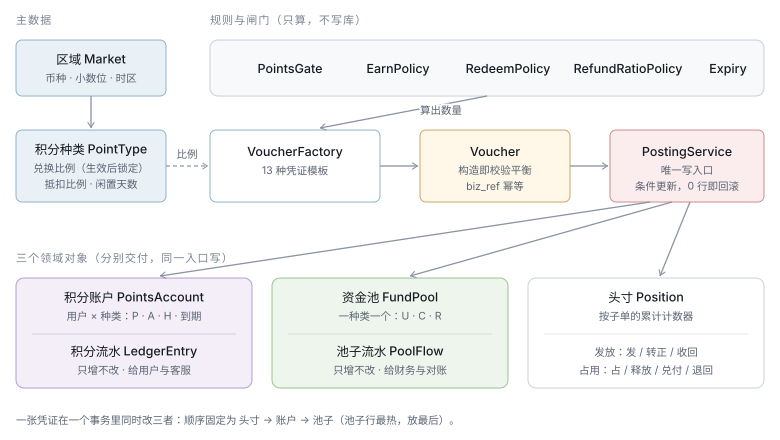
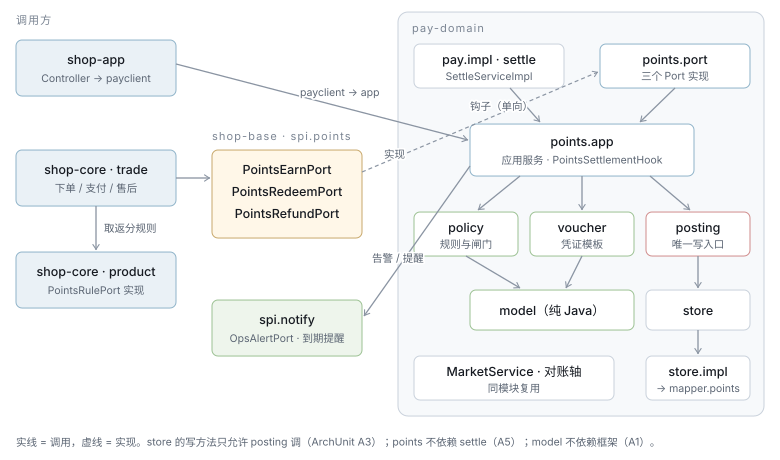

# TDD-积分域重整 · 平台积分专户与四类积分户

状态：**草稿**（待确认）
档位：**2**（新表族 + 跨域接口 + 不可逆的资金模型决策）
关联需求：[PRD-支付域](../requirements/PRD-支付域.md) §S8（**本 TDD 的 AC 确认后整体回写 §S8**，现有 AC-8.1/8.3 口径已过时）
资金方案：[积分资金方案-平台预存池](./design/积分资金方案-平台预存池.md) · 决策：[ADR-036](./ADR/ADR-036-积分改为平台出资预存池.md)
创建：2026-10-14 · 最后更新：2026-10-14（按「四类积分户流转 + 受理协议 + 随单 / 定期两种结算」改写）

> 读法：§2.1 业务抽象 → §2.2 类设计 → §2.3 依赖管理 → §2.4 数据库 → §2.5 接口 → §2.6 流程。
> 「钱为什么这么走」见资金方案，这里只写**怎么落成代码**。

---

## §0 对账一 · 需求 → 设计

| AC | 需求（Given / When / Then 压成一句） | 落点 |
|---|---|---|
| AC-P1 | 运营创建积分种类，选区域（币种随区域）与兑换比例；生效后比例不可改 | `PointTypeService#create/activate` · `pts_point_type` |
| AC-P2 | 同一区域同一时刻只有一种生效中的平台积分 | `pts_point_type.active_market` 唯一键 |
| AC-P3 | 种类生效前专户必须至少过账过一笔补充 | `PointTypeService#activate` |
| AC-P4 | 补充 / 提取 / 调账须另一人审批后过账；提取不超过发放户余额 | `PoolService` · `pts_pool_request` |
| AC-P5 | 定期补充计划按月生成待审批补充单；补充过账时接收户的分优先流转回发放户 | `PointsTopupPlanJob` · `VoucherFactory#topup` |
| AC-P6 | 积分守恒：任一凭证四类户 + 发行登记变动合计为 0 | `Voucher` 构造校验 V1 |
| AC-P7 | 支付成功后按规则发放待生效积分；发放户不够整单不发并记 `SKIPPED/POOL_EXHAUSTED` | `EarnService#grant` · `pts_grant_position` |
| AC-P8 | 线下单、被暂停、用户冻结、规则为 0 时不发放，并记原因；发放不要求商家签协议 | `PointsGate` |
| AC-P9 | 发放子单结算终局后待生效转可用 | `PointsSettlementHook#onBillFinalized` |
| AC-P10 | 商家签受理协议（版本、签署人、时刻）后其门店才能受理积分；解约只影响将来 | `AgreementService` · `pts_merchant_agreement` |
| AC-P11 | 协议选结算方式：随单（默认）/ 定期；直连商家在打款通道接通前不能选定期 | `AgreementService#sign/changeMode` |
| AC-P12 | 下单抵扣：上限 = 可受理子单（券后不含运费）× 抵扣比例；只在可受理门店间分摊；余额不足降级不抵扣 | `RedeemService#hold` · `DefaultRedeemPolicy` |
| AC-P13 | 线下单、核销暂停、门店未签协议时不能抵扣 | `PointsGate` |
| AC-P14 | 随单结算：支付成功即 C 端 → 门店户 → 接收户，钱 C → D；分账前以积分域当时应付额补差（两阶段） | `RedeemService#onPaid` · `PointsSettlementHook#beginPayout/confirmPayout/abortPayout` |
| AC-P15 | 定期结算：支付成功进门店户待确认，终局转待结算；按账期出结算单，B 端确认（或超期自动确认）后转接收户，平台打款 | `StoreStatementService` · `pts_store_statement` |
| AC-P16 | 兑付全额：商家得到的金额 == 抵扣金额 | `RedeemPolicy` · I5 / I6 |
| AC-P17 | 部分退款按累计比例退回抵扣、收回返分；积分所在位置决定 RELEASE / REVERSE / RETURN | `PointsRefundService#apply` · `RefundRatioPolicy` |
| AC-P18 | 收回已转正积分时余额不够：不许负，差额从退款现金扣并在退款单明示 | `ord_after_sale.points_offset_minor` |
| AC-P19 | 已付款后退款收不回：用户照退，专户记待追回；定期结算的下期结算单冲减 | `pts_receivable` · `RECOVER` |
| AC-P20 | 闲置满期清零，分进接收户、钱转平台收入；提前 30 天提醒；核销暂停期间顺延 | `ExpiryService` |
| AC-P21 | 发放 / 核销按八个粒度分别暂停；只影响将来；必填原因留审计 | `PointsSwitchService` · `pts_switch` |
| AC-P22 | 发放户低于水位告警；停发告警 | `PoolWatermark` · `OpsAlertPort#pointsAlert` |
| AC-P23 | 统计：平台 / 门店 / 用户三视角 | `PointsStatsService` · `pts_stat_daily` |
| AC-P24 | I1–I7 每小时一致性快照核对，可定位差异落差异单，失衡告警 | `PointsReconService` |
| AC-P25 | 任何积分写入都经凭证过账；同一业务动作重放只生效一次 | `PointsPostingService` · `pts_voucher.biz_ref` |
| AC-P26 | 售后不能再选「积分退款」形式 | `AfterSaleServiceImpl#approve` · b-app |

**孤立项**：没落点的 AC 无；挂不上 AC 的设计 —— 划拨单（支撑 L3 外部对账，归 AC-P24）、`commission_cap_bp`（本期关闭，只留列与接口）。

---

## §1 现状与影响面

### 会被替换的

| 现有 | 去向 |
|---|---|
| `pay/.../PointsService` · `impl/PointsServiceImpl`（1100 行） | `points.app.*` 应用服务 + `PointsPostingService` |
| `pay/.../PointsConfig`（JSON，比例随时可改） | `PointType` 主数据 |
| `spi/settle/PointsPort` · `pay/.../port/PointsPortImpl` | `spi/points/PointsEarnPort` · `PointsRedeemPort` · `PointsRefundPort` |
| `PointsActivateJob` · `PointsIdentityJob` · `PointsPoolReconAxis` | 事件驱动转正 + `ActivateSweeper`；`PointsReconJob` / `PointsReconAxis`（轴码 `POINTS`） |
| `payclient/PointsPolicyAppService`（端策略 JSON） | `pts_switch` 的 `CLIENT` 粒度 |
| `MerchantPortImpl#pointsDenyReason/isPointsForced` · `mch_entity.points_enabled/forced` · `cmt_community.points_enabled` | 受理协议 + 暂停开关 |
| 表 `pts_user_account` · `pts_user_ledger` · `stl_points_pool` | 冻结只读，迁移验证后删 |

### 会被改到的

| 位置 | 改动 |
|---|---|
| `OrderServiceImpl` 下单 | `pointsPort.deduct` → `PointsRedeemPort#hold`；**挪到「线下禁平台券」校验之后** |
| `OrderServiceImpl` 支付提交后 | `PointsRedeemPort#onPaid(orderNo)`（随单兑付 / 进门店户）+ `PointsEarnPort#grant`；不再写 `points_fee_minor` / `points_granted` |
| `OrderServiceImpl` 未支付取消 / 关单 | `PointsRedeemPort#release` |
| `AfterSaleServiceImpl#doRefund` | ① 回退分账 → **② `PointsRefundPort#apply`** → ③ 退现金（退款额 − 现金抵扣）；删 `returnBenefitsIfWholeOrderRefunded` 的积分部分；`approve` 拒 `POINTS` 退款形式 |
| `SettleServiceImpl` 生成结算单 | 不再记 `MERCHANT_RECEIVE`、不再算 `points_fee_minor`；**结算基数按结算方式**：随单 = 实付 + 平台券 + 积分抵扣（不变），定期 = 实付 + 平台券（积分那部分走门店积分结算单）；**佣金基数两种方式都按含积分的全额**，否则定期结算的商家少交佣金 |
| `SettleServiceImpl#executeSplit` | 补差前 `beginPayout`，成功 `confirmPayout`、失败 `abortPayout`；`SPLIT_CONFIRMED` 时 `onBillFinalized` |
| `SettleServiceImpl` / `PayoutServiceImpl` 归集确认与付款 | 删 `confirmDeduction`；归集在 `CONFIRMED` 时 `beginPayout + confirmPayout + onBillFinalized` |
| `SettleServiceImpl#reverseSplit` | 补差回退结果经 `onSubsidyReturn` 告知积分域 |
| `PayoutServiceImpl`（归集打款单） | 增加「门店积分结算单」作为一类应付来源（定期结算的归集商家） |
| `FundInvariantReconciler` | I3 删除；I6 改读 `pts_redeem_position` |
| `BootstrapConfigServiceImpl` | `features.points` 改由后端闸门求值下发 |
| 三端界面 | 见 §2.5.4 → **更新 `ui-catalog.json`** |

### 可直接复用

`MarketService`（币种、小数位、时区）· `BizKey` · `AfterCommit` / Outbox · `RefundLedger` 写法与 `ord_sub_order.refunded_minor`（退款比例分子）· `OpsAlertPort` · `ReconAxis` + `stl_recon_diff` · `JobSupport` / ShedLock · `PointsRulePort` · `PayoutService`（归集打款）。

### 明确不受影响的

券、运费、库存、物流、进销存、商家资质；分账主流程除补差那一步。

---

## §2 方案

### 2.1 业务抽象



#### 统一语言

| 词 | 定义 | 不是什么 |
|---|---|---|
| **区域** Market | 资金口径隔离单位：币种、小数位、时区（`MarketService`） | 不是配送范围 |
| **积分种类** PointType | 一套独立核算的积分：属于一个区域，有出资方、兑换比例、抵扣比例、闲置天数 | 不是活动 |
| **场景** Scene | 积分从哪来：`SHOPPING_REBATE`（本期）、`SIGN_IN`（预留）、`ADJUST`、`MIGRATION` | 场景不决定账本 |
| **积分户** PointsHolder | 持有积分的一方：`PLATFORM_ISSUE` 发放户 · `USER` C 端户 · `STORE` 门店户 · `PLATFORM_RECEIVE` 接收户 · `PLATFORM_MINT` 发行登记 | 不是资金账户 |
| **格** Bucket | 户内的分格：C 端 `PENDING/AVAILABLE/HELD`；门店 `PENDING`（待确认）/ `AVAILABLE`（待结算）；平台户只用 `AVAILABLE` | — |
| **平台积分专户** FundPool | 钱：`U` 未分配 · `C` 已承诺 · `D` 待付商家 · `R` 待追回 | 本期不是独立银行账户 |
| **受理协议** Agreement | 商家主体 × 种类：签了才能收积分；含结算方式、账期、兑付价格（全额） | 不控制发放 |
| **结算方式** SettleMode | `PER_ORDER` 随单（默认）· `PERIODIC` 定期 | — |
| **头寸** Position | 一张子单在一个种类下的累计计数器：**发放头寸**、**核销头寸** | 不是流水 |
| **门店积分结算单** StoreStatement | 定期结算时，一个门店一个账期的兑付单：出单 → B 端确认 → 打款 | 不是订单结算单 `stl_bill` |
| **待追回** Receivable | 已付给商家、因退款应收回的钱（按商家记） | — |
| **凭证** Voucher | 一次业务动作的写入单元 | 不是第四本账 |
| **结算终局** | 直连 `SPLIT_CONFIRMED`；归集 `CONFIRMED` | 不是「支付 + N 天」 |

#### 不变式

| # | 不变式 | 守在哪 |
|---|---|---|
| V1 | **积分守恒**：每张凭证所有积分户变动之和 == 0 | `Voucher` 构造校验 |
| V2 | **发放户对应 U**：`ΔU == m(Δ发放户)` | `Voucher` 构造校验 |
| V3 | **负债对应 C+R**：`Δ(C + R) == m(Δ(C 端户 + 门店户))` | `Voucher` 构造校验 |
| V4 | **真钱对外部**：`Δ(U + C + D) == external_minor`，方向是该凭证类型允许的 | `Voucher` 构造校验 |
| V5 | 所有格 ≥ 0（发行登记除外，它恒为负） | 条件更新 SQL |
| V6 | 头寸累计不超上限；状态迁移只能从规定的前态出发 | 头寸条件更新 SQL |
| V7 | 同一业务动作只过账一次 | `pts_voucher.biz_ref` 唯一 |
| V8 | 分数是 `points_unit` 的整数倍 | `RedeemRate#requireAligned` |
| V9 | 只有 `PointsPostingService` 能写积分户 / 专户 / 头寸 / 流水 | ArchUnit A3 |

V1–V4 逐张成立 ⇒ 资金方案的总恒等式任何时刻成立；I1 巡检只抓**绕过凭证的带外写**。

凭证允许的外部资金方向（V4）：

| 方向 | 凭证 |
|---|---|
| 进 | `TOPUP` · `RECOVER` |
| 出 | `WITHDRAW` · `PAYOUT` · `EXPIRE` |
| 进或无 | `RETURN`（收回成功为进，失败记 R 为无）· `REVOKE`（有现金抵扣为进） |
| 无 | `GRANT` · `ACTIVATE` · `HOLD` · `RELEASE` · `PAY_SETTLE` · `PAY_TRANSFER` · `STORE_CONFIRM` · `STORE_SETTLE` · `REVERSE` · `ADJUST` · `PROMO_GRANT` |

### 2.2 类设计

#### 包结构（`pay/pay-domain`，与结算共用 `payTxManager`）

```text
ai.neargo.shop.pay.points
├── model/        值对象与快照 —— 纯 Java
├── voucher/      VoucherFactory：命令 + 快照 → 已校验的 Voucher
├── policy/       规则与闸门（接口 + Default），只算不写
├── posting/      PointsPostingService —— 唯一写入口
├── store/        持久化端口（接口，写方法全是条件写）
│   └── impl/     MyBatis 实现
├── app/          应用服务（编排）+ PointsSettlementHook（给结算域）
├── payout/       StorePayoutExecutor：归集并入打款单 / 直连转账（未接通）
├── recon/        I1–I7、外部对账、PointsReconAxis
├── job/          任务触发器
└── port/         spi 实现
ai.neargo.shop.pay.mapper.points   Mapper（须在 pay.mapper 下，才归 paySqlSessionFactory）
```

#### model

| 类 | 职责 / 关键成员 |
|---|---|
| `PointTypeCode` · `PointType` | 种类编码；种类快照（`market, currency, scale, funder, rate, deductRatioBp, idleDays, remindDays, status`） |
| `RedeemRate` | 既约比例 `(pointsUnit, minorUnit)`：`of()` 约分 · `toMinor(pts)` 要求对齐 · `floorAligned(pts)` |
| `HolderType` · `Holder` | 五类积分户；`Holder(HolderType, holderNo)`，平台户 `holderNo = "*"` |
| `Bucket` · `PoolBucket` | `PENDING/AVAILABLE/HELD` · `U/C/D/R` |
| `VoucherType` | 19 种凭证；`ExternalFlow allowed()` |
| `SettleMode` · `Scene` · `BizRef` · `Dims` | 结算方式；场景；幂等键 `type:ref`；统计维度（含 `settleMode`、发放 / 受理门店） |
| `PointsMove` | `(Holder, Bucket, deltaPoints)` —— 一张凭证的所有 `PointsMove` 之和必须为 0 |
| `PoolMove` | `(PoolBucket, deltaMinor, counterparty)` |
| `PositionMove`（sealed） | 发放头寸：`Open / Skip / Activate / RevokePending / RevokeAvailable`；核销头寸：`Hold / Release / Transfer / StoreConfirm / Statement / BeginPayout / ConfirmPayout / AbortPayout / Reverse / Return` |
| `Voucher` | 构造即校验 V1–V4、V8；不平抛 `UnbalancedVoucher` |
| 快照 | `AccountSnapshot` · `PoolSnapshot` · `GrantPosition` · `RedeemPosition` · `Agreement` · `StoreStatement` |
| `RedeemState` | `HELD → TRANSFERRED → PAYING → PAID`（随单）· `HELD → IN_STORE → SETTLEABLE → IN_STATEMENT → SETTLED`（定期）· 任一态可 `RELEASED/REVERSED` 到终态 `CLOSED` |

```java
/** 一次业务动作的写入单元。构造即校验 —— 拿到实例就一定是平的。 */
public record Voucher(BizRef bizRef, PointType type, Dims dims, long externalMinor,
                      List<PointsMove> pointsMoves, List<PoolMove> poolMoves,
                      List<PositionMove> positionMoves) {
    public Voucher {
        pointsMoves = List.copyOf(pointsMoves);
        poolMoves = List.copyOf(poolMoves);
        positionMoves = List.copyOf(positionMoves);
        RedeemRate rate = type.rate();
        require(sum(pointsMoves) == 0, "V1 积分守恒");
        require(pool(U) == rate.toMinor(sum(pointsMoves, PLATFORM_ISSUE)), "V2 发放户对应 U");
        require(pool(C) + pool(R) == rate.toMinor(sum(pointsMoves, USER) + sum(pointsMoves, STORE)), "V3");
        require(pool(U) + pool(C) + pool(D) == externalMinor
                && bizRef.type().allowed().permits(externalMinor), "V4 真钱对外部");
    }
}
```

#### voucher

`VoucherFactory` 一个类、每种凭证一个方法（每个十来行，拆 19 个类反而难对照）：

```java
Voucher topup(PointType t, long minor, long receiveBalance, String requestNo, Dims d);  // 接收户先流转，不足再发行
Voucher withdraw(PointType t, long minor, String requestNo, Dims d);
Voucher grant(PointType t, String subOrderNo, long pts, Dims d);                         // 发放户 → P；U → C
Voucher activate(PointType t, GrantPosition g, Dims d);                                  // P → A
Voucher hold(PointType t, String orderNo, List<HoldShare> shares, Dims d);              // A → H，逐子单开头寸
Voucher release(PointType t, RedeemPosition p, Dims d);                                  // H → A
Voucher paySettle(PointType t, RedeemPosition p, Dims d);                                // H → 门店 → 接收户；C → D
Voucher payTransfer(PointType t, RedeemPosition p, Dims d);                              // H → 门店「待确认」
Voucher storeConfirm(PointType t, RedeemPosition p, Dims d);                             // 门店 待确认 → 待结算
Voucher storeSettle(PointType t, StoreStatement s, Dims d);                              // 门店 待结算 → 接收户；C → D
Voucher payout(PointType t, long minor, String payoutRef, Dims d);                       // D −（出）
Voucher reverse(PointType t, RedeemPosition p, long pts, String ref, Dims d);            // 按积分当前所在位置反转
Voucher returnBack(PointType t, RedeemPosition p, long pts, boolean funded, String ref, Dims d);
Voucher recover(PointType t, long minor, String ref, Dims d);                            // R → C（进）
Voucher revoke(PointType t, GrantPosition g, RevokeSplit split, long receiveBalance, String ref, Dims d);
Voucher expire(PointType t, AccountSnapshot a, Dims d);                                  // A → 接收户；C −（出）
Voucher adjust(PointType t, String userNo, long signedPts, String requestNo, Dims d);
```

#### policy（只算，不碰库）

| 接口 | Default 规则 |
|---|---|
| `EarnPolicy` | 每行 `FIXED` = n × 件数、`RATIO` = 行实付 × 万分比；赠品 0；合计 `floorAligned` |
| `CommissionCapPolicy` | 本期 `NoCap`；`commission_cap_bp` 非空时截断 |
| `RedeemPolicy` | 上限 = Σ可受理子单金额 × `deductRatioBp`，与余额、意愿值取小；按金额分摊、余数给最后一家；`floorAligned`；兑付额 = 抵扣额（全额） |
| `RefundRatioPolicy` | `target = floorAligned(base × refunded / payBasis)`，`delta = target − done`；全退取精确 |
| `ExpiryPolicy` | `expireAt` = 区域本地日 23:59:59(now + idleDays)；`remindAt = expireAt − remindDays` |
| `StatementPolicy` | 账期区间、出单日、自动确认日；金额 = 本期兑付 − 待追回冲减；为负结转 |
| `PointsGate` | 依次判：总闸 → 全局 → 区域 → 种类 → 场景 → 端 → 商家 → 门店 → 用户；核销另判线下、**协议已签**；首个命中即拒 |

#### posting

```java
public interface PointsPostingService {
    /**
     * 过账。同一事务内固定顺序：凭证头（抢 biz_ref）→ 头寸 → 用户 / 门店户 → 平台户 → 专户 → 流水。
     * 任一条件更新 0 行 → PostingRejected(对象, 约束)，整张回滚；biz_ref 已存在 → 返回已有凭证。
     */
    PostingResult post(Voucher voucher);
    record PostingResult(String voucherNo, boolean replayed) {}
}
```

平台户与专户行最热，放在最后，锁持有时间最短；固定顺序防死锁。

#### store（写方法只被 posting 调）

| 接口 | 写 | 读 |
|---|---|---|
| `PointTypeStore` | `insert` · `activate` · `retire` · `updateDraft` | `find` · `activeOf(market)` |
| `HolderAccountStore` | `ensure(holder, type)` · `apply(holder, type, dP, dA, dH, renew)` → boolean | `find` · `dueToExpire` · `dueToRemind` |
| `PoolStore` | `apply(type, dU, dC, dD, dR, totals)` → boolean | `find` |
| `PositionStore` | 发放：`open/skip/activate/revokePending/revokeAvailable/markFinalized`；核销：`hold/release/transfer/storeConfirm/attachStatement/detachStatement/beginPayout/confirmPayout/abortPayout/reverse/returnBack/markRefundFunded` | `grantOf` · `redeemOf` · `redeemsOfOrder` · `settleableOf(store, until)` · `stuckPaying` · `finalizedNotActivated` |
| `AgreementStore` | `sign` · `changeMode` · `terminate` | `activeOf(entity, type)` |
| `StatementStore` | `draft` · `confirm` · `dispute` · `voidDraft` · `beginPayout` · `markPaid` | `dueForAutoConfirm` · `ofStore` |
| `ReceivableStore` | `open` · `recover` | `openOf(entity, type)` |
| `VoucherStore` · `LedgerStore` · `PoolFlowStore` | `insertIfAbsent` · `append` | 分页明细 |
| `SwitchStore` · `PoolRequestStore` · `TopupPlanStore` · `TransferOrderStore` · `StatStore` · `CursorStore` | 各自条件写 | 各自查询 |

#### app（编排，不含规则）

| 服务 | 方法 |
|---|---|
| `PointTypeService` | `create` · `updateDraft` · `activate` · `retire` · `list` |
| `PoolService` | `submit` · `approve` · `reject` · `runPlans(now)` · `watermark(type)`；`COMMISSION_RATIO` 计划经 `SettleStatsService`（接口，只读）取上月佣金 |
| `AgreementService` | `sign(entity, type, mode, period, version, signer)` · `changeMode` · `terminate` · `current` —— 直连商家选 `PERIODIC` 时查 `StorePayoutExecutor#supports` |
| `PointsSwitchService` | `set` · `list` · `logs`；恢复核销时 `ExpiryService#extendForPause` |
| `EarnService` | `grant(GrantCommand)` · `activateFinalized(subOrderNo)` |
| `RedeemService` | `quote` · `hold` · `release` · `onPaid(orderNo)`（按协议走 `paySettle` 或 `payTransfer`） |
| `PointsRefundService` | `quote` · `apply(afterSaleNo, subOrderNo, refundedTotalAfter)` · `onSubsidyReturn` |
| `StoreStatementService` | `draftDue(period)` · `confirm(no, by)` · `dispute(no, by, reason)` · `autoConfirmDue(now)` · `payout(no)` |
| `ExpiryService` | `expireDue(type)` · `remindDue(type)` · `extendForPause(type, ms)` |
| `TransferService` | `buildDaily(type, date)` · `execute(no)`（`TransferExecutor`，本期 `InternalBookingExecutor`） |
| `PointsQueryService` · `PointsStatsService` | 只读 + `rollup()` |
| `PointsSettlementHook` | `beginPayout` · `confirmPayout` · `abortPayout` · `onBillFinalized` · `onSubsidyReturn`（**域内**，结算直接注入） |

#### payout

```java
/** 定期结算单的打款执行器。按商家资金路径选一个。 */
public interface StorePayoutExecutor {
    boolean supports(String fundsMode);              // AgreementService 签约时据此拦直连 + 定期
    PayoutTicket submit(StoreStatement s);            // 归集：并入 PayoutService 打款单；直连：转账通道
}
```

本期实现 `AggregatedPayoutExecutor`（并入现有打款单）；`DirectTransferExecutor` 只留类名，`supports` 返回 false。

#### 写一笔随单兑付（说明各层分工）

```java
// app/RedeemService#onPaid —— 只编排
for (RedeemPosition p : positions.redeemsOfOrder(orderNo)) {
    Agreement a = agreements.activeOf(p.entityNo(), p.type()).orElseThrow();   // hold 时已判过，签约可能刚解约 → 仍按支付时的协议
    Voucher v = a.mode() == PER_ORDER ? vouchers.paySettle(t, p, dims) : vouchers.payTransfer(t, p, dims);
    posting.post(v);                                                            // 头寸 HELD → TRANSFERRED / IN_STORE，条件不满足即回滚
}
```

### 2.3 依赖管理



#### 跨模块

| 调用方 | 被调 | 方式 | 事务 |
|---|---|---|---|
| trade 下单 / 未支付取消 | `PointsRedeemPort#hold/release` | spi 同步 | `payTxManager` 独立提交；下单失败由 I6 释放死单占用 |
| trade 支付提交后 | `PointsRedeemPort#onPaid` · `PointsEarnPort#grant` | `AfterCommit` | 幂等由 `biz_ref` 保证 |
| trade 售后退款 | `PointsRefundPort#apply` | 回退分账之后、退现金之前同步调用 | 积分先落定，返回现金抵扣额 |
| trade → product | `PointsRulePort` | spi | 组成 `EarnLine` 传给 pay，pay 不回查 product |
| settle（同模块） | `PointsSettlementHook` | 注入接口 | 与结算单同一 `payTxManager` 事务；`confirmPayout` 另经 outbox 兜底 |
| points → payout | `PayoutService`（归集打款单） | 同模块接口 | 打款回执回调 `StoreStatementService#markPaid` |
| points → `SettleStatsService` | 只读接口 | 同模块 | — |
| points → notify | `OpsAlertPort#pointsAlert` · 到期提醒 `UserInboxPort` / `WxSubscribePort` | spi | 尽力而为，不抛 |
| shop-app Controller | `payclient/*AppService` → `points.app.*` | 与现有 `BizPointsAppService` 同形 | — |

**points 不依赖 settle 实现**：方向只有 settle → points（经钩子）。结算事实由 settle **推**进来（`onBillFinalized`、`onSubsidyReturn`），积分域落在头寸上，不反查结算单。

#### ArchUnit（新增）

| # | 规则 | 防住什么 |
|---|---|---|
| A1 | `pay.points.model..` 不依赖 Spring、MyBatis、`pay.points` 其他包 | 值对象可纯单测 |
| A2 | `voucher..`、`policy..` 只依赖 `model` | 策略不碰库 —— 先查后写从结构上写不出来 |
| A3 | `store` 写方法只能被 `posting..` 调用 | 改了一边忘了另一边 |
| A4 | `pay.mapper.points..` 只被 `pay.points.store.impl..` 引用 | 绕过 store 写表 |
| A5 | `pay.points..` 不依赖 `pay.impl..` 的结算实现类（可依赖 `SettleStatsService`、`PayoutService` 接口） | 包级环 |
| A6 | `shop-core` 只经 `spi.points.*` 调积分 | 跨域直连 |
| A7 | 旧类删除后：不存在 `PointsService` / `spi.settle.PointsPort` | 旧入口复活 |

### 2.4 数据库

> 表关系图属于结构图，按[文档规范](../文档规范.md) §二 迁移落地后由 `npm run gen:erd` 生成，此处不手画。
> 关系一句话：种类 1—1 专户、1—N 积分户；凭证 1—N 积分流水 / 专户流水，按 `sub_order_no` 关联头寸；
> 协议按商家主体；门店积分结算单 1—N 核销头寸（`statement_no`）；补充单 → 凭证；划拨单 ← 专户流水。

#### 表清单

| 表 | 对象 | 写入者 |
|---|---|---|
| `pts_point_type` | 积分种类 | `PointTypeStore` |
| `pts_fund_pool` | 平台积分专户（一种类一行，U / C / D / R） | posting |
| `pts_pool_flow` | 专户流水 | posting |
| `pts_account` | **积分户**（五类持有方统一一张表） | posting |
| `pts_ledger_entry` | 积分流水 | posting |
| `pts_voucher` | 凭证头（含全部统计维度） | posting |
| `pts_grant_position` | 发放头寸（含停发记录） | posting |
| `pts_redeem_position` | 核销头寸（随单 / 定期两条状态线） | posting |
| `pts_merchant_agreement` | 受理协议 | `AgreementService` |
| `pts_store_statement` | 门店积分结算单 | `StoreStatementService` + posting |
| `pts_receivable` | 待追回（按商家） | posting |
| `pts_pool_request` | 补充 / 提取 / 调账单 | `PoolService` |
| `pts_topup_plan` | 定期补充计划 | `PoolService` |
| `pts_switch` · `pts_switch_log` | 暂停开关与审计 | `PointsSwitchService` |
| `pts_transfer_order` | 划拨单（到期转收入、归集回补、补充、提取） | `TransferService` |
| `pts_stat_daily` · `pts_cursor` | 日汇总、任务水位 | 任务 |

#### DDL（`V406__points_v2_schema.sql`；不写 ENGINE / CHARSET）

审计列统一为：

```sql
tenant_no VARCHAR(32) DEFAULT NULL, created_at DATETIME DEFAULT NULL, created_by VARCHAR(64) DEFAULT NULL,
updated_at DATETIME DEFAULT NULL, updated_by VARCHAR(64) DEFAULT NULL,
version BIGINT(20) NOT NULL DEFAULT 0, deleted TINYINT(4) NOT NULL DEFAULT 0,
```

下面以 `/* 审计列 */` 代指（迁移里逐表写全）。

```sql
-- 积分种类：一区域同时只有一种生效。active_market 只在 ACTIVE 时 = market，否则 NULL；
-- 唯一键对 NULL 不生效 —— 代替「UPDATE … WHERE NOT EXISTS(同表子查询)」（MySQL 1093）
CREATE TABLE IF NOT EXISTS pts_point_type (
    id                BIGINT(20)   NOT NULL AUTO_INCREMENT,
    type_code         VARCHAR(32)  NOT NULL COMMENT '种类编码，如 CN_PLATFORM',
    name              VARCHAR(64)  NOT NULL,
    name_i18n         VARCHAR(512) DEFAULT NULL COMMENT '多语名称 JSON',
    funder            VARCHAR(16)  NOT NULL DEFAULT 'PLATFORM',
    market            VARCHAR(8)   NOT NULL,
    currency          VARCHAR(8)   NOT NULL COMMENT '对标币种，创建时取区域币种，不可改',
    currency_scale    INT(11)      NOT NULL,
    rate_points       BIGINT(20)   NOT NULL COMMENT '兑换比例（既约）：rate_points 积分 = rate_minor 最小货币单位',
    rate_minor        BIGINT(20)   NOT NULL,
    deduct_ratio_bp   INT(11)      NOT NULL COMMENT '抵扣上限万分比',
    idle_days         INT(11)      NOT NULL,
    remind_days       INT(11)      NOT NULL DEFAULT 30,
    commission_cap_bp INT(11)      DEFAULT NULL COMMENT 'NULL = 不封顶（本期）',
    status            VARCHAR(12)  NOT NULL DEFAULT 'DRAFT' COMMENT 'DRAFT / ACTIVE / RETIRED；比例只在 DRAFT 可改',
    active_market     VARCHAR(8)   DEFAULT NULL,
    successor_code    VARCHAR(32)  DEFAULT NULL COMMENT '停用后余额迁往哪个种类',
    activated_at      BIGINT(20)   DEFAULT NULL,
    retired_at        BIGINT(20)   DEFAULT NULL,
    /* 审计列 */
    PRIMARY KEY (id),
    UNIQUE KEY uk_pts_type_code (type_code),
    UNIQUE KEY uk_pts_type_active_market (active_market)
) COMMENT='积分种类';

-- 平台积分专户：一种类一行，四格各自条件更新不许为负
CREATE TABLE IF NOT EXISTS pts_fund_pool (
    id                   BIGINT(20)  NOT NULL AUTO_INCREMENT,
    type_code            VARCHAR(32) NOT NULL,
    currency             VARCHAR(8)  NOT NULL,
    unallocated_minor    BIGINT(20)  NOT NULL DEFAULT 0 COMMENT 'U 未分配 == m(发放户)',
    committed_minor      BIGINT(20)  NOT NULL DEFAULT 0 COMMENT 'C 已承诺：C 端户 + 门店户的分对应的钱（减去 R）',
    payable_minor        BIGINT(20)  NOT NULL DEFAULT 0 COMMENT 'D 待付商家：已兑付、未付款',
    receivable_minor     BIGINT(20)  NOT NULL DEFAULT 0 COMMENT 'R 待追回：已付给商家、应收回未收回',
    topup_total_minor    BIGINT(20)  NOT NULL DEFAULT 0,
    withdraw_total_minor BIGINT(20)  NOT NULL DEFAULT 0,
    payout_total_minor   BIGINT(20)  NOT NULL DEFAULT 0,
    expire_total_minor   BIGINT(20)  NOT NULL DEFAULT 0,
    low_water_days       INT(11)     NOT NULL DEFAULT 7,
    /* 审计列 */
    PRIMARY KEY (id),
    UNIQUE KEY uk_pts_pool_type (type_code)
) COMMENT='平台积分专户（平台账户内专项）。U + C + D 与平台账户余额每日外部对账';

CREATE TABLE IF NOT EXISTS pts_pool_flow (
    id                BIGINT(20)  NOT NULL AUTO_INCREMENT,
    flow_no           VARCHAR(40) NOT NULL,
    voucher_no        VARCHAR(40) NOT NULL,
    voucher_type      VARCHAR(16) NOT NULL,
    type_code         VARCHAR(32) NOT NULL,
    bucket            VARCHAR(4)  NOT NULL COMMENT 'U / C / D / R',
    delta_minor       BIGINT(20)  NOT NULL,
    after_minor       BIGINT(20)  NOT NULL,
    counterparty_type VARCHAR(16) DEFAULT NULL COMMENT 'MERCHANT / PLATFORM / FINANCE',
    counterparty_no   VARCHAR(64) DEFAULT NULL,
    transfer_no       VARCHAR(40) DEFAULT NULL,
    occurred_at       BIGINT(20)  NOT NULL,
    /* 审计列 */
    PRIMARY KEY (id),
    UNIQUE KEY uk_pts_pool_flow_no (flow_no),
    KEY idx_pts_pool_flow_type (type_code, id),
    KEY idx_pts_pool_flow_voucher (voucher_no),
    KEY idx_pts_pool_flow_transfer (transfer_no)
) COMMENT='专户流水：只增不改';

-- 积分户：五类持有方一张表。三格的含义随 holder_type：
--   USER    pending=待生效 available=可用 held=占用
--   STORE   pending=待确认 available=待结算 held 不用
--   PLATFORM_ISSUE / PLATFORM_RECEIVE  只用 available
--   PLATFORM_MINT  只用 available，恒为负（累计发行）—— 条件更新对它不加 >= 0
CREATE TABLE IF NOT EXISTS pts_account (
    id                 BIGINT(20)  NOT NULL AUTO_INCREMENT,
    holder_type        VARCHAR(20) NOT NULL COMMENT 'USER / STORE / PLATFORM_ISSUE / PLATFORM_RECEIVE / PLATFORM_MINT',
    holder_no          VARCHAR(64) NOT NULL COMMENT '用户号 / 门店号；平台户为 *',
    type_code          VARCHAR(32) NOT NULL,
    entity_no          VARCHAR(64) DEFAULT NULL COMMENT 'STORE 户所属商家主体',
    pending_points     BIGINT(20)  NOT NULL DEFAULT 0,
    available_points   BIGINT(20)  NOT NULL DEFAULT 0,
    held_points        BIGINT(20)  NOT NULL DEFAULT 0,
    frozen             TINYINT(4)  NOT NULL DEFAULT 0 COMMENT '仅 USER：风控冻结',
    last_active_at     BIGINT(20)  DEFAULT NULL COMMENT '仅 USER',
    expire_at          BIGINT(20)  DEFAULT NULL COMMENT '仅 USER：区域本地日 23:59:59',
    expire_notified_at BIGINT(20)  DEFAULT NULL COMMENT '仅 USER：提醒幂等位，续期时清空',
    in_total           BIGINT(20)  NOT NULL DEFAULT 0 COMMENT '累计转入',
    out_total          BIGINT(20)  NOT NULL DEFAULT 0 COMMENT '累计转出',
    /* 审计列 */
    PRIMARY KEY (id),
    UNIQUE KEY uk_pts_account_holder (holder_type, holder_no, type_code),
    KEY idx_pts_account_expire (type_code, holder_type, expire_at)
) COMMENT='积分户：平台发放户 / C 端户 / 门店户 / 平台接收户 / 发行登记';

CREATE TABLE IF NOT EXISTS pts_ledger_entry (
    id           BIGINT(20)  NOT NULL AUTO_INCREMENT,
    entry_no     VARCHAR(40) NOT NULL,
    voucher_no   VARCHAR(40) NOT NULL,
    voucher_type VARCHAR(16) NOT NULL COMMENT '决定展示标题（i18n：points.voucher.{type}）',
    type_code    VARCHAR(32) NOT NULL,
    holder_type  VARCHAR(20) NOT NULL,
    holder_no    VARCHAR(64) NOT NULL,
    bucket       VARCHAR(12) NOT NULL,
    delta_points BIGINT(20)  NOT NULL,
    after_points BIGINT(20)  NOT NULL,
    order_no     VARCHAR(40) DEFAULT NULL,
    sub_order_no VARCHAR(40) DEFAULT NULL,
    occurred_at  BIGINT(20)  NOT NULL,
    /* 审计列 */
    PRIMARY KEY (id),
    UNIQUE KEY uk_pts_entry_no (entry_no),
    KEY idx_pts_entry_holder (holder_type, holder_no, type_code, id),
    KEY idx_pts_entry_voucher (voucher_no)
) COMMENT='积分流水：只增不改';

CREATE TABLE IF NOT EXISTS pts_voucher (
    id             BIGINT(20)   NOT NULL AUTO_INCREMENT,
    voucher_no     VARCHAR(40)  NOT NULL,
    biz_ref        VARCHAR(96)  NOT NULL COMMENT '幂等键 = 凭证类型:业务单号',
    voucher_type   VARCHAR(16)  NOT NULL,
    type_code      VARCHAR(32)  NOT NULL,
    market         VARCHAR(8)   NOT NULL,
    currency       VARCHAR(8)   NOT NULL,
    rate_points    BIGINT(20)   NOT NULL,
    rate_minor     BIGINT(20)   NOT NULL,
    points         BIGINT(20)   NOT NULL DEFAULT 0 COMMENT '主分数（绝对值）',
    amount_minor   BIGINT(20)   NOT NULL DEFAULT 0,
    external_minor BIGINT(20)   NOT NULL DEFAULT 0 COMMENT '进出专户的真钱：进正出负',
    scene          VARCHAR(24)  NOT NULL,
    settle_mode    VARCHAR(12)  DEFAULT NULL COMMENT '核销类凭证：PER_ORDER / PERIODIC',
    user_no        VARCHAR(64)  DEFAULT NULL,
    order_no       VARCHAR(40)  DEFAULT NULL,
    sub_order_no   VARCHAR(40)  DEFAULT NULL,
    entity_no      VARCHAR(64)  DEFAULT NULL COMMENT '发放侧 = 成交商家；核销侧 = 受理商家',
    store_no       VARCHAR(64)  DEFAULT NULL,
    statement_no   VARCHAR(40)  DEFAULT NULL,
    request_no     VARCHAR(40)  DEFAULT NULL,
    operator_no    VARCHAR(64)  DEFAULT NULL,
    reason         VARCHAR(255) DEFAULT NULL,
    occurred_at    BIGINT(20)   NOT NULL,
    /* 审计列 */
    PRIMARY KEY (id),
    UNIQUE KEY uk_pts_voucher_no (voucher_no),
    UNIQUE KEY uk_pts_voucher_biz_ref (biz_ref),
    KEY idx_pts_voucher_type_time (type_code, occurred_at),
    KEY idx_pts_voucher_store_time (store_no, occurred_at),
    KEY idx_pts_voucher_user_time (user_no, occurred_at),
    KEY idx_pts_voucher_sub (sub_order_no)
) COMMENT='积分凭证：一次业务动作一张';

CREATE TABLE IF NOT EXISTS pts_grant_position (
    id                BIGINT(20)  NOT NULL AUTO_INCREMENT,
    type_code         VARCHAR(32) NOT NULL,
    sub_order_no      VARCHAR(40) NOT NULL,
    order_no          VARCHAR(40) NOT NULL,
    user_no           VARCHAR(64) NOT NULL,
    entity_no         VARCHAR(64) DEFAULT NULL,
    store_no          VARCHAR(64) DEFAULT NULL,
    pay_basis_minor   BIGINT(20)  NOT NULL COMMENT '子单实付快照：退款比例分母',
    status            VARCHAR(12) NOT NULL COMMENT 'GRANTED / SKIPPED',
    skip_reason       VARCHAR(24) DEFAULT NULL,
    skip_points       BIGINT(20)  NOT NULL DEFAULT 0 COMMENT '若不停发本应发多少',
    granted_points    BIGINT(20)  NOT NULL DEFAULT 0,
    activated_points  BIGINT(20)  NOT NULL DEFAULT 0,
    revoked_pending   BIGINT(20)  NOT NULL DEFAULT 0,
    revoked_available BIGINT(20)  NOT NULL DEFAULT 0,
    finalized_at      BIGINT(20)  DEFAULT NULL,
    /* 审计列 */
    PRIMARY KEY (id),
    UNIQUE KEY uk_pts_grant_sub (type_code, sub_order_no),
    KEY idx_pts_grant_finalized (finalized_at)
) COMMENT='发放头寸：granted = 待生效 + activated + revoked_pending';

CREATE TABLE IF NOT EXISTS pts_redeem_position (
    id                  BIGINT(20)  NOT NULL AUTO_INCREMENT,
    type_code           VARCHAR(32) NOT NULL,
    sub_order_no        VARCHAR(40) NOT NULL,
    order_no            VARCHAR(40) NOT NULL,
    user_no             VARCHAR(64) NOT NULL,
    entity_no           VARCHAR(64) NOT NULL COMMENT '受理商家',
    store_no            VARCHAR(64) NOT NULL COMMENT '受理门店',
    settle_mode         VARCHAR(12) DEFAULT NULL COMMENT '支付时按协议落定：PER_ORDER / PERIODIC',
    pay_basis_minor     BIGINT(20)  NOT NULL,
    held_points         BIGINT(20)  NOT NULL,
    released_points     BIGINT(20)  NOT NULL DEFAULT 0 COMMENT '未支付释放',
    transferred_points  BIGINT(20)  NOT NULL DEFAULT 0 COMMENT '支付时转出（= held − released）',
    reversed_points     BIGINT(20)  NOT NULL DEFAULT 0 COMMENT '付款前因退款反转回用户',
    paid_points         BIGINT(20)  NOT NULL DEFAULT 0 COMMENT '已付款给商家的部分',
    returned_points     BIGINT(20)  NOT NULL DEFAULT 0 COMMENT '付款后因退款退回用户',
    refund_funded_minor BIGINT(20)  NOT NULL DEFAULT 0 COMMENT '结算域告知：补差已回退到账',
    state               VARCHAR(14) NOT NULL DEFAULT 'HELD'
                        COMMENT 'HELD / TRANSFERRED / PAYING / PAID / IN_STORE / SETTLEABLE / IN_STATEMENT / SETTLED / CLOSED',
    statement_no        VARCHAR(40) DEFAULT NULL,
    paying_since        BIGINT(20)  DEFAULT NULL,
    /* 审计列 */
    PRIMARY KEY (id),
    UNIQUE KEY uk_pts_redeem_sub (type_code, sub_order_no),
    KEY idx_pts_redeem_order (order_no),
    KEY idx_pts_redeem_state (state, paying_since),
    KEY idx_pts_redeem_store (store_no, state),
    KEY idx_pts_redeem_statement (statement_no)
) COMMENT='核销头寸：held = 在占 + released + transferred；transferred = 在途 + reversed + paid；returned ≤ paid';

CREATE TABLE IF NOT EXISTS pts_merchant_agreement (
    id               BIGINT(20)   NOT NULL AUTO_INCREMENT,
    agreement_no     VARCHAR(40)  NOT NULL,
    entity_no        VARCHAR(64)  NOT NULL COMMENT '商家主体',
    type_code        VARCHAR(32)  NOT NULL,
    doc_version      VARCHAR(16)  NOT NULL COMMENT '协议文本版本',
    doc_digest       VARCHAR(64)  NOT NULL COMMENT '签署时文本摘要',
    settle_mode      VARCHAR(12)  NOT NULL DEFAULT 'PER_ORDER' COMMENT 'PER_ORDER 随单（默认）/ PERIODIC 定期',
    settle_period    VARCHAR(12)  DEFAULT NULL COMMENT 'PERIODIC 时：MONTH / HALF_MONTH / WEEK',
    redeem_rate_bp   INT(11)      NOT NULL DEFAULT 10000 COMMENT '兑付价格万分比：本期恒 10000（全额）',
    status           VARCHAR(12)  NOT NULL DEFAULT 'SIGNED' COMMENT 'SIGNED / TERMINATED',
    active_key       VARCHAR(100) DEFAULT NULL COMMENT 'SIGNED 时 = entity_no:type_code，否则 NULL —— 一主体一种类只有一份生效',
    signed_by        VARCHAR(64)  NOT NULL,
    signed_at        BIGINT(20)   NOT NULL,
    terminated_by    VARCHAR(64)  DEFAULT NULL,
    terminated_at    BIGINT(20)   DEFAULT NULL,
    terminate_reason VARCHAR(255) DEFAULT NULL,
    /* 审计列 */
    PRIMARY KEY (id),
    UNIQUE KEY uk_pts_agreement_no (agreement_no),
    UNIQUE KEY uk_pts_agreement_active (active_key),
    KEY idx_pts_agreement_entity (entity_no, type_code)
) COMMENT='积分受理协议：签了才能收积分；变更方式 = 终止旧的、签新的（留痕）';

CREATE TABLE IF NOT EXISTS pts_store_statement (
    id              BIGINT(20)  NOT NULL AUTO_INCREMENT,
    statement_no    VARCHAR(40) NOT NULL,
    type_code       VARCHAR(32) NOT NULL,
    entity_no       VARCHAR(64) NOT NULL,
    store_no        VARCHAR(64) NOT NULL,
    pay_merchant_no VARCHAR(64) DEFAULT NULL COMMENT '打款收款账户快照',
    funds_mode      VARCHAR(16) NOT NULL COMMENT 'AGGREGATED / DIRECT：决定打款执行器',
    period_from     BIGINT(20)  NOT NULL,
    period_to       BIGINT(20)  NOT NULL,
    points          BIGINT(20)  NOT NULL COMMENT '本期兑付分数',
    amount_minor    BIGINT(20)  NOT NULL COMMENT '本期兑付金额（全额）',
    offset_minor    BIGINT(20)  NOT NULL DEFAULT 0 COMMENT '冲减的待追回',
    payable_minor   BIGINT(20)  NOT NULL COMMENT '= amount − offset；为负时 0 并结转',
    status          VARCHAR(12) NOT NULL DEFAULT 'DRAFT' COMMENT 'DRAFT / CONFIRMED / DISPUTED / PAYING / PAID / VOID',
    auto_confirm_at BIGINT(20)  NOT NULL,
    confirmed_by    VARCHAR(64) DEFAULT NULL COMMENT 'B 端操作人或 SYSTEM（超期自动）',
    confirmed_at    BIGINT(20)  DEFAULT NULL,
    dispute_reason  VARCHAR(255) DEFAULT NULL,
    payout_ref      VARCHAR(64) DEFAULT NULL COMMENT '打款单号 / 通道流水号',
    paid_at         BIGINT(20)  DEFAULT NULL,
    /* 审计列 */
    PRIMARY KEY (id),
    UNIQUE KEY uk_pts_statement_no (statement_no),
    UNIQUE KEY uk_pts_statement_period (type_code, store_no, period_from),
    KEY idx_pts_statement_status (status, auto_confirm_at)
) COMMENT='门店积分结算单（定期结算）';

CREATE TABLE IF NOT EXISTS pts_receivable (
    id              BIGINT(20)  NOT NULL AUTO_INCREMENT,
    receivable_no   VARCHAR(40) NOT NULL,
    type_code       VARCHAR(32) NOT NULL,
    entity_no       VARCHAR(64) NOT NULL,
    store_no        VARCHAR(64) DEFAULT NULL,
    source_voucher  VARCHAR(40) NOT NULL COMMENT '产生它的 RETURN 凭证',
    amount_minor    BIGINT(20)  NOT NULL,
    recovered_minor BIGINT(20)  NOT NULL DEFAULT 0,
    /* 审计列 */
    PRIMARY KEY (id),
    UNIQUE KEY uk_pts_receivable_no (receivable_no),
    KEY idx_pts_receivable_entity (entity_no, type_code)
) COMMENT='待追回：recovered ≤ amount；未结清的进下期结算单冲减';

CREATE TABLE IF NOT EXISTS pts_pool_request (
    id             BIGINT(20)   NOT NULL AUTO_INCREMENT,
    request_no     VARCHAR(40)  NOT NULL,
    kind           VARCHAR(12)  NOT NULL COMMENT 'TOPUP / WITHDRAW / ADJUST',
    type_code      VARCHAR(32)  NOT NULL,
    amount_minor   BIGINT(20)   NOT NULL DEFAULT 0,
    adjust_user_no VARCHAR(64)  DEFAULT NULL,
    adjust_points  BIGINT(20)   NOT NULL DEFAULT 0,
    evidence_no    VARCHAR(64)  DEFAULT NULL COMMENT '打款回单号；TOPUP / WITHDRAW 必填',
    reason         VARCHAR(255) NOT NULL,
    plan_no        VARCHAR(40)  DEFAULT NULL,
    status         VARCHAR(12)  NOT NULL DEFAULT 'SUBMITTED' COMMENT 'SUBMITTED / POSTED / REJECTED',
    submitted_by   VARCHAR(64)  NOT NULL,
    submitted_at   BIGINT(20)   NOT NULL,
    decided_by     VARCHAR(64)  DEFAULT NULL,
    decided_at     BIGINT(20)   DEFAULT NULL,
    decide_remark  VARCHAR(255) DEFAULT NULL,
    voucher_no     VARCHAR(40)  DEFAULT NULL,
    /* 审计列 */
    PRIMARY KEY (id),
    UNIQUE KEY uk_pts_request_no (request_no),
    KEY idx_pts_request_type (type_code, status)
) COMMENT='补充 / 提取 / 调账单：一人提交、另一人审批';

CREATE TABLE IF NOT EXISTS pts_topup_plan (
    id              BIGINT(20)  NOT NULL AUTO_INCREMENT,
    plan_no         VARCHAR(40) NOT NULL,
    type_code       VARCHAR(32) NOT NULL,
    mode            VARCHAR(20) NOT NULL COMMENT 'FIXED / COMMISSION_RATIO',
    value           BIGINT(20)  NOT NULL,
    day_of_month    INT(11)     NOT NULL DEFAULT 1,
    enabled         TINYINT(4)  NOT NULL DEFAULT 1,
    last_run_period VARCHAR(8)  DEFAULT NULL COMMENT 'yyyyMM，幂等',
    /* 审计列 */
    PRIMARY KEY (id),
    UNIQUE KEY uk_pts_plan_no (plan_no),
    UNIQUE KEY uk_pts_plan_type (type_code)
) COMMENT='定期补充计划：只生成待审批补充单';

CREATE TABLE IF NOT EXISTS pts_switch (
    id            BIGINT(20)   NOT NULL AUTO_INCREMENT,
    scope_type    VARCHAR(16)  NOT NULL COMMENT 'GLOBAL / MARKET / TYPE / SCENE / CLIENT / MERCHANT / STORE / USER',
    scope_id      VARCHAR(64)  NOT NULL,
    issue_paused  TINYINT(4)   NOT NULL DEFAULT 0,
    redeem_paused TINYINT(4)   NOT NULL DEFAULT 0,
    paused_since  BIGINT(20)   DEFAULT NULL,
    reason        VARCHAR(255) NOT NULL,
    operator_no   VARCHAR(64)  NOT NULL,
    /* 审计列 */
    PRIMARY KEY (id),
    UNIQUE KEY uk_pts_switch_scope (scope_type, scope_id)
) COMMENT='积分暂停开关：没有行 = 放行';

CREATE TABLE IF NOT EXISTS pts_switch_log (
    id            BIGINT(20)   NOT NULL AUTO_INCREMENT,
    scope_type    VARCHAR(16)  NOT NULL,
    scope_id      VARCHAR(64)  NOT NULL,
    issue_paused  TINYINT(4)   NOT NULL,
    redeem_paused TINYINT(4)   NOT NULL,
    reason        VARCHAR(255) NOT NULL,
    operator_no   VARCHAR(64)  NOT NULL,
    occurred_at   BIGINT(20)   NOT NULL,
    /* 审计列 */
    PRIMARY KEY (id),
    KEY idx_pts_switch_log_scope (scope_type, scope_id, id)
) COMMENT='暂停开关审计';

CREATE TABLE IF NOT EXISTS pts_transfer_order (
    id           BIGINT(20)  NOT NULL AUTO_INCREMENT,
    transfer_no  VARCHAR(40) NOT NULL,
    type_code    VARCHAR(32) NOT NULL,
    kind         VARCHAR(20) NOT NULL COMMENT 'TOPUP_IN / WITHDRAW_OUT / PAYOUT_COVER（归集随单回补）/ EXPIRE_INCOME / CASH_OFFSET_IN',
    biz_date     VARCHAR(10) NOT NULL,
    amount_minor BIGINT(20)  NOT NULL,
    flow_count   INT(11)     NOT NULL,
    executor     VARCHAR(20) NOT NULL DEFAULT 'INTERNAL_BOOKING',
    status       VARCHAR(12) NOT NULL DEFAULT 'CREATED' COMMENT 'CREATED / EXECUTED / RECONCILED / MISMATCH',
    evidence_no  VARCHAR(64) DEFAULT NULL,
    executed_at  BIGINT(20)  DEFAULT NULL,
    /* 审计列 */
    PRIMARY KEY (id),
    UNIQUE KEY uk_pts_transfer_no (transfer_no),
    UNIQUE KEY uk_pts_transfer_day (type_code, kind, biz_date)
) COMMENT='划拨单：按日汇总的内部真钱动作。直连补差逐单在 stl_split_log；定期打款在结算单';

CREATE TABLE IF NOT EXISTS pts_stat_daily (
    id           BIGINT(20)  NOT NULL AUTO_INCREMENT,
    biz_date     VARCHAR(10) NOT NULL,
    type_code    VARCHAR(32) NOT NULL,
    scene        VARCHAR(24) NOT NULL,
    voucher_type VARCHAR(16) NOT NULL,
    settle_mode  VARCHAR(12) NOT NULL DEFAULT '',
    entity_no    VARCHAR(64) NOT NULL DEFAULT '',
    store_no     VARCHAR(64) NOT NULL DEFAULT '',
    cnt          BIGINT(20)  NOT NULL DEFAULT 0,
    points       BIGINT(20)  NOT NULL DEFAULT 0,
    amount_minor BIGINT(20)  NOT NULL DEFAULT 0,
    /* 审计列 */
    PRIMARY KEY (id),
    UNIQUE KEY uk_pts_stat_daily (biz_date, type_code, scene, voucher_type, settle_mode, entity_no, store_no)
) COMMENT='积分日汇总：可从 pts_voucher 重算';

CREATE TABLE IF NOT EXISTS pts_cursor (
    id          BIGINT(20)  NOT NULL AUTO_INCREMENT,
    cursor_name VARCHAR(32) NOT NULL,
    last_id     BIGINT(20)  NOT NULL DEFAULT 0,
    /* 审计列 */
    PRIMARY KEY (id),
    UNIQUE KEY uk_pts_cursor_name (cursor_name)
) COMMENT='积分任务水位';
```

#### 条件更新（每条都是一道「写不进去」的闸）

```sql
-- 积分户：三格一起改，任一格为负即 0 行；发行登记由 #{allowNegative}=1 跳过下限
UPDATE pts_account
   SET pending_points = pending_points + #{dP}, available_points = available_points + #{dA},
       held_points = held_points + #{dH},
       in_total = in_total + #{in}, out_total = out_total + #{out},
       last_active_at = COALESCE(#{activeAt}, last_active_at),
       expire_at = COALESCE(#{expireAt}, expire_at),
       expire_notified_at = CASE WHEN #{expireAt} IS NULL THEN expire_notified_at ELSE NULL END,
       updated_at = NOW()
 WHERE holder_type = #{ht} AND holder_no = #{hn} AND type_code = #{type} AND deleted = 0
   AND (#{allowNegative} = 1 OR (pending_points + #{dP} >= 0 AND available_points + #{dA} >= 0
                                 AND held_points + #{dH} >= 0))
   AND (#{checkFrozen} = 0 OR frozen = 0);
-- 到期再加：AND available_points = #{expectA} AND expire_at <= #{now}

-- 专户：发放户扣得动不代表 U 扣得动 —— 两者由 V2 绑定，但仍各自设下限
UPDATE pts_fund_pool
   SET unallocated_minor = unallocated_minor + #{dU}, committed_minor = committed_minor + #{dC},
       payable_minor = payable_minor + #{dD}, receivable_minor = receivable_minor + #{dR}, …
 WHERE type_code = #{type}
   AND unallocated_minor + #{dU} >= 0 AND committed_minor + #{dC} >= 0
   AND payable_minor + #{dD} >= 0 AND receivable_minor + #{dR} >= 0;

-- 核销头寸：状态迁移只从规定前态出发
UPDATE pts_redeem_position SET released_points = held_points, state = 'CLOSED'
 WHERE id = #{id} AND state = 'HELD';                                                       -- release（未支付）
UPDATE pts_redeem_position SET transferred_points = held_points - released_points, settle_mode = #{mode},
       state = CASE WHEN #{mode} = 'PER_ORDER' THEN 'TRANSFERRED' ELSE 'IN_STORE' END
 WHERE id = #{id} AND state = 'HELD';                                                       -- 支付
UPDATE pts_redeem_position SET state = 'PAYING', paying_since = #{now}
 WHERE id = #{id} AND state = 'TRANSFERRED' AND transferred_points - reversed_points > 0;    -- beginPayout
UPDATE pts_redeem_position SET state = 'PAID', paid_points = transferred_points - reversed_points
 WHERE id = #{id} AND state = 'PAYING';                                                     -- confirmPayout
UPDATE pts_redeem_position SET state = 'TRANSFERRED', paying_since = NULL
 WHERE id = #{id} AND state = 'PAYING';                                                     -- abortPayout
UPDATE pts_redeem_position SET reversed_points = reversed_points + #{r}
 WHERE id = #{id} AND state IN ('TRANSFERRED', 'IN_STORE', 'SETTLEABLE')
   AND reversed_points + #{r} <= transferred_points;                                        -- reverse（付款前）
UPDATE pts_redeem_position SET returned_points = returned_points + #{r}
 WHERE id = #{id} AND state IN ('PAID', 'SETTLED') AND returned_points + #{r} <= paid_points; -- return（付款后）
UPDATE pts_redeem_position SET state = 'SETTLEABLE' WHERE id = #{id} AND state = 'IN_STORE';  -- storeConfirm
UPDATE pts_redeem_position SET state = 'IN_STATEMENT', statement_no = #{no}
 WHERE store_no = #{store} AND type_code = #{type} AND state = 'SETTLEABLE' AND statement_no IS NULL; -- 出单锁定

-- 发放头寸
UPDATE pts_grant_position SET activated_points = activated_points + #{d}
 WHERE id = #{id} AND activated_points + revoked_pending + #{d} <= granted_points;
UPDATE pts_grant_position SET revoked_pending = revoked_pending + #{d}
 WHERE id = #{id} AND activated_points + revoked_pending + #{d} <= granted_points;
UPDATE pts_grant_position SET revoked_available = revoked_available + #{d}
 WHERE id = #{id} AND revoked_available + #{d} <= activated_points;

-- 结算单：B 端确认只从 DRAFT / DISPUTED 出发；审批不许自批
UPDATE pts_store_statement SET status = 'CONFIRMED', confirmed_by = #{by}, confirmed_at = #{now}
 WHERE statement_no = #{no} AND status IN ('DRAFT', 'DISPUTED');
UPDATE pts_pool_request SET status = 'POSTED', decided_by = #{op}, decided_at = #{now}, voucher_no = #{vno}
 WHERE request_no = #{no} AND status = 'SUBMITTED' AND submitted_by <> #{op};
```

#### 既有表的变化

| 表.列 | 变化 |
|---|---|
| `ord_sub_order.points_deduct` / `points_deduct_minor` | 保留，下单时由 `hold` 的分摊结果写入 |
| `ord_sub_order.points_granted` / `points_fee_minor` | 停写，注释标废弃 |
| `stl_bill.points_fee_minor` | 停写 |
| `stl_bill` 新增 `points_settle_mode` | 结算单生成时快照：决定基数是否含积分抵扣 |
| `stl_bill.subsidy_minor` / `points_cost_minor` | 改为 `beginPayout` 时按返回值写入，不在生成时快照；定期结算的单恒为 0 |
| `ord_after_sale.points_offset_minor` | 开始写：现金抵扣额 |
| `ord_after_sale.refund_mode` | 新单只允许 `CASH` |
| `mch_entity.points_enabled/forced` · `sys_industry.points_forced` · `cmt_community.points_enabled` | 停读，注释标废弃 |
| `prd_category_points` | 不变；第二个区域开通时再加种类维度 |
| `pts_user_account` · `pts_user_ledger` · `stl_points_pool` | 冻结只读，迁移验证后另开迁移删除 |

另需 `V407__points_v2_perms.sql`：权限码、功能点、角色授权种子（逐行 `INSERT … WHERE NOT EXISTS`）；ops 菜单经菜单生成器落迁移。

### 2.5 接口设计

#### 2.5.1 spi（`shop-base/spi/points`，trade 调 pay）

```java
/** 发放侧。支付提交后调（AfterCommit）。幂等：GRANT:{subOrderNo} */
public interface PointsEarnPort {
    GrantOutcome grant(GrantCommand cmd);

    record GrantCommand(String market, String userNo, String orderNo, String subOrderNo,
                        String entityNo, String storeNo, String payChannel, String clientScene,
                        long payBasisMinor, long commissionMinor, List<EarnLine> lines) {}
    record EarnLine(String goodsNo, String categoryNo, int qty, long baseMinor, EarnRule rule, boolean gift) {}
    record GrantOutcome(long points, String status, String skipReason) {}
}

/** 核销侧。 */
public interface PointsRedeemPort {
    /** 结算页试算。与 hold 用同一个 RedeemPolicy */
    RedeemQuote quote(RedeemQuery q);
    /** 下单占用。不可用返回 none()，不抛 —— 抵扣失败不挡成交。幂等：HOLD:{orderNo} */
    HoldOutcome hold(HoldCommand cmd);
    /** 支付提交后：按受理协议随单兑付或转入门店户。幂等：PAY:{subOrderNo} */
    void onPaid(String orderNo);
    /** 未支付取消 / 关单。幂等：RELEASE:{subOrderNo} */
    void release(String orderNo, String reason);

    record RedeemQuery(String market, String userNo, String payMode, String clientScene, List<Target> targets) {}
    record HoldCommand(String market, String userNo, String orderNo, long wantPoints,
                       String payMode, String clientScene, List<Target> targets) {}
    record Target(String subOrderNo, String entityNo, String storeNo, long baseMinor, long payBasisMinor) {}
    record RedeemQuote(String typeCode, long available, long maxPoints, long maxMinor, String denyReason) {}
    record HoldOutcome(long points, long amountMinor, List<Share> shares) {}
    record Share(String subOrderNo, long points, long amountMinor) {}
}

/** 退款。售后在「回退分账」之后、「退现金」之前调。幂等：REFUND:{afterSaleNo} */
public interface PointsRefundPort {
    RefundQuote quote(String subOrderNo, long refundedTotalAfterMinor);
    RefundOutcome apply(String afterSaleNo, String subOrderNo, long refundedTotalAfterMinor);

    /** @param cashOffsetMinor 收回不足、从本次退款现金里扣的金额 —— 退款单必须明示 */
    record RefundOutcome(long returnedPoints, long revokedPoints, long cashOffsetMinor) {}
    record RefundQuote(long returnedPoints, long revokedPoints, long cashOffsetMinor) {}
}
```

`PointsRulePort#ruleFor` 签名不变；`FIXED` 语义改为「每件」。

#### 2.5.2 域内（settle → points）

```java
public interface PointsSettlementHook {
    /** 随单结算的补差前：TRANSFERRED → PAYING，返回此刻真实应付额（0 = 不补差）。结算单 subsidy_minor 以此为准 */
    PayoutTicket beginPayout(String subOrderNo);
    /** 补差成功（直连）/ 结算确认（归集）：过账 PAYOUT。幂等：PAYOUT:{subOrderNo} */
    void confirmPayout(String subOrderNo, String settleNo);
    void abortPayout(String subOrderNo, String error);
    /** 子单结算终局：发放侧转正；定期结算的核销侧门店确认。幂等：ACTIVATE / STORE_CONFIRM:{subOrderNo} */
    void onBillFinalized(String subOrderNo);
    /** 补差回退结果 */
    void onSubsidyReturn(String subOrderNo, long minor, boolean ok);
    /** 结算单生成时取结算方式快照（决定基数是否含积分抵扣） */
    String settleModeOf(String subOrderNo);

    record PayoutTicket(long points, long amountMinor) {}
}
```

#### 2.5.3 HTTP 端点

**C 端 `/mp/points`**（当前登录人）

| 方法 | 路径 | 返回 |
|---|---|---|
| GET | `/mp/points/account?market=` | `{typeCode, name, rate, available, pending, held, expireAt, expiringSoon}` |
| GET | `/mp/points/records?page&size` | 按凭证聚合，一个动作一行：`{voucherNo, voucherType, title, deltaAvailable, deltaPending, orderNo, at}` |
| GET | `/mp/points/quote` | 结算页试算（旧 `/deductible` 保留一个版本） |

**B 端 `/biz/points`**（作用域取 `BizContext`）

| 方法 | 路径 | 说明 | 权限 |
|---|---|---|---|
| GET | `/biz/points/agreement` | 当前协议（未签返回待签的协议文本与版本） | `FINANCE` |
| POST | `/biz/points/agreement` | 签署：`{docVersion, settleMode, settlePeriod}` | `FINANCE`（主账号） |
| PUT | `/biz/points/agreement/mode` | 改结算方式（终止旧的、签新的） | 同上 |
| GET | `/biz/points/summary?storeNo&period` | 返出（平台出资）、受理分数、随单兑付额、待结算余额 | `FINANCE` |
| GET | `/biz/points/records?storeNo&period&kind=ISSUE\|REDEEM&page` | 逐单明细 | `FINANCE` |
| GET | `/biz/points/statements?storeNo&page` · `/statements/{no}` | 门店积分结算单与所含单据 | `FINANCE` |
| POST | `/biz/points/statements/{no}/confirm` · `/dispute` | 确认 / 提异议 | `FINANCE` |
| ~~POST~~ | ~~`/biz/points/toggle`~~ | **删除** | — |

**运营 `/ops/points`**（每个控制器路径第一段 ≤ 3 种）

| 控制器 | 路径 | 权限码 |
|---|---|---|
| `OpsPointTypeController` | `GET/POST /types` · `PUT /types/{code}` · `POST /types/{code}/activate\|retire` | `points:type:read/write` |
| `OpsPointsPoolController` | `GET /pools/{code}`（U/C/D/R、四类平台户、可发天数）· `GET /pools/{code}/flows` · `GET/PUT /pools/{code}/plan` · `GET/POST /requests` · `POST /requests/{no}/approve\|reject` | `points:pool:read/submit/approve` |
| `OpsPointsMerchantController` | `GET /agreements?entityNo` · `POST /agreements/{no}/terminate` · `GET /statements?status` · `POST /statements/{no}/confirm` · `GET /receivables` | `points:merchant:read/write` |
| `OpsPointsSwitchController` | `GET/PUT /switches` · `GET /switches/logs` | `points:switch:read/write` |
| `OpsPointsAccountController` | `GET /accounts?userNo=` · `GET /accounts/{userNo}/records` · `POST /accounts/{userNo}/freeze\|unfreeze` | `points:account:read/write` |
| `OpsPointsStatsController` | `GET /stats/platform` · `GET /stats/stores` · `GET /stats/stores/{storeNo}/records` · `GET /stats/users` · `GET /recon` | `points:stats:read` |

（路径均以 `/ops/points` 开头。）登记走「/ops 五处」（判据 `scripts/check-ops-contract.mjs`）；新权限码进种子与角色授权：`SUPER_ADMIN`、`FINANCE` 全部；`points:pool:approve` 只给 `FINANCE`。

#### 2.5.4 界面（三端）

| 端 | 页面 | 动作 |
|---|---|---|
| c-app | 我的积分 · 结算页积分行 · 订单详情积分明细 | 改接新接口 |
| b-app | 售后核定面板 | **去掉「积分」退款形式** |
| b-app | 积分页 | 改为：受理协议（签署 / 结算方式）· 本店统计 · 门店积分结算单（确认 / 异议）；去掉开关 |
| ops-web | 积分种类 · 专户（流水、计划、四类平台户）· 补充 / 提取 / 调账审批 · 商家受理（协议、结算单、待追回）· 暂停开关 · 用户积分 · 积分统计 | 新增 7 页 → `nav.ts` → 菜单生成器落迁移 → `gen-ui-catalog.py` |

#### 2.5.5 配置、错误码、i18n

| 类别 | 项 |
|---|---|
| 配置 | `shop.points.enabled`（`@ConfigurationProperties`，硬总闸，上线前 false）；`features.points` 由后端闸门求值下发 |
| 错误码 | `POINTS_TYPE_RATE_LOCKED` · `POINTS_TYPE_ACTIVE_EXISTS` · `POINTS_TYPE_NOT_FUNDED` · `POINTS_POOL_INSUFFICIENT` · `POINTS_REQUEST_SELF_APPROVE` · `POINTS_PAYOUT_IN_PROGRESS` · `POINTS_ACCOUNT_FROZEN` · `POINTS_AGREEMENT_REQUIRED` · `POINTS_SETTLE_MODE_UNSUPPORTED` · `POINTS_STATEMENT_STATE` · `AFTERSALE_REFUND_MODE_UNSUPPORTED`（各四处登记） |
| i18n（端上） | `points.voucher.{type}` 流水标题；`points.skip.{reason}`；`points.deny.{reason}`；协议、结算单、ops 七页文案 |

### 2.6 关键流程

```text
下单       trade ─▶ RedeemPort.hold：gate（含协议）→ RedeemPolicy → HOLD（A→H，逐子单开核销头寸）
支付后     trade ─AfterCommit─▶ RedeemPort.onPaid
              随单：PAY_SETTLE（H→门店→接收户；C→D；头寸 TRANSFERRED）
              定期：PAY_TRANSFER（H→门店待确认；头寸 IN_STORE）
           trade ─AfterCommit─▶ EarnPort.grant：gate → EarnPolicy → GRANT（发放户→P；U→C）/ SKIPPED
结算单生成 settle 取 settleModeOf：随单基数含积分抵扣；定期不含；佣金基数都按全额
分账（直连，随单）
           settle ─▶ beginPayout（TRANSFERRED→PAYING，返回应付额）─▶ 通道补差
                     成功 ─▶ confirmPayout（PAYOUT：D−，出）  失败 ─▶ abortPayout
           回执 SPLIT_CONFIRMED ─▶ onBillFinalized（ACTIVATE；定期的 STORE_CONFIRM）
结算确认（归集）  beginPayout + confirmPayout（D−，次日划拨单 PAYOUT_COVER）+ onBillFinalized
积分账期（定期）
           StatementJob ─▶ 出单（锁 SETTLEABLE 头寸，冲减待追回）─▶ B 端确认 / 超期自动
                      ─▶ STORE_SETTLE（门店→接收户；C→D）─▶ 打款执行器 ─▶ 回执 ─▶ PAYOUT（D−，出）
退款       afterSale ① reverseSplit（补差回退 → onSubsidyReturn）
                     ② RefundPort.apply：按积分所在位置 RELEASE / REVERSE / RETURN；发放侧 REVOKE；返回 cashOffset
                     ③ 退现金 = 退款额 − cashOffset
到期       ExpiryJob ─▶ 每户一张 EXPIRE（A→接收户；C−，出）─▶ 次日划拨单 EXPIRE_INCOME
补充（流转）审批通过 ─▶ TOPUP（接收户→发放户，不足部分发行登记→发放户；U+，进）
```

### 2.7 迁移与切换

1. **先只读查生产存量**：旧三张表的账户数、`balance + pending_balance` 合计、PENDING 的 USE 合计、`AFTER_SALE_COMP` 行数。
2. 几乎为空：建新表 → 新链路上线（`shop.points.enabled=false`）→ 运营建种类、补充、生效 → 商家签协议 → 开总闸。
3. 有余额：先 `TOPUP` 存量负债等额资金 → 迁移脚本按 `ADJUST`（场景 `MIGRATION`）逐户迁入 A / P，PENDING 的 USE 迁成核销头寸（视为随单结算）→ 跑 I1–I4 → 开总闸。
4. 旧表冻结；一个版本后删旧类、旧表，加 ArchUnit A7。

### 2.8 实施分期（细化计划确认后由 writing-plans 写进本节）

| 期 | 内容 | 可独立验证的产出 |
|---|---|---|
| 1 | 库表 + model + voucher + posting + store | 凭证四条守恒单测；真库并发：双发放、两笔发放抢发放户最后一分、释放 vs 支付 |
| 2 | 种类 / 专户 / 审批 / 计划 / 开关 / 闸门 + ops 接口 | 运营建种类、补钱、暂停 |
| 3 | 受理协议（B 端签约 + ops 查看） | 未签不能收积分 |
| 4 | 发放链路（grant / skip / activate / sweeper） | 支付后待生效、终局后可用、发放户不足停发 |
| 5 | 核销 · 随单结算（hold / release / onPaid / 两阶段付款）+ 结算单基数按方式 | 补差额以积分域为准 |
| 6 | 核销 · 定期结算（门店户、结算单、确认、归集打款） | 结算单 B 端确认后打款 |
| 7 | 退款链路 + 去掉积分退款形式 + 待追回冲减 | 部分退款按比例；待追回下期冲减 |
| 8 | 到期 / 提醒 / 划拨单 | 到期进接收户、钱转收入 |
| 9 | 统计 + C / B / ops 页面 + UI 清单 | 三视角 |
| 10 | 对账 I1–I7、外部对账、告警 | 消融后对账能报出差异 |
| 11 | 存量迁移、切换、删旧 | — |

---

## §3 选型

资金模型选型见[资金方案 §二](./design/积分资金方案-平台预存池.md)，不可逆部分见 [ADR-036](./ADR/ADR-036-积分改为平台出资预存池.md)。

| 记账方式 | 优点 | 缺点 | 结论 |
|---|---|---|---|
| 三本账各自写 + 事后恒等式（现状） | 改动最小 | 每条新路径都可能只改一边 | ❌ |
| **积分户流转 + 凭证过账** | 积分守恒与资金对应在写入时成立；积分去向任何时候说得清 | 多凭证、头寸、平台户三层 | ✅ |
| 批次（FIFO） | 每一分可追溯到出资单 | V28 / V30 刚删掉；通用积分兑付不需要追溯 | ❌ |

| 积分户建模 | 优点 | 缺点 | 结论 |
|---|---|---|---|
| **五类持有方一张 `pts_account`** | 一套条件更新、一套流水、I2 一条 SQL | 三格含义随类型变，要写清 | ✅ |
| 每类一张表 | 列名即语义 | 五套 Mapper 与流水；过账要分支 | ❌ |

---

## §4 风险

| 风险 | 影响 | 缓解 |
|---|---|---|
| 发放户、专户两行是热点（每笔支付子单的 GRANT 都改） | 高峰期发放排队 | 发放在 `AfterCommit`、不在用户请求路径；锁顺序放最后；压测不够时按分片拆行，I1 按分片求和，接口不变 |
| 结算终局事件丢失 | 不转正 / 门店不确认 | `ActivateSweeper` 每小时补；I5 核 |
| 桩网关不产生 `SPLIT_CONFIRMED` | 测试环境永远不转正 | 场景测试用回执驱动 |
| `PAYING` 卡住 | 退款被挡 | outbox 重投；`PayingSweeper` 查通道结果后确认或回滚；超 30 分钟告警 |
| 定期结算单长期不确认 | 商家迟迟拿不到钱、D 长期挂账 | 出单后 N 天自动确认；异议进 ops 处理队列；超期告警 |
| 直连商家需要定期打款 | 无通道 | 接通前协议层禁选；执行器接口已留 |
| 结算方式在订单途中变更 | 一单两种口径 | 核销头寸在**支付时**落定 `settle_mode`，之后不随协议变；结算单从头寸取快照 |
| 部分回退分账的补差回退额与积分比例不一致 | `RETURN` 判错 | 结算域按同一累计比例算、经 `onSubsidyReturn` 推入；I5 逐单核 |
| 专户被挪用 | 账面有钱、实际没钱 | L3 每日校验余额，不足最高级告警 |
| 运营误操作 | 资金或体验事故 | 双人复核；暂停必填原因 + 审计；比例生效后锁定；协议不可代签 |

---

## §5 对账三 · 实现 → 需求（测试计划）

| AC | 测试 | 类型 | 消融 |
|---|---|---|---|
| AC-P1/P2/P3 | `PointTypeServiceTest#rate_locked_after_activate` · `#second_active_in_market_rejected` · `#activate_requires_topup` | 真库 | 去 `active_market` 唯一键 → 红 |
| AC-P4/P5 | `PoolServiceTest#self_approve_rejected` · `#withdraw_over_issue_balance_rejected` · `#topup_recirculates_receive_first` · `PointsTopupPlanJobTest#once_per_period` | 真库 | 去 `submitted_by <>` → 红 |
| AC-P6 | `VoucherTest`：V1–V4、V8 各一条反例 | 单测 | — |
| AC-P7/P8 | `EarnServiceTest#grant_moves_issue_to_pending` · **`#two_grants_race_for_last_point_only_one_wins`** · `#skipped_with_reason` · `#no_agreement_required_to_earn` | 真库 + 并发 | 去发放户 `>= 0` → 红 |
| AC-P9 | `#activate_only_on_finalized` · `ActivateSweeperTest` | 真库 | — |
| AC-P10/P11 | `AgreementServiceTest#unsigned_cannot_accept` · `#direct_periodic_rejected_without_executor` · `#terminate_affects_future_only` | 真库 | 去协议闸 → 红 |
| AC-P12/P13 | `DefaultRedeemPolicyTest`（上限、分摊、余数、对齐、只在可受理门店）· `RedeemServiceTest#offline_denied` | 单测 | — |
| AC-P14 | **`PayoutRaceTest#reverse_vs_beginPayout_exactly_one_wins`** · `#subsidy_uses_live_position_not_snapshot` · `#per_order_bill_base_includes_points` | 真库 + 并发 | 去 `state='TRANSFERRED'` → 红 |
| AC-P15/P16 | `StoreStatementServiceTest#draft_locks_settleable` · `#confirm_moves_store_to_receive_and_C_to_D` · `#auto_confirm_after_due` · `#periodic_bill_base_excludes_points_but_commission_full` · `#full_face_redemption` | 真库 | 去出单锁定条件 → 同一头寸进两张单 → 红 |
| AC-P17 | `RefundRatioPolicyTest` · `PointsRefundServiceTest`（五种积分位置各一） | 单测 + 真库 | — |
| AC-P18 | `#shortfall_becomes_cash_offset_never_negative` | 真库 | 去 `available + dA >= 0` → 红 |
| AC-P19 | `#return_after_failed_subsidy_return_opens_receivable` · `#next_statement_offsets_receivable` | 真库 | — |
| AC-P20 | `ExpiryServiceTest#expire_moves_to_receive_and_income` · `#skip_if_available_changed` · `#remind_once` · `#pause_extends` | 真库 | 去 `available = expectA` → 红 |
| AC-P21 | `PointsGateTest`（九个粒度 × 两个动作）· `#pause_does_not_break_in_flight` | 单测 + 真库 | — |
| AC-P22 | `PoolWatermarkTest` | 单测 | — |
| AC-P23 | `PointsStatsServiceTest#rollup_rebuildable_from_vouchers` | 真库 | — |
| AC-P24 | `PointsReconServiceTest#detects_out_of_band_write`（直接改一个户 → I2 报出该户） | 真库 | 本身即消融 |
| AC-P25 | `PostingServiceTest#replay_is_noop` · ArchUnit A1–A6 | 单测 + 架构 | 去 `biz_ref` 唯一 → 重放双写 → 红 |
| AC-P26 | `AfterSaleServiceTest#points_refund_mode_rejected` | 场景 | — |

并发测试照 `RefundLedgerStoreTest` 写法：两线程打同一行，断言恰好一笔成功；去掉条件即红。

---

## §6 对账二 · 设计 → 实现

（实现完成后填：`git show --stat` 与 §2.2 / §2.4 逐行比。）

## §7 确认与完成

| 日期 | 事件 |
|---|---|
| 2026-10-14 | 草稿 v1：平台出资预存池、凭证过账 |
| 2026-10-14 | 草稿 v2：四类积分户流转、受理协议、随单 / 定期两种结算、全额兑付 |
