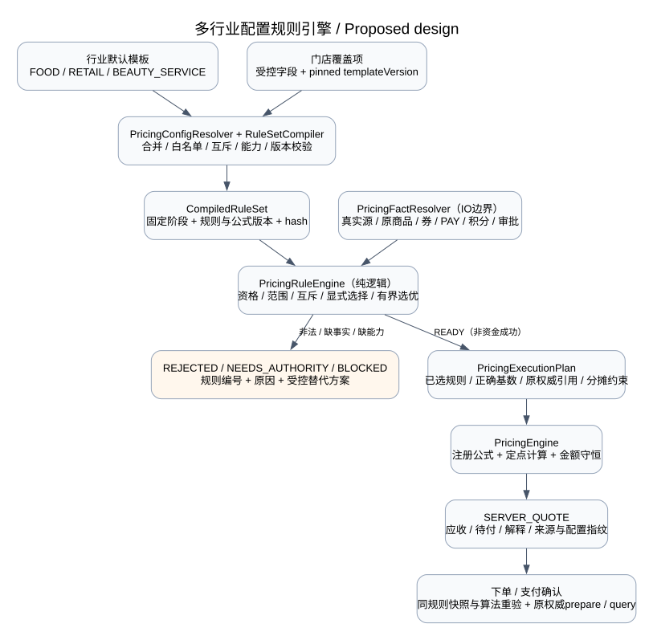

# 餐饮、零售、美业详细规则与配置规则引擎

> 状态：设计提案，未实现 · 2026-10-22 · 档位2。依据已确认的行业模板、门店个性化及用户最新要求细化。规则目录54条：共用12条＋餐饮14条＋零售14条＋美业14条。原因码均为拟定原因，不是现有ErrorCode。
>
> 机器目录：[pricing-industry-rule-catalog.json](./design/schema/pricing-industry-rule-catalog.json)；配置语义：[规则、公式与多行业模型§8](./TDD-统一试算引擎-规则公式与多行业模型.md)；金额/权威边界：[统一试算与结算](./TDD-统一试算引擎与餐饮结算.md)。

## L1 设计结论

共用内核不维护三套互相复制的计算逻辑。行业提供规则模板和可信业务事实，门店保存允许修改的覆盖项，规则引擎合并校验并编译为执行计划，计算引擎执行该计划引用的固定公式及权威优惠分摊。

“人工找零”的业务用词暂按人工抹零/减免建模，真正现金实收差额找零始终独立。未确认的术语不能变成“用了券不退现金多收款”的系统规则。

原文早期先打折后抵扣的通用示例不再作为本轮新模板的默认：用户当前要求金额抵扣先于折扣，储值分支不使用折扣券；积分在储值分配后，人工抹零在末段。存量零售及券提供方既有算法不能直接改写；不支持该顺序时阻止新模板发布，或继续留在明确的旧兼容档案，不假装与新公式等价。

## L2 行业模板与门店生效配置

| 项目 | 餐饮新模板 | 零售新模板 | 美业/服务新模板 |
|---|---|---|---|
| 优惠种类 | MULTI_KIND，逐对校验 | MULTI_KIND，逐对校验 | SINGLE_KIND，可按能力扩展 |
| 默认券数量 | 1张 | 1张 | 1张 |
| 多现金券＋抵扣券 | 默认关闭，支持后门店可调 | 同左 | 同左 |
| 储值 | 默认关闭、预留餐饮真实源及部分支付合同 | 默认关闭、须有真实普通交易适配 | 默认关闭；已开通服务核销仅全额储值路径 |
| 积分 | 本人选择，能力支持时末段处理 | 同左，保留原资产规则 | 源类型支持才可用，全额储值后不再抵零余额 |
| 人工操作 | 权限＋原因＋审批；用券禁人工折扣/抹零 | 同左 | 同左 |

行业模板给出默认值与覆盖边界。门店可将单券改成多券，但不能凭配置授予上游多券核销能力。发布快照绑定模板版本、门店版本及规则hash；升级、回退、新报价/历史冻结的处理沿既有§8规则。

## §0 共用规则

| 编号 | 规则 | 默认行为与校验 | 门店修改边界 |
|---|---|---|---|
| COM-01 | 真实源与门店身份 | 源、买家、主体、门店、渠道来自可信上下文，源版本一致 | 不可放宽 |
| COM-02 | 非活动商品隔离 | 非活动项保留应收但不进活动/券基数；积分、储值资格独立 | 可维护受控商品范围 |
| COM-03 | 优惠种类及券数量 | 先限优惠种类，再同时限券总数、各券类张数和次数 | 可在能力上限内调整 |
| COM-04 | 储值与折扣券互斥 | 已接纳的储值选择与折扣券不能同单采用 | 不可放宽 |
| COM-05 | 用券后限制人工优惠 | 已接纳券后禁止人工打折和人工抹零 | 不可放宽 |
| COM-06 | 人工折扣独立 | 人工打折与其他活动、券、储值、积分优惠选择互斥 | 不可放宽 |
| COM-07 | 人工原因及审批 | 有分类、操作者、额度、有效审批与源hash绑定；填写原因不等于授权 | 可配类别及受控额度 |
| COM-08 | 储值真实能力 | 仅使用PAY合法offer和本人授权；本金赠金与核销不在本域改写 | 可关闭；开启须能力验收 |
| COM-09 | 积分末段处理 | 选用时在本次储值分配后计算，按原积分规则及剩余基数封顶，不自动使用 | 可关闭及配获准组合；不可改顺序 |
| COM-10 | 抹零末段与额度 | 积分后对获准未结剩余抹零；有券禁止；0余额不再减免 | 可关闭及配受控上限 |
| COM-11 | 定点与金额守恒 | 有限币种、数量精度、明确舍入与分摊；不负应收，不隐藏超收 | 不可放宽算法约束 |
| COM-12 | 快照及确认 | 绑定模板/门店/源版本、规则及报价指纹；UNKNOWN锁定范围，历史按原快照 | 不可放宽 |

## §1 餐饮规则

依据餐饮完整需求的餐牌、选配、套餐、结账、AA与退餐要求，以下是新引擎目标规则，不代表所有底座能力已经开通。

| 编号 | 规则 | 默认行为与校验 | 门店修改边界 |
|---|---|---|---|
| FOOD-01 | 餐牌及渠道计价 | 只使用当前获准餐段/渠道/菜单发布修订；不能挑另渠道低价 | 可配置已发布餐牌/渠道策略 |
| FOOD-02 | 菜品与小料资格 | 小料独立计价且可有独立优惠标记；不因主菜可优惠而自动优惠全部小料 | 可按商品/组件配置排除 |
| FOOD-03 | 套餐计价唯一 | 父套餐价加补差与组件独立价选一种模型；冻结分摊，不重复收费 | 只能选提供方支持的已发布模型 |
| FOOD-04 | 商品排除默认 | 酒水/特价菜等只有显式标记才排除；不能仅凭分类名硬编码 | 可维护排除商品/分类 |
| FOOD-05 | 活动与券 | 默认MULTI_KIND但每对组合依原权威允许；抵扣在折扣前的公式须受原合同支持 | 可收紧及选择已注册策略 |
| FOOD-06 | 单券与多券 | 默认1张；多现金券加抵扣券需原能力和总/分类限额 | 可按能力开启及限额 |
| FOOD-07 | 储值预留 | 默认关闭；将来支持已验证餐饮来源及混合支付后启用 | 可在验收后开启 |
| FOOD-08 | 积分及服务费用 | 积分末段；服务费/包装/配送不得默认用于凑商品券门槛 | 可选原提供方允许的范围 |
| FOOD-09 | 先吃后付与加菜 | 已下单批次用冻结价；新增批次独立计价，账单优惠不重复应用 | 不可回写历史单价 |
| FOOD-10 | AA及并桌 | 受益、未付范围、券次数按核心原根及份额校验，不因换桌/拆份重置 | 可开启已验收结账模式 |
| FOOD-11 | 员工优惠原因 | 建议服务补偿、出品问题、获准议价、尾数减免、其他必填说明 | 可维护分类/权限/审批额 |
| FOOD-12 | 退餐与制作分离 | 退餐按冻结行价和优惠/资金分摊；制作损耗不自动变现金减免或可售库存 | 不可绕过正式退餐协议 |
| FOOD-13 | 收费与小费 | 仅已发布收费策略；未验收的小费、最低消费等不得暗加 | 可启用已支持费项；不得任意表达式 |
| FOOD-14 | 抹零与现金找零 | 用券禁人工抹零；无券依未付/额度；现金实收差额找零始终单列 | 可收紧人工减免，不得混淆现金找零 |

## §2 零售规则

参考现有OrderServiceImpl、CouponPort和原活动/积分规则。平台券线下限制、活动后券门槛、资方和原分摊均不能因新配置而放宽。

| 编号 | 规则 | 默认行为与校验 | 门店修改边界 |
|---|---|---|---|
| RETAIL-01 | SKU门店价格 | 原SKU/门店/渠道价格及库存事实决定报价；会员价有权威来源 | 可绑定已支持价格策略 |
| RETAIL-02 | 商品优惠范围 | 特价品/赠品等显式排除；不得用不可优惠商品凑门槛 | 可维护原规则允许的排除 |
| RETAIL-03 | 活动档位 | 同活动按原活动规则择档，不能每个满减档重复相加 | 可选择原权威已发布活动 |
| RETAIL-04 | 活动与券顺序 | 存量保持活动后用券及对应门槛；新公式不得自动改老券语义 | 可关闭叠加，不可擅改提供方算法 |
| RETAIL-05 | 单券与多券 | 默认1张；多券能力未验收不能只靠门店开关开启 | 可在验收上限内调整 |
| RETAIL-06 | 出资方及线下限制 | 平台/商家优惠分列；线下不扩大当前平台券/活动适用性 | 不可放宽原出资/支付约束 |
| RETAIL-07 | 运费独立 | 券/积分是否可作用运费按原权威；默认不把运费算商品门槛 | 可选已支持运费优惠策略 |
| RETAIL-08 | 多门店分摊 | 各门店、主体、币种和出资方分别核验；商家券不抵别店 | 不可跨主体任意通用 |
| RETAIL-09 | 会员价与折扣 | 会员价是已解析基价或有身份的优惠，不能重复当两种价减两次 | 可选原价策及合法叠加档案 |
| RETAIL-10 | 赠品与零金额 | 赠品有来源/数量/分摊；0应收需合法零金额订单确认，不伪造支付成功 | 可选已支持赠品活动 |
| RETAIL-11 | 储值及积分 | 储值默认关闭；积分由本人选择、末段按原规则；不改变原门禁 | 可按真实能力启用或关闭 |
| RETAIL-12 | 员工优惠原因 | 建议商品瑕疵、价格纠错、客服补偿、获准议价、尾数减免 | 可配原因及审批额度 |
| RETAIL-13 | 称重与数量 | 仅在核心/库存协议支持的精度内计算；不把小数数量截成整数 | 可选已支持计量模式 |
| RETAIL-14 | 部分退款 | 按原行价、资方、优惠和实付分摊退；不按当前门槛重新算整单 | 不可改变已确认历史分摊 |

## §3 美业规则

依据[美业共用商品订单与服务工作流](./TDD-美业系统-共用商品订单与服务工作流.md)及[美业储值详细设计](./TDD-美业储值-系统详细设计.md)的最新首期边界；充值活动归核心，权益及储值归PAY，不采纳旧文中已被覆盖的模块归属。

| 编号 | 规则 | 默认行为与校验 | 门店修改边界 |
|---|---|---|---|
| BEAUTY-01 | 服务SKU计价 | 项目/时长/技师等级差异用原正式SKU/受控价格策略 | 可绑定已支持服务SKU |
| BEAUTY-02 | 附加项目 | 升级护理、材料、产品等分别有合法计价源行；备注不产生收费 | 可维护可售附加项 |
| BEAUTY-03 | 预约与成交 | 预约估价不等于最终成交；服务加项、改价需新确认，不回写原消费 | 可设报价有效期上限内策略 |
| BEAUTY-04 | 服务包与重复收费 | 已被合法疗程/次数权益覆盖的项目不能再按完整现金价收费 | 次卡未开通时不可启用 |
| BEAUTY-05 | 优惠组合 | 默认SINGLE_KIND，券最多1张；多种优惠须逐项能力及规则验证 | 可开启已支持组合 |
| BEAUTY-06 | 储值来源 | 储值消费用真实CORE/SERVICE_USE等已支持来源；不能伪造普通订单 | 可开启已验收路径 |
| BEAUTY-07 | 储值不足 | 首期服务核销需全额合格储值覆盖；不足拒绝，不自动扣余额补现金 | 当前不可放宽；混合需新合同验收 |
| BEAUTY-08 | 本金赠金范围 | 批次/门店/项目限制由PAY决定，外端只展示获准总额 | 不可自选绕开受限批次 |
| BEAUTY-09 | 身份与消费者确认 | 会员码只识别本人/账户，核销还需核对项目金额并确认 | 不可关闭真实授权 |
| BEAUTY-10 | 储值折扣与券 | 储值支付不自动附带会员折扣；折扣作为独立规则参与互斥 | 可配已发布会员优惠但不可破强制互斥 |
| BEAUTY-11 | 积分末段 | 仅在原源类型/积分规则均支持时选用；全额储值后无剩余不继续抵积分 | 可关闭，不能虚构核销积分接线 |
| BEAUTY-12 | 员工优惠原因 | 建议服务补偿、服务调整、获准议价、价格纠错、尾数减免 | 可配原因及受控审批额 |
| BEAUTY-13 | 同服务来源唯一 | 同一任务不能同时建现金单和储值核销来源重复结清；未知时不换路径 | 不可放宽 |
| BEAUTY-14 | 售后当前边界 | 冻结原核销依据；首期不提供线上退款/冲正，不删流水或人工改余额 | 仅预留后续正式售后协议 |

## §4 三个规则实例

### 4.1 餐饮：默认单券，门店改为多券

门店从FOOD模板覆盖为最多3张券，现金券最多2张、金额抵扣券最多1张。200元活动商品＋30元不参与活动商品，采用10元和5元现金券＋20元抵扣券，原券权威验证支持该组合且无重叠超抵：

```text
活动商品扣减后 = 200 - 10 - 5 - 20 = 165元
本单应收 = 非活动商品30 + 165 = 195元
```

如果再申请人工9折或人工抹零，规则拒绝。若再申请储值：原PAY能力不支持则拒绝，不默默改现金；已支持时仍不得同时用折扣券。抵扣券若是菜品兑换性质，先按指定菜项/数量取得权威抵扣，不能直接当20元通用优惠。

### 4.2 零售：新顺序与存量券兼容不是同一件事

新模板明确允许“20元金额抵扣＋9折”且原提供方支持先抵扣后折扣，200元商品计算为(200-20)×90%=162元；若提供方仅支持旧顺序得到160元，则不能把该提供方伪装成支持新顺序。发布校验拒绝不支持的策略，存量订单继续原档案。

若选择线下现金收款，原平台券不支持线下出资，则即使算式能算、门店选了允许多优惠，该方案仍被拒绝。现金找零只对原现金应付核算，与券后人工减免互斥是两回事。

### 4.3 美业：余额与授权均不能靠配置跳过

服务180元，可适用储值余额150元：在首期全额储值核销路径返回余额不足，不能自动写成储值150＋现金30；切换普通收款路径须原来源取消且无未知资金，再以合法普通订单处理。余额足够但尚未由本人确认，仍不可核销。

次卡覆盖一次护理时，不再收同一项目全额现金；升级材料有合法独立SKU，可作为额外收费行。次卡能力未开通则整条选择不可确认，不能先把项目价改成0冒充核销成功。

## §5 规则引擎结构



### 5.1 明确三个对象，不把校验写进公式

| 组件 | 输入 | 输出 | 不负责 |
|---|---|---|---|
| 配置解析/编译 | 行业模板、门店覆盖、系统约束、已支持规则/公式目录 | EffectiveRuleSet及来源/版本/hash | 不查询或修改买家资产余额 |
| 规则引擎 | EffectiveRuleSet、可信事实、原权威决定、实际选择 | RuleDecision：拒绝/需权威/合法执行计划 | 不扣款、不把公式求值当作资格判断 |
| 计算引擎 | 合法ExecutionPlan、精确金额/数量事实 | 分项金额、分摊、计划资金、最终待付 | 不自行放宽券、储值、积分和审批规则 |

行业/门店名与银行卡余额不是规则表达式中的任意脚本变量。系统只允许受支持的事实路径、算子及公式策略，原权威资格使用受控事实/决定，不在本地重写。

### 5.2 引擎处理顺序

1. **解析配置**：从真实门店行业归属取已绑定模板版本，应用字段级覆盖，校验边界。false与继承区分，数组整项替换。
2. **编译规则**：检查schema、规则类型、引用、互斥对称性、张数/额度、阶段依赖、公式能力；未知算子和循环依赖拒绝发布。固定排序、生成compiledRuleSetHash。
3. **收集事实**：IO编排在本地写事务外读取源及原商品/活动/券/PAY/积分/审批事实；只读取本单选中能力所需事实。引擎不调用远端。
4. **静态前置校验**：主体门店/本人/源CAS、币种、已付/UNKNOWN范围、基本资格与能力。缺事实为NEEDS_AUTHORITY/BLOCKED，不当作false或0。
5. **规则组合**：先固定显式人工操作及支付选择，校验优惠种类、券总数/分类数量、强制互斥。EXPLICIT冲突必须提示，不能静默丢弃。
6. **候选基数及权威决定**：依赖金额门槛时按该候选正确的阶段预计算基数，再请求原权威报价，所得决定绑定baseHash及scopeHash。这里的预计算不是可支付报价。
7. **有界选优**：只枚举允许组合；总预算内完整比较含费用/税及资格的最终金额。超预算不声称全局最优。金额相同按冻结的业务优先级和稳定ruleNo排序。
8. **产出执行计划**：输出采用/排除的规则、基数来源、公式id/version、权威报价引用及不变量。计算引擎只执行该受控计划。
9. **最终重验**：新报价、下单与支付按各阶段的当前或冻结事实重验；原资产prepare竞争、UNKNOWN及资金成功仍走原确认/恢复协议，不在规则引擎里完成。

### 5.3 有限规则合同

目标规则定义保留以下字段：

```text
RuleDefinition
  ruleNo / version / industryScope
  phase / kind / priority
  condition: 有限PredicateSpec
  outcome: DENY | REQUIRE_AUTHORITY | EXCLUDE_CANDIDATE | PLAN_CONSTRAINT
  reasonCode
  storeEditableFields / bounds
  requiredFactPaths / capabilityRequirements
```

允许算子只包括已注册的EQ、IN、CONTAINS、PRESENT、LTE、ALL、ANY、NOT、受控集合计数/范围交集与资格决定引用，不支持SpEL、JavaScript、SQL或任意类名加载。CONTAINS只接受集合事实路径及有类型的单值；IN用于标量事实与常量候选集合，比较时不作字符串/数字隐式转换。计算表达式另用已注册FormulaSpec，不接受前端上传表达式或函数体。

例如“储值与折扣券互斥”的逻辑：

```json
{
  "ruleNo": "COM-04",
  "phase": "COMPATIBILITY",
  "condition": {"op": "ALL", "args": [
    {"op": "PRESENT", "path": "selection.storedValue"},
    {"op": "CONTAINS", "path": "selection.acceptedCouponKinds", "value": "PERCENT_COUPON"}
  ]},
  "outcome": "DENY",
  "reasonCode": "STORED_VALUE_PERCENT_CONFLICT",
  "storeEditableFields": []
}
```

PRESENT判断实际接纳的选择，不是“门店启用了储值开关”；不能因为功能开着就禁止所有折扣券。自动选优候选在每个候选上下文中校验；显式选择冲突则整单不可确认。

### 5.4 Java对象及方法

| 类/接口（目标） | 主要方法 | 职责 |
|---|---|---|
| IndustryPricingTemplate | immutable definition | 原行业模板及可覆盖边界 |
| StorePricingOverride | immutable override | 门店绑定版本及覆盖项 |
| PricingConfigResolver | resolve(storeNo, scene) | 获准配置合并与来源解析 |
| RuleSetCompiler | compile(template, override, capabilitySchema) | 发布校验、有限算子/公式校验及编译 |
| CompiledRuleSet | immutable plan metadata | 规范化规则、依赖、版本与hash |
| PricingFactResolver | resolve(context, source, dependencies) | IO边界，加载合法事实和原权威决定 |
| RuleContext | immutable facts/selection/config | 不包含Mapper或可执行脚本 |
| PricingRuleEngine | evaluate(RuleContext, CompiledRuleSet) | 返回拒绝/缺事实/合法ExecutionPlan |
| RuleEvaluatorRegistry | evaluator(kind) | 注册有限通用校验算子，非每行业复制规则代码 |
| BenefitConflictResolver | resolve(facts, candidates, limits) | 互斥、次数、EXPLICIT与AUTO_BEST |
| FormulaRegistry | formula(id, version) | 注册受控公式算法；不执行用户表达式 |
| RuleDecision | status/issues/plan/explanations | 完整规则依据，非单个boolean |
| PricingExecutionPlan | steps/refs/versions/hash | 绑定公式、分摊、优惠权威决定及资金约束 |
| PricingEngine | calculate(plan, facts) | 现有设计的纯数学执行入口 |

此前PricingEngine.calculate(PricingInput)可保持唯一公共接口，将ExecutionPlan作为该输入的已解析字段，不再增加一套重复计算实现。行业适配只提供事实与profile，不在核心写三个大型if/else。

### 5.5 返回结果与状态

```text
READY：规则与事实齐备，产生可执行试算计划
REJECTED：已知非法，例如多券超限、互斥、越权
NEEDS_AUTHORITY：事实缺失或原提供方需重新报价/授权
BLOCKED：能力未开通、版本不支持、来源/支付范围待恢复
```

RuleDecision READY仅代表可执行计算，不等于资产已冻结或资金已付。最终quote.confirmable还需金额完整、分摊守恒、快照有效及所有选中能力门禁通过。对外规则解释脱敏；内部可保留ruleNo、配置来源、失败路径和原引用，不能记录明文会员码/支付凭据。

### 5.6 缓存和历史

编译规则按specVersion＋templateVersion＋storeConfigVersion＋hash缓存；配置发布生成新key，不原地替换旧缓存。买家余额、券状态、审批及已付范围不跟配置长期缓存。报价绑定规则快照；旧已提交操作返回原结果，新操作按其阶段重验。发布/回退及重试沿版本CAS、审计及原幂等框架。

## §6 实施与验收计划

| 阶段 | 交付 | 必验 |
|---|---|---|
| 1 目录与模板冻结 | 54条规则、门店覆盖边界、原因分类及能力清单 | 三行业差异、存量兼容、矩阵与规则无矛盾 |
| 2 配置解析/编译 | resolve、validate、compile、preview/publish | 非法覆盖、未知算子、引用缺失、循环、版本竞争 |
| 3 纯规则内核 | evaluate、conflict resolver、decision/plan | 显式冲突、范围/次数、缺事实、有界选优、稳定排序 |
| 4 原权威适配 | 商品、券、PAY、积分、审批事实 | 余额/券过期竞争、服务源全额限制、线下平台券门禁 |
| 5 公式及接口接线 | 注册公式、餐饮报价、核心确认 | 不参与活动商品仍收费；先抵扣后折扣；积分末段；下单复用 |
| 6 三行业与客户端向量 | 行业适配与同规范客户端估算 | 不同规则同内核；移除互斥/范围守卫必须变红；未知规则回退 |

本轮为设计，未实现规则引擎、配置服务、API或数据库表。当前验证仅覆盖目录唯一性、规则引用、默认值约束、JSON/XML、文档链接与算例守恒；不声称运行时业务测试通过。
