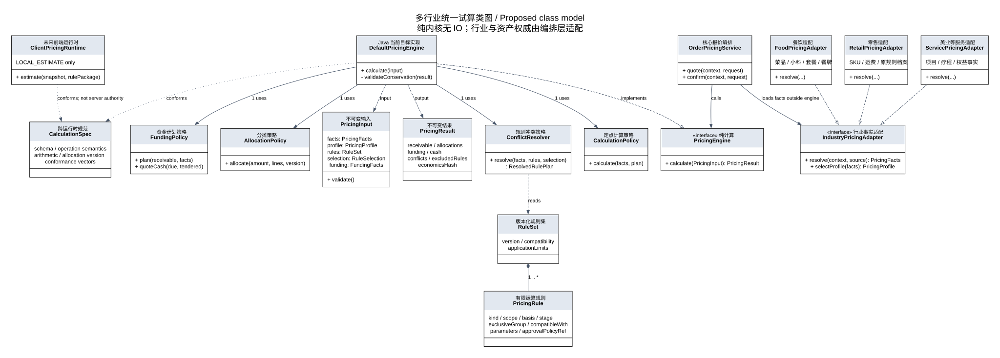

# 统一试算引擎：规则、公式与多行业模型

> 状态：设计提案，未实现 · 2026-10-22 · 档位2。依据用户补充：餐饮兼容未来储值；当前后端计算、未来前端也可计算；内核支持多行业；人工抹零、扣减、打折和折扣券/现金券必须有冲突规避。
>
> 本篇先定规则，再给公式与类图，是[统一试算及结算TDD](./TDD-统一试算引擎与餐饮结算.md)的上层计算约束。机器设计源：[pricing-rule-design.json](./design/schema/pricing-rule-design.json)。不改变原订单、PAY或营销权威，不代表已交付引擎或新接口。

> 最新配置口径见§8：行业默认模板与门店覆盖；储值与折扣券互斥、用券后禁止人工打折/抹零作为本次新引擎的强制约束。前文允许放宽这些组合的早期建议以§8为准；存量零售迁移仍需单独核对。

## L1 六条基本规则

1. **内核只认识金额、数量、计价项、规则、分摊、支付事实。** 餐饮的菜/小料/套餐、零售的SKU/配送、美业的项目/疗程，通过行业适配器进入同一模型。
2. **先解决规则适用和冲突，再执行金额计算。** 优先级不能让过期券、越权优惠或不支持的支付能力变成可用。
3. **同一范围不默认重复打折。** 人工折扣/扣减默认互斥，折扣券/现金券默认择一；叠加必须明确授权并固定顺序。
4. **优惠、抹零、支付分开。** 券降低应收；储值抵付应收；现金找零属于资金收付。现金券不能当现金，也不因面额用不完而找零。
5. **当前Java后端计算，未来前端按同一规范估算。** 两端遵守规则版本、定点运算、分摊和一致性测试；正式下单/收款始终以后端重算和权威确认结果为准。
6. **试算与确认共享算法，但不反复重定价历史。** 下单前用当前权威事实；已下单结账用冻结行/优惠；支付成功后核对原资金证据。

## L2 多行业结构与类图



图中为目标类关系，不是现有已实现类。Java类放原有common.pricing、trade.service/impl与spi体系；行业适配实现留在各行业包，核心不依赖Food实体。ClientPricingRuntime为未来前端独立运行时，遵从规则规范，不是Java接口的浏览器继承类。

| 行业 | 行业适配器提供 | 通用内核不关心 |
|---|---|---|
| 餐饮 | 菜项、规格/小料、配料组合、套餐补差、餐牌/渠道价格、堂食/外送范围 | 桌号、厨房工位、菜品表 |
| 零售 | 原SKU、渠道/会员价、运费与原活动/券决策 | 零售Mapper、配送服务实现 |
| 美业/服务 | 项目价格、服务次数、受控套餐/卡项权益事实 | 排班、技师、疗程实体 |
| 其他行业 | 已验证计价项、范围、业务能力、费用与优惠决策 | 行业私有状态机和数据库结构 |

卡次数抵扣或换购券可能是权益履约，不必全部折成“现金优惠”。由行业适配与原权益权威给出相应事实；纯计算模型不能擅自把每种卡当钱包余额。

## §0 规则对象：把“优惠配置”变成明确合同

一条规则必须明确以下信息，不是只保存一个折扣率：

| 字段 | 意义 | 示例 |
|---|---|---|
| ruleNo / ruleVersion | 稳定身份与版本 | COUPON70 / 3 |
| kind | 有限运算种类 | MANUAL_PERCENT、CASH_COUPON |
| scope / eligibleLineRefs | 整单、门店、行/组件和实际可作用范围 | 本店饮品，不含包装费 |
| basis | 对哪个阶段的金额计算 | POST_ACTIVITY_ELIGIBLE_GOODS |
| stage | 固定执行阶段 | COUPON |
| parameters | 有类型、受上限校验的参数 | payableRateBp=7000、amountMinor=2000 |
| exclusiveGroup | 互斥组 | ORDER_COUPON |
| compatibleWith | 明确允许共同使用的规则/种类 | 经原权威允许的活动 |
| maxApplications | 单范围/单订单使用次数 | 单订单1张券 |
| stackingOrder | 允许叠加时的明确顺序 | 先折扣券后现金券 |
| funder | 商户、平台或其他原出资方 | MERCHANT |
| permissionRef / approvalPolicyRef | 员工权限与审批策略引用 | 人工优惠上限及审批 |

金额阈值、税政策、券资格、账户适用范围由原权威返回，不由客户端自由指定。活动/券的资格与分摊仍采用原服务；核心ConflictResolver检查其与其他规则的整体兼容，不能扩大提供方允许的叠加范围。

### §0.1 先统一业务名词

| 类型 | 精确定义 | 是否降低商品/账单应收 |
|---|---|---|
| PRICE_REPLACE 人工调价 | 修改指定计价组件的基础单价，保留原价和原因 | 有符号价格调整 |
| MANUAL_PERCENT 人工打折 | 在获准商品基数上按应付比例打折 | 是 |
| MANUAL_AMOUNT 人工扣减 | 在获准商品基数上减指定金额 | 是 |
| PERCENT_COUPON 折扣券 | 原券规则决定可用基数、折扣、封顶和分摊 | 是 |
| CASH_COUPON 现金券 | 固定面额优惠；不代表现金，不产生现金找零 | 是 |
| MANUAL_WAIVER 人工抹零 | 在获准未结范围上作小额/受限减免，独立原因和上限 | 是，按核心调整及税费口径确认 |
| STORED_VALUE 储值支付 | 使用账户中可用于本次范围的金额支付 | 否，只减少待付 |
| CASH_TENDER 现金实收 | 收入现金减去现金找零得到净现金支付 | 否 |

“8折”统一表达为`payableRateBp=8000`，优惠率是20%。禁止某个客户端把8000解释为“优惠80%”。储值卡附带的会员折扣需另建优惠规则并参与券/人工优惠的冲突判断，不能藏在支付扣款里重复优惠。储值卡或有余额的预付卡走资金协议；普通现金券则按原券规则消耗，默认剩余面额不转余额、不找零。

## §1 冲突规避规则

### §1.1 默认矩阵

以下是**新行业安全默认档案**，不是对全部存量零售活动的强制修改。现有零售按原档案执行。矩阵主要针对同一可优惠范围；另有单订单券数量限制时，即使源行不重叠也受限制。

| 规则组合 | 默认 | 明确允许后如何处理 |
|---|---|---|
| 同一组件两次人工调价 | 互斥 | 通过新修改版本替代旧调价，不累加两个目标单价 |
| 人工打折＋人工扣减 | 互斥 | 若业务批准叠加，固定先打折后扣减，不能临时换顺序 |
| 人工打折/扣减＋活动 | 同一范围默认互斥 | 原活动和行业档案均允许，按人工优惠→活动执行 |
| 人工打折/扣减＋优惠券 | 同一范围默认互斥 | 原券与档案均允许，人工优惠后的基数参与券门槛 |
| 折扣券＋现金券 | 默认择一 | 同时被原权威和档案允许才叠加，固定折扣券→现金券 |
| 多张折扣券 | 默认不叠加 | 受控新券合同明确允许后执行指定顺序、总优惠上限 |
| 多张现金券 | 默认不叠加 | 受单订单张数、行范围、剩余基数和原券合同限制 |
| 活动＋优惠券 | 依原活动/券兼容决定 | 保持现有“活动后用券”，不可因本引擎存在而扩大资格 |
| 获准人工调价＋活动/券 | 条件允许 | 必须允许“人工改价商品”；基数用改后价格，不能按原高价凑门槛 |
| 抹零＋其他优惠 | 条件允许 | 优惠后对获准未结范围抹零，受金额/累计/次数上限与税费口径限制 |
| 抹零＋自动现金舍入 | 默认不能重复减同一差额 | 行业档案明确优先级，默认人工抹零后关闭自动舍入 |
| 储值＋活动/券 | 通常属于不同阶段，条件允许 | 券若限制支付工具，必须携带计划工具并重验；原PAY须支持此范围 |
| 储值＋现金/线上 | 条件允许混合 | 仅真实部分储值合同可用时开启；不靠本地取min模拟扣款 |

以下原因码均为拟定设计，尚不是已有运行时ErrorCode。不存在配置、互斥关系不明或引擎不认识规则时，返回`RULE_COMPATIBILITY_UNKNOWN`/`NEEDS_SERVER`等明确原因，不默认全部叠加，也不把未知规则当0优惠。

### §1.2 冲突处理优先顺序

```text
身份/权限及真实来源
→ 原订单冻结与已收/未知资金约束
→ 规则有效期、资格、适用范围、能力检查
→ 单订单/范围次数及剩余可优惠上限
→ 显式互斥组与兼容关系
→ 顾客/员工明确选择
→ 有界自动选优
→ 输出已选、被排除及原因
```

- **明确选择 EXPLICIT**：选了两种互斥优惠就返回冲突和可选替代方案，`confirmable=false`；不擅自取消人工操作，也不悄悄换券。
- **自动选优 AUTO_BEST**：在已获准候选中比较完整最终应收，默认每单最多一券时直接枚举每张可用券与“不用券”；已有人工明确操作是固定约束。
- 相同最终金额时，按快照中明确的业务优先级，再按稳定ruleNo排序；优先级只用于合法方案择优，不能越过互斥和资格检查。
- 允许多券时只枚举档案明确允许的组合；设置候选/组合预算。超出预算返回能力限制或转服务端，不截断一半搜索后声称“全局最优”。当前原服务未支持多券则直接能力门禁。
- 判定范围与基数后再算候选。支付工具会影响券资格时，每个候选携带固定的工具选择，禁止优惠与付款策略相互循环重新最大化。

依赖阶段金额的券门槛，必须用对应候选计划的正确阶段基数核验，不能在计算前拿原价判断全部门槛。编排可先用同一内核预计算基数、请求原权威取得优惠决定，再解组合冲突并计算最终结果；基数预计算不是可支付报价。

### §1.3 返回结构必须解释为什么

```json
{
  "selectionMode": "EXPLICIT",
  "confirmable": false,
  "conflicts": [{
    "ruleNos": ["PERCENT70", "CASH20"],
    "reason": "EXCLUSIVE_GROUP",
    "group": "ORDER_COUPON",
    "resolution": "SELECT_ONE"
  }],
  "appliedRules": [],
  "excludedRules": [],
  "alternatives": [
    {"ruleNos": ["PERCENT70"], "receivableMinor": 14000},
    {"ruleNos": ["CASH20"], "receivableMinor": 18000}
  ]
}
```

此为待实现的响应片段，金额条件见后面的200元算例；真实alternative还需匹配费用/税、资金计划及来源hash。不得泄露其他买家的券、账户或内部敏感审批信息。

## §2 简洁、确定的公式

### §2.1 符号与舍入

金额均是币种最小单位整数；例如CNY 10000代表100元。`R(x)`表示某个明确、版本化的舍入函数，而不是所有步骤共用一个隐含四舍五入。

| 符号 | 含义 |
|---|---|
| G | 按有效基础价/获准调价后的商品基数 |
| m | 人工应付比例基点，8000为8折 |
| d | 人工定额扣减 |
| a | 原活动权威确认的优惠金额 |
| c | 原现金券面额/本次获准扣减 |
| r | 折扣券应付比例基点 |
| f、t | 新增费用、价外税；含税金额不重复加税 |
| w | 获准人工抹零 |
| D | 最终应收 |
| P | 原权威确认的已付净额 |
| S、E、C | 本次计划储值、线上、现金净支付 |
| T、Z | 现金实收与找零 |

### §2.2 商品与人工优惠

每个计价叶子行：

```text
lineAmount = R(unitPriceMinor × exactQuantity)
G = Σ lineAmount
```

父套餐价与组件价选择一种经济计价模型；父价加补差时，组件明细用于分摊/耗用，不再加一次组件零售价。

人工打折与扣减默认二选一：

```text
人工打折优惠 M = floor(G × (10000 - m) / 10000)
打折后 B = G - M

人工扣减 M = d，要求 0 ≤ d ≤ G
扣减后 B = G - d
```

人工输入超过范围不静默截成最大优惠，应提示修改或走审批。只有明确允许二者叠加时：`B = G - floor(G × (10000-m)/10000) - d`，并且`0 ≤ d ≤ 打折后基数`。

### §2.3 活动与券

```text
活动后基数 A = B - a                    要求 0 ≤ a ≤ B
折扣券优惠 Vp = floor(A × (10000-r)/10000)
折扣券后 = A - Vp
现金券优惠 Vc = min(c, 原权威认定的可优惠基数)
```

这里的floor优惠额语义与现有`CouponCalculation.discount`保持一致，不替换为“先算应付并floor”；两种做法可能差1分。存在封顶、部分商品、门槛、出资方分摊时使用原权威结果，公式只表达简化算例，不能绕过资格检查。

默认折扣券和现金券择一。若明确允许同时使用：

```text
Vp = 原折扣券权威对A的优惠
Vc = 原现金券权威对(A - Vp)的优惠
优惠后商品额 H = A - Vp - Vc
```

券门槛按规则明示的当前阶段、实际可用商品基数判断；不能把包装费、别店商品、不可用小料或原已付行拿来凑门槛。不可把原账户/券合同没有支持的分摊精度伪装成已支持。

### §2.4 抹零、支付与找零

```text
抹零前应收 D0 = H + f + t
最终应收 D = D0 - w                    要求 0 ≤ w ≤ 获准未结范围/审批上限
待付 R = D - P                         正常新收款要求 R ≥ 0
R = S + E + C + 未分配金额             未知资金份额另行锁定，禁止再收
Z = max(0, T - C)
现金不足 = max(0, C - T)
净现金支付 = T - Z
```

若`D < P`，必须产生超收/调整退款状态，不用`max(0,D-P)`把超收事实藏掉。支付计划、已成功付款与UNKNOWN三列分别展示，`S+E+C=D`不代表资金已经收到。

抹到某个正整数币值步长q的**候选减免**为`w_candidate = D0 mod q`。例如抹到元时CNY q=100。仍须验证权限、受益范围、累计上限、税费口径和已付边界；不能仅凭公式自动获准。人工定额抹零直接提交w意图，由服务端验证。

默认不启用自动现金舍入。确需启用时只作用最终现金剩余，一次性形成明确应收调整；先固定非现金支付计划，调整后重算现金应付/找零，不能循环增加储值抵付或多次AA抹零。

## §3 四个可核验算例

### A. 两张券冲突，择一

商品200元；7折券优惠60元，现金券优惠20元：

```text
用7折券：200 - 60 = 140元
用现金券：200 - 20 = 180元
```

EXPLICIT同时选中：返回冲突。AUTO_BEST且没有其他限制：选择7折券，应收140元。不是先按业务优先级选一张再声称最优惠。

### B. 明确允许叠加，顺序固定

商品200元；9折券与20元现金券，原权威和档案均允许：

```text
先9折再现金券：200 × 90% - 20 = 160元
先现金券再9折：(200 - 20) × 90% = 162元
```

方案采用前者时将该顺序写入profile及quote快照；不能由前端数组顺序决定。默认未开启叠加时，两券仍然互斥。

### C. 券＋人工抹零＋未来储值＋现金找零

商品109.87元，现金券减10元，获准人工抹零0.87元：

```text
应收 = 109.87 - 10 - 0.87 = 99.00元
计划储值支付 = 60.00元
现金应收 = 99.00 - 60.00 = 39.00元
现金实收 = 40.00元
找零 = 1.00元
```

储值支付不会把营业应收从99元写成39元。当前餐饮部分储值合同未实现时，此组合可用于设计向量，但真实确认必须BLOCKED；不能把例子当作现有已支持能力。

### D. 人工打折与人工扣减

商品200元，人工9折与人工减30元默认冲突：分别应收180元和170元。若明确批准叠加，则`200×90%-30=150元`。员工只选了9折时，不得自动改成减30元；自动优惠推荐也不能撤销明确人工操作。

## §4 面向对象设计：保持少量清晰对象

```java
public interface PricingEngine {
    PricingResult calculate(PricingInput input);
}

public interface IndustryPricingAdapter {
    PricingFacts resolve(VerifiedPricingContext context, SourceRef source);
    PricingProfile selectProfile(PricingFacts facts);
}

public interface ConflictResolver {
    ResolvedRulePlan resolve(
            PricingFacts facts, RuleSet rules, RuleSelection selection);
}

public interface CalculationPolicy {
    PricingResult calculate(PricingFacts facts, ResolvedRulePlan plan);
}
```

这些是目标签名，不是已实现代码。ConflictResolver和CalculationPolicy均为确定性纯逻辑，IndustryPricingAdapter属于IO编排边界。实际商品、优惠、储值适用事实由原权威解析，不能让纯内核查询数据库或确认员工审批。

| 对象 | 唯一职责 |
|---|---|
| PricingFacts | 标准化计价叶子行、币种、范围、来源、原已付与可信资格事实 |
| PricingRule / RuleSet | 有限且版本化的规则定义及兼容关系 |
| RuleSelection | EXPLICIT/AUTO_BEST与已明确的操作意图 |
| ConflictResolver | 资格、互斥、叠加次数、候选与冲突解释；输出已解析规则计划 |
| ResolvedRulePlan | 固定阶段/顺序/基数和原权威优惠决定，不能任意重排 |
| CalculationPolicy | 执行定点公式、明确舍入；不再做另一份券适用判断 |
| AllocationPolicy | 原优惠分摊原样保留，新增自有调整按版本化算法分配 |
| FundingPolicy | 已付/未知/计划分离，储值及混合能力限制 |
| PricingResult | 金额明细、已用/被排除规则、冲突、分摊与可确认状态 |
| CalculationSnapshot | 规范版本、profile/规则/算法版本、源hash及有效期 |

`DefaultPricingEngine`组织：`标准化 → 冲突解决 → 定点计算 → 分摊 → 资金计划 → 守恒校验`。不做任意可执行规则脚本；只支持注册的有限运算种类，能力不足有明确结果。每个阶段不必都拆成Spring Bean，先保持少量内聚类。

## §5 当前后端与未来前端计算

### 当前：统一后端API

B/C调用现有规划的quote接口，提交源引用、源版本、规则选择与员工操作意图。服务端加载事实/权限，执行Java引擎，返回quote、冲突原因和建议。下单/收款再以原源CAS、quoteFingerprint及幂等键确认，不能信任浏览器的应收数。

### 未来：客户端可计算，但不能自行核销或扣款

采用 **CalculationSpec + 有限规则包 + 一致性测试向量**，而不是立即维护另一份独立业务规则：

1. 由服务端提供经授权脱敏的计价快照、有限运算规则和版本；不返回同桌他人权益、钱包明细、审批密钥或商业敏感配置。缺少所需公开资格事实时返回NEEDS_SERVER。
2. `ClientPricingRuntime`用相同规则语义估算；实现可以后续选择TS BigInt运行时或可移植编译产物，当前不提前锁定工具链，也不声称Java字节码能直接在浏览器运行。
3. 当前API整数先检查`Number.isSafeInteger`，再转BigInt参与客户端乘除；数量用精确十进制/有理数规范。不先用JS Number算完小数再转整数，也不偷偷改变当前HTTP金额JSON合同。
4. 协议包含specVersion、profileVersion、ruleSetHash、arithmeticVersion、allocationVersion、sourceHash；两端运行同一组向量，含边界/舍入/尾差/互斥/乱序和资金守恒。原券分摊算法有版本，不换成另一种“看起来更精确”的算法。
5. 未知规则、版本不匹配或源快照过期则回退后端，不能忽略规则继续显示可支付。前端输出`LOCAL_ESTIMATE`，后端权威报价输出`SERVER_QUOTE`。
6. 本地结果可用于即时交互，最终请求只携带源/选择/quote引用；服务端重新加载或按有效锁定快照核验，不能接受客户端计算结果作权威。断网不因此拥有储值扣款、券核销或资金成功确认能力。

未来跨端一致的是“规范化经济结果”，不要求客户端计算服务端私有授权摘要或对服务器token签名；授权/签名只由服务端处理。

## §6 储值兼容与多行业能力门禁

- 通用`FundingMethod`预留STORED_VALUE、CASH、ONLINE等；储值是可选Provider，不应成为餐饮引擎启动的强依赖。未选择储值时，不因缺少储值服务阻断普通报价。
- 选了储值但尚无真实餐饮来源/部分使用/币种/门店批次能力，则返回可解释的能力不可用，而不是自动全部改现金。模式MAX_APPLICABLE只在PAY真实offer支持时启用；精确金额模式EXACT不足则要求重新选择。
- 未来接入后由PAY返回本金赠金、适用范围和资产版本；引擎只使用该事实，不自建余额表。prepare/commit/query仍属原资金协议。
- 不同币种、次数卡、押金抵付、挂账等分别声明能力；不能为凑“多行业通用”而把所有资产换算成一笔不带来源的discountMinor。
- 行业profile及原权威共同决定叠加；核心只有有限运算和一致性约束，没有`if (industry == FOOD)`分支来决定券资格。

## §7 验收与实施顺序

本轮只有设计文件、机器可读提案和类图，没有业务代码或可运行引擎。自检只核验JSON/XML、规则引用、文档链接与公式算例，不将其写成运行时测试通过。

| 阶段 | 交付 | 必验 |
|---|---|---|
| 1 规则冻结 | 本篇、规则种类/基数/冲突矩阵/默认档案/算例 | 含糊叠加默认为拒绝，旧零售档案不自动变化 |
| 2 Java纯内核 | 值对象、ConflictResolver、CalculationPolicy、分摊及资金计划 | 确定性、非法基数、舍入、金额守恒、冲突原因、移除守卫消融 |
| 3 后端API与餐饮适配 | 源版本/套餐小料事实、原券权威、报价及确认快照 | 价格与身份不可伪造，已下单不按现价重算，B/C权限 |
| 4 储值扩展 | 原PAY来源、部分使用、原意图及混合支付 | 无合同不假成功；本金赠金/范围/并发/UNKNOWN |
| 5 多行业接入 | 零售/美业适配和各自profile | 同内核保留原规则；次数权益不伪装货币 |
| 6 前端运行时 | 有限规则规范、客户端运行时、双端向量 | 与Java经济结果一致；未知规则回退；不可宣布资金成功 |

对旧TDD的补充：未来前端计算由“不提供”改为“明确预留并要求一致性”；通用对象不再以餐饮专属模型命名；人工扣减/打折和券类冲突由显式RuleSet/ConflictResolver处理。新行业默认互斥不强行改变原零售现状。现金币值舍入、税政策、员工抹零额度等仍由真实业务政策及权威能力决定。


## §8 配置引擎、行业模板与门店个性化

### 8.1 三级配置，两类管理入口

```text
系统强制约束 / 受支持能力
          ↓
行业默认模板（按行业发布版本）
          ↓
门店个性化配置（仅覆盖允许修改的字段）
          ↓
校验与编译 → 本门店生效规则快照 → 规则引擎 → 公式计算
```

平台运营维护行业模板，商户获准人员维护门店覆盖。行业身份必须来自原主体/门店的可信行业归属及开通能力；请求不能任意改industryNo绕过规则。混合业态门店后续显式绑定业务场景与模板，当前不由浏览器随意切换行业。

源码中的PlatformConfigService当前管理平台皮肤、功能开关等配置，不能把它当作已经存在的通用版本化试算配置引擎。本节描述新配置组件的目标合同；持久化承载及是否复用现有配置/发布基础设施在实施前核对，不先增加一套通用配置平台。

### 8.2 行业默认配置建议

下表是新引擎模板建议，不表示所有行业现有能力均已支持，也不自动替换存量零售规则。

| 配置 | 餐饮默认 | 零售默认 | 美业/服务默认 |
|---|---|---|---|
| 优惠种类组合 | 多类，逐对校验 | 多类，保持原规则 | 单类，门店可调整 |
| 单单用券 | 单券，最多1张 | 单券，最多1张 | 单券，最多1张 |
| 多张现金券/抵扣券 | 默认关闭，可按原权威能力开启 | 同左 | 同左 |
| 储值支付 | 预留、默认关闭；真实能力开通后可启用 | 同左 | 同左；次数/项目权益另处理 |
| 积分 | 可选择，不自动用；能力允许时在储值后计算 | 同左 | 同左 |
| 人工打折/扣减 | 有权限、原因及审批政策才能使用 | 同左 | 同左 |
| 人工抹零 | 无券且符合原因/额度/审批政策 | 同左 | 同左 |
| 非活动商品 | 不进入活动优惠基数，保留原价应收 | 同左 | 同左 |

“优惠种类数”和“券张数”是两个独立约束：例如活动＋券属于两类优惠；2张现金券＋1张抵扣券属于券类内部3张券。积分是最终结算步骤，是否允许与券等共用另有显式开关及原权威校验；储值是支付工具，不计作一种营销优惠，但仍受折扣券互斥限制。

积分开关不授予积分使用资格；缺少积分能力或买家授权时，选择积分仍不可确认。未选择储值时，不因储值服务尚未开通阻止普通报价；启用储值必须真实具备本行业来源、币种和部分使用等能力。

### 8.3 门店可以修改哪些字段

| 允许门店个性化 | 不能由门店放宽 |
|---|---|
| 单类/多类优惠模式 | 储值与折扣券互斥 |
| 单券/多券、总张数及分券类上限 | 用券后禁止人工打折与人工抹零 |
| 原权威支持的现金券/抵扣券组合 | 人工打折与其他优惠互斥 |
| 是否开放积分、已开通的储值能力 | 原券/账户归属、适用范围、资产限额及权限 |
| 人工操作开关、原因分类、审批额度 | 无法支持的多券/混合支付能力 |
| 不参加活动的商品/分类规则 | 定点精度、金额守恒、原规则算法版本 |

公式执行顺序、金额/分摊算法版本不作为门店任意JSON配置开放。门店配置选择已注册且已发布的规则/公式策略；新公式版本须由平台按协议发布。人工原因分类可个性化，但审批仍由原权限与审批权威确认；额度按币种配置，未配额度不能默认为无限。

“抵扣券”在配置中是按原券权威分类解析的类别，可能是金额抵扣或指定商品兑换；不能仅给老券换一个枚举名称就宣称支持。原提供方不支持三张券原子预占/核销时，门店多券设置不能直接发布为可用。

### 8.4 只保存覆盖项，不复制整份模板

门店绑定：`industryNo + templateNo + templateVersion`，另保存`storeNo + storeConfigVersion + overrides`。

```json
{
  "industryNo": "FOOD",
  "templateNo": "PRICING_FOOD_DEFAULT",
  "templateVersion": 1,
  "storeNo": "STORE_A",
  "storeConfigVersion": 1,
  "overrides": {
    "benefitCombinationMode": "MULTI_KIND",
    "couponMode": "MULTI",
    "couponLimits": {"total": 3, "cash": 2, "deduction": 1},
    "allowedCouponCombinations": [["CASH_COUPON", "DEDUCTION_COUPON"]]
  }
}
```

假设原权威能力已通过验收，上述门店允许最多3张券，最多2张现金券、1张抵扣券。行业默认仍为单券；别的门店不受影响。储值/折扣券及券后人工操作等强制互斥没有被修改。

覆盖语义必须明确：未提供字段为继承；false是显式关闭，不是继承；null拒绝；数组整项替换，不按下标深度合并；恢复默认是删除覆盖项。couponMode=SINGLE却配置total=3属于错误，不自动猜测用户意图。张数的总上限与分类型上限必须同时校验。

### 8.5 发布、生效与模板升级

1. 门店读取“行业默认值、覆盖值、最终值及来源”三列，编辑的是草稿。
2. 保存时校验字段类型、行业适用性、跨字段关系、强制互斥、账户/券提供方能力及人工审批政策。
3. 先用典型订单试算并展示变更影响，再以expectedVersion做发布CAS，保存操作者、原因和审计；不得静默覆盖其他管理员更新。
4. 发布产生不可变生效快照及effectiveConfigHash；报价绑定模板版本、门店配置版本与该hash。
5. 当前新订单采用新配置；未提交且未锁定的旧报价按版本重验，发生适用差异则重新确认。已下单/已锁定支付意图继续按其冻结规则及原确认协议处理，不用新配置改历史。
6. 行业模板升级不自动改变已绑定旧版本的门店。门店预览差异后升级模板，保留覆盖项，重新校验后发布；系统紧急强制约束可即时阻止新的未确认操作，但不能篡改既有资金结果。
7. 回退使用“旧内容创建新的发布版本”，不改旧快照。恢复行业默认即清除对应覆盖项后发布，不是删除门店历史。

### 8.6 配置对象与方法

| 目标对象/服务 | 责任 |
|---|---|
| IndustryPricingTemplate | 行业默认规则、字段可修改边界、模板版本 |
| StorePricingOverride | 门店绑定的模板版本与显式覆盖项 |
| EffectivePricingConfig | 合并、校验、编译后的不可变规则/公式策略引用 |
| PricingConfigResolver.resolve(store, scene) | 从可信行业归属解析模板及门店覆盖，形成最终配置 |
| PricingConfigValidator.validate(candidate, capabilities) | 校验强制约束、跨字段关系和真实能力 |
| PricingConfigService.preview / publish / restoreDefault | 配置预览、受权发布与恢复默认；沿Service/Impl及typed内部合同风格 |

本节仅设计；三个行业模板已写入机器设计源供评审，不代表数据库初始化、配置服务或管理页面已经实现。
