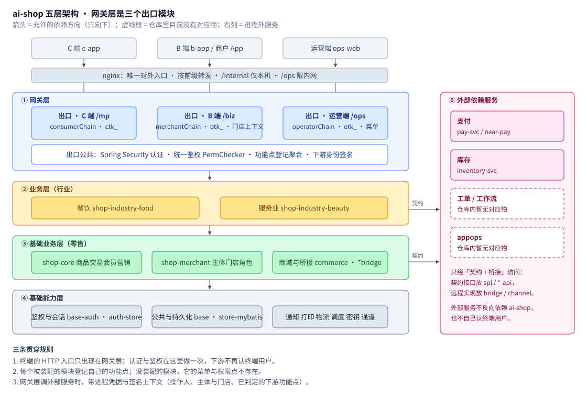
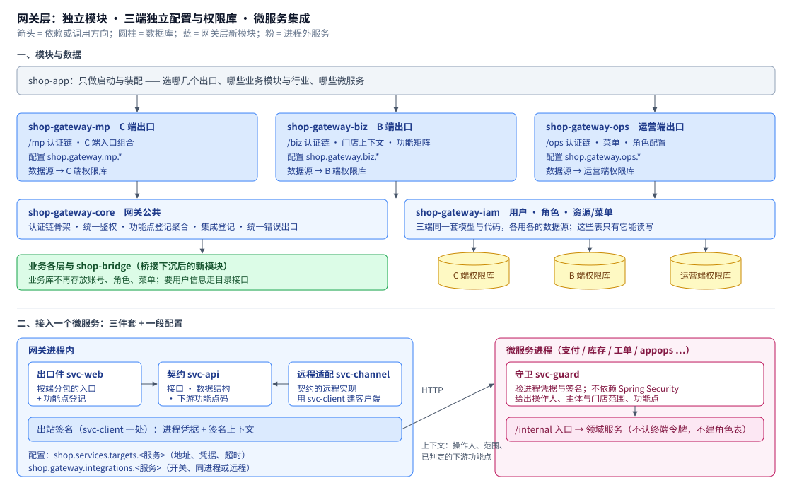
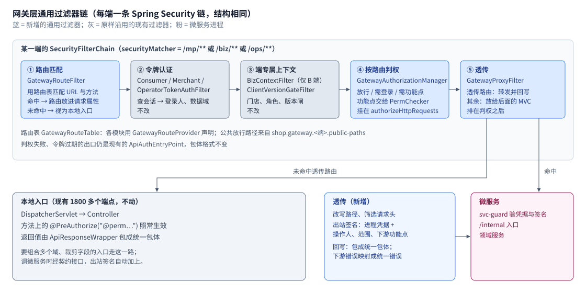
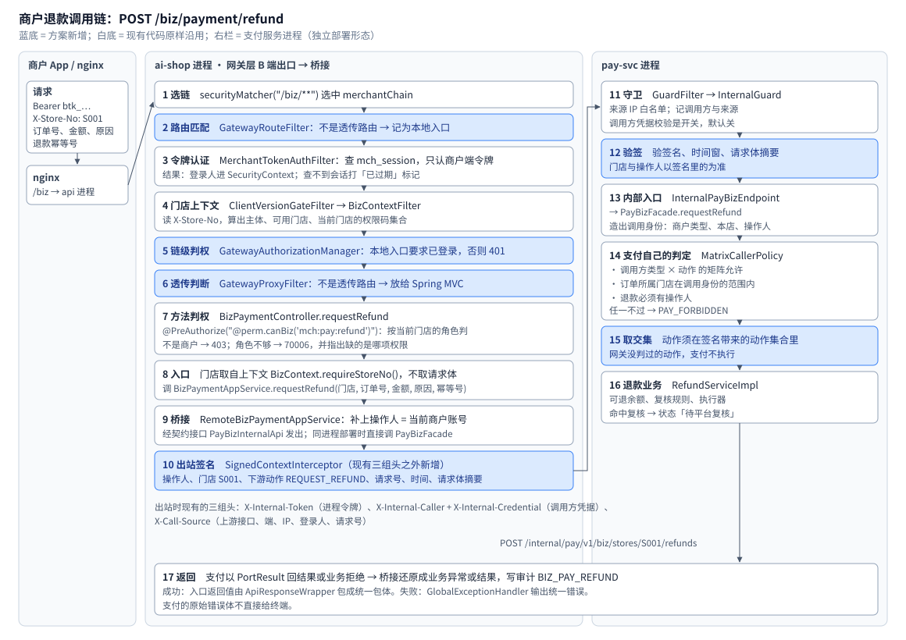
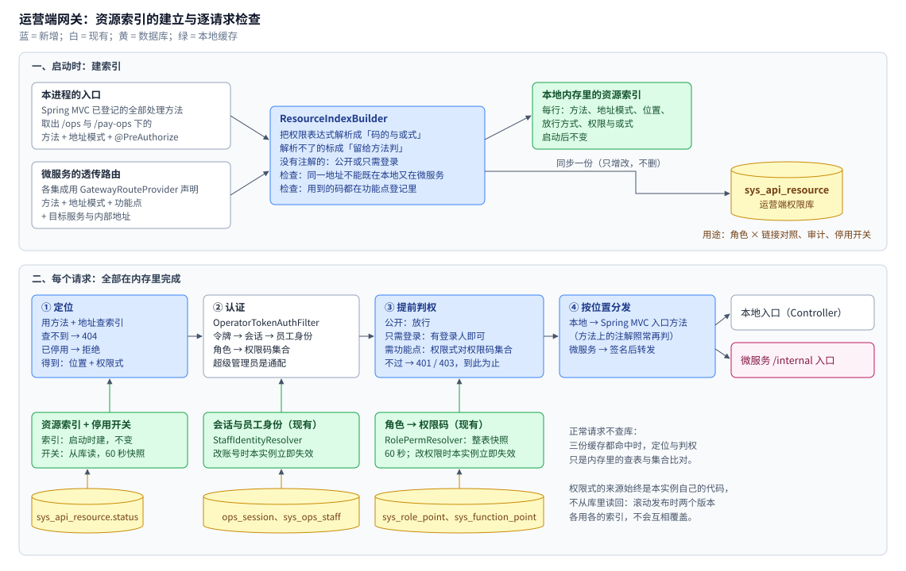
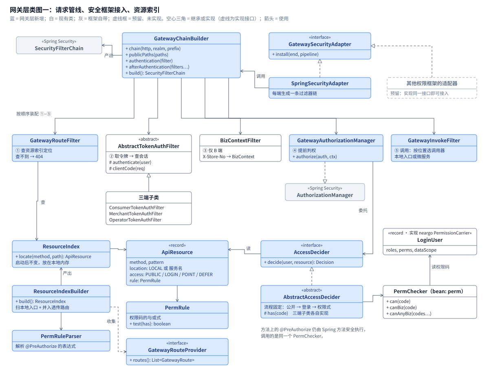
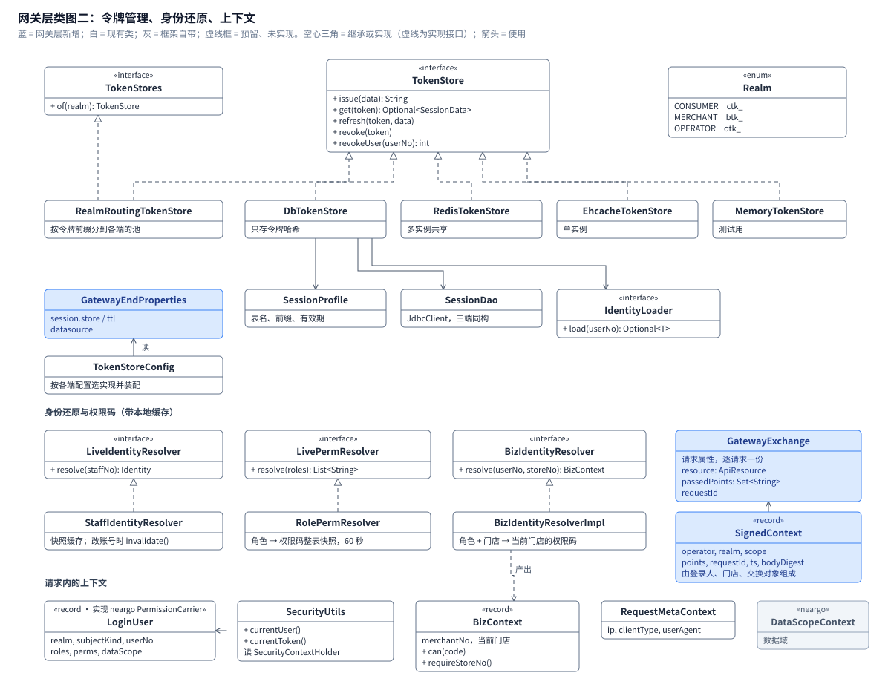
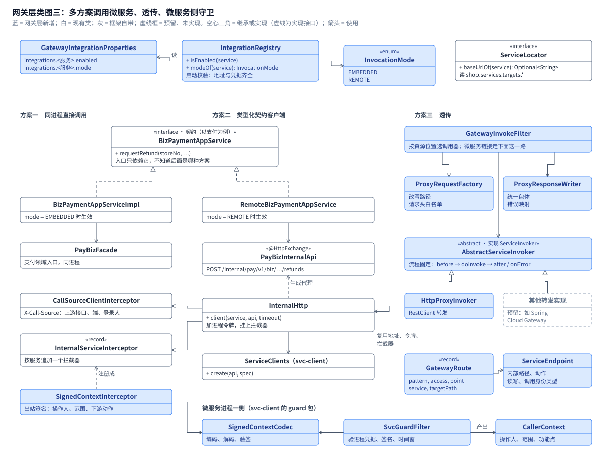
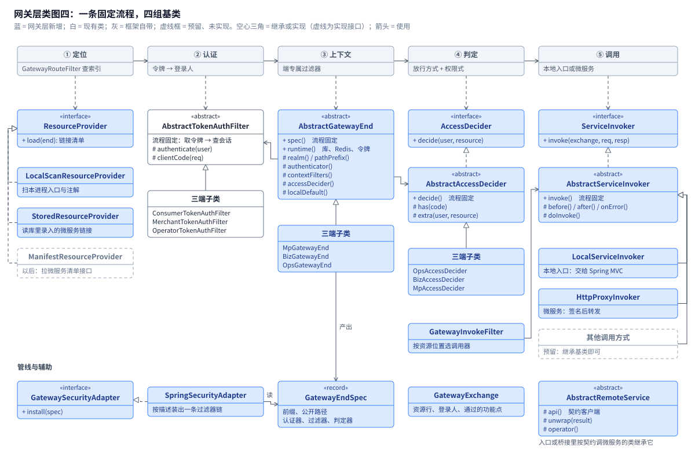

# TDD-网关层与统一权限-五层架构对齐

状态：已确认（用户 2026-11-18 确认定稿；尚未实现）
关联需求：无既有 PRD。需求来自 2026-11-18 十二次口述，已整理成下文「需求与验收标准」，确认后再往下走。
创建：2026-11-18 · 最后更新：2026-11-18（定稿）

关联文档（本文在它们之上收口，不另立一套）：
[TDD-三端服务拆分](design/TDD-三端服务拆分-架构与依赖规划.md)（§6.2 网关用法）·
[TDD-统一鉴权与会话外置](TDD-统一鉴权与会话外置.md)（§4 隔离边界、§11 拆库就绪、§16 三阶段）·
[TDD-多行业统一业务架构](TDD-多行业统一业务架构-零售餐饮美业.md)（§8 分层与落点）·
[TDD-B端门店功能矩阵与方案准入](TDD-B端门店功能矩阵与方案准入.md) ·
ADR-044 / ADR-045 / ADR-046 / ADR-049

---

## 一句话

网关层是一个独立模块 `shop-gateway`：C 端、B 端、运营端各一个出口，认证与权限每端一套、互不影响；
请求按固定的五步走（定位、认证、上下文、判定、调用），认证与鉴权只在这一层用 Spring Security 做一次；
链接与权限先记录在数据库里，角色不能访问的链接在网关层就被拦下；微服务按「配置 + 清单」接入。
**不引入 Spring Cloud Gateway**，路由仍归 nginx。





---

## 定稿口径（先读这里）

本文经十二轮口述逐步成形，前面的章节保留了推导过程，其中有几节被后面的取代。**定稿以本节为准**，不可逆的部分另见 [ADR-060](ADR/ADR-060-网关层独立模块与鉴权不进路由网关.md)、[ADR-061](ADR/ADR-061-三端认证与权限各自一套及权限库独立.md)。

**定下来的十三件事：**

| # | 决定 | 详见 |
|---|---|---|
| 1 | 网关层是一个独立模块 `backend/shop-gateway`，按包划分；`shop-app` 只剩启动与装配 | §2.20 |
| 2 | 请求流程固定为五步：定位 → 认证 → 上下文 → 判定 → 调用；端、判定、调用、链接来源各一组基类 | §2.21 |
| 3 | 认证与鉴权在网关层用 Spring Security 做一次；微服务不认终端用户、不建角色表 | §2.4、§2.11 |
| 4 | 不引入 Spring Cloud Gateway；路由匹配与转发自己写，留 `ServiceInvoker` 作为以后替换的位置 | §3、§2.8 |
| 5 | 认证与权限每端一套、互不影响：配置、令牌存储、Redis、权限库、本地缓存都按端分开 | §2.15、§2.5 |
| 6 | 链接与权限第一期走数据库：本进程入口启动扫描入库，微服务链接由种子或界面录入；库 → 本地快照 → 逐请求检查 | §2.18、§2.13 |
| 7 | 角色不能访问的链接在网关层拦；微服务链接是白名单，没录入的一律 404 | §2.12 |
| 8 | 本进程入口的权限码由代码决定，库里只记录并可停用；方法上的 `@PreAuthorize` 保留 | §2.13、§2.18 |
| 9 | 调微服务三种方式：同进程直接调用、类型化契约客户端、透传；出站统一带签名上下文 | §2.14、§2.11 |
| 10 | 工单 / 工作流、appops 以后按「配置 + 清单」接入，不改网关代码 | §2.17 |
| 11 | 三处接缝留接口、不预写第二个实现：安全框架适配、判定来源、调用方式 | §2.14、§2.21 |
| 12 | 166 上 nginx 直连 near-pay 的运营端支付链接现在不动 | §2.12 |
| 13 | 网关代理五类对象：零售、餐饮、服务业、支付、库存；每类在 `shop.gateway.integrations` 下一块同构的配置，现有键作默认值 | §2.22 |

**被取代的章节：**

| 章节 | 状态 | 以哪里为准 |
|---|---|---|
| §2.2 五个独立模块 | 模块划分被取代 | §2.20 |
| §2.9 代码结构与代码清单 | 被取代 | §2.19 的类清单 + §2.20 的包 + §2.21 的类变化 |
| §2.19 里的七个模块 | 模块划分被取代，类清单有效 | §2.20 |
| §2.16 清单接口与注解 | 推后，不在第一期 | §2.18 |
| §4.3 分期 | 被取代 | 本节下面的分期 |
| §2.14 类图一、三里的旧类名 | 已按 §2.21 更新 | §2.21 |

**定稿的分期：**

| 期 | 内容 | 不可逆吗 |
|---|---|---|
| P | 建 `shop-gateway`；搬三端出口包与桥接包；四组基类与三端子类；每端配置、Redis、令牌存储；拆 `SecurityConfig` | 否：行为不变 |
| D1 | 运营端：建接口资源两张表，启动扫描入库，整表快照，逐请求提前判权 | 否 |
| D2 | 透传与 `GatewayInvokeFilter`；微服务链接的种子；运营端「接口资源」页 | 否 |
| D3 | B 端同构的表、判定与页面 | 否 |
| F | 功能点按模块登记，行业的权限码声明搬回各模块 | 否 |
| I1 → I2 → I3 | 运营端、B 端、C 端权限库依次独立；C 端先拆 `usr_account` | **是**，每次一份回退方案 |
| S | 出站签名与微服务侧守卫；支付内部入口加验签开关，默认只比对并记录 | 打开拒绝前另行确认 |
| 后 | 微服务清单接口与注解；near-pay 直连是否改经网关 | — |

P 与 D1 是第一批。每一期开工前按仓库规范补该期的任务拆分与测试对账。

**实现前必须核对的三点，2026-11-18 已核对**（详见[开发计划](TDD-网关层与统一权限-开发计划.md) §1）：

1. `shop-base-auth` 里的类**都不搬**。令牌过滤器、`PermChecker`、令牌存储的各个实现被留在原处的类、`shop-core` 的入口和行业测试引用。§2.19 里「搬约 17 个类」取消，这些类留在原处由网关模块直接用；新写的代码仍全部在网关模块。
2. 出口包与桥接包不依赖按部署形态切换的构建配置，那些配置原样留在 `shop-app`。
3. 组件扫描与 Mapper 扫描的根都是 `ai.neargo.shop`，搬过去的类包名不变，装配不用改。

第一批的任务拆分、顺序与验证方式见[开发计划](TDD-网关层与统一权限-开发计划.md)。

---

## 需求与验收标准

### 需求整理

| # | 需求（按口述整理） | 归类 |
|---|---|---|
| R1 | C 端、B 端、运营端各有一个出口模块，合起来是标准的网关层 | 结构 |
| R2 | 网关层代理外部微服务（支付、库存等） | 结构 |
| R3 | 网关层集成 Spring Security | 认证鉴权 |
| R4 | 调研是否有必要把 Spring Gateway 作为依赖集成 | 选型 |
| R5 | 各模块依赖统一的权限模型：用户、角色、菜单/资源 | 权限 |
| R6 | 能根据集成了哪些模块，对应到微服务里的细粒度功能点 | 权限 |
| R7 | ai-shop 分五层：网关层 → 业务层（餐饮、服务业）→ 基础业务层（零售）→ 基础能力层 → 外部依赖服务（库存、支付、工单/工作流、appops 等） | 分层 |
| R8 | 方案要与当前项目结构对齐 | 落地 |
| R9 | 网关层要有独立的代码模块 | 结构 |
| R10 | 三端各有独立的配置 | 配置 |
| R11 | 三端各有独立的用户、角色、资源/菜单数据库 | 数据 |
| R12 | 网关与微服务之间要有无缝集成的设置方案 | 集成 |
| R13 | 给出网关的代码结构与代码清单 | 落地 |
| R14 | 网关层有通用的过滤器：匹配 URL、集成 Spring Security、对接微服务接口；说明它与现有过滤器的关系 | 集成 |
| R15 | 给出从 URL 到过滤器、Spring Security、微服务的调用链，以支付为例 | 说明 |
| R16 | 说明网关权限如何与微服务自己的权限结合 | 权限 |
| R17 | 调微服务要有匹配策略：什么情况下才调，按微服务的链接规则与权限规则来；角色不能访问的链接在网关层拦，不到微服务层才拦 | 权限 |
| R18 | 以运营端为场景给出详细逻辑：网关拿到流量后按地址自动定位是本地还是微服务；按 Controller 上配置的权限提前拦截；权限同步进库并进本地缓存，每个请求从缓存检查 | 权限 |
| R20 | 工单/工作流、appops 是以后要接入的微服务；架构层做好抽象，能方便接入，并给出接入方案 | 集成 |
| R21 | 认证与权限每端一套、互不影响，包含令牌及其依赖的 Redis 等 | 数据 |
| R22 | 权限功能点怎样从微服务层挪到网关层：微服务提供清单接口、生成本地文件、提前入库与种子，三者给出选择 | 权限 |
| R23 | 第一期先用数据库方式：链接与权限先记录到数据库，调整权限在数据库里做 | 权限 |
| R24 | 以上所有代码在网关模块实现，给出代码清单 | 落地 |
| R25 | 模块偏多，改为一个项目目录、分多个包 | 结构 |
| R26 | 尽量抽象，用基类继承：三端的入口、安全、微服务与本地服务的调用；在简洁的流程上扩展能力 | 结构 |
| R27 | 网关要代理零售、餐饮、服务业，以及支付、库存；补充详细的配置方案 | 配置 |
| R19 | 给出网关层类图：集成 Spring Security 或其他权限框架、令牌管理、上下文、多方案调用微服务、透传接口 | 落地 |

R11 已确认（2026-11-18）：认证和权限每端一套、互不影响，令牌及其依赖的 Redis 等都要分开，见 §2.15。

### 验收标准

- AC1：Given 任一面向终端的 Controller，When 跑架构测试，Then 它只位于网关层允许的位置（`portal.<端>` 或 `<域>.api.<端>`），且按 URL 前缀只归属一个出口。
- AC2：Given 三个出口，When 只开启其中一个启动，Then 只有该端的认证链与出口入口生效，其余两端的路径返回 404。
- AC3：Given 一个外部服务（支付、库存），When 终端发起需要它的操作，Then 请求先在出口完成认证与鉴权，再由契约接口调用下游；终端不能直达下游。
- AC4：Given 任一 `@PreAuthorize` 用到的权限码，When 启动或跑测试，Then 这个码能在功能点登记表里找到，并且归属于某个已装配的模块。
- AC5：Given 某个模块（如餐饮）没有被装配，When 运营端取菜单、B 端取功能矩阵、配置角色权限，Then 该模块的菜单与权限点都不出现，也不能被授予。
- AC6：Given 一个功能点声明了下游映射，When 出口调用下游服务，Then 调用携带操作人、主体与门店范围和已判定的下游功能点，且被签名绑定；下游可据此拒绝越权调用。
- AC7：Given 五层的依赖规则，When 下层模块引用上层，或外部服务引用 ai-shop 模块，Then 架构测试失败。
- AC8：Given 本文的选型结论，When 评审，Then 能看到 Spring Cloud Gateway 采用与否的依据，以及什么条件下重新评估。
- AC9：Given 网关模块 `shop-gateway`，When 构建，Then 它不依赖 `shop-app`；`shop-app` 里不再有三端的认证链和 `portal.{mp,biz,ops}` 包；架构测试保证三端的包互不引用、`gateway.core` 不引用各端、桥接包不引用网关与出口。
- AC10：Given 三端各自的配置块，When 只改其中一端的会话时长或数据源，Then 另外两端的行为不变；某一端开启而必填配置缺失时，启动失败并指明是哪一端。
- AC11：Given 某一端配置了独立数据源，When 该端登录、判权、取菜单，Then 只访问该端的权限库；架构测试保证这些表只有权限模块读写，三端的表之间、它们与业务表之间没有 join。
- AC12：Given 一个按三件套提供的微服务，When 加上依赖并写一段地址与凭据配置，Then 它的入口、功能点、菜单出现在对应出口，不需要改网关层的代码；开启而未配地址或凭据时启动失败。

- AC13：Given 一条声明了功能点的透传路由，When 终端请求它，Then 未登录返回 401，没有该功能点返回 403，有则请求被签名后转到目标微服务，响应以统一包体返回；这条路径上不需要写任何入口类。
- AC14：Given 路由表，When 启动，Then 同端模式重叠、透传路由与本地入口重叠、功能点不在登记表、目标服务未配置，四种情况都启动失败。
- AC15：Given 现有的 1800 多个本地入口，When 三个通用件接入后跑现有的端点权限测试，Then 结果与接入前一致。
- AC16：Given 支付登记了「功能点 → 下游动作」，When 一个入口以未映射到退款动作的功能点调到退款接口，Then 支付拒绝并返回 `PAY_FORBIDDEN`；When 请求参数里的门店与签名里的不一致，Then 支付拒绝。
- AC17：Given 功能点登记里的每个下游动作，When 跑契约测试，Then 它存在于该微服务公布的动作清单，且在对应调用方类型的矩阵内。
- AC18：Given 某个微服务前缀下一条没有在路由表里声明的路径，When 终端请求它，Then 网关回 404，微服务收不到请求。
- AC19：Given 运营端一个没有 `pay:refund:review` 的角色，When 它请求退款复核的链接，Then 网关回 403，支付服务收不到请求；给该角色授予这个功能点后，同一实例上的下一次请求通过。
- AC20：Given 路由表与微服务的接入清单，When 跑核对测试，Then 每条透传路由的目标都在清单里，功能点的下游动作包含目标链接的动作，标了「写」的链接都要求功能点。
- AC21：Given 运营端启动完成，When 取资源索引，Then `/ops` 与 `/pay-ops` 下每个已登记的端点和每条透传路由各有一行，且每行的权限式与该端点 `@PreAuthorize` 解析出的相等。
- AC22：Given 一个没有某权限码的运营角色，When 它请求一个要求该码的本地入口并带一个不合法的请求体，Then 得到 403 而不是参数错误，入口方法没有执行。
- AC23：Given 三份缓存都已加载，When 处理一个运营端请求，Then 定位与判权阶段不发出数据库查询。
- AC24：Given 同一个集成分别按同进程与远程两种方式部署，When 请求同一个地址，Then 索引分别定位到本地入口与目标服务，终端的地址与判权结果相同。
- AC25：Given 运营把一条链接的 `status` 改为停用，When 过了快照有效期，Then 该链接被拒绝；库里其他列被改动不影响判权。
- AC26：Given `isolation: strict`，When 两端的 Redis 或数据源指向同一处，Then 启动失败；When 运营端的 Redis 不可用，Then 只有 `/ops` 回 503，`/mp` 与 `/biz` 的登录与判权正常。
- AC27：Given 一个按 §2.17 接入的新微服务，When 只在网关加配置并启动，Then 它的功能点出现在角色配置页且不属于任何角色；授给某角色后该角色的请求被转发，其他角色得到 403。
- AC28：Given 一份清单里有超出前缀的地址、超出命名空间的功能点、未在网关列出的公开地址，When 同步，Then 这三类条目被拒绝并在日志里列出，其余条目正常生效。
- AC29：Given 微服务不可用，When 网关启动或处理请求，Then 沿用库里上一次同步的清单判权，转发失败时回下游不可用。
- AC30：Given 一条 `MANUAL` 的微服务链接，When 运营在接口资源页把它要求的功能点从 A 改成 B，Then 本实例上只有 B 的角色能访问，改动写进审计；其他实例在快照有效期后一致。
- AC31：Given 一条 `SCAN` 的本进程链接，When 试图在库里改它要求的功能点，Then 被拒绝；改它的停用状态则生效。
- AC32：Given 库里一条微服务链接的功能点已被运营调整过，When 再次发版执行种子，Then 调整过的值不被覆盖。
- AC33：Given 四组基类，When 跑架构测试，Then 基类里固定流程的方法都是 `final`；继承不超过「接口 → 基类 → 子类」两层；三个端子类不含流程代码，只覆盖基类声明的方法。
- AC34：Given 一个本地入口和一条微服务链接，When 各请求一次，Then 两者都经过同一个 `GatewayInvokeFilter` 与调用器基类的 `before` / `after`，留痕字段相同。

### 不做

- 不把三套用户表合成一张。
- 不改现有权限码的名字，不改现有 URL 前缀（`/mp` `/biz` `/ops` `/internal`），不改现有表名。
- 不搬各域自己的单域 Controller：它们留在 `<域>.api.<端>` 包（Java 规范 §七），由出口按包装配。
- 不建通用工作流引擎（[多行业架构](TDD-多行业统一业务架构-零售餐饮美业.md) §3.9 已定）。
- 不为支付服务重新设计接入鉴权（ADR-045 已定）。
- 不把网关层做成独立于业务层的路由进程。出口模块与业务层默认同进程，按配置可以只开某一端（见 §3）。

---

## §0 对账一 · 需求 → 设计

| AC | 需求 | 落点 |
|---|---|---|
| AC1 | R1 | §2.2 出口模块；`ArchitectureTest` 现有 Controller 位置规则，加「按前缀归属出口」一条 |
| AC2 | R1 R3 R10 | §2.3 每端一个开关；§2.4 每个出口自带自己的 `SecurityFilterChain` 配置类 |
| AC3 | R2 | §2.7 接入形态：出口入口 → 契约接口 → 同进程实现或远程实现 |
| AC4 | R5 R6 | §2.6 `FunctionModule` 登记 + 对齐测试 |
| AC5 | R6 | §2.6 登记表按已装配模块聚合；菜单、功能矩阵、可授清单从它过滤 |
| AC6 | R6 R12 | §2.7 出站签名与微服务侧守卫 |
| AC7 | R7 | §2.1 六条依赖规则 + 架构测试 |
| AC8 | R4 | §3 选型 |
| AC9 | R9 | §2.2 五个网关模块 + 桥接下沉 |
| AC10 | R10 | §2.3 `shop.gateway.<端>.*` |
| AC11 | R11 | §2.5 三端权限库 + 权限模块独占 |
| AC12 | R12 | §2.7 三件套 + 集成登记 + 启动校验 |
| AC13 | R14 | §2.8 `GatewayRouteFilter`、`GatewayAuthorizationManager`、`GatewayProxyFilter` |
| AC14 | R14 | §2.8 `GatewayRouteTable` 的启动检查 |
| AC15 | R14 | §2.8 现有过滤器不改；`BizEndpointPermTest`、`OpsEndpointPermTest`、`MpEndpointAuthTest` |
| — | R13 | §2.9 代码结构与代码清单 |
| — | R15 | §2.10 调用链 |
| — | R19 | §2.14 类图三张；§2.21 类图四 |
| AC33 | R26 | §2.21 四组基类与继承规则 |
| AC34 | R26 | §2.21 `GatewayInvokeFilter` + `AbstractServiceInvoker` |
| AC9 | R24 R25 | §2.19 合并后的代码清单；§2.20 一个模块与包规则 |
| AC16 | R16 | §2.11 签名上下文 + 支付守卫验签 + `MatrixCallerPolicy` 取交集 |
| AC17 | R16 | §2.11 下游动作清单进契约 + 契约测试 |
| AC18 | R17 | §2.12 白名单匹配 |
| AC19 | R17 | §2.12 `GatewayAuthorizationManager` 在转发之前判权 |
| AC20 | R17 | §2.12 `ServiceEndpoint` 接入清单 + 三项核对 |
| AC21 | R18 | §2.13 `ResourceIndexBuilder`、`PermRuleParser` |
| AC22 | R18 | §2.13 `GatewayAuthorizationManager` 在读请求体之前判 |
| AC23 | R18 | §2.13 资源索引 + 现有 `RolePermResolver`、`StaffIdentityResolver` 的快照 |
| AC24 | R18 | §2.13 索引的位置列由处理方法与透传路由自动得出 |
| AC25 | R18 | §2.13 `sys_api_resource.status` + `ResourceStatusCache` |
| AC26 | R21 | §2.15 每端自己的 Redis 连接、数据源与 `isolation` 校验 |
| AC27 | R20 R22 | §2.16 清单同步；§2.17 接入步骤 |
| AC28 | R22 | §2.16 收清单的四条规则 |
| AC29 | R22 | §2.16 远程清单条目从库加载 |
| AC30 | R23 | §2.18 `MANUAL` 行可调整 + 整表快照 + 审计 |
| AC31 | R23 | §2.18 `SCAN` 行只读，仅可停用 |
| AC32 | R23 | §2.18 种子只在首次建行时写入 |

**孤立项**

- 没落点的 AC：无。
- 挂不上 AC 的设计：§2.5 里「角色到权限的三份副本收成一份」不在口述需求里，是权限库独立之后顺带能做掉的，单列出来由你决定。

---

## §1 现状与影响面

本节数字来自 2026-11-18 对当前工作区的只读扫描。扫描范围：`backend/` 与 `backend-plugins/` 的全部 pom 与 Java、XML 源码（不含测试与迁移脚本）、`deploy/`、`ops-web/lib`、`b-app/src/stores`。

### 1.1 已经具备的

| 事实 | 位置 |
|---|---|
| 三端按 URL 前缀分开：`/mp` C 端、`/biz` B 端、`/ops` 运营、`/internal` 机器调用 | 映射注解计数：`/biz` 1050、`/ops` 611、`/mp` 188、`/internal` 162 |
| Spring Security 已集成，三端各一条链，另有支付相关 5 条与公共 1 条 | `shop-app/.../config/SecurityConfig.java`，共 9 条 `SecurityFilterChain`，428 行 |
| 三端令牌分池，自研不透明令牌，会话落库 | `shop-base-auth/.../Realm.java`、`TokenStore.java`；表 `usr_session` `mch_session` `ops_session` |
| 会话存取已按「每端一个 `JdbcClient`，换库等于换 bean」写成 | `shop-auth-store`；[统一鉴权](TDD-统一鉴权与会话外置.md) §11 |
| 鉴权统一用 `@PreAuthorize("@perm.can / canBiz / canAnyBiz")` | `shop-base-auth/.../PermChecker.java`；约 338 个文件、1300 多处 |
| 接入微服务已有固定形态：契约 + 三端入口 + 远程适配 | 行业插件 `*-api`、`*-web`、`*-channel`、`*-server` |
| 进程间调用统一：`@HttpExchange` + RestClient，内部令牌头 | `svc-client`；`ServiceName` 现有 PLATFORM / PAY / JOB / FOOD / COMMERCE / BEAUTY |
| 第二数据源已有先例 | `inventory.datasource.*` 与独立的 `db/inventory` 迁移目录 |
| 对外只有 nginx，`/internal/` 仅本机 | `deploy/`；ADR-045 |
| B 端已有「功能 → 权益码 → 权限码」的注册表 | `shop-app/.../portal/biz/feature/StoreFeature.java` |
| 运营端已有功能点表，菜单项与按钮两类都入库 | `sys_function`、`sys_function_point`（`V62__perm_config.sql`） |

### 1.2 与目标的差距

| # | 差距 | 证据 |
|---|---|---|
| G1 | 出口没有模块边界。三端的认证链挤在一个配置类里；出口包都在 `shop-app`；按端启停靠 `@Profile("api")` 377 处、`@Profile("ops")` 128 处 | `SecurityConfig.java`；`shop-app/.../portal/{mp,biz,ops}` |
| G2 | 出口与桥接都在 `shop-app` 里。`portal` 下 215 个文件中 158 个直接引用同模块的桥接包，出口无法单独成模块 | §2.2 的计数 |
| G3 | 权限点没有模块归属。B 端 66 个码、运营端 145 个码集中写在基础能力层的两个常量类里，行业的码也在其中 | `BizPerms.java`、`Perms.java` |
| G4 | 角色到权限有三份：Java 硬编码、库表、前端手抄副本，靠测试防漂移 | `Perms.java` 的 `ROLE_PERMS`；`sys_role_point`；`ops-web/lib/permissions.ts` |
| G5 | 没有「模块 → 功能点」的登记机制 | 全仓无对应 SPI |
| G6 | 跨进程凭据五种并存：共享令牌、调用方凭据、appKey、HMAC 范围头、JWT | 支付、库存、餐饮、美业、商城各一种 |
| G7 | 工单/工作流、appops 在仓库里没有对应物 | 全仓检索 |
| G8 | 三端没有各自的配置块。会话、验证码、登录相关配置散在 `shop.auth` `shop.ops` `shop.mp` `shop.merchant-app` 等键下 | `application.yml` |
| G9 | 账号、角色、菜单表与业务表同库，业务模块直接读它们 | 见下表 |

G9 的细节（引用该表的源文件数，按模块）：

| 表 | 文件数 | 分布 |
|---|---|---|
| `usr_account` | 28 | shop-core 13、shop-app 5、shop-base-auth 3、shop-auth-store 3、pay 2、其余 2 |
| `mch_account` | 40 | shop-merchant 16、shop-app 8、shop-core 7、其余 9 |
| `sys_ops_staff` | 10 | shop-core 3、shop-base-auth 2、shop-auth-store 2、shop-app 2、shop-base 1 |
| `mch_role` / `mch_store_role` / `mch_management_grant` | 4 / 10 / 6 | 几乎都在 shop-merchant |
| `sys_role` / `sys_role_point` / `sys_role_member` / `sys_function` / `sys_function_point` | 2 / 7 / 8 / 1 / 6 | 几乎都在 shop-core 的 platform 域 |

这些表上的 join 一共 9 行，集中在 4 个文件：`HostStoreCreationAuthority`（4 行）、`PayBizSessionVerifier`（2 行）、`MerchantMappers`（2 行）、`OperatingEntityServiceImpl`（1 行）。

另一个要正视的事实：C 端的 `usr_account` 把登录标识（手机号、openid、unionid、Apple 标识、状态）和业务资料（昵称、头像、社区、自提点、默认地址、最近位置、市场）放在同一张表里。

### 1.3 会被改到的与不受影响的

- 会被改到：`SecurityConfig`（拆成三份）、`shop-app` 的 `portal` 与桥接包（搬模块，包名不变）、`BizPerms` / `Perms`（码不变，声明位置变）、读账号与角色表的业务代码（改走目录接口）、`application.yml`（加三端配置块）、`ArchitectureTest`（加规则）。
- 不受影响：所有 URL、权限码、表名、令牌格式、nginx 配置、支付接入守卫 `pay-guard`、库存服务本身。

---

## §2 方案

### 2.1 五层与依赖规则

| 层 | 职责 | 落点 |
|---|---|---|
| ① 网关层 | 终端的 HTTP 入口；认证、鉴权、端专属编排；用户、角色、资源/菜单；功能点登记；微服务集成 | 新建 `shop-gateway-*` 五个模块；各域 `<域>.api.{mp,biz,ops}`；`food-web` `beauty-web` `commerce-web` |
| ② 业务层 | 行业的单据、流程与作业：餐饮、服务业 | `backend-plugins/shop-industry-food`、`shop-industry-beauty` |
| ③ 基础业务层 | 零售核心：商品、交易、履约、会员、营销、主体与门店；以及连接外部服务的桥接 | `shop-core`、`shop-merchant`、`shop-report`、`shop-inventory`、`commerce`、`shop-retail-commerce`、`shop-commerce-integration`、新建 `shop-bridge` |
| ④ 基础能力层 | 与业务无关的能力：令牌与会话、公共语言与 SPI、持久化、通知、打印、物流、调度、密钥、外部通道、进程间调用 | `shop-base`、`shop-base-auth`、`shop-auth-store`、`shop-store-mybatis`、`svc-client`、`shop-notify`、`shop-channel`、`print`、`logistics`、`job`、`secret` |
| ⑤ 外部依赖服务 | 进程外、有自己数据与发布节奏的服务 | 支付 `pay-svc` 与独立 near-pay；库存 `inventory-svc`；工单/工作流、appops 待接入 |

| # | 规则 | 防住什么 |
|---|---|---|
| 1 | 依赖只向下：① → ② → ③ → ④ | 下层认识上层后，裁掉一个行业就编译不过 |
| 2 | 三个出口之间不互相调用 | 三端重新耦合成环 |
| 3 | 行业之间不互相依赖；行业只依赖零售核心的契约 | 餐饮改动波及美业 |
| 4 | 终端的 HTTP 入口只出现在网关层；`/internal` 是机器入口，不属于网关层 | 权限检查散落到说不清哪里判过 |
| 5 | 认证与鉴权在网关层做一次；下游只验进程凭据和签名上下文 | 同一件事判两遍，且两处口径不一致 |
| 6 | 外部服务只经契约访问，且不反向依赖 ai-shop 模块 | 外部服务被拖回单体（ADR-046 已对库存这样规定） |

### 2.2 网关层的五个独立模块

> 定稿口径见文首；模块划分以 §2.20 为准：一个 `shop-gateway` 模块，本节的五个模块是它的五个包。

```
backend/
  gateway/
    shop-gateway-core     网关公共：认证链骨架、统一鉴权装配、功能点登记聚合、集成登记、统一错误出口
    shop-gateway-iam      用户、角色、资源/菜单：模型、数据访问、管理服务、三端各自的迁移脚本
    shop-gateway-mp       C 端出口：/mp 认证链 + portal.mp
    shop-gateway-biz      B 端出口：/biz 认证链 + 门店上下文 + portal.biz + 功能矩阵
    shop-gateway-ops      运营端出口：/ops 认证链 + portal.ops + 菜单与角色配置
  shop-bridge             从 shop-app 下沉的桥接包（包名不变）
  shop-app                只剩启动与装配、机器入口 portal.internal、主库迁移、测试
```

依赖方向：`shop-app` → `shop-gateway-{mp,biz,ops}` → `shop-gateway-core`、`shop-gateway-iam`、`shop-bridge`、业务各层。网关模块都不依赖 `shop-app`。

模块名用 `gateway`，与你对这一层的叫法一致。已有代码的 Java 包名 `ai.neargo.shop.portal.<端>` 不改：架构测试的 Controller 位置规则和 215 个文件都认这个名字，改包名只有成本。新写的代码放 `ai.neargo.shop.gateway.{core,iam}`。

**让出口能独立成模块的前提是桥接先下沉。** 出口引用的桥接包今天在 `shop-app` 里：

| 桥接包 | 文件数 | 对 `shop-app` 其余部分的引用 |
|---|---|---|
| `payclient` | 165 | `svc` |
| `paybridge` | 140 | `portal` 2 处、`svc` 1 处 |
| `invbridge` | 68 | 无 |
| `commercebridge` | 32 | `auth` 1 处、`config` 1 处 |
| `reportbridge` | 22 | `svc` |
| `merchantbridge` | 16 | `auth` 1 处 |
| `printbridge` + `printing` | 14 | `svc` |
| `promotion` + `points` | 7 | 无 |
| `logisticsbridge` | 3 | 无 |

约 460 个文件整体搬进 `shop-bridge`，要先切断的反向引用只有个位数（`paybridge` → `portal` 2 处，两处 → `config`、`auth`），`svc` 两个文件随桥接一起下沉。桥接先收成一个模块；只有当某个服务的桥接需要在构建期单独裁剪时，再把它拆出去。

出口模块里放什么：

| 放 | 不放 |
|---|---|
| 本端的 `SecurityFilterChain` 配置 | 业务规则、状态机、Mapper |
| 跨域组合的入口（`portal.<端>`） | 单域入口：留在各域的 `<域>.api.<端>` 包 |
| 端专属的编排与字段裁剪 | 远程调用的协议细节：那在桥接与远程适配 |
| 本端的配置属性类与数据源装配 | 权限码常量：由各模块登记（§2.6） |

各出口要搬的文件数：`mp` 20，`biz` 99，`ops` 47。`portal` 下其余子包（`common` `config` `device` `link` `port`）和 4 个打印相关的类在实现时逐个归属。`portal.internal`（49 个文件）是机器入口，留在 `shop-app`。

### 2.3 三端独立配置

每端一个配置块、一个属性类、一个开关。开关关着时，该端的认证链、出口入口和数据源都不装配。

```yaml
shop:
  gateway:
    mp:
      enabled: true
      datasource:            # 不配则用主库（现状），配了就是该端独立的权限库
        url:
        username:
        password:
        max-pool-size: 8
      session:
        store: db            # db / redis / ehcache / memory
        ttl: P30D
        idle-ttl: P7D
      login:
        captcha-enabled: false
    biz:
      enabled: true
      datasource: { ... }
      session: { ... }
      login: { ... }
    ops:
      enabled: false
      datasource: { ... }
      session: { ... }
      login:
        second-factor: true
```

| 项 | 规则 | 防住什么 |
|---|---|---|
| 归属 | 每个出口模块自带自己的属性类和默认值文件，别的模块读不到 | 一端的配置被另一端顺手引用 |
| 现有键 | 现有的 `shop.auth.*` 等键作为新键的默认值来源，部署上的环境变量一个都不用改（仓库里 `inventory.*` 对 `shop.inventory.*` 就是这样桥接的） | 切换当天要同时改所有环境 |
| 部署面 | 现有 `api` profile 等于开 `mp` 与 `biz`，`ops` profile 等于开 `ops`；UME 环境按 profile 分两个进程的做法不变 | 部署脚本要重写 |
| 校验 | 某端开启而必填项缺失时启动失败，报错里写明是哪一端的哪个键 | 带着半套配置上线 |
| 密钥 | 数据源口令、签名密钥不设默认值（沿用现有的 `NoSecretDefaultInConfigTest` 约束） | 漏配时静默用公开口令 |

表中列出的 `session`、`login` 子项是示意，具体字段以现有 `SessionProfile` 和各端登录代码已经在用的参数为准，不新造参数。

### 2.4 Spring Security 的集成方式

Spring Security 已经在用，本方案只调整装配方式，不换机制。

| 项 | 做法 |
|---|---|
| 认证 | 继续用 `AbstractTokenAuthFilter` 及其三个子类校验不透明令牌；不引入 JWT 或 OAuth2 资源服务器 |
| 链的归属 | `consumerChain` 归 C 端出口，`merchantChain` 归 B 端出口，`operatorChain` 与 `payOpsChain` 归运营端出口，`publicChain` 归网关公共 |
| 支付相关的 4 条链 | `channelCallbackChain` `openPayChain` `terminalPayChain` `checkoutChain` 是支付接入层的入口，继续归支付自己的守卫，不并入三端出口（ADR-044、ADR-045） |
| 鉴权 | 继续 `@PreAuthorize` + `PermChecker`；数据范围继续由 `BizContextFilter`、`StoreRequestScopeValidator` 和 MyBatis 的数据权限拦截器承担 |
| 微服务侧 | 不要求引入 Spring Security。库存服务的构建规则明确禁止它；微服务用 §2.7 的守卫 |

### 2.5 三端独立的用户、角色、资源/菜单库

**一套模型、一套代码、三个库。** `shop-gateway-iam` 用同一组数据访问代码，分别接三端的数据源；这些表只有它能读写。

| 概念 | C 端权限库 | B 端权限库 | 运营端权限库 |
|---|---|---|---|
| 用户 | `usr_identity`（新，见下） | `mch_account` | `sys_ops_staff` |
| 角色 | 不建 | `mch_role` | `sys_role` |
| 用户 ↔ 角色 | 不建 | `mch_store_role`（账号 × 门店 × 角色） | `sys_role_member` |
| 资源 / 菜单 | 不建 | `mch_function_point`（新） | `sys_function`、`sys_function_point` |
| 角色 ↔ 资源 | 不建 | `mch_role` 内的权限集合（现状） | `sys_role_point` |
| 范围授权 | — | `mch_management_grant` | 员工记录上的数据域字段 |
| 会话与登录日志 | `usr_session`、`usr_login_log` | `mch_session`、`mch_login_log` | `ops_session`、`ops_login_log` |

三点说明：

1. **C 端不建角色和资源表。** C 端今天没有角色，登录后按数据归属判断。模型和代码是同一套，等真有 C 端角色需求时加表即可。
2. **B 端新增 `mch_function_point`。** B 端的资源今天只在代码里（`BizPerms` + `StoreFeature`）。权限库独立后，自定义角色要有一张可选资源的表；它由功能点登记表（§2.6）同步，不手工维护。
3. **C 端用户要拆成两半。** 登录标识与状态进权限库的 `usr_identity`；昵称、头像、社区、地址等业务资料留在业务库的 `usr_account`。两边用 `user_no` 对应。

规则：

| # | 规则 | 防住什么 |
|---|---|---|
| 1 | 每端一个数据源，由该端的 `shop.gateway.<端>.datasource` 决定；不配时落回主库 | 没建好独立库的环境起不来 |
| 2 | 这些表只有 `shop-gateway-iam` 读写，架构测试按表名扫描 | 业务代码又绕回去直接查账号表 |
| 3 | 三端的表之间、它们与业务表之间不做 join、不建外键，只存编号 | 拆库当天第一个要拆的就是外键（[统一鉴权](TDD-统一鉴权与会话外置.md) §11 已有此约束） |
| 4 | 业务层要用户信息，走 `spi` 里的目录接口（按编号查显示名、手机号、状态，支持批量），由 `shop-gateway-iam` 实现 | 引用三张账号表的 78 个文件各写各的查询 |
| 5 | 迁移脚本按端分三个目录，各有自己的迁移历史表：`db/gateway/mp`、`db/gateway/biz`、`db/gateway/ops` | 拆库那天还要先拆迁移（仓库里 `db/inventory` 是同样做法） |
| 6 | 跨库的写入不靠同一个事务：先在权限库建账号（按编号幂等），再写业务库；失败后重试同一个编号 | 分库后本地事务跨不过去，留下半截数据 |

规则 6 影响的流程要在实现前逐个清点，至少包括：入驻建店（账号、主体、门店角色一起建）、邀请店员、账号注销（ADR-054）。运营端建员工只写权限库，不受影响。

**搬库顺序：运营端 → B 端 → C 端。**

| 端 | 为什么排这个位置 | 要改的东西 |
|---|---|---|
| 运营端 | 最干净：员工表只有账号与权限字段，角色与菜单 5 张表几乎都在 platform 域，没有 join | platform 域的权限配置代码搬进 `shop-gateway-iam`；10 个读 `sys_ops_staff` 的文件改走目录接口 |
| B 端 | 账号挂在经营主体上，门店角色引用门店编号；9 行 join 里有 7 行涉及 `mch_account` | 改写 4 个文件里的 join 为两次查询；40 个文件改走目录接口；`BizIdentityResolverImpl` 改成「权限库取角色 + 门店目录取门店」 |
| C 端 | 要先把 `usr_account` 拆成两半，而 C 端没有角色，拆库的收益最小 | 新建 `usr_identity` 并回填；登录与身份还原改读它；28 个文件按需改走目录接口 |

数据搬迁每端都是同一套动作：建库与表 → 复制存量 → 把该端数据源切到新库 → 旧表保留一个发布周期后删除。已应用的历史迁移一个字符都不改。166 环境的应用库账号没有建库建表权限，这三次搬迁的 DDL 要在交接里标出，由 root 先执行。

**可选项：角色到权限收成一份。** 运营端权限库独立后，角色的默认权限可以由模块声明、库表作运行时真源、前端只读接口返回值，`Perms.ROLE_PERMS` 的硬编码与 `ops-web/lib/permissions.ts` 的手抄副本就可以退役。

一个操作是否放行，仍是五个条件的交集，各有唯一出处：

| 条件 | 出处 | 回答的问题 |
|---|---|---|
| 模块已装配 | 功能点登记表（§2.6） | 这套部署里有没有这个能力 |
| 方案包含 | `StoreFeature` 的权益码 + 运营发布的方案目录 | 这家店买没买 |
| 开关打开 | `sys_function_point.gated_by` | 运营有没有放开 |
| 角色授予 | 该端权限库里的角色 ↔ 资源 | 这个人能不能做 |
| 数据范围 | 门店 / 主体 / 品牌范围 | 能对谁的数据做 |

### 2.6 模块 → 功能点登记

每个模块声明自己提供哪些功能点；网关公共在启动时把已装配模块的声明聚合成登记表。

```java
// ai.neargo.shop.gateway.core
public interface FunctionModule {
    String code();                 // retail / food / beauty / pay / inventory …
    List<FunctionPoint> points();
}

public record FunctionPoint(
        String code,               // 现有权限码，原样沿用，如 biz:stock
        Realm realm,               // MERCHANT / OPERATOR
        PointType type,            // MENU / ACTION
        String parent,             // 菜单树上的父节点，可空
        String entitlement,        // 方案权益码，可空（来自 StoreFeature）
        Downstream downstream) {}  // 下游映射，可空

public record Downstream(String service, List<String> points) {}  // 服务名 + 下游功能点码
```

| 环节 | 行为 |
|---|---|
| 声明 | 每个模块在自己的自动装配里提供一个 `FunctionModule`。行业的码回到行业模块声明（解 G3） |
| 聚合 | 网关公共收集所有 `FunctionModule` 得到登记表。没装配的模块没有声明，它的功能点就不存在（AC5） |
| 同步 | 启动时把登记表同步进该端权限库的资源表（`sys_function_point`、`mch_function_point`），带上模块编码；未装配模块的存量行标记为不可用，不删除 |
| 对齐 | 测试断言每个 `@PreAuthorize` 用到的码都在登记表里。现有的 `BizEndpointPermTest`、`OpsEndpointPermTest`、`FunctionPointPermAlignmentTest` 改为对登记表比对（AC4） |
| 菜单与授权 | `/ops/menu`、`/biz/scope`、功能矩阵接口、角色配置页的可选项，都只取可用的资源行 |
| 下游 | 功能点带 `downstream` 时，出站签名把对应的下游功能点写进上下文（§2.7） |

**落地时对「同步」一行的修正（2026-11-18，开发计划 F 第二步）：** 入库的只有「功能点归哪个模块」这一个源码事实（`sys_function_point.module_code`，迁移 `V681`），按权限码算，跨部署稳定。「未装配模块的行标记为不可用」**不入库**，改为菜单接口现算：模块没装的点与开关关着的点一样，降为「现在用不了」。理由与 `gated_by` 相同 —— 装没装是部署状态，多套部署、同一个库的多个实例各不相同，写进库里就会互相覆盖。平台域通过 `ModuleAvailabilityPort` 问网关层的登记表。B 端没有功能点表，改的是自定义角色的可勾选项：模块没装的权限码不下发。

粒度的例子：B 端「盘点审核」在 ai-shop 是一个功能点；它的 `downstream` 指向库存服务的盘点审核与库存调整两个功能点。装配了库存的集成，这个功能点才出现；店员的角色被授予它，出口才放行，并把两个下游功能点带给库存服务。

### 2.7 网关与微服务的集成方案

**接入单元是三件套加一段配置。** 行业插件已经是这个形态，把它定为所有微服务的标准。

| 件 | 内容 | 谁维护 | 依赖 |
|---|---|---|---|
| 契约 `<服务>-api` | `@HttpExchange` 接口、数据结构、该服务的下游功能点码 | 微服务方 | 只依赖 spring-web |
| 出口件 `<服务>-web` | 透传路由声明（§2.8）或按端分包的入口 + `FunctionModule` + 自动装配 | 微服务方与网关方共同评审 | 契约、网关公共 |
| 远程适配 `<服务>-channel` | 契约的远程实现，用 `svc-client` 建客户端 | 微服务方 | 契约、`svc-client` |
| 配置 | 地址、凭据、超时；开关与部署形态 | 部署 | — |

```yaml
shop:
  services:
    targets:
      INVENTORY:               # 沿用现有 shop.services.targets.* 的字段
        base-url: http://127.0.0.1:8086
        credential: ${SHOP_SVC_INVENTORY_CREDENTIAL}
  gateway:
    integrations:
      inventory:
        enabled: true
        mode: remote           # remote = 调远程适配；embedded = 同进程装配该服务的实现
```

接入一个微服务的步骤：

1. 微服务方提供三件套。
2. `shop-app` 的 pom 加出口件与远程适配两个依赖。
3. `ServiceName` 加服务名，部署配置加上面两段。
4. 启动。网关公共完成四件事：建好契约的客户端；把出口件的入口挂到对应出口；把它的功能点并入登记表并同步进权限库；校验地址与凭据齐全，不齐则启动失败。
5. 运营在角色配置页给角色授予新出现的功能点。

不需要改网关层的代码。`mode` 在 `remote` 与 `embedded` 之间切换时入口和契约都不变，这是餐饮今天内嵌与独立两种部署已经在用的做法。

**出站：一处签名。** 在 `svc-client` 建客户端的地方统一加一个拦截器，所有出站调用自动带上两样东西：

| 项 | 内容 | 来源 |
|---|---|---|
| 进程凭据 | 证明调用方是 ai-shop | 该服务的 `credential` |
| 签名上下文 | 操作人、端、主体与门店范围、已判定的下游功能点、请求号、时间戳、请求体摘要，整体做 HMAC | 当前登录人、`BizContext`、本次通过的权限码经登记表映射 |

这是把 ADR-049 为餐饮定的做法（机器令牌对规范化请求做 HMAC，绑定身份、主体、门店和请求体）提成通用件，并加上「下游功能点」一项。

**入站：微服务侧一个守卫。** 新建守卫模块 `svc-guard`（§2.19 定名为 `svc-client` 的守卫包），只依赖 Servlet 与 spring-web，不依赖 Spring Security，也不依赖 `shop-base`，所以库存服务的构建规则能接受它。

| 守卫做什么 | 微服务怎么用 |
|---|---|
| 拦 `/internal/**`：验进程凭据、验签名、验时间窗 | 加依赖，配一把密钥 |
| 把上下文放进当前线程 | 取操作人与范围用于留痕和数据隔离 |
| 提供按功能点断言的方法 | 需要纵深防御的入口调一次；不需要的不调 |

微服务不认终端令牌，不建自己的角色表。

**其余约定**

| 项 | 约定 |
|---|---|
| 超时与重试 | 读可以重试；写只有带幂等键时才重试 |
| 错误 | 下游错误经现有的 `ServiceCallException` 回到网关的统一错误出口，不把下游的原始错误体透给终端 |
| 留痕 | 请求号贯穿网关与下游；沿用现有的 `CallSourceInterceptor` 记录上游接口、端、登录人 |
| 存量收敛 | 新接入的服务（工单、appops）直接用这一套；餐饮已基本是这个形态；美业、库存、商城、支付按各自排期迁移（G6）。支付侧维持 ADR-045 |

各服务当前离标准还差什么：

| 服务 | 契约 | 出口件 | 远程适配 | 服务名与配置 | 功能点登记 | 守卫 |
|---|---|---|---|---|---|---|
| 餐饮 | 有 | 有 `food-web` | 有 `food-channel` | 有 | 缺 | 有自己的范围校验，待换成通用件 |
| 美业 | 有 | 有 `beauty-web` | 有 `beauty-channel` | 有 | 缺 | 只有共享令牌 |
| 商城 | 有 | 有 `commerce-web` | 有 `commerce-channel` | 有 | 缺 | JWT 形式的上下文 |
| 支付 | `pay-domain/pay/client` | 入口散在 `shop-app` 的出口包与支付模块 | `payclient`、`paybridge` | 有 | 缺 | `pay-guard`，只识别来源 |
| 库存 | `inventory-client` | 入口在 `shop-app` 的出口包 | `shop-inventory`、`invbridge` | 服务名缺 | 缺 | appKey + 操作人头 |
| 工单 / 工作流、appops | 无 | 无 | 无 | 无 | 无 | 无 |

### 2.8 通用过滤器链：与现有框架的集成



**不是替代现有的认证过滤器，是在它们前后各加一个通用件，并把散在配置类里的 URL 规则收进一张路由表。**

现有的三端认证过滤器已经是通用骨架：`AbstractTokenAuthFilter` 写了全部流程，三个子类只差「认哪个端、审计记什么、身份怎么还原」。重写它们没有收益。缺的是另外三样：按 URL 匹配路由、按路由判权、把请求转给微服务。这三样今天分别写死在 `SecurityConfig` 的 `requestMatchers(...)` 里、散在 1300 多处方法注解里、靠手写入口逐个转发。

新增的三个通用件都在 `shop-gateway-core`，三端共用同一份代码：

| # | 通用件 | 做什么 | 怎么接进 Spring Security |
|---|---|---|---|
| ① | `GatewayRouteFilter` | 用路由表匹配 URL 与方法；命中的路由放进请求属性，未命中的视为本地入口 | 加在令牌认证过滤器之前 |
| ④ | `GatewayAuthorizationManager` | 按路由的放行方式判权：公开、需登录、需某个功能点；功能点交给现有的 `PermChecker` | 作为 `authorizeHttpRequests(...).anyRequest().access(...)` 的判定器 |
| ⑤ | `GatewayProxyFilter` | 命中透传路由时，改写路径、签名、转发到微服务并回写响应；其余请求放给后面的 Spring MVC | 加在 `AuthorizationFilter` 之后 |

编号对应图里的顺序；② ③ 是原样沿用的现有过滤器。

现有过滤器逐个的去向：

| 现有过滤器 | 位置 | 去向 |
|---|---|---|
| `AbstractTokenAuthFilter` 与三个子类 | `shop-base-auth` | **不改、不搬**。由三个出口模块各自装进自己的链 |
| `BizContextFilter` | `shop-base-auth` | 不改。只装进 B 端的链 |
| `ClientVersionGateFilter` | `shop-app/config` | 搬进 `shop-gateway-biz`，逻辑不改 |
| `RequestMetaFilter`、`ApiAuthEntryPoint`、`PermChecker` | `shop-base-auth` | 不改 |
| `ApiAccessLogFilter` | `shop-app/config/obs` | 不改 |
| 支付的 `GuardFilter` | `pay-guard` | 不改。支付接入层自己的守卫（ADR-044、ADR-045） |
| `SecurityConfig` 里的 `requestMatchers(...)` 放行清单 | `shop-app/config` | **被替代**：改成各端配置里的 `public-paths` |
| `InternalCallFilter`、`FoodScopeVerificationFilter`、`InventoryAuthFilter` | 机器入口与各微服务 | **逐步被 `svc-client` 的守卫包 替代**（§2.7），按服务排期 |
| `PrintAgentAuthenticationFilter`、`PayBizAuthenticationFilter`、`AdminTokenFilter` | 各自模块 | 不在本方案范围 |

与 neargo 框架的关系不变：继续用它的权限载体与数据范围引擎，继续排除它自带的 `SecurityAutoConfiguration`、`SessionStoreAutoConfiguration`、`DataAutoConfiguration`。网关公共以自己的自动装配接入，不与框架的会话链并存。

**一条链怎么装。** 三端共用一个骨架，各端只给出自己的差别：

```java
// shop-gateway-biz
@Bean
@Order(1)
SecurityFilterChain merchantChain(HttpSecurity http, GatewayChainBuilder gateway,
                                  BizGatewayProperties props, TokenStore tokenStore,
                                  BizContextFilter bizContext, ClientVersionGateFilter versionGate,
                                  GuardFilters portalFilters) throws Exception {
    return gateway.chain(http, Realm.MERCHANT, "/biz/**")
            .publicPaths(props.publicPaths())
            .localDefault(Access.LOGIN)                       // 本地入口默认要登录；C 端这里是 PUBLIC
            .authentication(new MerchantTokenAuthFilter(tokenStore))
            .afterAuthentication(versionGate, bizContext, portalFilters.forEntry(PortalFace.BIZ))
            .build();
}
```

```java
// shop-gateway-core：GatewayChainBuilder.build() 内部，三端相同
http.securityMatcher(prefix)
    .cors(c -> c.configurationSource(cors))
    .csrf(csrf -> csrf.disable())
    .sessionManagement(s -> s.sessionCreationPolicy(SessionCreationPolicy.STATELESS))
    .authorizeHttpRequests(reg -> reg
            .dispatcherTypeMatchers(DispatcherType.ASYNC, DispatcherType.ERROR).permitAll()
            .anyRequest().access(authorizationManager))                           // ④
    .addFilterBefore(authentication, UsernamePasswordAuthenticationFilter.class)  // ②
    .addFilterBefore(routeFilter, authentication.getClass())                      // ①
    // ③ 依次加在 ② 之后
    .addFilterAfter(proxyFilter, AuthorizationFilter.class)                       // ⑤
    .exceptionHandling(e -> e.authenticationEntryPoint(new ApiAuthEntryPoint()));
```

**路由表。** 一条路由就是一条 URL 规则：

```java
public record GatewayRoute(
        Realm realm,               // 归哪一端
        Set<HttpMethod> methods,
        String pattern,            // /biz/x/inventory/stocktakes/{id}/approve
        Access access,             // PUBLIC / LOGIN / POINT
        String point,              // access = POINT 时的权限码
        String service,            // 透传目标的服务名；本地入口为空
        String targetPath,         // 下游路径模板：/internal/inventory/v1/stocktakes/{id}/approve
        Duration readTimeout) {}
```

```java
// 出口件里声明，随契约一起评审
@Bean
GatewayRouteProvider inventoryRoutes() {
    return () -> List.of(
            GatewayRoute.proxy(Realm.MERCHANT, POST, "/biz/x/inventory/stocktakes/{id}/approve")
                    .point(BizPerms.STOCK)
                    .to(ServiceName.INVENTORY, "/internal/inventory/v1/stocktakes/{id}/approve"));
}
```

| 路由表的规则 | 防住什么 |
|---|---|
| 路由由模块用 `GatewayRouteProvider` 在代码里声明，不写在部署配置里 | 路由与契约版本脱节；环境之间路由不一致 |
| 启动时检查：同一端内模式不重叠；透传路由不与已有的本地入口重叠；`POINT` 路由的码在功能点登记表里；目标服务已开启且配了地址 | 请求被错误的路由抢走；指向不存在的功能点或服务 |
| 一条透传路由必须写明放行方式，没有默认值 | 忘了配权限的路由默认公开 |
| 透传路由的功能点与 `FunctionPoint.downstream` 共同决定带给下游的功能点 | 网关判了一个点，带给下游的是另一个 |

**两种入口并存，怎么选：**

| | 本地入口（Controller） | 透传路由 |
|---|---|---|
| 适用 | 要组合多个域或多个服务、要裁剪字段、有本地业务逻辑 | 微服务的接口原样给终端用：参数与返回都不变 |
| 判权 | 方法上的 `@PreAuthorize`（现状） | 路由上的 `access` 与 `point` |
| 调下游 | 经契约接口，类型化 | 通用转发，不认识业务类型 |
| 存量 | 现有 1800 多个端点全部是这种，不迁移 | 新接入的微服务优先用它；餐饮、美业已有的手写转发入口可以逐步换成它 |

有了透传路由，§2.7 三件套里的出口件可以只有路由声明和功能点声明，不必再为每个接口手写一个入口。

**透传的边界：**

| 项 | 一期做法 |
|---|---|
| 请求 | JSON 与无请求体的请求；请求体读入内存后计算摘要并签名，设大小上限 |
| 请求头 | 只转发白名单内的头；终端的 `Authorization` 不下传，下游拿到的是签名上下文 |
| 响应 | JSON 响应包成与 `ApiResponseWrapper` 相同的统一包体；文件下载按原样直通 |
| 错误 | 下游的错误映射成统一错误码，不把下游的原始错误体透给终端；超时与连接失败各有固定错误码 |
| 不支持 | 文件上传、SSE、WebSocket：这三类继续写本地入口 |
| 不做 | 负载均衡、限流、熔断、灰度。需要它们时就是 §3 里重新评估的条件 |

**与 Spring Cloud Gateway 的关系。** ① 与 ⑤ 合起来，就是 Spring Cloud Gateway Server WebMVC 里「路由匹配 + 转发」那一部分。这一步有两种做法：

| 做法 | 代价 | 得到 |
|---|---|---|
| 自己写这两个过滤器 | 约 400 到 500 行，外加测试 | 没有新依赖；签名、统一包体、功能点都按本仓库的规矩来 |
| 引入 Spring Cloud Gateway Server WebMVC | 先在跨项目的父 pom 里加 Spring Cloud 依赖管理，并在 Spring Boot 4.0.7 上验证；签名、包体、判权仍要自己写成它的过滤器 | 现成的路由谓词与转发；以后要限流、熔断、重试时有现成的件 |

我的建议是先自己写：眼下只需要匹配、改写、转发三件事，而引入的那条路第一步就卡在别的项目里。`GatewayRoute` 的形状与它的路由定义是对得上的，将来换过去只替换 ① 与 ⑤ 的实现，路由声明、判权、签名都不动。

### 2.9 网关代码结构与代码清单

> 本节已被 §2.19 取代：模块从五个变为七个，守卫与共用约定也放进网关模块，并合并了后续各版新增的类。以 §2.19 为准。

标记：**新** = 新写；**搬** = 从现有位置移过来，逻辑不改；**改** = 原地修改。搬来的代码保持原包名，除非另有说明。

```
backend/gateway/
├── pom.xml                                                    新  聚合五个模块
│
├── shop-gateway-core/                    包 ai.neargo.shop.gateway.core
│   ├── GatewayCoreAutoConfiguration                           新  本模块的自动装配入口
│   ├── config/
│   │   ├── GatewayEndProperties                               新  单端配置的公共形状：开关、数据源、会话、登录、public-paths
│   │   ├── GatewayIntegrationProperties                       新  shop.gateway.integrations.*
│   │   └── GatewayCorsConfiguration                           搬  SecurityConfig 里的 corsSource 与来源清单
│   ├── route/
│   │   ├── GatewayRoute、Access                               新  路由与放行方式
│   │   ├── RouteManifestCheck                                 新  路由表与微服务接入清单的三项核对（§2.12）
│   │   ├── GatewayRouteProvider                               新  模块声明路由的接口
│   │   ├── GatewayRouteTable                                  新  聚合、匹配、启动检查
│   │   └── GatewayRouteFilter                                 新  通用件 ①
│   ├── security/
│   │   ├── GatewayChainBuilder                                新  三端共用的链骨架
│   │   ├── GatewayAuthorizationManager                        新  通用件 ④
│   │   └── PublicChainConfiguration                           搬  SecurityConfig 里的 publicChain
│   ├── proxy/
│   │   ├── GatewayProxyFilter                                 新  通用件 ⑤
│   │   ├── ProxyRequestFactory                                新  路径改写、请求头白名单、请求体与摘要
│   │   └── ProxyResponseWriter                                新  统一包体、错误映射、文件直通
│   ├── function/
│   │   ├── FunctionModule、FunctionPoint、Downstream、PointType  新  §2.6
│   │   ├── FunctionRegistry                                   新  聚合；按码查模块与下游映射
│   │   └── FunctionRegistrySync                               新  启动时同步进各端资源表
│   ├── integration/
│   │   ├── IntegrationRegistry                                新  已开启的集成；启动时校验地址与凭据
│   │   └── SignedContextInterceptor                           新  出站签名；按服务注册成现有的 InternalServiceInterceptor
│   └── session/
│       └── TokenStoreConfig、TokenStoreSelection、SessionProfiles、
│           DbSessionConfig、LoginAuditConfig                  搬  自 shop-app/config
│
├── shop-gateway-iam/                     包 ai.neargo.shop.gateway.iam
│   ├── GatewayIamAutoConfiguration                            新
│   ├── IamDataSources                                         新  按端建数据源；未配置时落回主库（仿 PayDataSourceConfig）
│   ├── directory/
│   │   └── UserDirectoryPortImpl                              新  实现 spi 的用户目录接口，支持批量
│   ├── ops/                              运营端权限库
│   │   ├── platform/perm/**                                   搬  自 shop-core：PermConfigService 与实现、RolePermResolver、
│   │   │                                                          SysFunction、SysFunctionPoint、SysRole、SysRolePoint、SysRoleMember
│   │   ├── OperatorIdentityLoader、SysOpsStaff                搬  自 shop-core/platform
│   │   └── OpsStaffService 与实现                             新  从 OpsService 里拆出员工账号那一部分
│   ├── biz/                              B 端权限库
│   │   ├── MchRole、MchStoreRole 及其 Mapper                  搬  自 shop-merchant（从 MerchantMappers 里拆出）
│   │   ├── MerchantRoleService 与实现                         新  从 MerchantStaffServiceImpl 里拆出角色那一部分
│   │   ├── ManagementGrantService 与实现                      新  mch_management_grant 的读写；brand 下 6 个实现改调它
│   │   └── MchFunctionPoint 及其 Mapper                       新  B 端资源表
│   ├── mp/                               C 端权限库（最后一期）
│   │   └── UsrIdentity 及其 Mapper、ConsumerIdentityLoader    新 / 搬
│   └── resources/db/gateway/{mp,biz,ops}/                     新  三端各自的迁移脚本
│
├── shop-gateway-mp/                      C 端出口
│   ├── MpGatewayAutoConfiguration、MpGatewayProperties        新  shop.gateway.mp.*
│   ├── ConsumerChainConfiguration                             搬  SecurityConfig 里的 consumerChain，改用 GatewayChainBuilder
│   └── ai/neargo/shop/portal/mp/**                            搬  自 shop-app，20 个文件
│
├── shop-gateway-biz/                     B 端出口
│   ├── BizGatewayAutoConfiguration、BizGatewayProperties      新  shop.gateway.biz.*
│   ├── MerchantChainConfiguration                             搬  SecurityConfig 里的 merchantChain
│   ├── ClientVersionGateFilter、BizCaptchaConfiguration       搬  自 shop-app/config
│   ├── BizIdentityResolverImpl                                搬 + 改  自 shop-merchant；改成「权限模块取角色 + 门店目录取门店」
│   └── ai/neargo/shop/portal/biz/**                           搬  自 shop-app，99 个文件（含 feature/StoreFeature）
│
└── shop-gateway-ops/                     运营端出口
    ├── OpsGatewayAutoConfiguration、OpsGatewayProperties      新  shop.gateway.ops.*
    ├── OperatorChainConfiguration                             搬  SecurityConfig 里的 operatorChain 与 payOpsChain
    └── ai/neargo/shop/portal/ops/**                           搬  自 shop-app，47 个文件（含菜单与角色配置的入口）
```

网关层之外要动的：

| 位置 | 动作 | 内容 |
|---|---|---|
| `backend/shop-bridge/` | 新 + 搬 | 新模块；`shop-app` 的桥接包整体搬入（§2.2） |
| `backend/svc-client` | 新 | `SignedContext`、`SignedContextCodec`：签名上下文的结构与编解码，出站与入站共用；`ServiceEndpoint`：微服务接入清单的一行，各服务的契约模块用它公布自己的链接 |
| `backend/svc-guard/` | 新 | 新模块：`SvcGuardFilter`、`CallerContext`、`SvcGuardProperties` |
| `shop-base/.../spi/user/` | 新 | `UserDirectoryPort`：按编号批量查显示名、手机号、状态 |
| `shop-base/.../svc/ServiceName` | 改 | 加 `INVENTORY`，以后每接一个服务加一个 |
| `shop-base-auth/.../BizPerms`、`Perms` | 改 | 码值不变；各模块的 `FunctionModule` 引用它们。行业的码随后搬回行业模块 |
| `shop-app/config/SecurityConfig` | 拆后删除 | 三端的链去各出口；支付的 4 条链去支付自己的配置类 |
| `shop-app` | 改 | 只剩启动、装配、`portal.internal`、主库迁移、测试；pom 改为依赖三个出口模块 |
| `shop-app/.../application.yml` | 改 | 加 `shop.gateway.*`；`api`、`ops` 两个 profile 段里设各端开关 |
| `backend/pom.xml` | 改 | 加 `gateway/*`、`shop-bridge`、`svc-client` 的守卫包 |
| `ArchitectureTest` | 改 | 加：网关模块不依赖 `shop-app`；权限表只有 `shop-gateway-iam` 访问；出口之间不互引 |
| 业务模块里读账号与角色表的代码 | 改 | 改调 `UserDirectoryPort` 或权限模块的服务；分三期，随各端搬库进行 |

规模：新写的类约 45 个，集中在 `shop-gateway-core`（约 20 个）与 `shop-gateway-iam`（约 13 个）；搬动的文件约 660 个，其中桥接约 460 个、出口包 166 个、配置与权限相关约 30 个，搬动本身不改逻辑。

上面搬动清单里，权限相关的类名来自按表名的扫描；`OpsService`、`MerchantStaffServiceImpl`、`MerchantMappers` 这三处是「拆」不是「搬」，具体拆到哪个方法要在实现时读代码确定。

### 2.10 调用链：以商户退款为例



请求：`POST /biz/payment/refund`，头 `Authorization: Bearer btk_…` 与 `X-Store-No: S001`，体里是订单号、金额、原因、退款幂等号。下表每一步都标了是现有代码还是方案新增；现有的部分是对着源码写的，支付按独立部署形态（`shop.pay.deployment=standalone`）。

| # | 环节 | 类 | 做什么 | 现有 / 新增 |
|---|---|---|---|---|
| 0 | 反向代理 | nginx | 按前缀 `/biz` 转给 api 进程；`/internal/` 对外拒绝 | 现有 |
| 1 | 选链 | Spring Security | `securityMatcher("/biz/**")` 选中 `merchantChain` | 现有；配置类搬到 `shop-gateway-biz` |
| 2 | 路由匹配 | `GatewayRouteFilter` | 路由表里没有这条 URL 的透传路由，记为本地入口 | 新增 |
| 3 | 令牌认证 | `MerchantTokenAuthFilter` | 取 Bearer，查 `mch_session`；只认商户端令牌；登录人进 `SecurityContext`；查不到会话打「已过期」标记 | 现有 |
| 4 | 门店上下文 | `ClientVersionGateFilter` → `BizContextFilter` | 读 `X-Store-No`，算出主体、可用门店、当前门店的权限码集合，放进 `BizContext` | 现有 |
| 5 | 链级判权 | `GatewayAuthorizationManager` | 本地入口要求已登录；没有则由 `ApiAuthEntryPoint` 回 401，并区分没登录与已过期 | 新增（今天是 `anyRequest().authenticated()`，行为相同） |
| 6 | 透传判断 | `GatewayProxyFilter` | 不是透传路由，放给 Spring MVC | 新增 |
| 7 | 方法判权 | `BizPaymentController.requestRefund` 上的 `@PreAuthorize("@perm.canBiz('mch:pay:refund')")` | `PermChecker.canBiz` 按**当前门店**的角色判：不是商户回 403；角色不够抛 70006 并指出缺哪项权限 | 现有。新增一行：把通过的权限码记进请求属性，供第 10 步用 |
| 8 | 入口 | `BizPaymentController` | 门店取自 `BizContext.requireStoreNo()`，不取请求体；调 `BizPaymentAppService.requestRefund` | 现有 |
| 9 | 桥接 | `RemoteBizPaymentAppService` | 补上操作人（当前商户账号），经契约接口 `PayBizInternalApi` 发出。同进程部署时换成 `BizPaymentAppServiceImpl` 直接调 `PayBizFacade`，后面没有 HTTP | 现有 |
| 10 | 出站 | `InternalHttp` 建的客户端上的拦截器 | 现有三组头：进程令牌 `X-Internal-Token`；调用方凭据 `X-Internal-Caller` + `X-Internal-Credential`；来源 `X-Call-Source`（上游接口、端、IP、登录人、请求号）。**新增**签名上下文：操作人、门店、下游动作 `REQUEST_REFUND`、请求号、时间、请求体摘要 | 现有 + 新增 |
| 11 | 支付守卫 | `GuardFilter` → `InternalGuard` | 来源 IP 白名单（只认 TCP 对端）；记下调用方与来源；调用方凭据校验是开关，默认关 | 现有 |
| 12 | 验签 | `svc-client` 的守卫包 的能力并入支付守卫 | 验签名、时间窗、请求体摘要；门店与操作人以签名里的为准 | 新增 |
| 13 | 内部入口 | `InternalPayBizEndpoint` → `PayBizFacade.requestRefund` | 校验参数；造出调用身份 `PayCaller`：商户类型、本店、操作人 | 现有 |
| 14 | 支付自己的判定 | `MatrixCallerPolicy.check(caller, REQUEST_REFUND, 订单门店)` | 三项都要过：调用方类型 × 动作的矩阵允许；订单所属门店在调用身份的范围内；退款必须有操作人 | 现有 |
| 15 | 取交集 | `MatrixCallerPolicy` 加一条 | 动作必须在签名带来的动作集合里 | 新增 |
| 16 | 退款业务 | `RefundServiceImpl` | 可退余额、复核规则、执行器；命中复核时状态是「待平台复核」 | 现有 |
| 17 | 返回 | `PortResult` → 桥接 → `ApiResponseWrapper` | 支付回结果或业务拒绝；桥接还原成结果或业务异常并写审计 `BIZ_PAY_REFUND`；成功由统一包体返回，失败由 `GlobalExceptionHandler` 输出 | 现有 |

各类失败出在哪一步：

| 情况 | 出在 | 终端看到 |
|---|---|---|
| 没带令牌 / 令牌过期 | 第 3 步打标记，第 5 步拒绝 | 401，两种情况的错误码不同 |
| 拿 C 端或运营端令牌打 `/biz` | 第 3 步不认，第 5 步拒绝 | 401 |
| 不是这家店的成员 | 第 4 步门店准入 | 门店准入的错误码 |
| 在这家店没有退款权限 | 第 7 步 | 70006，带缺的权限名 |
| 订单不属于这家店 | 第 14 步 | `PAY_FORBIDDEN` |
| ai-shop 里某个入口挂错了权限码却调到退款 | 今天拦不住；方案下第 15 步拦住 | `PAY_FORBIDDEN` |
| 签名被改、请求被重放 | 第 12 步 | 统一的内部调用失败码 |
| 可退余额不足、命中复核 | 第 16 步 | 支付的业务错误码原样还原 |

**如果这条 URL 是透传路由**，第 2 步会命中路由，第 5 步直接按路由上的功能点判权，第 6 步完成签名与转发，第 7 到 9 步不存在。支付近期不走这条路，原因有两个：现有内部接口把操作人放在请求体里，透传时没人替它补；审计 `BIZ_PAY_REFUND` 今天写在桥接里。新接入的微服务一开始就从签名上下文取操作人，没有这两个包袱。

### 2.11 怎么结合微服务自己的权限

两层权限回答的是两个不同的问题，支付里两层今天都已经存在：

| | 网关层 | 微服务（支付） |
|---|---|---|
| 回答 | 这个人在这家店能不能退款 | 这个调用方、以这种身份、对这家店的这笔单，能不能做这个动作 |
| 判的对象 | 人 | 调用身份 `PayCaller`：类型、门店范围、操作人 |
| 依据 | 角色 → 功能点 `mch:pay:refund`；当前门店；方案权益 | `CapabilityMatrix`：调用方类型 × 动作（商户类型允许 `REQUEST_REFUND`，内部系统类型不允许）；门店范围；退款必有操作人 |
| 知道角色吗 | 知道 | 不知道，也不该知道 |

今天两层之间的接点是隐含的，有三个缺口：

| # | 缺口 | 后果 |
|---|---|---|
| 1 | 入口调哪个内部接口，就等于选了哪个动作；「功能点对应哪个动作」只存在于代码的调用关系里 | 运营看不到一个角色最终能触达支付的哪些动作；挂错权限码没有任何一处会报 |
| 2 | 门店和操作人是普通参数，支付「只记、不认人」（ADR-045） | ai-shop 里的一个 bug 可以替任意门店、任意操作人发起动作，支付分辨不出 |
| 3 | 支付分不清「网关判过权的调用」和「没判过的内部调用」 | 两者在支付看来是同一种调用 |

结合的办法是三件事：

| # | 做什么 | 谁做 | 落在哪 |
|---|---|---|---|
| 1 | **微服务公布自己的动作清单。** 支付已有 `PayAction` 枚举，把它作为下游功能点码放进契约 | 微服务方 | `<服务>-api` |
| 2 | **网关登记「功能点 → 下游动作」。** 写在该服务的 `FunctionModule` 里，随功能点一起登记（§2.6 的 `downstream`） | 网关方与微服务方共同评审 | 出口件 |
| 3 | **签名带过去，微服务取交集。** 出站把本次判过的功能点映射成下游动作签进上下文；微服务的调用身份改从签名里取门店与操作人，并要求动作在签名带来的集合里 | 两边 | `SignedContextInterceptor`、`svc-client` 的守卫包、微服务的判定处 |

支付的登记长这样：

| 网关功能点 | 下游动作 | 核对情况 |
|---|---|---|
| `mch:pay:refund` | `REQUEST_REFUND` | 对过代码 |
| `mch:pay:order:view` | `QUERY` | 示意，定稿时对 `PayBizFacade` |
| `mch:pay:statement` | `READ_LEDGER` | 示意 |
| `mch:pay:collect` | `CREATE_ONLINE` | 示意 |

最终一次退款放行的条件是：

```
角色在当前门店有 mch:pay:refund                （网关，第 7 步）
∩ mch:pay:refund 登记了下游动作 REQUEST_REFUND   （登记表，第 10 步）
∩ 支付的矩阵允许商户类型做 REQUEST_REFUND        （支付，第 14 步）
∩ 订单的门店 = 签名里的门店                      （支付，第 12、14 步）
∩ 有操作人                                      （支付，第 14 步）
∩ 支付自己的业务规则                             （支付，第 16 步）
```

| 规则 | 防住什么 |
|---|---|
| 微服务只定义「有哪些动作」和「哪类调用方能做哪些动作」，不存角色、不认终端令牌 | 两边各有一套角色，改权限要改两处 |
| 映射到的下游动作必须存在于微服务的清单里，且在对应调用方类型的矩阵内；由契约测试断言 | 登记了一个微服务根本不允许的动作，到线上才发现 |
| 门店、操作人以签名为准；请求参数里的与签名不一致就拒 | 参数被 bug 或被人改掉 |
| 同进程部署时没有 HTTP，不签名；映射关系由同一份登记和测试保证 | 为同进程调用硬造一层签名 |
| 机器自己发起的调用（定时任务、事件消费）没有登录人，用内部系统类型的调用身份，不带功能点 | 把后台任务伪装成某个用户的操作 |

运营端同理：运营端的支付权限码映射到 `REVIEW_REFUND` 等动作，调用身份是运营类型，不按门店圈。独立部署的 near-pay 运营接口目前是回查宿主身份后自己判成员权限，与这里的做法不同，见 §8 第 7 条。

**与 ADR-045 的关系。** ADR-045 定了两条：内部入口「只识别、不拒绝」；否决「支付内省平台令牌」。签名上下文不违反第二条，支付既不认识商户端令牌，也不回查 ai-shop。但第 12、15 步是「验了不过就拒」，比第一条严，属于修订，需要你确认。建议沿用支付守卫里 `verify-credential` 开关的做法：先加开关，默认只比对并记录不一致，观察一段时间没有误报后再打开拒绝。

### 2.12 匹配策略：什么时候调微服务，在哪一层拦

**原则：一条链接能不能访问，在网关层判完；请求只有全部通过才会离开网关。** 微服务提供规则（有哪些链接、每条链接是什么动作），网关执行规则。微服务侧的校验只用来兜住「网关被绕过」或「网关有 bug」，不承担按角色拦人。

**一个请求要依次过六道，才会调到微服务：**

| # | 条件 | 不满足时 | 请求到微服务了吗 |
|---|---|---|---|
| 1 | URL 前缀属于某一端，且该端已开启 | 404 | 否 |
| 2 | 方法与路径命中路由表里的一条路由 | 404 | 否 |
| 3 | 该路由所属的集成已开启，目标服务已配置地址与凭据 | 路由根本不注册，等同第 2 道的 404 | 否 |
| 4 | 已登录（公开路由除外） | 401 | 否 |
| 5 | 登录人的角色有这条路由要求的功能点，且方案包含、开关打开 | 403 | 否 |
| 6 | 数据范围：路由声明的范围维度能从登录人的数据域里取到值 | 403 | 否 |
| — | 六道都过：签名、转发 | — | 是 |

两种入口在这张表里的差别只在第 2、5 道：透传路由由路由表给出目标和功能点；本地入口由 Controller 代码决定调不调下游，功能点在方法注解上。

**路由匹配的规则：**

| 规则 | 防住什么 |
|---|---|
| **白名单**：微服务的链接只有在路由表里声明过的才能从终端访问。某个服务前缀下没声明的路径一律 404，不转发 | 微服务新加了一个内部接口，终端立刻就能打到 |
| 匹配按「方法 + 路径模式」；多条都能匹配时取更具体的那条；同样具体就在启动时报错 | 请求被哪条路由接走取决于声明顺序 |
| 透传路由必须写明放行方式；写操作的路由必须是「需功能点」，不能只要求登录 | 一条能改数据的链接只凭登录就能打 |
| 路径变量原样带到下游路径；查询参数与请求体原样转发；范围参数由网关按登录人的数据域写入，终端传来的同名参数被覆盖 | 终端自己填一个别人的门店或商户编号 |
| 部署形态决定落点：`mode: embedded` 时同一条路由落到本进程的实现，`mode: remote` 时转发；终端看到的 URL 不变 | 换部署形态要改前端 |

**链接规则与权限规则从哪来。** 微服务在契约里公布一份接入清单，每个可对外的内部接口一行；网关的出口件引用它来声明路由。

```java
// pay 的契约模块，微服务方维护：这条链接是什么
public static final ServiceEndpoint REFUND_REVIEW =
        ServiceEndpoint.of(POST, "/internal/pay/v1/ops/refunds/{payRefundNo}/review")
                .action("REVIEW_REFUND")     // 对应 PayAction
                .callerType("OPS")           // 只接受运营类型的调用身份
                .write();

// 出口件，随契约一起评审：终端的哪条链接、要哪个功能点、转到哪
GatewayRoute.proxy(Realm.OPERATOR, POST, "/pay-ops/v1/refunds/{payRefundNo}/review")
        .point(Perms.PAY_REFUND_REVIEW)      // pay:refund:review
        .to(ServiceName.PAY, PayOpsEndpoints.REFUND_REVIEW);
```

| 谁定 | 定什么 | 写在哪 |
|---|---|---|
| 微服务 | 有哪些内部链接；每条是什么动作、读还是写、接受哪类调用身份、需要哪个范围维度 | 契约里的接入清单 |
| 网关 | 终端的哪条 URL 对应哪条内部链接；访问它要哪个功能点 | 出口件里的路由声明 |
| 运营 | 哪个角色有哪个功能点 | 运营端权限库 |

启动与测试时的三项核对：

| 核对 | 防住什么 |
|---|---|
| 每条透传路由的目标都在该服务的接入清单里，方法一致 | 路由指向一个不存在或已改名的内部接口 |
| 路由的功能点登记的下游动作，包含目标链接的动作 | 网关判的是「看退款」，转过去的却是「审退款」 |
| 清单里标了「写」的链接，对应路由都要求功能点 | 见上表第三条 |

**运营端的例子：某个角色不能访问某条链接。** 客服角色没有 `pay:refund:review`，财务审核角色有。两个人都去点「退款复核」：`POST /pay-ops/v1/refunds/R20261118001/review`。

| 环节 | 客服 | 财务审核 |
|---|---|---|
| 菜单 `/ops/menu` | 不返回「退款复核」这个按钮，页面上看不到 | 返回 |
| 选链、路由匹配 | 命中透传路由，要求功能点 `pay:refund:review` | 同左 |
| 令牌认证 `OperatorTokenAuthFilter` | 按角色现算权限码集合，其中没有 `pay:refund:review` | 集合里有 |
| 判权 `GatewayAuthorizationManager` | **403，到此为止** | 通过 |
| 转发 | 不发生。支付服务收不到这次请求，它的请求记录里也没有 | 签名上下文：操作人为员工号、端为运营、下游动作 `REVIEW_REFUND` |
| 支付服务 | — | 守卫验签；矩阵确认运营类型可做 `REVIEW_REFUND`；动作在签名集合里；执行复核 |

客服绕过页面直接发请求，结果相同：拦截点是 URL 上的判权，不是菜单。运营给客服角色加上这个功能点后，本实例立即生效，其他实例最长 60 秒（§2.13）。

**微服务侧还留什么。** 这些都不看角色：

| 微服务侧的校验 | 拦的是 |
|---|---|
| 进程凭据、来源 IP、签名与时间窗 | 不是网关发来的请求 |
| 动作在签名带来的集合里 | 网关路由配错、入口挂错功能点 |
| 调用方类型 × 动作的矩阵 | 身份类型根本不该做这个动作（内部系统身份不能退款） |
| 数据归属：订单是否属于签名里的门店 | 范围对不上 |
| 业务规则：可退余额、复核规则 | 业务上不成立 |

正常情况下，一个被角色限制的请求永远走不到这张表。

**今天不符合这个原则的一处。** 166 环境上，nginx 把运营端的 `/oms-api/pay-ops/v2/` 直接转给独立部署的 near-pay（18093 端口），不经过 ai-shop；登录走 ai-shop，但这些链接的角色判定发生在 near-pay 里（它回查宿主身份，再按自己的映射判）。要做到「在网关层拦」，这条转发要改成先到 ai-shop 的运营端出口，由出口匹配路由、判权、签名后再转给 near-pay 的内部入口。这涉及 nginx 配置和 near-pay 仓库的改动，near-pay 的 v2 接口不在本仓库，我没有读到它的代码。

**2026-11-18 决定：这条直连现在不动。** 新方案没有成熟之前不改线上的转发；它作为已知例外记在这里，网关不为它建路由。重新评估的前提是三条都满足：本仓库运营端入口在新管线上稳定运行；透传与签名至少在一个服务上线并验证过；拿到 near-pay v2 的接口清单。

仓库内嵌的那套 `/pay-ops/v1/**` 不存在这个问题：它的入口和 `@PreAuthorize` 本来就在 ai-shop 进程里，属于网关层。

### 2.13 运营端详细逻辑：资源索引、入库、本地缓存、逐请求检查



**做法：启动时把每条链接「在哪、要什么权限」扫成一张资源索引，放进本地内存并同步一份进库；每个请求先查索引定位和判权，再决定进本地入口还是转微服务。** 你提的两种办法（按 Controller 上配置的权限提前拦；把权限同步进库再进本地缓存逐请求检查）在这里是同一件事的两半：Controller 上的注解是来源，索引是它的缓存，库里是它的副本。

运营端现状（2026-11-18 扫描 `/ops` 与 `/pay-ops` 下的入口）：

| 项 | 数 |
|---|---|
| 入口类 | 130 |
| 端点 | 641 |
| 带 `@PreAuthorize` 的 | 573 |
| 其中单个权限码 `@perm.can('X')` | 558 |
| 其中权限码的与或组合 | 14 |
| 其中用到方法参数、无法提前判的 | 1 |
| 没有权限注解的（登录、找回密码等公开入口；只要求登录的入口；用自己校验的商城运营入口） | 约 68 |

573 个里有 572 个能在进入口方法之前、只凭「地址 + 登录人的权限码」判完。

#### 资源索引的一行

| 字段 | 含义 | 本地入口的来源 | 微服务链接的来源 |
|---|---|---|---|
| 方法、地址模式 | `POST /pay-ops/v1/refunds/{payRefundNo}/review` | Spring MVC 已登记的处理方法 | 透传路由声明 |
| 位置 | `LOCAL`，或目标服务名加内部地址 | 固定为 `LOCAL` | 路由的 `to(...)` |
| 放行方式 | 公开 / 只需登录 / 需功能点 / 留给方法判 | 由注解与公开路径清单推出 | 路由上写明 |
| 权限式 | 权限码的与或式，如 `(A 或 B 或 C) 且 D` | 解析 `@PreAuthorize` | 路由的功能点 |
| 模块 | 属于哪个模块或集成 | 入口类所在模块 | 集成名 |
| 处理方 | 入口类与方法名，排查用 | 处理方法 | — |

#### 启动时怎么建

| 步 | 做什么 | 细节 |
|---|---|---|
| 1 | 取本地入口 | 从 `RequestMappingHandlerMapping` 取全部处理方法，留下本端前缀下的。读的是运行时的注解值，字符串拼接已经算好，不解析源码 |
| 2 | 解析权限式 | 用 Spring 自带的表达式解析器解析成语法树。只认三种节点：`@perm.can('码')`、`and`、`or`。出现别的节点，这一行标成「留给方法判」，提前判权时只要求登录 |
| 3 | 没有注解的入口 | 在该端 `public-paths` 里的是公开，其余是只需登录 |
| 4 | 并入微服务链接 | 各集成声明的透传路由，位置是目标服务 |
| 5 | 检查 | 同一个「方法 + 地址」不能既有本地入口又有透传路由；用到的权限码都在功能点登记里；写操作的微服务链接都要求功能点。任一不过，启动失败 |
| 6 | 放进内存 | 不含路径变量的地址放哈希表直接命中；含变量的按方法分组、用 Spring 的路径模式逐条匹配并取最具体的。641 行的量级，不需要更复杂的结构 |
| 7 | 同步进库 | 写进运营端权限库的 `sys_api_resource`（见下） |

**自动定位「本地还是微服务」就是第 1、4 步的结果：** 一个集成按同进程方式部署时，它的入口是本进程的处理方法，索引里是 `LOCAL`；按远程方式部署时，它的入口不在本进程，索引里是透传路由。终端的地址不变，网关不用配置就知道该往哪走。

#### 入库：`sys_api_resource`

| 列 | 说明 |
|---|---|
| `method`、`pattern` | 唯一键 |
| `location`、`service`、`target_path` | 位置 |
| `access`、`rule_json` | 放行方式与权限式 |
| `module_code`、`handler` | 归属与处理方 |
| `app_version`、`synced_at`、`stale` | 哪个版本写的；本次启动没再出现的行标为过期，不删除 |
| `status` | `ENABLED` / `DISABLED`：运营可以临时停用一条链接。只有这一列是人改的 |

另有一张子表 `sys_api_resource_point(resource_id, group_no, perm_code)` 把权限式拆成行，用来和 `sys_function_point`、`sys_role_point` 关联，直接查出「哪个角色能访问哪些链接」。

| 规则 | 防住什么 |
|---|---|
| 权限式只由代码决定，库里的是副本；运行中的判权读本实例自己扫出来的索引，不从库里读回 | 滚动发布时新旧两个版本同时在线，旧实例读到新版本写的规则，对着自己没有的入口判权 |
| 库里只有 `status` 能人工改，并且只能收紧（停用），不能放宽 | 有人在库里把一条链接的权限码改松，绕过代码评审 |
| 同步只增改、不删；内容与上次相同时不写 | 多实例同时启动互相删行；每次启动都产生无意义的写入 |
| 同步失败不阻止启动，只记告警 | 权限库短暂不可用时整个运营端起不来 |

#### 每个请求怎么走

| # | 环节 | 读哪份缓存 | 结果 |
|---|---|---|---|
| 1 | 定位：`GatewayRouteFilter` 用「方法 + 地址」查索引 | 资源索引（内存，不变）；停用开关（库 → 60 秒快照） | 查不到 → 404；已停用 → 拒绝；查到 → 这一行放进请求属性 |
| 2 | 认证：`OperatorTokenAuthFilter` | 会话与员工身份（现有 `StaffIdentityResolver`）；角色 → 权限码（现有 `RolePermResolver`，整表快照） | 登录人与他的权限码集合；超级管理员是通配 |
| 3 | 提前判权：`GatewayAuthorizationManager` | 第 1 步那一行 + 第 2 步的集合 | 公开：放行。只需登录：有登录人即可。需功能点：把权限式对着集合算一遍，实现上仍调 `PermChecker.can`。不过 → 401 或 403，带缺的权限名 |
| 4 | 分发 | — | `LOCAL` → Spring MVC 的入口方法；微服务 → 签名后转发（§2.8、§2.11） |
| 5 | 本地入口上的 `@PreAuthorize` | 同第 2 步的集合 | 照常再判一次；标成「留给方法判」的那一个只在这里判 |

三份缓存都命中时，一个请求的定位和判权不查库。

**提前判了，方法上的注解还留着再判一次，理由有三：** 它是索引的来源，删了索引就没东西可扫；有一个表达式只能在方法上判；测试切片和没装网关链的场景里，它是唯一的检查。两次读的是同一个内存集合，代价可以忽略。用一条测试保证两处不会给出不同结论：对每个端点，索引里的权限式与注解解析出的权限式相等。

提前判带来的实际差别：

| | 只靠方法注解（今天） | 加上提前判 |
|---|---|---|
| 拒绝发生在 | 请求体已经反序列化、参数已经校验之后 | 读请求体之前 |
| 没权限但参数也不合法时 | 可能先看到参数错误 | 一律先看到 403 |
| 微服务链接 | 要为每条链接写一个本地入口才有地方挂注解 | 路由上声明即可 |
| 「某角色能访问哪些链接」 | 要扫源码生成对照表 | 查库 |
| 临时停用一条链接 | 发版 | 改一行 `status` |

#### 改权限后多久生效

| 改什么 | 本实例 | 其他实例 |
|---|---|---|
| 给角色加减功能点 | 立即（`PermConfigServiceImpl` 写完就让快照失效） | 最长 60 秒（`shop.perm.cache-ttl-ms`） |
| 改员工的角色或数据域 | 立即（`StaffIdentityResolver.invalidate()`） | 该缓存的有效期内 |
| 停用一条链接 | 最长 60 秒 | 最长 60 秒 |
| 一条链接要求的权限码 | 发版 | 发版 |

#### 三条链接走一遍

| 请求 | 定位 | 判权 | 去向 |
|---|---|---|---|
| `POST /ops/auth/login` | `LOCAL`，公开 | 放行 | 登录入口 |
| `GET /pay-ops/v1/refunds`，客服（有 `pay:refund:view`） | 支付同进程部署：`LOCAL`；独立部署：支付服务 | 权限式 `pay:refund:view`，集合里有 → 通过 | 本地入口，或签名后转给支付 |
| `POST /pay-ops/v1/refunds/{单号}/review`，客服（没有 `pay:refund:review`） | 同上 | 集合里没有 → 403 | 到此为止；入口方法没有执行，支付服务没有收到请求 |

#### 运营端要新增和改动的代码

| 位置 | 类 | 新 / 改 |
|---|---|---|
| `shop-gateway-core/resource` | `ApiResource`、`PermRule`（权限式）、`ResourceIndex`、`ResourceIndexBuilder`、`PermRuleParser` | 新 |
| `shop-gateway-core/resource` | `ResourceIndexSync`（入库）、`ResourceStatusCache`（停用开关的快照） | 新 |
| `shop-gateway-core/route` | `GatewayRouteFilter`：改为查 `ResourceIndex`；`GatewayRouteTable` 只负责收集透传路由，交给索引 | 改（相对 §2.9） |
| `shop-gateway-core/security` | `GatewayAuthorizationManager`：按索引行的放行方式与权限式判 | 改（相对 §2.9） |
| `shop-gateway-iam/ops` | `SysApiResource`、`SysApiResourcePoint` 及其 Mapper；迁移脚本 | 新 |
| `shop-gateway-ops` | 「角色可访问的链接」查询入口；链接停用的入口 | 新 |
| 测试 | 索引权限式 = 注解权限式；现有 `OpsEndpointPermTest` 从逐行扫源码改为对索引断言 | 新 / 改 |

B 端与 C 端用同一套代码建各自的索引。B 端多一个维度：权限码是按当前门店算的，判权仍调 `PermChecker.canBiz`；有 `memberOfSelectedStore(#storeNo)` 这类用到路径参数的表达式，会落进「留给方法判」，数量要在做 B 端时单独数。

### 2.14 网关层类图

> §2.21 之后有三处类名变了，图一、图三已更新：`GatewayProxyFilter` → `GatewayInvokeFilter`；`RuleAccessDecider` → `AbstractAccessDecider` 加三端子类；`ServiceInvoker` 下多了一层基类 `AbstractServiceInvoker`。下面表格里的旧名按此对应。

三张图的图例相同：蓝色是网关层新增的类，白色是现有的类，灰色是框架自带的类型，虚线框是预留而未实现的位置。现有类的名字与方法是对着源码写的。

#### 图一：请求管线、安全框架接入、资源索引



| 类 | 职责 | 新 / 现有 |
|---|---|---|
| `GatewaySecurityAdapter` | 接缝一：把网关的请求管线装进某个安全框架 | 新，接口 |
| `SpringSecurityAdapter` | 上面接口目前唯一的实现：每端生成一条 `SecurityFilterChain` | 新 |
| `GatewayChainBuilder` | 三端共用的链骨架，按固定顺序装进 ①–⑤ | 新 |
| `GatewayRouteFilter` | ① 用方法与地址查资源索引 | 新 |
| `AbstractTokenAuthFilter` 及三端子类 | ② 令牌 → 会话 → 登录人 | 现有，不改 |
| `BizContextFilter` | ③ B 端门店上下文 | 现有，不改 |
| `GatewayAuthorizationManager` | ④ 实现 Spring Security 的 `AuthorizationManager`，本身不含判定逻辑，委托给 `AccessDecider` | 新 |
| `AccessDecider` / `RuleAccessDecider` | 接缝二：与框架无关的判定。按资源行的放行方式与权限式给出结论，权限码的有无问 `PermChecker` | 新 |
| `PermChecker` | 现有的权限检查器，也是方法注解里 `@perm` 指向的那个 bean | 现有，不改 |
| `LoginUser` | 登录人；实现 neargo 框架的 `PermissionCarrier`，neargo 的权限与数据域引擎由此接入 | 现有 |
| `ResourceIndex`、`ApiResource`、`PermRule`、`ResourceIndexBuilder`、`PermRuleParser` | 资源索引（§2.13） | 新 |
| `GatewayRouteProvider` | 各集成声明透传路由的接口 | 新 |
| `GatewayProxyFilter` | ⑤ 见图三 | 新 |

**关于「Spring Security 或其他权限框架」：留两处接缝，只实现 Spring Security 一个（2026-11-18 已确认留接口）。**

| 接缝 | 换框架时换什么 | 说明 |
|---|---|---|
| `GatewaySecurityAdapter` | 管线怎么挂进框架 | 另一个框架实现这个接口，把同样的 ①–⑤ 挂到它自己的拦截机制上 |
| `AccessDecider` | 判定结论从哪来 | 想把判定交给别的权限引擎或策略服务，实现这个接口即可，管线与索引不动 |

有一点要说在前面：现有 1300 多处 `@PreAuthorize` 是 Spring Security 的方法安全，所以**整体换掉 Spring Security 不现实**。这两处接缝实际能支持的是「保留 Spring Security 做管线，换判定来源」，以及给一个不用 Spring Security 的新服务复用同一套索引与判定。neargo 框架的权限载体和数据域引擎今天已经是这样接进来的。

#### 图二：令牌管理、身份还原、上下文



这张图里只有三个新类，其余都是现有的。

| 类 | 职责 | 新 / 现有 |
|---|---|---|
| `TokenStore` | 令牌的签发、查询、续期、吊销、按用户全部吊销 | 现有，接口 |
| `DbTokenStore`、`RedisTokenStore`、`EhcacheTokenStore`、`MemoryTokenStore` | 四种存储：库（只存哈希）、多实例、单实例、测试 | 现有 |
| `RealmRoutingTokenStore`、`TokenStores` | 按令牌前缀分到三端各自的池 | 现有 |
| `Realm` | 三端及其令牌前缀 `ctk_` `btk_` `otk_` | 现有 |
| `SessionProfile`、`SessionDao`、`IdentityLoader` | 会话档位、会话表访问、按编号加载身份 | 现有 |
| `TokenStoreConfig` | 按配置选存储实现 | 现有，搬进 `shop-gateway-core`，改为读各端自己的配置 |
| `GatewayEndProperties` | 单端配置：会话存储与有效期、数据源等 | 新 |
| `LiveIdentityResolver` / `StaffIdentityResolver` | 运营员工身份现算，带快照缓存 | 现有 |
| `LivePermResolver` / `RolePermResolver` | 角色 → 权限码整表快照 | 现有 |
| `BizIdentityResolver` / `BizIdentityResolverImpl` | B 端：账号与门店 → 当前门店的权限码，产出 `BizContext` | 现有 |
| `LoginUser`、`SecurityUtils` | 登录人；从 Spring Security 的上下文里取登录人与令牌 | 现有 |
| `BizContext`、`RequestMetaContext`、`DataScopeContext` | 门店上下文；来源 IP 与端；数据域（neargo） | 现有 |
| `GatewayExchange` | 逐请求一份的请求属性：命中的资源行、本次通过的功能点、请求号。让 ①④⑤ 与出站签名之间传递结果，不靠各自重查 | 新 |
| `SignedContext` | 出站时带给微服务的签名上下文，由登录人、门店上下文、`GatewayExchange` 三者组成 | 新 |

上下文的生命周期：

| 上下文 | 谁写入 | 谁清理 | 存在哪 |
|---|---|---|---|
| 登录人 | ② 令牌认证过滤器 | Spring Security 在请求结束时清 | `SecurityContextHolder` |
| `RequestMetaContext`、`DataScopeContext` | ② | ② 的 `finally` | 线程变量 |
| `BizContext` | ③ | ③ | 线程变量 |
| `GatewayExchange` | ① 创建，④ 与方法判权写入通过的功能点 | 随请求对象回收 | 请求属性，不用线程变量 |
| `SignedContext` | 出站签名拦截器在每次调用时现组 | 不保存 | 只在请求头里 |

#### 图三：多方案调用微服务、透传、微服务侧守卫



调用微服务有三种方案，同一个服务用哪种由部署配置和入口类型决定，入口代码不用改：

| 方案 | 什么时候用 | 关键类 | 新 / 现有 |
|---|---|---|---|
| 一、同进程直接调用 | 该集成 `mode = EMBEDDED`：微服务的实现和网关装在同一个进程 | 契约接口的本地实现，如 `BizPaymentAppServiceImpl` → `PayBizFacade` | 现有 |
| 二、类型化契约客户端 | `mode = REMOTE`，且入口是本地入口（要组合、裁剪、补参数） | 契约接口的远程实现，如 `RemoteBizPaymentAppService` → `PayBizInternalApi`；客户端由 `InternalHttp` 经 `ServiceClients` 生成 | 现有 |
| 三、透传 | `mode = REMOTE`，且这条地址是透传路由（接口原样给终端） | `GatewayProxyFilter` → `ProxyRequestFactory`、`ServiceInvoker`、`ProxyResponseWriter` | 新 |

| 类 | 职责 | 新 / 现有 |
|---|---|---|
| `GatewayIntegrationProperties`、`InvocationMode` | 每个集成的开关与部署方式 | 新 |
| `IntegrationRegistry` | 已开启的集成与各自的方式；启动时校验地址与凭据 | 新 |
| `ServiceLocator` | 服务名 → 地址，读 `shop.services.targets.*` | 现有 |
| `InternalHttp`、`ServiceClients` | 生成契约客户端，加进程令牌，挂拦截器 | 现有 |
| `CallSourceClientInterceptor` | 带上调用来源：上游接口、端、登录人、请求号 | 现有 |
| `InternalServiceInterceptor` | 按服务追加拦截器的登记方式 | 现有 |
| `SignedContextInterceptor` | 出站签名。用上面的登记方式挂到每个已开启的服务上，方案二、三都经过它 | 新 |
| `ServiceInvoker` / `HttpProxyInvoker` | 接缝三：透传的转发实现。目前只有 `RestClient` 一个；它复用 `InternalHttp` 的地址、令牌与拦截器，所以透传与契约客户端出站时带的头完全一样 | 新 |
| `GatewayRoute`、`ServiceEndpoint` | 透传路由；微服务接入清单的一行（§2.12） | 新 |
| `SignedContextCodec` | 签名上下文的编码、解码、验签，出站与入站共用 | 新，放 `svc-client` |
| `SvcGuardFilter`、`CallerContext` | 微服务侧：验进程凭据、签名、时间窗，给出操作人、范围、功能点 | 新，放 `svc-client` 的守卫包 |

`ServiceInvoker` 这处接缝就是 §2.8 说的替换位置：将来若引入 Spring Cloud Gateway，只在这里加一个实现，路由声明、判权、签名都不动。

三张图相对 §2.9 代码清单新增了这些类：`GatewaySecurityAdapter`、`SpringSecurityAdapter`、`AccessDecider`、`RuleAccessDecider`、`GatewayExchange`、`InvocationMode`、`ServiceInvoker`、`HttpProxyInvoker`，都在 `shop-gateway-core`。

### 2.15 每端一套认证与权限，互不影响

2026-11-18 确认：认证和权限每端一套，令牌及其依赖的 Redis 等都要分开。

| 资源 | 每端各一份 | 今天 |
|---|---|---|
| 配置块 | `shop.gateway.mp` / `.biz` / `.ops` | 散在多个键下 |
| 令牌前缀与令牌池 | `ctk_` / `btk_` / `otk_` | 已分 |
| 会话存储实例 | 每端一个 `TokenStore`，可各选各的存储方式 | 库形态已按端分表；Redis、Ehcache、内存三种形态是**单池**，三端共用一个实例和同一个键前缀 `shop:session:` |
| Redis | 每端自己的连接（地址、库号、口令、连接池）与键前缀 | 全进程一个 `spring.data.redis` |
| 权限库数据源与连接池 | 每端一个（§2.5） | 主库 |
| 本地缓存 | 资源索引、角色权限快照、身份快照，各端各一份 | 运营端有两份快照；没有按端隔离的概念 |
| 登录限流、验证码、登录票据的计数 | 落在该端自己的 Redis 与键前缀下 | 共用 |
| 健康检查 | 每端一项，单独报告自己的库与 Redis | 全局一项 |

```yaml
shop:
  gateway:
    isolation: strict        # strict = 三端的 Redis 与数据源不得指向同一处，否则启动失败；relaxed = 允许共用（本机开发）
    ops:
      redis:
        host: ${SHOP_GW_OPS_REDIS_HOST}
        port: 6379
        database: 2
        password: ${SHOP_GW_OPS_REDIS_PASS}
        key-prefix: "gw:ops:"
      datasource: { ... }
      session: { store: redis, ttl: PT12H }
```

| 规则 | 防住什么 |
|---|---|
| 每个出口模块自己建 Redis 连接与数据源，不使用全局的 `spring.data.redis` 和主数据源 | 一端把连接池打满，另外两端一起登不进去 |
| `strict` 下启动时比对三端的 Redis（地址 + 库号）与数据源地址，有重合就失败 | 配置上写了三份，实际指向同一个实例 |
| 一端的 Redis 或权限库不可用，只有该端回 503；另外两端的认证链不依赖它 | 运营端的 Redis 故障让 C 端全员掉线 |
| 键前缀按端固定，`RedisTokenStore` 的前缀从常量改为构造参数 | 共用实例时（`relaxed`）三端的会话键混在一起 |
| 网关调微服务用的进程凭据与签名密钥**不按端分**，按服务分 | 它证明的是「调用方是 ai-shop」，与哪一端无关；按端再分一层只会多出三倍的密钥轮换 |

代码上的改动：`GatewayEndProperties` 加 `redis`；每个出口模块里加一个配置类建本端的 `RedisConnectionFactory` 与 `StringRedisTemplate`；`RedisTokenStore` 的键前缀改成参数；`TokenStoreConfig` 从「全局选一种」改成「每端各选一种」，仍由 `RealmRoutingTokenStore` 按令牌前缀分发。

### 2.16 功能点从哪来：微服务清单接口、本地文件、数据库种子的取舍

> **2026-11-18 决定：第一期先用数据库方式，见 §2.18。** 本节的清单接口与注解推后；下面保留的是三种做法的比较和完整形态，供以后接入时用。

**完整形态的结论：三样都用，但各管一段，来源只有一处。** 权限写在微服务代码的注解上；由注解生成一份清单；清单通过接口交给网关；网关写进自己的权限库，再从库进本地缓存。本地文件是同一份清单的离线形态，种子只用于默认授权和开发账号。

三种做法单独用时的问题：

| 做法 | 好处 | 单独用的问题 |
|---|---|---|
| 微服务提供接口，网关**在第一个请求到来时**拉取并缓存 | 清单永远和正在运行的微服务一致；微服务在别的仓库、独立发版也能接 | 第一个请求要等一次远程调用，微服务恰好不可用时这个请求无从判断；运营要给角色配权限时，清单可能还没被任何请求触发过；只在缓存里，网关重启就没了 |
| 代码完成后生成本地文件 | 能进代码评审，改了哪条权限一目了然；网关启动时就能核对 | 网关要重新打包发布才能拿到微服务的新接口，两边的发版被绑在一起 |
| 提前写进数据库（迁移种子） | 角色关联本来就在库里，界面直接读 | 种子靠人或脚本维护，和代码各走各的；微服务仓库没法往网关的迁移里写东西 |

推荐的组合：

| 环节 | 做法 | 对应你提的 |
|---|---|---|
| 来源 | 微服务在内部接口上加注解，写明对外地址、功能点、名称、读写 | — |
| 清单 | `svc-client` 的守卫包 扫描注解生成清单；同一份内容有两种出口 | — |
| 出口一：接口 | `GET /internal/_gateway/manifest`，返回清单与版本号 | 微服务层提供接口 |
| 出口二：文件 | 构建时把清单写成一个 JSON 文件，随契约模块提交 | 形成本地文件 |
| 拉取时机 | 网关**启动时、定时、运营手动点同步**三个时机拉，不等第一个请求 | 改了「第一次请求时拉」这一点 |
| 落库 | 写进该端权限库的资源表与功能点表；新出现的功能点默认没有授予任何角色 | 提前同步到数据库 |
| 缓存 | 网关各实例从库加载到本地内存，逐请求查缓存 | 放在本地缓存 |
| 界面 | 运营端、B 端的角色配置页读库，展示所有可授的功能点，由人去关联角色 | 动态展示给角色关联 |
| 种子 | 只做两件事：预置角色的默认授权；开发环境按角色生成测试账号 | 生成种子用户 |

文件这条出口的用途是三个：评审时看得到权限的变更；网关测试不用起微服务；微服务与网关同仓库时，启动拉不到可以用它兜底。

注解长这样（由 `svc-client` 的守卫包 提供，微服务只需要加它）：

```java
@GatewayEndpoint(end = OPS, path = "/tasks/{taskId}/approve",
                 point = "workflow:task:approve", name = "审批任务", group = "工单/待办", write = true)
@PostMapping("/internal/workflow/v1/ops/tasks/{taskId}/approve")
public TaskView approve(@PathVariable String taskId, @RequestBody ApproveReq req) {
    CallerContext caller = CallerContext.current();   // 操作人与范围来自网关的签名
    ...
}
```

**控制怎样从微服务层挪到网关层：**

| | 挪之前 | 挪之后 |
|---|---|---|
| 「这个角色能不能访问这条链接」 | 微服务里判（自己的角色表，或回查宿主身份） | 网关按清单与角色授权判，不过就不转发 |
| 微服务里的权限代码 | 每个入口各写各的 | 只有一个注解。`svc-client` 的守卫包 自动核对「签名里带来的功能点包含本入口的功能点」，微服务不写判断 |
| 角色与授权数据 | 可能在微服务里也存一份 | 只在网关的权限库 |
| 功能点的定义 | 在微服务里 | 仍在微服务里（注解），因为只有它知道自己有哪些接口 |

新接入的微服务，网关的功能点码和带给下游的动作码用同一个码，不需要 §2.11 那样的映射表。那张映射表只留给支付这样已有自己动作体系的服务。

网关不无条件相信清单，按四条收：

| 规则 | 防住什么 |
|---|---|
| 清单里的对外地址必须在该服务被分配的前缀下，功能点码必须在它的命名空间下（前缀与命名空间写在网关配置里） | 一个服务声明了别人的地址或别人的权限码 |
| 清单里声明「公开」的地址不生效，除非网关配置里逐条列出 | 微服务一行注解就开出一个不用登录的入口 |
| 新功能点落库时不授予任何角色 | 微服务新加一个接口，现有角色自动就能访问 |
| 清单里消失的条目先标为过期，连续两次同步都没有才停止转发 | 微服务滚动升级期间，新旧两个版本的清单不同，接口被反复开关 |

微服务不可用时，网关沿用库里上一次同步的清单继续判权，转发失败按下游不可用处理。

这一节对 §2.13 有一处修正：本进程入口的权限式仍然只来自本实例自己的扫描，不从库里读回；**远程微服务的清单条目从库加载**，这样各个网关实例看到的是同一份，微服务暂时不可用时也有东西可判。

仓库内的模块（餐饮、美业、同进程部署的支付）用 §2.6 的 `FunctionModule` 直接在进程内登记，是同一种数据的进程内形态。资源索引的构建器合并三个来源：本地入口的扫描、进程内的 `FunctionModule`、远程微服务的清单。

### 2.17 新微服务接入方案（工单/工作流、appops）

工单/工作流与 appops 是以后要接入的微服务。它们的接口现在还没有，所以这里给的是**接入约定与步骤**；下面的地址和功能点名字是示意。

**架构层已经固定下来的抽象（接入时不用再设计）：**

| 抽象 | 是什么 | 在哪 |
|---|---|---|
| 服务登记 | 服务名 → 地址、凭据、超时；开关与部署方式 | `shop.services.targets.*`、`shop.gateway.integrations.*` |
| 接入清单 | 这个服务对哪一端开放哪些地址、各要什么功能点 | 微服务的注解 → 清单接口与清单文件 |
| 路由 | 清单自动变成透传路由 | `ResourceIndex` |
| 权限 | 清单里的功能点自动进权限库，等运营授给角色 | 各端权限库 |
| 身份传递 | 进程凭据 + 签名上下文 | `SignedContextInterceptor` |
| 入站校验 | 验签、核对功能点、给出调用上下文 | `svc-client` 的守卫包 |
| 错误与留痕 | 统一错误包体、请求号贯穿 | `ProxyResponseWriter`、`CallSourceClientInterceptor` |

**微服务一方要做的：**

| # | 事项 | 说明 |
|---|---|---|
| 1 | 内部接口放在 `/internal/<服务>/v1/**` 下 | 与现有服务一致；nginx 对 `/internal/` 一律拒绝外部访问 |
| 2 | 引入 `svc-client` 的守卫包，配一把与网关共用的签名密钥 | 不需要 Spring Security |
| 3 | 给要对外的接口加 `@GatewayEndpoint` | 写明端、对外地址、功能点、名称、分组、读写 |
| 4 | 操作人、主体与门店范围从 `CallerContext` 取，不从请求参数取 | 参数是终端能改的，签名里的不能 |
| 5 | 不建角色表，不认终端令牌 | — |
| 6 | 构建时生成清单文件并提交 | 评审时能看到权限的变更 |

不是 Java 的服务也能接：清单是一份 JSON，验签是 HMAC，按同一份约定实现这两样即可。

**网关一方要做的：只有配置。**

```yaml
shop:
  services:
    targets:
      WORKFLOW:
        base-url: http://127.0.0.1:8090
        credential: ${SHOP_SVC_WORKFLOW_CREDENTIAL}
  gateway:
    integrations:
      workflow:
        enabled: true
        mode: remote
        manifest: pull                 # pull = 从服务拉清单；bundled = 用随契约打包的清单文件
        point-namespace: workflow      # 功能点码必须以 workflow: 开头
        ends:
          ops: /ops/x/workflow         # 该服务在运营端被分配的地址前缀
          biz: /biz/x/workflow
```

**接入后自动发生的：**

1. 网关启动时拉清单，按 §2.16 的四条规则校验，写进运营端与 B 端的权限库。
2. 清单里的每一条成为一条透传路由，进入资源索引。
3. 运营端的角色配置页出现「工单」分组下的新功能点，默认没有角色拥有。
4. 运营把功能点授给角色后，这些角色的请求开始被转发；其他人得到 403。

**仍然要人做的两件事：**

| 事项 | 为什么不能自动 |
|---|---|
| 运营端或商户 App 里的页面与菜单入口 | 网关解决的是接口与权限，页面是前端代码。运营端加菜单要改 `ops-web/lib/nav.ts` 并重跑界面清单生成器 |
| 把功能点授给哪些角色 | 这是运营的决定；预置角色的默认授权可以放进种子 |

需要网关一侧写代码的只有一种情况：某个入口要组合多个服务或裁剪字段，这时写本地入口，经契约接口调用（§2.14 的方案二）。

**一份清单的样子（示意）：**

```json
{
  "service": "WORKFLOW",
  "version": "1.4.0",
  "endpoints": [
    { "end": "OPS", "method": "GET",  "path": "/tasks",
      "target": "/internal/workflow/v1/ops/tasks",
      "point": "workflow:task:view", "name": "查看待办", "group": "工单/待办", "write": false },
    { "end": "OPS", "method": "POST", "path": "/tasks/{taskId}/approve",
      "target": "/internal/workflow/v1/ops/tasks/{taskId}/approve",
      "point": "workflow:task:approve", "name": "审批任务", "group": "工单/待办", "write": true }
  ]
}
```

**上线前的核对清单：**

| # | 核对 | 怎么核 |
|---|---|---|
| 1 | 清单里每条的对外地址与功能点都在分配的前缀与命名空间内 | 网关启动日志；不符合的条目会被拒并列出 |
| 2 | 没授权的角色访问得到 403，微服务的访问日志里没有这次请求 | 用一个无权限的测试账号实测 |
| 3 | 改掉签名或重放旧请求被微服务拒绝 | `svc-client` 的守卫包 自带的测试 |
| 4 | 微服务停掉时，网关回下游不可用，而不是 404 或 403 | 停服务实测 |
| 5 | nginx 没有把终端流量直接转给这个微服务 | 查 nginx 配置 |

### 2.18 第一期：数据库方式

2026-11-18 确认：**先用数据库的方式。链接与权限先记录在数据库里，调整权限也在数据库里做。** §2.16 里的清单接口与清单文件推后；它们以后接进来时只是多一个往同一组表里写数据的来源，读的一侧不用改。

**第一期的数据流：**

```
本进程入口    启动时扫描 ──────────┐
                                  ├──→ 该端权限库 ──→ 本地缓存（快照）──→ 逐请求：定位 + 判权
微服务链接    种子脚本 / 运营端录入 ─┘        ↑
                                   运营在界面上调整：链接要哪个功能点、角色有哪些功能点、链接停用
```

**表**（以运营端为例，放运营端权限库；B 端同构，表名前缀 `mch_`）：

| 表 | 一行是什么 | 状态 |
|---|---|---|
| `sys_function` / `sys_function_point` | 功能与功能点（菜单项、按钮） | 现有；加 `module_code` |
| `sys_role` / `sys_role_point` / `sys_role_member` | 角色、角色的功能点、角色的成员 | 现有 |
| `sys_api_resource` | 一条链接：方法、地址模式、位置、放行方式 | 新 |
| `sys_api_resource_point` | 链接要求的功能点（与或式拆成行） | 新 |

`sys_api_resource` 的列：

| 列 | 说明 |
|---|---|
| `method`、`pattern` | 唯一键 |
| `source` | `SCAN` = 启动时从本进程入口扫出来的；`MANUAL` = 种子或界面录入的微服务链接 |
| `location`、`service`、`target_path` | `LOCAL`，或目标服务与内部地址 |
| `access` | 公开 / 只需登录 / 需功能点 |
| `module_code`、`name`、`group_name` | 归属与界面上显示的名称、分组 |
| `status` | 启用 / 停用 |
| `app_version`、`stale`、`updated_by`、`updated_at` | 版本、过期标记、最后修改人与时间 |

**两类行，能改的范围不同：**

| | `SCAN`（本进程入口） | `MANUAL`（微服务链接） |
|---|---|---|
| 谁写入 | 网关启动时自动同步 | 种子脚本；运营端界面 |
| 链接要求的功能点 | 只读。它来自入口方法上的注解，方法上的注解仍会再判一次；库里改了而注解没改，两处会给出不同结论 | **可在库里调整**，立即成为判权依据 |
| 停用 / 启用 | 可改 | 可改 |
| 地址、目标服务 | 只读 | 可改 |
| 新增 / 删除 | 不可手工增删 | 可以 |

这是我对「在数据库里调整权限」的落法：微服务链接的权限完全以库为准；本进程入口的权限码仍由代码决定，库里记录它并可停用。如果你要的是本进程入口的权限码也能在库里改，需要先把方法上的 `@PreAuthorize` 改成读库的形式，那是 1300 多处的改动，我没有放进第一期，见 §8 第 14 条。

**微服务链接怎么进库：**

| 途径 | 用在 | 做法 |
|---|---|---|
| 种子 | 接入一个服务时的首批链接 | 仓库里按服务放一份清单文件（方法、对外地址、内部地址、功能点、名称、分组），由脚本生成迁移用的种子 SQL。仓库里运营端菜单的种子已经是这样生成的（`ops-web/scripts/gen-perm-seed.mjs`） |
| 运营端界面 | 之后的增删与调整 | 「接口资源」页：列表、录入、改功能点、停用 |

写入时的校验与 §2.16 相同，由写入的服务层执行，种子由测试执行：地址在该服务被分配的前缀下；功能点码在它的命名空间下；写操作必须要求功能点；公开地址要在网关配置里逐条列出。

**缓存与生效：**

| 项 | 做法 |
|---|---|
| 加载 | 启动时把该端全部链接与功能点读成一个整表快照，放本地内存。与现有 `RolePermResolver` 同一种做法 |
| 刷新 | 快照 60 秒过期后重读；在本实例上经界面修改时立即失效 |
| 逐请求 | 只查快照，不查库（§2.13 的流程不变） |
| 库不可用 | 继续用手上的快照，记告警；启动时库不可用则该端启动失败 |

| 调整什么 | 在哪调 | 本实例 | 其他实例 |
|---|---|---|---|
| 角色有哪些功能点 | 角色配置页（现有） | 立即 | 最长 60 秒 |
| 微服务链接要哪个功能点 | 接口资源页（新） | 立即 | 最长 60 秒 |
| 停用 / 启用一条链接 | 接口资源页（新） | 立即 | 最长 60 秒 |
| 新增一条微服务链接 | 种子，或接口资源页 | 立即 | 最长 60 秒 |
| 本进程入口的权限码 | 代码 | 发版 | 发版 |

| 规则 | 防住什么 |
|---|---|
| 「接口资源」页的写操作本身要一个单独的功能点，默认只给超级管理员 | 能配角色的人顺手把某条链接的权限改松 |
| 每次修改写审计：谁、什么时候、改前与改后 | 权限被改了却查不到是谁改的 |
| `MANUAL` 行改完后，若它要求的功能点没有任何角色拥有，界面上提示 | 改完以为生效了，实际所有人都 403 |
| 种子只在首次建行时写入，之后不覆盖库里已被调整过的值 | 发版时种子把运营调过的权限冲回去 |

**第一期微服务一侧要做的事很少：** 不需要加注解，不需要提供清单接口；沿用现有的内部令牌即可接通。签名上下文与守卫（§2.11）仍按原计划做，但不是第一期接通的前提。

**对 §2.17 接入步骤的影响（第一期）：**

| 步骤 | 第一期 | 以后 |
|---|---|---|
| 微服务声明自己的链接与功能点 | 写一份清单文件放进仓库，脚本生成种子 | 注解 + 清单接口，网关自动拉 |
| 网关配置 | 相同：地址、凭据、前缀、命名空间；`manifest: seed` | `manifest: pull` |
| 之后的调整 | 运营端接口资源页 | 相同，另加自动同步 |

**分期顺序（替换 §4.3 里与权限相关的部分）：**

| 期 | 内容 |
|---|---|
| D1 | 建 `sys_api_resource` 两张表；运营端启动扫描写入 `SCAN` 行；整表快照与逐请求提前判权（只对本进程入口） |
| D2 | 透传路由从 `MANUAL` 行生成；种子脚本；接口资源页（列表、录入、改功能点、停用、审计） |
| D3 | B 端同构的表与页面 |
| 之后 | 清单接口与注解（§2.16），作为第三种写入来源 |

新表要建表权限，166 上要 root 先执行。

### 2.19 合并后的代码清单（全部在网关模块）

2026-11-18 确认：以上所有代码在网关模块实现。本节取代 §2.9，是代码清单的唯一版本。

> **模块划分已被 §2.20 取代：七个模块收成一个 `shop-gateway`，按包划分。** 本节列出的类仍然有效，读的时候把「模块」当成「包」，对应关系见 §2.20。

**放置原则：**

| 原则 | 说明 |
|---|---|
| 新写的代码全部在 `backend/gateway/` 下 | 包括给微服务用的守卫和网关与微服务共用的约定，它们各自成一个轻量模块，仍属网关模块族 |
| 现有类里只有网关才用的，搬进网关 | 令牌过滤器、令牌存储实现、判权器、会话与认证链的装配 |
| 被业务代码编译期引用的上下文与常量，留在 `shop-base-auth` | `LoginUser`、`SecurityUtils`、`BizContext`、`BizPerms`、`Perms`、`Realm`、`TokenStore` 接口等。业务层在网关层下面，把它们搬进网关等于让下层依赖上层 |

因此前文的两个名字在这里改了位置：前文说放进 `svc-client` 的签名上下文类，改放 `shop-gateway-contract`；前文的 `svc-guard`，即这里的 `svc-client` 的守卫包。

**七个模块与依赖：**

| 模块 | 给谁用 | 依赖 |
|---|---|---|
| `shop-gateway-contract` | 网关与微服务共用的约定 | 只依赖 spring-web |
| `svc-client` 的守卫包 | 微服务引入 | contract、Servlet。不依赖 Spring Security，不依赖 `shop-base` |
| `shop-gateway-core` | 三端出口共用 | contract、`shop-base-auth`、`shop-auth-store`、`svc-client`、Spring Security |
| `shop-gateway-iam` | 用户、角色、资源/菜单的数据 | core、`shop-store-mybatis` |
| `shop-gateway-mp` / `-biz` / `-ops` | 三端出口 | core、iam、`shop-bridge`、业务各层 |

期次标记：**P** 模块独立与每端隔离 · **D1** 链接入库与提前判权 · **D2** 透传与接口资源页 · **D3** B 端同构 · **F** 功能点按模块登记 · **I1 / I2 / I3** 运营端 / B 端 / C 端权限库独立 · **S** 签名与守卫 · **后** 清单接口与注解。
动作标记：**新** 新写 · **搬** 移过来、逻辑不改、包名不变 · **搬改** 移过来并修改。

```
backend/gateway/
├── pom.xml                                                        新  P   聚合七个模块
│
├── shop-gateway-contract/                包 ai.neargo.shop.gateway.contract
│   ├── GatewayEnd                                                 新  D2  枚举：MP / BIZ / OPS
│   ├── ServiceEndpoint                                            新  D2  清单的一行：端、方法、对外地址、内部地址、功能点、名称、分组、读写
│   ├── ServiceManifest                                            新  D2  一个服务的清单：服务名、版本、条目
│   ├── GatewayHeaders                                             新  S   请求头名常量
│   ├── SignedContext                                              新  S   签名上下文
│   ├── SignedContextCodec                                         新  S   编码、解码、验签
│   └── GatewayEndpoint                                            新  后  注解：微服务在内部接口上声明对外地址与功能点
│
├── shop-gateway-guard/                   包 ai.neargo.shop.gateway.guard
│   ├── SvcGuardAutoConfiguration                                  新  S
│   ├── SvcGuardProperties                                         新  S   密钥、时间窗、是否只比对不拒绝
│   ├── SvcGuardFilter                                             新  S   拦 /internal/**：验进程凭据、签名、时间窗
│   ├── CallerContext                                              新  S   操作人、范围、功能点
│   ├── ManifestScanner                                            新  后  扫 @GatewayEndpoint 生成清单
│   └── ManifestEndpoint                                           新  后  GET /internal/_gateway/manifest
│
├── shop-gateway-core/                    包 ai.neargo.shop.gateway.core
│   ├── GatewayCoreAutoConfiguration                               新  P
│   ├── config/
│   │   ├── GatewayProperties                                      新  P   isolation: strict / relaxed
│   │   ├── GatewayEndProperties                                   新  P   单端配置：开关、数据源、Redis、会话、登录、public-paths
│   │   ├── GatewayIntegrationProperties                           新  D2  各集成：开关、部署方式、前缀、命名空间、清单来源
│   │   ├── InvocationMode                                         新  D2  EMBEDDED / REMOTE
│   │   ├── GatewayIsolationCheck                                  新  P   strict 下比对三端的 Redis 与数据源
│   │   └── GatewayCorsConfiguration                               搬  P   自 SecurityConfig 的 corsSource 与来源清单
│   ├── end/
│   │   ├── GatewayEndRuntime                                      新  P   一端的运行时：端、前缀、数据源、Redis、令牌存储
│   │   ├── GatewayEndRedis                                        新  P   按端建 RedisConnectionFactory 与 StringRedisTemplate
│   │   └── GatewayEndHealthIndicator                              新  P   每端一项健康检查
│   ├── security/
│   │   ├── GatewaySecurityAdapter                                 新  P   接口：把管线装进安全框架
│   │   ├── SpringSecurityAdapter                                  新  P
│   │   ├── GatewayChainBuilder                                    新  P   三端共用的链骨架
│   │   ├── PublicChainConfiguration                               搬  P   自 SecurityConfig 的 publicChain
│   │   ├── GatewayExchange                                        新  D1  逐请求：命中的资源行、通过的功能点、请求号
│   │   ├── GatewayAuthorizationManager                            新  D1  通用件 ④
│   │   ├── AccessDecider、Decision                                新  D1  接口：与框架无关的判定
│   │   └── RuleAccessDecider                                      新  D1
│   ├── resource/
│   │   ├── ApiResource、Access、ResourceSource                    新  D1  一条链接；放行方式；来源 SCAN / MANUAL / MANIFEST
│   │   ├── PermRule、PermRuleParser                               新  D1  权限码与或式；解析 @PreAuthorize
│   │   ├── LocalEndpointScanner                                   新  D1  从 RequestMappingHandlerMapping 取本端入口
│   │   ├── ResourceStore                                          新  D1  接口：读写资源表（实现在 iam）
│   │   ├── ResourceSyncRunner                                     新  D1  启动时把 SCAN 行同步进库
│   │   ├── ResourceSnapshot                                       新  D1  整表快照：60 秒过期，本实例写后立即失效
│   │   ├── ResourceIndex、ResourceIndexBuilder                    新  D1  按方法 + 地址定位
│   │   └── ResourceWriteValidator                                 新  D2  前缀、命名空间、写操作必须要功能点、公开白名单
│   ├── route/
│   │   ├── GatewayRouteFilter                                     新  D1  通用件 ①
│   │   ├── GatewayRoute                                           新  D2  透传路由
│   │   └── GatewayRouteProvider                                   新  D2  接口：进程内声明路由
│   ├── proxy/
│   │   ├── GatewayProxyFilter                                     新  D2  通用件 ⑤
│   │   ├── ProxyRequestFactory                                    新  D2
│   │   ├── ProxyResponseWriter、ProxyResult                       新  D2
│   │   ├── ServiceInvoker                                         新  D2  接口：转发实现
│   │   └── HttpProxyInvoker                                       新  D2
│   ├── integration/
│   │   ├── IntegrationRegistry                                    新  D2  已开启的集成；启动校验地址与凭据
│   │   ├── ManifestSeedLoader                                     新  D2  读仓库里的清单文件，首次建 MANUAL 行，不覆盖已调整的值
│   │   ├── SignedContextInterceptor                               新  S   出站签名
│   │   └── ManifestPuller                                         新  后  启动、定时、手动三个时机拉清单接口
│   ├── function/
│   │   ├── FunctionModule、FunctionPoint、Downstream、PointType   新  F
│   │   ├── FunctionRegistry                                       新  F
│   │   └── FunctionRegistrySync                                   新  F   同步进各端功能点表
│   ├── error/
│   │   └── GatewayErrorWriter                                     新  D1  过滤器里输出统一错误包体
│   ├── session/                          包名不变 ai.neargo.shop.config
│   │   ├── TokenStoreConfig                                       搬改 P  自 shop-app；从「全局选一种」改为「每端各选一种」
│   │   └── TokenStoreSelection、SessionProfiles、
│   │       DbSessionConfig、LoginAuditConfig                      搬  P   自 shop-app
│   └── auth/                             包名不变 ai.neargo.shop.auth
│       ├── AbstractTokenAuthFilter、ConsumerTokenAuthFilter、
│       │   MerchantTokenAuthFilter、OperatorTokenAuthFilter       搬  P   自 shop-base-auth
│       ├── ApiAuthEntryPoint、RequestMetaFilter                   搬  P   自 shop-base-auth
│       ├── PermChecker                                            搬改 D1 自 shop-base-auth；加一行：把通过的码记进 GatewayExchange
│       ├── RealmRoutingTokenStore                                 搬  P   自 shop-base-auth
│       └── store/DbTokenStore、EhcacheTokenStore、MemoryTokenStore、
│           DbAccountSessionVerifier、FreshAccountReadDataSource、
│           FreshAccountReadUnavailable                            搬  P   自 shop-base-auth
│           store/RedisTokenStore                                  搬改 P  键前缀从常量改为构造参数
│
├── shop-gateway-iam/                     包 ai.neargo.shop.gateway.iam
│   ├── GatewayIamAutoConfiguration                                新  D1
│   ├── IamDataSources                                             新  P   按端建数据源与会话工厂；未配置时落回主库
│   ├── resource/
│   │   ├── ApiResourceStore                                       新  D1  实现 core 的 ResourceStore
│   │   ├── ApiResourceAdminService 与实现                         新  D2  录入、改功能点、停用；校验；写审计
│   │   └── RoleResourceQueryService 与实现                        新  D2  某角色能访问哪些链接
│   ├── directory/
│   │   └── UserDirectoryPortImpl                                  新  I1  实现用户目录接口，支持批量
│   ├── ops/
│   │   ├── SysApiResource、SysApiResourcePoint、OpsResourceMappers 新  D1
│   │   ├── platform/perm/**（8 个类）                             搬  I1  自 shop-core：PermConfigService 与实现、RolePermResolver、五个实体
│   │   ├── OperatorIdentityLoader、SysOpsStaff                    搬  I1  自 shop-core
│   │   └── OpsStaffService 与实现                                 新  I1  从 OpsService 拆出员工账号部分
│   ├── biz/
│   │   ├── MchApiResource、MchApiResourcePoint、
│   │   │   MchFunctionPoint、BizResourceMappers                   新  D3
│   │   ├── MchRole、MchStoreRole 及其 Mapper                      搬  I2  自 shop-merchant
│   │   ├── MerchantRoleService 与实现                             新  I2  从 MerchantStaffServiceImpl 拆出角色部分
│   │   └── ManagementGrantService 与实现                          新  I2  mch_management_grant 的读写
│   ├── mp/
│   │   └── UsrIdentity 及其 Mapper、ConsumerIdentityLoader        新  I3
│   └── resources/
│       ├── db/gateway/ops/、db/gateway/biz/、db/gateway/mp/       新  D1 起  三端各自的迁移脚本
│       └── gateway/manifest/<服务>.json                           新  D2  各服务的清单文件，种子的来源
│
├── shop-gateway-ops/                     包 ai.neargo.shop.gateway.ops
│   ├── OpsGatewayAutoConfiguration、OpsGatewayProperties          新  P   shop.gateway.ops.*
│   ├── OpsRedisConfiguration、OpsDataSourceConfiguration          新  P
│   ├── OperatorChainConfiguration                                 搬改 P  自 SecurityConfig 的 operatorChain 与 payOpsChain，改用 GatewayChainBuilder
│   ├── OpsApiResourceController                                   新  D2  接口资源页的后端：列表、录入、改功能点、停用
│   ├── OpsRoleResourceController                                  新  D2  角色可访问的链接
│   ├── ai/neargo/shop/portal/ops/**（47 个文件）                  搬  P   自 shop-app
│   └── resources/gateway-ops-defaults.yml                         新  P   本端配置的默认值
│
├── shop-gateway-biz/                     包 ai.neargo.shop.gateway.biz
│   ├── BizGatewayAutoConfiguration、BizGatewayProperties          新  P
│   ├── BizRedisConfiguration、BizDataSourceConfiguration          新  P
│   ├── MerchantChainConfiguration                                 搬改 P  自 SecurityConfig 的 merchantChain
│   ├── ClientVersionGateFilter、BizCaptchaConfiguration           搬  P   自 shop-app/config
│   ├── BizIdentityResolverImpl                                    搬改 I2 自 shop-merchant：权限模块取角色 + 门店目录取门店
│   ├── BizApiResourceController                                   新  D3
│   ├── ai/neargo/shop/portal/biz/**（99 个文件）                  搬  P   自 shop-app
│   └── resources/gateway-biz-defaults.yml                         新  P
│
└── shop-gateway-mp/                      包 ai.neargo.shop.gateway.mp
    ├── MpGatewayAutoConfiguration、MpGatewayProperties            新  P
    ├── MpRedisConfiguration、MpDataSourceConfiguration            新  P
    ├── ConsumerChainConfiguration                                 搬改 P  自 SecurityConfig 的 consumerChain
    ├── ai/neargo/shop/portal/mp/**（20 个文件）                   搬  P   自 shop-app
    └── resources/gateway-mp-defaults.yml                          新  P
```

**规模：**

| 模块 | 新写的类 | 搬来的类或文件 |
|---|---|---|
| contract | 7 | — |
| guard | 6 | — |
| core | 约 50 | 约 20 |
| iam | 约 30 | 约 15 |
| ops | 7 | 47 + 1 |
| biz | 6 | 99 + 4 |
| mp | 5 | 20 + 1 |
| 合计 | 约 110 | 约 210 |

第一批（P + D1）要新写的约 45 个类，全部在 core、iam、ops 三个模块。

**不在网关模块里、但必须跟着动的，只有这些：**

| 位置 | 动作 | 为什么不能放进网关 |
|---|---|---|
| `backend/shop-bridge/` | 新模块；把 `shop-app` 里约 460 个桥接文件搬进去 | 桥接里有定时任务、事件消费、库存与支付的业务适配，属于基础业务层；机器入口 `portal.internal` 也要用它。它不下沉，出口模块就没法脱离 `shop-app` |
| `shop-base/.../spi/user/UserDirectoryPort` | 新增一个接口 | 业务层要通过它查用户信息，接口必须在业务层看得见的地方；实现在 `shop-gateway-iam` |
| `shop-base-auth` | 搬走上面列的约 17 个类；其余不动 | 留下的是业务代码直接引用的上下文与常量 |
| `shop-app` | 删 `SecurityConfig`（三端的链去各出口，支付的 4 条链去支付自己的配置类）；删已搬走的配置类；pom 改为依赖三个出口模块；`application.yml` 只留环境相关的值 | 启动模块本身 |
| `backend/pom.xml` | 加 `gateway`、`shop-bridge` | 聚合 |
| `shop-app` 的 `ArchitectureTest` | 加规则：网关模块不依赖 `shop-app`；权限表只有 iam 访问；出口之间不互引 | 架构测试目前都在 `shop-app` |
| `scripts/gen-gateway-resource-seed.mjs` | 新增：由清单文件生成种子 | 仓库的脚本统一放 `scripts/` |
| `ops-web` | 新增「接口资源」页；改 `lib/nav.ts`；重跑界面清单生成器 | 前端 |
| 各微服务 | S 期引入 `svc-client` 的守卫包 | 守卫运行在微服务进程里 |
| 业务模块里读账号与角色表的代码 | I 期改调目录接口 | 这些代码本来就在业务模块 |

**两处要在动手前逐个确认的：**

- 从 `shop-base-auth` 搬走的类，是按「除配置类外没有别的模块显式引用」挑的。但有 25 个文件用通配符引入了整个 `ai.neargo.shop.auth` 包（`shop-app` 18 个、`shop-merchant` 6 个、插件 1 个），它们实际用到哪些类我没有逐个核对。搬的类包名不变，只要这些文件所在的模块能依赖到新位置就不受影响；`shop-merchant` 在网关层下面，如果它用到了被搬走的类，那个类就得留在原处。
- `BizContextFilter` 没有列进搬动清单：行业插件里有 37 个文件引用它，留在 `shop-base-auth`。

### 2.20 收成一个模块，按包划分

2026-11-18 确认：模块偏多，改为**一个项目目录、分多个包**。§2.19 的七个模块收成一个 Maven 模块 `backend/shop-gateway`；§2.19 列出的类一个不少，只是从「模块」变成「包」。

**前文的模块名与现在的包一一对应：**

| 前文的模块 | 现在的位置 |
|---|---|
| `shop-gateway-core` | `shop-gateway` 模块的 `ai.neargo.shop.gateway.core` 包 |
| `shop-gateway-iam` | `ai.neargo.shop.gateway.iam` 包 |
| `shop-gateway-mp` / `-biz` / `-ops` | `ai.neargo.shop.gateway.mp` / `.biz` / `.ops` 包 |
| `shop-gateway-contract`、守卫 | 现有 `svc-client` 模块里新增 `ai.neargo.svc.contract`、`ai.neargo.svc.guard` 两个包 |
| `shop-bridge` | `shop-gateway` 模块里，包名不变（`ai.neargo.shop.payclient`、`paybridge`、`invbridge` 等） |

新增的 Maven 模块从八个（七个网关模块加桥接）降到**一个**。

```
backend/shop-gateway/                         一个 Maven 模块
├── pom.xml
└── src/main/
    ├── java/ai/neargo/shop/
    │   ├── gateway/
    │   │   ├── GatewayAutoConfiguration
    │   │   ├── core/
    │   │   │   ├── config/        属性类、隔离校验、CORS
    │   │   │   ├── end/           每端的运行时：数据源、Redis、健康检查
    │   │   │   ├── security/      安全框架适配、链骨架、判定
    │   │   │   ├── session/       会话存储的装配（自 shop-app/config 搬来，改到这个包）
    │   │   │   ├── resource/      资源索引、扫描、快照、写入校验
    │   │   │   ├── route/         路由定位过滤器、透传路由
    │   │   │   ├── proxy/         透传
    │   │   │   ├── integration/   集成登记、种子加载、出站签名
    │   │   │   ├── function/      功能点登记
    │   │   │   └── error/
    │   │   ├── iam/
    │   │   │   ├── resource/      接口资源的存取、管理、角色可访问链接
    │   │   │   ├── directory/     用户目录
    │   │   │   ├── ops/           运营端权限库的实体、Mapper、服务
    │   │   │   ├── biz/           B 端
    │   │   │   └── mp/            C 端
    │   │   ├── ops/               运营端出口：属性、Redis 与数据源、认证链、接口资源页的入口
    │   │   ├── biz/               B 端出口
    │   │   └── mp/                C 端出口
    │   ├── auth/                  搬来的令牌过滤器、令牌存储实现、判权器（包名不变）
    │   ├── portal/{mp,biz,ops}/   搬来的三端出口包（包名不变）
    │   └── payclient/ paybridge/ invbridge/ commercebridge/ reportbridge/
    │       merchantbridge/ printbridge/ printing/ promotion/ points/ logisticsbridge/ svc/
    │                              搬来的桥接包（包名不变）
    └── resources/
        ├── META-INF/spring/org.springframework.boot.autoconfigure.AutoConfiguration.imports
        ├── gateway-mp-defaults.yml、gateway-biz-defaults.yml、gateway-ops-defaults.yml
        ├── db/gateway/{ops,biz,mp}/           三端各自的迁移脚本
        └── gateway/manifest/<服务>.json       各服务的清单文件

backend/svc-client/                           现有模块，加两个包（S 期才需要）
└── src/main/java/ai/neargo/svc/
    ├── client/                               现有
    ├── contract/                             新：清单结构、签名上下文及编解码、请求头常量、对外声明注解
    └── guard/                                新：守卫过滤器、调用上下文、清单接口
```

**原来靠模块边界保证的事，改由包规则保证：**

| 原来 | 现在 | 防住什么 |
|---|---|---|
| 只依赖某一端的模块，就只有那一端 | 每端一个自动装配类，受 `shop.gateway.<端>.enabled` 控制；关着时该端的认证链、入口、数据源、Redis 连接都不创建 | 部署运营端时把 C 端入口也带上线 |
| 三个出口模块互不依赖 | 架构测试：`gateway.mp`、`gateway.biz`、`gateway.ops` 与对应的 `portal.<端>` 三组包互不引用 | 三端在代码上重新耦合 |
| 权限表只有 iam 模块能访问 | 架构测试：只有 `gateway.iam` 包引用这些表的实体与 Mapper | 业务代码绕回去直接查账号表 |
| core 不依赖出口 | 架构测试：`gateway.core` 不引用 `gateway.{mp,biz,ops,iam}` 与 `portal` | 公共件长出对某一端的特判 |
| 桥接是独立模块 | 架构测试：桥接包不引用 `gateway` 与 `portal` | 桥接反过来依赖出口，以后想拆出去时拆不动 |
| 网关不依赖 `shop-app` | 不变，仍是模块依赖方向：`shop-app` → `shop-gateway` | — |

> **2026-11-18 M1 已按本节搬迁**（675 个文件）。与下面的结构有两处出入：`config/MallOperatorSessions` 随商城桥接一起搬进了 `shop-gateway`；`paybridge/PaymentCollectionExceptionHandler` 留在 `shop-app`。原因见[开发计划](TDD-网关层与统一权限-开发计划.md) §5。

**两件要说清楚的事：**

1. **微服务一侧的代码进不了网关模块。** 守卫运行在微服务进程里，而网关模块依赖业务各层和 Spring Security；库存服务的构建规则禁止这两样。所以共用约定和守卫（约 13 个类）放进现有的 `svc-client`：它只依赖 spring-web，库存已经在用它。这样不新增模块，只是要给 `svc-client` 加一个编译期的 Servlet 依赖。这部分属于 S 期，第一批用不到。
2. **桥接包放进网关模块，是为了少一个模块。** 桥接里有定时任务、事件消费和库存、支付的业务适配，按五层它属于基础业务层，不属于网关层。现在把它和出口放在同一个模块，分层靠上表最后第二条规则守住；包名不变，以后想单独成模块，整包移出去即可。如果你更看重分层清楚，它单独成一个 `shop-bridge` 模块也行，那就是两个新模块。

**动手前要核对的一点：** `shop-app` 的 pom 里有按部署形态切换的构建配置（商城内嵌、餐饮内嵌或独立、美业内嵌或独立）。出口包和桥接包搬到 `shop-gateway` 后，如果其中有代码依赖这些配置下才有的模块，`shop-gateway` 的 pom 要带上同样的配置。我没有逐个核对这些包的编译依赖。

**取舍：**

| | 一个模块 | 七个模块 |
|---|---|---|
| 新增模块数 | 1 | 8 |
| 三端隔离 | 运行期开关 + 架构测试 | 编译期就隔离 |
| 只打包某一端 | 做不到，三端的类都在同一个包里；靠开关不装配 | 做得到 |
| 构建与依赖管理 | 一个 pom | 八个 pom 及其相互依赖 |
| 以后拆分 | 按包移出，包名不变 | 已经拆好 |

UME 环境今天就是同一个包按配置分成两个进程，所以「只打包某一端」目前没有需求。

### 2.21 抽象：一条固定流程，四组基类

2026-11-18 确认：尽量抽象，用基类继承；在一条简洁的流程上扩展能力。



**流程固定为五步，谁也不改顺序；每一步背后是一组可继承的类，差别只写在子类里。**

| 步 | 做什么 | 流程写在哪（不变的） | 差别写在哪（可继承的） |
|---|---|---|---|
| ① 定位 | 用方法与地址找到这条链接 | `GatewayRouteFilter` + `ResourceIndex` | `ResourceProvider` 的实现：链接从哪来 |
| ② 认证 | 令牌 → 登录人 | `AbstractTokenAuthFilter`（现有） | 三端子类：认哪个端、身份怎么还原 |
| ③ 上下文 | 端专属的准备工作 | `SpringSecurityAdapter` 按端的描述装配 | 端子类的 `contextFilters()` |
| ④ 判定 | 这条链接此人能不能访问 | `AbstractAccessDecider.decide()` | 三端子类的 `has(code)` |
| ⑤ 调用 | 进本地入口，或转给微服务 | `GatewayInvokeFilter` + `AbstractServiceInvoker.invoke()` | 调用器子类的 `doInvoke()` |

#### 第一组：三端的入口 `AbstractGatewayEnd`

一个端的全部差别集中在一个子类里。基类负责两件固定的事：按本端配置建好数据源、Redis、令牌存储；把子类给出的差别拼成一份描述交给安全框架适配器。

```java
public abstract class AbstractGatewayEnd {

    // —— 流程固定 ——
    public final GatewayEndSpec spec() {
        return new GatewayEndSpec(realm(), pathPrefix(), props().publicPaths(), localDefault(),
                authenticator(runtime().tokenStore()), contextFilters(), accessDecider());
    }
    public final GatewayEndRuntime runtime() { ... }        // 本端的数据源、Redis、令牌存储，按配置建一次

    // —— 每个端必须回答的 ——
    protected abstract Realm realm();
    protected abstract String pathPrefix();
    protected abstract AbstractTokenAuthFilter authenticator(TokenStore tokenStore);
    protected abstract AbstractAccessDecider accessDecider();

    // —— 有默认值，需要时才覆盖 ——
    protected List<Filter> contextFilters() { return List.of(); }
    protected Access localDefault() { return Access.LOGIN; }
}
```

```java
@Component
@ConditionalOnProperty("shop.gateway.biz.enabled")
public class BizGatewayEnd extends AbstractGatewayEnd {
    protected Realm realm() { return Realm.MERCHANT; }
    protected String pathPrefix() { return "/biz"; }
    protected AbstractTokenAuthFilter authenticator(TokenStore t) { return new MerchantTokenAuthFilter(t); }
    protected AbstractAccessDecider accessDecider() { return bizAccessDecider; }
    @Override protected List<Filter> contextFilters() {          // B 端独有：版本闸、门店上下文、支付接入记录
        return List.of(versionGate, bizContextFilter, payGuard);
    }
}
```

| 端 | 子类只写这些 |
|---|---|
| C 端 `MpGatewayEnd` | 端与前缀；`localDefault()` 覆盖为公开（游客可逛，登录由入口自己要求） |
| B 端 `BizGatewayEnd` | 端与前缀；三个端专属过滤器 |
| 运营端 `OpsGatewayEnd` | 端与前缀；除 `/ops` 外再认一个前缀 `/pay-ops` |

这一组基类替掉了 §2.19 里每端各五个的装配类（自动装配、属性、Redis 配置、数据源配置、认证链配置），每端只剩一个端子类。三端的配置共用一个 `GatewayEndProperties`，各绑定到 `shop.gateway.mp` / `.biz` / `.ops`。

#### 第二组：安全

| 抽象 | 固定的 | 子类写的 | 状态 |
|---|---|---|---|
| 认证 `AbstractTokenAuthFilter` | 取令牌 → 查会话 → 区分「没带」与「过期」→ 放进安全上下文 → 清理 | `authenticate(user)`、`clientCode(req)` | 现有，不改 |
| 判定 `AbstractAccessDecider` | 停用 → 公开 → 需登录 → 留给方法 → 权限式 → 附加条件 | `has(code)`；可选的 `extra(user, resource)` | 新 |
| 框架接入 `GatewaySecurityAdapter` | 接口：按 `GatewayEndSpec` 把五步装进某个安全框架 | `SpringSecurityAdapter` 是唯一实现 | 新 |

```java
public abstract class AbstractAccessDecider implements AccessDecider {

    public final Decision decide(LoginUser user, ApiResource r) {          // 流程固定
        if (r.disabled())                 return Decision.disabled();
        if (r.access() == Access.PUBLIC)  return Decision.permit();
        if (user == null)                 return Decision.unauthenticated();
        if (r.access() == Access.LOGIN || r.access() == Access.DEFER) return extra(user, r);
        return r.rule().test(this::has) ? extra(user, r) : Decision.forbidden(r.rule().missing(this::has));
    }

    protected abstract boolean has(String code);                           // 每个端回答：此人有没有这个权限码
    protected Decision extra(LoginUser user, ApiResource r) { return Decision.permit(); }
}
```

| 子类 | `has(code)` | `extra(...)` |
|---|---|---|
| `OpsAccessDecider` | `perm.can(code)`：角色的权限码 | 运营开关（`gated_by`） |
| `BizAccessDecider` | `perm.canBiz(code)`：当前门店上的权限码 | 方案是否包含（`StoreFeature` 的权益码） |
| `MpAccessDecider` | 恒为否：C 端没有权限码，只分公开与登录 | — |

以后要加判定条件（来源 IP、时间段），覆盖 `extra`；判定顺序不会被子类改乱。

#### 第三组：调用（本地服务与微服务同一个抽象）

```java
public abstract class AbstractServiceInvoker implements ServiceInvoker {

    public final void invoke(GatewayExchange ex, HttpServletRequest req, HttpServletResponse resp,
                             FilterChain chain) throws IOException, ServletException {      // 流程固定
        before(ex, req);
        try {
            doInvoke(ex, req, resp, chain);
            after(ex, resp);
        } catch (ServiceCallException e) {
            onError(ex, e, resp);
        }
    }

    public abstract boolean supports(ApiResource resource);                 // 本地，还是哪类远程
    protected abstract void doInvoke(...) throws IOException, ServletException;
    protected void before(GatewayExchange ex, HttpServletRequest req) { }   // 留痕、计时
    protected void after(GatewayExchange ex, HttpServletResponse resp) { }
    protected void onError(GatewayExchange ex, ServiceCallException e, HttpServletResponse resp) { ... }  // 统一错误包体
}
```

| 子类 | `supports` | `doInvoke` |
|---|---|---|
| `LocalServiceInvoker` | 位置是 `LOCAL` | `chain.doFilter(req, resp)`：交给 Spring MVC 的入口 |
| `HttpProxyInvoker` | 位置是某个服务，且该集成是远程方式 | 改写请求 → 出站签名 → `RestClient` 转发 → 回写统一包体 |
| 以后的调用方式 | 自定 | 继承基类，写一个 `doInvoke` |

`GatewayInvokeFilter` 取代了之前的 `GatewayProxyFilter`：它不分本地还是微服务，只做一件事，按资源行的位置挑一个调用器。本地入口也经过同一个 `before` / `after`，留痕和计时不用写两套。

入口或桥接里**按契约调微服务**的类（§2.14 的方案二），另有一个小基类：

```java
public abstract class AbstractRemoteService<API> {
    protected AbstractRemoteService(InternalHttp http, String service, Class<API> api, Duration readTimeout) { ... }
    protected final API api() { ... }                                        // 契约客户端
    protected final <T> T unwrap(Supplier<PortResult<T>> call) { ... }       // 业务拒绝还原成业务异常
    protected final String operator() { return SecurityUtils.currentUserNo(); }
}
```

现有 47 个远程实现里，只有 2 个自带 `unwrap`、4 个自带 `operator`，重复并不多，**不为了套基类去改它们**；新写的远程实现继承它。

#### 第四组：链接来源 `ResourceProvider`

| 实现 | 提供什么 | 期次 |
|---|---|---|
| `LocalScanResourceProvider` | 本进程入口及其权限注解 | D1 |
| `StoredResourceProvider` | 库里录入的微服务链接 | D2 |
| `ManifestResourceProvider` | 从微服务清单接口拉来的链接 | 以后 |

`ResourceIndexBuilder` 把所有来源合并、查冲突、建索引。加一种来源只加一个实现。

#### 要扩展时改哪里

| 想加什么 | 怎么加 | 不用动 |
|---|---|---|
| 接一个微服务 | 配置 + 清单（§2.17、§2.18） | 任何代码 |
| 第四个端（如开放平台） | 继承 `AbstractGatewayEnd`、`AbstractTokenAuthFilter`、`AbstractAccessDecider` 各写一个子类 | 五步流程、另外三端 |
| 一个端专属的过滤器 | 覆盖该端的 `contextFilters()` | 其他端 |
| 一个判定条件 | 覆盖 `extra()` | 判定顺序 |
| 一种调用方式 | 继承 `AbstractServiceInvoker` | 定位、认证、判定 |
| 一种链接来源 | 实现 `ResourceProvider` | 索引与判定 |
| 换安全框架的接入 | 实现 `GatewaySecurityAdapter` | 端子类与判定 |

| 规则 | 防住什么 |
|---|---|
| 基类里固定流程的方法都是 `final` | 子类改掉步骤顺序，比如先调用后判定 |
| 继承最多两层：接口 → 基类 → 子类 | 为了复用一小段代码长出多层继承，读一个行为要翻四五个类 |
| 子类只回答「我这一端是什么」，不写流程 | 三端各有一份略有不同的流程 |
| 没有第二个实现的地方不设基类；本节每个基类至少有两个子类 | 为抽象而抽象 |

#### 相对 §2.19 的类变化

| 去掉 | 换成 |
|---|---|
| 每端的 `XxxGatewayAutoConfiguration`、`XxxGatewayProperties`、`XxxRedisConfiguration`、`XxxDataSourceConfiguration`、`XxxChainConfiguration`（共 15 个） | `AbstractGatewayEnd`、`GatewayEndSpec` + 三个端子类（共 5 个）；Redis 与数据源由基类按 `GatewayEndProperties` 建 |
| `RuleAccessDecider` | `AbstractAccessDecider` + 三个端子类 |
| `GatewayProxyFilter` | `GatewayInvokeFilter` |
| `ServiceInvoker` 只有一个实现 | `AbstractServiceInvoker` + `LocalServiceInvoker`、`HttpProxyInvoker` |
| `LocalEndpointScanner` | `ResourceProvider` + `LocalScanResourceProvider`、`StoredResourceProvider` |
| — | 新增 `AbstractRemoteService` |

新写的类总数从约 110 降到约 100；`gateway.mp` / `.biz` / `.ops` 三个包里，每端新写的装配代码从 5 个类降到 2 个（端子类、判定子类）。类图一、三里的类名已按本节更新。

### 2.22 网关代理的五类对象与详细配置方案

2026-11-18 补充：网关要代理零售、餐饮、服务业，以及支付、库存。本节给出这五类各自怎么接、配置怎么写。数字与配置键取自当天 main 上的代码与端点快照。

#### 五类对象的现状

| 对象 | 归层 | 今天的部署形态 | 三端入口前缀（端点数） | 今天的开关与形态键 |
|---|---|---|---|---|
| 零售 | 基础业务层 | 只有同进程 | `/mp/**`、`/biz/**`、`/ops/**` 里不带 `/x/` 的部分；商城销售在 `/biz/x/commerce`（68）、`/ops/x/commerce`（3） | 核心没有开关；商城：`commerce.enabled`、`shop.commerce.enabled`、`shop.commerce.deployment` |
| 餐饮 | 业务层 | 同进程或独立服务 | `/biz/x/food`（241）、`/mp/x/food`（24）、`/ops/x/food`（3） | `shop.food.enabled`、`shop.food.deployment` |
| 服务业（美业） | 业务层 | 同进程或独立服务 | `/biz/x/beauty`（13）、`/mp/x/beauty`（6） | `shop.beauty.enabled`、`shop.beauty.deployment` |
| 支付 | 外部依赖 | 同进程或独立服务（含独立的 near-pay） | `/biz/payment`（24）、`/biz/pay`（10）、`/ops/payments`（28）、`/ops/pay`（13）、`/pay-ops/v1`（10） | `shop.pay.deployment`；独立时另有 `shop.pay.internal-caller` 及其凭据 |
| 库存 | 外部依赖 | 同进程过渡，目标是独立服务 | `/biz/inventory`（44）、`/ops/inventory`（13） | `shop.inventory.enabled`；独立时 `shop.inventory.service.base-url`、`.app-key`、`.app-secret` |

支付另有四个不经三端出口的入口（开放接口、终端、收银台、渠道回调），由支付接入层自己的守卫把关，不在本节范围。

五类对象有一个共同点：**终端看到的地址不随部署形态变化**。餐饮同进程时 `/biz/x/food/**` 落到本进程的实现，独立部署时落到远程适配，前缀不变。本节的配置就是把这件事对五类对象写成同一种格式。

#### 统一的配置结构

每个被代理的对象在 `shop.gateway.integrations` 下占一块，字段相同：

| 字段 | 含义 | 取值 |
|---|---|---|
| `enabled` | 这套部署里有没有它 | `true` / `false` |
| `mode` | 落在哪 | `embedded`（同进程）/ `standalone`（独立服务）。沿用现有两个取值，不新造词 |
| `service` | 独立部署时的服务名，对应 `shop.services.targets.<名>` | `FOOD`、`BEAUTY`、`COMMERCE`、`PAY`、`INVENTORY` |
| `ends` | 它在每一端被分配的地址前缀；没列的端不开放 | 端名 → 前缀列表 |
| `entry` | 入口形态 | `local`（本进程里的入口类）/ `proxy`（透传路由）。今天五类全是 `local` |
| `resources` | 链接与权限从哪来 | `scan`（启动扫描本进程入口）/ `seed`（清单文件生成种子）/ `pull`（以后：拉清单接口） |
| `point-namespaces` | 允许它声明的功能点码前缀；空表示不校验 | 码前缀列表 |
| `read-timeout` | 调独立服务的读超时 | 时长；连接超时全局 3 秒 |

服务地址与凭据不放在这一块里，放在 `shop.services` 下，按服务一份：

| 键 | 含义 |
|---|---|
| `shop.services.targets.<名>` | 服务地址。现有的键，沿用 |
| `shop.services.internal-token` | 进程凭据，所有内部调用共用。现有的键，沿用 |
| `shop.services.credentials.<名>` | 该服务专用的签名密钥。S 期（签名与守卫）才启用 |

#### 完整配置

```yaml
shop:
  services:
    internal-token: ${SHOP_INTERNAL_TOKEN}
    targets:
      FOOD: ${SHOP_SVC_FOOD_URL:}
      BEAUTY: ${SHOP_SVC_BEAUTY_URL:}
      COMMERCE: ${SHOP_SVC_COMMERCE_URL:}
      PAY: ${SHOP_SVC_PAY_URL:}
      INVENTORY: ${SHOP_SVC_INVENTORY_URL:}

  gateway:
    integrations:
      retail:                                   # 零售：基础业务层，永远同进程
        enabled: true
        mode: embedded
        ends:
          mp: [/mp]
          biz: [/biz]
          ops: [/ops]
        entry: local
        resources: scan

      commerce:                                 # 商城销售：属于零售，单独一块是因为它有自己的开关与形态
        enabled: ${shop.commerce.enabled:false}
        mode: ${shop.commerce.deployment:embedded}
        service: COMMERCE
        ends:
          biz: [/biz/x/commerce]
          ops: [/ops/x/commerce]
        entry: local
        resources: scan

      food:                                     # 餐饮
        enabled: ${shop.food.enabled:false}
        mode: ${shop.food.deployment:embedded}
        service: FOOD
        ends:
          mp: [/mp/x/food]
          biz: [/biz/x/food]
          ops: [/ops/x/food]
        entry: local
        resources: scan
        read-timeout: PT5S

      beauty:                                   # 服务业
        enabled: ${shop.beauty.enabled:false}
        mode: ${shop.beauty.deployment:embedded}
        service: BEAUTY
        ends:
          mp: [/mp/x/beauty]
          biz: [/biz/x/beauty]
        entry: local
        resources: scan
        read-timeout: PT5S

      pay:                                      # 支付
        enabled: true
        mode: ${shop.pay.deployment:embedded}
        service: PAY
        ends:
          biz: [/biz/payment, /biz/pay]
          ops: [/ops/payments, /ops/pay, /pay-ops]
        entry: local
        resources: scan
        point-namespaces: ["mch:pay:", "pay:"]
        read-timeout: PT5S

      inventory:                                # 库存
        enabled: ${shop.inventory.enabled:false}
        mode: embedded                          # 库存迁出后改为 standalone
        service: INVENTORY
        ends:
          biz: [/biz/inventory]
          ops: [/ops/inventory]
        entry: local
        resources: scan
        read-timeout: PT5S
```

| 规则 | 防住什么 |
|---|---|
| 现有的开关与形态键是新键的默认值来源（上面的 `${...}`），现有部署一个环境变量都不用改 | 切换当天所有环境一起改配置 |
| 同一个前缀只能分给一个对象；一个对象的前缀必须落在该端的前缀之下 | 两个对象抢同一段地址；餐饮的地址跑到运营端前缀外面 |
| `enabled: false` 的对象，它的前缀下一律 404，它的功能点在权限库里标为不可用 | 模块没装，菜单和权限还在 |
| `mode: standalone` 而 `shop.services.targets.<名>` 为空，启动失败并指明是哪个对象 | 带着空地址上线，第一个请求才报错 |
| 一个对象没开放某一端（比如美业没有运营端），该端下不为它建任何路由 | 在不该有它的端上露出入口 |
| 零售的 `enabled` 与 `mode` 不可改 | 把基础业务层关掉或远程化 |

#### 逐个说明

| 对象 | 独立部署时怎么调 | 今天的凭据 | 接入后的变化 |
|---|---|---|---|
| 零售 | 不适用 | 不适用 | 无。它的入口由启动扫描进资源表，按端提前判权（M4 起） |
| 商城销售 | 契约接口 + 远程适配（`commerce-channel`） | 进程凭据 + JWT 形式的上下文 | S 期换成统一的签名上下文 |
| 餐饮 | 契约接口 + 远程适配（`food-channel`）；`food-web` 里的 268 个入口不变 | 进程凭据 + HMAC 范围头 | 已基本是目标形态；S 期把范围头换成通用的签名上下文 |
| 服务业 | 契约接口 + 远程适配（`beauty-channel`） | 只有进程凭据 | S 期补上签名上下文 |
| 支付 | 契约接口（`PayBizInternalApi`、`PayOpsInternalApi`）+ 桥接 | 进程凭据 + 调用方码与凭据（`shop.pay.internal-caller`） | 登记「功能点 → 支付动作」（§2.11）；验签开关默认只比对 |
| 库存 | `inventory-client` + 桥接 | 应用键与密钥 + 操作人头 | 服务名登记为 `INVENTORY`；地址与凭据的键归到 `shop.services` 下，旧键作默认值 |

五类对象今天的入口都是本进程里的入口类（`entry: local`），所以 `resources` 都是 `scan`：启动时扫出来写进资源表。**`proxy` 与 `seed` 是给以后新接入的微服务用的**（工单、appops，见 §2.17、§2.18）；这五类不需要为了统一而把已有的入口类改成透传。

#### 三种典型组合

| 组合 | 配置差别 | 说明 |
|---|---|---|
| 全部同进程 | 五块都是 `mode: embedded`；`shop.services.targets` 全空 | 本机开发与测试的默认形态 |
| 支付独立 | `pay.mode: standalone`；配 `targets.PAY` 与支付的调用方凭据 | 仓库的部署配置里有独立的支付服务（8083 端口） |
| 行业独立 | `food.mode: standalone` 或 `beauty.mode: standalone`；配对应的 `targets` | 行业的入口仍在网关进程里（`food-web`、`beauty-web`），业务实现在独立服务 |

三种组合下终端的地址、权限码、角色授权都相同，变的只有这几行配置。

#### 什么时候生效

| 期 | 这份配置起什么作用 |
|---|---|
| M2–M4 | 还不读 `shop.gateway.integrations`。五类对象仍按各自现有的键开关与切换形态 |
| D2 | `IntegrationRegistry` 开始读这一块：做上表的启动校验；`enabled: false` 的对象封前缀、功能点标为不可用 |
| S | `shop.services.credentials.<名>` 启用，出站带签名上下文 |
| 之后 | 新接入的微服务用 `entry: proxy` 与 `resources: seed` 或 `pull` |

---

### 2.23 运营端「接口资源」页（D2b，2026-11-18）

**做什么：** 让运营看到网关认得的每一条链接在哪、要什么权限，并能把一条链接停用或恢复。此前这两件事只能直接查库、改库。

**入口：** 「平台设置 · 系统维护 · 接口资源」，地址 `/system?tab=apiResource`，是系统配置页的一个页签。

| 方法 | 地址 | 权限码 | 说明 |
|---|---|---|---|
| GET | `/ops/api-resources` | `system:param:read` | 分页列表。筛选：端（`ops` / `pay-ops`）、关键字（地址或权限码）、来源、状态 |
| GET | `/ops/api-resources/summary` | `system:param:read` | 各类条数，以及当前部署的提前判权档位、转发开关 |
| POST | `/ops/api-resources/{id}/status` | `system:api-resource:update`（新增） | 请求体 `{ "status": "ENABLED" \| "DISABLED" }`，返回改后的那一行 |

**权限码：** 看沿用 `system:param:read`（技术运维已有）。改是新增的 `system:api-resource:update`，不配给任何角色，只有超管的通配能到 —— 停用一条链接会让所有人都访问不了它，做法与 `system:app-version:update` 相同（`V639`）。迁移 `V680` 只写菜单功能点与操作功能点两行及其授权，不建表。

**规则：**

1. 页面能改的只有「停用 / 恢复」。权限要求是代码（本进程入口）或清单（微服务链接）决定的，页面只读。这与 §2.13「库里把权限改宽，判权不认」是同一条。
2. 两类行不能停用，后端拒绝、页面不给按钮：本进程里不带权限码的入口（登录、验证码、当前用户、菜单这一类）；本页自己的三个接口。前者停了整端用不了，后者停了没法在页面上恢复。扫描只知道一个入口「没有权限注解」，分不出其中哪条是登录，所以这一类整体不让停。
3. 停用对本进程入口**只在提前判权开到观察或拦截时生效**（M4b 已知）；对微服务链接在转发打开时生效。页面顶部按 `summary` 返回的档位如实说明当前是否生效，不让人以为点了就停了。
4. 改动即刻让本实例的两份快照失效；其它实例最长 60 秒。每次改动写一条高危审计（动作 `API_RESOURCE_DISABLED` / `API_RESOURCE_ENABLED`）。
5. 已经过期的行（最近一次启动扫描里没有了）照常列出并标注，不提供删除。

**验收（AC26–AC29）：**

- AC26：有 `system:param:read` 的人能看列表与汇总；没有的人被拒。
- AC27：只有 `system:param:read` 的人改状态被拒；超管能改，改完同一请求返回新状态，审计里有一条高危记录。
- AC28：停用一条普通链接后（提前判权为拦截），访问它回 404；恢复后照常。全程不用等快照过期。
- AC29：停用不带权限码的入口或本页接口被拒，库里的状态不变。

### 2.24 接入 Nacos：服务注册与发现（2026-11-19，ADR-062）

**做什么：** ai-shop 的每个实例启动后把自己登记进 Nacos；调别的服务时，名单里的服务先向 Nacos 要地址，要不到就用配置里的。
用的是 Nacos 原生客户端，代码在 `gateway.core.discovery`，默认关闭。

| 类 | 做什么 |
|---|---|
| `NacosDiscoveryProperties` | `shop.nacos.*` 的配置 |
| `NacosDiscoveryConfiguration` | `shop.nacos.enabled=true` 时才装配：客户端、定位、登记 |
| `NacosServiceLocator` | `ServiceLocator` 的新实现（`@Primary`）：名单里的服务问 Nacos，其余与回落读配置 |
| `NacosRegistrar` | 就绪后登记本实例（临时实例），停机时摘除；失败每 30 秒重试 |

配置项（都是新增）：

| 配置项 | 默认 | 含义 |
|---|---|---|
| `shop.nacos.enabled` | `false` | 总开关 |
| `shop.nacos.server-addr` | 空 | Nacos 地址，如 `192.168.3.80:8848`；开了总开关而没配则拒绝启动 |
| `shop.nacos.namespace`、`shop.nacos.group` | 空（public）、`DEFAULT_GROUP` | 命名空间与分组 |
| `shop.nacos.username`、`shop.nacos.password` | 空 | Nacos 账号，没有默认值 |
| `shop.nacos.register.enabled` | `true` | 是否登记本实例 |
| `shop.nacos.register.service-name` | 按部署面：`ai-shop-ops` / `ai-shop-api` | 登记用的服务名 |
| `shop.nacos.register.ip`、`.port` | `server.address`、`server.port` | 登记的地址 |
| `shop.nacos.register.metadata.*` | — | 附加元数据；自动带 `face`（部署面）、`scheme`、`buildTime` |
| `shop.nacos.discovery.services.<服务>` | 空 | 本仓库服务名 → Nacos 服务名，如 `PAY: near-pay`。只有列出的才问 Nacos |

**验收（AC30–AC33）：**

- AC30：总开关关着时，不创建 Nacos 客户端，`ServiceLocator` 仍是读配置的实现。
- AC31：名单里的服务在 Nacos 有健康实例时，地址取自 Nacos；实例元数据声明了 `scheme` 时按它拼。
- AC32：Nacos 没有健康实例或调用出错时，地址回落到配置；名单外的服务完全不访问 Nacos。
- AC33：实例就绪后登记一次，带部署面等元数据；停机时摘除；登记失败不影响启动。

**接入顺序：** 先 ai-shop（本节）；支付在 near-pay 仓库里登记自己之后，在 ai-shop 的名单里加 `PAY` 一行即可切到按 Nacos 发现，不用改代码。

### 2.25 C 端接入网关：只定位、不判权（2026-11-19）

**做什么：** C 端（`/mp/**`）的入口也进网关的资源索引并写进 `sys_api_resource`（`end_code = mp`），
「接口资源」页能看到、能按条停用。**网关对 C 端不判权限**：C 端没有角色与权限码，要不要登录由业务代码逐个入口决定，这一点不变。

| 改动 | 说明 |
|---|---|
| `LocalScanResourceProvider` | `/mp/` 下没有权限注解的入口记成「留给入口判」（`DEFER`），不记成「只需登录」——网关并不知道它要不要登录 |
| `MpAccessDecider` | C 端的判定器：对谁都放行。它让 C 端走到固定流程里「定位」这一步 |
| `MpGatewayEnd.accessDecider()` | 返回上面的判定器；档位读 `shop.gateway.mp.precheck`（`off` / `observe` / `enforce`，默认 `off`） |
| `ResourceSyncRunner` | 同步名单加一条 `mp`（`api` 部署面） |
| `ApiResourceAdmin` | C 端的登录、验证码、令牌类入口（按地址认）不能停用 |
| 运营端「接口资源」页 | 端的筛选加「消费者端」 |

三个档位在 C 端的含义：`off` 不建索引、不入库；`observe` 建索引并入库，命中停用的行只记日志；`enforce` 命中停用的行回 404。
任何档位下都不会因为「没登录」「没权限」而拒绝——那仍由业务代码做。

没有新表、新端点、新权限码、新迁移；新配置项 `shop.gateway.mp.precheck` 是既有 `shop.gateway.<端>.precheck` 在 C 端的取值。

**验收（AC35–AC37）：**

- AC35：C 端每个已登记的入口都在索引里，类别是「留给入口判」；没有一条被记成「只需登录」。
- AC36：就绪后 C 端的行写进接口资源表，端为 `mp`。
- AC37：不带令牌访问公开入口照常通过；把一行停用后，拦截档下这一条回 404，其余入口不受影响。

### 2.26 B 端：只问「是不是商家」的入口归为只要求登录（2026-11-19）

B 端有两种写法只问「是不是商家」：`@perm.merchantAccount()` 与 `@managementAccess.authenticated()`。
B 端的认证链只收商家令牌，登录了就一定是商家，所以网关把**整条表达式恰好是这两者之一**的入口记成「只要求登录」，不再记成「留给入口判」。
与别的条件组合起来的不认，仍留给入口判。

- 判定结果不变：以前是「网关要求登录，再由入口上的注解判」，现在是「网关要求登录」，入口上的注解照常执行。变的只是类别。
- 入库时把原表达式写进 `rule_text` 作为依据（这一列此前只在「需要权限码」时有值）。
- 「接口资源」页的锁定规则相应收窄：不带权限码、且没有依据的扫描行才不能停用。这批入口是业务入口，照旧可以停用。
- 前提（跨端令牌在 B 端的链上被拒）由 `CrossRealmRejectionTest` 守着；这个前提不成立了，这条规则就要撤。

没有新表、新端点、新权限码、新配置、新迁移。验收 AC38：这批入口在索引里是「只要求登录」并带依据；B 端留给入口判的只剩带方法参数的那几条；它们在页面上可以停用。

### 2.27 部署形态：一个进程提供三端（2026-11-19 用户确认）

用户原话：「只有一个 jar，同时提供 C 端、B 端和运营端，入口进来后分别通过网关切到不同的 controller，底层是同一套」
「所有的底层都是一份，提供统一的 mapper、service、工具、配置文件，针对各个端，提供特定的配置」。

- **一个进程**同时装三端（profile `api,ops`）。请求进来先由网关按地址前缀落到本端的链（`/ops`、`/pay-ops`、`/biz`、`/mp`），再到各自的 controller。
- **底层只有一份**：数据源、mapper、service、工具类、配置文件不按端复制。
- **各端只带自己的特定配置**：认证链、令牌与会话、公开地址、判权档位（`shop.gateway.<端>.*`）。按端不同的东西放在这里，不靠多起一个进程来区分。
- 对外放哪些路径由 nginx 按白名单把关；三端同一个端口，所以应用端口只对 nginx 所在的机器开放。
- 不要因为现有版本（v1）按运营面、对外面拆成两个进程就照搬；确实要拆实例（比如隔离故障或扩容某一端）先问。

与 ADR-061「三端认证与权限各自一套」不冲突：那一条说的是认证与权限的数据和链路按端分开，不是进程按端分开。

## §3 选型：是否集成 Spring Cloud Gateway

结论：**现在不集成**。第二版加进来的四项要求（独立模块、三端配置、独立权限库、微服务集成）不改变这个结论：出口模块仍与业务层同进程，要解决的是模块边界、数据归属和调用约定，不是路由。

| 方案 | 说明 | 结论 |
|---|---|---|
| A 不引入；路由归 nginx，出口用 Spring MVC + Spring Security + 契约接口 | 现状加上模块边界、权限库与集成约定 | ✅ 采用 |
| B Spring Cloud Gateway（WebFlux）作独立网关进程 | 在 nginx 与各服务之间加一个响应式网关 | ❌ |
| C Spring Cloud Gateway Server WebMVC 嵌入出口模块 | 用它的路由与转发，代替 §2.8 里自己写的 ① 与 ⑤ | ❌ 暂不采用；§2.8 的路由模型为它留了替换位置 |

| # | 依据 | 对应事实 |
|---|---|---|
| 1 | 网关能提供的认证、鉴权、路由、限流熔断，这里都已有归属。认证与鉴权是 Spring Security 的事，已经在用；路由是 nginx 的事，单机多进程、没有服务发现（ADR-023）；限流熔断有 nginx 与已在依赖管理里的 resilience4j | `SecurityConfig`、`deploy/`、`backend/pom.xml` |
| 2 | 这里的「代理」不是透传。调下游要把操作人、门店范围和请求体摘要签进去，类型化的契约接口天然能做，通用路由要靠自定义过滤器重建一遍 | §2.7 |
| 3 | 鉴权依赖同进程的门店上下文、数据范围和即时生效的权限解析。方案 B 是另一个进程和另一套线程模型，等于再抄一遍权限系统 | [三端拆分](design/TDD-三端服务拆分-架构与依赖规划.md) §6.2 已有同样结论 |
| 4 | 方案 C 能嵌进 Servlet 栈，但每条路由要写的仍是路径、权限码和范围三样，正是入口注解已经表达的内容，多出一套要对账的路由真源 | 1300 多处 `@PreAuthorize` |
| 5 | 引入成本不在本仓库：全仓没有 Spring Cloud 的依赖管理，要先改跨项目的 `neargo-build-parent`，并在 Spring Boot 4.0.7 上验证兼容 | 全部 pom 无 spring-cloud、无 webflux |

依据 5 里 Spring Cloud 对 Spring Boot 4 的兼容版本线我没有在本仓库验证过，重新评估时要以实际构建为准。

出现下面任一情况时重新评估，届时首选方案 C：

1. 公网上有两个以上需要各自伸缩的端服务，且需要 nginx 表达不了的动态路由或灰度。
2. 有外部服务要把自己的 HTTP 接口原样暴露给终端，不需要重新绑定身份，且数量大到手写出口件成为负担。
3. 需要跨服务统一的限流与熔断策略，nginx 与 resilience4j 分别配置已经管不住。

---

## §4 与现有项目结构对齐

### 4.1 逐模块归层

| 现有位置 | 层 | 去向 |
|---|---|---|
| `shop-app/config/SecurityConfig` | ① | 拆进 `shop-gateway-{mp,biz,ops}` 与 `shop-gateway-core` |
| `shop-app/portal.{mp,biz,ops}` | ① | 搬进对应的 `shop-gateway-*`，包名不变 |
| `shop-core` platform 域的权限配置（角色、功能点、菜单） | ① | 搬进 `shop-gateway-iam` |
| `shop-merchant` 的角色与门店角色管理 | ① | 搬进 `shop-gateway-iam`；经营主体与门店留在原处 |
| `shop-base-auth` 的 `BizPerms`、`Perms` | ① | 码值不变；按模块拆成各自的 `FunctionModule` 声明 |
| `shop-core`、`shop-merchant` 内的 `<域>.api.{mp,biz,ops}` | ① | 物理上不动，逻辑上属网关层，由出口按包装配 |
| `food-web`、`beauty-web`、`commerce-web` | ① | 不动；补 `FunctionModule` |
| `shop-app/portal/internal`、各 `*-server` 的内部入口 | 机器入口 | 不动；换用 `svc-client` 的守卫包 |
| `shop-industry-food`、`shop-industry-beauty` | ② | 不动。代码里叫美业，`StoreFeature` 的分组叫 SERVICE，指的都是服务业 |
| `shop-core`、`shop-merchant`、`shop-report` | ③ | 不动（搬走权限相关代码之后） |
| `commerce`、`shop-retail-commerce`、`shop-commerce-integration`、`shop-inventory` | ③ | 不动 |
| `shop-app/{payclient,paybridge,invbridge,commercebridge,reportbridge,merchantbridge,printbridge,printing,promotion,points,logisticsbridge,svc}` | ③ | 搬进新建的 `shop-bridge`，包名不变 |
| `shop-base`、`shop-base-auth`（令牌、过滤器、`PermChecker`）、`shop-auth-store`、`shop-store-mybatis`、`svc-client` | ④ | 不动；`svc-client` 加出站签名；旁边新建 `svc-client` 的守卫包 |
| `shop-notify`、`shop-channel`、`print`、`logistics`、`job`、`secret` | ④ | 不动 |
| `pay`（pay-svc，含 `pay-portal` `pay-guard`）、独立 near-pay | ⑤ | 不动；支付有自己的接入层 |
| `inventory`（inventory-svc） | ⑤ | 不动；已规划迁出仓库 |
| `elec` → 仓库外的 ai-hxkey | ⑤ | 已迁出 |
| 工单 / 工作流、appops | ⑤ | 仓库内无对应物，见 §8 |

### 4.2 对不上的地方与处理

| # | 对不上的地方 | 处理 |
|---|---|---|
| 1 | 出口与桥接都在 `shop-app`（G1、G2） | §2.2：桥接先下沉，出口再独立 |
| 2 | 行业权限码写在基础能力层（G3） | §2.6：码不变，声明搬回各模块 |
| 3 | 账号、角色、菜单与业务表同库，业务代码直接读（G9） | §2.5：三端权限库 + 目录接口，按运营端、B 端、C 端的顺序搬 |
| 4 | C 端 `usr_account` 混着登录标识和业务资料 | §2.5：拆成 `usr_identity` 与 `usr_account` |
| 5 | 三端配置散在多个键下（G8） | §2.3：新键以旧键为默认值 |
| 6 | 跨进程凭据五种（G6） | §2.7：出站签名 + `svc-client` 的守卫包，按服务排期迁移 |
| 7 | 库存不在 `ServiceName` 里 | §2.7 表中补齐 |
| 8 | 美业不在 `backend/pom.xml` 的 profile 里，只在 `shop-app/pom.xml` | 与餐饮对齐成同样的写法，属构建整理 |
| 9 | 运营端 near-pay 的岗位权限由谁判 | 近期交接文档写的是 near-pay 回查宿主身份后自己判，与「App 权限由 ai-shop 决定」的约定不完全一致，见 §8 |

### 4.3 分期

| 期 | 内容 | 不可逆吗 |
|---|---|---|
| P1 | 模块独立：桥接下沉成 `shop-bridge`；建 `shop-gateway-{core,mp,biz,ops}`；拆 `SecurityConfig`；三端配置块；架构测试加规则 | 否：只搬文件，不改行为 |
| P2 | 功能点登记：`FunctionModule`、聚合、对齐测试 | 否：码与接口都不变 |
| P3 | 建 `shop-gateway-iam`；运营端权限库独立 | **是**：拆库 |
| P4 | B 端权限库独立；新增 `mch_function_point` | **是** |
| P5 | 集成标准化：`svc-client` 出站签名、`svc-client` 的守卫包；库存与支付补功能点和下游映射 | 下游契约加字段，需要对方配合 |
| P6 | C 端身份拆出，C 端权限库独立 | **是** |
| 随需 | 工单 / 工作流、appops 按 §2.7 的三件套接入 | — |

P1、P2 互不依赖，可以并行。P3 之后每一期都是一次数据搬迁，各自要有回退方案。

---

## §5 风险

| 风险 | 影响 | 缓解 |
|---|---|---|
| 桥接下沉时发现更多对 `shop-app` 的隐性依赖（本次只数了 import，没数 Spring 装配关系） | P1 工期拉长 | 先单独做「桥接下沉」这一步并跑通全部测试，再动出口 |
| 分库后，原来一个事务里完成的「建账号 + 建业务数据」拆成两步 | 中途失败留下只有账号、没有业务数据的半截状态 | §2.5 规则 6：账号按编号幂等，重试同一编号；实现前逐个清点受影响的流程 |
| 业务代码改走目录接口后，列表页逐行查用户 | 响应变慢 | 目录接口只提供批量查询，不提供单条循环的用法 |
| 权限码声明搬家时漏掉一个 | 该码对应的入口全部 403 | 对齐测试（AC4）在合并前就会红；搬家不改码值 |
| 登记表同步把存量角色里的点标成不可用 | 角色配置页显示变化 | 标记而不删除；模块重新装配后恢复 |
| 166 环境建库建表要 root | 搬库发布被卡住 | 每次搬库的 DDL 单独列在交接里，提前执行 |
| 下游功能点映射与下游实际接口漂移 | 纵深防御形同虚设，或误拒 | 映射写在出口件里，与契约放在一起评审，由契约测试覆盖 |
| 三个权限库让本机开发变重 | 新人起环境更难 | 数据源不配时落回主库，本机默认一个库 |

---

## §6 对账三 · 实现 → 需求（测试）

实现时填写真实输出；下面是每条 AC 计划对应的测试。

| AC | 测试 | 跑过 |
|---|---|---|
| AC1 | `ArchitectureTest`：终端入口的位置与出口归属 | — |
| AC2 | 只开启单个出口的上下文测试：其余两端路径 404 | — |
| AC3 | `ArchitectureTest`：出口件只依赖契约；nginx 配置检查 `/internal` 仅本机 | — |
| AC4 | 功能点对齐测试：`@PreAuthorize` 的码全部在登记表里 | — |
| AC5 | 不装配餐饮模块的上下文测试：菜单、功能矩阵、可授清单里没有餐饮的点 | — |
| AC6 | 出站签名与守卫的往返测试：上下文含下游功能点；篡改后验签失败；功能点不符被拒 | — |
| AC7 | `ArchitectureTest`：层间依赖方向；外部服务不引用 ai-shop 模块 | — |
| AC8 | 文档评审（§3） | — |
| AC9 | `ArchitectureTest`：网关模块不依赖 `shop-app`；`shop-app` 内无三端认证链与出口包；§2.20 的五条包规则 | — |
| AC10 | 配置测试：改一端的会话时长不影响另两端；开启而缺必填项时启动失败且报错指明端与键 | — |
| AC11 | 三个数据源指向三个库的集成测试：登录、判权、取菜单只访问本端库；`ArchitectureTest` 按表名扫描独占与无 join | — |
| AC12 | 用一个测试用的三件套接入：入口、功能点、菜单出现；缺地址或凭据时启动失败 | — |
| AC13 | 透传路由的链路测试：401、403、转发成功三种；下游用桩服务，断言收到的签名上下文 | — |
| AC14 | `GatewayRouteTable` 启动检查的四个失败用例 | — |
| AC15 | 现有 `BizEndpointPermTest`、`OpsEndpointPermTest`、`MpEndpointAuthTest` 原样通过 | — |
| AC16 | 支付内部入口的测试：动作不在签名集合里被拒；参数门店与签名门店不一致被拒 | — |
| AC17 | 契约测试：登记的下游动作 ⊆ `PayAction`，且在 `CapabilityMatrix` 对应类型内 | — |
| AC18 | 链路测试：未声明的路径回 404，桩服务的收到次数为 0 | — |
| AC19 | 链路测试：无功能点的角色回 403，桩服务的收到次数为 0；授予后通过 | — |
| AC20 | 路由表与接入清单的三项核对测试 | — |
| AC21 | 索引完整性与「索引权限式 = 注解权限式」测试 | — |
| AC22 | 链路测试：无权限 + 非法请求体 → 403，入口方法调用次数为 0 | — |
| AC23 | 链路测试：缓存预热后统计数据源的查询次数为 0 | — |
| AC24 | 同一条地址在两种部署形态下的定位测试 | — |
| AC25 | 停用开关的快照测试；改库里其他列后判权不变 | — |
| AC26 | 启动校验测试；停掉一端 Redis 的链路测试 | — |
| AC27 | 用桩服务提供清单的接入测试 | — |
| AC28 | 三类非法条目的同步测试 | — |
| AC29 | 桩服务停掉后的启动与请求测试 | — |
| AC30 | 接口资源页改功能点的链路测试，含审计断言 | — |
| AC31 | 改 `SCAN` 行功能点被拒的测试 | — |
| AC32 | 种子重复执行不覆盖的测试 | — |
| AC33 | `ArchitectureTest`：`final`、继承层数、端子类只覆盖声明的方法 | — |
| AC34 | 本地入口与微服务链接各一次的链路测试，比对留痕 | — |

## §7 对账二 · 设计 → 实现

实现完再填。

---

## §8 确认记录

十五条都已收口。第 1、2、12、15 条由用户逐条答复；其余在 2026-11-18 定稿时按当时文档里的建议定下。

| # | 问题 | 结论 |
|---|---|---|
| 1 | 工单 / 工作流、appops 是什么服务 | **已定（2026-11-18）：以后要接入的微服务。架构层按 §2.16、§2.17 做好抽象；接口确定后按接入步骤走** |
| 2 | R11 是「每端一个库」还是「网关层一个库、三端分表」 | **已定（2026-11-18）：每端一套，含令牌与 Redis，见 §2.15** |
| 3 | C 端要不要也建角色和资源表 | **定稿：不建**，等有 C 端角色需求再加 |
| 4 | C 端 `usr_account` 拆成登录标识与业务资料两张表 | **定稿：拆**，排在最后一期（I3） |
| 5 | Spring Cloud Gateway 现在不集成，按 §3 的三个条件再评估 | **定稿：不集成**，已记入 ADR-060 |
| 6 | 是否顺带把角色到权限的三份副本收成一份 | **定稿：做**，放在运营端权限库独立（I1）之后 |
| 7 | near-pay 的运营岗位权限由 ai-shop 判，还是 near-pay 回查后自己判 | **定稿：随第 12 条一并推后。** 方向是由 ai-shop 判；现状（near-pay 回查后自己判）在直连改掉之前不变 |
| 8 | 桥接放哪 | **定稿：作为包放进 `shop-gateway`**，包名不变，靠架构测试守住分层（§2.20）；以后可整包移出 |
| 9 | 路由匹配与转发自己写，还是引入 Spring Cloud Gateway Server WebMVC | **定稿：自己写**，`ServiceInvoker` 留作替换位置 |
| 10 | 餐饮、美业已有的手写转发入口要不要换成透传路由 | **定稿：不急**；新接入的服务先用，存量按需换 |
| 11 | 支付内部入口从「只识别、不拒绝」改为「验签，不过就拒」，是对 ADR-045 的修订 | **定稿：加开关，默认只比对并记录**，此时行为与 ADR-045 一致。打开拒绝才构成修订，届时另行确认 |
| 12 | 166 上 `/oms-api/pay-ops/v2/` 由 nginx 直连 near-pay，角色判定在 near-pay 里。要不要改成先经 ai-shop 运营端出口 | **已定（2026-11-18）：现在不动。新方案在本仓库的运营端入口上跑稳、确认没有问题之后再议** |
| 13 | 提前判权之后，方法上的 `@PreAuthorize` 是否保留再判一次 | **定稿：保留**；两处一致由测试保证 |
| 14 | 库里的链接权限是否允许运营在线修改 | **定稿：微服务链接的权限在库里调整；本进程入口的权限码由代码决定，库里只记录并可停用**（§2.18） |
| 15 | 类图里留了三处接缝（安全框架适配、判定来源、透传转发），各只有一个实现。要不要现在就留 | **已定（2026-11-18）：留接口，不预写第二个实现** |

定稿后的动作（2026-11-18 已做）：本文状态改为「已确认」；开 [ADR-060](ADR/ADR-060-网关层独立模块与鉴权不进路由网关.md)、[ADR-061](ADR/ADR-061-三端认证与权限各自一套及权限库独立.md)；在[三端拆分](design/TDD-三端服务拆分-架构与依赖规划.md) §6.2 与[统一鉴权](TDD-统一鉴权与会话外置.md) §16 各加一行指向本文。

| 日期 | 事件 |
|---|---|
| 2026-11-18 | 草稿：需求整理、设计方案、与现有结构对齐 |
| 2026-11-18 | 第二版：网关层改为独立模块并立即拆出；加三端独立配置、三端权限库、微服务集成方案 |
| 2026-11-18 | 第三版：加通用过滤器链与透传路由（§2.8）、代码结构与代码清单（§2.9） |
| 2026-11-18 | 第四版：加支付退款调用链（§2.10）、网关权限与微服务权限的结合（§2.11） |
| 2026-11-18 | 第五版：加匹配策略与网关侧拦截（§2.12） |
| 2026-11-18 | 第六版：加运营端详细逻辑（§2.13）：资源索引、入库、本地缓存、逐请求检查 |
| 2026-11-18 | 第七版：加网关层类图三张（§2.14） |
| 2026-11-18 | 确认：三处接缝（`GatewaySecurityAdapter`、`AccessDecider`、`ServiceInvoker`）留接口，不预写第二个实现 |
| 2026-11-18 | 第八版：每端隔离到令牌与 Redis（§2.15）、功能点来源选型（§2.16）、新微服务接入方案（§2.17）；确认第 1、2、12 条 |
| 2026-11-18 | 第九版：功能点来源第一期走数据库方式（§2.18）；清单接口与注解推后 |
| 2026-11-18 | 第十版：全部代码放进网关模块，七个模块的合并代码清单（§2.19），取代 §2.9 |
| 2026-11-18 | 第十一版：七个模块收成一个 `shop-gateway`，按包划分（§2.20）；微服务侧的约定与守卫放进现有 `svc-client` |
| 2026-11-18 | 第十二版：一条固定流程加四组基类（§2.21）；端、判定、调用、链接来源各一组；类图四 |
| 2026-11-18 | **定稿**：状态改为已确认；加「定稿口径」；§8 十五条收口；开 ADR-060、ADR-061 |
| 2026-11-18 | 核对定稿时留下的三点；`shop-base-auth` 的类改为不搬；出[开发计划](TDD-网关层与统一权限-开发计划.md) |
| 2026-11-18 | 补充：五类被代理对象与详细配置方案（§2.22） |
