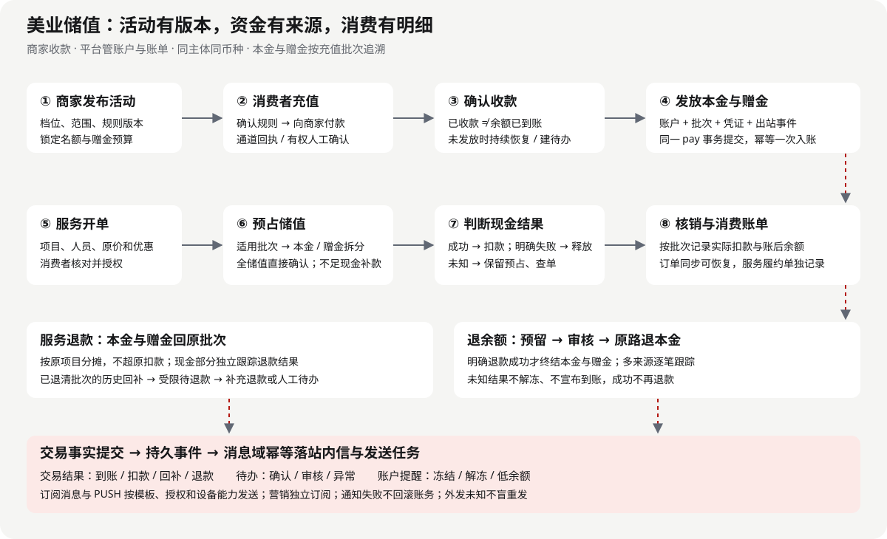

# 美业储值流转与通知设计

> 历史讨论记录：本期统一范围、数据库与接口以 [系统详细设计](./TDD-美业储值-系统详细设计.md) 为准。本文保留多轮讨论，不再作为独立实施依据。

状态：草稿，待评审；UI 为可交互评审原型，业务代码未实现 · 档位：2 · 创建：2026-10-16

首期由商家收款，平台管理活动、本金/赠金、消费确认和逐笔账单。每次充值形成独立批次，每次消费能追到活动与资金来源。交易结果通知只由已提交的账务事实触发。

关联：[需求与验收标准](../requirements/PRD-美业储值.md) · [UI 原型](../../prototypes/beauty-stored-value.html) · [ADR-037](./ADR/ADR-037-储值作为pay内独立模块.md)。除“商家收款、活动买赠、支付域归属、消费透明”为用户明确要求外，本文具体规则为推荐方案，待评审。

## §0 需求到设计

| AC | 设计落点 | 原型 |
|---|---|---|
| SV01–02 | 活动版本、充值单、预算占用，§2.1 | s02–s04 |
| SV03、SV15 | 充值状态机、过账、人工收款确认，§2.2 | s05–s07、s21 |
| SV04–05 | 账户、批次、比例分配，§2.3 | s08–s09、s11–s13 |
| SV06–07 | 消费单、预占、支付组成，§2.4 | s10–s12、s19 |
| SV08–09 | 服务退款与退余额，§2.5 | s15–s17、s22 |
| SV10 | 不可变流水与账单，§2.6 | s13–s14 |
| SV11–12 | 通知矩阵、可靠事件、差异待办，§2.7–2.9 | s07、s18–s20 |
| SV13 | 对账与结算边界，§2.10 | s01、s20 |
| SV14 | 三端原型、交互与状态，§2.11 | s01–s23 |

## §1 现状与影响面

| 现有能力 | 已核实的状态 | 本设计处理 |
|---|---|---|
| `会员资产域V2-设计规格书.md` | 已设计本金/赠金、流水及比例扣减，归会员资产；包含尚待重评的退卡原价核销口径 | 沿用双池与可追溯原则，新增充值批次，提出归属调整 |
| `c-app/src/pages/cards/index.vue` | 卡包展示，注释明确核销待做 | 后续连接商家储值账户与消费明细；本次仅原型 |
| `PaymentLedgerService` / `StlPayment` | 收款、退款、通道单号及结果查询基础 | 复用真实现金资金路径，不把储值内部转账伪装成通道现金 |
| `PayDataSourceConfig` | pay 数据源、工厂与 payTxManager 已存在 | 新模块复用，显式指定 pay 事务 |
| `PaymentMachine` | 等待支付、当面收款、成功、关闭、晚到款处理 | 新增支付组成与储值确认接缝，不能沿“只有通道成功”假设直接复用 |
| `NotifyScene` / `NotificationConsumer` | 站内信、场景路由、订阅消息、App PUSH 和受众角色 | 新增储值场景及种子；本次不修改场景常量 |
| `通知节点清单.md` | 存量退款订阅模板曾不可用，站内信为事实记录 | 不假定储值/退款模板可用；通道能力验证后启用 |
| `TDD-积分域重整.md` | pay 内 points 包为待评审 v3 方案，代码尚未按其实现 | 参考边界，不声称积分改造已完成 |

消息节点文档是 2026-10-05 历史核查，本次只核对本地源码，不推断线上模板或配置现状。旧设计不被本提案静默覆盖；评审通过再同步旧文档与对外契约。

## §2 方案

### 2.1 总体结构与活动

图中实线表示业务主链，通知来自每一账务提交后的事件。收款确认和余额发放为两个状态；跨域通知不处于资金数据库事务中。消费者的付款确认属于授权行为，账务提交才是核销事实。

储值模块分为 campaign（经济规则）、recharge（充值）、account/lot（账户与批次）、posting（唯一写账）、redemption（预占/扣款）、refund（退款）、query/recon/event。消息域负责发送，订单域负责服务价格、优惠及履约，paybridge 负责跨域事实组装。营销域可引用活动 ID，不自行计算赠金。

活动：`DRAFT → PUBLISHED → PAUSED / ENDED`。发布规则不可原地覆盖，调整生成新版本；下架停止新充值单，已锁定且未超时的充值仍按原规则收尾。消费者选择档位前展示收款商家、充/赠金额、可用项目与门店、消费与退余额规则。

充值单创建时原子占用活动名额与赠金预算，保存 `activityVersion / principal / bonus / entityNo / currency / scope / expiresAt`。订单超时后，须取得通道已关闭或明确未收款的事实才释放占用；晚到款进入交易作废退款，不重新抢赠金预算。支付结果未知时继续占用、查单。

### 2.2 发放流程及状态

“发放”包括充值本金和活动赠金同时入账，不允许员工脱离活动直接赠金。

1. 消费者扫码进入商家活动，或员工选择客户和已发布活动生成充值单。
2. 消费者查规则、选档位，确认向该商家付款。仅现金通道或经核验线下收款可充值；不使用储值、积分或优惠券购买储值。
3. 线上通道返回成功后，收款流水确认 `SUCCESS`；充值单进入 `PAID_PENDING_CREDIT`。客户端返回页面不能作为收款依据。
4. pay 短事务核对收款金额、币种、收款商家与充值快照，统一过账：创建批次、本金/赠金入账、更新账户、生成不可变凭证、完成活动预算，并写出站事件。
5. 充值单进入 `CREDITED`，通知消费者“本金 X、赠金 Y 已到账”，商家查看充值成功记录。
6. 收款成功后 60 秒仍未发放为建议首期异常阈值：生成一次待办，显示“已收款，余额入账处理中”，后台按同一业务键恢复；阈值属于待评审配置值。

状态：`WAIT_PAY → PAID_PENDING_CREDIT → CREDITED`；`WAIT_PAY → CLOSED`；关闭后到账转 `LATE_PAID_REFUNDING → REFUNDED`，不发余额。已到账后退余额走独立退款单，不覆盖原充值事实。入账永久失败时先停止新发放并由有权人员基于确切未入账事实选择恢复或退款，两条动作互斥。

线下现金：`WAIT_COLLECTION → WAIT_REVIEW → PAID_PENDING_CREDIT → CREDITED`。登记收款方式、凭据、经办人与确认人；受权限约束的收款确认与消费者对账户/活动的确认分别留痕。人工录入不写虚构的通道单号。消费者未登录/未确认对象时可保留充值草稿，不给任意手机号自动开户入账。

### 2.3 账户、批次与比例

账户唯一维度：`tenant + userNo + entityNo + currency`。会员关系由 member 域维护，避免把可合并/变化的会员关系当作资金身份。首期同主体、同币种消费，活动可限门店和项目；实际收款号保留在充值支付记录，跨门店核销仅记录内部归属，不再打一次款。

每批记录：原充值/支付号、活动版本快照、原本金 P0、原赠金 B0、剩余本金 P、剩余赠金 B、预占本金/赠金、范围。账户当前余额是批次汇总，过账事务一起更新。首期不设置自动到期，不自动清零本金或赠金。

按当前项目筛选合格批次，再按充值时间、批次号稳定排序。每批扣款 A 不超过可用余额，本金扣款为 `floor(A × P / (P+B))`，赠金为 `A−本金`；预占时固化拆分，最后全额用完时耗尽双池。金额使用整数最小货币单位；存在预占时用扣除预占后的可用双池计算，不能拿已占用的钱再次分配。累计结果以每笔固化分配为准，不重新用当前余额倒算历史。

例：充 1000 送 200，消费 300，扣本金 250、赠金 50，余本金 750、赠金 150。又充 2000 送 600 时生成第二批，原批次比例与退款来源保持不变。

### 2.4 核销与混合支付

1. 员工创建服务单：项目、次数/数量、服务人员、原价、优惠、应付。订单侧先确定最终价格。
2. 消费者本人通过登录态打开确认页，确认商家、服务、支付拆分、预计余额。员工通过手机号查询不获得扣款权限；二维码只作为短期、一次性的订单确认入口，不能无金额授权自动扣款。
3. 授权后调用储值 `prepare(orderNo, revision, allocation)`，按稳定锁序预占账户及批次。本金/赠金分配、项目分摊、价格版本和授权引用持久化。
4. 全储值支付：短事务扣减预占和余额，写扣款流水与事件；订单域消费持久事件后推进支付状态。消费者页面可短暂显示“已扣款，订单确认中”，恢复任务补齐订单，不能重复扣款。
5. 混合支付：先提交储值预占，再发起剩余现金支付；明确现金成功后确认储值扣款；现金明确失败/关闭后释放。现金成功时不得因原展示报价超时而释放已成功付款所依赖的占用。
6. 现金结果未知时 `CASH_PENDING`，页面展示实际冻结额，后台查单。超时任务必须先关闭/查明通道，再决定释放。关闭后晚到款按原路退款，不强制重新扣储值。
7. 现金已收但储值确认因系统错误未完成，保留占用、生成异常待办并重试；确实无法完成交易时走现金补偿退款后释放，不直接把订单标为支付成功。

预占状态：`HELD → COMMITTED / RELEASED`，终态互斥。支付组成状态：`WAIT_CONFIRM → HELD → CASH_PENDING（可选）→ COMMITTING → PAID`。只有各组成均完成才宣布整笔支付成功。服务履约完成另记，不把“核销支付成功”当成“服务已完成”。

限制：储值不买储值；首期同笔支付不同时使用积分和储值；现金补款单不得拆到其他商家；适用校验在报价及提交时都执行。改价后重新报价和消费者授权。

### 2.5 退款、回补与退余额

**服务退款**：引用原扣款凭证与项目分配，按已支付来源退款。全储值服务退款为本金和赠金回原批次；混合支付分别记录余额回补与现金退款进度，任一未成功就不发“全部退款完成”。部分退款按项目原支付分摊固化本次本金/赠金，后续退款以剩余可退额度为上限；不得用 `reversal_of` 全局唯一限制一笔消费只能部分退一次，改为退款业务键唯一和累计防超退。

**退余额**：消费者申请并原子冻结所选批次剩余本金和对应赠金 → 商家核对/审批 → 按原充值现金流水分配退款 → 通道明确成功后核销待退本金与赠金，写退款凭证与事件。赠金不兑现金；首期可选整批剩余余额退回，避免开放任意本金退款后赠金处理不清。多批次退款可部分成功，每个子退款独立状态与金额，展示已退/处理中/失败，整单完成事件仅触发一次。

退款超时为未知，继续查单。明确失败且确认不再执行时方可释放冻结额；审核驳回先释放再发结果通知。线下原收款的退款用有权确认的实付凭据作为结果，消费者界面注明“商家线下退款”，不显示支付机构到账回执。

**已退余额后发生历史服务退款**：冻结批次仍可承接回补，但不自动进入可消费余额；已退清批次回补本金进入受限的待退本金，发起关联原充值的补充退款，赠金登记为不可用回补后注销。消费者可见“历史消费退款待退回”；若原通道累计退款额度/期限不支持，转人工待办并保留待退金额，不能丢弃权益或悄悄重新开通旧活动。原充值本金退款累计不得超过原实收。

### 2.6 账单与推荐数据对象

| 拟定对象/表 | 关键事实 |
|---|---|
| `sv_campaign / sv_campaign_version` | 主体、状态、档位、范围、规则快照、发布版本 |
| `sv_recharge` | 充值单、原支付、金额、活动预算占用、状态、到账时间 |
| `sv_account / sv_lot` | 消费者主体币种账户、每笔充值批次、本金/赠金、冻结与待退额度 |
| `sv_hold / sv_hold_allocation` | 订单价格版本、授权、预占及批次本金/赠金拆分 |
| `sv_voucher / sv_entry` | 业务凭证、不可变分录、账后余额、顺序号、原引用、唯一业务键 |
| `sv_refund / sv_refund_item` | 服务回补/退余额、原来源分配、累计可退额、现金执行进度 |
| `sv_outbox / sv_inbox` | pay 内事件和跨域幂等消费；通知发送状态属于消息域 |

表名为设计提案，本次无 DDL、迁移编号或已实现端点。实施时须与订单支付组成契约一起审阅，不把表清单当作已存在接口。

消费者详情展示：发生时间、商家及门店、服务项目/数量/服务人员、原价和优惠、应付、现金实付、本金扣减、赠金扣减、活动来源、原业务单号、账务顺序号、该笔发生后余额、当前余额入口、售后进度。多批次有展开明细。列表的消费金额使用负号，充值与回补使用正号，退本金和赠金注销分别命名，避免混成“消费”。

示例主线：10:00 充值 +1000/+200；14:30 护理消费 −250/−50；15:00 服务退款 +250/+50。退余额与混合支付为独立场景分支，原型图注明确分支，避免把不同时间的余额误作同一连续流水。

### 2.7 通知类型与通道

类型分四类：**交易结果**（到账、扣款、回补、退款）；**业务待办**（待确认消费、待审核、异常）；**账户提醒**（冻结、解冻、低余额）；**营销**（新活动）。前两类以事实或有效待办为依据，账户提醒有去重窗口，营销需独立订阅和频率控制，不混入扣款结果。

通道：INAPP 站内信保存交易事实，客户端结果页提供即时反馈；C 端 WXSUB 只在模板可用且本次有授权/额度时尽力发送，PUSH 仅已绑定 App 的用户按配置发送；B 端优先站内信与普通 PUSH，按门店和岗位定向。短信首期默认关闭，不因订阅消息失败自动转发付费短信；企微、邮件沿用平台能力但不默认把所有储值明细发到群。

以下 `SV_*` 为拟新增场景码，尚未加入 `NotifyScene` 或配置表。C=账户所有者，B=该门店有权店长/收银/售后，O=指定运营/财务。外发的金额和手机号最小化展示，详情页重新鉴权；失败日志不存完整手机号和付款码。

### 2.8 通知矩阵

| 场景码 | 时机与触发事实 | 类型 / 收件人 | 通道建议 | 关键内容 / 落地页 |
|---|---|---|---|---|
| SV_RECHARGE_CREDITED | 本金、赠金、批次和充值终态提交后 | 交易结果 C；B 仅收银/店长 | C INAPP，WXSUB/PUSH 条件启用；B INAPP | 充/赠金额、入账后余额、收款商家 → 充值详情 |
| SV_CREDIT_DELAYED | 收款成功且超过 60 秒仍待入账，首次越阈值 | 待办 C/B/O | INAPP；B/O 普通 PUSH/告警 | 已收款、余额入账处理中、支付号 → 异常详情；不得写到账 |
| SV_CONSUME_CONFIRM | 服务单待消费者确认且未超时，主动发起一次 | 待办 C | 当面展示/扫码为主；远程 INAPP，WXSUB 条件启用 | 商家、项目、应付、到期时间 → 确认页；过期链接只显示失效 |
| SV_CONSUMED | 扣款凭证提交；订单未同步时详情显示确认中 | 交易结果 C；B 收银结果可查 | C INAPP + 条件外发；B 当前页面反馈 | 总扣款、本金/赠金、发生后余额 → 消费详情 |
| SV_PAYMENT_EXCEPTION | 混合支付收款结果未知越阈值，或现金成功核销待恢复 | 待办 C/B/O | INAPP；B/O 普通 PUSH/告警 | 现金/储值分别状态、冻结额 → 支付进度 |
| SV_HOLD_RELEASED | 已明确取消/失败并提交释放，有实际冻结额 | 账户结果 C | INAPP；不默认外发 | 已释放储值 X，现金进度单列 → 支付进度 |
| SV_SERVICE_RETURNED | 服务退款的本金/赠金回补提交 | 交易结果 C/B 售后 | INAPP + 条件外发 | 回补拆分、现金仍处理金额 → 售后详情；全部完成仅统一退款结果发一次 |
| SV_BALANCE_REFUND_APPLIED | 退余额申请已受理并预留额度 | 待办 B 店长/售后；C 回执 | INAPP；B 普通 PUSH | 待退本金、赠金处理、申请人 → 退余额单 |
| SV_BALANCE_REFUND_REJECTED | 驳回原因及释放冻结已提交 | 结果 C | INAPP + 条件外发 | 原因、可用余额、申诉入口 → 申请详情 |
| SV_BALANCE_REFUND_PROGRESS | 子退款明确成功，但整单未结束 | 交易结果 C | INAPP；聚合更新同一进度卡 | 已退/待退及渠道 → 退款进度 |
| SV_BALANCE_REFUNDED | 全部子退款明确成功且赠金处理已记账 | 交易结果 C/B | INAPP + 条件外发 | 实退本金、注销赠金、退回路径 → 退款凭证 |
| SV_REFUND_EXCEPTION | 通道未知越阈值、明确失败或历史回补待退 | 待办 C/B/O | INAPP；B/O 告警 | 真实进度、失败原因与处理方 → 异常单；后续恢复可查 |
| SV_ACCOUNT_FROZEN / UNFROZEN | 有权冻结/解冻及原因留痕提交后 | 账户提醒 C、B 店长 | INAPP + 条件外发 | 范围、原因、可操作项 → 商家储值账户 |
| SV_LOW_BALANCE | 已确认消费后可用额从阈值上方降到下方 | 账户提醒 C，自选开启 | INAPP 自选；不默认外发 | 当前可用额 → 账户；同一低余额周期仅一次 |
| SV_RECON_DIFF | 对账确认差异，首次创建或严重程度升级 | 待办 O/B 财务 | 运营待办/告警，不广播消费者 | 差异种类、业务号、处置 → 对账异常 |
| SV_ACTIVITY_AVAILABLE | 活动发布，消费者主动订阅且频控通过 | 营销 C | 首期不自动发送 | 后续单独设计，不复用交易通知权限 |

活动发布/下架只在操作页回执与审计记录；未付款充值不广播、没有实际预占的取消不额外通知。充值单和储值消费应抑制重复的通用 `ORDER_PAID` 消息，按业务关联生成一张结果卡；服务履约完成通知保留，其语义不同。混合支付可先通知“储值已扣”，但绝不能提前通知“整单支付完成”。

### 2.9 通知可靠性与时效

资金账、业务终态和 `sv_outbox` 同 pay 事务提交。消息域消费时以 `sourceEventNo + recipient + scene` 唯一键落站内信和发送任务；每个受众独立去重，业务成功不因通知失败回滚。跨域传输采用既有事件总线的投递协议和 pay 自有持久表，禁止用平台事务写 pay 出站，也禁止只用 AfterCommit 内存回调。

客户端响应一旦账务完成即可展示结果；站内信正常目标 10 秒内可查，外发目标 60 秒内发起，这是待评审的验收目标。通知失败按建议 1/5/30 分钟有界重试，超过次数产生运维待办；过期待办停止外发，交易结果可重放站内信。通知任务提交前先处理源事件序号，乱序时重新查权威状态：已成功不再推“待确认”，延迟事件被恢复事实覆盖时不再新发异常。

站内信逻辑唯一可由数据库保证；外发无法保证端到端恰好一次。发送已受理但回执未知时，有通道查询能力就查，无能力标为 UNKNOWN 并停止盲目重发，避免重复轰炸。送达、发送受理、用户已读是不同状态；无已读回执不显示已读。外发跳过原因分别记录模板未配、未授权、额度不足、设备未绑定、用户关闭。

冻结/余额敏感页重新检查 user/entity/store 权限；平台管理员重放通知不重放扣款或充值命令，按钮命名“重试通知”与“恢复入账”明确分开。

### 2.10 对账与结算

每日按商家市场时区核对：账户本金/赠金与批次一致、与流水净额一致；预占不超过剩余余额；充值实收成功恰有一次发放或明确晚到款退款；每条消费凭证有订单支付组成；每条退款有原来源及累计上限。差异自动建单，不自动调平余额。

商家看四个分开指标：充值实收、储值消费、现金补款、未消费本金/赠金。现金渠道只对充值和补款收退款进行结算，储值消费不新增现金应付。平台费、渠道手续费、门店内部业绩属于独立计费/报表事实，不能在消费者本金中悄悄扣减。

### 2.11 UI 原型与交互

原型真源 `prototypes/beauty-stored-value.html`，样式复用 `proto.css`，每屏 `figure#sNN`。原型按端独立分组：商家端 7 屏（活动、服务开单、线下收款、退款审核）；C 端 15 屏（充值、账户、消费确认、账单、退款与消息）；运营端 1 屏（账务异常与通知处置）。顶部提供三端直达导航，每组另有页面索引。跨端流程通过链接衔接，不混排页面。全部是假数据，主线与分支在图注标识。

交互：档位切换实时更新本金/赠金/到账总额；规则勾选控制支付入口；消费者确认储值支付后跳转到成功明细；混合支付入口转至处理中分支；账单与通知卡可点详情；商家开单只能邀请客户确认；运营重试通知只改变演示发送状态。错误及空态提供明确下一步，不用成功页面替代处理中状态。未建立产品路由的页面使用拟定路径登记，不能理解为已上线功能。

### 2.12 后续契约影响

拟新增充值活动、充值单、账户/批次、预占确认、退款、流水查询接口及相应权限；HTTP 入口继续在 shop-app，跨域入口走 shop-base SPI。拟新增储值场景常量、通道路由种子和三端词条；本次不注册运行期契约。后续细化 DDL、请求响应、授权校验及实施任务需在书面设计评审通过后进行。

## §3 选型与旧方案关系

采用 pay 内独立包、按批次记录、同主体同币种、预占再确认、交易事实后通知，理由见 ADR-037。旧 mbr_asset 模型只聚合双池，无法完整解释不同活动范围及退款来源；本提案保留其正确原则并补足批次。

首期不自动到期，不自动把历史消费按原价重算；与旧 A2/A5 决议不同，须明确评审后再同步旧规格。本次只增补提案，不改旧决议状态。

## §4 风险与待评审配置

| 项目 | 建议 / 处理 |
|---|---|
| 微信储值通知模板 | 实施时核验小程序类目、模板与授权能力；无模板时站内信仍完整 |
| 线上支付与线下收款混用 | 凭据来源分别标记，退款原路条件逐笔检查 |
| 账户限制与历史退款 | 停止新增消费仍继续处理已有退款，不因冻结丢弃回补 |
| 活动预算被占满 | 超时占用需与通道关闭事实协作，不按客户端退出直接释放 |
| 异常时效 | 发放 60 秒、普通通知 10/60 秒及重试间隔是建议配置，非现有 SLA |
| 合同与商品权益 | 正式上线前固定规则文本版本，消费者确认记录可追溯；本文不作监管或法定会计结论 |

## §5 验证与验收计划

本次验证范围为设计和原型，不执行真实支付测试，不将下列未来业务测试标记通过。

| AC | 后续必要场景 | 本次状态 |
|---|---|---|
| SV01–03 | 规则改版不影响旧单、预算并发、重复回调仅发一次、收款后掉进程可恢复 | 设计覆盖，业务未实现 |
| SV04–07 | 跨主体拒绝、末分舍入、最后余额并发仅一笔成功、改价重授权、未知现金不释放、晚到款退款 | 设计覆盖，业务未实现 |
| SV08–09 | 多次部分退不超额、混合退分状态、退余额后服务退款、子退款部分成功、未知结果不假成功 | 设计覆盖，业务未实现 |
| SV10–12 | 账后余额不随后续交易变动、乱序通知、重投去重、外发未知不盲重发、越权详情拒绝 | 设计覆盖，业务未实现 |
| SV13、SV15 | 账户/批次/流水恒等、现金不二次结算、人工收款凭据审核 | 设计覆盖，业务未实现 |
| SV14 | 登记锚点、索引新鲜度、档位/确认/通知交互、浏览器布局 | 随交付记录实际结果 |

未来业务实现时对“条件非负、唯一业务键、未知不释放”执行消融验证；本次静态文档和可逆原型不增加镜像业务测试。

### 本次实际验证记录（2026-10-16）

- `python3 scripts/gen-proto-index.py --check`：通过，原型总览与登记表一致（35 份）。
- `python3 scripts/gen-ui-catalog.py --check`：通过，现有界面清单为最新（277 个界面）；本地未发布原型的收录限制见 §6。
- 新增文档相对链接、23 个唯一 figure 锚点及全部原型页内链接均存在；HTML 复用 proto.css，无内联样式；SVG 经 XML 解析通过。
- 浏览器实测：规则未勾选时支付按钮禁用；充 2,000 送 600 显示到账 2,600；主线原充值链接恢复 1,200；线下确认凭证显示人工现金来源；消费本金 250、赠金 50、账后余额 900。
- 浏览器实测：退余额结果为实退本金 750、注销赠金 150；重试通知只显示演示任务排队；现金结果未知刷新后仍保持锁定；空态可切换加载失败提示。
- 默认 1280 像素浏览器宽度下页面内容同宽，无页面横向溢出；22 个手机框尺寸一致，长内容在手机框内滚动。未执行移动端设备尺寸验证或真实通道测试。
- `git diff --check`：通过。本次没有更改业务 Java/Vue 文件，不将业务支付、到账或外发行为标为已通过。

## §6 本次交付对账

产物：PRD、本文、ADR 提案、流程 SVG、23 屏 HTML 原型、原型登记与生成索引；已重跑界面清单生成器。业务代码、数据库和生产通知配置没有修改。原型展示范围与本设计 §2.11 对齐，后续实施状态仍为待评审。现有界面清单生成器只收录有外部 artifact 地址的原型，本地稿未发布，故其 JSON 没有新增行；本稿 23 屏均已进入原型总览与原型清单，可由本地入口访问。

## C 端优先级调整（2026-10-16 用户补充）

C 端首要需求为消费记录、消费明细和展示核销二维码。账户首页主操作为“消费记录”和“展示核销码”；消费记录展示项目、门店、时间、本金与赠金扣减、消费后余额，并可追溯原活动。线上购买储值为低等级需求，保留于次要入口与原型末尾，不作为首期核心验收前提。

核销码绑定本人账户及商家，短时有效并防重放；扫码仅识别账户并发起消费单，不直接授权扣款。消费者核对项目与金额后确认；二维码原型为不可实际扫码的视觉占位。新增 s24 核销码页。调整后共 24 屏：商家端 7 屏、C 端 16 屏、运营端 1 屏；先前 23 屏验证记录为调整前版本。

## 最新范围修订（2026-10-16，以本节为准）

用户明确收简页面：本金、赠金、充值批次及拆分不在页面展示，仅作为内部设计与账务规则保留。C 端核心仅为核销记录列表及简明详情（项目、金额、门店、时间、状态、单号），不展示内部资金分配。核销统一使用会员码，不新增独立储值核销码或页面。线上购买储值为低优先级，本期 C 端原型移除。

不支持线上退款：移除 C 端退款申请、进度及操作入口；原文关于线上退款的需求、流程及验收不属于本期范围。历史退款设计仅作为边界参考，不代表允许在线执行；如后续确需商家线下纠错或退费，另行确定审核、凭据及账务处理。原型中的商家退款审核仅为历史设计参考，非本期承诺功能。

本次原型 C 端仅保留 s14 核销记录、s13 核销详情、s23 空态；早期屏数及交互验证记录为历史版本，不适用于当前交付。

## C 端入口补充（2026-10-16）

主要路径：我的 → 核销记录，默认汇总本人全部商家、门店记录，按时间倒序；支持商家/门店筛选，无需先选门店。辅助路径：门店主页 → 我的核销记录，自动筛选当前门店，可切回全部。每条展示项目、金额、商家及实际核销门店、时间、状态；详情随所选记录展示。统一查询不合并各商家账户。会员码继续使用“我的”统一入口，无储值专用码。

新增 s25 我的入口、s26 门店入口、s27 统一会员码衔接示意；当前共 13 屏，C 端 6 屏。原型支持门店筛选、带筛选进入、各记录详情切换。会员码只是占位示意，不生成凭证。

## 默认储值门店目录及排序（2026-10-16，以本节覆盖此前默认流水列表规则）

统一入口先展示本人有成功储值记录的门店，点击门店后查看该店核销记录。余额已耗尽仍保留门店；只有核销而无储值记录的门店不进入默认储值目录。每个门店按 max(最近成功储值时间, 最近成功核销时间) 倒序，时间相同按门店号稳定排序。未付款、失败和处理中记录不更新排序；使用业务发生时间而非消息到达时间。没有核销时按最后储值时间排序。储值记录归属实际充值门店，同主体其他店发生核销只更新对应核销店的时间；主体通用余额不为所有门店虚构储值记录。

门店卡展示门店名、最近活动类型及时间，不展示本金赠金。主入口路径：我的 → 储值门店 → 门店核销记录 → 详情；门店主页入口直接进入本店核销记录。新增 s28 二级核销记录页，s14 改为储值门店目录。当前 14 屏，C 端 7 屏。
