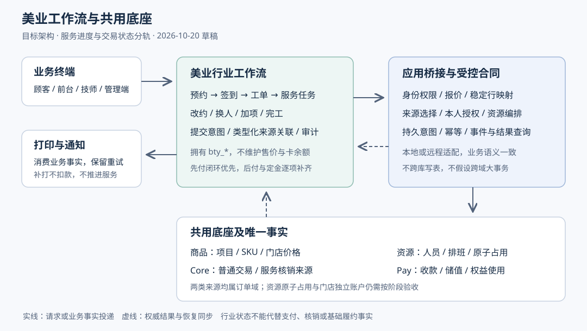

# 美业系统共用商品订单与服务工作流方案

> 本文为历史目标设计，当前编码、集成和待验收状态以 [后端开发计划](./TDD-美业系统-后端开发计划.md)及统一迁移映射报告为准，下文原始设计状态不代表当前交付。
> 状态：新方案草稿，待评审 · 创建：2026-10-20 · 本次交付设计，不包含业务实现、迁移或实例开通。
> 依据：本次需求“参考餐饮，依赖共用商品和订单”；[餐饮扩展边界与契约](./design/餐饮与商品订单基座-扩展边界与契约.md)、[餐饮多端与部署边界](./design/餐饮系统-多端功能矩阵与部署边界.md)。
> 阅读顺序：先读本方案，再读[新旧方案对比](./design/美业系统-新旧方案对比-2026-10-20.md)。本文独立定义目标，不以旧案接口已经存在为前提。

## §0 定位与验收目标

**美业项目＝共用商品和 SKU；美业交易＝共用订单域的交易或核销来源；美业运营＝预约、服务工单和人员协作。** 商品域维护售价，订单域维护成交与消费事实，Pay 维护资金和权益，美业不另建商品账、收款账或卡余额账。

用户明确的约束是复用本项目及餐饮的扩展方式。本文建议先服务单店、单客、联网营业，覆盖美发、美甲、美睫、日常美容护理；多人同时服务、定金、服务后付、疗程销售等保留为目标分期。此范围是本轮推荐，尚未确认上线门店、排期或资金政策。

| AC | 目标行为 | 设计落点 |
|---|---|---|
| B01 | 同一项目线上、前台使用同一商品、门店价格和合法优惠 | §1.2、§1.3 |
| B02 | 预约可以不收款、不建交易单；到店无预约也能开工单 | §1.5、§1.7 |
| B03 | 技师与床位的连续占用全成或全败；改约失败保留原预约 | §1.4 |
| B04 | 签到、开始、完工、消费确认和订单履约分别留事实 | §1.6、§1.7 |
| B05 | 现金、全额储值、次数权益分别复用已支持的共用合同 | §1.3、§1.8 |
| B06 | 加项、换人、撤项不能绕过计价、资源或售后守卫 | §1.7、§1.9 |
| B07 | 重试、未知结果、乱序事件可恢复，不能重复建单或扣款 | §1.10 |
| B08 | 全部终端校验租户、商家、门店和操作范围 | §1.11 |
| B09 | 收款、充值、权益消耗、服务产出、提成分别统计 | §1.12 |
| B10 | 关闭美业新入口后普通交易照常，历史服务可收尾 | §2、§5 |

## §1 架构与详细设计

### 1.1 总体结构与餐饮映射

图中的关键边界是应用桥接：美业只通过受控合同使用商品、订单、资源和 Pay；共享底座不查询 `bty_*` 表。集成部署与独立部署使用同一业务语义，跨服务动作通过持久意图与事件恢复。

| 餐饮对象或能力 | 美业对应对象 | 共用与差异 |
|---|---|---|
| 菜品与 SKU | 服务项目与 SKU | 共用商品、价格、上下架；美业增加资源需求配置 |
| 就餐台账 | 服务工单 | 都聚合多笔业务；美业还需独立预约单表达未到店约定 |
| 点单批次、加菜 | 服务提交批次、加项 | 每次提交固化快照与来源，不修改原成交金额 |
| 厨房任务、制作进度 | 服务任务、开始与完工 | 行业私有状态，不扩充统一订单主状态 |
| 桌台及占用 | 技师、工位、房间及排期 | 资源基础能力共用，行业定义需求与调度规则 |
| 先付、后付、整桌收银 | 先付、服务后付、工单结账 | 都受基座实际支付、取消、库存及履约合同约束 |
| 后厨单、结账票 | 服务单、消费凭条 | 共用打印任务和设备，行业负责内容 |

### 1.2 商品和服务规则

商品名称、图片、分类、SKU、门店价、活动价、优惠和库存仍由商品域管理。美业聚合查询可以展示“今日可约”，不能产生另一个售价；预约余量与商品库存分别校验，不能把技师时段转成 SKU 库存。

| 需求 | 首选表达 | 防止的问题 |
|---|---|---|
| 洗剪、护理、美甲等项目 | `prd_goods(type=SERVICE)` 与 `prd_sku` | 防止另建项目表后价格、上下架不同步 |
| 基础服务时长 | 已有 `PrdGoods.durationMin` | 防止复制同义时长；预约按受理时版本冻结 |
| 不同时长或技师等级售价 | 有限、稳定差异优先建正式 SKU | 防止现场填任意附加价绕过计价与退款 |
| 门店缓冲、必选技能、所需床位/设备 | 拟增美业资源需求配置，引用商品/SKU | 当前商品实体未完整提供这些字段，不能假称已有 SERVICE 扩展段 |
| 可独立销售的护理附加项、商品 | 正常 SKU 和独立来源行 | 防止用工单备注收费，丢失成交及售后依据 |
| 任意加价、临时折扣、补差 | 待共用报价与分摊合同支持 | 不能仅由美业扩展表决定最终应收 |
| 疗程包、次卡销售 | 共用商品销售＋权益发行合同，后续阶段 | “卖了组合商品”本身不能证明已生成合法可用权益 |

资源需求配置只存业务规则，不存第二份价格。其服务规则经证明确实多行业共用后可上收；首期避免为未来家政等场景强迫全商品域重建。配置和成交快照都保存版本，项目改名或改时长不改写已受理服务。

到店预约使用 `STORE_VERIFY`＋美业预约关联；当前 `APPOINTMENT` 明确表示上门且需要地址。不得更改其含义来接到店预约。到店预约绑定资源占用需补通用业务上下文与提交校验，不能期待当前 `appointmentSlotNo` 自动解决。

### 1.3 订单身份与唯一事实

当前 Core 中有两种不同来源，均为共用订单域所有：普通交易 `ord_order/ord_sub_order/ord_item`，以及权益消费来源 `ord_ent_service_order`。后者不是普通现金订单或收款凭条。**复用订单域不等于目前两者已经统一存表、统一报表或统一售后。**

| 业务 | 权威来源 | 美业保存的关联 |
|---|---|---|
| 顾客线上付款或门店现金购买一次服务 | 现有普通订单，门店子单为服务交易粒度 | `paymentRootNo`、`storeOrderNo`、`orderItemId` |
| 已持有储值或次数权益的服务消费 | 现有 Core 服务核销来源＋Pay 使用凭证 | `sourceKind=SERVICE_USE`、`serviceOrderNo`、来源快照版本、使用操作号 |
| 充值 | 共用储值充值单及 Pay 凭证 | 可关联客户记录，不视作一次服务产出 |
| 售卡 | 共用销售来源及权益发行凭证 | 关联原销售来源，不将后续每次服务当成新现金收入 |

新增 `BeautyTradeBridge` 作为目标应用适配层，向美业返回带类型的 `TradeSourceRef`。普通交易来源用 `sourceKind=STORE_ORDER`；核销来源用 `SERVICE_USE`，不能把两个不同编号都塞入无类型 `orderNo`。

**每个服务任务只能关联一份当前有效的消费来源分配。** 同一任务不能同时建一张现金单和一张储值消费单分别结清。支付路径在提交前选择并冻结；切换路径须先由来源域确认旧来源未成功、已取消且预占释放，再创建新来源。未知状态禁止换路径收第二次钱。

次数权益来源未必有数据库行 ID：使用 `serviceOrderNo + sourceLineRef`；当前来源不能返回稳定行引用时，桥接需补查询/快照匹配合同并拒绝歧义，不能伪造 `ord_item.id`。一笔来源数量为二的项目可拆成两项服务，绑定分配量之和必须等于源行实际服务数量；行上数量、赠品和支付归类以来源为准。

同一次原始服务、加项、撤销都由 `serviceSubmitNo` 记录意图和结果，构成工单来源关联。工单可关联多笔来源，单笔不跨商家或门店。统一历史视图须按来源类型查询后聚合，不能将核销来源未经接线直接导入现有现金结算。

### 1.4 预约资源与排期

资源容量能力归 merchant/预约资源底座，美业提供“什么项目需要什么技能与资源”。拟建人员技能、排班和原子预占合同；现有 `AppointmentSlotPort.tryBook(slotNo, storeNo)` 只有单个门店时段名额，实体也没有技师或床位维度，不能靠前台循环调用当作资源排期已经完成。

1. 可约区间＝营业时间∩人员技能∩人员排班∩所需工位/设备可用区间；服务先后顺序明确，不能将连续两项误算为同时做。
2. 实际占用为每个任务的 `[开始－前缓冲, 结束＋后缓冲)`；不同资源可有不同占用区间。按网格实现时将区间投影到所有相交格，不仅计算格数，还必须校验连续性与边界。
3. `hold` 输入请求号、归属、任务资源集合、区间和规则版本，原子全成或全败，返回 `holdNo/revision/expiresAt`。由资源所有方按稳定顺序锁定，禁止多次独立抢位后靠尽力释放冒充原子性。
4. `confirm` 将临时占用转为正式预约；`release` 针对持有凭证幂等；改约 `replace` 在同一资源域事务处理新旧集合差量，支持重叠区间，不会因自己占着旧格而误报满。
5. 支付期限和占位期限协调：有付款处理中事实时不能单凭本地时钟释放。晚到支付且资源已失效时进入异常处置及受支持的退款流程，不能自动挤占后来顾客。
6. 到店只将占用责任从预约转给工单，保留同一个资源凭证，不再扣一次容量。提前完工释放未使用区间；超时延长必须重验冲突，失败转人工协调，不能自动挪动后续预约。
7. 同时换人、请假、取消和开始服务使用版本守卫；调班不得静默删除已约顾客。资源无关的普通交易保持现有行为，受约束服务遇模块缺失或校验不可用时拒绝提交。

预约规则在普通下单、代客下单等可触达入口均需受服务端约束。带美业预约规则的商品不能绕过行业入口直接购买而缺失资源关联；允许不预约购买的通用到店券则按明确销售模式开放。

### 1.5 最小数据集合

以下为逻辑表提案，不是已存在的实体或 DDL；统一带租户、商家/门店范围、审计与乐观锁字段。表名在详细契约阶段冻结。

| 美业自有对象 | 核心字段或关系 | 关键约束 |
|---|---|---|
| `bty_service_requirement` | 商品/SKU引用、技能、资源类型、缓冲、版本 | 不保存售价；门店覆盖优先级明确 |
| `bty_appointment` | 预约号、客户/临客引用、来源、服务区间、状态、holdNo | 可无交易；归属不随改约改变 |
| `bty_appointment_item` | 预约源行号、SKU、数量、指定人员、时长与规则快照 | 多项顺序和资源集合显式保存 |
| `bty_work_order` | 工单号、预约号可空、客户、服务状态、起止时间 | 签到开单幂等；首期一个预约最多生成一张有效工单 |
| `bty_service_task` | 工单行、项目引用、执行快照、服务状态与数量 | 付款结果不代替实际完工 |
| `bty_service_assignment` | 服务任务、人员、角色、实际参与区间 | 换人保留历史；后续多人协作可分配业绩 |
| `bty_service_submission` | 提交号、动作、幂等摘要、冻结快照、关联进度 | 门店＋请求键唯一，同键异参冲突 |
| `bty_trade_binding` | 任务、带类型来源、来源行、数量分配、版本 | 不同来源互斥有效；不按SKU取第一条绑定 |
| `bty_action_log` | 签到/换人/撤项等事实、操作者、原因、前后版本 | 追加留痕；撤销不删除原事实 |
| `bty_store_policy` | 预约窗口、改约限制、允许营业模式及版本 | 默认不开放后付、爽约扣款、定金等未验收能力 |

资源、排班、hold/hold明细在共享资源域维护；支付与权益账户在 Pay 维护。客户档案、提成规则和提成流水为后续独立对象，不要求首期同时建完。读取到的金额和名称可以作为只读历史快照；它们不是可编辑应收，不由美业重新计价。

### 1.6 两条状态轨道与同步点

| 对象 | 拟定状态 | 不能代表的事实 |
|---|---|---|
| 预约 | `HELD → CONFIRMED → CHECKED_IN`；可到 `CANCELLED/EXPIRED/NO_SHOW` | CONFIRMED 不统一代表已付款，后付预约可先确认 |
| 服务工单 | `OPEN → IN_SERVICE → SERVICE_FINISHED → CLOSED`；未开工可取消 | 完工不代表付清；关闭前要确认全部任务及关联来源结果 |
| 服务任务 | `PENDING → IN_SERVICE → DONE`；开工前可 `VOIDED` | 已做服务不能通过删行变成没做 |
| 交易/核销来源 | 使用对应共用域的真实状态 | 美业不发明一组“已付”值写回基础表 |

付款、资源确认和签到是独立条件。先付服务开始前须权威已付/已核销、有效资源和人员资格齐备。完成所有任务后才申请基础履约完成；对应门店订单包含的服务数量未全部完成时不能整单提前完成。

**签到校验预约身份；会员码识别顾客；订单核销证明履约；权益使用授权允许扣资产。四者不能共用一次扫码就全部成立。** 若当前核销码接口会将订单直接完成，签到页不得调用它。美业完工接现有履约合同，需先验证其自动完成、买家确认与售后规则；不满足“服务做完再完成”的合同就补通用守卫，再开放该链路。

### 1.7 主流程与逆向

| 场景 | 推荐流程与边界 |
|---|---|
| 顾客预约先付 | 选门店/项目/技师→查可约→原子hold→核心报价→保存提交意图→核心建单并绑定→顾客付款→权威确认＋资源确认→成约→签到→开工→完工→基础履约→关闭工单 |
| 电话或微信预约 | 前台建临客预约，不自动开户或虚构买家；到店后认领真实客户，再选择合法现金/资产来源。未认领时可以保留预约，不能给临客扣余额 |
| 到店直客 | 检查即时资源→开工单及任务→建立交易/核销来源→付款或本人授权核销→开工→完成；无需为了统一流程补一张虚假预约 |
| 储值老客 | 统一会员码识别→建 Core 服务核销来源→报价→本人确认→Pay预占/提交→消费结果可靠回传→服务→完工；金额不足整笔拒绝，不能自动补现金 |
| 次数权益老客 | 查询实际可用权益与项目范围→同样建立 Core 核销来源及本人授权→按受支持的权益合同扣次；付费疗程的销售、发行、退卡须另验收 |
| 服务中加项 | 新提交、新来源及新任务→重验资源与消费者确认→成功后开始新增服务；原单金额、已授权版本均不改写 |
| 中途换技师 | 先验证新技师技能和剩余区间→资源原子替换→追加人员参与记录；更换等级若影响价格，需另报价确认，不能直接改价 |
| 取消/爽约 | 释放资源与停止未做任务；已收款交给对应来源域售后，保留实际退款进度；爽约首期只记事实，不自动扣钱或扣次 |
| 部分完成/提前结束 | 保留已完成和未完成数量；剩余服务进入待处理，能否部分退款取决于对应来源合同和渠道，不自动将工单结清 |

### 1.8 现金、储值与权益的接入合同

| 目标合同名称 | 当前可接能力 | 仍需补齐或验收 |
|---|---|---|
| `Catalog.query/quote` | `GoodsQueryPort`、普通 `OrderService.preview/capability` | 美业聚合视图、规则版本及受权代客报价；核销来源用它自己的可信报价，不能挪用现金报价当扣卡依据 |
| `Trade.place/findPlacement` | `OrderService.create/createFor`、`EntitlementServiceOrderService.create/createMonetary` | 类型化结果、稳定行关联、未知建单结果查询与预约上下文传递 |
| `Payment.open/query` | 普通订单 `pay/payResult` | 门店人员发起与顾客接管的身份合同；不能伪造当前登录顾客 |
| `Payment.confirmOffline` | `MerchantOrderService.confirmOfflinePay` | 仅确认该笔获准线下收款；美业补实际员工审计，不扩成任意金额或跨单分配API |
| `AssetUse.authorize/submit/query` | 会员识别、授权服务、`EntitlementServiceUseCoordinator` 与 Pay 使用合同 | 每种资产的实际能力、开关、门店范围、恢复及冲正；源码存在不代表当前实例已经开放 |
| `Resource.hold/replace/release` | 现有单时段门店名额仅作参考 | 完整资源原子操作及凭证生命周期是新能力 |
| `Fulfillment.complete` | 共用履约服务与订单状态转换 | 工单任务与来源数量守卫；服务核销来源的实际完工接点 |
| `AfterSale.apply/query` | 现金订单已有售后入口 | 按当前具体分支/渠道能力判断，不能笼统说全部仅全退或全部支持部分退；储值/卡退款不能借用现金接口默认开放 |

最新[门店独立储值设计](./TDD-独立储值方案与B端接入.md)目标为租户＋商家＋门店＋顾客＋币种唯一，当前文件状态为待实施。美业以此为目标，验收前不向顾客承诺不同门店余额互用，也不将原按主体聚合的余额当成本店可用余额。账户历史归属不清时阻断迁移，不复制或按最近门店猜测余额。

储值办理复用共用管理入口和统一会员码；不在美业中新增充值账户或专用核销码。首期沿用已收敛范围：线下核验实收，全额合格储值消费；不承诺混合支付、线上购买储值、线上退款、跨店通兑。独立储值方案不能被强制包装成营销活动，旧活动来源按原合同兼容。

付费卡销售、赠次数权益和已持有权益消费是不同能力。只有能力证据、授权、原子扣减、恢复与剩余次数查询都通过验收，才展示相应入口，不能因为系统有 `TIMES_CARD` 字符串就开放销售。

### 1.9 后付、定金和收银扩展

“到店付款后再服务”可以沿现有线下收款链；“服务已经做完再付款”属于新营业模式。后者需共用底座认可服务受理、取消守卫、非付款触发的服务/耗材承诺、真实履约事实及后续结清。不能把 `WAIT_OFFLINE_PAY` 放很久就当后付完整支持，更不能工单显示完成而基础订单已自动取消。

定金需共用支付计划表达定金、尾款及其售后与违约规则；不建“定金虚拟商品”掩盖合同缺口。跨工单一次付款、储值加现金、分笔支付需共享收银的分配合同。首期只汇总展示多笔来源并逐笔结算，不把一次总收款逐单标付。

服务取消、资产冲正、顾客退款、退卡和耗材回库分别处理。已做项目不回滚成未做；已使用耗材不能因为退款自动回成可售库存。上门服务、团体、多步骤并行服务及断网支付均在独立条件满足后启用。

### 1.10 幂等、事务和事件

提交前保存 `serviceSubmitNo + payloadHash + sourceKind + frozenTasks`，由此派生稳定幂等键。桥接超时后用原键查询或重试，不能换键新建。服务状态使用 expectedRevision，签入、完工、取消等动作同键异参拒绝。

资源、Core、Pay 各自拥有本地事务，不将“预约＋建单＋扣卡＋提成”包装成跨库大事务。成功建单但绑定中断时恢复关联；无法建单且确认无收款时释放hold。结果未知保留恢复意图，不盲目释放已成功付款依赖的资源或资产。

美业本地事务同时记录关系、消费去重、服务动作和待通知事实；通过现有 Outbox/Inbox 接口接入实际发布与消费链。普通交易使用 `OrderEvents` 中对应真实事件，权益使用走其独立结果合同；不假设 `OrderPaid` 能覆盖所有服务核销。

事件可能先于绑定到达，先保存待关联消费再恢复。同一来源版本/动作只生效一次；陈旧事件不把已取消或已完成事实覆盖回待服务。恢复查询原来源的权威结果，不能凭客户端支付成功页或核销提交成功响应推断经济结果。

### 1.11 终端、权限、打印和通知

| 端/角色 | 核心能力 | 默认边界 |
|---|---|---|
| 顾客 C 端 | 项目、预约改约、本人付款/核销授权、服务进度与历史 | 不展示内部本金赠金分配；会员码继续统一入口 |
| 前台/POS | 代约、签到、排程、开单、发起收款、打印和异常待办 | 识别客户不授予扣款权；确认现金需专门权限 |
| 技师端 | 本人或被分配服务、开始完工、交接申请 | 不默认开放账户、退款和全店客户档案 |
| 商家运营 Web | 项目入口、资源、技能、排班、规则、角色、报表 | 商品写回共用商品服务；资金管理进入共用模块 |
| 老板 B App | 当日经营、异常审批、授权范围内管理 | 与商家运营共用后端规则，不复制管理模型 |
| 平台运营 | 能力开通、审计、异常诊断、受控恢复 | 无默认代客扣款、代做服务权限 |
| 顾客自助终端（后续） | 到店识别、签到和付款接管 | 设备身份、最小权限，不使用老板账号 |

权限按预约读写/改约取消、工单操作/换人、资源调班、现金确认、资产使用发起、客户档案、提成管理拆开；复用原有商品、订单和储值权限，不复制一组可绕过原鉴权的资金权限。代码实施时再冻结权限码、路由与三语，不把本册的目标名称注册为已实现端点。

打印复用餐饮同一共享打印应用能力：行业生成内容，打印应用维护任务、重试和回执，通道层连接设备。服务单来自开工事实；消费凭条来自真实支付/核销结果；补打使用原快照且不再扣款或开始服务。失败不回滚订单，未知结果先查原任务并提供人工补打。

预约确认/改约/取消、即将到店提醒、服务完成、资金结果、异常待办分别通知；资金事实由共用域产生，不能再发第二张成功结果。资源占位草稿不发预约成功消息。客户过敏等记录按岗位最小化展示，避免在公共服务票或群通知默认打印；照片引用共用媒体，访问授权随人员离职回收。

### 1.12 提成和经营口径

至少分开记录充值实收、单次服务现金实收、储值消耗、次数消耗、服务产出金额和提成。充值是预先收款事实，之后的储值消费不能再计一次现金收款；本文不裁定法定收入确认口径。

旧案的“统一按原价提成”不作为默认。拟定提成规则版本明确基数（成交分摊、原价或固定额）、售卡与服务是否分别计提、换人参与比例和退款冲回。服务产出及其来源成立后生成可追溯计提，只有付款或只有签到不能触发。

提成快照保存来源分配、规则版本、参与人和基数；退款/资产冲正追加冲回，已发放部分形成后续调整，不能删除原计提。首期先记录服务人员与产出事实，自动提成及工资发放不作为交易闭环前置依赖。

## §2 分期与交付依赖

本节仅列阶段与退出条件，不启动实施；详细接口/DDL/逐文件计划在本方案评审后制定。

| 阶段 | 交付 | 必须先满足的条件 |
|---|---|---|
| P0 契约核实 | 两类来源映射、商品规则、资源原子合同、权限与履约守卫 | 复核真实调用和装配；确认预约不误用上门语义；共享底座增量先评审 |
| P1 单次现金服务 | 单店单客、联网、直客/代约、先收款、服务工单、打印通知 | 普通订单身份/行映射/完工接线；预约功能启用前完成资源hold/replace；交易单不与消费源重复 |
| P2 储值与可用权益 | 接入既有本人授权与使用、异常恢复、消费记录 | 门店独立账户及范围验收；次数权益逐种验收；不强制售卡或混合支付 |
| P3 服务运营 | 客史、排班优化、多人参与与提成、团体服务 | 敏感资料范围、业绩政策、多人资源/数量分配验收 |
| P4 扩展营业 | 服务后付、定金尾款、跨单收银、付费疗程销售、上门 | 各项共用支付/取消/发行/售后与资源合同独立验收 |
| P5 外部与断网 | 第三方预约导入、门店边缘操作、设备协作 | 外部编号去重、冲突认领、正式导入合同；恢复不重复扣资产和记服务 |

独立项目目录已由后续[美业独立Java项目与包依赖方案](./TDD-美业系统-独立项目与包依赖方案.md)细化为 `backend-plugins/shop-industry-beauty`，采用beauty-api/core/web/channel/server五模块，根包为 `ai.neargo.shop.beauty`。原shop-industry-service为早期建议，不再作为本轮工程目标；共享能力仍归其所有者，少量宿主胶水放industrybridge.beauty，具体包名、依赖和部署以新方案为准。目录均是候选设计，尚未创建美业Java工程。

首期采用集成部署以减少链路；独立部署保留同一合同和适配器，不复制商品、资金库，不增加跨库JOIN。独立部署不等于断网可用，断网期间不能依据缓存余额扣卡、把线上款标成功或无条件接预约；边缘营业另立交付。

## §3 选型与取舍

| 方案 | 优点 | 代价及本轮结论 |
|---|---|---|
| 共用商品订单＋美业扩展＋桥接（推荐） | 复用资金与定价；工作流清楚；与餐饮一致 | 要补资源及类型化来源合同；逐项建设，不承诺零改核心 |
| 全部写入商品与订单核心 | 单进程调用方便 | 零售交易将承担排班、客史、人员协作等行业责任，不采用 |
| 美业独立商品、订单、卡账 | 单行业局部开发快 | 价格、退款、会员余额和报表形成多份真源，不采用 |

首期保留 Core 已有两类来源，统一美业消费视图，不在行业包合并基础表。将来若要统一普通订单与核销来源，须由订单域另立兼容与迁移设计，覆盖授权、资金分配、统计及历史引用，不作为美业首期隐含重构。

## §4 待确认及阻断范围

| 决策 | 本文建议 | 未确认时的限制 |
|---|---|---|
| 首家试点与项目类型 | 单店单客，先付单次服务 | 不承诺多店或上线日期 |
| 资源粒度、项目串并行、超时处理 | 可配置粒度，首期串行；超时人工协调 | 不开放团体并行和自动改约 |
| 取消与爽约收费 | 首期只记事实，不罚款不扣次 | 不开放扣定金或爽约自动耗卡 |
| 提成基数与换人分配 | 独立版本化规则，完工后计提 | 不自动结算工资 |
| 定金、后付、退款和退卡政策 | 各自补共享合同及明确执行范围 | 不以门店配置提前开放 |
| 人员与客户资料可见范围 | 按岗位与实际参与最小化授权 | 不开放全员客史及照片查看 |

门店独立账户迁移、原子资源服务、服务完工守卫属于技术依赖，不能通过业务口头选项跳过。普通订单行级退款与旧分支的实际能力须分别验证；不能用本方案扩大最新储值首期已排除的退款范围。

## §5 验证与验收设计

以下为后续实施验收场景，本次未运行这些业务用例。文档校验记录放在本次交付说明，不将设计用例写成已通过测试。

| AC | 必须证明的场景 |
|---|---|
| B01 | 同SKU顾客与前台报价一致；改门店/价格/活动后旧报价不可直接成交 |
| B02 | 无账号电话预约可保留；到店认领前不能扣余额；直客不产生假预约 |
| B03 | 两人抢最后一个连续资源集合仅一人成；最后一格失败零残留；重叠改约不误判；换约失败原位仍在 |
| B04 | 签到不完成交易；支付不完成服务；自动确认不能越过有效服务守卫；部分任务完成不整单结清 |
| B05 | 消费者授权绑定金额/版本/门店；不足整笔失败；已扣资产但来源确认中可恢复；A店不能使用B店独立余额 |
| B06 | 加项新来源；换人重验容量且留历史；已做项目撤项不抹掉事实；退款与耗材处置分别留痕 |
| B07 | 重复提交、同键异参、支付先于绑定、晚到付款、核销回执丢失都不重复扣款/扣次/占位/出服务票 |
| B08 | 跨店编号访问、技师越权看客史、前台冒充顾客授权均拒绝；设备不获得老板权限 |
| B09 | 充值一次、服务十次不重复计现金；混合历史来源不漏报；提成冲回保留原计提及已发放调整 |
| B10 | 未启用/模块缺失时普通零售不变；受约束美业商品拒绝绕过；停新业务后原单恢复与历史查询仍可用 |

资源并发、资金分配和事件恢复在目标数据库与实际装配中定向验证；打印补打及未知结果需真机验收。验收还应证明去掉资源条件或授权守卫后对应测试会失败，避免假通过。

## §6 本次交付与代码依据

本次仅新增方案、独立对比文档、架构SVG，并在技术索引登记。未修改旧美业正文、运行期合同、业务代码或数据库；未进行真实付款/核销和部署。

本次文档核验（2026-10-20）：两篇新增文档的相对链接、索引登记、空白和占位检查通过，SVG XML及标题/描述校验通过；使用 `scripts/gen-doc-html.mjs` 已生成两篇本地HTML投影。执行 `npm run test -w @ai-shop/shared -- tests/doc-standard.test.ts` 为6项通过、2项失败：工作区其他文档存在20张Mermaid图（基线14）和9份未登记索引文档，失败清单未涉及本次新增文件；未修改这些其他工作内容或放宽基线。

代码核对入口：

- 商品：[GoodsQueryPort](../../backend/shop-base/src/main/java/ai/neargo/shop/spi/product/GoodsQueryPort.java)、[PrdGoods](../../backend/shop-core/src/main/java/ai/neargo/shop/product/entity/PrdGoods.java)。
- 普通订单：[OrderService](../../backend/shop-core/src/main/java/ai/neargo/shop/trade/service/OrderService.java)、[MerchantOrderService](../../backend/shop-core/src/main/java/ai/neargo/shop/trade/service/MerchantOrderService.java)。
- 核销来源：[EntitlementServiceOrderService](../../backend/shop-core/src/main/java/ai/neargo/shop/trade/service/EntitlementServiceOrderService.java)、[OrdEntServiceOrder](../../backend/shop-core/src/main/java/ai/neargo/shop/trade/entitlement/entity/OrdEntServiceOrder.java)。
- 履约与名额：[Fulfillments](../../backend/shop-base/src/main/java/ai/neargo/shop/common/Fulfillments.java)、[AppointmentSlotPort](../../backend/shop-base/src/main/java/ai/neargo/shop/spi/user/AppointmentSlotPort.java)、[MchAppointmentSlot](../../backend/shop-merchant/src/main/java/ai/neargo/shop/merchant/entity/MchAppointmentSlot.java)。
- 储值能力：[StoredValuePort](../../backend/shop-base/src/main/java/ai/neargo/shop/spi/storedvalue/StoredValuePort.java)、[StoredValueUseQuotePort](../../backend/shop-base/src/main/java/ai/neargo/shop/spi/storedvalue/StoredValueUseQuotePort.java)、[StoredValueCapabilityPort](../../backend/shop-base/src/main/java/ai/neargo/shop/spi/storedvalue/StoredValueCapabilityPort.java)。
- 原生流程证据：[BeautyStoredValueLifecycleFlowTest](../../backend/shop-app/src/test/java/ai/neargo/shop/scenario/BeautyStoredValueLifecycleFlowTest.java)；存在用例不代表本次已执行或生产已开通。
