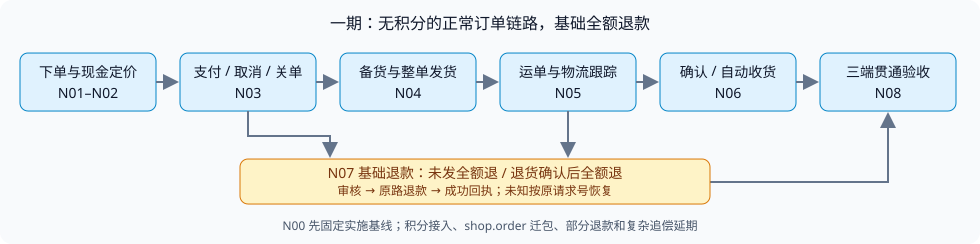

# TDD-订单一期主流程与基础退款

> 执行者使用 `superpowers:executing-plans` 逐任务实施；本文 §2 为唯一一期开发计划，步骤用复选框追踪。

状态：**实施中 · 后端优先，随后对接 C/B**。创建/更新：2026-10-15。

**目标：** C 端下单和支付、B 端备货发货、物流跟踪和收货、运营异常处理形成可验收的完整链路；一期不依赖积分，退款只完成基础流程。

**架构：** 复用 `ai.neargo.shop.trade.order` 已有 2.0 构件，补齐生产 Store、事务边界和旧接口兼容接线。支付、库存、物流沿用现有 SPI；只为主流程的实际缺口增加最小合同，不要求先完成全部领域拆分或复杂结算重构。

**技术栈：** Java 21、Spring Boot、MyBatis Plus、Flyway、MariaDB；C/B 为 Vue + uni-app，运营端为 Next.js + React；JUnit 与 Vitest。

**需求/设计依据：** 用户 2026-10-15 的范围调整；[C端功能清单](../requirements/C端功能清单.md)、[B端功能清单](../requirements/B端功能清单.md)、[平台端功能清单](../requirements/平台端功能清单.md)、[支付域 PRD §S2/§S5](../requirements/PRD-支付域.md)、[物流功能清单](../requirements/物流-功能清单.md)、[订单状态与履约定义](./reference/订单状态与履约-定义整理.md)。原完整方案见 [旧开发计划](./TDD-订单重构修复与三端接线.md)，一期发生范围冲突时以本文为准；未纳入一期的需求保持延期，不能标成已完成。

## §0 范围与需求对账

### 0.1 一期做什么

主线：**确认商品/地址/运费 → 创建订单 → 支付确认 → 商家备货 → 发货/登记运单 → 揽收/运输/派送/签收 → 买家确认或自动收货 → 完成**。



订单主线先到收货完成，再验基础退款支线；未发货退款和退货后退款都以现金成功回执收尾。物流签收只提供交付事实，订单完成仍由人工或自动收货规则判断。

优先验收普通实物快递 `EXPRESS`，先支持每个门店子单整单发货。多门店一次支付仍必须正确，订单展示和履约按门店子单独立处理。已存在的自提、自送、核销、预约、拼团等保留兼容并做受影响回归，一期不扩建这些模式。

退款范围暂按以下最小产品口径规划，属于本计划的明确假设，可在实施前调整：

- 门店子单一次全额现金退款，金额以该子单实际支付快照为上限；多店支付只退申请的子单，不能退掉兄弟单。
- 未发货：买家申请 → 商家或获授权运营审核 → 原路退款 → 成功确认 → 订单收尾。
- 已发货：申请 → 审核；需要退货的，填寄回单号 → 商家确认收到退货 → 原路退款 → 成功确认 → 收尾。已有免退货全额退款可保留，经审核执行。
- 拒绝/撤销申请、退款处理中、明确失败、结果未知可见；受理、审核通过和物流签收都不能冒充现金到账。
- 未支付取消属于主流程，释放原占用，不发起退款。已支付禁止通过未支付取消入口绕过退款。

一期暂不新增部分商品退款、部分金额/多次退款、协商少退、损耗留存、退款换积分、自动垫付或供应商追偿；不增加退货物流自动审核。原有复杂售后存量需要保留查询/出口，不能因新入口收窄直接删掉。

### 0.2 积分边界

一期新订单不抵扣、不赠送、不转正、不返还或追回积分、不做积分补偿；价格公式只包含现有商品实价、现有优惠和运费。C/B/运营订单入口不展示“可用积分/预计赠分”的新承诺，不请求积分试算；后端仍要拦截 `usePoints > 0`，不能只靠 C 端开关。

积分域及历史记录保留；历史带积分订单只读展示原快照，需处理积分的历史售后进入可见的人工核对流程，不能清零、伪造积分处理成功或把积分金额当现金多退。对一期无积分订单，详情/回调/收货/关单/退款均不得因积分服务异常失败。

### 0.3 验收映射

| AC | Given / When / Then | 任务 |
|---|---|---|
| P01 | 积分接口全部故障时，无积分订单仍可下单、支付、发货、收货、全额退款；正积分请求在资源占用前被拒绝 | N01、N02、N03、N07 |
| P02 | 一次购买两个门店 1000/2000 分商品，生成一笔 3000 分支付、两张门店订单；C/B/运营金额与权限一致 | N02、N03、N08 |
| P03 | 真实下单接口遇重复/并发/跨买家同幂等键，不能重复建单/占库存/返回别人订单；失败后资源可恢复 | N02 |
| P04 | 只有可信支付成功才进入待履约；回调重复一次扣库存/建结算单，回调丢失可以原交易号回查修复 | N03 |
| P05 | 未支付取消/到期关单一次释放资源；支付与关单竞态不能产生“收款成功但订单永久无出口” | N03 |
| P06 | 商家备货和整单发货受门店、支付、售后守卫约束；重复发货只建一张有效发货单，失败整体回滚 | N04 |
| P07 | 发货后登记/订阅/上传微信可恢复；可信物流状态推进，重复/乱序/作废运单事件不误改当前包裹 | N05 |
| P08 | 三端能看同一运单及轨迹/异常；普通详情只读库，快递100默认不主动查询；故障不伪造签收 | N05、N08 |
| P09 | 签收与订单完成分开；买家或自动收货一次完成，失败回滚，一单失败不阻断其他单 | N06 |
| P10 | 全额退款审核和成功分开；受理/超时不记实退，重复回执不双退，退款失败保持可恢复 | N07 |
| P11 | 未发退款正确恢复库存；已发货只在真实退回并确认可回库后恢复；不退款兄弟单、不重复退券/库存 | N07 |
| P12 | C/B/运营对同一订单的状态、可执行动作、支付/退款/物流事实一致；旧 HTTP/JSON 兼容 | N00–N08 |

## §1 当前完成状态与复用方式

### 1.1 暂停检查点

旧计划暂停于隔离工作树 `/Users/robin/.codex/worktrees/order-refactor-plan/ai-shop-codex`，分支 `codex/order-refactor-plan`；已提交检查点 `fdb3926e84a1fe11007bccde2f9c9a0dcb3e496d`。

| 旧批次/构件 | 目前事实 | 一期安排 |
|---|---|---|
| B00、M01 | 基线/归属清单及 9 个 Mapper 提取已提交 | 复用；不重建订单 2.0 |
| F01 | 退款回调方向及认领幂等修复已提交 | N07 回归并复用 |
| F02/F03 | 每单自动收货事务、备货 CAS 修复已提交 | N04/N06 接线时保留 |
| F04/F05 | 整笔取消影响集合授权、C 支付聚合与有界回查已提交 | N02/N03/N08 复用 |
| F06 | 不可变退款基数写入已提交，尚未切换退款读策略 | 保留已有数据合同，不要求一期实现全部切分策略 |
| F07 | 累计退款切分、结算位置等仍未提交、未完成 | 原地保留；不继续执行，不作为一期默认依赖 |
| 下单/发货/收货 Handler | 已有构件和内核测试；`OrderCommandService` 仍只有接口，若干 Store 仅有接口/测试替身 | 补生产适配和真实入口验证，不能以单测替身通过宣告链路完成 |
| 查询 | `OrderQueryService` 现为支付主单视图；旧服务仍负责大量生产读写 | 门店子单业务视图与支付聚合视图区分，旧 JSON 用兼容适配保留 |
| 物流 | 已有 logistics-domain/channel、登记/推送/补偿及三端端点 | 对账并补断点；不另建轨迹系统 |

暂停前最后扩展测试为 pay 14 + shop-app 182，共 196 条通过，日志见 `.superpowers/sdd/TDD-订单重构修复与三端接线/F07-final-expanded.log`。这是含未提交 F07 的选择性测试证据，不是干净检查点或一期验收结果，不包含本次重新整理计划后的新实现。

### 1.2 全局约束

1. 2026-10-15 用户授权一期开发，先完成后端，再对接 C/B。旧 26 批计划暂停，F07 不再追加修复或提交为“已完成”。
2. 一期订单新增规则落 `ai.neargo.shop.trade.order`。后续迁到 `ai.neargo.shop.order` 的目标不变，包迁移、全域所有权收口延期，不作为主流程前置。
3. 保留现有 HTTP 路由、权限/数据域和 JSON；需要增量字段时同步三端合同。支付聚合号 `payOrderNo`、门店业务号 `subOrderNo`、包裹号 `shipmentNo` 不混用。
4. 状态变更复用 `StateTransitionGate/TradeStatusWriter`；旧 `OrderTransitions` 委托到同一写门，不保留两个生产写器。事务原子性只承诺同数据源；外部发送不持有订单数据库锁。
5. 金额为整数分，取服务端价格/实际支付快照。全额现金上限、原支付号/通道/币种、已支付/未支付界限均由服务端校验。
6. 只新增必要 Flyway 迁移；已应用版本冻结。隔离树与最新共享分支已有 V407 编号冲突记录，实施前先核对已应用记录，再分配未应用迁移号，禁止顺手修改生产 checksum。
7. 物流沿用需求约束：**快递100 额度不够，只订阅不主动查** · **状态尽量找微信要，策略可配置** · **定时作业能不用就不用**。普通详情只读缓存/库；微信允许的物流页校正沿用 10 分钟缓存。
8. 自动收货沿用签收后 7 天 / 发货后 15 天先到者，不重新制定时限；已有服务类/自提完成路径按原规则回归。
9. 不引入 Redis、新支付通道、新快递渠道、新积分表族或新的通用工作流。必要异步恢复复用现有 Outbox、稳定业务号、支付回查与作业设施。
10. 实施者按任务先写有业务断言的失败测试，最小修复后跑相关回归并做一次消融；每任务只提交明确文件。不能改 `known-*` 止血线掩盖失败。

### 1.3 Review 重点

| 容易遗漏的输入 | 预期 | 验证归属 |
|---|---|---|
| 旧客户端仍发正积分、或积分服务不可用 | 拒绝正积分；现金路径不调用积分 | N01 `positivePointsRejectedBeforeReservation`、N08 |
| 不同买家同 key、相同 key 不同购物内容 | 不泄露旧响应，不返回不匹配订单，不新增重复占用 | N02 `foreignBuyerCannotReplay`/`sameKeyDifferentPayloadRejected` |
| 支付成功回调晚于关单，或回查返回其他金额/交易 | 可恢复冲突可见；不将已取消订单直接复活，不认领不匹配收款 | N03 `latePaymentHasRecoverableResolution`/`mismatchedPaymentNotApplied` |
| 无揽收事件直接签收、换单号后旧单迟到 | 可信签收可收敛，旧单不推进新单/订单 | N05 `signedWithoutPickupConverges`/`oldWaybillCannotAdvanceReplacement` |
| 退款网关已经成功但本地提交失败/ACK 丢失 | 原执行号回查恢复，现金/库存仅一次 | N07 `externalSuccessLocalFailureRecoversSameExecution` |

## §2 一期开发计划

依赖主线：**N00 → N01 → N02 → N03 → N04 → N05 → N06 → N07 → N08**。2026-10-15 用户调整实施顺序：N01–N07 先完成后端，相关页面与 API 类型在后端合同验收后集中于 N08 对接 C/B；运营已有接口保留兼容。里程碑 A=N03 下单支付；B=N06 发货物流收货；C=N08 基础退款与三端完整验收。每个任务独立测试/复核/提交；未通过出口不标完成。

路径缩写：`T=backend/shop-core/src/main/java/ai/neargo/shop/trade/`，`O=T/order/`，`S=backend/shop-base/src/main/java/ai/neargo/shop/spi/`，`P=backend/pay/pay-domain/src/main/java/ai/neargo/shop/pay/`，`IT=backend/shop-app/src/test/java/ai/neargo/shop/scenario/`。下列“新增”是拟创建，实施时先验证不存在并复用等价构件。

### Task 0: N00 固定一期实施基线和接线清单

**文件：** 修改本文 §1/§6、`docs/technical/design/order-domain-migration-map.json` 的现状标记；执行记录放 `.superpowers/sdd/TDD-订单一期主流程与基础退款/`，不调整已有归属目标。必要迁移编号核查位置 `backend/shop-app/src/main/resources/db/migration/`。

**接口/产出：** 固定 `phase1-base.sha`，产出 C/B/运营 Controller → Service → Handler → Store → Mapper/外部 Port 清单，标明生产/替身/未装配。记录暂停 F07 文件清单和恢复路径。

- [ ] 将旧工作树及未提交内容作为暂停快照保留；从已验证检查点新建隔离一期分支，并逐项对照最新主线订单相关增量。不得直接在含 F07 的脏树上继续编码、整树复制共享登录/积分改动或清理旧文件。
- [ ] 核对 Flyway 已应用历史及 V407/V408/V409 占用，区分本地未应用改名和生产冻结版本；只解决一期实际使用迁移的装配冲突，不执行生产迁移。
- [ ] 运行原 `ConsumerOrderFlowTest,StoreSplitOrderFlowTest,BizOrderFulfillFlowTest,LogisticsRegistrationFlowTest,OrderAutoReceiptFlowTest,M5AfterSaleFlowTest,ArchitectureTest`，记录每个真实入口当前能力与失败，固定测试选择和 SHA。
- [ ] 将遗漏 Store、主单/子单合同、积分调用和支付/物流外部依赖写回本文；只提交基线文档，不制造“基线必须红”的业务测试。

### Task 1: N01 订单一期积分隔离

**文件：** 修改 `T/service/impl/{OrderServiceImpl,AfterSaleServiceImpl}.java`、`T/dto/CheckoutCapabilityVO.java`；新增 `O/policy/PhaseOnePointsPolicy.java`。增量错误码 `ORDER_POINTS_MANUAL_REQUIRED=20014` 与三语消息提示历史义务人工核对；cash 的 pay 结算不调用积分转正（`P/impl/SettleServiceImpl.java` 根据原积分成本/补差快照跳过零积分调用，历史非零财务回执保留既有处理）。修改 `c-app/src/pages/order-confirm/index.vue`、三端 API 合同及订单/售后展示；复用现有 C 端 `FEATURES.points`，不改积分域实现。

**接口：** 新增 `void PhaseOnePointsPolicy.validate(Long usePoints)`：正值拒绝，null/0 合法，负值按输入错误拒绝；`boolean enabled()` 一期固定 false。结算能力增量字段 `pointsEnabled=false`；C 端缺字段也按关闭处理。现金订单的调用编排依据此政策跳过扣分/赠分/返分和规则查询，历史积分义务不能套用“无积分已完成”。

- [ ] 新增 `IT/OrderWithoutPointsFlowTest.java`：`positivePointsRejectedBeforeReservation` 断言资源占用 0 次；`cashLifecycleNeverCallsPoints` 让 PointsPort/PointsRulePort 被调用就失败，覆盖详情、付款、收货、关闭及基础退款。
- [ ] 扩展 `c-app/tests/order-confirm-page.test.ts`：能力关闭或缺字段时没有积分试算请求、抵扣/赠分承诺，提交 `usePoints=0`；旧客户端正值请求后端拒绝。运行新测试确认当前赠分等调用使断言失败。
- [ ] 以策略统一隔离调用；如存在收货/事件消费者继续发积分，纳入同一检查。不把组件余额置零伪装完成，不改历史金额。
- [ ] 运行上述测试及 `OrderPaidFourChannelsFlowTest`、C 页面测试/类型检查，证明支付不依赖积分；保存真实输出、消融策略守卫、复核并精确提交。

### Task 2: N02 完整现金下单与门店查询接线

**文件：** 修改 `O/command/CreateOrderCommand.java`、`O/service/create/{CreateOrderHandler,PaymentDraftFactory,OrderDraftFactory,OrderPersister,OrderWriteStore}.java`、`T/service/impl/OrderServiceImpl.java`。新增 `O/command/OrderActor.java`、`O/service/create/{CheckoutPreparationService,PreparedOrder,MybatisOrderWriteStore,OrderCreateTransaction}.java` 及准备服务实现；新增 `O/service/{StoreOrderQueryService,impl/StoreOrderQueryServiceImpl}.java`、`O/service/query/{StoreOrderReadStore,MybatisStoreOrderReadStore,StoreOrderAssembler}.java`、`O/contract/{StoreOrderView,StoreOrderSummary,StoreOrderQuery}.java`。复用 `backend/shop-store-mybatis/src/main/java/ai/neargo/shop/idem/IdempotencyService.java`，只补真实订单缺口。

**接口：** `PreparedOrder prepare(CreateOrderCommand command,OrderActor actor)`；`String create(PreparedOrder prepared,OrderActor actor,String idemKey)` 返回支付号；`StoreOrderView detail(String subOrderNo,String buyerNo)`、`PageData<StoreOrderSummary> list(String buyerNo,StoreOrderQuery query,long page,long size)`。OrderActor 的角色/属主/merchant/store 集合由认证或代客授权构造；B/运营继续用各自数据域，不能用 buyerNo 代替店权限。

拟新增交接类型：`record OrderActor(Actor actorKind,String operatorNo,String buyerNo,String merchantNo,Set<String> storeNos,Integer payMinutes)`，`record PreparedOrder(PaymentDraft draft,String inputHash)`。`StoreOrderView/StoreOrderSummary` 必须包含 `subOrderNo/payOrderNo/storeNo/status/payAmountMinor/refundedMinor/version`；View 另含实际订单行和有效包裹。旧查询条件搬入 `StoreOrderQuery` 时保留现有筛选语义，不让各端自行推断金额属于主单还是子单。

新命令保留旧 `OrderService.CreateOrderCommand` 所有字段：商品/SKU/数量、履约、自提点、地址、券、备注、预约、支付模式/场景、拼团、活动、门店和多地址选择，积分只允许 0。草稿保存实际行价/优惠/运费及子单实付快照；`PreparedOrder` 还保存输入 hash，不在生产中用原价 CartLine 简化旧规则。新查询按门店子单分页；`OrderQueryService/UnifiedOrderVO` 继续承担付款聚合，旧 JSON 在兼容入口唯一转换。

- [ ] 新增 `IT/OrderCreateCashWiringFlowTest.java`：`twoStoresOnePayment` 核对 1000+2000=3000；`sameKeyRaceCreatesOneReservation` 并发只产生一组订单/库存占用；`foreignBuyerCannotReplay`、`sameKeyDifferentPayloadRejected`、`saveFailureReleasesOrRecordsRecovery`、`existingChoicesAndFreightArePreserved` 从真实 POST 验证。
- [ ] 新增 `IT/StoreOrderQueryWiringFlowTest.java`：一店一行、异店/异买家不可见、付款视图仍聚合、GET 不落库。确认生产缺接线/属主重放缺口使新增测试失败。
- [ ] 提取并复用旧定价/落店逻辑，装配真实 Store/公共事务代理，改旧 create/createFor 委托；保留原端点幂等 scope/旧响应缓存。相同业务键需数据库唯一认领，不能先查再写。
- [ ] 资源占用前固定稳定支付号；失败后核对本地完整订单与外域占用事实。复用已有稳定业务键/Outbox 恢复；若缺持久化恢复记录，在本任务先增量设计最小创建记录（buyer/endpoint/key/hash/payNo/status/resource refs），再实现，不能把跨库占用当成本地回滚成功。未知结果按原号回查，不另建单。
- [ ] 运行新测试和 `StoreSplitOrderFlowTest,FreightOrderFlowTest,CouponDoubleUseTest,AppointmentSlotFlowTest,GroupOrderFlowTest`；C 确认页/订单列表与 B/运营订单详情接真实 API 验证字段/权限，消融一项幂等/选择字段、复核并提交。此任务不要求全域搬迁。

### Task 3: N03 支付、取消和自动关单闭环

**文件：** 新增 `O/service/lifecycle/{PaymentLifecycleService,OrderCancellationService}.java` 及同包 `impl` 实现；修改 `T/service/impl/OrderServiceImpl.java`、`T/api/callback/{PayCallbackController,ChannelPayCallbackController}.java`、`T/job/OrderAutoCloseJob.java`、`backend/shop-app/src/main/java/ai/neargo/shop/paybridge/OrderPaidReconciler.java`。保留 `c-app/src/pages/pay/index.vue` 和已有支付测试中的 F05 行为；必要资金上下文修改走 `backend/shop-app/src/main/java/ai/neargo/shop/paybridge/port/SettlePortImpl.java`，不直接调用 pay Mapper。

**接口：** `void markPaid(String payNo,String channel,String tradeNo)` 消费支付域已确认的收款；`void cancel(String payOrSubNo,String reason,OrderActor actor)` 消费完整影响集合授权；现有 `/mp/order/{orderNo}/pay-result` 保留。一笔支付合并展示/发起/回查，多店子单各自履约。零现金只按服务端实际结清处理；线下待确认不能显示已支付。

- [ ] 新增 `IT/OrderPaymentLifecycleWiringFlowTest.java`：重复可信回调一次扣库存/建结算单；回调丢失回查补齐；`mismatchedPaymentNotApplied` 拒绝金额/币种/交易归属不符；`latePaymentHasRecoverableResolution` 保留真实收款并形成可恢复冲突，不盲目复活 CANCELLED。
- [ ] 扩展关单/取消场景：支付与关单并发有一致胜者，取消/关单不重复释放；异店运营不能取消整笔支付；已付取消必须走售后。先跑新增断言定位当前缺口。
- [ ] 将付款/取消/关单规则接同一写门；支付账确认在订单投影之前，库间中断由原流水回查恢复。保持实际付款账户/场景来源，不由调用端 header 伪造金融身份。
- [ ] 运行新测试及 `OrderPaidFourChannelsFlowTest,OrderCloseRuleFlowTest,MultiStoreOrderScopeTest`、C `pay-page.test.ts/one-tap-pay.test.ts`；真接口验证付款失败/用户取消/成功延迟回查。复核提交后交付里程碑 A。

### Task 4: N04 备货、整单发货和有效发货单

**文件：** 修改 `O/service/OrderCommandService.java`、`O/command/ShipCommand.java`、`O/service/ship/ShipHandler.java`、`T/service/impl/MerchantOrderServiceImpl.java`、`T/api/biz/BizOrderController.java`。新增 `O/service/impl/OrderCommandServiceImpl.java`、`O/service/ship/{MybatisShipmentReadStore,MybatisShipmentWriteStore}.java`；修改 `b-app/src/pages/order/index.vue`、`b-app/src/api/{contract,requests}.ts`。

**接口：** `ShipResult ship(String subOrderNo,ShipCommand command,OrderActor actor)`。ShipCommand 的内部 itemIds 改为 `List<Long>` 真实行 ID，Handler 不再把它当 SKU；旧 `{expressNo,expressCompany}` 请求统一映射为整单剩余行。一期 UI 不开放选件/行内分批；整单发货一次绑定全部可发货行。门面 create/markPaid/cancel 委托 N02/N03，不重新实现业务。

- [ ] 新增 `IT/OrderShipWiringFlowTest.java`：真实 B ship 路由创建 ord_shipment/绑定行；未付、异店、进行中退款不可发；同号重复一次；同 SKU 多行均正确绑定；`saveFailureRollsBackAllFacts` 无半发货单/孤立行。
- [ ] 补 B 页面 `b-app/tests/order-shipping.test.ts`：只能在允许状态操作；快递公司/运单必填、提交中禁重复、成功后刷新真实订单。先确认新增后端断言在现路径失败。
- [ ] 锁所属子单后重读支付/售后事实并校验，保存 Shipment、行、状态和流水在同事务；保留 F03 备货 CAS。重复提交必须同时匹配订单与相同请求内容，不能凭单号返回不相符发货结果。
- [ ] 发货登记和微信上传使用稳定 shipmentNo 触发现有可靠事件/Outbox；本地已发货、外部订阅失败可见且可恢复，不能回滚后再建第二张。既有改单号入口需作废旧单并生成有效新单、保留审计。
- [ ] 运行新测试及 `MerchantOrderPrepareTest,BizOrderFulfillFlowTest,ShipNotifyFlowTest,WxShippingUploadFlowTest`，B 真接口发货/C 查看；消融绑定/事务守卫、复核并提交。

### Task 5: N05 物流登记、推送、换号和三端查看

**文件：** 修改 `backend/logistics/logistics-domain/src/main/java/ai/neargo/shop/logistics/{registration/ShipmentRegistrar.java,registration/SubscribeExecutor.java,push/PushIngestion.java,domain/WaybillProgress.java,port/LogisticsPortImpl.java}`、`T/service/impl/{OrderServiceImpl,MerchantOrderServiceImpl}.java`；必要订单接收适配新增 `O/service/ship/ShipmentSnapshotConverger.java`。复用 `backend/shop-app/src/main/java/ai/neargo/shop/logisticsbridge/LogisticsCompensationJob.java`、`backend/shop-core/src/main/java/ai/neargo/shop/fulfillment/service/impl/LogisticsServiceImpl.java` 的既有运营能力，C/B 订单页及运营现有物流页面补消费。

**接口：** 登记沿用 `SUB_ORDER_SHIPPED` Outbox 事件 → ShipmentRegistrar → SubscribeExecutor；补齐事件中的有效订单发货单号/版本。查询沿用 `Optional<TrackView> LogisticsPort.track(TrackQuery query)` 和 `Map<String,Long> signedAtOf(Collection<String> subOrderNos)`；订阅快照沿用 `S/logistics/ShipmentSourcePort.java`。内部收敛 `void converge(String shipmentNo,long version,String waybillNo,String status,Long signedAt)`，只接受当前有效发货版本的可信快照。order 读物流 Port 不直读 lgs Mapper；`ord_shipment.shipmentNo` 与 `lgs_waybill.shipmentNo` 当前不是同一编号体系，本任务固定来源映射，不直接按名字等同，两个模型不能各自订阅一遍。

- [ ] 新增 `IT/OrderShipmentLogisticsFlowTest.java`：发货一次登记/订阅；验签失败无推进；`signedWithoutPickupConverges` 可信直接签收可收敛；重复/乱序不回退；`oldWaybillCannotAdvanceReplacement`；订阅失败按原 shipmentNo 重放成功。
- [ ] 扩展 `LogisticsRegistrationFlowTest,WaybillNotifyFlowTest,OpsLogisticsFlowTest`：普通三端详情无外部查询，微信校正受 10 分钟缓存约束，快递100主动查询 0 次；同一有效运单三端摘要/节点/异常一致。先跑新增反例确认断点。
- [ ] 接通登记→订阅→推送入库→订单包裹事实→三端查询；复用手机号保护、渠道验签和去重。签收只能更新签收事实/提示收货，不直接冒充买家确认完成。
- [ ] 微信发货上传/token 前置未满足可见且可重试；运营可以按原号重放订阅/上传失败，换号留痕并隔离旧回执。异常/无轨迹显示真实原因，不写虚构轨迹。
- [ ] 跑新场景和 `WaybillProgressTest,SubscribeExecutorTest,WxBindTest`（域模块），三端类型/页面检查；准备真实渠道配置与 HTTPS 回调联调清单。记录测试替身、沙箱和真实渠道分别验到哪里，复核提交。

### Task 6: N06 确认收货、自动收货和完成收敛

**文件：** 修改 `O/service/receipt/{ReceiptHandler,OrderCompletion,OrderReceiptCompleter}.java` 及 `impl/OrderReceiptCompleterImpl.java`、`T/service/impl/OrderServiceImpl.java`、`T/job/OrderAutoReceiptJob.java`、命令门面；新增 `O/service/receipt/{MybatisReceiptReadStore,MybatisReceiptWriteStore}.java`。C `c-app/src/pages/order/index.vue` 接真实收货结果。

**接口：** `void confirmReceipt(String subOrderNo,String shipmentNo,OrderActor actor)`；旧整单收货接口映射到该子单当前有效发货单。自动收货沿用 `boolean completeAuto(String subOrderNo,long now,int shippedDays,int signedDays)` 的每单公共事务代理，15/7 天取先到，售后等已有守卫保留。

- [ ] 新增 `IT/OrderReceiptWiringFlowTest.java`：签收不自动变完成；本人确认一次、异买家拒绝；并发人工/自动收货只一条完成流水；流水写失败订单/包裹一起回滚；缺历史 Shipment 的旧单走明确兼容事实。
- [ ] 在 `OrderAutoReceiptTransactionFlowTest/OrderAutoReceiptFlowTest` 保留一单失败不中断批次、当前事实重验及时间边界；历史多包裹最后两个并发收货也必须收敛，不因此新开部分发货产品入口。
- [ ] 包裹更新按所属子单串行，再当前读重算完成；完成、退款终态不被迟到物流事件改回履约中；复用状态写门/通知，积分调用仍为 0。
- [ ] 跑新场景与 `OrderAutoReceiptFlowTest,BizOrderFulfillFlowTest`、C 收货页面测试；真接口完成普通快递订单。复核提交后交付里程碑 B。

### Task 7: N07 基础全额退款和必要恢复

**文件：** 修改 `T/service/impl/AfterSaleServiceImpl.java`、`O/refund/service/{AfterSaleRefundExecutor,RefundLedger}.java`、`T/api/{mp/MpTradeController,biz/BizAfterSaleController,ops/OpsAfterSaleController}.java`、`T/job/RefundRetryJob.java`；扩展 `S/settle/SettlePort.java`、`backend/shop-app/src/main/java/ai/neargo/shop/paybridge/port/SettlePortImpl.java` 和 `P/service/impl/PaymentLedgerServiceImpl.java` 的最小退款结果能力。新增 `O/refund/service/{BasicRefundExecutionService,impl/BasicRefundExecutionServiceImpl}.java`、`S/settle/{RefundRequest,RefundDispatchResult}.java`。三端售后页和合同同步；必要执行数据用新 Flyway 迁移及测试 schema 对账。

**接口：** `String BasicRefundExecutionService.prepare(String afterSaleNo,OrderActor actor)` 在批准/退货收妥后冻结全额计划；`void dispatch(String executionNo)`；`void applyResult(RefundDispatchResult result)`；`void recover(String executionNo)`。`record RefundRequest(String executionNo,String afterSaleNo,String subOrderNo,String originPaymentNo,long amountMinor,String currency,String reason)`；`record RefundDispatchResult(String executionNo,String paymentNo,DispatchStatus status,String errorCode,boolean retryable,Long succeededAt)`，`DispatchStatus=ACCEPTED/SUCCEEDED/FAILED/UNKNOWN` 在 RefundDispatchResult 内定义。`RefundDispatchResult SettlePort.requestRefund(RefundRequest request)`/`RefundDispatchResult queryRefundExecution(String executionNo)` 返回明确结果；资金请求编号/实际通道由 pay 持有。

最低数据合同：优先复用可满足唯一性/冻结/恢复的现有执行与资金流水；不足则新增 `ord_refund_execution`，executionNo/afterSaleNo 唯一，保存 subOrderNo/originPaymentNo/amountMinor/currency/冻结行快照/status/paymentNo/version/nextAttemptAt/errorCode，状态 PREPARED/PROCESSING/UNKNOWN/FAILED/SUCCEEDED。发送认领采用条件更新或既有租约；不为一期引入协议留存、分级追偿或完整财务位置表。批准只冻结/预占，不增加实退；现金成功后才落实退账本和售后成功。

- [ ] 新增 `IT/BasicRefundFlowTest.java`：未发全退、退货收妥全退、拒绝/撤销；一次审核一条执行；两店付款只退申请子单；不是全额/超过实付/带积分补偿的新请求被拒绝。
- [ ] 新增 `IT/BasicRefundRecoveryFlowTest.java`：ACCEPTED/UNKNOWN 不增加实退；重复成功一次；`externalSuccessLocalFailureRecoversSameExecution` 重启后原退款号回查、本地补记一次；明确失败不退款成功；未知时禁止重新拍一笔或切线下。先确认现有“先记实退 + 返回流水号即成功”反例变红。
- [ ] 实现最小执行记录、提交后发送、成功回执/回查记实退。沿用 F01 的方向/幂等认领；现金成功不因库存/券恢复失败再次退款。缺原收款、不匹配币种、分账回退失败/未知进入可见异常，不返回退款成功。
- [ ] 对一期启用的每条支付路线验未分账和已分账退款：已分账只使用既有通道可确认的回退能力；若缺口阻断普通全额退款，只补该路线最小恢复协议。已提现/供应商追偿/垫付保持人工处理。不能绕过回退检查，也不能为了这个任务续做整套旧 F07–F12；对无法支持的场景明确入口与验收边界。
- [ ] 未发商品退款后按实际扣库存事实恢复一次；已发只在退回且审核可回库后恢复。库存目的域按稳定业务键幂等，不能只靠售后布尔值；券按既有整笔支付全部取消规则处理，单店退款不得误退兄弟单仍使用的券。若现金已到账但资源恢复失败，记录可恢复结果并在运营展示。
- [ ] C 能申请/撤销/看进度/填寄回单号，B 能审核/确认退回，运营能审核并查失败原因/原执行恢复；不得显示积分补偿或新部分退款操作。扩展 `b-app/tests/after-sale-approve.test.ts` 并新增 C 基础退款页面测试。
- [ ] 运行新场景及 `LineRefundFlowTest,M5AfterSaleFlowTest,AfterSaleTimeoutFlowTest,RefundLeavesLedgerTest`、真实 MariaDB 并发/事务验证和三端售后测试。原分账后回退/原路退款的沙箱或真实小额联调另记证据，未通过不得宣告上线；消融成功确认守卫、复核并提交。

### Task 8: N08 三端贯通验收与交付清单

**文件：** C `c-app/src/pages/{order-confirm,pay,orders,order,after-sale}/index.vue`；B `b-app/src/pages/{orders,order,after-sale}/index.vue`；运营 `ops-web/app/orders/page.tsx`、`ops-web/app/after-sales/page.tsx`、`ops-web/app/fulfillment/{page,express-tab}.tsx`；三端 API 合同/HTTP/mock；修改本文 §5/§6。仅在页面/菜单实际变化时运行 UI 清单生成器。

**接口：** 消费 N02 门店/支付视图、N03 支付结果、N04 Shipment、N05 物流和 N07 RefundDispatchResult；按钮依据服务端当前权限/状态合同，提交后服务端重验，不用前端状态放行写操作。

- [ ] 新增 `IT/PhaseOneOrderEndToEndFlowTest.java`：走真实 Controller 和生产 Store，串起下单→支付→备货→发货→可信物流→人工/自动收货；另一路串基础退款。再加入多店、取消/超时、支付/物流/退款异常路径，不替换业务 Service 以制造假贯通。
- [ ] 三端关闭 mock 联调：C 产生订单，B 备货/填真实运单，C/B/运营对照同一子单；物流故障和退款处理中清楚可见，运营按原执行重试。记录真实网关调用和已验证账户/渠道，不能把网关替身通过写成外部已通。
- [ ] 核对旧端点/JSON、数据域、历史订单、既有自提/自送/预约/拼团/零现金/线下支付受影响回归；积分服务断开时一期主线可运行。
- [ ] 按 §5 命令跑后端/三端相关测试与构建；UI/API/i18n/字段/生成文档按实际变动执行守卫；记录已知存量失败归属，不修无关任务或放宽棘轮。
- [ ] 复核未完成退款/订阅任务的原号续跑与回退兼容，写入上线/回退步骤及 AC 结果；一期全部出口通过才标已实现。包迁移和复杂售后另起后续计划，旧 F07 仍保持暂停。

## §3 取舍与延期

| 延期项 | 原因与恢复条件 |
|---|---|
| `shop.trade.order` → `shop.order`、旧 I05/M02 全面收口 | 用户当前优先业务流程；主线验收后按归属清单独立迁移，避免业务/目录同时大改 |
| 积分抵扣/赠送/返还/补偿及新积分域 | 积分尚未完成；待积分独立验收并明确订单接口再接入 |
| 旧 F07 累计切分/财务位置与 F08 协议用途模型 | 一期全额退款不要求多次累计/损耗留存；已提交 F06 保留，暂停 F07 不默认合入 |
| 部分退款、多次退款、协商/裁决少退、比例退权益 | 先验一次全额退款与退货基础流程，再单独评审 |
| 自动垫付、供应商追偿、提现后自动扣回 | 资金账户/权限/责任未确定；一期对不可自动处理的场景显示人工处理状态 |
| 行内分批发货、自由多包裹发货产品、新快递渠道 | 先完成整单快递；存量多包裹的正确收货仍需回归 |
| 全域动作描述符重构、新行业工作流 | 现有权限和状态守卫足以交付本期；只补实际动作缺口 |

基础退款中“持久化原请求、区分受理与成功、防重复现金”的最小安全能力仍要实现，不因范围缩小省掉。若同一普通路线缺回退能力，先报告准确业务边界并补最小实现，不能静默缩成“只能未支付取消”。

## §4 外部前置与待确认边界

- 一期默认微信小程序已支持的普通线上支付/退款、商家手填快递单号。其他现有支付路线按实际可用能力保留和回归，启用范围必须在 N00/N03 记录，不能假定账户已开通。
- 真实支付/退款需测试主体、原付款账户和回调；物流需可用订阅渠道与 HTTPS 回调/微信配置。代码和回放测试可先做，真实外部闭环未通需单独标记；不另立新渠道项目。
- 基础退款暂按“门店子单一次全额 + 必要退货确认”，一期不允许商家任意填写少退金额；后续若用户需要部分退款，再扩范围。
- 历史积分/复杂售后、已提现需人工核对；已有入口出口的兼容映射在 N00/N07 列清。人工处理不标自动退款成功，也不阻止无积分普通单正常完成。

## §5 验证计划与结果

当前结果：N00 基线后端 92 条通过（7 个类，0 失败/错误）。N01 后端积分隔离及 N02-A 幂等增量通过全量后端回归：3501 条、0 失败/错误、1 条既有条件跳过（RefundBasisMariaDbReplayTest 需显式独立 MariaDB URL）；日志 `.superpowers/sdd/TDD-订单一期主流程与基础退款/backend-full-verified.log`。N02 其余接线及 N03–N08 尚未完成，C/B 在后端之后对接。旧测试证据只记在 §1，不勾选一期 AC。

后端每任务命令模板（在一期隔离树执行，`<任务测试类>` 替换为任务列出的确切类名）：

```bash
JAVA_HOME=/opt/homebrew/opt/openjdk@21 PATH=/opt/homebrew/opt/openjdk@21/bin:$PATH mvn -o -B -f backend/pom.xml -pl shop-app -am -Dtest=<任务测试类> -Dsurefire.failIfNoSpecifiedTests=false test
```

域内物流测试按对应模块执行，例如 `-pl logistics/logistics-domain -am -Dtest=WaybillProgressTest,SubscribeExecutorTest,WxBindTest`；所有测试必须检查 Surefire 实际发现数/Failures/Errors，不能仅凭 BUILD SUCCESS。

```bash
npm --prefix c-app run test -- tests/order-confirm-page.test.ts tests/pay-page.test.ts tests/order-page.test.ts
npm --prefix c-app run type-check
npm --prefix b-app run test
npm --prefix b-app run type-check
npm --prefix ops-web run test
npm --prefix ops-web run typecheck
npm --prefix c-app run build:mp-weixin
npm --prefix b-app run build:mp-weixin
npm --prefix ops-web run build
python3 scripts/gen-ui-catalog.py --check
git diff --check
```

执行后逐行回填：AC → 实际测试方法 → 输出/日志 → 外部联调边界。每任务记录至少一个撤掉守卫/实现后真正失败的业务断言；资料整理和纯目录核查不制造消融。

## §6 执行状态与计划自检

| 任务 | 状态 | 交付出口 |
|---|---|---|
| N00 | 已完成 | 干净一期基线/接线清单/旧改动保留 |
| N01 | 后端已完成，C/B 待 N08 | 无积分依赖、端与服务端一致 |
| N02 | 实施中，幂等子批已验证 | 现金下单/查询生产接线和幂等 |
| N03 | 待实施 | 付款/取消/关单闭环，里程碑 A |
| N04 | 待实施 | 商家备货/整单发货 |
| N05 | 待实施 | 物流订阅/可信推送/三端查看 |
| N06 | 待实施 | 收货与完成，里程碑 B |
| N07 | 待实施 | 基础退款成功/失败/未知可恢复 |
| N08 | 待实施 | 三端贯通与交付证据，里程碑 C |

计划自检：P01–P12 均有任务落点；Review 重点五项均指定反例测试；支付聚合与子单/Shipment 编号分开；新积分、复杂财务和迁包未作为主线前置；F07 保留未提交且未记完成。实现时用实际 diff 更新文件清单/偏差与测试结果，不能把本节规划自检写成代码通过。

N00 执行：隔离树 `/Users/robin/.codex/worktrees/order-phase1/ai-shop-codex`，分支 `codex/order-phase1`，BASE `fdb3926e84a1fe11007bccde2f9c9a0dcb3e496d`。原 F07 保留，未复制共享登录/积分代码。接线清单及暂停状态保存在本计划工作区；本地测试 Flyway 禁用，仅 H2 schema，未对生产数据库执行迁移。

N01 范围对账：初始5条反例、历史取消/到期两条反例和现金结算转正反例均已得到业务 RED；首轮现金结算夹具误写 NONE 而应 NO_INVOICE（发票守卫错误不计入 RED）。M5 旧积分订单/补偿的3条验收按一期范围改为拒绝和历史人工核对，现金售后37条保留。新 capability 字段与三语错误消息同步后端合同；C/B 按用户要求暂不修改。

N01 后端验收：`N01-verified.log` 11 类129/129，`N01-restored.log` 3 类54/54，均0失败/错误；移除正积分守卫后 `N01-ablation.log` 1/1失败，恢复文件与备份字节一致后重新编译54条通过。覆盖正/负积分、能力关闭、付款/取消/超时/历史人工处理、现金结算无转正、积分补偿拒绝，普通下单/支付/发货/物流/收货/现金售后回归保持通过。仅后端及文档改动，C/B 没有提前接线。

N02-A 当前实施边界：先修真实 `/mp/order` 的幂等合同；新增 `O/service/create/OrderCreateRequestHasher.java`，SHA-256 对完整现有 CreateOrderCommand 规范化排序后摘要。`IdempotencyService` 增加带 requestHash 的 execute 重载，旧调用保留；同 `(idemKey,endpoint)` 重放必须匹配 userNo，新记录还需匹配摘要，跨属主 NOT_FOUND、不匹配 CONFLICT，旧 null 摘要记录仅在属主相同情况下兼容重放。`sys_idempotent.request_hash VARCHAR(64) NULL` 仅增量，使用 V410（暂停 F07 的 V408/V409 版本预留不复用），旧唯一键不改变。该子批次不等于 N02 全部完成；完整草稿/资源恢复与查询 Store 仍按任务继续。

N01 审查修复：历史取消/退款的 REFUND/REVOKE 流水按原积分快照走只读查询，现金订单不请求积分；仅有非零赠分费用快照也进入人工核对。订单通过 CampaignPort.MerchantAmount.pointsRewardsEnabled=false 排除包含积分的组合活动（含现金与积分混合），不展示、不接受选择、不消耗其配额；保留独立积分活动与现金减免组合。两类新增四条真实入口反例均先 RED 后通过，独立活动与现金回归也通过。

N02-A 验证：相关30条通过，移除属主/请求摘要守卫后两条业务断言失败，恢复源码后全量重新编译。临时本地 MariaDB 12.2.2 使用独立 socket/port，343个原始应用迁移 SQL 按版本执行成功（含 V410），真实下单五条测试全部通过，覆盖同键并发、属主、内容变化、旧缓存及 Map 排序。不是生产迁移或 Flyway 历史/checksum验证。原 F07 继续暂停，C/B 尚未改动。
