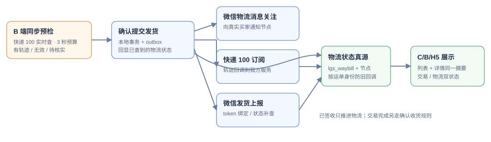

# TDD-订单状态及时同步与发货触达

> 状态：待实施方案；依据 2026-10-15 生产订单 `O261015100041` 的只读排查。范围：一期快递订单、B/C 列表与详情、收件人短信及 H5 看件页；不接积分，不改变基础退款范围，也不做并发测试。关联：[订单状态机](TDD-订单状态机.md) · [物流轨迹多渠道](TDD-物流轨迹多渠道.md) · [微信物流能力清单](微信物流能力清单.md) · [收件人物流触达](TDD-收件人物流触达与分享裂变.md)。

## 一、一句话

提交发货时**同步查一次运单并回显结果**，提交后立即并行启动快递 100 轨迹订阅、微信物流消息关注与发货信息上报，失败由异步任务补偿；C/B 两端从同一物流摘要显示进度，并把“物流签收”与“交易完成”分开。短信称呼真实收件人，H5 看件页在小程序 URL Link 可用时提供明确入口。

## 二、现场证据与问题定位

| 时间（北京时间） | `O261015100041` 的事实 | 含义 |
|---|---|---|
| 10:59:38 | 微信支付成功；主单 `PAID` | 支付事实已入账 |
| 11:00:30 | 子单 `O261015100041-1` 进入 `FULFILLING`；创建圆通发货单 `YT7649795509417`；快递 100 订阅成功 | 交易已发货，但尚未收到货 |
| 11:00:30 | `sys_notify_log` 的发货短信为 `SENT`，模板 `SMS_512500972` | 供应商受理，不等于手机实际收到；模板当前仅传 `code` |
| 11:07:53 | `lgs_waybill=IN_TRANSIT`，轨迹节点 0 条；`ord_shipment=SHIPPED`，`ord_status_log` 有 `PICKED_UP` | 已知物流状态，缺少可展示的节点；“运输中”不能推出订单已完成 |
| 11:10:01 | `trd_shipping_upload=SUCCESS`，从发货排队到微信上报约 9 分半 | 当前 10 分钟轮询是上报延迟的主要来源 |
| 11:10:02 | 微信 `trade_manage_order_settlement` 到达，`confirm_receive_method=null`；当前处理器调用买家确认接口，因无用户会话报 `unauthorized`，推进 0 张子单 | 存在系统事件调用买家接口的实错；同时本事件缺少确认收货证据，不能仅凭事件名强制完成 |

当前 B 列表只用 `ord_sub_order.status` 显示“已发货”，详情另读 `lgs_waybill.status` 显示“运输中”，两者并非同一字段，却都被当作单一“状态”展示。C/B 列表接口目前均不批量提供物流摘要。运单的 `bind_state=WAITING`，但已有 `display_token` 和 `display_channel=wx-plugin`；旧绑定路径与新物流域并行，绑定元数据也需要核对并收敛。当前 H5 页面已有跳小程序按钮逻辑，但生产 `SHOP_WX_STUB=true`、未单独开启 URL Link，接口返回空，按钮不出现；生产小程序处于 `trial`。

图中的“订单状态”只回答交易是否待履约、履约中或已完成；“物流状态”回答未揽收、运输、派送、签收。二者可以同时是 `FULFILLING` 和 `DELIVERED`，直到买家确认收货、微信有效确认事件或既有自动确认规则满足时才推进交易完成。

## 三、详细设计

### 3.1 状态真源与两端展示

| 真源 | 用途 | 对外文案 |
|---|---|---|
| `ord_order` | 支付主单、微信交易号、退款/结算关联 | “已支付”等支付状态 |
| `ord_sub_order` + `ord_shipment` | 子单履约与收货确认 | “已发货”“待确认收货”“已完成” |
| `lgs_waybill` + `lgs_waybill_node` | 承运商进度及轨迹 | “待揽收”“运输中”“派送中”“已签收”“异常” |
| `trd_shipping_upload` | 微信发货信息上报 | B/运营端辅助提示“微信上报中/成功/失败”，不覆盖物流状态 |

为列表增加 `LogisticsPort.summariesOf(Collection<subOrderNo>)` 批量读取有效运单的 `status/carrier/waybillNo/lastEventAt/signedAt`，在 C/B 列表 DTO 中返回 `logisticsSummary`；单页 50 条只做一次运单查询，不逐单查询节点或外部渠道。详情与列表使用同一状态映射。列表主标签继续表明交易阶段，快递子单有运单时增加独立物流标签，例如“已发货 · 运输中”；详情明确标“订单状态”和“物流状态”。无节点但有状态时照样显示状态，说明“轨迹明细待承运商更新”。更正运单号后按新运单身份读取，不显示旧运单进度。

### 3.2 B 端同步校验、提交与状态回显

发货流程分成预检 API 与确认提交 API 两步；B 端必须清楚显示预检结果，确认提交时携带预检令牌。预检先做承运商/单号格式、必填手机号、**本系统其他有效订单是否已绑定相同公司+单号**的校验。若当前运单已经有有效微信 `waybill_token`，优先调用微信 `query_trace`/`query_follow_trace` 主动查状态；新录入或更正的号码通常尚无对应 token，不能为了校验先把未提交的运单 `follow_waybill` 绑定给买家，此时按公司+单号+必要手机号查询快递 100 的实时轨迹。微信查询只给状态，快递 100 可给轨迹；两路均无可用结果时返回“待核实”。外部调用在数据库事务之外，接口预算建议 3 秒，服务端超时/重试不得突破总预算；现有 `Kuaidi100TraceProvider` 的 10 秒超时及 `Optional.empty()` 不能直接用于这个入口，需要独立的结构化结果与短超时。按两家接口各自的配额/频率限制缓存结果，缓存必须展示来源和查询时间；未达到可查询窗口时使用缓存或返回“待核实”。

| 预检结果 | B 端动作 | 提交后的状态 |
|---|---|---|
| 有轨迹且未签收 | 展示承运商、最新状态/时间和关键节点；商家确认后提交 | 同步写入当前运单轨迹，响应携带相同物流摘要 |
| 有轨迹但已签收/异常/疑似旧运单 | 明显提示“此单号已有历史轨迹/已签收”，要求商家核对收件信息并二次确认；同单号已绑定本系统另一有效订单时阻止提交并引导更正 | 确认后按**查到的物流事实**展示，不能倒退为“待揽收”；交易仍为已发货/履约中，不自动完成 |
| 权威渠道明确指出公司/号码参数无效 | 阻止提交，保留表单并提示更正 | 不创建发货单 |
| 查无轨迹、新单未揽收、限频、超时、渠道不可用 | 标成“未核实”，说明原因及上次查询时间；允许商家明确确认后提交，安排后续订阅/重查 | 发货成功但物流状态为“待揽收/待核实”，不得把“查不到”断定为假号 |

预检令牌短期有效并绑定商家、子单、公司、单号、手机号摘要及结果时间；提交时再检查订单仍可发货、令牌对应当前输入、幂等键与重复绑定。提交事务只写发货单/子单/outbox，并在 outbox 中保留预检轨迹引用供失败重放，**不持有数据库锁等待外部接口**。事务成功后在同一 HTTP 响应前把预检轨迹经统一 `WaybillProgress` 写入当前 `sourceShipmentNo + sourceShipmentVersion`，并返回 `orderStatus`、`logisticsStatus`、`lastEventAt`、`verification`、`syncPending`；若落库失败则返回“已发货、物流同步中”并由 outbox 重放，绝不让商家误以为发货失败而重复提交。B 列表与详情、C 列表与详情读取同一摘要；B 提交页即时用响应更新，随后刷新详情核对。运单更正复用同一预检规则，旧运单回调必须按发货身份隔离。

查询结果能证明**该公司+单号有这些轨迹**，不能证明运单一定属于当前收件人；没有收件人匹配证据时 UI 不写“号码已验证属于本订单”。已签收或旧运单的二次确认需要留操作人、时间、预检结果和原因。预检阶段不发短信、不上报微信；完成提交后才触发通知。

### 3.3 双渠道关注、微信上报与补偿

1. 本地提交后 outbox **并行**派发：快递 100 轨迹订阅（其回调更新我们自己的运单真源）、微信 `follow_waybill` 物流消息关注（微信向实际购买者推送关键节点通知）、微信发货信息上报；三个动作各自幂等、各自重试和告警，一个成功不代替另一个。微信发货上报仍记 `trd_shipping_upload` 台账，现有每 10 分钟任务只做补偿。微信也有**主动查询 API**：已接的查询组件走 `trace_waybill → query_trace`，新增物流消息关注走 `follow_waybill → query_follow_trace`；两组接口拿到 token 后应立即查一次状态，并在权限和限频允许时继续做主动校正。`follow_waybill` 与已接的 `trace_waybill`、发货信息上报分别记账，不能混作一个成功状态。
2. 微信物流消息需在小程序后台另行申请“功能 → 物流服务 → 物流消息”；官方准入要求小程序**已发布上线**、开通微信支付且近 90 天有线上交易。调用需要真实买家 `openid`、微信支付交易号 `trans_id`、收件手机号、运单号、商品信息和小程序落地页。当前生产小程序仍是体验版 `trial`，应先核实发布和权限，未开通时记录 `NOT_ELIGIBLE`，快递 100 订阅照常运行。微信消息只发给**实际购买者**，收件人与购买者不同时仍由短信触达收件人；同一节点如还有自发微信订阅消息，应按订单+节点去重，避免重复提醒。
3. 当前 `SubscribeExecutor` 在路由链中**首个成功即返回**，`lgs_waybill.sub_state/sub_channel` 也只能记录一个渠道。新增按 `shipmentIdentity + channel` 唯一的渠道订阅台账，分别记录快递 100 与微信关注的状态、引用、错误、重试时间；迁移现有快递 100 记录，不能把路由列表改成 `wx,kuaidi100` 就声称双订阅成功。微信关注按交易单/当前发货身份幂等；运单更正时保留旧台账审计并重新关注新运单，旧运单的回调不得更新新运单。微信重复通知的撤销能力需按官方接口核实，不能只改本地关联就承诺撤回已发出的通知。
4. 微信查询组件 token 与物流消息关注 token 分别保存、分别限频；拿到当前发货身份的 token 后立即调用相应的 `query_trace` 或 `query_follow_trace`，并记录来源及查询时间。清理旧 `ful_shipment` 绑定与新 `lgs_waybill` 绑定的双写/双调度，使各自绑定状态与 token 保持一致。两种微信查询都能主动获得运单状态，但官方返回体不含完整轨迹节点；快递 100 查询/回调补充轨迹。针对提交时“待核实”的运单，微信获得 token 后先查状态，快递 100 在查询资质及同单号 30 分钟间隔允许时补查；后续按各渠道限频、回调和沉默补偿更新，失败展示最后可信状态及时间。
5. 所有查询/回调核对 `sourceShipmentNo + sourceShipmentVersion + carrier + waybillNo`。不同渠道结果按事件时间、状态单调规则和原始来源入库；轨迹与状态发生冲突时保留原始事件并标记待核，不用较旧结果覆盖较新结果。`DELIVERED` 只更新物流/签收时间；交易完成走明确收货规则。

时效验收建议：外部查询可用且未限频时，B 端预检在 **3 秒预算内**返回当前轨迹/明确的未核实原因；提交成功的响应包含物流摘要。发货后 **1 分钟内**三条派发任务开始；接口成功回执落库后，C/B 重新进入页面或下拉刷新 **5 秒内**展示同一物流状态。以上是待实施目标，不是当前系统承诺；外部渠道无结果时显示最后可信状态与更新时间。

### 3.4 微信结算事件与交易完成

`WxPushEventService` 改为先持久化并验签入站事件，再判断是否有可信的确认收货字段与对应支付单/当前发货身份。`confirm_receive_method` 与 `confirm_receive_time` 等关键字段缺失时只留痕待核，不触发完成。确认有效后调用**系统身份**的收货命令，而非 `OrderService.confirmReceipt()` 买家入口；复用发货单逐包确认、售后阻断、幂等状态迁移和结算收尾。微信重复推送与定时自动确认均以同一子单/包裹状态为幂等键。不得因为承运商“已签收”或微信“将结算”就立即认定买家已确认收货。

### 3.5 发货短信与 H5 跳小程序

短信建议文案：**“${name}，您购买的商品已发货。点击 s.hxmall.top/${code} 查看物流信息。”** `name` 取发货时子单收件人快照，缺失时用“您好”；姓名只用于本次模板参数，不写入日志。`SmsPort.sendShipToRecipient` 接收姓名与短链码，参数用 JSON 序列化，不拼接转义。现有模板 `SMS_512500972` 仅收 `code`，须先在阿里云报备新模板并取得新模板号，再切换生产配置；切换前继续使用旧模板，避免发货短信因参数不匹配整体失败。`SENT` 仍标供应商受理，不声称终端送达。

H5 看件页保留免登录、安全收窄的物流信息；在 URL Link 真通道成功返回时显示按钮“**在微信小程序中查看完整物流**”，旁边说明“将打开微信，首次使用需登录并验证收件手机号”。不可生成 URL Link 时显示“**暂时无法跳转小程序，您可以先在本页查看物流**”，不展示无效按钮。先以体验/正式版可用性和微信接口返回实测验证，再单独开启 `SHOP_WX_URLLINK_STUB=false`；未发布的小程序或微信拒绝生成时，不把短信短链改为直跳小程序。H5 与短信仍共用现有短链及 5 天看件令牌有效期，文案不得承诺长期可用。

## 四、执行顺序与验收

| 批次 | 改动 | 验收证据 |
|---|---|---|
| P0 | 修微信入站事件的确认条件与系统收货入口；补事件留痕 | 本笔缺确认字段的事件不会误完成；有效确认可推进，重复推送不重复结算 |
| P1 | 列表批量物流摘要、B/C 两端双状态标签；详情空节点状态；运单更正旧状态隔离 | 同一子单的列表/详情显示一致；50 条列表无逐单外部请求 |
| P2a | 微信已有 token 时主动查状态，快递 100 结构化预检、3 秒预算与限频缓存、运单重复绑定检查；B 端预检确认/提交和同步回显 | 已有微信状态或快递 100 轨迹的结束运单立即展示实际状态；无结果/超时明确为“待核实”；确定无效的号码不能提交；事务失败不产生通知 |
| P2b | 微信上报 outbox 即时派发、查询组件 token 收敛及即时查询、快递 100 订阅与补偿；各渠道独立台账和微信 `follow_waybill` 关注、`query_follow_trace` 主动查询 | 微信权限具备时与快递 100 分别成功/失败可追踪；微信未获权限不阻塞快递 100；新 token 首次查询结果进入统一物流状态真源 |
| P3 | 新短信模板参数与 H5 跳转/回退文案 | 阿里云新模板审批通过后再切流；H5 可用时跳转成功、不可用时明确说明 |
| P4 | 灰度部署与人工联调 | 用新测试单逐项核对 B/C/运营端、微信发货管理、短信与 H5；不改动 `O261015100041` 的交易状态作为“修复演示” |

每批进行定向单元/接口测试、C/B 类型检查与构建、生产只读对账；遵照当前一期要求**不做并发测试**。人工联调覆盖：正常新单、已有运输轨迹、已签收旧运单、明确错误公司/单号、查无轨迹、渠道超时或限频、改错运单、买家和收件人不同、微信权限未开通。上线监控按订单号串联 `预检 → SUB_ORDER_SHIPPED → LGS_WAYBILL_REGISTERED → 双渠道关注/上报 → token 绑定 → 物流推进/签收 → 确认收货/结算`，对 `FAILED`、`bind_state=WAITING 且 token 非空`、`上报超过 1 分钟未开始`、列表/详情摘要不一致设运营告警。

## 五、取舍与待办条件

- 选择“事务前同步预检 + 本地事务提交 + 多渠道异步订阅”：B 端及时得到查询结果，外部网络失败不回滚已提交发货。预检的确定无效、未核实、有轨迹三类必须分开；已有轨迹也不能证明运单属于本订单。
- 选择“双状态展示”，因为物流签收与交易完成是不同事实；把 `DELIVERED` 直接写成 `COMPLETED` 会提前触发结算，并可能与售后冲突。
- 微信与快递 100 都可主动查询运单：微信需先取得对应 token，返回状态；快递 100 可按公司+单号查轨迹，但有费用与同单频率限制。两家的查询结果都进入同一真源，不能让 B/C 各自实时查询造成不一致。
- 微信 `follow_waybill` 与快递 100 都可订阅/关注运单。已核实的区别是：微信官方文档描述其跟踪后向真实买家发送关键节点通知，快递 100 文档明确提供面向我方服务端的轨迹回调；尚未查到微信这组 `open_msg` 接口向商家服务端回传轨迹的官方说明，不能据此设计微信 webhook。微信通知也不能取代发给收件人的短信。微信权限和小程序上线是接入前置条件。
- 新短信模板号依赖阿里云审核；H5 跳小程序依赖小程序可生成 URL Link。两项在外部条件未满足前仍提供现有短信及 H5 看件功能，并把原因明确显示/记录。
- 微信 `trade_manage_order_settlement` 在本笔的原始字段语义仍需以入站事件留痕核对；确认条件以真实回调样本和官方定义为准，不能凭事件名或当前缺字段样本猜测。

接口依据：[微信物流消息能力](https://developers.weixin.qq.com/miniprogram/dev/platform-capabilities/industry/express/business/express_open_msg.html) · [微信 `follow_waybill`](https://developers.weixin.qq.com/miniprogram/dev/server/API/weixin-express/express-msg/api_follow_waybill) · [微信 `query_follow_trace`](https://developers.weixin.qq.com/miniprogram/dev/server/API/weixin-express/express-msg/api_query_follow_trace) · [微信物流查询组件](https://developers.weixin.qq.com/miniprogram/dev/platform-capabilities/industry/express/business/express_search.html) · [快递 100 实时查询](https://api.kuaidi100.com/document/5f0ffb5ebc8da837cbd8aefc) · [快递 100 订阅推送](https://api.kuaidi100.com/document/5f0ffa8f2977d50a94e1023c.html)。
