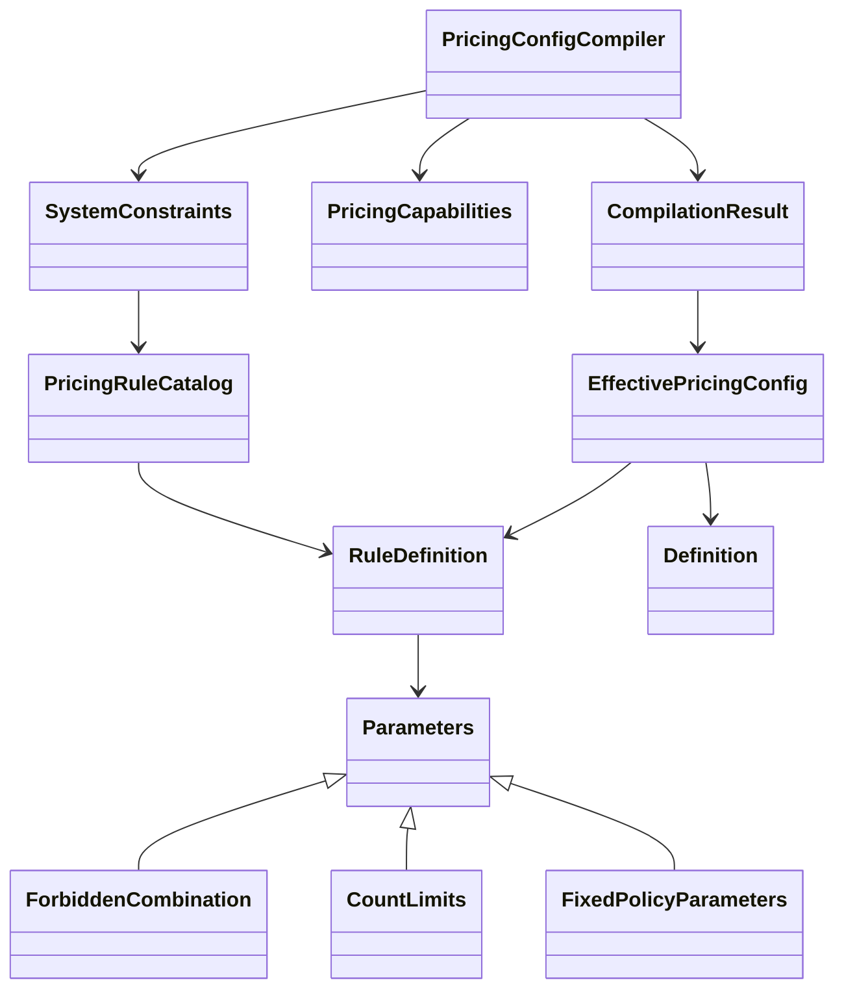

# 订单结账CKO-03：类型化规则配置编译

> 状态：共享编译器已实现，验证见§5 · 2026-10-22 · 档位2。执行[完整计划CKO-03](./TDD-餐饮订单结账-完整开发计划.md)，起点`d9be484d7`。沿[CKO-01合同基线](./TDD-订单结账-CKO01合同与字段核验.md)及[CKO-02值对象](./TDD-订单结账-CKO02定点金额与事实对象.md)推进。

## L1 定位

餐饮、零售、美业共用shop-base中的纯Java配置编译器。输入行业模板、门店覆盖及可信能力证据，输出不可变类型配置、规范JSON和配置hash；不合法时只返回问题，不返回半成品配置。

本阶段不接入订单、资金、税档或库存服务。配置编译通过不代表交易授权，也不代表已经执行优惠或税费计算。下一步CKO-04才实现运行期规则校验和可解释的执行证据。

## L2 使用及对象关系

```java
CompilationResult result = new PricingConfigCompiler().compile(
        templateDefinitionJson, storeOverrideJson,
        SystemConstraints.standard(), verifiedCapabilities);
if (result.valid()) {
    EffectivePricingConfig config = result.config();
    // 交由后续应用服务冻结版本、核验来源并执行规则；此处无数据库写入。
} else {
    List<CompilationResult.Issue> issues = result.issues();
}
```

代码片段为调用示意，verifiedCapabilities必须来自后端可信适配，不能从前端布尔值构造。前三行业的默认definition均取自[规则初始数据](./design/schema/pricing-initial-data.example.json)。整个种子文件不能直接作为template参数传入，传入的是industryTemplates中选定项的definition对象JSON。



## L3 编译与合同

## §0 需求 → 实现

| AC | 要求 | 实现/验证 |
|---|---|---|
| C01 | 拒绝未知字段、Evaluator、越权覆盖及null | 结构/叶路径白名单、固定目录、负例测试 |
| C02 | false保留、对象合并、数组整替换、显式reset | merge/remove；继承及reset测试 |
| C03 | 数量、比例、叠折及原owner能力一致 | validateDefinition；SINGLE、多折扣券及STACK测试 |
| C04 | 强制规则不可删除/降级/换参数 | SystemConstraints及20条代码目录；篡改测试 |
| C05 | 确定性、不可变、输入有界 | 规范化SHA-256、深复制、解析器限制及测试 |
| C06 | 严格枚举与业务引用格式 | 数字字符串枚举拒绝、32位业务No及控制字符测试 |

## §1 编译步骤及方法

1. 有界解析template，验证完整schema及原始字段类型。
2. 有界解析override，检查门店可改叶路径，拒绝null及未知字段。
3. 可选resetPaths删除显式覆盖，恢复模板继承；只能reset可改叶路径。
4. 递归合并对象；标量、数组整项替换。空对象保留原值，false和0不被当作缺失。
5. 再验结构，按闭合枚举名称解码Definition，校验跨字段及可信能力。
6. 输出不可变配置。对象键递归排序、数组保留顺序；按规则目录语义hash和规范配置JSON生成SHA-256。

公开方法：

- PricingConfigCompiler#compile(template, override, constraints, capabilities)。
- 同名重载增加resetPaths，参数位于override与constraints之间。
- CompilationResult#valid()，以及config()/issues()；issues含code/path/message。目前快速返回首个问题，不承诺收集全部错误。
- PricingRuleCatalog#validateJson(systemRulesArrayJson)：用于种子目录核验；合法时返回代码拥有的不可变标准规则，不把外部JSON注册成可执行规则。非法抛IllegalArgumentException。
- PricingRuleCatalog#standardRules()、SystemConstraints#standard()。SystemConstraints构造器私有，不提供客户端JSON输入。

解析/解码错误使用通用错误码及安全消息；已定位约束带字段路径。没有把原始输入、内部异常栈或任意脚本回传客户端。错误路径是配置路径，不是对任意对象进行反射求值的路径。

## §2 配置规则

### 2.1 可改叶项

| 组 | 门店可覆盖 |
|---|---|
| 优惠 | benefitCombinationMode、couponMode、allowedCouponCombinations |
| 券数量 | couponLimits.total/percent/amountTotal/cash/deduction |
| 折扣券 | discountCouponPolicy.maxUsedPerOrder/overlapMode/maxUsedPerItem/stackingEnabled |
| 扩展资产 | storedValueEnabled、pointsEnabled；开启声明仍需运行期能力及来源核验 |
| 人工 | manualOperations.enabled/reasonCategories/amountBasis/minPayableRateBp |
| 税档引用 | taxBinding.taxProfileNo；只能绑定引用，不可改税率 |

ruleRefs、formulaId/version、schemaVersion、行业限制、强制互斥、积分阶段、审批来源、税率编辑权等受保护。门店不能修改mandatory，也不能通过删除ruleRefs绕过强制规则。

覆盖例：`{"pointsEnabled":false,"allowedCouponCombinations":[]}`明确关闭积分、移除跨券型组合。resetPaths包含pointsEnabled时，仅删除该覆盖，积分恢复模板值，组合数组仍为空。覆盖null一律拒绝，包括同时要求reset的字段；模板taxProfileNo必须存在，可显式null表示尚未解析税档。

### 2.2 数量、叠折及人工下限

- 券数量范围0～64；percent和amountTotal不超过total，cash/deduction不超过amountTotal。
- SINGLE要求total=1；maxUsedPerOrder不能超过percent。
- DISJOINT/BEST_ONE：maxUsedPerItem=1且stackingEnabled=false。
- STACK：stackingEnabled=true，2≤maxUsedPerItem≤maxUsedPerOrder，并要求可信owner明确支持叠折。
- 总券数/折扣券数不能超过owner能力；配置允许实际可选的折扣券与金额券组合时要求percentAndAmount能力；开启储值要求storedValue能力。
- 活动与用券EXCLUSIVE；积分不自动应用且处于AFTER_STORED_VALUE阶段。人工审批仍来自既有权限/审批权威，缺失即DENY。
- 新增可选manualOperations.minPayableRateBp：0～10000，表示人工优惠后最低应付比例，如8000表示不得低于80%。仅作为后续执行器的门店限制输入，不能授予人工权限或放宽owner的更严格限制；未配置不虚构全局授权。优惠算法及最终审批校验归后续任务。

以上是配置兼容校验；选中的真实券、商品范围、冲突、积分余额、储值扣款等尚未执行，不将声明可用误当作已授权。

### 2.3 代码拥有的规则及有界JSON

目录固定B01～B12、T01～T08，共20条version=1强制规则。EvaluatorType使用封闭枚举；参数源只在代码目录维护一份，同时导出类型定义、种子核验及语义hash。禁止组合、数量参数编译为具体record；其余固定策略编译为FixedPolicyParameters中的闭合策略ID，具体执行器分别归CKO-04/07，不解释通用表达式或任意类名。

输入上限：每段JSON≤65536 UTF-8字节且字符数≤65536，深度16，字符串256、字段名64、数字16字符；配置数组及reset列表≤64项。重复键、尾随第二段JSON、未知字段、字符串布尔值/整数、分数整数、枚举数字及数字字符串均拒绝。税档/人工原因业务No≤32，拒绝空白及控制字符；格式通过不代表记录存在、适用地区正确或审批原因已授权。

hash包含规则目录版本语义及规范后的有效配置，不包含交易事实/权限/资产余额，也不是签名。相同对象字段顺序产生相同hash；数组顺序保留，不声称任意数组排列都等价。没有引入可变缓存，按已发布不可变revision缓存归CKO-08应用服务实现。

## §3 精确代码清单及实施裁决

全部新增Java类位于既有模块，无POM变动：

| 包 | 类 | 职责 |
|---|---|---|
| ai.neargo.shop.common.pricing | PricingConfigCompiler | 合并、校验、类型化输出 |
| 同上 | EffectivePricingConfig | 不可变结果及嵌套配置record/枚举 |
| 同上 | CompilationResult | 成功配置或失败issues |
| 同上 | PricingCapabilities | 后端注入的数量/组合/叠折/储值支持证据 |
| 同上 | RuleDefinition | 有限Evaluator、参数record及固定策略枚举 |
| 同上 | PricingRuleCatalog | 20条代码拥有的强制规则及种子核验 |
| 同上 | SystemConstraints | 可信系统规则入口 |
| 同上 | PricingJson | 包内有界解析、规范化及hash |

生产路径为backend/shop-base/src/main/java/ai/neargo/shop/common/pricing/；测试同包位于src/test/java/，新增PricingConfigCompilerTest、PricingRuleCatalogTest、PricingConfigTestData。测试读仓库内种子文件；生产编译器无文件/数据库/网络IO。

实施裁决：沿用户指定codex/food-next01执行，精确文件归属提交，保留共享工作区其他改动。编译只做结构、配置冲突和显式能力校验；完整运行期规则不提前塞进编译器。可选人工比例字段落实原任务03的0～10000验收，未修改默认种子或默认授权。无新增Controller/Service/Mapper/表/权限/API，既有零售订单与资金算法保持原调用方式。

## L4 验证与交付

## §4 剩余门禁

CKO-04执行真实候选与规则冲突，05选择优惠计划，06金额/比例公式，07税费，08～09发布/版本/门店权限，10～11报价及真实来源适配。税档存在性/地区/生效期、人工原因目录和审批、资产资格及余额必须由相应owner验证；本阶段不会因JSON有效开放这些能力。Keeta仍仅规划。

## §5 测试证据

初始测试先于实现执行，因目标类不存在而失败。新增编号及枚举回归均先确认断言失败，再实现保护。两次消融分别移除枚举名称和引用格式校验，对应断言均失败；源码已恢复。

新增测试共20项：PricingConfigCompilerTest 17，PricingRuleCatalogTest 3。覆盖三行业模板、未知/受保护路径、null、false/数组/reset、数量/叠折/能力、人工比例、深度/大小/重复JSON、强制目录篡改、不可变与hash，以及枚举和编号校验。

最终全量及架构检查结果见§6。完整shop-base回归需要上游svc-client测试绑定本机临时HTTP端口，使用获准的测试监听，不连接真实业务服务。

```sh
JAVA_HOME=/opt/homebrew/opt/openjdk@21/libexec/openjdk.jdk/Contents/Home \
  mvn -o -f backend/pom.xml -pl shop-base -am test
JAVA_HOME=/opt/homebrew/opt/openjdk@21/libexec/openjdk.jdk/Contents/Home \
  mvn -o -f backend/pom.xml -pl shop-app -am test \
  -Dtest=ArchitectureTest -Dsurefire.failIfNoSpecifiedTests=false
```

## §6 执行及设计 → 实现对账

独立只读评审发现数字字符串枚举隐式转换，已补原始名称白名单及回归测试；无其他实质阻断。后续交易授权、税档解析、缓存和运行期规则归属已明确，不将未执行任务标记为交付。

最终恢复后完整回归：shop-base 116项、job-api 11项、svc-client 10项，均0失败/0错误/0跳过。ArchitectureTest共16项：15通过、1失败；失败仍为任务基线已有OpsPointsInspectionController全限定PathVariable注解，该文件与HEAD无差异。本任务未修改该Controller，也未放宽架构检查；common依赖、SPI位置等其余检查通过。

新增11个Java文件静态检查：≤120列、无行尾空格和通配符import；文档链接及围栏检查通过。任务共14个归属路径（8生产类、3测试类/辅助类、3份文档），按限定清单提交；不提交共享工作区其他改动。
