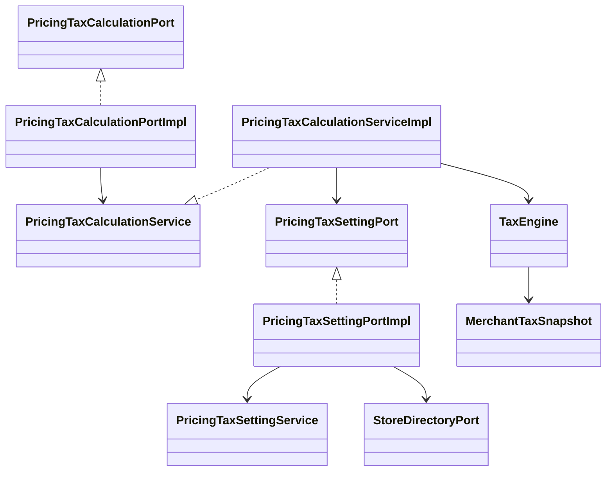

# 订单结账CKO-09：受控种子与配置API

> 状态：实施中 · 2026-10-22 · 档位2 · 基线9f5140dff。依据[完整计划CKO-09](./TDD-餐饮订单结账-完整开发计划.md)、[存储方案](./TDD-统一试算引擎-存储与Java实施方案.md)、[初始种子与税费](./TDD-统一试算引擎-初始规则与结账税费.md)及[ADR-040](./ADR/ADR-040-餐饮销售配置与耗用权威边界.md)。

> **最新业务裁决（2026-10-23，用户修正，优先于下文历史收据）：** 平台提供统一默认税配置，商家自主维护税率及价税模式，无平台审核。C2改为“平台默认与商家自主税配置接线”，不再建设平台税档审批，也不再以税登记核验作为普通订单计税前置条件。历史收据描述的是当时实现，不代表新需求已开发；当前代码仍有旧限制，见文末新口径。

## L1 定位

先完成原规则目录对应的种子校验及仅草稿导入，再接平台/门店鉴权API。示例门店、能力夹具、资金计划向量不能变成实际账号/门店/资产能力。2个AE税档只能保存为待审核候选，不能自动获得法律有效性或门店税登记资格。

## L2 边界

系统没有销售VAT税档及门店已核验税登记的现成权威来源；须在平台/原主体能力中补真实来源，不能以new Context构造成功替代核验。模板、门店权限分别登记；C端不开放配置写接口。本轮不接真实Keeta或资金扣款。

## L3 需求与实现

## §0 需求→设计

| AC | 需求 | 落点 |
|---|---|---|
| S01 | 20个mandatory规则与代码目录完全匹配 | PricingSeedValidator复用PricingRuleCatalog |
| S02 | 3行业模板仅生成草稿，2AE税档待审核；无示例门店/能力导入 | typed SeedPlan及白名单持久化 |
| S03 | DRY_RUN无副作用；同版本异hash永久拒绝 | provenance列seed_version/hash/snapshot，原唯一头约束及事务 |
| S04 | 导入原子性及并发幂等 | 原事务管理器/幂等设施，3头同事务；MariaDB |
| S05 | 分端权限/错误码/身份和税档来源门禁 | 后续本任务API子步，未具备真实来源时不开放发布成功路径 |

## §1 存储裁决

幂等收据24小时过期，不能单靠它保证同种子版本永久不变。向原ord_pricing_template增加seed_version VARCHAR(64)、seed_hash CHAR(64)、seed_snapshot LONGTEXT可空来源列，不增加第8张表。seed_snapshot只保留种子版本/规则/税档候选/资料引用；不包含门店示例、能力夹具及资金向量。templateCode由seedVersion及来源templateNo派生稳定哈希，实际templateNo仍用BizKey。

导入不更新已有草稿、不发布、不自动升级门店。重放返回原3个业务No，即使有人编辑过这些草稿也不覆盖。相同seedVersion不同全量规范化摘要拒绝，包含只改示例部分的情况。仅存待审核税档候选，不把它们加入verifiedTaxProfiles。

引擎规范V4与配置JSON结构schemaVersion=2是不同维度。原CKO08写入schemaVersion=4不匹配实际编译器，这轮补断言后改为实际配置结构版本；历史不可变revision不做覆盖更新。

## §2 代码及步骤

A. shop-base/common.pricing/PricingSeedValidator与不可变SeedPlan：严格字段/重复key/大小/代码规则/模板/税档候选验证。校验时使用代码允许的结构能力上界，仅验证模板可表达性，绝不视为实际owner能力。

B. trade.service.PricingSeedService及impl：importDrafts(Context,seed,registryVersion,DRY_RUN|DRAFT)；返回mode/seedVersion/hash、规则/模板/税档候选计数及业务No。OrdPricingTemplate增加来源字段，V533增量迁移；原CKO08服务输出metadata修正schemaVersion。

C. 平台/门店Controller、原权限/i18n及真实来源接线：在本任务后续子步完成，入口不得接受Context或自报主体/能力/税率。税档发布与门店规则发布分权。

### C步税档与主体登记归属（用户已确认，待实现）

| 对象 | 权威维护方 | 门店可做的事 | 发布/使用门禁 |
|---|---|---|---|
| 地区税档及版本 | 平台运营审核，保存来源依据、地区、币种、有效期、审核人及内容摘要 | 申请适用已发布版本 | `pricing:tax:publish`独立授权；待审核种子不能作为已发布版本 |
| 供应方税登记 | 原经营主体档案维护；登记号、所属地区、有效期及核验状态由主体能力提供 | 关联本门店所属主体的有效登记引用 | 服务端验证store→entity归属、登记主体/地区/有效期；不能跨主体选择 |
| 门店税档绑定 | 原门店配置草稿及不可变revision | 选择适用税档版本及本主体登记引用 | 服务端核验平台审核版本、登记及交易适用条件，不能提交法定税率 |
| 报价/订单税证据 | 原报价及最终确认链 | 读取试算结果 | 冻结税档/主体登记版本与摘要；缺失、失效或不适用则阻止相关报价/确认 |

继续沿原方案将经审核税档完整嵌入不可变模板/门店发布与报价快照，不因这次归属确认另建一套门店税务主体。C步须先补齐原主体档案的税登记来源及平台审核证据存储，再对接鉴权API。`verifiedTaxProfiles`是服务端核验结果，不能由前端列表、自报APPROVED字段或seed候选生成。平台模板发布权限不自动等于税档审核权限。审核税档和税登记的改动生成新版本，历史订单仍引用原证据；是否允许新交易按当前有效性重新核验。

- [x] 验证器及导入需求测试RED→GREEN。
- [x] 真实MariaDB验证干跑、重复/冲突、失败回滚、并发及无激活。
- [ ] 平台/门店API与合法税档来源、越权和三语测试。
- [x] A/B回归、评审、消融及生成物对账；不把A/B完成标为整个09完成。

## L4 验证与交付

## §5 验证记录

| 验证项 | 实际结果 |
|---|---|
| PricingSeedValidatorTest | 9项通过；含20规则/3模板/2待审核候选、全量hash、非法字段/日期/税候选拒绝 |
| PricingSeedServiceTest | 7项原生MariaDB11.4通过，0跳过；干跑、幂等、永久版本冲突、编辑后重放、触发器失败回滚、并发、非平台拒绝 |
| PricingConfigServiceTest | 17项原生MariaDB11.4通过，0跳过；结构版本断言由expected2/actual4变绿 |
| 事务消融 | 移除TransactionTemplate后，回滚用例1个断言失败/0错误，发现1份残留模板；实现已恢复 |
| 非法日期回归 | 新测试先1断言失败/0错误（DateTimeParseException未转换），补DateTimeException转换后9项全绿 |
| 核心回归 | 日期修复后完整reactor成功：base237/core438（实际执行414通过，24个仅隔离DB执行用例跳过；另有24项原生DB实跑均通过） |

schema生成器Node测试1项通过；最终原生MariaDB24项重跑均通过、无跳过。

应用守卫30项中28项通过，2项既有基线失败：`ArchitectureTest.noFullyQualifiedReferences`指向未改动的OpsPointsInspectionController全限定注解；`SchemaDriftTest.migrationAndTestSchemaMatch`指向原pay_ent_exception_action列解析差异（CKO08已用原HEAD迁移/schema复现，见CKO08收据）。新增V533的SchemaGeneratorTest/H2全schema载入、SchemaParityTest、业务键、出箱路由及三语6项均通过。未声称全应用守卫通过。

只读独立评审未发现A/B阻塞问题；唯一日期错误契约问题按对未来API的影响提升为本轮修复项，已有RED→GREEN证据。候选日期/格式校验不等于平台审核了税务法律依据。

## §6 对账与剩余工作

已确认：正式税档由平台运营审核，门店关联经营主体的税登记。平台税档审核/发布与门店规则发布分别授权；门店不重复维护主体税登记，不允许以自报税率或示例税档代替核验。此归属用于C步真实来源接线；旧门店/零售未自动迁移。

### A/B代码对账

| §2设计 | 实际代码 |
|---|---|
| 纯种子校验 | shop-base/common.pricing/PricingSeedValidator及9项测试 |
| 草稿原子导入 | trade.service.PricingSeedService及impl；7项真实DB测试 |
| 永久来源约束 | OrdPricingTemplate新增3字段、V533增量迁移及重新生成schema-test.sql |
| metadata版本修正 | PricingPublicationPolicy写结构版本2，revision取实际编译结果；原配置DB测试增加断言 |
| 隔离数据库证据 | verify-pricing-config-mariadb.py支持publication/seed/all，TCP探测等待最终实例 |
| 文档同步 | 本收据、完整开发计划及存储方案；生成表/分层/实体/ER与索引，保留共享工作区其他草稿 |
| C步配置API/真实税务权威 | 未实现，不计为A/B交付；不开放伪造发布成功路径 |

### 统一分支集成（2026-10-22）

统一分支已有V532/V533储值迁移，并推进至V545。餐饮分支原V532配置表与V533来源字段仅在临时测试库验证，未部署业务库，本次分别重编号为V546/V547并同步测试引用；SQL内容不变，统一分支原已部署迁移不变。保留shop-core两边的H2及MySQL测试依赖。旧收据中的V532/V533表示原餐饮分支历史编号，最终集成编号以此为准。

集成时发现统一分支V538/V539动态CHECK替换及MODIFY/ADD省略COLUMN语法未被原测试schema生成器支持。新增精确完整语句白名单重放（仍拒绝未知/被改动动态SQL），保留其他约束；ADD列捕获收紧以防多空格/换行把UNIQUE/INDEX误吞。5项Node回归均通过，新增路径先RED后GREEN；全库生成362表/2417种子，H2完整加载通过。独立评审确认原V532/V533储值内容不变、餐饮迁移只重编号及无重复版本；其空白回溯发现已补测试修复。

合并结果核心回归477项中453项执行通过/24项条件跳过；对应24项发布/导入在临时MariaDB实跑全通过，无跳过。应用守卫31项中23项通过/8项失败；在原统一基线e9ae7bd2d隔离快照重跑ArchitectureTest/SchemaDriftTest，8个失败方法及逐条错误详情与合并结果完全一致，不视为本次引入，也不声称全应用测试通过。餐饮五模块reactor通过：531项/485执行通过/46条件跳过（food-api5、food-core313/38跳过、food-web146、food-channel24、food-server43/8跳过）；尚未将这些跳过项冒充真实数据库或远端验收。最终SchemaGeneratorTest、SchemaParityTest及BackendI18nParityTest共8项重跑全通过。

### C1：分端API与缺证据阻断（2026-10-23，已完成本切片）

使用执行计划技能在已有干净worktree的统一分支5c5b8d154继续，复用前述经确认的CKO-09计划。本切片先提供真实身份下可用的模板/种子草稿API及门店已有配置草稿操作；C2正式税档审核/主体税登记权威尚未实现，整个CKO-09不标完成。

裁决：C步原文“先补齐来源再对接API”调整为先接可验证且无激活副作用的API，所有需要发布证据的入口通过唯一服务端Port加载；无provider、无证据、过期、错作用域均阻断，不写模拟成功provider。代价是C2前初始化/预览/发布/回滚不能成功，门店首次初始化也不会伪造草稿或默认有效配置。该顺序允许独立验收权限和输入边界，不改变税务归属决策。

| AC | C1可验收行为 | 代码/验证 |
|---|---|---|
| A01 | 运营只能用OPERATOR登录；B端只能用MERCHANT登录，门店在BizContext授权集合且目录归属一致 | PricingAccessPolicyTest |
| A02 | HTTP不得接收Context/tenant/entity/store/capabilities/verifiedTaxProfiles；多余字段拒绝 | PricingConfigRequests、API解码测试 |
| A03 | 原有Service接入controller，CAS/幂等键及previewHash/原因透传，不在Web重算 | OpsPricingTemplateController、BizPricingConfigController |
| A04 | 预览/发布/初始化/回滚缺证据、过期或作用域不一致阻断；草稿操作不加载证据 | PricingConfigEvidencePort + PricingAccessPolicy |
| A05 | 6条权限分读/改/发，原角色授权不扩大；新错误码三语完整 | Perms/BizPerms及权限种子，方法安全代理测试 |

输入输出沿PricingConfigCommands的DraftVO/PreviewVO/RevisionVO和SeedService.ImportReport。HTTP请求使用独立PricingConfigRequests闭合record（含Bean Validation），不暴露内部Context构造字段。Idempotency-Key对写操作必传（种子由服务端版本摘要幂等，不接受客户端registryVersion）。registryVersion固定PRICING_RULE_SPEC_V4。

平台：POST /ops/pricing-templates、POST /ops/pricing-templates/seed-import；GET/PUT /ops/pricing-templates/{no}/draft；POST /ops/pricing-templates/{no}/preview、/{no}/publish；GET /ops/pricing-templates/{no}/revisions/{revisionNo}。平台预览为read权限，发布单独publish权限。

门店：POST /biz/pricing-configs/initialize；GET/PUT /biz/pricing-configs/{no}/draft；POST /biz/pricing-configs/{no}/preview、/{no}/publish、/{no}/reset、/{no}/upgrade、/{no}/rollback；GET /biz/pricing-configs/{no}/revisions/{revisionNo}。初始化会发布首版，必须publish权限及证据；reset/upgrade只变更草稿，update权限；C端无配置入口。

证据合同仅在shop-base/spi.trade，返回精确tenant/entity/store/resource/template作用域、到期时间、能力、已核验税档No、来源引用。不提供默认成功实现；由后续真实owner和平台审核/主体登记实现者接通。草稿Context能力为0且已过期，只能进入原草稿操作；绝不能用来预览或发布。发布证据最长5分钟，来源不得为空，读取失败不回落到seed、sys_setting或前端值。

步骤：先写身份/证据/请求与分端授权测试RED→GREEN；实现唯一身份策略和Controller；登记V548 API-only权限点（不分配既有角色）/三语/端点映射；执行核心、API方法鉴权、实际24项DB回归及生成物对账；独立评审后按实际C1状态提交。权限发布与税档发布仍分离，C1不提供税档审核成功接口。

### C1评审、验证及代码对账

| 设计 | 实现 |
|---|---|
| 可信身份与缺来源门禁 | PricingAccessPolicy；仅OPERATOR/指定MERCHANT门店可用，无默认PricingConfigEvidencePort实现 |
| 闭合输入与分端Controller | PricingConfigRequests；7个Ops/9个Biz端点；CAS版本必须显式且非null，reason上限沿原256 |
| 保持幂等恢复 | 两个Service及impl增加惰性证据overload，PricingPublicationPolicy先读原收据再查owner，不将局部SQL scope bypass传播给owner；同actor/tenant/entity/store校验 |
| 草稿恢复继承 | reset只做可编辑路径及代码结构上界验证，不依赖live证据、不授予实际能力、不移动active指针；新发布仍需真实证据 |
| 并发种子导入 | 真实并发sys_idempotent插入死锁已复现；仅PessimisticLockingFailure最多3次独立事务重试，ambient事务不自动重试 |
| 权限、错误与数据库 | 6个常量及Biz标签；V548仅3个Ops ACTION权限点/ui_ready=0，不给旧角色授权；40190三语词条 |
| API契约与前端阶段 | pricing-config.openapi.json含16个操作、成功/错误ApiResult信封；独立Ops/Biz后端先行清单，经原守卫逐条验证真实handler和专用契约，不扩充旧欠账 |

独立评审的reset过期上下文、reason500/256不一致、错误信封data:null及宽松JSON下CAS null问题，均补失败回归后修复。reset真实DB先1断言失败/0错误；reason/CAS测试先2断言失败/0错误；JSONschema错误信封16个操作先失败后全部通过。API重放收据消融移除前置恢复后1断言失败/0错误（检测到访问已不可用owner），代码已原样恢复。

最终实际证据：16项新增Java测试通过（含HTTP绑定/方法权限/身份/请求/事务重试）；19发布+7种子导入真实MariaDB测试全部通过、无跳过。完整核心reactor BUILD SUCCESS：shop-base 246项、shop-base-auth 28项全部通过，shop-core 495项中469项执行通过、26项条件跳过（这26项已在上述MariaDB独立实跑通过）。Node交付/schema生成共9项、Python交付4项及JSONschema契约3项全部通过，SQL方言扫描无新增依赖。

应用守卫34项中26项通过、8项失败：ArchitectureTest 7项及SchemaDriftTest 1项，失败方法与错误详情均与原统一分支e9ae7bd2d隔离快照一致。SchemaGeneratorTest、SchemaParityTest、BizRoleSeedTest 3项、BizKeyConventionTest 3项、BackendI18nParityTest 6项及OutboxRoutingTest 2项均通过，不声称全应用守卫通过。生成schema为362表/2420种子，增加的3条仅为权限点。

Ops新增7端点全部有权限映射，0条失效映射规则；20个原有未映射端点与基线一致。后端先行交付守卫通过，未分类出口仍为原有10项。角色端点矩阵按实际源码重新生成，同时刷新原fixture遗漏的11个既有积分端点；与C1前实际源码对照，所有非SUPER_ADMIN角色集合不变，SUPER_ADMIN仅由原通配权限获得7个新增API，未修改角色授权。审核完成不等于平台已批准种子税档；本切片没有向业务库执行新迁移或部署运行包。

C2继续事项：原主体税登记及门店绑定来源、平台审核税档完整版本与证据存储，真实能力owner汇总/生效资格解析；再实现PricingConfigEvidencePort并验证稳定证据No/expiry在preview→publish间一致。C2前预览、首次初始化、新发布及回滚返回40190；已成功命令的同身份同键重放仍返回原收据。整个CKO-09不标完成。

### C2新口径：平台默认、商家自主设置（2026-10-23，设计待实现）

用户最新要求取代此前“平台审核税档、门店只能关联核验税登记”的归属。平台负责基础设施及默认配置，商家负责自身经营配置；不增加税档申请、审核、审批通过状态或平台代商家发布流程。主体税登记信息可继续作为原主体资料维护，不成为普通试算/下单的审核门槛。

| AC | 需求与设计落点 | 实现状态 |
|---|---|---|
| TAX01 | 平台维护统一默认税率及价税模式；商家未覆盖时继承 | 待实现默认配置读取/版本化 |
| TAX02 | 商家可保存税率及模式或恢复平台默认，不需要平台审批 | 待实现商家自主管理入口及商家作用域存储 |
| TAX03 | 支持额外加税EXCLUSIVE和含税倒推INCLUSIVE | TaxEngine已有纯计算；配置来源接线待改 |
| TAX04 | 前端试算与下单确认用同一配置解析器/税引擎；历史订单不随设置变化 | 待接报价/确认及不可变快照 |
| TAX05 | 只能操作当前授权商家的设置；客户端不能在结算请求中临时指定税率 | 沿原登录/主体/门店鉴权；新增商家配置授权待实现 |

#### 配置归属与解析

首版解析顺序：当前商家已启用的自定义配置，否则平台统一默认配置。同一商家的门店共用其税配置；本次不额外引入门店税率覆盖、地区自动选档或外部税务服务。平台默认配置是系统兜底，不覆盖商家已保存的自定义配置。商家恢复默认后，后续报价才使用平台当前默认版本。

“商家”沿项目现有经营主体及BizContext映射，不新增一套账户/商户树。访问必须校验当前授权门店归属于当前商家；商家级配置修改权限不能仅凭拥有任意一个门店读取权限推导。主体经营资料及支付、库存各自权威边界保持原方案。

候选配置字段（不是已发布HTTP合同）：source=PLATFORM_DEFAULT|MERCHANT_CUSTOM、rateBp、priceTaxMode=EXCLUSIVE|INCLUSIVE、version、updatedBy、updatedAt；merchant/entity标识从服务端上下文解析，不从请求正文授权。rateBp=500表示5%，0是显式零税率，缺配置不能静默等同0；使用整数基点及现有MoneyMinor定点金额。保存时校验枚举、范围、乐观版本及授权，商家保存即可生效，无审批字段。

平台默认优先复用SettingService的存储与变更留痕能力，由税配置Service提供领域校验和稳定版本/摘要；现有接口本身不提供版本，不能直接把更新时间冒充不可变版本。商家配置优先核查现有商家配置存储；现有ord_store_pricing_config是门店级，不可伪装成商家级而重复写每店作为唯一权威。是否需要增量字段/表，在后续详细代码方案中按现有真实结构确定；本次不创建候选表或修改旧迁移。

#### 计算口径

沿现有优惠、积分及人工调整对价分类，先得到引擎已确定的各计税行金额A，再计算税额；本次不改变优惠税基规则，也不将储值支付简单等同可减税折扣。

- EXCLUSIVE额外加税：tax=round(A×rateBp/10000)，net=A，gross=A+tax。
- INCLUSIVE含税倒推：tax=round(A×rateBp/(10000+rateBp))，gross=A，net=A-tax。
- 示例税率5%：不含税金额100.00，税5.00，应收105.00；含税金额100.00，税4.76，未税95.24，应收仍100.00。

round沿现有货币最小单位和逐发票行HALF_UP策略，汇总行结果，不另做订单总额二次计税。AA、拆单及退款沿原订单冻结税额分摊，不因拆分或当前设置变化重新增加税额。商家模式是价格含税语义，前端须明确展示；不能只切换显示标签却沿用相反语义的价格来源。

报价及订单应冻结配置来源、商家、版本/摘要、税率、价税模式和net/tax/gross。试算后设置改变时，下单重新解析并对比来源版本；不一致返回重新试算要求，不静默用新价格完成确认。已确认订单及其退款使用原快照。

#### 与当前代码的差异及下一步

当前PricingConfigCompiler仍强制VERIFIED_STORE_REGION_AND_TRANSACTION_CONTEXT、storeMayEditRate=false；PricingSeedValidator及种子仍带待审核/法定税档约束；PricingConfigEvidencePort注释及发布门禁仍依赖旧税证据，不能仅修改文档就声称已生效。旧不可变revision/种子摘要不能原地改写，应以新合同版本兼容解析旧记录，新配置按新口径保存。

实施顺序：①详细对齐平台/商家配置来源、版本及分端权限；②调整配置编译/种子合同并保留旧记录可读；③接通真实平台默认与商家设置来源，移除税审批/登记门禁；④贯通报价与下单确认快照；⑤验证继承/覆盖/恢复默认、两种公式、零税率、越权、配置变更重算及历史退款。PricingConfigEvidencePort仍需真实服务端资金/能力来源，不可因取消税审核而用全能力默认provider放行储值或优惠。

本次仅更新需求裁决与设计，未修改Java、数据库或API契约。C2仍未实现，C1现有40190门禁在后续代码接线前仍保留，不能将其当作商家设置已可用。

### C2.1实施合同（2026-10-23，合同切片已实现）

沿已批准清单先实施新配置合同，不改历史种子/revision。schemaVersion=2及PRICING_RULE_SPEC_V4保留原校验、目录和hash；schemaVersion=3使用PRICING_RULE_SPEC_V5，仅T01/T02升级为规则版本2，来源为服务端商家覆盖或平台默认，不要求税登记/平台审核。税binding字段暂沿原DTO保持兼容：taxProfileNo必须null、resolveFrom=MERCHANT_OR_PLATFORM_DEFAULT、missingPolicy=BLOCK、storeMayEditRate=true（仅表示商家有独立设置入口，不允许门店规则patch写税率）。配置税率/模式由后续独立商家配置来源读取，规则定义不能内嵌或覆盖商家级税率。

新schema3种子增加platformTaxDefaultExample={rateBp,priceTaxMode}；regionalTaxProfiles必须空，requireValidatedLegalTaxProfiles=false；保留其余只草稿、不建资产、不升级、不自动发布限制。示例默认税配置只保存在来源快照，绝不激活平台默认。HTTP种子导入按服务器支持的schema映射固定V4/V5目录，拒绝不支持版本，不能由客户端指定动态注册表。

文件：PricingRuleCatalog、SystemConstraints、PricingConfigCompiler、PricingSeedValidator；原OpsPricingTemplateController种子注册表选择；新增schema3种子示例及目标测试。先验证新版编译/严格绑定/新种子不含审核条件和税率类型/范围/目录串版拒绝，再实现；原schema2全部测试继续运行，并增加固定历史hash防回写。税配置存储/API及真实发布owner尚属C2.2～4，不能以此合同切片称已可设置或收税。

### C2.1实现与验收对账

| 计划 | 实际落点 |
|---|---|
| schema2/V4兼容、新schema3/V5 | PricingConfigCompiler/SystemConstraints/PricingRuleCatalog；旧配置固定hash回归，新版仅T01/T02规则版本2 |
| 新种子不审核/不激活 | PricingSeedValidator及独立pricing-merchant-tax-initial-data.example.json；旧示例不改，零候选税档，默认税率仅来源示例 |
| 服务端选择固定注册表 | PricingSeedService新增不带registry参数的重载；Ops入口调用此重载，原显式V4内部合同保留 |
| 实际结构/引擎/目录元数据 | PricingPublicationPolicy及种子导入：创建/保存/导入/门店初始化/升级维护draft_schema_version；不可变revision记实际schema、engineSpec和ruleCatalog |
| 验证与生成物 | 新增MerchantTaxConfigContractTest 6项；原API方法回归及原生数据库各新增1场景；重新生成分层/词表/文档索引（只有索引有差异） |

测试证据：合同定向35项及API5项通过；原生MariaDB20发布+8导入=28项实际执行通过、无跳过。完整核心reactor通过，shop-base252、shop-base-auth28全通过，shop-core497项中469执行通过、28项条件跳过（已在上述真实DB独立验收）。Node交付/schema生成9项、JSONschema契约3项通过，Ops后端先行出口守卫无新增欠账。

失败证据：最初新版合同3项断言失败；API注册表委托1项断言失败；原生发布V4/V5元数据1项断言失败；扩展输入回归发现Jackson数字长度异常未映射BAD_REQUEST，1项断言失败，已统一包装；独立评审无Critical/Important，发现草稿schema元数据Minor后补原生断言1项失败再修复。草稿允许未完成的非法配置，缺有效schema声明时仍保留旧2标记用于兼容，不代表编译通过；明确整数声明按实际记录，发布只接受受支持版本。

此切片未新增表/迁移、未改公开端点/权限或部署。C2.2平台默认/商家税配置持久化、C2.3实际管理入口及C2.4真实owner证据仍待实现；新种子支持不等于商家税率已可设置或订单已可计税。

消融：移除schema3禁止taxProfileNo的条件后，新版禁止审核税档回退用例产生1项断言失败/0错误；随后逐字节恢复源码并再次执行完整核心回归。宿主守卫34项中26通过/8失败，ArchitectureTest7项错误与原统一基线完全一致，SchemaDriftTest仍是同一mbr_identity_ticket.customer_no列差异（列输出顺序不同但集合相同）；H2加载/Parity、角色种子及三语通过。不声称全应用守卫通过。

### C2.2 默认与商家税配置存储（2026-10-23，内部服务已实现）

复用现有sys_setting，当前DDL已有version和setting_key唯一键。trade只经spi.platform.SettingPort调用，不引用platform实体/Mapper。新增版本读取及CAS合同，原get/put语义保持；新税键独占pricing.tax.default与pricing.tax.merchant.{entityNo}。MAIN租户沿当前系统约束，不给客户端任意键权限。无新表、无新迁移、无默认税率种子。

参数值闭合JSON：schemaVersion=1、custom(boolean)、rateBp(integer|null)、priceTaxMode(INCLUSIVE|EXCLUSIVE|null)。custom=true要求rateBp在0～10000且模式明确；custom=false要求另两字段均null，仅用于商家恢复继承，不删除行或重置版本。平台只允许custom=true。显式0表示零税率，缺记录表示未配置；坏配置不可降级为0或绕过为默认。Settings存储版本与配置schema版本分开。

| AC | 计划落点与验证 |
|---|---|
| ST01 | SettingPort/SettingService增versioned读取和compareAndSet，更新条件同时比较tenant/key/version/原JSON；创建靠现有唯一键；原get/put兼容 |
| ST02 | TaxSettingDefinition纯解析/校验及不可变快照含来源/主体/版本/税率/模式/摘要；严格拒绝类型强转、重复字段和额外字段 |
| ST03 | PricingTaxSettingService/Impl：getPlatform/getMerchant/savePlatform/saveMerchant/resetMerchant；Context取既有可信身份，不接HTTP |
| ST04 | 平台默认→商家覆盖解析；平台更新不覆盖自定义；恢复默认后返回平台当前版本，商家自己的版本仍增加；缺默认查询可表示未配置，requireEffective必须阻断 |
| ST05 | 变更使用现有TransactionTemplate+IdempotencyService短事务，稳定作用域/actor/请求摘要；并发CAS只有一胜，重放旧成功结果不重复写或覆盖新配置 |
| ST06 | sys_setting更新人/时间及版本保留；审计沿原AuditLogPort结构化前后记录，其best-effort语义沿原基础设施，不冒充强制资金审计 |

新增文件：common.pricing/TaxSettingDefinition.java及测试、trade/dto/PricingTaxSettingCommands.java、trade/service/PricingTaxSettingService.java及impl、trade/PricingTaxSettingServiceTest.java。修改SettingPort、SettingService/Impl、SettingPortImpl与隔离MariaDB验证脚本；不新增平行SettingMapper。旧提供方对版本方法显式不支持，不返回假版本。每阶段先观察失败断言再实现，并运行纯解析/真实并发/幂等回滚测试及完整核心回归。

此步仅内部服务与数据来源，分端权限/HTTP入口留C2.3；发布来源、报价及订单快照消费留C2.4/5和CKO10/11，不声称税设置已能影响正式收款。

C2.2补充裁决：versioned CAS更新前锁定已有行，用Java精确比较原JSON及版本，再带原version更新；首建直接依赖唯一键竞争，不锁空集合。原put的写入值/接口/最后写入生效语义不变，但明确维护version递增（不依赖可选MyBatis拦截器）；否则旧写入者会让新CAS看不到变更。创建version=1，现有version=0行仍可读取；不删除继承标记。数值版本上限采用JSON安全整数，超限阻断。新增来源快照hash同时冻结作用域、版本和规范值。

C2.2评审裁决：审计仍为best-effort，但改为主配置/收据提交后再执行独立REQUIRES_NEW事务；外层业务回滚不记成功变更，审计事务即使被数据库整体回滚也不能吞掉主事务失败或删除已提交配置。真实数据库故障注入先复现“返回成功但配置和收据不存在”，而不是只模拟普通日志异常。旧put首建显式version=1及审计时间，避免缺记录0与未见的新记录0混淆；历史已有version=0仍可读。CAS输入按TEXT实际UTF-8 65535字节容量校验，超限返回BAD_REQUEST。

### C2.2代码与验收对账

| 设计AC | 实际实现 | 验证落点 |
|---|---|---|
| ST01 | 原SettingPort/SettingService新增VersionedValue、getVersioned、compareAndSet，原SettingMapper复用；原put首建1/更新递增，已有0可读 | versionedStorageChecksOriginalJsonAndLegacyPutAlwaysAdvancesTheVersion、legacyCreationUsesAVisibleVersionAndCannotOverwriteAnUnseenNewSetting |
| ST02 | TaxSettingDefinition及严格JSON/继承/基点/来源摘要 | TaxSettingDefinitionTest 4项 |
| ST03 | PricingTaxSettingCommands、PricingTaxSettingService/Impl，可信Context及商家级键；同商家不同门店共用 | defaultsAndMerchantOverridesRemainIndependentAcrossUpdatesAndStores、realmScopeAndInvalidVersionsAreRejectedBeforeWriting |
| ST04 | 默认/覆盖/恢复及缺源阻断，SettingVO含管理版本、custom与有效Snapshot | missingDefaultIsVisibleButCannotBeAssumedToBeZeroTax、resetPersistsAnIncreasingVersionAndUsesTheCurrentDefault、malformedMerchantOrPlatformSettingsCannotFallBackToZeroOrAnotherSource |
| ST05 | 主配置/幂等收据同事务，最多3次独立锁重试，外层事务不重试 | firstCreateAndExistingUpdatesHaveOnlyOneCasWinner、concurrentSameKeyReturnsOneSuccessfulReceiptWithoutDoubleWriting、aFailedMutationRollsBackBothSettingAndReceipt、lockRetriesAreBoundedAndNeverRetryInsideAnAmbientTransaction |
| ST05重放 | 成功收据先恢复；异actor或异请求不可重用；历史结果不覆盖最新配置 | oldSuccessfulReceiptCannotOverwriteANewerSetting、completedReceiptReplaysWithoutAnAvailableSettingsProviderAndStillChecksTheActor |
| ST06 | source updatedBy/version，提交后REQUIRES_NEW审计；失败仅影响审计 | bestEffortAuditFailureDoesNotTurnACommittedSettingIntoAFailedCommand、auditTransactionRollbackCannotEraseAReportedSuccessfulSettingOrReceipt、auditWaitsForTheOuterCommitAndNeverRecordsRolledBackChanges |
| 快照 | record保存来源/主体/来源版本/税率/模式/摘要；已返回快照不受当前参数变更影响 | snapshotsAreStableAndDoNotChangeWhenNewDefaultsAreSaved |

内部请求为SaveReq(expectedVersion,rateBp,priceTaxMode)、ResetReq(expectedVersion)，变更需稳定幂等键。输出SettingVO(version,custom,effective)，其中version为管理对象自己的版本，effective为Snapshot(source,ownerNo,version,rateBp,priceTaxMode,contentHash)或未配置时null。requireEffective不允许null继续试算。继承情况下管理版本与有效平台来源版本是两个不同维度；后续报价须同时冻结SettingVO.version与effective来源版本/摘要，而非只存税率。

本次失败/通过证据：值对象初始4断言失败/0错误后4通过；内部服务初始11断言失败/0错误后11通过，再扩展为17项原生事务测试。评审1项Important（审计数据库回滚被吞掉导致假成功）与兼容首建版本/字节上界共4项失败断言/0错误，修复后全部17项原生测试通过；审计故障用实际JDBC ROLLBACK模拟数据库死锁受害事务，不仅抛日志异常。移除CAS原JSON比较的消融产生1项失败断言/0错误，代码逐字节恢复。

完整原生回归：20配置发布+8种子+17税设置=45项实际通过，无跳过。核心reactor：shop-base256、shop-base-auth28全通过，shop-core514项中469执行通过/45条件跳过（对应45已在前述MariaDB实跑）；消融源码逐字节恢复后，完整核心与45项原生测试再次全部通过。公共端点/库表/权限码不变，无业务库迁移、无默认税率激活或部署。C2.3管理API、C2.4证据及报价订单消费仍待执行。

最终守卫：宿主34项中26通过/8失败，ArchitectureTest 7项错误与原统一分支e9基线逐条相同，SchemaDriftTest仍是mbr_identity_ticket.customer_no同一列集合差异（仅忽略输出列顺序）；SchemaGeneratorTest、SchemaParityTest、BizRoleSeedTest 3项、BizKeyConventionTest 3项、BackendI18nParityTest 6项及OutboxRoutingTest 2项通过。不声称全应用守卫通过。Node9项、JSONschema契约3项及Ops后端先行出口/SQL方言守卫通过，无新增欠账；角色授权、公共API及数据库schema均未变。已重新生成分层、词表及索引，新增Service按现有零售/core包规范，未生成空Controller或平行Mapper。

### C2.3～5批次：管理入口、真实税来源与共享计税接线（2026-10-23）

按用户新要求扩大交付粒度：阶段一实现管理HTTP与权限后编译，阶段二实现跨行业来源及计算复核后编译，阶段三补齐合同/迁移生成物及回归代码后编译；三个阶段后统一测试、原生数据库验证和批次评审。不再逐个小任务要求继续。原生资金能力证据仍单独对账，不能因为税无需审批就冒充券/储值全能力。

#### L1 可用边界

平台可设置统一默认税率，商家属主可保存自定义或恢复默认；已授权员工可按独立读权限查看。共享计算通过Java Port供餐饮、零售、美业接入，不提供接受前端任意税率/金额的通用HTTP计算口。此批输出供CKO10/11消费的不可变计算合同，不代表报价表、正式订单、支付扣款和退款已接通。

#### L2 分端API

| 端 | 方法及路径 | 权限/附加身份 | 输入 | 输出 |
|---|---|---|---|---|
| 平台 | GET /ops/pricing-tax-settings | pricing:tax:read；Ops登录主体 | 无 | SettingVO |
| 平台 | PUT /ops/pricing-tax-settings | pricing:tax:update；Ops登录主体 | Save、Idempotency-Key | SettingVO |
| 商家 | GET /biz/pricing-tax-settings | biz:pricing:tax:read；当前授权门店归属核对 | 无 | SettingVO |
| 商家 | PUT /biz/pricing-tax-settings | biz:pricing:tax:update及BizContext.owner | Save、Idempotency-Key | SettingVO |
| 商家 | POST /biz/pricing-tax-settings/reset | 同上 | Reset、Idempotency-Key | SettingVO |
| C端 | 无税配置管理路由 | 后续只消费报价明细 | 不接收临时报税率 | 见CKO10/11 |

Save={expectedVersion:整数0～9007199254740990,rateBp:整数0～10000,priceTaxMode:EXCLUSIVE|INCLUSIVE}；Reset={expectedVersion}。必须显式传值，拒绝缺失/null/浮点/数值字符串/未知字段，0表示显式零税率。所有身份、配置来源及摘要均由服务端提供。冲突返回既有CONFLICT；缺少/损坏实际税来源返回40190，不默认为零。响应沿统一ApiResult，完整JSON Schema见[合同](../api/pricing-config.openapi.json)。

SettingVO={version,custom,effective}；effective允许null用于管理界面显示“未配置”，有值时为{source,ownerNo,version,rateBp,priceTaxMode,contentHash}。外层version属于商家自身设置；effective.version属于当前选择的商家或平台记录，两者均须冻结。

权限裁决：现有B端角色按门店授权，没有跨全主体的委派模型，因此首版跨店税配置仅主体属主可写。单店tax:update甚至单店裸*也不能突破owner校验；该写码不出现在可委派自定义角色码中。不扩展现有店长/店员或平台非超管角色权限。V549仅新增2个平台API功能点，不创建新表、不激活任何默认税率。

#### L3 来源及对象关系

PricingTaxSettingPort.resolve(Scope{tenantNo,entityNo,storeNo})只允许现有MAIN，校验实际StoreDirectory归属，然后读取真实sys_setting版本。调用方先验证其订单/购物车可访问性；本Port不把传入标识当成用户授权。输出MerchantTaxSnapshot包含tenant/entity/store、managedVersion、source、owner、sourceVersion、rate、mode、contentHash，结构构造会核对来源hash与值的一致性；hash只作一致性证据，不是身份令牌。

PricingTaxCalculationPort.estimate(scope,Input)→Calculation；Input={sourceSnapshotHash,sourceVersion,lines}，lines为实际商品/订单owner确认的完整原发票行及价格含税语义，最多1024源分段。Calculation={input,result}；result带MerchantTaxSnapshot、逐行net/tax/gross及汇总。TaxEngine新增estimateConfigured，与旧地区税路径调用同一个calculateLines/reprice方法：不伪造国别、税登记号或审核引用；旧schema2/地区税合同仍保持原限制。

确认调用confirm(scope,currentOwnerInput,expectedCalculation)：先比对当前真实商品事实及版本，再重新读取实际税配置，比较完整作用域、managedVersion和sourceVersion/hash；即使税率未变但恢复默认、来源切换、版本变化也返回CONFLICT要求重算。通过后重用相同引擎重算，绝不使用请求携带的合计作为收款依据。此确认仅复核事实和税设置，不是事务性的订单创建、收款或法定发票签发。CKO10/11/14仍须在其事务边界内接入并持久化快照，解决确认到落单之间的并发窗口。

公式与原行HALF_UP均复用已有TaxEngine；显式零税率可对STANDARD按0计算，ZERO_RATED/EXEMPT/OUT_OF_SCOPE保留各自语义；UNKNOWN阻断。计价模式不匹配阻断。原发票行金额必须完整，AA/拆段不得创造新行或拿部分金额再次计税。历史计算对象不可变，但退款仍须消费未来正式订单冻结分摊，不能把计算对象当成退款凭据。

#### L4 统一验收及剩余依赖

统一验收覆盖两种公式/零税率/最大税率/溢出、逐行和AA完整性、真实方法安全代理与HTTP输入、主体属主与单店通配边界、不同商家/门店及同值换版重算；原生MariaDB从sys_setting经过两个真实Port到试算/确认，验证继承、覆盖、恢复和默认更新。

C2.4尚未整体完成：新增PricingTaxSettingPort已提供实际税来源，并修正EvidencePort过时审核注释；现有CouponPort和StoredValue/Entitlement就绪布尔值不能证明多券数量、混合折扣和叠加原子能力，仍无可安全实现的完整PricingConfigEvidencePort生产provider。本批不设置默认全能力provider，规则预览/初始化/发布仍保留40190；下一批需要由实际权益/资金owner给出可验证、稳定版本的结账能力证据。取消税审批不等于扩大资金权限。CKO10报价、CKO11真实餐饮事实及正式下单依然未完成。

#### 批次验收收据

三阶段compile/compile/test-compile均BUILD SUCCESS。统一核心回归：shop-base261、shop-base-auth28全通过；shop-core527项，481执行通过、46条件数据库用例跳过；对应46项在独立原生MariaDB全部实际执行通过（20发布+8种子+18税设置，0跳过）。新增5纯税计算、7计算/来源协作、5安全代理/HTTP用例及1真实数据库贯通用例。OpenAPI4、Node9、分端交付Python4全通过，SQL方言/Ops UI staging守卫无新增欠账。H2生成物362表/2422种子，V549仅新增2权限种子。

宿主既有34项检查：26通过、8失败。Architecture7失败的方法和错误消息与原统一基线逐字相同；SchemaDrift1仍为mbr_identity_ticket列解析差异，actual/expected列集合与原基线相同。Schema生成器真实执行/H2建库、SchemaParity、角色种子、业务键及三语检查通过。不能将此写成宿主全绿。没有连接业务数据库、部署或推送远端。

一次新上下文只读批次评审未发现Critical/Important/待修Minor。评审边界：本Port只复核计算，不承诺订单/支付/发票原子性；事实真实性由内部调用方的商品/订单owner负责，正式消费由CKO10+实现；退款持久化未交付；C2.4完整资金证据provider仍缺失。主体属主写边界是兼容既有门店权限模型的明确裁决，未来委派必须新增主体级授权；当前不扩大单店角色。上述未交付项均保留在总计划，不计作完成。

另修复权限页面矩阵生成器读取现有嵌套目录报EISDIR：递归读取真实文件，不把目录当文件，不跟随符号链接。已重新生成矩阵，未手工补生成产物。40190三语更新为“有效能力或税配置来源暂不可用”，移除旧核验/仅发布措辞，错误码兼容不变。
