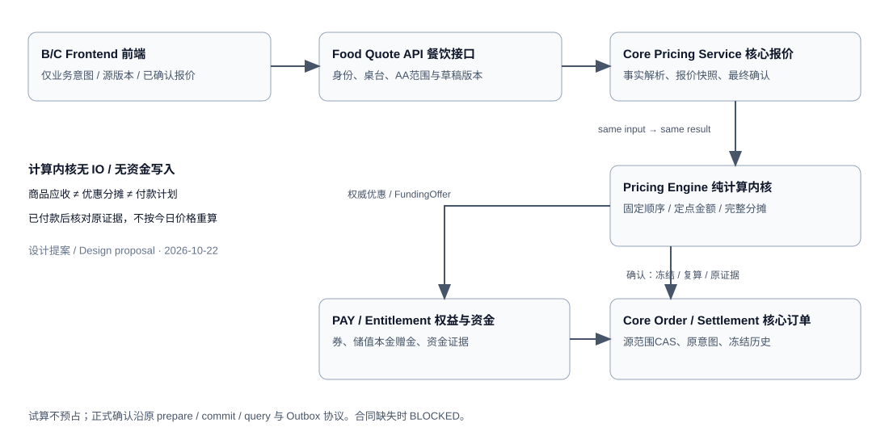

# 餐饮订单结账完整开发计划

> **税配置最新口径（2026-10-23）：** 平台统一默认、商家自主覆盖，支持EXCLUSIVE额外加税/INCLUSIVE含税倒推，无平台审核；普通订单不再以前置税登记核验阻断。原税档审核/登记来源计划由[CKO-09 C2新口径](./TDD-订单结账-CKO09种子与配置API.md#c2新口径平台默认商家自主设置2026-10-23设计待实现)取代。首版同商家门店共用配置，历史订单冻结原税配置；新合同、内部存储、管理API及共享税计算/复核Port已实现；真实发布能力证据、报价及订单落库接线待开发。

> 执行者：使用superpowers:executing-plans按任务顺序实施；每个任务完成失败测试、最小实现、验证、独立评审及范围明确的提交。不得仅因本计划存在就启动编码或声称能力已交付。
>
> 状态：CKO-01～08、09 A/B及C1已实现；09 C2.1/2/3及C2.5共享税合同已实现；CKO-10报价内部存储已实现；CKO-11A及11B1核心来源接线已实现；C2.4真实发布能力证据、11B完整报价及12～31待开发。2026-10-23，档位2；本批任务核对基线`5defdfc53`，统一分支`codex/ai-shop-codex`。历史执行记录保留，当前任务总览以§2.3为准。

**目标：** 基于原商品、订单、支付、库存及账号门店能力，实现从规则配置、报价到先付/后付、收退款、打印、日结及恢复的餐饮结账闭环，并保留零售、美业共享内核的接入路径。

**架构：** shop-base提供纯规则/定点内核和唯一SPI；shop-core.trade承担报价、经济确认及订单权威编排；餐饮五模块提供行业事实、B/C入口和结账流程。独立PAY/库存依真实typed合同接入，不在food复制账本。本文“结账”是顾客订单Checkout，不是另建供应商结算/支付清算平台。

**技术栈：** Java21、原平台Spring/MyBatis-Plus/Flyway、已有幂等/outbox/作业/审计；沿父POM，不增加规则引擎依赖或新Maven模块。

**设计依据：** [存储与Java](./TDD-统一试算引擎-存储与Java实施方案.md)、[初始规则及税费](./TDD-统一试算引擎-初始规则与结账税费.md)、[优惠组合](./TDD-三行业优惠规则-组合与多券.md)、[独立支付库存核验](./TDD-餐饮系统-独立支付库存合同核验.md)、[原后端计划](./TDD-餐饮系统-后端开发计划.md)、[API任务索引](./design/餐饮系统-开发任务对照索引.md)、[ADR-040](./ADR/ADR-040-餐饮销售配置与耗用权威边界.md)。

## L1 交付范围与顺序

后端优先，按31个任务推进。先交付内核与配置，再交付真实报价和单支付根先付闭环，之后扩展后付、现金、人工调整、AA/混合支付、储值积分及售后。打印、恢复和对账属于营业闭环，不作为最后才考虑的装饰功能。

“完整计划”覆盖全部目标，不代表所有能力一次发布。各能力独立开关、独立验收；Keeta只规划渠道合同，暂不开发真实适配；离线结账单列专项，不因未来前端能计算就允许离线扣储值或核销平台券。

## L2 里程碑



图中的共享金额权威和原资金/库存能力决定任务依赖；food负责结账范围和行业编排，不替代原账本。

| 里程碑 | 任务 | 可验收结果 | 原计划映射 |
|---|---|---|---|
| M0 合同冻结 | CKO-01 | 精确API、状态、字段、权威及能力门禁清单 | CORE-01～04、ORD-02、PAY-01～04 |
| M1 纯内核 | CKO-02～07 | 规则校验、优惠计划、金额及税计算可独立验证 | ORD-02 / E1 |
| M2 配置发布 | CKO-08～09 | 行业模板、门店覆盖、初始数据、预览/发布/回滚 | E2 |
| M3 真实报价 | CKO-10～11 | B/C读取真实菜品/套餐/配料，报价不消费资产 | ORD-02，API041/131 |
| M4 单支付根在线闭环 | CKO-12～15；营业还须24、26及31对应门禁 | 真支付/库存合同、建单恢复、先付确认可追溯 | CORE-01、ORD-03、PAY-01/02 |
| M5 现场经营 | CKO-16～18 | 后付多批次、现金当班找零、人工审批 | CORE-02、ORD-06、SHIFT、PAY-03/04 |
| M6 复杂结账及资产 | CKO-19～22 | AA、跨根混合、订金、储值与积分逐能力验收 | CORE-03、PAY-04 |
| M7 经营闭环 | CKO-23～27 | 售后、打印、日结报表、对账、三端联调 | CORE-04、RET、PRN、CLOSE、RPT |
| M8 行业与专项扩展 | CKO-28～30 | 零售/美业接入，离线能力及渠道预留 | 原M8；独立专项合同 |
| M9 发布验收 | CKO-31 | 双部署、沙箱链路、降级、恢复演练及证据 | 各里程碑按能力可分批发布 |

CKO-24/26不是必须等CKO-23才开始，详见任务依赖。此表是能力分组，不是要求把任务编号机械串行执行。

## L3 任务及实施约束

## §0 需求 → 计划对账

| AC | 要求 | 任务 |
|---|---|---|
| C01 | 行业默认、门店覆盖、强制规则及不可变版本 | 01、03～04、08～09 |
| C02 | 多券、分项、金额后折扣、真实owner资格及确定性 | 02、04～06、11 |
| C03 | 平台默认税率、商家自主覆盖、含税/价外、冻结版本及最终定税，无平台审批 | 07、09 C2、10～11、18、22～25 |
| C04 | 先付后吃与先吃后付、多批加菜、线上/线下/堂食/外送 | 11～16、30 |
| C05 | 现金实收找零、人工打折扣减抹零及审批 | 17～18 |
| C06 | AA、拼并桌、跨根、混合与订金不重复收款 | 19～20 |
| C07 | 储值/积分未来兼容，真实接线后才开放 | 21～22 |
| C08 | 退餐与财务退款分离、原行金额税费及资金退款 | 23 |
| C09 | 客单、厨房单、打印恢复、当班日结报表 | 16、24～25 |
| C10 | 幂等、UNKNOWN原键恢复、对账、权限与双部署 | 01、10、12～15、26～27、31 |
| C11 | 共享多行业内核、旧零售兼容、受控离线和渠道扩展 | 28～30 |

## §1 全局约束、状态及代码位置

### 1.1 全局约束

**2026-10-22用户确认：共用部分在现有零售及核心代码中开发，餐饮和美业调用基础能力。** 这确认实现归属，不表示所有外部合同、字段或接口已经验收，CKO-01仍先核验。

| 能力 | 权威实现归属 | 餐饮/美业职责 |
|---|---|---|
| 通用商品、SKU、价格及计价身份 | 现有商品/零售基础域 | 菜品/服务配置和源事实映射，不维护第二套商品权威 |
| 行业模板、门店覆盖、规则/公式/税运算 | shop-base.common.pricing＋shop-core.trade | 提供行业参数、资格及场景事实，不复制计算器 |
| 报价快照、应收版本、重算确认 | shop-core.trade，7张ord表 | 保存原业务引用，展示及提交获准源范围 |
| 通用范围锁、AA金额分摊、混合支付计划、订金抵付 | 核心交易能力及原资金owner | 桌台/座位/服务项目与核心份额的映射及流程 |
| 券、储值、积分、支付、库存及恢复 | 各现有权威域及唯一SPI；共享改造在原提供方 | 调用，不直接改余额、资金账或库存实存 |
| 通用打印、报表、审计与审批能力 | 原共享能力域/核心现有设施 | 行业模板、展示、事件和业务签核编排 |
| 桌台、点餐批次、厨房、配方耗用意图 | food模块 | 行业特有流程；fnb表不升格为通用金额/资金账 |
| 预约、技师、服务任务、疗程履约 | 原美业模块 | 行业特有流程；消费金额及资产确认复用基础能力 |

共享能力在原零售基础设施上做兼容扩展，不等于所有类都放进零售OrderService。纯运算归common，交易服务归trade，支付/库存/打印/报表各归原owner。行业模板差异以配置及typed事实表达；核心不能import food/美业实体或调用其私有Service。

- 新增Java遵守[平台Java规范§七](../../.claude/skills/ai-shop-dev-standards/references/java.md)：接口/实现分包、Entity完整表名驼峰、嵌套Mapper、无Repository转发；跨域接口仅放shop-base.spi，food核心不持有trade实体。
- 金额long最小币种单位、比例基点、数量BigDecimal；中间乘法检查溢出，币种精度/JSON安全整数业务上限受控。不使用double/float计算钱。
- 配置取不可变发布版本；门店不能删除强制规则。模板升级不自动追改旧订单；法定税率有效性按可信税点验证，不能靠锁旧模板延长失效税率。
- 默认最多1张折扣券＋1张金额券；活动禁券、折扣券禁储值、券后禁人工打折/抹零。人工扣减默认同人工折扣互斥，纠错有独立依据；现金找零不属于抹零。
- 试算无资产/库存写副作用；确认前同内核重验。sourceRef、durableIntentNo及原核销键稳定，quoteNo不能作为不断变化的扣款源键。
- UNKNOWN不代表失败；不能换键重扣、先释放再重占。外部调用不包在长本地事务；使用原意图/outbox及查回。
- 已应用V1～V7餐饮迁移和其他历史迁移不修改；新增迁移号执行时读取最新编号后分配。本库7张ord表归核心迁移，fnb增量归餐饮迁移；既有表不得重复CREATE。
- 用户/主体/门店/行业及税登记从可信上下文得出；C端不发布配置、不提交员工调整、不读他人quote；新权限及三语错误码同任务登记。
- food-web Controller在宿主挂载；独立food-server沿原方案只提供内部接口；通道模块不依赖food-core，平台核心不依赖food实现。
- 当前工作区多人共享；实施建立隔离工作区或明确文件归属，按任务精确路径提交，禁止整目录git add或覆盖别人修改。

### 1.2 状态分开处理

| 对象 | 基础状态/处理 | 禁止混淆 |
|---|---|---|
| 报价 | READY/EXPIRED/SUPERSEDED；经济内容不可变 | READY不是已核销或已付款 |
| 结账范围 | DRAFT/FROZEN/COLLECTING/SETTLED/CANCELLED | 只有原权威已收清且无未知份额才SETTLED |
| 收款意图 | 原表PREPARED/SENT/CONFIRMED/UNKNOWN/FAILED | 超时进入UNKNOWN；原键查询，不生成另一成功副本 |
| 部分收款 | 原范围及各支付计划分别保存 | 不给原表随意塞PARTIAL状态替代资金分摊合同 |
| 退餐/退款/厨房 | 分别推进、以原引用关联 | 厨房退菜不等于财务退款成功 |
| 日结 | 沿已有设计签核与修订 | 日结不是关闭支付回调、也不是篡改迟到资金事实 |

CKO-01核验每个提供方真实状态和迁移字段，将本表映射为明确状态机；不得仅按设计状态字符串模拟资金成功。

### 1.3 精确文件路径约定

下列前缀在任务中展开为仓库根下的实际路径；包名由src/main/java后路径唯一确定。单个任务列出的类按实际职责建文件，不生成空壳。

| 前缀 | 路径 |
|---|---|
| K | `backend/shop-base/src/main/java/ai/neargo/shop/common/pricing/` |
| KT | `backend/shop-base/src/test/java/ai/neargo/shop/common/pricing/` |
| SPI | `backend/shop-base/src/main/java/ai/neargo/shop/spi/` |
| C | `backend/shop-core/src/main/java/ai/neargo/shop/trade/` |
| CT | `backend/shop-core/src/test/java/ai/neargo/shop/trade/` |
| A | `backend-plugins/shop-industry-food/food-api/src/main/java/ai/neargo/shop/food/` |
| F | `backend-plugins/shop-industry-food/food-core/src/main/java/ai/neargo/shop/food/` |
| FT | `backend-plugins/shop-industry-food/food-core/src/test/java/ai/neargo/shop/food/scenario/` |
| W | `backend-plugins/shop-industry-food/food-web/src/main/java/ai/neargo/shop/food/api/` |
| WT | `backend-plugins/shop-industry-food/food-web/src/test/java/ai/neargo/shop/food/api/` |
| H | `backend-plugins/shop-industry-food/food-channel/src/main/java/ai/neargo/shop/food/` |

共享打印/报表现有供应者路径在CKO-01核对并登记到任务对照索引；未找到真实实现时在原能力域补齐，不在food临时造PrintService/报表账本。任务中的方法为目标合同，实施前与已有同名能力合并，不并存等义Service。

### 1.4 全局评审重点

1. 同价但券身份、税点、覆盖份额、资方不同：CKO-15要求重新确认。
2. 支付成功但绑定/outbox/打印之前进程崩溃：CKO-14/24/26原键恢复。
3. 同SKU不同份额、套餐父叶、AA拆行影响计数/税舍入：CKO-05/07/19固定身份。
4. 现金金额不足、电子超额、余额不足、无原审批：CKO-17～22不得静默转抹零/现金或切换资金源。
5. 日结后迟到回调、退款、重复事件：CKO-25/26追加事实/受控修订，不能修改历史金额以对平。

## §2 逐任务开发清单

### 2.1 每个代码任务的执行周期

每个任务的下列清单按顺序执行：先写指定测试并确认目标分支失败，再实现，然后运行目标测试、相关架构/i18n/数据库检查、必要消融，最后审查并仅提交本任务文件。缺少外部合同只允许推进不依赖它的工作，不能以成功Mock代替真实提供方营业验收。

基础命令（仓库根；JDK路径按已安装Java21核验，禁止联网解析）：

```sh
export JAVA_HOME=/opt/homebrew/opt/openjdk@21/libexec/openjdk.jdk/Contents/Home
mvn -o -f backend/pom.xml -pl shop-base -am test -Dtest=MoneyMinorTest -Dsurefire.failIfNoSpecifiedTests=false
mvn -o -f backend/pom.xml -pl shop-core -am test -Dtest=PricingConfigServiceTest -Dsurefire.failIfNoSpecifiedTests=false
mvn -o -f backend-plugins/shop-industry-food/pom.xml -pl food-core -am test -Dtest=DiningQuoteTest -Dsurefire.failIfNoSpecifiedTests=false
```

每个任务将-Dtest替换为其列出的真实测试类；查看目标模块Surefire报告，必须有目标测试实际执行的计数，不能只看BUILD SUCCESS。API、数据库和remote场景需对应模块集成测试，最后执行两个reactor完整相关验证；共享构件变化先install再验证独立food，避免使用旧.m2包。上面命令是计划，未在本轮运行。

### CKO-01 合同与规范冻结

依赖：无。关联：全部能力；先完成本项再扩运行时代码。

文件：修改本计划§6、原API任务索引、原存储/税费TDD；核验`SPI/settle/SettlePort.java`、`SPI/product/StockPort.java`、原券/储值/积分Port、`F/mapper/FoodMappers.java`及两处迁移目录。

产出：逐动作记录输入/输出、来源身份、状态、幂等/查回、owner、真实实现路径、支持部署方式、能力开关、测试证据。API041/131保留原`/stores/{storeNo}/quotes`资源，不额外注册先前候选cart quote同义路由；明确报价Service门面与原DiningOrderService的委托关系。

- [x] 对照真实源码和现有迁移，输出7张ord新表与fnb已有表字段差异、唯一约束及状态映射；不重建已有表。
- [x] 为PAY、库存、后付、AA、储值混合、积分税务、打印分别标SUPPORTED/CONTRACT_GAP/EXTERNAL_VERIFICATION_REQUIRED，附可追溯证据。
- [x] 登记权限/错误码、canonical API及类清单；未来新合同给出精确签名后再进入相应任务。
- [x] 评审字段/方法/任务映射及原零售影响，保存可执行合同基线；只提交本任务文档变化。

完成证据：[CKO-01核验收据](./TDD-订单结账-CKO01合同与字段核验.md)及[机器合同基线](./design/schema/pricing-checkout-contract-baseline.json)。仅源码/迁移核验完成，外部合同补齐与营业验证留在对应任务；当前进度见§6及CKO-02收据。

### CKO-02 定点值对象与标准事实

依赖：01。文件：新增`K/MoneyMinor.java`、`K/PricingFacts.java`、`K/PricingUnit.java`及`SPI/trade/PricingSourceRef.java`，公共来源引用仅SPI一份；新增`KT/MoneyMinorTest.java`。

接口：`MoneyMinor#add/subtract`；`PricingUnit`固定sourceLineNo/componentRef/quantityRange/taxInvoiceLineRef，qty不使用double。

- [x] 写MoneyMinorTest#rejectOverflowAndCurrencyMismatch：MAX_VALUE加1、不同币种相加均拒绝；0.1数量按受控精度计算，不静默截断。
- [x] 运行目标测试确认实现前失败；实现最小金额/事实record及边界校验。
- [x] 检查JSON安全金额上限、负数/比例/数量边界，运行测试并仅提交本任务文件。

实施证据：[CKO-02定点金额与标准事实对象](./TDD-订单结账-CKO02定点金额与事实对象.md)。新增4个record及18个测试；架构检查保留原有1处失败，详见收据，不声称全量架构通过。

### CKO-03 JSON类型化编译器

依赖：02。文件：新增`K/PricingConfigCompiler.java`、`EffectivePricingConfig.java`、`RuleDefinition.java`及有限参数record；新增`KT/PricingConfigCompilerTest.java`。

接口：`compile(template, override, systemConstraints, capabilities) → CompilationResult`；输出不可变配置及问题；无IO，不使用任意反射路径或脚本。

- [x] 写rejectUnknownEvaluatorAndInvalidOverride：未知Evaluator/路径/null、SINGLE却total=3、payableRateBp超出0～10000、门店删除强制规则拒绝；false保留、数组整替换、reset恢复继承。
- [x] 确认失败后实现字段白名单/有限参数解码/覆盖合并/编译；强制规则以代码目录核验，不信客户端mandatory。
- [x] 验证同输入编译/hash确定性；运行目标测试并独立提交。编译器无可变缓存，按不可变版本缓存由CKO-08应用服务实现。

实施证据：[CKO-03类型化规则配置编译](./TDD-订单结账-CKO03规则配置编译.md)。新增8个生产类、3个测试辅助/测试类，20个新增测试通过；可选manualOperations.minPayableRateBp落实0～10000配置边界，实际优惠计算与审批留在后续任务。

### CKO-04 规则校验器与执行证据

依赖：03。文件：新增`K/PricingRuleEngine.java`、`RuleEvaluator.java`及互斥/数量/能力/审批/阶段/守恒校验实现；`KT/PricingRuleEngineTest.java`。

接口：`validate(facts, config, candidate) → List<RuleViolation>`；每项含ruleNo/version/阶段/code/关联源项；所有适用禁止共同生效。

- [x] 写denyCannotBeOverriddenByAllow：活动+券、折扣券+储值、券+人工抹零拒绝；“允许折扣券+金额券”不能放行三者加储值。
- [x] 确认失败后实现B01～B12；实际订单活动参与事实与门店活动开关分开。
- [x] 验证EXPLICIT错误返回全部可解释冲突；校验不核销资产；消融B02必须失败，恢复后验证并提交。

实施证据：[CKO-04业务规则校验与证据](./TDD-订单结账-CKO04业务规则校验.md)。新增8个生产类及1个测试类，27项新增测试通过，shop-base全套143通过；逐份额金额证据防止跨菜品挪用及重复资助。空冲突只表示本阶段通过，税务/优惠公式/交易授权仍在后续。

### CKO-05 多券候选与份额计划

依赖：04。文件：`K/BenefitPlanSelector.java`、`CalculationPlan.java`、`BenefitSelection.java`、`KT/BenefitPlanSelectorTest.java`。

接口：`select(context, selection) → PlanSelectionResult`；EXPLICIT/CANDIDATE_POOL/AUTO_BEST、DISJOINT/BEST_ONE/受控STACK。

- [x] 写explicitCannotDropCoupon、countsAssetsAndChecksQuantityOverlap：同券跨5行计1张；两张折扣券同一份额DISJOINT拒绝，不同份额可用仍受全单上限。
- [x] 实现有界候选、稳定同价选择、根账单累计用券范围；超过复杂度限制返回PLAN_SEARCH_LIMIT，不伪称全局最优。
- [x] 验证未采用候选不核销、套餐父叶不重复；测试通过并提交。

实施证据：[CKO-05多券候选与份额计划](./TDD-订单结账-CKO05多券候选与份额计划.md)。选择器要求逐组合完整金额/分配评估，保护固定资金/人工意图；明确BUSINESS_PRE_TAX阶段，不将税前计划当作含税最终最优。具体公式/税务评估器分别在06/07接线。

### CKO-06 公式、分摊与金额守恒

依赖：05。文件：`K/PricingEngine.java`、`FormulaRegistry.java`、`PricingFormula.java`、`PricingResult.java`、`PricingInvariantChecker.java`、`KT/PricingEngineTest.java`。

接口：`calculate(PricingFacts, EffectivePricingConfig, BenefitSelection) → PricingResult`；原优惠算法版本通过获准事实/owner定义使用，不复制一套旧券权威。

- [x] 写deductThenDiscount：未税20000先减2000后9000基点得16200；DISJOINT的10000八折+5000九折得12500；受控STACK10000得7200。
- [x] 实现固定阶段、逐行基数、资方及尾差证据，原legacy分摊保持；owner不认可相同顺序/基数时阻断。
- [x] 校验行/总/券/资方守恒及确定性，并增加`CT/RetailPricingCompatibilityTest.java`验证现有零售金额/舍入/资方不变；不等到28才首次做零售回归。无税促销算例不得冒充地区税票；验证并提交。

实施证据：[CKO-06公式、分摊与金额守恒](./TDD-订单结账-CKO06公式分摊与守恒.md)。29项新增引擎测试及4项真实零售分配兼容测试通过；shop-base全套202、shop-core全套414通过。输入增加原owner有序报价/基数/资方证据，不猜旧商家分配到源行的映射；输出仍为BUSINESS_PRE_TAX，税务归07。

### CKO-07 地区税与最终定税

依赖：06。文件：新增`K/TaxEngine.java`、`TaxAdjustmentResolver.java`及TaxPolicy/TaxTreatment/TaxLineResult；新增`KT/TaxEngineTest.java`、`TaxAdjustmentResolverTest.java`；向量来自规则种子JSON。

接口：`estimate(lines, policy) → ProvisionalTaxResult`、`finalizeTax(adjustedLines, policy) → TaxResult`；固定税发票行身份，与促销份额分开。

- [x] 写inclusiveExclusiveMixedClassesAndLineRounding：未税10000加税500；含税10500拆税500；两行未税10各税1；未知税类拒绝。
- [x] 实现可信地区/税点匹配、税前/含税两模式、价格优惠与对价分类、积分/抹零后单次最终定税；不可表达gross减免拒绝。
- [x] 运行8个标准向量，验证不双减积分、不因拆券/AA重算原税、不侵入已安排S；测试与消融通过后提交。

实施证据：[CKO-07地区税与最终定税](./TDD-订单结账-CKO07地区税与最终定税.md)。26项新增测试及8个JSON向量通过；shop-base全套228、shop-core全套414通过。完整原发票行基数及冻结原税AA分配防止重复舍入；税基减免/对价/储值分开。尚未接入正式报价/税后候选择优、税档发布、实际owner或收款接口。

### CKO-08 4张配置表及发布事务

依赖：03；01字段冻结。文件：核心增量迁移、`C/entity/OrdPricingTemplate.java`等4配置Entity、现有`C/mapper/TradeMappers.java`、`C/service/PricingTemplateService.java`及impl、`StorePricingConfigService.java`及impl；`CT/PricingConfigServiceTest.java`及真实DB IT。

接口：`saveDraft(context,no,req)`、`preview(context,no)`、`publish(context,no,req,idempotencyKey)`；发布时插入revision与CAS切换指针同事务。

- [x] 写concurrentPublishHasOneWinner：草稿CAS并发仅一胜，失败无孤立revision/outbox；同幂等键异body拒绝。
- [x] 追加4表迁移、实体和嵌套Mapper，实现锁版/初始化/发布/回滚；旧revision不可改。
- [x] 真实数据库验证唯一约束、事务、空首次指针与回滚；不以H2/Mock代替目标数据库证据；验证并提交。

实施证据：[CKO-08配置发布与事务](./TDD-订单结账-CKO08配置发布与事务.md)。4表、内部Service/Mapper、幂等/发布outbox原子事务、恢复继承/升级/回滚已实现；17项真实MariaDB测试通过。API、种子导入与真实身份/能力/税档来源解析待09；既有两项守卫基线失败及实际测试数字见收据。

### CKO-09 初始数据与配置API

依赖：07、08。文件：`C/service/PricingSeedService.java`及impl、`C/api/ops/OpsPricingTemplateController.java`、`C/api/biz/BizPricingConfigController.java`、对应dto和权限/i18n目录；`CT/PricingSeedServiceTest.java`。

接口：`importDrafts(seed,registryVersion,DRY_RUN|DRAFT)`；Ops模板、B门店草稿/预览/发布/升级/回滚按原设计合同。

- [x] 写importIsIdempotentAndDoesNotPublish：20规则、3模板、2AE税档、示例门店/能力夹具不进入真实配置；同版本异hash拒绝。
- [x] 实现受控种子草稿导入、7个平台/9个门店配置API，C端无配置写入口；保留缺实际owner证据阻断。
- [ ] 按§2.3任务09-C2.1～5接通平台默认与商家自主税配置、移除税审批/登记前置门禁，校验真实授权/版本及三语；不以取消审核放开资金能力。

实施进度：[CKO-09种子与配置API](./TDD-订单结账-CKO09种子与配置API.md)。A/B种子校验与草稿导入已实现；20规则、3模板草稿、2待审核税档候选，不导入示例门店/能力。C1已补7个平台/9个门店接口及真实身份/缺证据阻断；C2按最新要求改为平台默认税率、商家自主覆盖及两种计税模式，不做平台审核；详见§2.3。CKO-09整体未完成。旧审核归属记录已被2026-10-23用户修正取代。

### CKO-10 3张报价表与快照

依赖：06～08。文件：核心增量迁移、`C/entity/OrdPriceQuote.java`、`OrdPriceQuoteLine.java`、`OrdPriceQuoteAllocation.java`、`C/assembler/PricingQuoteAssembler.java`及TradeMappers嵌套Mapper；`CT/PricingQuotePersistenceTest.java`。

接口：保存quote头/行/分摊同一短事务；factsHash、economicsHash、requestHash分别规范化；确认引用原不可变quote。

- [x] 写quoteIsAtomicImmutableAndScoped：写分摊失败整份回滚；别店/别用户quote不可读；金额不可UPDATE；时间/UUID不影响经济hash。
- [x] 实现3表及税/对价字段；quote过期、被替换与支付状态分离；有订单/意图引用不得过期物理清除。
- [x] 验证同一发票行的份额税合计、积分降价/对价字段互斥及金额脱敏；真实DB测试通过并提交。2026-10-23内部存储批次完成，见存储实施TDD收据；消费者VO脱敏和真实owner准入继续在CKO11验收，未提供公开报价API。

### CKO-11 餐饮真实事实与B/C报价

依赖：09～10。文件：`SPI/trade/OrderPricingPort.java`、`PricingSourceFactsPort.java`及typed DTO；`C/service/OrderPricingService.java`及impl、`C/port/OrderPricingPortImpl.java`、`C/api/internal/InternalPricingController.java`；`A/service/DiningPricingService.java`、`F/service/impl/DiningPricingServiceImpl.java`、`F/port/FoodPricingSourceFactsPortImpl.java`、原API041/131对应W/biz/BizDiningQuoteController.java与W/mp/MpDiningQuoteController.java；`FT/DiningQuoteTest.java`。

接口：`quote(context, QuotePricingReq) → PricingQuoteVO`、`getQuote`、`revalidate`；原quote资源读取cart/check/scope引用，不接收可信单价/税率。

- [ ] 写usesAuthorityPriceAndHasNoAssetSideEffects：时段/渠道餐牌、收费小料、套餐补差来自真实冻结版本；前端传价拒绝，不预占券/余额/库存。
- [ ] 实现事实/能力加载与纯内核、报价持久化、source版本前后检查；独立food经typed客户端调用核心，缺来源/owner能力返回BLOCKED。
- [ ] 验证B店铺与C会话隔离、乱序quote/过期/税点未确定标记、canonical接口契约及双装配；验证并提交。

### CKO-12 独立PAY普通收退款合同

依赖：01；可与内核阶段独立推进。文件：现有`SPI/settle/SettlePort.java`、`backend/pay/pay-domain/src/main/java/ai/neargo/shop/pay/client/PayInternalApi.java`、原PAY Controller/Service及`backend/shop-app/src/main/java/ai/neargo/shop/payclient/`typed适配；具体owner文件在01逐方法登记；对应PAY/provider与consumer合同测试。

接口：原`init/openPayment`、原键查询、关单、发起退款及queryRefundExecution；不以权益专用查询冒充普通支付合同。

- [ ] 写originalInstructionSurvivesTimeout：提供方成功但客户端超时，原键查询返回同一结果；错币种/错主体/不同请求hash拒绝。
- [ ] 最小扩充原typed PAY接口、鉴权、错误语义及本地/远程装配；未接事实Port不能返回假成功。
- [ ] 本地与远程相同合同测试、沙箱trace及原退款查回通过后开放独立收款；仅HTTP200/启动成功不算完成。

### CKO-13 独立库存承诺与恢复合同

依赖：01；可与12独立推进。文件：现有`SPI/product/StockPort.java`、`backend/shop-inventory/src/main/java/ai/neargo/shop/inventory/service/ReservationService.java`、`backend/shop-app/src/main/java/ai/neargo/shop/invbridge/port/InventoryStockPort.java`及核验后的内部typed通道；provider/consumer测试。

接口：原预留/提交/释放/履约及按原引用查询；后付承诺和取消墓碑沿原权威状态扩充，不能假装已支付分配。

- [ ] 写queryOriginalReservationAndRejectResurrection：预留成功响应丢失可查回；释放/取消后的迟到请求不复活库存。
- [ ] 在库存owner最小补查询/远程合同与装配，预留计量和餐饮配方耗用各沿原事实，不由quote扣库。
- [ ] 验证并发、重复、短缺、取消与履约竞争及真实隔离库/远程链；验证并提交。

### CKO-14 正式下单、批次绑定与恢复

依赖：11～13。文件：`A/service/DiningOrderService.java`、`F/service/impl/DiningOrderServiceImpl.java`、批次/核心绑定/源行分配Entity及FoodMappers；`W/biz/BizOrderBatchController.java`、`W/mp/MpOrderBatchController.java`；`FT/DiningPlacementRecoveryTest.java`。

接口：原API042/132下单、043等查询及取消；源cart版本、quote/hash、稳定intentNo、原核心订单引用。

- [ ] 写coreCreatedBeforeBindingRecoversOnce：核心创建成功本地断电，重试绑定同一核心单；相同键异请求拒绝。
- [ ] 实现短事务意图→重验报价→核心建单→绑定/源行/outbox；失败/UNKNOWN只按原源查询。
- [ ] 测数量、行金额及税费绑定守恒，取消竞争、零售待付超时保持；核验独立装配后提交。

### CKO-15 单支付根电子收款及先付闭环

依赖：14。文件：`A/service/DiningCheckoutService.java`、`F/service/impl/DiningCheckoutServiceImpl.java`、FnbSettlement/FnbSettlementItem/FnbChargeIntent对应Entity/Mapper、`W/biz/BizDiningCheckoutController.java`、`W/mp/MpDiningCheckoutController.java`；`FT/DiningPrepayFlowTest.java`、`PricingConfirmationTest.java`。

接口：原056～060、134/135/140；create/get/pay/cancel/finalize；`OrderPricingService#confirm`由获准意图调用，非C端无边界扣款API。

- [ ] 写sameAmountDifferentBenefitNeedsAck及payTwiceCreatesOneIntent：总价相同但券身份/税点/范围变更仍需确认；重复点击原意图复用。
- [ ] 实现冻结单根未付范围、同内核复算、原资产确认/PAY流程及查询恢复；支付成功事件才触发先付受理/厨房。
- [ ] 验证超时、回调乱序/重放、关单与支付竞争、0应收获准结清；原权威未收清不得finalize，测试通过提交。

### CKO-16 后付受理与多批次加菜

依赖：13～15。文件：修改核心原订单生命周期策略、`F/service/impl/DiningOrderServiceImpl.java`及原厨房受理事件适配；`FT/DiningPostpayFlowTest.java`、核心RetailOrderCompatibilityTest。

接口：获准POSTPAY接单/库存承诺/履约与追加批次；不把未支付订单调用“已支付分配”。

- [ ] 写acceptedUnpaidMealSurvivesRetailTimeout：后付获准受理且有库存承诺才派工；未付不被零售待付超时误撤，零售原超时仍有效。
- [ ] 实现先付/后付门店策略、冻结批次价及真实税点、加菜独立源、未付范围汇总；多支付根不伪合并成功。
- [ ] 测结账冻结与加菜竞争、部分收清还有新批次、取消/退餐与厨房状态独立；验证并提交。

### CKO-17 现金当班、实收与找零

依赖：15；后付现金再依赖16。文件：`A/service/CashShiftService.java`及F实现、FnbCashShift/Entry及原对应表Mapper、`W/biz/BizCashShiftController.java`、BizCashEntryController.java、`K/CashTenderPolicy.java`；`FT/DiningCashPaymentTest.java`。

接口：原068～071及获准checkout现金方式；amount/currency/shift/source intent、现金权威支付引用。

- [ ] 写cashRequiresOpenShiftAndRecoversOnce：现金应付4500、实收5000找零500；不足拒绝；未开班不能收，C电子支付不写现金entry。
- [ ] 实现当班、交班及资金支付引用幂等绑定；系统记录现金支付事实仍走原PAY合同，不只在food标PAID。
- [ ] 测权威现金已成功本地断电、重复交班/entry、负实收/电子超额不找现金；验证后提交。

### CKO-18 人工调整、审批与税额重验

依赖：07、15；现金使用依赖17。文件：`C/policy/PricingAdjustmentPolicy.java`、`K/ManualAdjustmentPolicy.java`、`W/biz/BizDiningAdjustmentController.java`及原调整/审批实体与Mapper；`FT/DiningAdjustmentTest.java`。

接口：原API061，kind/amountBasis/reasonCode/approvalRef/expectedReceivableVersion；调整发布新应收版本，不改已付事实。

- [ ] 写couponForbidsWaiverAndApprovalIsScoped：有券不能人工抹零/打折；过期/错店/错人/超额度审批拒绝；现金不足不自动抹零。
- [ ] 实现纠错、人工打折扣减、末段抹零及税务分类；明示gross/未税量纲，不可精确表达则拒绝/新quote确认。
- [ ] 测多次小额累计绕限、券后假调价、已付/UNKNOWN不可侵入及税前税后守恒；验证并提交。

### CKO-19 AA、按菜分摊与桌台变更

依赖：15～16、18；核心03子合同通过。文件：核心trade原范围/支付分配能力、`K/ScopeAllocationPolicy.java`、餐饮Checkout/Check服务及原fnb范围表；`FT/DiningSplitPaymentTest.java`。

接口：精确份额scopeRef/version、原rootScopeNo、按菜/按金额/按人获准模式；拼桌/并桌不创建新的优惠资格根。

- [ ] 写concurrentAaCannotPaySameQuantityTwice：同源行同份额竞争仅一胜；已付/UNKNOWN不可重收；两人分摊不重算原行税额。
- [ ] 实现原根范围冻结、尾差承接、券累计次数及转并拆桌保留来源；并桌不能移动已付资金。
- [ ] 测0.01尾差、同SKU不同份额、退餐与AA竞争；范围锁合同未实现模式保持关闭，验证并提交。

### CKO-20 跨支付根、混合支付及订金

依赖：19、12；原CORE-03逐能力扩充。文件：核心原收款分配/订金能力、餐饮Checkout intent/item映射、`FT/DiningMixedPaymentTest.java`。

接口：统一计划下的各root/各支付leg固定源键、quote版本、金额及原订金引用；订金抵付/取消退款合同分别定义。

- [ ] 写oneLegUnknownCannotRestartWholePlan：两leg一成功一UNKNOWN不重收成功leg；跨根已清部分保留，整体不伪标结清。
- [ ] 实现计划金额/资方/税与各根分摊、逐leg幂等恢复、获准订金应用及退款；失败补偿沿原owner，不本地改余额。
- [ ] 验证不支持跨主体/跨币种及超额抵扣拒绝，重复订金应用不发生；各子能力独立开关与沙箱验收后提交。

### CKO-21 餐饮储值接线

依赖：20及真实资金来源/部分支付合同；无合同可先完成只读禁用状态和契约测试。

文件：原`SPI`储值/权益唯一Port、PAY对应实现、核心资金适配及餐饮事实来源；`CT/StoredValueFundingContractTest.java`、`FT/DiningStoredValueTest.java`。

接口：原来源quote/prepare/commit/release/query；支持范围、币种、余额、本金赠金、授权、可部分支付必须由owner明确返回。

- [ ] 写unsupportedFoodOrPartialBalanceIsBlocked：当前CORE/SERVICE_USE全额限制不被绕过，applicableMinor不等于可扣款授权。
- [ ] 真实合同具备后接餐饮稳定source及本金赠金计划；折扣券互斥、用户明确授权、储值不减税基、不转现金找零。
- [ ] 测超时原键查回、余额变动需新确认、成功后重复提交不再扣款；沙箱证据及能力开关验收后提交。

### CKO-22 积分末段抵扣

依赖：07、18、20的资金计划合同；储值关闭且S=0时不依赖21，启用储值＋积分组合才额外依赖21。原积分来源/扣减/恢复能力须完成核验。

文件：原`SPI/points/`合同及owner、`K/PointsPlanPolicy.java`、税调整适配；`CT/PointsFundingContractTest.java`、`FT/DiningPointsTest.java`。

接口：用户opt-in、owner换算/额度、税Treatment、prepare/commit/release/query或原等效可恢复协议；不假设存在PointsDebitPort。

- [ ] 写pointsAfterStoredAndTaxTreatmentRequired：储值全额覆盖时积分0；未知积分税分类拒绝；降价积分和对价积分不双扣。
- [ ] 最小补原积分owner合同后接内核/确认；积分不侵入S及已付/UNKNOWN，不因反复quote重复预占。
- [ ] 验证并发余额、原键恢复、税调整不可表达拒绝、无接线不展示可用积分；验证并提交。

### CKO-23 退餐、原行部分退款与补偿

依赖：15、12～13；复杂分摊已启用时再依赖19～22相应能力。文件：原CORE-04/退款/库存接口、`A/service/DiningReturnService.java`及实现、原FnbReturn及行表Mapper、`W/biz/BizDiningReturnController.java`；`FT/DiningPartialReturnTest.java`。

接口：原062～064、源行数量/原分摊/已退与在途量、原退款executionNo；整单退款先支持，按菜退款另门禁。

- [ ] 写refundCannotExceedOriginalLineTaxOrFunding：分两次退税累计不超原税/优惠/资金；已在途退款份额不可再退。
- [ ] 实现厨房撤菜与财务退款独立流程、原路径原资方回退、库存归还/已耗用处理；美业在线储值冲正不因本任务默认新增。
- [ ] 测退款成功响应丢失、分账回退失败、资产释放失败、跨日及AA后部分退；未知原键恢复、对账追踪，验证提交。

### CKO-24 打印与凭证

依赖：15；现金内容依赖17，退款凭证依赖23；无需等待全部复杂资产功能。

文件：核验后的原共享打印owner及唯一Port、餐饮已确认事件适配、原065～067入口；`FT/DiningPrintContractTest.java`及打印owner测试。

接口：confirmedQuoteRef/intentNo/sourceEventNo/templateVersion/printerRef；税票字段沿原开票权威，出纸任务不能生成第二份资金成功。

- [ ] 写paymentSuccessPrintFailureDoesNotRecollect：打印失败可重试/重打但不重新付款；同事件只建一个逻辑打印任务，物理出纸不承诺网络exactly-once。
- [ ] 实现客单/税明细/实收找零/退款单/厨房单不同模板及脱敏，重打显式标识并记录原因。
- [ ] 先模拟设备协议，再实机断网/缺纸/恢复出纸验收；税票能力未具备不把普通客单标税发票，验证提交。

### CKO-25 日结、交班及经营报表

依赖：17、23～24的已开启能力；电子-only门店按对应真实资金来源验证。

文件：原CLOSE/RPT能力与报表DAO/JdbcClient体系、餐饮CashShift/DailyClose编排、源事件适配；`FT/DiningDailyCloseTest.java`及原报表域测试。

接口：门店营业日切点、冻结统计watermark、现金盘点/差异原因/签核、原资金与税分组事实；不直接查当前商品价重算历史。

- [ ] 写latePaymentAndRefundAppendCorrection：日结后迟到回调/退款不丢失，按原修订/追加事实制度追溯；重复消费不重复计收入。
- [ ] 实现销售/优惠/税净额含税/各资金/对价抵付/退款分列、盘点交班、日结差异与报表钻取；营业日不是法定税点。
- [ ] 测切点跨夜、税类汇总守恒、实收减找零与钱箱入账一致、UNKNOWN差异不静默抹平；验证并提交。

### CKO-26 恢复作业、对账与可观测性

依赖：14～15；每新增现金/混合/资产/退款能力同步补相应恢复，不等全部阶段结束。

文件：原核心/PAY/库存job与outbox执行器、`F/job/`必要的行业绑定恢复、审计/指标；`FT/DiningRecoveryTest.java`及各owner恢复测试。

接口：按稳定intent/source查询原权威、状态CAS、幂等事件、有限重试及人工处置单；不由food job直接更新支付账。

- [ ] 写crashAtEachDurableBoundaryRecovers：意图后/远端成功后/绑定前/outbox后逐点崩溃，同一业务只产生一次有效结果。
- [ ] 实现pending/UNKNOWN扫描、原键查询、差异告警、trace关联及受控补偿；无权限读取不泄露卡/审批数据。
- [ ] 验证回调乱序、重复、长时间未知、作业并发、重放后统计不重复；恢复证据通过后才开放对应资金能力。

### CKO-27 B/C/平台接口与前端联调合同

依赖：09～11；每个收款/调整能力跟随其任务完成后联调。文件：对应W入口、核心Ops/B配置Controller、`b-app/src/api/`、`c-app/src/api/`及ops-web API客户端；页面修改同步原UI清单。

接口：保留原API编号与资源；quoteNo/sourceVersion/scopeVersion/configRevision/economicsHash/expiresAt；受控错误、blockedReasons和差异确认。

- [ ] 写rejectOutOfOrderAndForeignQuote：晚到旧quote不能覆盖新选择；价相同券不同仍确认；C端伪造员工调整拒绝。
- [ ] 先交付API契约/类型和真实后端联调，再做必要结账展示；平台改税、门店改配置和顾客用券各自权限隔离。
- [ ] 验证现金/电子入口差异、未知支付提示不允许换键重付、设备切换与会话失效；端测试及vue-tsc通过后提交。

### CKO-28 零售新策略迁移与美业适配

依赖：成熟的03～11、相关资产合同。本任务做零售新策略显式迁移和美业来源适配；共享实现从02～11起就在原核心开发并进行零售兼容回归，不把公共能力留到本任务才回迁。

文件：原零售OrderService报价/确认适配、美业原服务来源适配、共享CalculationSpec；`CT/RetailPricingCompatibilityTest.java`、原美业合同测试。

接口：LEGACY_OWNER_COMPAT默认留存；新模板显式切换；美业真实SERVICE_USE源、权益次数及全额储值保持。

- [ ] 写legacyAmountsAndFunderAllocationRemainIdentical：旧零售金额/分摊/资方不变；美业余额不足不自动补现金，同服务不能双来源结清。
- [ ] 实现影子对比、差异归因、受控迁移与关闭新单开关；历史冻结quote仍可查询/恢复，不能用回滚重写历史。
- [ ] 三行业同规范向量、来源身份/权限/税及退款回归通过后分行业发布。

### CKO-29 离线估算与离线营业专项

依赖：成熟的11、17、26～27及独立边缘安全/资金/库存合同；不阻塞在线闭环。

文件：未来前端定点runtime及离线边缘模块，具体工程文件必须在本任务启动前形成独立spec并登记；当前不预建空模块。

接口：CalculationSpec版本/签名/有效期、设备身份、离线交易稳定键、同步/查重/冲突恢复；本地估算不等于可核销资产。

- [ ] 独立评审离线可售/库存承诺、现金收据、设备序列和冲突边界；平台券/储值/积分无离线授权能力就禁用。
- [ ] 先实现与Java同版本向量的离线估算，再逐项验收获准离线现金营业及恢复；本地估算明确标待后端确认。
- [ ] 测设备时钟回拨、配置过期、重复上传、双端竞争、重连价格差异及本地数据丢失；专项合同未签不得开放离线资金。

### CKO-30 外送渠道合同及后续适配

依赖：11、14～16、23、26。当前Keeta仅规划，不调用/开发真实平台适配。

文件：原餐牌渠道定义、Food事实适配及内部渠道DTO；真实Keeta客户端及webhook文件须将来获得明确接入范围后再登记。

接口：渠道餐牌/价格/配料版本、externalOrderNo幂等、平台/商家出资、税是否已含、实收及取消退款证据；平台服务费不混入顾客商品税。

- [ ] 规划channel来源事实及合同夹具，覆盖渠道差价/不同配料、重复外部单、外送税费和券互斥。
- [ ] 保证现有自营外送/H5报价与收款使用真实来源；Keeta状态保持PLANNED_DISABLED，不造沙箱成功或订单。
- [ ] 后续正式接入前另验地区/税/出资/回调/退款合同；当前完成条件是预留兼容且真实适配禁用。

### CKO-31 双部署、灰度与最终验收

依赖：所发布能力对应任务完成，且24/26/27必要门禁通过；不要求未开通专项全部完成。

文件：原food-server/shop-app装配、按任务新增迁移/配置开关、部署smoke及验收证据；回填本计划§5～6和原后端计划。

- [ ] 执行shop-app嵌入、food独立＋PAY/库存独立两种形态的真实沙箱链；禁用food时零售仍可运行。
- [ ] 演练配置升级、quote过期、支付/库存/资产UNKNOWN、进程重启、打印失败和迟到回调；新单开关关闭不阻止原意图恢复。
- [ ] 先测试门店再受控灰度；退款/日结所需能力未通过则不能宣传完整营业；数据库仅前向兼容迁移，不通过删表回滚。
- [ ] 更新每项任务状态、实际测试计数/trace、迁移号/API版本/提交及未开能力；独立审核后按已获部署授权范围发布。

### 2.2 依赖与首个可执行切片

主线：`01 → 02 → 03 → 04 → 05 → 06 → 07`；`03 → 08`；`07+08 → 09`；`06+07+08 → 10`；`09+10 → 11`；`11+12+13 → 14 → 15`。

合同支线12/13可在01后推进；打印24、恢复26、接口27随第一条收款能力进入，不等待资产21/22。后付16、现金17、调整18之后进入范围19和混合20。储值21、积分22、退款23按真实能力依赖推进；退款按已开放支付工具提供可用路径，不能先开放某资金却没有相应原路恢复/退款门禁。

初始执行顺序为CKO-01合同差异核验、CKO-02定点对象、CKO-03配置编译；以上三项及CKO-04～08业务规则、候选、公式、纯税内核及配置发布事务已完成，实际进度见§6。种子导入与C1配置API已完成；下一步09-C2商家自主税配置，随后10/11报价持久化与真实来源。此计划不授权在没有合同的情况下先写模拟成功的支付适配器。


### 2.3 当前完整待办清单（2026-10-23）

本节是任务总览，原§2.1/各CKO任务继续保存精确文件、接口及验收细节；厨房、耗用和专项功能复用[后端模块计划](./TDD-餐饮系统-后端开发计划.md)，不另建一套业务编号。未勾选表示尚未验收，不表示现有基础设施不存在。本清单不启动业务编码、远端推送或生产迁移。

#### A. 当前基线：已有能力与剩余边界

| 范围 | 已有交付 | 接下来需要做的工作 |
|---|---|---|
| 工程与桌台 | 独立/嵌入骨架、门店范围、营业策略、桌台/就餐会话及部分本地转并关系 | 带订单资金的转并拆、AA、预约订金/预点、排队及营业readiness仍须专项联验 |
| 菜品配置 | 商品绑定、口味/配料组合、固定/自选套餐、配方管理发布；存在餐牌/工位/停售配置实现 | 不重写配置CRUD；补真实价格、库存、交易冻结、制作耗用及开放前差异验收 |
| 草稿购物车 | ORD-01多端共享草稿、CAS、权限及选配快照 | 正式报价/建单尚未闭环；点餐机设备身份不能靠现有H5会话冒充 |
| 共享计价 | CKO-01～07：事实、编译、规则、多券、公式、税纯内核 | 实际来源、资产owner及正式交易调用待接线 |
| 配置持久化/API | CKO-08及09 A/B/C1；C2.1/2/3及C2.5共享税来源和计算复核已实现 | C2.4真实发布证据、CKO10/11报价及交易消费待完成 |

#### B. 第一优先：完成CKO-09 C2商家自主税配置

依赖同一TDD的[C2新口径](./TDD-订单结账-CKO09种子与配置API.md#c2新口径平台默认商家自主设置2026-10-23设计待实现)。以下按可单独验证切片执行。

- [x] **09-C2.1 配置合同及兼容编译。** 修改原EffectivePricingConfig/PricingConfigCompiler、PricingSeedValidator及对应种子/测试；定义平台默认和商家自定义来源、rateBp、INCLUSIVE/EXCLUSIVE及稳定版本。旧revision/种子摘要保持不变；新合同可读旧记录，不能把旧null税档默认为0%。验收：两种模式、0/500基点、非法范围、旧版本读取及哈希稳定。2026-10-23合同切片已实现，实际代码/测试见CKO09收据；商家设置存储及入口未交付。
- [x] **09-C2.2 默认/商家配置持久化与解析。** 核查SettingService、MchEntity及现有商家配置存储，先形成实际字段/索引/权限映射再加必要增量迁移；不复制每店配置冒充商家级权威。实现商家覆盖→平台默认，以及恢复默认、CAS、审计、稳定版本。验收：A商家变更不影响B、默认更新不覆盖自定义、恢复后继承新默认、缺配置拒绝计税。2026-10-23内部服务已实现，复用sys_setting无新表；实际事务/审计隔离及测试见CKO09收据，管理API仍待C2.3。
- [x] **09-C2.3 分端管理API与授权。** 在原core平台/商家资源及Service/Impl/Mapper规范下交付读取、保存、恢复默认，补请求响应、权限码、三语及OpenAPI。平台维护默认，商家管理自身配置，C端只读报价税明细；门店员工读权限不推导为商家级写权限。验收：跨商家/越权/伪造来源或版本拒绝，无审批流程。2026-10-23批次实现5管理API及主体属主写边界，详见CKO09批次收据。
- [ ] **09-C2.4 配置发布证据接线。** 接通PricingConfigEvidencePort与PricingAccessPolicy，移除平台税档审核及税登记的前置限制；真实税配置版本与真实资金能力仍从服务端加载。税来源Port已实现；资金就绪布尔值不足以证明叠加及多券执行能力，完整生产发布provider仍未实现。验收：配置预览/初始化/发布可用、证据稳定、原键重放不依赖owner在线；缺储值/券owner不能全能力放行。
- [x] **09-C2.5 税模式与报价合同联验。** 复用TaxEngine已有定点公式，统一价格来源含税语义及响应net/tax/gross；向10/11输出冻结的税配置来源/版本/摘要。验收：100在5%价外为105，含税为100且税4.76；逐行舍入守恒，前端临时报税率无效。已实现共享来源/试算/事实与配置复核Port；历史订单和下单变更重验在10/11/15继续验收，不因本切片而提前标完成。

#### C. 报价、库存与正式订单

| 待办 | 交付内容 | 依赖及完成标志 |
|---|---|---|
| ☑ CKO-10 报价持久化 | 3张报价表、行/优惠/税/资金分摊、有效期、不可变来源与经济摘要 | 06～08；原子回滚、隔离、冻结/保留规则真实DB通过 |
| ◐ CKO-11 真实报价API | 11A权威价格事实、11B1核心来源接线已实现；优惠券/税准入及B/C报价服务待开发 | 09 C2+10；禁止客户端定价、试算不扣资产、不扣库存 |
| ☐ CKO-12 支付合同 | 独立PAY支付/关单/退款/原键查询及本地远程同合同 | 可先做合同核验；真实提供方超时查回与沙箱通过 |
| ☐ CKO-13 库存合同 | SKU/物料数量单位精度、需求预留/提交/释放/查询、历史估值回执 | 不另建库存账；小料/套餐/配方唯一需求树及取消不复活 |
| ☐ CKO-14 正式下单 | 下单意图、报价重验、批次与核心订单绑定、源行分配、取消与恢复 | 11～13；断电重试同一核心单，确定营业日，不重扣库存 |
| ☐ CKO-15 先付后吃 | 冻结应收、确认差异、支付成功、零应收结清及受理事件 | 14；回调乱序/重复/UNKNOWN可恢复，成功后才派工 |
| ☐ CKO-16 先吃后付 | 获准未付受理、库存承诺、多批次加菜、结账冻结竞争 | 13～15；不被零售待付超时误撤，每批来源/未收可追溯 |

首个电子收款营业版本不强制依赖全部AA/储值功能，但必须包含已开放支付方式的退款、厨房履约、打印、恢复及日结证据。

#### D. 收银、人工优惠及复杂结账

| 待办 | 交付内容 | 完成标志 |
|---|---|---|
| ☐ CKO-17 / SHIFT-01～03 | 钱箱开班、备用金、非销售收支、现金实收找零、盲盘差异/交班、跨班未收责任移交 | 不足不自动抹零，电子不找现金，现金来源回执/原键唯一；先完成班次再开放现金 |
| ☐ CKO-18 | 商家人工操作原因分类、权限/额度、打折/扣减/抹零、规则冲突及新应收版本 | 券后禁用操作按规则执行；累计小额绕限拒绝；现金找零与优惠抹零分开 |
| ☐ CKO-19 / TBL交易联验 | 按人/金额/菜品AA、尾差、拼桌/并桌/转台、合拆账及带单清台 | 并发不重付同份额，已付资金不搬移，优惠根/原行税不重复生成 |
| ☐ CKO-20 | 整桌多批/跨支付根、混合支付、预约订金及抵付/取消退款 | 单leg UNKNOWN不重跑成功leg，禁止跨主体/币种拼成结清 |
| ☐ CKO-21 | 餐饮储值、支持范围、本金赠金、明确授权、原键扣减/恢复 | 与折扣券互斥沿规则；owner未支持部分支付时禁止擅自扩展 |
| ☐ CKO-22 | 积分末段抵扣、换算/上限/税分类、确认与退款恢复 | 无储值可独立验收；资产余额变更重算，积分不能重复预占或扣减 |
| ☐ CKO-23 / RET-01～03 | 未付撤菜、整单及按菜退款、套餐/配料退、原资方/原税分配与补偿 | 在途/已退不超原份额；厨房撤菜与财务退款独立；已耗原料不因退款自动返库 |

#### E. 厨房与菜品消耗（对应KIT及增强方案P3/P4/P6）

- [ ] **KIT-01 受理派工。** 按冻结工位/路由拆任务，整桌共享菜、套餐跨工位来源可追溯；仅获准先付或后付受理事件可派工。
- [ ] **KIT-02 制作/出品/上菜/交接。** 数量CAS，部分出品、外带齐套/打包、自取核销、骑手交接及签收；撤回交接/漏菜反馈补专用数量事实。
- [ ] **KIT-03 叫起/催菜/道次。** 中餐等叫、整桌齐菜；西餐按座位/道次放行；催菜不凭空增加制作量。
- [ ] **KIT-04 撤菜/重做。** 与退餐互锁，有重做来源及原因；费用、库存、制作状态分开，记录损耗。
- [ ] **P3/P4 制作耗用。** 冻结配方、选配及库存需求树；支持小数量单位、部分制作、报损/补料及替代审批；按原需求/事件幂等过账，UNKNOWN按行查询。
- [ ] **P6 耗用及成本。** 销量、理论耗用、真实领耗、损耗、历史成本分别展示；套餐收入只统计一次，缺成本显示未知；不以理论克重冒充单菜实耗。
- [ ] **GAP-08/11 KDS运行。** 工位负载、超时、拥堵暂停/恢复、授权订阅/语音/呼叫屏、断线重放及设备诊断。

#### F. 打印、日结、报表及运行保障

| 待办 | 交付内容 | 完成标志 |
|---|---|---|
| ☐ CKO-24 / PRN-01～03 | 设备绑定自检、模板路由、厨房票/加撤菜单/标签、预结/收款/退款票、补打与诊断 | 同事件一个逻辑任务，失败/缺纸/离线可恢复；重打有原号，打印失败不重收款；实机通过 |
| ☐ CKO-25 / CLOSE-01～02 | 营业日切点、预结、未收/UNKNOWN异常、盘点差异、签核、强制结转及关账后更正 | 沿现有营业时间/简单日切口径，迟到回调/跨日退款追加事实，历史签核不可覆盖 |
| ☐ CKO-25 / RPT-01～02 | 营业日报周月报、销售与实收、优惠税额/退款、餐段渠道、翻台人均、员工、菜品套餐小料、制作损耗/成本、日结台账 | 有指标口径/水位/缺口标记、门店授权导出、可重建及钻取原单；见需求J01～13 |
| ☐ CKO-26 | 支付/库存/资产/退款/耗用/打印恢复、outbox、对账差异、告警与人工处置 | 每新增一项资金能力同步接恢复；断电逐边界验证，不等全部业务完工 |
| ☐ CKO-27 | 契约、三语/RTL、各端请求响应/错误及真实联调 | 旧报价晚到不覆盖新报价，价格/券/税版本变动明确确认，设备会话隔离 |

#### G. 各端交付清单（后端优先，随对应业务开放）

| 端 | 尚需完成的交付 |
|---|---|
| 收银平板 | 桌台/无桌点餐→购物车→真实试算→先付/后付→现金/电子→退餐→打印→开交班；先接现有白底黑按钮原型，不把原型视为完成 |
| 服务员 | 开转拼桌、代客加菜、座位/道次、叫起催菜、传菜、退菜申请及授权内的收款 |
| 厨房/KDS | 工位任务、制作出品、催菜/超时、重做、打包齐套、原料耗用及断线恢复 |
| 商家运营 | 菜品餐牌/配方、渠道价格、商家税率/模式、优惠规则、门店策略、员工权限、设备/模板、日结报表 |
| 老板B端App | 多店看板、实收退款/优惠、税明细、日结差异/审批、菜品/成本分析及授权配置 |
| 顾客扫码H5/线上端 | 目录、选配/套餐、共享或无桌购物车、报价差异确认、下单/加菜、结账、订单/退款查询；自营外送/自取 |
| 点餐机 | 真实设备身份及门店授权、无桌/取餐号流程、下单支付、打印和会话重置；不复用匿名H5冒充设备 |
| 平台运营 | 系统默认税率/行业模板、能力开通、版本灰度、技术诊断及获准汇总；不审批商家税率/日常经营操作 |

#### H. 完整范围的后续专项（保留，不阻塞在线主线）

- [ ] **预约/排队（GAP-01/02）。** 预约预点修改截止、到店转正式单、订金退款、排队/叫号/过号/取消与通知；已有预约资源不等于完整交易链。
- [ ] **称重与菜品交付差异（GAP-03/04）。** 标称/实称/允差、补差确认/退菜数量精度；导入预检、行错误及结果导出按已有实现复核缺口，图片继续沿真实媒资归属，不重做已有接口。
- [ ] **赠菜/换菜/预售（GAP-05/06/09）。** 顾客确认、原新行关联、缺货替代、定时派工、产能、错单重开及销量修正；不得重复记收入。
- [ ] **收费及专项业态（SPEC-01～04及需求B10/F07～10/L01～06）。** 茶位/锅底/包材/服务费/低消、小费、发票或电子收据、企业挂账信用与账龄、器具押金/租金、自助/放题限时限量/浪费费、宴会、酒水寄存、酒店房账；先补各自来源及退款合同再启用。
- [ ] **CKO-28 零售/美业。** 旧零售不自动切新策略，影子对比后显式迁移；美业服务/权益/储值来源适配，三行业共用计算规范。
- [ ] **CKO-29 / EDGE。** 先交付与Java同向量的本地估算；完整离线点餐/厨房/获准现金另验单写者租约、持久化、配额、同步查重及冲突。离线储值/券/积分需真实授权，不能默认可核销。
- [ ] **CKO-30 / INT。** 自营H5外送先走在线主链；第三方映射/异常和渠道专属餐牌保留。Keeta当前仅规划，真实SDK/webhook/上传及订单回流不开发；其他第三方餐饮系统按明确供应商补合同。
- [ ] **CKO-31。** 嵌入core与food独立部署＋独立PAY/库存两形态，迁移/备份恢复、运行readiness、灰度、旧零售回归、故障恢复及现场设备验收；关闭新单开关仍可恢复/退款旧单。

#### I. 推荐领取顺序与统一验收

执行顺序：09-C2.1→C2.2→C2.3→C2.4→C2.5→10→11→12/13实际合同→14→15；厨房/打印/恢复/接口及基础报表随交易事实同步进入。随后16后付→17现金→18人工调整→19 AA→20混合/订金→21/22资产；23退款随每种收款方式开放前验收，不能拖到资产全做完。25日结为完整营业版本准入项；专项按场景逐项领取。

12/13可提前只读核验和补提供方合同，角色权限、三语、数据库迁移及OpenAPI纳入所属切片；不另做一轮只生成Controller/Service/Mapper的空壳工程。现有核心守卫8项基线失败须独立归因/治理，不能在发布时用“历史失败”替代实际风险判断。

每个任务关闭条件：输入输出/数据库/权限与文档对齐；业务测试和必要真实数据库/远程合同有实际执行证据；失败路径/幂等与恢复通过；生成物同步；独立范围提交。涉及支付、库存、设备的Mock成功不等于营业验收。工期在实际提供方合同及人员环境明确后估算，不为完整清单虚构日期。

## §3 任务边界及排期方式

共享内核、配置发布、报价持久化、资金/库存合同、餐饮结账、经营凭证各自为可单独评审的工作包，但依上述合同连成一条主线。不要按Controller→Service→Mapper分批开发一堆不可验收空壳。

每个任务完成独立可验证切片后再领取下一项；不预承诺日历工期，因为PAY/库存/储值真实合同、沙箱及打印硬件验收尚未完成。CKO-01结束后基于真实缺口、人员和环境给出工时范围；外部等待与开发工时分开记，不以“表已建”估算业务已完成。

## L4 验收、风险与执行记录

## §4 风险与能力门禁

| 风险 | 必须满足的门禁 |
|---|---|
| 本地可运行，远程普通支付/库存未通过 | 12/13 provider-consumer合同及真实sandbox trace，不以启动200替代 |
| 多券/税前后顺序原owner不支持 | 05/06/11按精确basis/hash阻断，保留旧零售兼容 |
| 全额储值被误作部分餐饮支付 | 21保留真实来源/币种/全额约束，未验收关闭 |
| 多根/AA在food本地拼成已结清 | 19/20必须有核心真实范围/资金分配及并发锁 |
| 总价相同却换券/税点/资方 | 15/27比较完整商业差异，重新确认 |
| 日结或打印失败导致重收款 | 24～26原键恢复；金融与凭证状态独立 |
| 大计划长期无可用交付 | 分阶段发布可报价、单根先付、后付现金、复杂结账；不同时重写零售 |

## §5 实现 → 需求验证矩阵

| AC | 必须有的验证 | 当前状态 |
|---|---|---|
| C01 | ConfigCompiler/ConfigService/Seed真实发布并发、幂等、越权 | 03/08、09 A/B/C1已验证；新税配置C2待实施 |
| C02 | RuleEngine/PlanSelector/Engine逐券、数量份额及确定性 | 04～06纯内核已验证；实际owner交易接线待11及后续 |
| C03 | TaxEngine两种公式、商家配置授权、版本冻结、AA原税与退款上限 | 07纯Java内核已验证；新配置来源及交易接线待实施 |
| C04 | DiningPlacement/Prepay/Postpay真实源与双部署链 | 待实施，原合同核验有缺口 |
| C05 | CashPayment/Adjustment权限、盘点、精确找零 | 待实施 |
| C06 | Split/MixedPayment并发、部分成功及UNKNOWN恢复 | 待实施 |
| C07 | StoredValue/Points owner合同、原键恢复、来源/税分类 | 待实施/能力门禁 |
| C08 | PartialReturn原行、原税、原资金及已退在途并发 | 待实施 |
| C09 | Print实机、DailyClose迟到事实及报表钻取 | 待实施 |
| C10 | Recovery故障注入、API授权、Architecture/i18n与双装配 | 待实施 |
| C11 | Retail兼容、美业原来源、Offline专项/渠道禁用 | 待实施；Keeta保持规划 |

每阶段需保存：实际测试类/方法与Tests run计数、必要的目标数据库IT、架构/i18n检查、关键消融结果、沙箱trace、公开API契约版本。计划检查、Mock测试、数据库已存在不能替代资金/库存/打印营业证据。

## §6 执行记录及设计 → 实现对账

本轮计划及共享归属确认已记录；后续已执行CKO-01源码合同核验、CKO-02共享值对象、CKO-03类型化配置编译、CKO-04业务规则校验、CKO-05多券候选编排、CKO-06公式与守恒、CKO-07纯地区税内核及CKO-08配置发布事务，09 A/B及C1已执行，09 C2新税配置及10～31待执行。已增加4配置表迁移并在隔离数据库验证；未在既有业务库建表、导入种子、开放报价/支付或部署。后续逐任务回填：任务编号、起止基线、实际文件/迁移/API、测试证据、提交、偏差与仍关闭的能力。原后端计划与本清单一对多映射；本清单细化结账主线，不推翻桌台、菜品和厨房的原实现记录。

本轮计划检查：31个任务编号连续且唯一、各任务含依赖/文件/至少3个未勾选步骤、共95个执行步骤；11项需求映射及本地链接、代码围栏检查通过。未运行Java/数据库/支付/库存或打印验收。

执行进度（2026-10-22）：CKO-01完成源码合同/迁移基线核验，下一步CKO-02；外部环境全部仍待验证，不因此开放交易。

执行进度（2026-10-22，CKO-02）：共享定点金额/计价份额/事实及来源引用已实现，18个新增测试通过，shop-base全套96通过；架构16项中1项基线已存在失败保留。下一步CKO-03。

执行进度（2026-10-22，CKO-03）：行业模板与门店覆盖编译、20条强制规则目录及能力/冲突校验已实现；20个新增测试通过，shop-base全套116通过，独立评审问题已修复并复查。下一步CKO-04；尚无配置发布、运行期规则执行、报价或资金接线。架构检查详见收据，不宣称全部通过。

执行进度（2026-10-22，CKO-04）：B01～B12业务阶段校验及逐份额金额/审批/owner证据已实现；27项新增测试、全套shop-base 143项通过，B02和份额余额消融均确认失败后恢复，独立评审修复并复查。下一步CKO-05；税务、正式计算公式、报价/订单资金接线仍未开放。架构基线问题详见收据。

执行进度（2026-10-22，CKO-05）：多券子集/完整分配方案搜索、固定意图保护及不可变税前计划已实现；30项新增测试通过，独立评审及容量边界复核无重要问题。下一步CKO-06；实际公式、税务、报价和资金接线仍未开放，最终回归/消融/架构证据见收据。

执行进度（2026-10-22，CKO-06）：固定公式/逐份额分摊、原owner有序证据及独立守恒复核已实现，复用原CouponCalculation；新增29项引擎及4项零售兼容测试，全套shop-base 202、shop-core 414通过。三项保护消融后恢复，独立评审修复并复查。下一步CKO-07；税务、报价/订单/资产接线仍未开放。架构原有失败详见收据。

执行进度（2026-10-22，CKO-07）：纯地区税预估/最终定税、逐行分类/精确减免、固定付款上限及原税AA分配已实现；26项新增测试、8个JSON向量及3项消融通过，独立评审修复并复查。全套shop-base228、shop-core414通过。下一步CKO-08；税档发布/报价持久化及正式资金接线仍待实施，架构基线失败详见收据。

执行进度（2026-10-22，CKO-08）：4表及模板/门店内部Service、原子发布/幂等/outbox、锁版初始化、恢复继承、升级草稿和新版本回滚已完成。17项一次性MariaDB实际全绿，事务消融有效，core完整回归通过；架构与schema合计24项有2项已复现历史基线失败。下一步09，正式权限/真实来源与API仍未开放。


### CKO-10执行细化（2026-10-23，批次开发）

顺序裁决：C2.4需要真实结账owner协议，旧CouponPort单次allocate和PAY就绪布尔值不能证明prepare/commit/query/退款及新版组合能力；不新增伪造生产证据provider。CKO10原依赖06～08，可独立实施，不等待未接资金服务。采用executing-plans；遵从用户多阶段开发编译、统一测试要求。

§0 AC：Q01三表同事务、幂等及失败全回滚；Q02按MAIN/主体/门店/消费者范围读取；Q03金额/源/税/分摊不可变，变更创建新报价；Q04逐原发票行税总额/分摊守恒，积分降价和对价互斥；Q05来源事实、意图、经济摘要独立规范化，随机No和时间不进经济摘要；Q06过期/替代与支付分离，被原意图/订单引用的报价保留，无物理删除入口。

§1复用：ord_同库、BaseEntity、TradeMappers嵌套Mapper、IdempotencyService、TransactionTemplate、BizKey及TaxEngine。增量V550三表，不回写旧迁移。无新Controller/权限、无资产/支付/库存写调用。

§2阶段：A先实现三表/实体和闭合typed报价输入及纯快照装配器，编译；B实现保存/读取/替代/引用服务及明确租户/门店/消费者SQL谓词，编译；C添加一次性MariaDB原子性、隔离、不可变、并发幂等及行税守恒测试，统一核心/原生/宿主及生成物验证，最终批次评审。内部合同不得直接作为C端VO，提供方证据留后端；CKO11负责真实source owner、税点、优惠资格、敏感字段裁剪及HTTP鉴权。

代码：trade.dto.PricingQuoteCommands、trade.assembler.PricingQuoteAssembler、trade.entity.OrdPriceQuote/Line/Allocation、trade.service.PricingQuoteService及impl、TradeMappers三个嵌套Mapper、PricingQuotePersistenceTest。快照仅来源typed records，不接受任意JSON；当前冻结商家税模式与原发票行金额，使用TaxEngine校验逐发票行税合计；基础金额有符号调价之外均非负且JSON安全，资金计划不等于扣款。现金找零仅保存意图，不启用现金营业。

生命周期：保存READY，有效期1～300秒、服务器UTC毫秒；过期读取EXPIRED，替代需同主体/门店/消费者及源根，引用仅READY未过期时允许且按原reference幂等。已引用不可替代，无清理/物理删除入口。hash按字段名递归排序、数量去多余零；经济hash排除报价No/创建/过期时间但包含源身份/配置版本/税源/业务金额和计划，不能因同金额不同优惠/资方而相同。


### CKO-11A 餐饮权威价格事实（2026-10-23，执行细化）

沿现有需求及ORD01/CAT餐牌选配套餐方案，采用executing-plans；按用户多阶段开发编译后统一测试。本批独立完成后台价格事实层及本地/远程同合同，不新增公开报价HTTP、不放行未核验券/储值，不提前标CKO11全部完成。

§0 AC：F01从获准购物车读取，不收前端单价；F02当前餐牌/时段/渠道、选配与套餐冻结版本必须匹配；F03主品、小料/组合配料销售SKU、套餐INCLUDED/ADD_SKU/DIFF_BASE分开计价，不重复父子收入；F04源哈希包含版本/真实价格/依赖/选择，不含读取时钟和访问凭证；F05读购物车和目录/价格前后复核变更冲突，来源故障不变0；F06B门店主体与C原会话/买家权限复用CheckCartService；F07嵌入式及独立food提供同typed内部服务，原token过滤先于解析，远端必须校验来源作用域/版本/摘要和金额，暂不作为C端返回值。

§1复用：CheckCartService、CatalogService、CartLinePolicy、DishOfferQueryPort、SalesRestrictionService、StoreCardQueryPort、FoodAutoConfiguration/ServiceCalls/InternalHttp。当前DishOffer提供方仅LOCAL/CNY且没有历史价格revision；冻结真实值内容hash作为价格内容标识，不冒充历史目录版本。外送真实渠道/未知价、预约未来时刻、称重仍阻断；不因报价读取预占或写库存/券/资金。

§2批次：A闭合DiningPriceFacts DTO和可重用SourcePriceMath、DiningPriceFactsPolicy纯校验/组成投影，编译；B DiningPricingFactsService/Impl，复用现有购物车授权，当前目录及SKU提供方前后内容校验；在food-core装配、food-server token保护的两个typed内部路由和food-web Remote适配，编译；C纯政策、服务权限及变更、实际HTTP/token/严格输入、远端损坏响应校验与双装配统一回归、消融和最终评审。

金额：组件数量=父点餐数量×选择数量×每选项单位；组件金额按最小货币单位HALF_UP一次，主品/收费组件分别汇总；共享SourcePriceMath计算乘法和非负补差。DIFF_BASE=max(选项SKU价−同范围基准SKU价,0)，不自动给予负补差；INCLUDED为0且只记录组成。父点餐行及其配料/补差保留同一原发票行身份，供核心统一计税；不在本层拆分税行或计算优惠/税。

输出schema1冻结entity/store/cart/sourceVersion/subject、真实价格来源、pricedUnits与composition/dependencies、sourceHash；不含accessToken/伪造税率/资金资格。staff匿名散客subject可null；C匿名用户必须绑定原session业务No，不能用null跨会话。前后复核是乐观读取稳定性验证，不是跨服务事务或资产确认；CKO11B/14仍须在保存/下单前后重验，过期、已付AA和历史退款不得仅凭本事实执行。


#### 11A 合同与代码落点

前端仍不上传可信价格；本批只提供服务内部两条 POST 合同，沿用 `InternalHttp` 服务令牌过滤，不对公众开放。B/C 公开 quote API 属于 11B。

| 服务方法 / 内部路径 | 输入 | 输出 / 失败语义 |
|---|---|---|
| `staff` / `/internal/food/pricing-sources/cart` | `entityNo, storeNo, cartNo`（各≤32字符）、`expectedVersion`（必填整数，≥0且小于Long最大值） | `DiningPriceFacts`；门店主体及购物车范围复用原B业务校验；staff的subjectNo为null |
| `customer` / `/internal/food/pricing-sources/customer-cart` | `cartNo, expectedVersion, access{sessionNo?, accessToken?, buyerNo?}` | 复用原C购物车认证；subjectNo优先原授权会话，省略sessionNo则使用持久化会话；token不进入输出 |

返回 `schemaVersion=1, payload, sourceHash`。payload含主体、授权subject、已保存cart及version、菜单发布引用/依赖摘要、冻结SKU归属、当前Offer、限售与实际组件用量、无读取时钟的Composition投影、currency和amountMinor。Composition提供当前已选餐牌的菜单/选项/套餐定义，既用于本地组价，也供接收端逐项重建；不得把摘要当签名或资金资格证明。sourceHash使用稳定对象键顺序和规范化小数，数组保留业务顺序，不含asOf或访问凭证。2MB上限。

失败：400参数/原选配非法；403范围无权；404原购物车/会话不存在；409购物车或价格版本变动；503（业务码40190）真实来源不完整、币种/业态不支持或远端回执非法。对跨读取范围变化采取乐观冲突检查；读取结束后的变化仍须由11B/14在报价保存和最终下单时再次确认。

代码：共享 `common.pricing.SourcePriceMath/PricingSnapshotHash`；food-api中的DTO、`DiningPricingFactsService`、`PricingSourceInternalApi`与共享纯政策；food-core的`DiningPricingFactsServiceImpl`显式装配；food-server的`InternalPricingSourceController`；food-web的`RemoteDiningPricingFactsService`。`CartLinePolicy`仅移动到food-api供两端复用，包名与原校验逻辑保持一致；没有新增数据库表或Mapper。数量、金额的乘法和HALF_UP归共享地基，餐饮选配与套餐语义留在餐饮包。

审查处置：增加“原购物车仍含收费选择但回执删除组件”和“DIFF_BASE错误改为0，重算摘要”的校验；接收方必须重建完整组件集合、数量、价格、组件引用，而非仅验证现有金额相加。QR目录查询同步原购物车的session回退规则。新增装配开关/显式实现覆盖、严格JSON和真实HTTP回执测试。

下一步11B：将本价格事实适配到共享PricingFacts和原发票行映射，接入真实规则/税配置与已核验的券/资金owner能力，走统一纯引擎和CKO10不可变报价存储，再提供B/C报价、查询和复核接口。仍未核验的券/储值能力保持BLOCKED；CKO11整体、普通支付与下单闭环尚未完成。


#### 11A 本批验证结果

- 分阶段编译及餐饮全模块clean后统一测试：549项，503项实际通过、46项数据库条件跳过；随后临时MySQL回归将对应数据库场景实际执行，餐饮19项主库＋290项业务守卫＋9项独立服务/内部接口＝318项通过且无跳过，另原商品属性提供方4项通过。临时容器已删除；未连接业务数据库。
- 共享shop-base完整265项通过。宿主food-embedded装配6项（5通过、1仅standalone执行而跳过）、food-standalone装配6项全部通过；新服务的本地/远程类路径隔离与显式实现覆盖已验证。
- 宿主选定守卫40项：31通过、1条件跳过、8失败。Architecture的7条失败消息与既有基线逐字相同；SchemaDrift的1条缺列集合与基线相同，仅输出顺序不同；不将宿主全套宣称为通过。
- Node交付/定价生成9项、Python定价合同4项及交付4项通过；SQL与Ops出口守卫无新增欠账，暂存diff空白检查通过。价格漂移消融测试在移除复核后按预期失败，恢复后通过。独立审查的两项问题均已复现并修复。
- 本批修复原生独立服务测试的过期固定日期：原先写死2026-10-22的“未来策略”在当前日期已生效，改为当前时间＋2日、毫秒精度；保留幂等键内容变更冲突验证，不改业务策略逻辑。

本批只做本地统一分支提交；无新表/业务迁移、公开报价接口、资金能力放行、部署或远端推送。后续任务总览继续保留11B及12～31待办。

### CKO-11B1 核心价格来源接线（2026-10-23）

§0 范围：依据CKO-11及ORD01的权威来源与原发票行约束，将11A价格事实通过共享SPI提供给核心。现有GoodsCatalog事实尚不包含优惠资格/商品税分类；C2.4也没有完整生产资金能力提供方。本批不把这些缺失值解释为可优惠或免税，完整B/C quote接口仍属于后续11B。

验收：S01核心不依赖food包，按sourceSystem唯一注册提供方，缺失/重复提供方阻断；S02餐饮适配复用11A的B/C购物车授权和严格来源校验；S03共享PricingFacts保留原价/数量/版本，INCLUDED组成保留为零、仅不进入收费单位，不重复套餐收入；S04每个原点餐行的全部收费组件属于同一原发票行，完整basis必须守恒，不能按配料重新创造发票行；S05来源与共享投影分别保留摘要，主体/门店/会话/版本及单位集合均校验；S06确认重新鉴权和读源，再对比摘要，失效/变化冲突，不凭旧摘要恢复权限；S07嵌入式及独立调用共用同一适配，令牌不进入摘要/事实；S08不写订单/库存/资金，不生成最终报价或推断税分类/优惠资格。

§1 合同：新增`PricingSourceFactsPort`及typed Scope/Credentials/Snapshot/Component/InvoiceBasis；共享策略验证单币种、DECIMAL(20,6)、金额乘法、组件唯一性和完整原发票行basis。`PricingSourceService`负责唯一owner路由、结果范围验证及read/confirm。餐饮`FoodPricingSourceFactsPortImpl`位于food-web，依赖`DiningPricingFactsService`（embedded本地、standalone远程），由既有FoodWebAutoConfiguration显式装配；纯映射留在food-api，不引入core实现依赖。

§2 执行：A共享SPI与校验、核心Service/Impl，公共模块编译；B餐饮纯映射与适配及双形态装配，餐饮编译；C统一执行金额/发票行/权限/版本/摘要损坏/owner路由与双形态回归、消融、最终独立审查及本地提交。遵从用户先开发编译、多阶段后统一测试的节奏。

§5 待记录真实命令与结果。无新表、Mapper、公开端点或权限码。仅支持MAIN、FOOD/CART、完整OPEN购物车；AA/已付/部分范围/历史退款依然需要后续独立合同。


11B1清单口径：共享来源SPI的实现由food-web行业插件提供。分层清单生成器原来只在backend查找实现，会将它误报为无实现；已让实现查找同时扫描backend-plugins（排除test/target），模块/域的数量仍保持backend原统计面，不增加虚假的默认provider或人工忽略项。


#### 11B1 交付合同与验证

`PricingSourceFactsPort`是backend-only Java SPI，不是HTTP请求或授权对象。`Scope(tenantNo,entityNo,storeNo)`必须来自已解析的服务端B权限上下文；构造Scope不授予权限。C端凭证`Credentials(sessionNo?,accessToken?,buyerNo?)`每次交给原餐饮服务鉴权，toString脱敏，不进入任何快照。当前仅MAIN、FOOD/CART、完整购物车，scopeNo/scopeVersion必须为空。

| 方法 | 输入 | 输出/结果 |
|---|---|---|
| `PricingSourceService.staff` | Scope、PricingSourceRef | 唯一来源owner重新读取并鉴权，返回共享Snapshot；staff的subjectNo为null |
| `customer` | PricingSourceRef、Credentials | 返回原授权会话绑定的Snapshot，未提供session时沿原购物车会话回退 |
| `confirmStaff` / `confirmCustomer` | 原读取参数、expectedSnapshotHash | 重新鉴权、重新读取来源后比较共享摘要；变化409，原权限/会话错误保持原业务失败 |

Snapshot：`schemaVersion=1, scope, subjectNo, source, channel, prices, composition, invoiceBases, snapshotHash`。prices为共享PricingFacts（currency、原sourceSnapshotHash、sourceVersion及完整收费units）；composition保留全部组成，其中BUNDLE_INCLUDED必须为0且不进入收费units。invoiceBases逐原发票行列出完整portions与amount。金额、币种、正数量、无重叠/重复、基准总额、版本与作用域全部复核；共享snapshotHash绑定投影内容，和原餐饮sourceSnapshotHash各自保留。两种摘要都不代替授权、优惠资格、合法税分类或资金能力。

失败：参数非法400；无唯一提供方、来源类型未支持、回执非法40190；陈旧摘要409；来源权限/会话/购物车冲突按原异常传播。无owner不回退另一个提供方，也不生成零价事实。该服务不缓存权限，不保存报价/订单，不触达支付、券、储值或库存写接口。

| AC | 验证落点 |
|---|---|
| S01 | PricingSourceServiceTest.unknownOrDuplicateOwnersNeverFallBack、retailSpringAssemblyBootsWithoutAnyIndustryOwner |
| S02/S06 | routesStaffScopeAndFreshlyReauthorizesOnEveryConfirmation、customerConfirmationPreservesOriginalSessionAndToken、FoodPricingSourceFactsPortTest.originalAuthorizationFailureIsPreservedWithoutProjectionFallback |
| S03 | DiningPriceSourcePolicyTest的配料/组合配料及三类套餐场景；PricingSourceFactsTest.preservesZeroIncludedCompositionAndOnlyChargesMainAndAdditions |
| S04 | PricingSourceFactsTest.originalInvoiceRoundsTaxOnceAcrossMainAndAddon；餐饮原发票行映射消融 |
| S05 | PricingSourceFactsTest的金额、重复组件、basis篡改、范围/会话/版本/摘要测试；PricingSourceServiceTest.malformedScopeAndVersionReceiptsFailClosed |
| S07 | FoodPricingSourceFactsPortTest双部署装配、RemoteDiningPricingFactsTest实际HTTP经共享适配、FoodEmbeddedWiringTest宿主双类路径 |
| S08 | 独立审查确认无新增资金/库存/订单写依赖或默认资格；未新增表、Mapper或公开接口 |

代码落点：shop-base新增`spi.trade.PricingSourceFactsPort/PricingSourceFacts`；shop-core新增`trade.service.PricingSourceService`及impl；food-api新增`policy.DiningPricingSourcePolicy`；food-web新增`port.FoodPricingSourceFactsPortImpl`及显式装配；既有原生11A内部HTTP不改合同。对应测试、宿主类路径守卫及生成清单已同步。本批是计划CKO-11的来源适配部分，`OrderPricingService/OrderPricingPort`与B/C公开quote仍待真实准入合同闭合后实现。

验证：分阶段核心/餐饮编译成功；共享基础272项通过；核心551项中495实际通过、56原数据库条件跳过（完整核心回归后额外核验无行业owner的Spring装配）；餐饮555项中509实际通过、46原数据库条件跳过。本批无数据库逻辑变更，未重复原生数据库批次，也不将条件跳过计为通过。宿主embedded装配6项中5通过/1仅standalone执行而跳过，standalone6项全部通过；新增来源测试在最终宿主reactor再次实际通过。宿主选定40项31通过/1条件跳过/8失败，Architecture7条消息与基线逐字相同，SchemaDrift1条缺列集合相同，无新增失败。

Node交付/定价生成9项、Python配置合同4项及UI交付合同4项通过；SQL/Ops出口守卫无新增欠账；分层/词典/索引/餐饮清单均由生成器生成。消融将餐饮taxInvoiceLineRef改成componentRef，原发票行测试由1行变2行按预期失败，字节恢复后完整餐饮回归成功。最终独立审查无待修或minor项。

下一步：11B2闭合实际优惠资格/活动事实、券与资金owner能力及有效配置读取，再接统一规则/公式/税计算与CKO10报价存储，提供B/C报价/读取/复核。CKO11整体保持未完成；无新金融能力放行或远端推送。

### CKO-11B2A 当前规则与报价上下文准入（2026-10-23）

§0 本批闭合11B2中的有效配置读取/准入及与11B1事实、既有商家税配置的绑定。旧活动/券合同仍不能证明餐饮多券、储值组合的完整执行能力，不新增生产假证据提供方。R01只读取同MAIN/主体/门店/行业唯一ACTIVE头指向的不可变schema3版本；R02从原模板冻结定义＋原覆盖重新编译，校验有效定义、语义hash、引擎与规则目录版本；R03真实owner证据必须唯一、同范围、稳定引用、非空来源、有效且≤5分钟，无证据/能力不足阻断；R04读取期间配置头变化冲突，草稿变化不改现行规则；R05报价准备从原source鉴权读取，绑定规则、能力、商家税配置，前后复核变化冲突；R06确认重新完成鉴权/来源/规则/税读取，旧摘要不续权；R07上下文仅后端使用，不是报价、不计算优惠、不扣资产/库存，无新表/公开接口。

§1 核心新增PricingRuntimeConfigService/Impl与纯PricingRuntimeConfigPolicy；复用ord_store_pricing_config/revision及ord_pricing_template_revision Mapper。PricingPreparationService/Impl组合PricingSourceService、PricingRuntimeConfigService、PricingTaxSettingPort，按来源system对应FOOD/RETAIL/BEAUTY_SERVICE行业，不收客户端行业/税率/能力。返回只读Prepared，保留原Source与投影hash、规则快照、真实owner证据和MerchantTaxSnapshot；不推断商品优惠资格/税分类。core保留跨行业共享能力，food不复制规则。

§2 A实现当前配置准入、编译；B组合source/config/tax与复核、编译；C统一做纯校验、来源重新鉴权、税/规则/owner变化以及真实MariaDB范围/版本读取测试、消融、完整核心和宿主守卫、一次独立评审及本地提交。遵从用户分阶段开发编译后统一测试。

§3 后端 Java 合同（非HTTP，客户端不能直接构造已授权Scope）：

| 类 / 方法 | 输入 | 输出 / 校验 |
|---|---|---|
| PricingRuntimeConfigService.resolve | authorizedScope(tenantNo,entityNo,storeNo)、industry | RuntimeConfig：scope/industry、configNo/revisionNo/revision、templateRevisionNo、engineSpecVersion/ruleCatalogVersion、EffectivePricingConfig、真实Evidence、snapshotHash |
| PricingRuntimeConfigPolicy.verify | 冻结门店revision、原模板revision、真实PricingCapabilities | 重编译EffectivePricingConfig；严格拒绝重复JSON字段，规范化对象键/排版后核验原语义hash，内容变化仍拒绝 |
| PricingPreparationService.staff | 服务端已授权Scope、PricingSourceRef | Prepared：完整授权Source、RuntimeConfig、MerchantTaxSnapshot、expiresAt、preparationHash |
| customer | PricingSourceRef、Credentials | 原来源owner每次执行C端鉴权；Prepared不含凭证 |
| confirmStaff / confirmCustomer | 原读取参数、expectedPreparationHash | 完整重新读取后比较，不使用旧摘要恢复已撤销的权限 |

Evidence必须有稳定reference/expiry与来源版本；同一owner身份出现不同版本也拒绝。源引用集合与旧schema2税档集合排序后入摘要，排列变化不造成假冲突。Prepared摘要绑定source.snapshotHash、规则快照（含能力/证据）、完整商家税快照与到期时间；税快照包含managedVersion，税率不变但继承/覆盖版本变化也冲突。读取时间不参与摘要。上下文没有优惠金额/税计算/最终应收价，也不授予下单权限；后续落单必须再次复核。

失败：输入非法400；来源原授权失败原样传播；无唯一当前配置/唯一真实owner、schema/范围/版本目录不兼容、内容篡改、证据过期或能力下降40190；前后版本或预期摘要不一致409。禁止在已有数据库事务内调用，避免持锁访问跨owner。只读乐观复核不能代替未来落单时的最终校验。

§4 验收映射：R01/R04→PricingConfigServiceTest新增三项真实MariaDB测试（草稿隔离、门店隔离/有效hash篡改、owner读取期间活动指针切换）；R02/R03→PricingRuntimeConfigServiceTest（冻结输入重编译、schema/目录版本、证据缺失/多实现/异范围/过期/冲突版本、能力下降、语义排版稳定）；R05/R06→PricingPreparationServiceTest（来源/规则/税变更、managedVersion、旧摘要不续权、C端凭证透传、拒绝前不读取税配置）；R07→独立只读审查及宿主装配/架构守卫。

§5 验证结果：两阶段开发编译成功；共享基础272项实际通过；核心572项中513实际通过、59原生数据库条件跳过，无失败。临时MariaDB统一59项实际通过、0跳过（配置发布23、种子8、商家税18、报价存储10），运行后确认只删除本次临时容器，不连接业务数据库。18项新增纯/服务测试覆盖上述准入和准备上下文；新增3项真实数据库测试归入配置发布23项。

宿主选定40项：31通过、1条件跳过、8既有失败；Architecture7项失败消息与基线逐字一致，SchemaDrift1项缺列集合与基线一致，无新增失败。Node交付/定价生成9项、Python配置合同4项及UI交付合同4项通过；SQL/Ops守卫无新增欠账，分层/词典/索引生成完成。

消融：临时删除effectiveHash比较，篡改摘要测试按预期失败；字节恢复后完整核心回归通过。JSON等价排版测试先失败、规范化校验后通过。最终一次独立审查发现owner回调继承数据权限绕过：即便尚无生产provider，也作为共享基础设施边界问题处理；新增回归先失败，随后将绕过收窄到三个显式限定范围的Mapper查询，完整核心/原生数据库再次通过。无未解决审查项。

本批不新增表/迁移/公开API，也不实现真实资金能力。C2.4实际生产owner能力、优惠资格/活动事实与完整11B quote仍待后续合同闭合；Prepared仅供后端准备，不能作为资金、下单或税分类授权。下一步先闭合真实owner及活动资格合同，再组合统一规则/公式/税计算、CKO10快照存储和B/C报价接口。


### CKO-11B2B 商品优惠参与与税分类（2026-10-23）

§0 依据[餐饮完整需求§5.1](../requirements/餐饮系统-完整需求文档.md#51-菜单与报价ab组)：11B2需要真实商品资格与税分类，既有prd_goods/prd_sku及GoodsCatalogQueryPort只证明归属，不含这两个事实。依据本文CKO11、11B1-S08及用户“先排除不参与活动商品”“商家自主管理税配置”的要求补齐显式配置。P01同MAIN/主体/门店的实际CN SKU才能配置；P02未配置不默认可优惠/标准税/免税；P03商家指定promotionEligible及明确TaxClass（STANDARD/ZERO_RATED/EXEMPT/OUT_OF_SCOPE），税率/含税方式仍来自原税设置；P04读写按原B权限/门店上下文、版本并发及原键重放，归属变更阻断；P05内部批量查询严格覆盖请求SKU、返回真实版本/稳定摘要；P06报价准备绑定当前商品策略，前后复核及确认重读，变化409；P07不改变商品基础价格/库存/销售，不把配置当法定税务认证或活动命中证明。

§1 存储：V551新增prd_sku_pricing_policy，沿BaseEntity，policy_no稳定业务键；tenant_no/entity_no/store_no/goods_no/sku_no、promotion_eligible、tax_class、version及审计字段。唯一(tenant_no,entity_no,store_no,sku_no)，不复制价格。缺行即未配置；不做批量默认回填，不执行业务库迁移。稀疏扩展表适用于餐饮主菜、小料与套餐收费组件的实际SKU，其他行业复用。

共享商品域新增PrdSkuPricingPolicy、ProductMappers.SkuPricingPolicyMapper、dto.GoodsPricingPolicyCommands、GoodsPricingPolicyService/Impl、GoodsPricingPolicyAccessPolicy、BizGoodsPricingPolicyController；shop-base新增spi.product.GoodsPricingPolicyPort与严格快照校验工具，商品域port实现。复用GoodsMapper/SkuMapper、IdempotencyService及原transactionManager。规则/税运算不复制到商品域。

§2 A完成扩展表、商品服务和严格只读Port后编译；B完成B接口、OpenAPI及后端先行清单、报价准备策略绑定后编译；C统一验证真实数据库创建/更新/幂等/隔离/并发与源归属、严格快照及准备流程版本变化，核心/宿主/合同守卫、消融、一次独立评审后本地提交。沿用户编译优先节奏。

接口GET/PUT /biz/goods/{goodsNo}/skus/{skuNo}/pricing-policy，复用STOCK权限及真实当前门店/主体，写入另要求商家老板身份；请求不能提交身份。PUT输入expectedVersion(0仅首次)、promotionEligible(必填Boolean)、taxClass(明确枚举)、Idempotency-Key；返回policyNo/goodsNo/skuNo/version/配置内容，缺配置GET404。创建version=1，更新CAS+1，旧版本409。每次入口重新验证用户/门店授权，幂等键只重放原作用域/用户/请求。

GoodsPricingPolicyPort.resolve(Scope,List<SkuRef(goodsNo,skuNo)>)只读，限制1..512个不同SKU，缺项/非法/不支持税类阻断40190；返回同scope、每SKU的policyNo/version/promotionEligible/taxClass与snapshotHash，不含价格、权限凭证。配置由真实商品表校验归属；摘要排序后稳定，不是授权。

§5 验收与真实执行结果：

| AC | 测试 / 检查 |
|---|---|
| P01/P04 | GoodsPricingPolicyPersistenceTest.foreignStoreGoodsSkuAndMarketCannotReadOrWrite、currentOwnershipIsRequiredEvenWhenAnOldPolicyExists、idempotentReplayStillChecksCurrentProductOwnership；GoodsPricingPolicyApiTest四项真实method-security/请求测试 |
| P02/P03 | absentPolicyNeverReturnsACompatibleDefault、invalidTaxAndFailedCreateCannotLeaveAReceiptOrImplicitDefault；GoodsPricingPolicyFactsTest四项严格事实测试；严格请求/JSON Schema测试 |
| P04 | createsUpdatesAndReplaysOriginalResponseWithoutChangingPriceTables、changedRequestAndOldVersionCannotReplaceCurrentPolicy、concurrentEditsCommitOnePolicyAndOneSuccessfulReceipt |
| P05 | completeBatchAndStableOrderingAreRequired、exactScopeAndCompleteGoodsSkuSetAreRequiredEvenWithAValidDigest、duplicateSkuConflictingOwnersAndUnsafeIdentitiesAreRejected |
| P06 | PricingPreparationServiceTest.missingOrForeignCatalogPoliciesNeverDefaultToPromotionOrZeroTax、catalogVersionChangeConflictsEvenWithUnchangedEligibilityAndTaxClass；原8项准备测试继续通过 |
| P07 | 一次独立只读审查；宿主结构/权限/装配守卫与既有基线比较；无价格/库存写入依赖 |

两阶段开发编译成功；共享基础276项全部实际通过，完整核心587项中519实际通过、68原生数据库条件跳过，无失败。临时MariaDB统一68项实际通过、0跳过（原配置23/种子8/税设置18/报价存储10＋商品策略9）；运行后确认删除仅本次临时容器。新策略用独立_product临时schema，不改已有套件夹具或连接业务库。

独立审查1项Important：原幂等回执重放跳过商品归属检查。新增真实DB测试先失败（预期异常未抛），修正普通重放和锁冲突恢复路径的归属复核后，68项原生与完整核心回归通过；原策略普通更新后仍重放原响应。无待修或deferred minor。消融去掉商品策略snapshotHash比较，篡改摘要测试按预期失败；字节恢复后完整核心通过。

宿主选定40项31通过/1条件跳过/8既有失败，Architecture7项消息逐字等于原基线，SchemaDrift1项缺列集合一致。Node9项、Python OpenAPI合同5项及交付合同4项通过；正向B/C契约无新增缺口、SQL/Ops守卫无新增欠账。本批14个定价B端后端先行登记均有效，含新增2个商品策略接口。全局B/C孤儿守卫仍因既有权益清单c-app GET /mp/stored-value/stores已接入却仍登记而失败，使用HEAD原权益清单可重现；本批不修改其他业务清单或抑制该失败。

§6 实现对账：

| 模块 / 包 | 类 / 产物 | 需求落点 |
|---|---|---|
| shop-base / ai.neargo.shop.spi.product | GoodsPricingPolicyPort、GoodsPricingPolicyFacts；common.BizKey新增SPP常量 | P02/P03/P05 |
| shop-core / ai.neargo.shop.product.entity、mapper | PrdSkuPricingPolicy、ProductMappers.SkuPricingPolicyMapper | P01/P04 |
| shop-core / ai.neargo.shop.product.dto、service、service.impl | GoodsPricingPolicyCommands、GoodsPricingPolicyService/Impl | P01～P05 |
| shop-core / ai.neargo.shop.product.policy、api.biz、port | GoodsPricingPolicyAccessPolicy、BizGoodsPricingPolicyController、GoodsPricingPolicyPortImpl | P04/P05/P07 |
| shop-core / ai.neargo.shop.trade.dto、service.impl | PricingPreparation与PricingPreparationServiceImpl，摘要V2绑定商品策略 | P06 |
| shop-app | V551迁移文件；生成schema-test.sql，不执行业务库迁移 | P01/P04 |
| 文档 / 守卫 | 既有OpenAPI/B端后端先行清单、完整需求§5.1与本TDD、生成分层/词典/常量清单、原生runner扩充product及全量选择 | 三处对账 |

完整需求§5.1原平台审核口径与已确认的商家管理要求冲突，已同步修正。本表是SKU业务元数据扩展，未放入平台动态参数，也不修改原商品价格。策略只定义商品可参与性，实际活动命中、多券和资金owner合同仍按原计划实现，不以本表推断。V551需按正常迁移部署后使用；本批无部署或远端推送。
