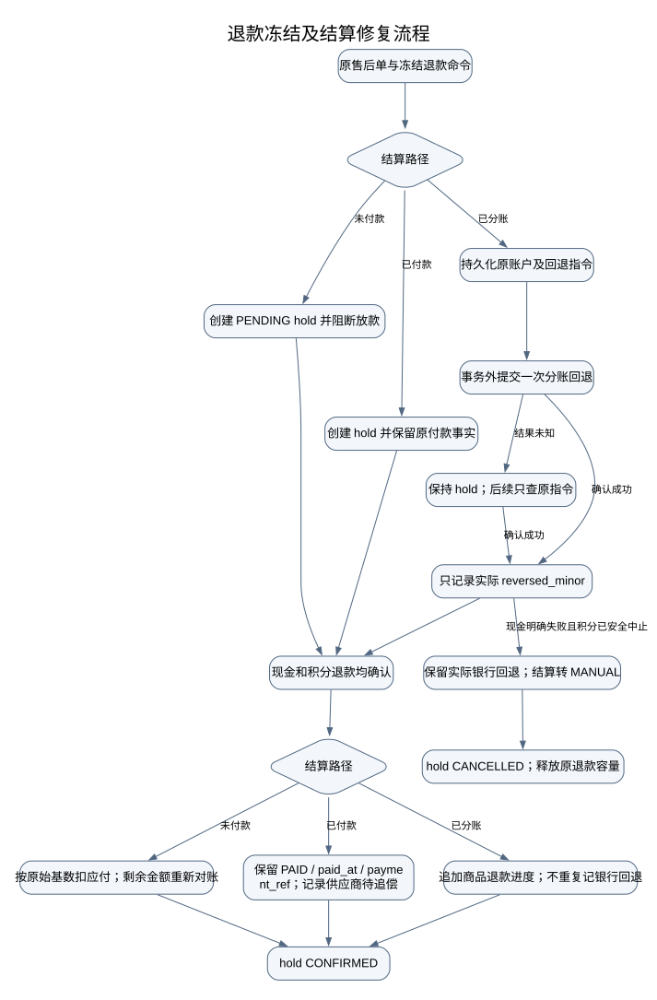

# 订单状态机 Review 修复记录

分支：`codex/ai-shop-codex`。本轮按 Review 清单修复三项问题，并补齐复核中发现的多次部分退款原始基数问题。代码提交及生产发布结果见末节。

## 修复与领域边界

| Review 项 | 实现与结果 |
| --- | --- |
| 基础现金退款把暂时结算冲突判成永久失败 | `BasicRefundExecutionServiceImpl` 将回退尚未确认映射为可重试的 ACCEPTED，执行单保持 PROCESSING。恢复复用原执行号和原支付指令；未确认前不发送现金退款。 |
| 历史错误终态无法恢复 | `RefundExecutionStore` 仅重新认领 `FAILED + REVERSAL + payment_no IS NULL + REVERSE_UNCONFIRMED`。现金明确失败的任务不因此复活。 |
| 积分退款只允许 PENDING 结算单 | 支持 PENDING、PENDING_RECON、CONFIRMED、PAID、SPLIT、SPLIT_CONFIRMED；MANUAL 仅在有 split_at 时走已分账路径。SPLITTING、其他退款占用、未决分账回退、已绑定但尚未完成付款的 payout 均保持阻断。 |
| allowed 与 fire 的动态目标判断不一致 | `StateMachine.allowed` 调用相同的 fire 逻辑，仅隐藏 BizException 业务拒绝；非法目标等定义错误继续暴露。 |
| 多次部分退款残留应付 | `PreparedRefundShares` 用 READY 原始快照计算累计份额；不再拿已扣减余额充当原始金额。分账后冻结的 prepared 份额也使用相同算法。 |

订单/售后终态仍由原有退款执行、积分确认和订单投影流程推进。结算回退被银行接受，只证明资金回退，不等于商品已经退款。储值账户的状态与余额协议未在本轮改动。

## 积分退款结算侧流转

- 未付 CONFIRMED 账单部分退款后回 PENDING_RECON，按剩余应付重新确认；货款全退时转 REVERSED。
- 已付供应商的历史 net、paid_at、payment_ref 不改写；本次待追偿金额保存在 hold 的 recovery_minor，recovery_status=PENDING。该状态不代表已经收回供应商现金，本轮未新增自动扣款/追偿执行器。
- 已分账的外部 reverse/query 均在事务外执行。UNKNOWN 只查原账户、原请求号；结果未明时不能取消 hold。
- 银行回退成功而现金退款最终失败时，MANUAL 明确保留异常事实。新售后单只回退累计目标超过实际已回退金额的部分，避免再次把同一笔钱退回。
- hold 检查覆盖分账准备、积分资金准备、确认应付、批次放款、导出和登记已付。bill 行锁在前，hold 行锁在后；hold 和分账前退款历史使用锁定当前读，避免 MySQL REPEATABLE READ 下漏看快照之后提交的记录。

## 原始基数与历史恢复

份额仍按两次累计下取整之差计算，但分子中的原始金额必须固定。比如原供应商应付 90，两次各退商品实付的 50%，两次各扣 45，累计扣完 90；旧实现会扣 45 和 23，残留 22。

READY 快照同时校验子单、商品实付分母及完整金额字段。无快照的旧账仅在金额尚未被扣减，或已付/已分账且不存在分账前扣减时兼容当前金额。其他情况提前报 BASIS_REQUIRED / BASIS_REVIEW_REQUIRED，要求核对原始金额；不能猜测原值。校验发生在创建 hold 和重放已有 PENDING hold 时，避免现金退款完成后才发现不能记账。

## 数据库迁移

`V472__points_refund_supplier_recovery.sql` 给 stl_points_refund_hold 增加 recovery_minor、recovery_status 及待追偿索引；旧记录默认 0 / NONE。发布本次代码前需应用迁移。schema-test.sql 通过 gen-test-schema.py 生成。

MySQL 9.7.2 临时容器仅使用合成数据，实际执行 V460 建表再执行 V472，字段默认值及复合索引检查通过。证据：`/tmp/order-review-fix-mysql-migration.log`。这不是生产迁移或真实通道验收。

## 验证证据

- 先红后绿：allowed 动态目标、暂时回退冲突、旧 FAILED 执行恢复、多个结算状态及连续部分退款均曾在修复前复现失败。
- 定向回归：`/tmp/order-review-fix-final-regression.log`，共 91 项，90 通过、1 个 MySQL 专用用例在默认 H2 环境跳过，0 失败/错误。覆盖状态机、基础退款恢复、积分退款结算、现金分账回退、真实售后执行、付款及对账、原始基数、SchemaDrift。
- MySQL 原生并发与架构守卫：`/tmp/order-review-fix-native-arch.log`，21 项全部通过、无跳过；包含两条原生用例（并发续跑只查原指令、旧 RR 快照后的 hold/退款历史当前读），以及 ArchitectureTest / PointsArchitectureTest。
- 最后追加积分成本扣减和 UNKNOWN 禁止取消断言后，积分退款结算 7 项全部通过：`/tmp/order-review-fix-points-final.log`。
- 积分退款准备及实际结算资金衔接补查：`/tmp/order-review-fix-funding-regression.log`，PointsOrderRefundStageTest / PerOrderSettlementTest 共 17 项全部通过、无跳过。
- `git diff --check -- backend` 通过。

扩大回归中的 14 个既有失败项未计作本次通过：SettlementPartialReverseTest 6 错误；PointsPayoutPreparationTest 4 失败、4 错误。已在 git archive HEAD 的独立副本复跑，测试名称与错误全部一致；该 HEAD 相对修复起点 4229159cc 没有 backend 差异。日志分别为 `/tmp/order-refund-head-baseline.log`、`/tmp/order-refund-head-points-payout.log`，当前修改回归日志为 `/tmp/order-review-fix-regression.log`、`/tmp/order-review-fix-basis-green.log`。未修改 known-failures 或放宽业务守卫。

## 未覆盖的既有边界

全积分多商品订单的部分退款仍需单独的结算比例协议：当前 SplitReversal 只有现金商品额/现金商品实付分母；LineShares.goodsPaid 为 0 时，旧 DefaultSettlementRefundPolicy 把 base<=0 当成一次全退。该接口无法区分全积分订单的部分退和全退，本轮没有扩展其数据协议，不能把上述定向通过视为对此场景的完整支持。

## 提交与生产发布结果

- 运行时代码提交：`1b2de0cc5dc6f2fa6a897efb1154f1ddde7f5b05`。仅包含本轮 24 个文件，其他活动、美业与原型修改留在工作区。
- 干净提交副本编译、主应用及 pay-svc 打包成功；发布产物均来自该提交。未把工作区未提交代码带入生产。
- 补跑全量：新版本 4,282 条测试；修复前独立源码同样全量执行。双方失败方法集合均为相同 119 项，新增失败 0、消失失败 0。静态 known-failures 为空导致既有脚本拒绝；本次按独立全量基线差异核验，没有将旧失败改记为通过或修改 known-failures。
- 全量证据：`/tmp/refund-review-release-gate.log`、`/tmp/refund-review-release-baseline-full.log`、`/tmp/refund-review-release-full-comparison.json`。生产结构和 Flyway 历史克隆到隔离 MySQL 后，全部已应用校验和一致，仅待执行 V472，预演成功：`/tmp/refund-review-release-migration.log`。
- 两包上传 SHA256 核对、双部署锁和原软链复核通过；先备份数据库并校验 gzip，再停止两个旧实例，切两包，启动主应用完成迁移、健康后启动支付服务。
- 生产主应用：`shop-app-20261019-114044-1b2de0cc5.jar`，health=200，actuator/info 的 gitSha=1b2de0cc5。
- 生产支付服务：`pay-svc-20261019-114044-1b2de0cc5.jar`，active，内部鉴权探针 401（预期）。生产 Flyway V472 成功，失败记录 0。
- 数据库备份：`/data/app/ai-shop/release-backups/refund-state-machine-20261019-114106-1b2de0cc5/ai_shop.sql.gz`，9,723,558 字节；同目录 release.json 留存包摘要及原版本。协调发布脚本记录耗时 46.4 秒，不能当作精确业务停机时长。
- 回滚保留原主应用 `shop-app-20261019-1050-4229159cc.jar`、原支付服务 `pay-svc-20261019-093615-357769ed9.jar`；需协调停两服务、切回两原包再启动。新增数据库字段不自动回滚或删除。
- 发布日志：`/tmp/refund-review-production-deploy.log`。未运行真实订单或资金交易，未变更积分开关或门店策略。
