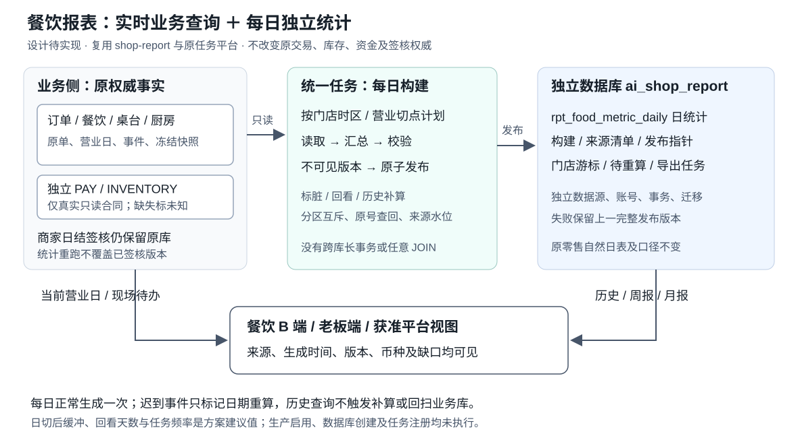

# TDD-B端报表库与日结

> **当前进度（2026-10-25）：** BIZ-01～12非支付后端已交付，开始原§9报表实施。§10 S1-A隔离初始化、API按需验证和J13已编码并完成定向验证，尚未提交发布到云端；六张统计控制/事实表、汇总补偿及查询导出仍待S1-B～S4。既有零售报表及J00保持原用途。

> **2026-10-24 餐饮补充：** [§9 实时查询与独立统计库方案](#9-餐饮实时查询与独立统计库方案2026-10-24设计待实现)为分阶段设计；除§10明确列出的初始化能力外，统计表/汇总与查询导出仍未实现，未在生产启用。§0～§8保留原零售实现及历史验收。餐饮历史报表每日汇总至独立报表库，当前营业日和现场操作读取实时业务事实。

> 状态：**已实现** · 创建 2026-09-30 · P1–P4 全部落地 2026-10-01
> （毛利与逐商品退货未做，上线前还需在生产库副本上跑迁移 —— 都写在 §7）
> 档位：**2**（新表族 + **第四个独立库** + 不可逆的存储决策）
> 依据：[B端报表清单-由浅入深](../../requirements/B端报表清单-由浅入深.md) ·
> 原型 [b-reports.html](../../../prototypes/b-reports.html) s01–s05

---

## §0 对账一 · 需求 → 设计

| # | AC（来自原型与清单） | 由谁满足 |
|---|---|---|
| AC1 | 近 7/14/30 天逐日的成交额、单量、退款 | `rpt_daily_store` + `GET /biz/report/daily` |
| AC2 | 顶部给本期合计与**环比**（上一个等长区间） | 同上，服务端算两段再相减 |
| AC3 | 按月逐月的营收与**订单数** | 由 `rpt_daily_store` 按月聚合，补上今天 `Statement` 缺的单量 |
| AC4 | 商品 TopN，可按件数 / 销售额排 | `rpt_daily_goods` + `GET /biz/report/goods` |
| AC5 | 每行同时给件数与销售额 | 两列都落表，不靠排序字段单给 |
| AC6 | 自带客流占比能按时间段看 | `rpt_daily_store.owned_*` 两列 |
| AC7 | 多门店能分店看、也能合并看 | 三张表都带 `store_no`，查询层决定合并与否 |
| AC8 | 昨天的数据今天一定在 | `rpt_job_watermark` + 水位告警 |

---

## §1 现状与影响面

### 今天的报表全是「现算」

| 报表 | 怎么来的 | 代价 |
|---|---|---|
| `mStats` / `statsByStore` | 扫 `ord_sub_order`，`TRANSACTED` + 本月起 | 每次请求一次全表扫 |
| 动销排行 | 扫 `inv_ledger` 近 N 天再内存聚合 | 同上 |
| 对账单 | 扫结算表，单账期 | 跨月要发 N 次 |

`MerchantOrderServiceImpl.statsByStore` 的注释里已经写着这件事：
「**一次扫完按店分组，不是逐店调 stats()**：后者是 N 次全表扫，而门店数正是这个功能的自变量」。
**商品数、天数是同一类自变量** —— 逐日 × 逐商品的报表用现算，这条路走不远。

### 三个供不上的需求

① 没有逐日序列（`mStats` 只有今日/本月两个定点数）；
② 商品 × 金额无处可答（`inv_ledger` 只有成本没有售价）；
③ 跨月并排要发 N 次请求。

### 这个仓库已经有三个独立库

`InventoryDataSourceConfig`（`inv-pool`）· `JobStoreConfig`（`job-pool`）· `PayDataSourceConfig`。
**装配模式成熟，而且背后有一次线上事故** —— 本方案照抄它们，§4 逐条列出。

---

## §2 方案

### 2.1 库与模块

```
ai_shop_report        第四个独立库，表前缀 rpt_
backend/shop-report/  新模块（Maven），只依赖 shop-base
```

**读写方向是单向的**：日结作业从平台库/进销存库**读**，往报表库**写**；
报表查询只**读**报表库。报表库不被任何业务写入，**丢了可以重跑重建**。

### 2.2 表（3 张）

#### ① `rpt_daily_store` 门店日汇总 —— R1 / R2 / 自带客流的底座

| 列 | 说明 |
|---|---|
| `stat_date` DATE | 统计日（自然日，按**下单时间**归属，见 2.5 ②） |
| `entity_no` / `store_no` | 商户主体 / 门店。**都不为空**，合并看时在查询层 SUM |
| `orders` / `gmv_minor` | 成交单量 / 成交额 |
| `refund_orders` / `refund_minor` | 退款单量 / 退款额（**按退款发生日归属**，不回冲原单那天） |
| `buyers` / `new_buyers` | 下单人数 / 其中首单人数 |
| `owned_orders` / `owned_gmv_minor` | 自带客流的那部分（`TrafficSource.MERCHANT_OWNED`） |
| `commission_minor` / `service_fee_minor` | 佣金 / 履约服务费 |
| `freight_income_minor` / `freight_cost_minor` | 运费收 / 支 |
| `net_minor` | 应结 = 毛 − 佣金 − 服务费 ± 运费 |
| `currency` | 币种，跟着金额走 |

> **客流来源不单独建表**：`TrafficSource` 只有 `MERCHANT_OWNED` / `PLATFORM` 两个值
> （库列注释「下单时固化」），两个值建一张表是又一张「建了表没人读」的表。
> 落成两列 `owned_*`，平台那部分 = 总数减去它。

#### ② `rpt_daily_goods` 商品日汇总 —— R3 的底座

| 列 | 说明 |
|---|---|
| `stat_date` · `entity_no` · `store_no` · `goods_no` | 联合主键 |
| `sku_no` | 可空：同一 `goods_no` 多 SKU 时按商品汇总，SKU 维度二期 |
| `title` / `spec` / `category_no` | **写入时快照** —— 报表库不 JOIN 商品表（2.5 ①） |
| `qty` / `amount_minor` | 件数 / 销售额，取自 `ord_item.qty` 与 `ord_item.amount` |
| `refund_qty` / `refund_amount_minor` | 退货件数 / 退款额 |

> **成本与毛利不在本期**：销售额在交易域（`ord_item.amount`），成本在进销存域
> （`inv_ledger.unit_cost_minor`）。跨两个域，且成本口径要先定
> （出库那一刻的成本 vs 当前进价，两者不同）。原型 s04 的「毛利」那一档本期置灰。

#### ③ `rpt_job_watermark` 作业水位

| 列 | 说明 |
|---|---|
| `job_key` | 主键，如 `daily-store` / `daily-goods` |
| `last_stat_date` | 已经算到哪一天 |
| `last_run_at` / `rows_written` / `duration_ms` | 上次跑的时间、写了多少行、耗时 |

> **这张表是 AC8 的全部依据**。没有它，「昨天的数据没生成」的表现是报表里少一行 ——
> 而少一行和「那天真的没单」长得一模一样。

### 2.3 日结作业

```java
@ConditionalOnProperty(name = "shop.job.enabled", havingValue = "true")
@Component
public class ReportDailyRollupJob implements JobHandler {
    @Scheduled(cron = "${shop.job.report-daily-rollup.cron:0 30 1 * * *}")
    @SchedulerLock(name = "report-daily-rollup", lockAtLeastFor = "PT1M", lockAtMostFor = "PT2H")
```

照 `MemberLevelRecomputeJob` 的形状：`JobHandler` + `@Scheduled` + `@SchedulerLock`
+ `JobSupport.run` + 一个 `JobDeclaration` Bean。
**ShedLock 的锁表在平台库**（`V91__shedlock.sql`），报表库不用重复建。

#### 关键决策：**重算一个窗口，不做增量累加**

每次跑 `[T-N, T-1]`（N 默认 3，可配），对这几天**先删后写**。

> **为什么不增量**：退款、售后、改价都会改动**历史某一天**的数字。
> 纯增量累加的话，一笔前天的退款永远补不回去，而差额会一直留在账上 ——
> 且不会有任何东西报错。重算窗口让「最近几天」始终是对的，
> 代价只是每天多算 N 天的量（一个门店一天几十单，可以忽略）。
>
> **幂等由此而来**：同一天跑几次结果一样，重跑是安全的。补历史就是把 N 调大跑一次。

### 2.4 读侧：今天与历史的分界

| 时间 | 数据来源 | 理由 |
|---|---|---|
| **今天** | 现算（`mStats` 那条路不动） | 今天的数还在变，落表就会比实际少 |
| **T-1 及以前** | 读 `rpt_*` | 已经封账，且要能按日/按月任意切 |

> **这条必须写进接口注释**：不写清的后果是「近 7 天」里今天那一格恒为 0
> —— 因为日结还没跑到它。服务端把今天那一格用现算补上。

### 2.5 跨库的三条硬约束

**① 不 JOIN，名字在写入时快照。**
报表库里没有商品表、没有门店表。`title` / `spec` 落的是**当时**的值 ——
商品改名之后，历史报表显示的仍是当时的名字，这是对的：那张报表描述的是那一天。

**② 归属日按「事件发生日」，不回冲。**
成交归下单日，退款归**退款发生日**。回冲原单那天的后果是：
昨天截图发群里的数字，今天再看会变。原型 s02 的底部提示写的就是这条。

**③ 报表库不装拦截器，隔离靠查询层显式带条件。**
同 `JobStoreConfig` 的第三条：本库没有租户、没有数据域、没有软删。
**所以每一个查询方法都必须显式带 `entityNo`（多门店时再带 `storeNos`）** ——
平台库那套行级隔离在这里不存在，漏一个条件就是越权，而且**不会报错**。
§5 为此单列一条测试。

### 2.6 P4 · 订单列表加时间区间（契约变更）

**这是三张报表共同的下钻出口** —— 没有它，报表上的每个数字都点不进去
（原型 s05 画的就是这一屏）。

| 项 | 变更 |
|---|---|
| 端点 | `/biz/order` **不新增**，加两个可选查询参数 `from` / `to`（`yyyy-MM-dd`，含两端） |
| 权限码 | 不变（`order:view`），它只是把已有列表筛窄 |
| 库表 | **不动**。`ord_sub_order.created_at` 已有索引覆盖的前缀即可 |
| 端上契约 | `mOrderList` 的 `q` 加两个可选字段 |

**四条实现约束**：

1. **按下单时间筛，与报表同一条时间轴。** 报表的「那天」是下单日，
   列表若按支付时间或更新时间筛，点进去的单数就对不上 ——
   而两边各自都说得通，这正是口径分岔最难查的形状。
2. **左闭右闭，在服务端翻成左闭右开。** 入参 `to=2026-09-30` 的含义是
   「含 9 月 30 日整天」，实现上取 `< 10-01 00:00`。
   要防的错是**忘了 +1 天**（写成 `< 09-30 00:00`）—— 那会把整个 `to` 当天排除，
   从报表点「今天」进来得到空列表。
   > ⚠️ 起初这里写的理由是「`<= 23:59:59` 会漏掉那一秒里的单」。
   > **那条对本表不成立**：`ord_sub_order.created_at` 是 `datetime(0)`，存不住小数秒，
   > 两种写法对它能存的每一个值都等价。选 `< to+1` 是为了将来加精度时仍然对。
3. **两个都可空，且可以只给一个。** 只给 `from` = 从那天起到现在；
   只给 `to` = 截至那天。报表下钻只会两个都给，但手工调接口不该因此报错。
4. **非法日期拒绝，不要静默忽略。** 传 `2026-13-01` 时必须报错 ——
   静默忽略会让调用方拿到一个**没筛过的全量列表**，而他以为那就是那一天的单。
   这比点不动更糟（§六之二 已经记过同一条）。

---

## §3 选型（2 档必填）

| 方案 | 优点 | 为什么没选 |
|---|---|---|
| A. 在平台库加汇总表 | 最省事，能 JOIN、能一个事务 | **不隔离扫描压力** —— 报表查询与交易读写抢同一个库；而报表恰恰是「偶尔来一次、一次扫很多」的负载 |
| B. 读库 / 从库 | 不改代码 | 只解决读压力，不解决「逐日 × 逐商品要预聚合」这件事；且多一套主从运维 |
| **C. 独立报表库（选）** | 压力隔离、可重建、与交易库的一致性要求解耦 | 代价：跨库不能 JOIN、无跨库事务、T+1 延迟 —— 三条都能接受（见 2.5 与 §4） |

**决定性的两条**：
① 报表数据是**可重建的派生数据**，丢了重跑即可 —— 它不需要交易库那种一致性保障；
② 这个仓库已经有**三个**独立库的成熟装配，第四个是走熟路，不是开新路。

---

## §4 风险

| # | 风险 | 处置 |
|---|---|---|
| R1 | **第二数据源接走平台的自动配置** —— Boot 的 DataSource / SqlSessionFactory / Flyway 三处自动配置都是 `@ConditionalOnMissingBean`，一出现第二个就整体退让，**行级越权防线静默丢失** | 平台侧已由 `PlatformDataSourceConfig` 显式接管；本模块一个 bean 都不标 `@Primary` |
| R2 | **注入拿到平台数据源** —— 2026-08-27 线上真实发生：19 张 `inv_*` 连同迁移历史建进平台库，`inv-pool` 从不启动，零 ERROR | 注入一律写 `@Qualifier`（参数名兜底会输给 `@Primary`）+ 照抄 `mustBeOwnDataSource` 那道护栏，pool 名不对就**拒绝启动** |
| R3 | **声明 `Flyway` 类型的 bean** 会让平台自己的迁移一次都不跑，库停在那天 | 迁移凭证 bean 刻意不是 `Flyway` 类型，返回自定义 record（照 `JobMigrated`）；自己的历史表 `rpt_flyway_history`，迁移号从 V1 重来 |
| R4 | **口径分岔** —— 汇总与现算两套实现，「总览说 3 单，点进去只有 2 单」 | 两边共用同一个 `OrdSubOrder.TRANSACTED` 与同一条时间轴；§5 有一条逐日对账测试 |
| R5 | **越权** —— 报表库无数据域拦截器 | 查询方法签名强制带 `entityNo`；§5 有一条只查得到自己的测试 |
| R6 | 日结没跑，报表少一天 | `rpt_job_watermark` + 水位落后告警；读侧发现缺口时明确显示「统计中」而不是 0 |
| R7 | 生产库是 **MySQL 9.7** | 新迁移**禁用 `uca1400` 排序规则**；建表照平台库现行写法 |

---

## §5 对账三 · 实现 → 需求（测试）

**18 条，全部跑过；十次消融全部红过。**

| AC / 风险 | 测试方法 | 判据 |
|---|---|---|
| AC1 · AC2 | 随 `/biz/report/daily` 的读侧一起验 | 逐日与环比的组装无 DB 分支 |
| AC3 | `ReportDailyStoreDaoTest#monthlyGroupsByCalendarMonth` | 月界在月初那一天：9/30 与 10/1 不合并 |
| AC4 | `ReportDailyGoodsDaoTest#orderByChangesTheWinner` · `#mergesAcrossDays` | 两种排法给出**不同**的第一名；跨天合并 |
| AC5 | `ReportDailyGoodsDaoTest#giftsStayOutOfQty`（DAO 契约）<br>`GoodsAggregateGiftTest#giftLinesDoNotCountAsSales`（**聚合口径**） | 两层各一条 —— DAO 那条管「分开存取」，聚合那条管「哪些行算哪个数」 |
| AC6 | 由 `owned_* / attributed_orders` 两列承载 | 占比的分母是**有归因的单**，见 V1 的列注释 |
| AC7 | `ReportDailyStoreDaoTest#scopeIsExplicit` | 空门店集合返回空而**不是查全部** |
| AC8 | `ReportWatermarkDao` + 读侧的 `complete` 标记 | 缺口不画成 0 |
| **幂等** | `ReportDailyStoreDaoTest#rerunIsIdempotent` | 同窗口跑三次结果不变 |
| **重算窗口** | `ReportDailyStoreDaoTest#lateRefundFixesHistory` | **前天的退款今天跑批能改正前天那一行** —— 「不做增量」的唯一判据 |
| R1 · R2 | `ReportDataSourceGuardTest`（3 条，纯单元）<br>`ReportWiringSmokeTest#secondDataSourceDoesNotTakeOverPlatform` | 后一条在**真实容器**里验「按类型注入拿到的还是平台那套」 |
| R3 | `ReportWiringSmokeTest#reportContributesNoFlywayBean` | 判据是「**有没有** Flyway bean」，不是「某一个 bean 的类型」 |
| R4 | `ReportVsLiveConsistencyTest#aggregatesMatchLiveStats` | 日结逐日合计 == 现算的本月 |
| R5 | `ReportDailyStoreDaoTest#scopeIsExplicit` | 漏 `entityNo` 抛错 |
| P4 | `OrderListDateRangeTest#toIncludesTheWholeDay` · `#filtersOutsideTheRange` | `to` 含那一整天（防「忘了 +1 天」） |

**空转防护**：凡是从库里取数的断言都配了对照量 ——
`ReportVsLiveConsistencyTest` 自己造两单（不造的话本地库当月无单，「0 == 0」会让它永远绿）；
`GoodsAggregateGiftTest` 先断言探针被聚合到；`OrderListDateRangeTest` 末尾断言不限时间时能查到 2 单。

---

## §6 对账二 · 设计 → 实现

**新模块 `backend/shop-report/`（18 个文件）**：pom · 2 份迁移 · 配置两件 ·
3 个 DAO · 3 个 record · 4 个测试类。
**装配层 `shop-app`**：`reportbridge/`（日结作业 + 读侧服务）· `portal/biz/BizReportController` ·
4 个测试类 · `application-rptwiring.yml`。
**交易域 `shop-core`**：`MerchantOrderService` 加三个方法（两个聚合 + `list` 的时间区间）。

### 偏差说明

| # | 与 §2 的设计不符之处 | 为什么 |
|---|---|---|
| 1 | `rpt_daily_store` **没有** `freight_cost_minor` | 起草时写了，查下来运费成本只在结算域按日算，子单上没有 —— 那是一个没有来源的列 |
| 2 | `rpt_daily_store` **多了** `attributed_orders` | 自带客流占比的分母是「有归因的单」不是全部单（`StatsSummary` 的 javadoc）；少这一列，历史单越多商家的费率档越吃亏 |
| 3 | `rpt_daily_goods` **没有** `refund_qty / refund_amount_minor` | 同 1：`ord_after_sale` 只到子单级，没有行级信息 |
| 4 | `rpt_daily_goods` **多了** `gift_qty` | 赠品行价格为 0，混进 `qty` 的话「送出去 100 件」会被读成「卖了 100 件」 |
| 5 | §2.6 约束 2 的理由改写过 | 原写「`<= 23:59:59` 会漏掉那一秒」，而本表是 `datetime(0)` 存不住小数秒，两种写法等价。真正要防的是「忘了 +1 天」 |
| 6 | 月报**没有建月表** | 从 `rpt_daily_store` 聚合即可；月表要自己维护一套「哪个月重算过」的状态 |

**1 与 3 是同一型**：两次写出没有数据来源的列，都在落地前删掉了。
留两个恒为 0 的列比没有更坏 —— 它们看起来是「没有」，真相是「不知道」。
下次设计表时先把每一列的来源列出来再动手。


## §7 计划与完成情况

| 步 | 内容 | 状态 |
|---|---|---|
| **P1** | 建库与模块骨架 + `rpt_daily_store` + 日结作业 + 水位 | ✅ |
| **P2** | `rpt_daily_goods` + 商品榜查询 | ✅ |
| **P3** | 按月聚合（从日汇总，不建月表）+ 补订单数 | ✅ |
| **P4** | `/biz/order` 加 `from`/`to` | ✅ |

三个端点：`/biz/report/daily` · `/biz/report/goods` · `/biz/report/monthly`，
端上契约四处与十一份产物均已跟上。启用方式见
[报表库-生产启用手册](报表库-生产启用手册.md)。

### 还没做的两件

| 事 | 为什么还没做 |
|---|---|
| **毛利**（原型 s04 的第三档） | 销售额在交易域、成本在进销存域，**跨两个域**；且成本口径要先定（出库那一刻的成本 vs 当前进价，两者不同）。原型里那一档置灰 |
| **逐商品的退货** | `ord_after_sale` 只到子单级，没有行级信息。要做得先让售后单带上退的是哪几行，那是交易域的改动 |

### 上线前必须有人做的一件

**在生产库副本上跑一遍 V1/V2。** 已在本机 **MariaDB 12.2** 上验过
（建表、索引逐条核对、10 条 DAO SQL 原文解析、两条关键查询真执行），
但生产是 **MySQL 9.7** —— 那一轮排掉的是语法与结构的粗错，
**排不掉两个引擎之间的差异**。需要有 DB 凭据的人执行。


## §8 收工清单

- [x] §0 的 8 条 AC 都有落点，没有挂不上 AC 的设计条目
- [x] §5 每条有测试方法，跑过；**十次消融全部红过**
- [x] §6 填了实现清单与**六条偏差**（两条是「我发明了没有来源的列」）
- [x] 新迁移在**真库**上跑过（MariaDB；MySQL 9.7 的残留差异见 §7）
- [x] 端点按 `/biz` 的七处清单登记齐（判权表 · 契约四处 · RESPONSE_TYPES · 产物）
- [x] 生成物重新生成（openapi-b 249 路径 / 281 操作）
- [x] 本文状态改成「已实现」


## §9 餐饮实时查询与独立统计库方案（2026-10-24，设计待实现）

### L1 定位与结论

本节执行用户最新要求：报表分实时数据与统计数据；已结束营业日每天跑定时任务，将每日汇总写入独立数据库，列明报表、任务与补算规则。本轮只提交方案，不继续之前的实时期间报表编码。依据：[餐饮PRD§六/七](../../requirements/餐饮系统-完整需求文档.md)、[餐饮主计划](../TDD-餐饮订单结账-完整开发计划.md)、[任务管理PRD](../../requirements/PRD-定时任务管理.md)、[ADR-040](../ADR/ADR-040-餐饮销售配置与耗用权威边界.md)。

**默认方案：当前营业日及现场待办实时查询；已结束营业日每天汇总落表；周/月/自定义历史期间只汇总统计库。** 报表库沿现有`ai_shop_report`、`shop-report`模块和原任务平台扩展，不把rpt表建到订单/商品/fnb业务库。生产建议独立实例，至少必须是独立database、连接池、账号和迁移历史；仅换表前缀不满足本次要求。

源码核验（不等于生产已启用）：

| 已有能力 | 当前事实 | 本方案处理 |
|---|---|---|
| ReportDataSourceConfig | 已有reportDataSource、reportTransactionManager、reportJdbcClient、rpt_flyway_history；缺URL拒绝启动，不回退主库 | 复用并增加真实数据库身份隔离验收；池名校验不能证明URL没指向业务库 |
| 报表迁移V1/V2 | rpt_daily_store、rpt_daily_goods、rpt_job_watermark，零售自然日口径 | 原字节、字段和口径保留；餐饮营业日不直接写进旧表 |
| ReportDailyRollupJob | report-daily-rollup默认01:30、回看默认3天；源码使用服务器LocalDate和CNY | 保留旧零售任务，餐饮另声明handler，使用原门店时区/日切及原币种 |
| DailyReportService | 今日现算、历史读汇总，按全局watermark识别缺口 | 复用分层思想；餐饮增加门店/日期级覆盖，不能仅凭全局最大日期说所有门店齐全 |
| BusinessCloseServiceImpl | 餐饮原营业日报表仍实时读取fnb事实，签核快照在业务库 | 用于受控今日/诊断及原营业日签核；历史分析改为查询报表库，签核不搬成可删除统计投影 |
| JobDeclaration/JobInvocation | 已有handlerName、runId、bizDate、params、超时/锁约束及任务管理 | 复用调度、日志、人工触发；不引入新的调度平台，不让本地Scheduled和远程worker重复触发 |

### L2 数据分层与查询路径



图中所有汇总写入均由任务执行器完成。报表查询不跨库JOIN，不在读接口触发补算；报表库故障不阻断下单、制作或打印；这是新增目标，必须先完成下述初始化隔离，现有启动期同步Flyway不能直接满足。跨库没有全局事务，任务来源读取与统计发布分别提交，通过原buildNo查回恢复。

| 类别 | 业务例子 | 数据来源 | 时效与标签 |
|---|---|---|---|
| REALTIME实时 | 桌台、排队、厨房、待出品、未结客单、当前营业日经营概览 | 原业务owner只读接口/Port | asOfAt；当前仍在变化，不标成正式日报 |
| DAILY日统计 | 已结束营业日的订单/菜品/渠道/厨房/退餐等指标 | 独立库已发布日统计 | businessDate、generatedAt、sourceWatermarks、metricVersion、完整性 |
| PERIOD期间统计 | 日报、周报、月报、年度趋势、门店对比 | 对日统计按相同口径聚合 | 列出缺失日期/门店，不把缺口填成0 |
| MIXED含今日 | 近7天且包含当前营业日 | 历史日统计＋单独今日实时段 | 两段分别给来源、水位，整体isFinal=false；不覆盖历史行 |
| SIGNED签核 | 已签核日结与后续更正 | 原fnb日结快照与审计权威 | closeNo/revision/snapshotHash，和当前重算差异并列展示 |

首版不周期落“今日5分钟快照”，避免和每日统计混淆。现场接口采用门店、范围和分页约束；不开放无界实时多店全历史查询。统计库未启用/不可用时，历史查询返回明确NOT_READY/UNAVAILABLE，不静默改扫业务库。

### L3.1 统计日期、状态与指标口径

1. **营业日复用原配置。** 使用可信门店IANA时区、营业日切点和生效版本，冻结businessDate、policyNo、startsAtUtc/endsAtUtc。区间左闭右开。切点04:00时，10月21日02:00属于10月20日。支持23/25小时夏令时；不用服务器零点或固定24小时计算。
2. 已冻结在原订单/台账的营业日不得用当前新配置重归日。付款、退款、厨房事件按各自发生营业日统计，同时保留原单营业日关联。旧`ORIGINAL_ORDER_BUSINESS_DATE`厨房汇总只代表原单队列视图，不直接冒充“当天实际制作”。
3. **原单归属视图与发生日视图分开。** dateBasis=BUSINESS_DATE是日期边界；attributionBasis=ORIGINAL_ORDER/OCCURRENCE是事实归属。退款当天计发生额，原单退款分析另选ORIGINAL_ORDER，两者不能相加。
4. 订单数=原核心子单去重；接单批次数=原FOOD batch去重；就餐客单数=原check去重。多轮加菜不能同时当新增客单，AA付款次数不能当订单数。无check场景单列，不能虚构桌台客单。
5. 先付/后付以冻结payMode和真实生命周期区分。ACCEPTED不是付款；退款申请不是退款完成；库存出库不是实际物理用量。
6. 套餐收入沿原行唯一金额分配；父/叶角色明确。父项用于套餐销量，组成项用于制作/耗用，默认不把父子数量和收入重复相加。配料另列选配量/加价，不从当前菜单价格倒算历史。
7. 数量按原单位分别汇总，BigDecimal受控精度；金额long最小币种单位、币种分组并检查溢出。AED与CNY不直接相加；没有真实汇率来源，不给伪“统一总金额”。
8. 来源缺失/未接通，指标值为null并给unknownReason。真实完成扫描、确实无事实才是0。尚未跑批、来源失败与无业务三者必须区分。

指标目录使用固定白名单和版本，不做任意SQL/脚本规则引擎。每个metricCode定义：名称、valueType、来源owner、有效状态、dateBasis/attributionBasis、去重键、允许维度、单位/币种、聚合方式及前置能力。口径变更增加metricVersion，先补算再切默认读取，不将新旧口径混加。

| 指标/公式 | 规则 |
|---|---|
| 期间订单量/数量/金额 | 只对相同口径、单位、币种的可加指标SUM |
| 净收款 | 同币种、同发生日范围的真实成功收款－真实成功退款；不含报价/未收应收 |
| 平均出品时长 | SUM(有效耗时)/SUM(对应任务数)，不平均每日平均值；暂停/重做是否计入由版本规定 |
| 人均/客单价 | 同一归属范围的可核实净销售额/有效就餐人数或完成客单数；缺分母为null |
| 翻台率 | 有效完成桌次/有效可营业桌数；转台/拼桌去重、可营业资源历史不足时为null |
| 毛利/毛利率 | 可核实净销售额－同口径历史销售成本；真实配方领料不自动等于销售成本，当前缺来源保持未知 |
| 跨日去重顾客数/复购率 | 不SUM每日去重人数；首批不提供精确期间去重，后续补独立去重事实模型后开放，不用近似值冒充精确值 |

### L3.2 报表清单

A=非支付优先；B=补齐行业事实后；C=依赖资金/成本真实owner，本轮仅设计。所有报表支持获准门店、期间、口径、水位及钻取；不是所有维度任意做笛卡尔积。

| ID / reportCode | 报表 | 主要指标与维度 | 路径/阶段 |
|---|---|---|---|
| F01 LIVE_OVERVIEW | 当前营业概览 | 接单/待制作/待交付/未结客单、来源完整性 | 实时/A |
| F02 LIVE_TABLE | 桌台与排队 | 空闲/用餐/待清台、等位、叫号、等待时长 | 实时/A |
| F03 LIVE_KITCHEN | 厨房工位看板 | 待制/制作中/已出品、等叫、超时、工位负载 | 实时/A |
| F04 DAILY_OVERVIEW | 营业日报 | 原子单数、批次数、客单数、有效菜品量、取消/退餐申请量 | 日统计/A |
| F05 PERIOD_TREND | 周/月/自定义趋势 | 日/周/月可加指标；环比按同样完整范围计算 | 日统计聚合/A |
| F06 STORE_COMPARE | 多店对比 | 同口径接单/菜品量/厨房效率；授权店分别展示 | 日统计聚合/A |
| F07 DISH_SALES | 菜品/规格分析 | 主项销量、赠送量、单位、类目/SKU；金额按owner能力开放 | 日统计/A，金额C |
| F08 MENU_CHANNEL | 餐牌/渠道/餐段 | 餐牌及版本、早餐/午餐/晚餐/特殊餐牌、H5/点餐机/员工/渠道及堂食/自提/外送 | 日统计/A，缺冻结维度标UNKNOWN |
| F09 KITCHEN_EFFICIENCY | 厨房出品 | 开始/出品/上菜/撤菜/损耗/重做量、有效耗时分子分母 | 发生日日统计/A |
| F10 RETURN_OPERATIONS | 退餐处理 | 原行申请量、CANCEL/LOSS/KEEP及处理状态；关联原单 | 日统计/A；不当成退款成功 |
| F11 OPTION_BUNDLE | 套餐与选配 | 套餐销量、组成品需求、小料选择/加价、替换/赠送 | 日统计/B；以实际成交事实为前提 |
| F12 TABLE_SERVICE | 桌台运营 | 桌次、就餐人数、用餐/等位时长、翻台/座位利用率 | 日统计/B；资源有效历史不足指标关闭 |
| F13 STAFF_OPERATIONS | 员工操作 | 实际接单、催菜、传菜、撤菜等动作与数量 | 日统计/B；SYSTEM/买家操作不计员工业绩 |
| F14 MATERIAL_USAGE | 物料耗用与损耗 | 销售理论/制作理论/真实出库/损耗分别列，物料/原单位/配方版 | 日统计/B；现有BLOCKED量仍为理论 |
| F15 PAYMENT_REFUND | 收款退款 | 真实成功金额/笔数、渠道、未收/未知及退款在途 | 日统计/C |
| F16 DISCOUNT_TAX | 优惠与税费 | 活动/券/人工优惠及原税分配，税前额/税额/含税额分列 | 日统计/C；不按当前税率重算历史 |
| F17 SHIFT_CLOSE | 班次与日结差异 | 班次收付/盘差、原日结版本、签核状态及重算差异 | 签核权威＋统计/C；只读差异不代签 |
| F18 COST_MARGIN | 历史成本与毛利 | 原销售成本、损耗成本、净销售、毛利及未知原因 | 日统计/C |
| F19 CUSTOMER_REPEAT | 顾客/复购 | 日去重顾客、期间去重与新老客，真实身份及归属 | B/C；精确期间去重模型未有前不开放 |
| F20 REPORT_HEALTH | 数据完整性与任务 | 缺失门店日期、发布版本、延迟、来源缺口、失败及补算进度 | 控制表/A |

首版查询日报/周报/月报复用同一组日统计，不另外运行周汇总/月汇总任务，不保存第二套期间金额。

同一来源没有实际支持的业态，不因目录出现就开放。Keeta只保留未来渠道维度，不接SDK/webhook，也不产生假渠道营业额。

### L3.3 独立统计库与候选表

沿`backend/shop-report`的record + JdbcClient + DAO方案，所有注入显式Qualifier。统计库迁移仅在`db/report`及`rpt_flyway_history`执行，实施时从最新编号追加，不修改V1/V2。新的rpt表不进入food-core的业务迁移，不使用业务库默认transactionManager。

**推荐先扩充原候选`rpt_food_metric_daily`，配固定指标目录和受控维度，不按20张报表建20张表。** 相比每报表宽表，能够复用原方案、降低首批表数量；热点指标后续根据实际查询性能增加专用投影，保留统一口径与发布机制。当前机器设计的原候选字段不足以支撑发布版本/来源覆盖，以下为待评审扩展，不表示已修改89张表目标、已生成DDL或已建表。

| 候选表 | 粒度/职责 | 关键字段与约束 |
|---|---|---|
| rpt_scope_cursor | 每主体/门店/口径版/日期基准 | firstStatDate、lastPlannedDate、timezone/policyRef、enabled；漏跑恢复从游标续排，不能只盯昨天 |
| rpt_build_batch | 一次门店营业日构建 | buildNo、原请求键/hash、scope/date、metricVersion、status、leaseToken/fence、来源水位向量、开始结束/错误；重试查原build |
| rpt_source_manifest | 每build＋owner＋事实族 | sourceSnapshotRef/游标、asOfAt、rowCount、checksum、完整性/未知原因；原始来源不塞任意SQL |
| rpt_day_publication | 每主体/门店/日期/基准/口径版一行 | activeBuildNo、generation、publishedAt、requiredFamilies及覆盖状态；指针CAS，旧worker不能覆盖新发布 |
| rpt_dirty_day | 每scope/date/基准/口径一条重算请求 | first/lastEventRef、dirtyGeneration、原因、状态、请求人；重复事件合并，期间新事件不得被本轮完成抹掉 |
| rpt_food_metric_daily | 每build＋指标＋规范维度一行 | 指标版、metricFamily/code、dateBasis/attributionBasis、dimensionKey/白名单快照、countValue/quantityValue/amountMinor、unit/currency、completeness/unknownReason |
| rpt_export_task | 每次获准导出一行，导出阶段再建 | exportNo、scope/actor、筛选/hash、固定build清单、格式、状态、私有objectRef/校验和、过期时间；不落长期公开URL |

**共7张候选表：首批6张（不含导出），导出阶段第7张。** 既有3张零售表继续复用原用途，不计为餐饮新增。全局rpt_job_watermark用于任务概览；正确覆盖以门店/日期publication与manifest为准。

共同规则：

- 新表显式保存tenantNo（当前MAIN）、entityNo；分区元数据有storeNo，事实行也保留scope便于强约束。此库没有MyBatis数据域拦截器，DAO每条读写必须完整带scope，拒绝空主体/未授权门店。不能照搬旧DAO的全日期DELETE用于单门店餐饮构建。
- count/quantity/amount由固定valueType决定；已知值恰好一个数值列有效，未知时数值null并写原因。指标并非任意key-value，禁止客户端新增指标、SQL表达式或任意JSON过滤。
- 规范维度包含角色、菜品/SKU、套餐/配料、渠道、餐牌/版本、餐段、工位/任务角色、员工、物料及原单位等白名单子集；不同reportCode只支持声明的组合。常用筛选可以有类型化索引列，与维度快照一致性由写入校验保证。
- dimensionKey使用规范化typed维度哈希，明确NONE（不适用）与UNKNOWN（应有但缺来源），避免NULL唯一索引重复。事实唯一键为(buildNo,metricCode,dimensionKey)，维度必须包含该指标的币种/单位/归属基准等全部区分项。
- 报表库不保存支付私参、卡号、顾客手机号/地址；名称、类目、餐牌和角色只取原冻结快照。当前商品改名不重写原单显示；缺快照不能把当前主数据冒充历史。
- 数据源隔离需比较连接到的实际catalog/实例身份并检查用户权限：报表账号只写report库，源账号只读相应owner；报表迁移不能以主库账号跨库建表。启动时同一database即拒绝启用；统计表误落业务库的集成测试必须为红。

### L3.4 每日生成、校验与发布

**先补齐初始化隔离。** 当前ReportDataSourceConfig在宿主启动同步连接报表库并执行Flyway，数据库临时不可达会使整个宿主启动失败。因此不得将“现有多数据源”直接声称为“报表故障已隔离”。本方案选用同一构建产物内的报表子系统隔离初始化，暂不新建报表服务或Maven应用：

- 计划新增显式初始化模式`shop.report.initialization-mode=ISOLATED`。旧环境默认STRICT保持现有启用/启动合同；餐饮采用ISOLATED前必须完成兼容改造和双模式测试，不能仅新增配置名就宣称支持。
- ISOLATED模式只装配惰性report连接与门面；原同步Flyway不参与主业务启动必经依赖。独立worker中的J13是指定迁移执行者；API实例只校验真实schema版本，不并发跑迁移。迁移成功凭据只有实际成功后才产生，不用一个空的ReportMigrated对象冒充已就绪。
- 状态分为DISABLED/INITIALIZING/READY/UNAVAILABLE/MISCONFIGURED/MIGRATION_FAILED。未READY时所有统计DAO/查询/构建先拒绝访问，历史接口返回报表NOT_READY或503，主业务readiness保持独立；不回落到默认数据源、不返回伪空报表。
- 网络暂不可达采用有上限退避探测，恢复后校验实际database身份及所需schema再READY。同库误配或缺配置为MISCONFIGURED，拒绝启用报表、保留业务启动；迁移失败为MIGRATION_FAILED并停止自动推进，不自动repair/baseline掩盖历史问题。
- 调度/运行记录使用原独立任务设施；即使report库不可用也能记录失败。worker完全未启动的检测由独立任务管理/外部健康巡检比较最后执行时间，不能只依靠停掉的worker自己发告警。


每日调度以“门店上一营业日结束＋建议30分钟缓冲”到期为准，不以全球统一01:30为准。10分钟扫描一次到期门店；每个已结束营业日正常生成一次，任务失败/迟到修订可以额外重算。03:00/04:00夜宵店不在尚未结束时提前生成最终日报。

1. **计划。** 从真实获准门店及原营业日策略确定应生成范围，持久化分区请求；firstStatDate建议从报表启用日开始，历史数据显式回填。停机多天后按scopeCursor分批补齐所有欠缺日期，不因7天回看窗口而漏掉更早未生成日。
2. **领取。** 锁定原scope/day/metricVersion，生成buildNo、fence和冻结统计定义；已存在成功的同请求直接查回。任务重试不新建第二个未知构建。
3. **读取来源。** FOOD、CORE、PAY、INVENTORY分别按权威提供只读快照/聚合合同；业务只读快照与统计写事务分开。第一版以门店/日单次有界读取为主，大数据需要稳定快照分页合同；不能把多次变化中的普通分页称为同一快照。
4. **构建。** 报表库按buildNo写不可见版本。多个来源记录各自水位向量，asOfAt参数不等于跨库全局ACID。来源无法满足必需的一致性/完整性合同，则相应事实族不可标COMPLETE。
5. **校验。** 检查原量/金额守恒、父叶不重记、同币种、单位精度、去重、scope、来源行数/hash、必需事实族与零业务证明。必需业务族失败不发布；可选尚未接通的资金/成本族可明确UNKNOWN，不能补0。
6. **发布。** 在一个短reportTransactionManager事务内校验fence，完成manifest及activeBuildNo CAS切换；读端旧版→完整新版。仅增加新日/新版本，不先删除读者正在读取的旧行。
7. **完成与查回。** 统计发布后再确认原任务结果；若发布响应丢失，按原buildNo查publication后确认，不换键重算。任务平台runId与buildNo双向关联。

**首版只发布完整日版本。** 每次主批、回看、标脏重算、人工补算都重新构建该metricVersion已启用的全部事实族，所有报表共享一个activeBuildNo。不实现按指标族替换；补算请求只接受scope/date/version，不接受局部family筛选。未接通的规划族在目录/manifest中明确UNKNOWN；已经启用且列为必需的族临时失联则本次构建失败，继续读上个完整版本。后续若需要局部补算，必须另设计不可变bundle及族水位，不能直接把局部build挂到整日指针。

处理状态分开：构建QUEUED/RUNNING/VALIDATING/PUBLISHED/FAILED/CANCELLED；数据覆盖COMPLETE/PARTIAL/UNKNOWN/EMPTY_VERIFIED。PUBLISHED不代表所有业务能力齐全，不代表支付成功或日结已签核。必需事实族列表随metricVersion冻结；query明确报告可选未知字段与缺失分区。

读端在同一个只读report事务中读取所有分区指针与事实，跨日查询可以固定本次选中的build集合；不同HTTP分页请求如需同一版本，携带服务端签发querySnapshotRef，绑定授权范围及build集合、设置期限。没有此token仅承诺单次请求一致，不承诺跨页同水位。

### L3.5 定时任务与事件清单

以下为餐饮新增/复用计划，不表示当前已注册。初始频率是建议配置；JobDeclaration默认只首次入库生效，后续运营调整不得被发版覆盖。统一任务平台负责触发、停启、人工重跑和日志，行业handler负责编排；event consumer不是额外cron。

| ID / handler | 类型/建议频率 | 具体工作 | 幂等/失败边界 |
|---|---|---|---|
| J00 report-daily-rollup | 已有零售任务01:30 | 原自然日门店/商品统计与原回看3天 | 保留原行为，不拿来直接生成餐饮日报 |
| J01 food-report-plan | 定时/每10分钟 | 找到已过日切＋缓冲的门店，按游标补计划日请求 | scope/date/version唯一；全局扫描分批，失败不推进未计划部分游标 |
| J02 food-report-build | 定时/每分钟领取待办 | 仅领取营业日结束＋缓冲已到期的请求，按原build全日读取、聚合、校验及发布 | 分区锁＋fence；有界批数、租约超时、原号查回 |
| J03 food-report-dirty | 事件驱动 | 接单、改单/取消、厨房动作、退餐、更正等只标记受影响日期 | 原outbox事件去重；仅置脏，不增量加金额/数量 |
| J04 food-report-lookback | 每店每日主批后 | 建议重算最近7个已结束营业日，补常见迟到/漏标 | 不负责代替全历史补算；每个分区仍走J02同一路径 |
| J05 food-report-catchup | 定时/每10分钟 | 检查逾期、异常构建及租约；查询是否已发布，重试/告警 | UNKNOWN先查原build，重试退避；不得把尚在执行的构建当已失败 |
| J06 food-report-quality | 每日发布后＋人工 | 同scope/date/version的行数、来源hash、量额守恒、缺失日期与控制总数校验 | 只生成差异/修复请求，不改业务原单或签核 |
| J07 food-report-backfill | 人工异步 | 指定门店、日期、口径版本，整日补历史或修复 | 原请求key/hash，分日分批；大范围暂停/续跑，不能一次长事务 |
| J08 food-report-version-rebuild | 发布新口径时人工启动 | 新metricVersion完整重建、对比，验证后切默认读版本 | 旧版保留；切换前不混用两版指标 |
| J09 food-report-export | 异步请求＋每分钟补扫 | 查询固定build集合，生成CSV/XLSX，写私有对象存储 | 同原导出号可查回；失败不暴露半文件，下载时重新鉴权 |
| J10 food-report-export-expire | 每日/建议低峰 | 清理已到期临时导出文件及授权；保留必要审计 | 仅删除已确认过期对象，不删业务凭证 |
| J11 food-report-version-cleanup | 每日/建议低峰 | 清理确认过期且无签核/导出/查询快照引用的派生旧版本 | 当前activeBuild不可删；保留周期按配置和记录类别执行 |
| J12 food-report-health | 每5分钟 | 统计未生成日/延迟、连续失败、来源不可用、队列积压、worker未执行 | 只通知可行动异常，避免持续无变化刷告警 |
| J13 report-storage-init | worker启动＋每分钟失败补探 | 指定执行者迁移独立report库，校验身份/schema并发布真实READY；API只校验不迁移 | 暂不可达退避；同库/配置错误拒绝启用；迁移失败暂停，不伪造就绪或自动repair |

J03收到当前营业日事件时可以合并dirty记录，但readyAfter必须为该日结束＋缓冲；J02在到期前不能生成这一天的日统计。未来预点餐日期也不能被提前发布。已结束日的修订按重算队列处理；首版因此没有隐含的“当前日每分钟统计落表”。

J03事件覆盖规则：交易变更标记原订单归属日；退款/付款标记真实发生日与必要的原单归属分析日；厨房动作按事件发生日，若影响原单队列视图再标记原单日；日结更正关联原日与当前日。消费者先持久化dirtyGeneration再ACK；J02只确认自己领取的generation，期间新事件仍保持待处理。

现有FOOD事件中一部分是archive-only。实施J03时必须同步真实producer路由与宿主handler声明，移除对应archive-only冲突并兼容报表开关；不能仅增加消费者名称就假定会收到历史事件。历史已归档事件由回填/回看补齐，不假定会自动重投。

**任务粒度：** 总任务可有多个日期分片，但每个分片固定主体/门店/日期/指标版，跨店失败独立。单分片超时/锁时长按原JobDeclaration约束设置，lock>=timeout且比例不超过4，另有报告分区fence防旧worker发布；超时是结果未知，不是确定失败。重试次数/退避、每轮最大分片、并发和来源限流均配置化，未成功不得推进成功覆盖。

### L3.6 API、模块与代码归属（候选，尚未注册）

| 能力 | API/合同建议 | 数据侧 |
|---|---|---|
| 实时概览 | 复用现有桌台/厨房/批次读取；候选GET /biz/x/food/reports/live | 业务owner，强scope、分页/限流 |
| 历史报表 | 保留原目标FOOD-API-077 GET /biz/x/food/reports/{reportCode} | 只读report库，受控reportCode/维度/metricVersion |
| 导出/查结果 | 原目标078/079，POST /biz/x/food/report-exports及GET /{exportNo} | 固定build集合、私有导出、短时下载 |
| 补算/升级 | 原目标080 POST /ops/x/food/report-rebuilds；商家可申请本范围补算，平台支持需明确授权 | 原任务系统异步执行，不在请求内扫全库 |
| 日结业务读取 | 原business-days/closes及exceptions读取 | 原业务库，只读签核权威，不当历史分析表 |

查询参数至少包含：reportCode、from/to（左闭右开）、storeNos（获准子集）、timeBasis、attributionBasis、currency（金额类必需）、metricVersion；可选门店允许的SKU/工位/餐牌/渠道/餐段、page/size或签发的querySnapshotRef。服务端不能信任客户端entityNo、tenantNo、可查询门店声明。

返回统一增加dataMode、from/to、rows/totals、currency/unit、metricVersion、generatedAt/asOfAt、sourceWatermarks、buildRefs、coverage、missingPartitions、unknownMetrics、isFinal。实时/统计值同名也必须展示来源和时间；汇总不隐藏PARTIAL。必需分区/指标有未知时，完整total为null；如提供已知部分，只能另列knownSubtotal并标注覆盖，不能用SUM忽略NULL或COALESCE把未知补成0。

- 餐饮公开Controller仍归food-web；行业事实提取在food-core，经food-api行业typed契约支持本地或food-server内部访问。
- 共享报表存储、DAO、指标定义/读取与发布在shop-report；只依赖原基础合同，不依赖food-core实体或Mapper。需要共享query/source接口时放原shop-base.spi.report，名称和归属实施前核对现有能力，不复制第二份接口。
- 跨域构建编排归app现有reportbridge，或原统一任务业务handler；嵌入/独立FOOD均调用同一typed来源语义。独立PAY/库存只能通过各自真实只读合同取数，不给job直接写其账本。
- 任务声明沿原job-api/core/store，日期使用JobInvocation.bizDate，参数白名单校验；任务不是新的一套调度器。
- 权限至少复用ORDER_VIEW及真实门店目录；资金明细叠加FINANCE，导出另登记明确动作权限及三语词条后开放。平台权限不自动取得商家明细访问权，下载时检查权限是否已撤销。

### L3.7 跨库、补算、导出及例子

**跨库读取与隔离。** 源owner给出自己的一致性快照/游标和原引用。初版不建设CDC、Kafka、Flink或跨库分布式事务。独立支付/库存未提供可核验历史事实时，仅发布已验证的非支付指标，对资金/成本标UNKNOWN。汇总任务不得持有业务写事务等待报表写入；报表库下线时业务照常运行，恢复后按请求及游标补算。

**迟到例子。** 门店日切04:00、缓冲30分钟：10月21日04:30后生成10月20日的日报。10月22日发生对10月20日原单的退款：退款发生日记10月22日，原单退款分析更新10月20日的统计新版本。10月20日已签核的日结不被覆盖；需要时展示与新统计的差异。若事件发生在10月22日02:00，发生营业日则是10月21日，按已冻结规则归属。

**跨日查询例子。** 查10月1～8日（to不含）时，共7个日分区；若其中一店10月3日未生成，返回missingPartitions与complete=false；它不能贡献一个假0。查看“近7天含今日”，历史段读库、今日段实时，标isFinal=false，清楚显示两个asOf。

**导出。** 沿原查询授权固定版本集合；CSV对以=、+、-、@等开头的外部文本做公式注入防护，XLSX将文本明确写为字符串。文件在私有存储，任务成功后才返回可下载状态；下载必须走需要登录的授权代理（可带短时ticket），每次发起下载都复验actor、scope、任务状态和过期时间，撤权后拒绝新下载。不直接发放可绕过实时撤权检查的对象存储签名地址。导出数据含查询条件、时区/日期基准、币种、指标版、生成时间、水位与部分数据声明。

### L4 验收矩阵、实施顺序与边界

| AC | 必须验收的结果 |
|---|---|
| A01 数据库分离 | report URL误配为业务库时拒绝报表子系统启用；实际建表只出现在report库，业务库无新增rpt表；ISOLATED模式不牵连业务启动 |
| A02 每日完整覆盖 | 多时区/夜宵/夏令时按营业日结束触发；跨多天停机后所有缺口能分片补齐 |
| A03 真实查询路由 | 当前营业日只读业务事实；历史查询只连统计库；库挂掉/日期缺失不回扫主库、不填0 |
| A04 发布原子性 | 构建半途失败不改变activeBuild；发布后响应丢失按原号查回；同分区并发只能有合法新代次生效 |
| A05 来源与口径 | 子单/批次/check不混数，套餐父叶不重记，赠送/退餐/损耗分开，单位币种不混，未知不变0 |
| A06 回看/dirty/重跑 | 重复/乱序事件不重复累计，构建期间新dirty不丢；超过7日变化按原日期补算；已签核版本不覆盖 |
| A07 跨库真实合同 | 源失联/无历史成本/无资金回执产生可见UNKNOWN或失败；不以Mock成功证明资金或原料完整性 |
| A08 多店权限 | 同主体不同门店、跨主体/tenant及撤权下载均正确隔离；DAO无拦截器也不能漏scope |
| A09 聚合数学 | 周/月金额数量求和、平均值用分子分母、零分母null、去重不求和；不以不完整两段生成假同比环比 |
| A10 兼容性 | 零售自然日/CNY旧切片与原rpt表不被静默改语义；STRICT/ISOLATED分别测试，独立/嵌入FOOD同合同，原任务不双触发 |
| A11 导出/保留 | 固定查询build、私有文件、文本防注入、过期/撤权拒绝；active及仍被引用版本不清理 |

实施顺序：

1. **S0 合同冻结**：指标目录、报表A/B/C门禁、日期/币种/单位、真实来源、source snapshot及授权合同。
2. **S1 独立库与发布控制**：先实现ISOLATED初始化/J13及双模式兼容，再完成首批6表、数据源硬校验、原生数据库迁移/空日证明/版本指针及读取一致性。
3. **S2 每日主流程**：J01/J02/J05/J12，先开放F04/F05/F06/F07/F08/F09/F10/F20中实际有源字段；没有支持的维度明确未知。
4. **S3 补偿与质量**：J03/J04/J06/J07/J08，接真实路由、dirty generation、回看及历史重建。首批生产开放前S3必做，不把补偿作为可以永久不做的后续。
5. **S4 查询及导出**：077历史查询、今日/历史混合标识、J09/J10/J11与第7表、原单钻取；当前原单发生变化时明确CURRENT_DETAILS，只有来源能还原build快照才称AS_OF_BUILD。
6. **S5 行业与资金深度**：真实套餐/小数/桌台/员工归属、材料成本及F15～F19按owner可核验能力逐项开放；当前支付开发仍摘除，不自动启动资金扣减或退款。

方案不承诺：统计跑批就是商家日结签核；一次来源查询参数asOf就形成全系统原子快照；所有日指标都能直接SUM；所有派生/审计数据都能随意删除。统计旧版本可按策略清理，原交易、签核和审计由各自owner保留，不能因“可重算”随意删除来源证据。

默认建议参数（尚非上线配置）：日切后缓冲30分钟、计划扫描10分钟、执行补扫1分钟、回看7个已结束营业日、健康巡检5分钟。历史启算日期、并发/限流、源查询上限、导出和版本保留周期在实施配置中显式设置；不硬编码全球统一时区、币种或税率。

设计可实施性审阅（2026-10-24，只读）：发现“现有同步Flyway启动耦合”与“局部族补算/整日单指针冲突”两项重要问题，现已明确选择ISOLATED惰性初始化＋指定迁移执行者、首版整日全量重算。两项均是待实施合同，不声称源码已支持。具体连接池参数、任务并发和保留时间由实施配置决定，不能改变以上数据与发布语义。


## §10 S1-A 隔离初始化实施记录（2026-10-25，代码验证完成）

### §0 需求与设计

承接§9 L3.4及J13：统计库故障不得阻断餐饮宿主；默认STRICT保留零售启动合同；ISOLATED由任务重试初始化，API角色首次报表访问也可按需验证，指定MIGRATOR角色才迁移。未核验成功不得读取或写入派生数据。此切片不启用餐饮统计，不创建候选表，不改变现有零售指标或资金状态。

### §1 实现边界

`shop.report.initialization-mode=STRICT|ISOLATED`（默认STRICT）；`shop.report.initialization-role=VALIDATOR|MIGRATOR`（默认VALIDATOR，仅影响ISOLATED）。STRICT仍在启动迁移；历史flyway-enabled=false保留原禁用行为。ISOLATED禁用Flyway时仍须validate及确认没有pending迁移，不能凭配置假定READY。状态NOT_READY/INITIALIZING/READY/FAILED；失败仅保存异常类型，避免凭据出现在任务结果。API按需校验不依赖job开关或任务路由，首次报表请求承担校验耗时；未就绪时只返回脱敏连接错误，不宣称API已后台就绪。

### §2 编码清单与顺序

1. ReportStoreProperties及ReportStorageInitializer：串行初始化、严格/隔离、迁移/验证角色、真实成功后READY，失败可重试。
2. ReportDataSourceConfig：保持原bean名及无Flyway类型bean；JdbcClient与报表事务管理器使用就绪保护的数据源；全部JdbcClient注入显式Qualifier。
3. ReportStorageInitJob：沿原JobHandler/JobDeclaration/JobSupport/ShedLock注册J13，每分钟探测，遵循report/job开关，STRICT仅报告现有状态。
4. 测试源码同时补齐；统一test-compile，再集中运行report初始化/DAO和装配相关用例。按用户指示不逐任务运行；集中阶段通过消融确认关键保护。

后续S1-B：实际数据库身份及账号权限隔离、六表与发布fence；S2/S3：营业日汇总、事件补偿和质量门禁；S4：查询导出。S1-A不得替代全部S1验收，不配置生产ISOLATED。

### §5 验收

默认STRICT兼容原护栏；隔离启动不访问数据库；未就绪获取连接失败；验证者不得迁移空库；迁移者真实迁移后可读；失败重试可恢复；真实校验失败不产生READY。集中验证结果待补，不声明已上线。


### §6 实施与验证证据

- 默认宿主及餐饮food-embedded宿主：生产和测试源码test-compile均成功，日志`/tmp/food-report-s1a-compile.log`及`/tmp/food-report-s1a-embedded-compile.log`。
- ReportStorageInitializerTest 5、原ReportDataSourceGuardTest 3、原DailyGoods/Store DAO 7，共15项通过，无跳过。覆盖真实Spring隔离装配不连接、未就绪两种连接路径、验证者不迁移、迁移后API自行恢复、报表事务回滚。
- ReportStorageInitJobTest 2、原ReportWiringSmokeTest 3，共5项通过，无跳过；仅相关模块验证，未跑全仓回归。
- 一次独立审阅发现API多实例NOT_READY缺口，已改为VALIDATOR实例首次访问只读校验，不依赖J13被路由到该实例。移除按需校验时对应测试以REPORT_STORAGE_NOT_READY失败，恢复源码后15项重新通过；消融日志`/tmp/food-report-s1a-ablation.log`。
- 默认STRICT、原bean名和非Flyway类型句柄保留；句柄存在不再解释为已迁移，必须检查initializer状态。所有报表DAO使用显式JdbcClient限定，事务与JdbcClient共用同一保护数据源。
- 与原L3.4差异：API采用首次访问按需验证，首次报表请求承担连接校验耗时；J13由分钟任务或任务平台触发，尚未实现worker启动即触发。S1-B须补实际catalog/权限隔离及生产级迁移演练，因此本次不在生产开启ISOLATED，不宣称全部S1或餐饮报表完成。未修改V1/V2迁移、业务库或支付服务。
