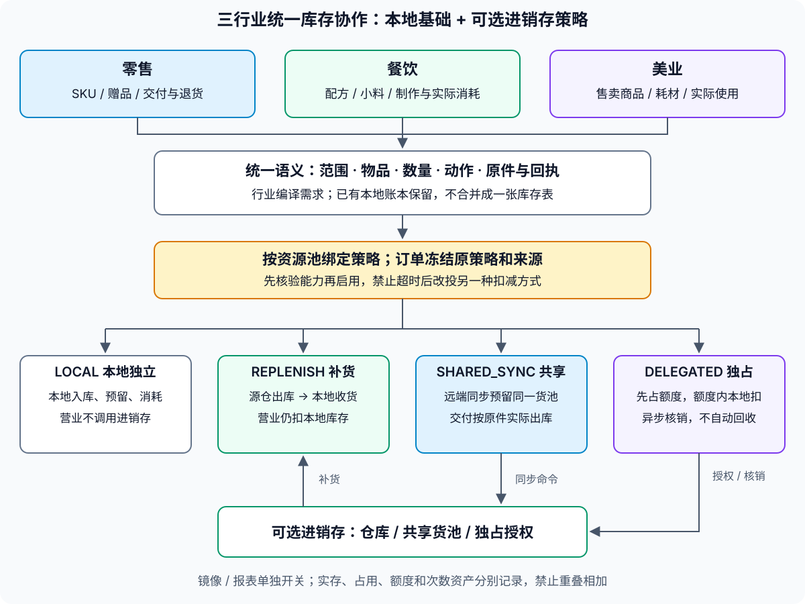

# TDD · 三行业简单库存与进销存统一对接方案

> 状态：统一方案草稿 · 2026-11-11。基础前提及四类策略沿用户已确认结论；具体接口、迁移和上线仍待分批实施。
> 档位：2。范围：零售、餐饮、美业；本次不讨论进销存内嵌部署，不修改业务代码或运行配置。
> 需求：[进销存需求§十四](../../requirements/进销存-需求.md)。决策：[ADR-046范围澄清与统一抽象](../ADR/ADR-046-进销存独立为服务与业态档案化.md)。
> 关系：本文是三行业统一主方案；[独立进销存TDD §8](./TDD-进销存独立服务与多业态.md)只讨论进销存执行引擎，§9保留餐饮补货及行业边界的详细例证；[餐饮既有镜像](./餐饮后端统一实施/04-可选进销存库存同步方案.md)继续作为现有合同真源，不因本文变成双向原生过账。

## 一、定位与目标（L1）

**三个行业都具备不依赖进销存的简单库存；统一库存范围、数量、需求动作、原件回执和对接策略，保留行业账本及业务节奏。进销存按需承担补货、共享货池或独占额度，不作为所有营业动作的强制前置。**

用户确认的边界：餐饮由进销存源仓出库、本地确认收货、制作消耗扣本地；零售默认同样本地扣减，共用同一货池时选择同步预留或独占额度；美业区分售卖商品与真实耗材，次数卡/余额及资源容量不当实物库存。本地指业务服务保存的简单记录，不指App设备离线缓存或内嵌进销存引擎。

目标是让同一套对接规则支持三行业，并能正确接入、断开、恢复、查询和对账。不是把三行业搬到同一张库存表，也不是将简单库存扩成采购、供应商、批次、财务成本核算的完整进销存。

## 二、方案选择与统一原则

| 方案 | 取舍 | 结论 |
|---|---|---|
| 各行业各建一套补货、消息和回执协议 | 行业代码容易起步，但重复入库、启停和原号恢复会分叉 | 不采用；协议及对接编排共用 |
| 把三行业全部放入一个库存服务、同一数量表 | 表面统一，但整数商品与小数物料、制作与服务阶段冲突，破坏独立营业 | 不采用；不迁走已有本地基础 |
| 统一语义/策略/对接协议，行业负责需求编译和本地账 | 保留既有模型，需要明确适配与能力边界 | 采用；先实现本地与补货，再逐步开放共享及独占 |

四条原则：

1. **同一数量口径有明确权威。** 默认本地营业数量归业务owner；共享模式归远端货池；独占模式的物理总账归远端、已授权使用权归本地。两边记录同一事实不等于两份实物。
2. **物理交接、逻辑额度、只读镜像是不同对象。** 收货可增加目标范围实存；额度授权不生成入库；镜像不产生原生库存出入库。
3. **业务原件决定后续路由。** 模式、owner、单位、映射、配方和授权引用在首次受理时冻结，历史动作不按当前开关或SKU归属重算。
4. **统一协议，不统一所有实现。** 复用现有领域和Port，保持原权限、原子语义与历史hash；不另造第二套通用库存数据库。

## 三、结构、模式与责任（L2）



图中行业适配负责解释“扣什么、何时扣”，策略负责“由谁执行”。本地基础始终可用，不代表明确选择共享货池的商品在远端故障时也能自动改成本地承诺；两者的可用性约束不同。

### 3.1 四种策略预设

下列名称为设计语义，不是现有 `stock-authority` 配置值；不能直接替换现有PLATFORM/DUAL/INVENTORY或FOOD_LOCAL原件字段。

| 策略 | 实物/数量权威 | 下单控制 | 实际消耗 | 进销存故障时 |
|---|---|---|---|---|
| LOCAL 本地独立 | 本地业务库存 | 本地原子预留 | 本地原件扣减 | 本地已有数量内照常营业 |
| REPLENISH 补货联动 | 源仓归进销存，收货后的目标范围归本地 | 本地原子预留 | 本地原件扣减，不再扣源仓 | 营业继续；新补货/远端确认等待 |
| SHARED_SYNC 共享同步 | 进销存同一货池 | 每单远端同步预留 | 原件交付/发货时远端出库；本地只留业务结果/读模型 | 该货池新单暂停，不回退LOCAL |
| DELEGATED 独占额度 | 物理总账归进销存，本地持明确使用权 | 已授权额度内本地预留 | 本地记录实际使用，异步原号核销远端 | 剩余已授权额度内可受理；补额度等待，实际履约能力仍需满足 |

默认LOCAL；有独立源仓补货选REPLENISH。同一货池被多个销售渠道共用时，SHARED_SYNC与DELEGATED二选一治理，不能各自复制余额。策略按真实资源池和物品能力启用，不按行业名字强行写死。

镜像/报表单独开关：LOCAL与REPLENISH可向外投影本地数量；SHARED_SYNC的本地读模型不反向覆盖权威库；DELEGATED投影明确区分权利余额与物理余额，不能把额度当实存。

### 3.2 分层职责

| 层 | 负责 | 保留的边界 |
|---|---|---|
| 行业业务层 | 零售交付、餐饮制作、美业实际使用，编译需求与返还处置 | 不自己调用另一行业数据库；不从付款推定物料已耗用 |
| 统一库存协作层 | 冻结策略及来源、按能力路由、聚合进度和恢复意图 | 不拥有另一份余额，不用全局bean优先级推测owner |
| 本地库存执行者 | 原子预留、消耗、释放、收货和有原因的调整 | 继续使用product/FOOD等真实owner及各自事务 |
| 进销存适配层 | 补货、共享原件、授权额度、身份/单位映射、系统凭证 | 只做必要跨合同转换；人和App不直连进销存 |
| 交接与同步 | 出库/收货关联、回执、Outbox、屏障、水位与差异 | 复用已有运输能力；不用跨库大事务绑定营业 |
| App / Ops | 库存模式和状态、到货确认、进度、原号恢复、异常处理 | 可售、实存、预留、额度、镜像延迟分别展示 |

## 四、统一业务抽象（L3）

以下是协议语义模型，不是要求一次创建同名Java类或表；实际类/字段应按§十一映射到现有合同，精确API和增量迁移在实施批次冻结。

### 4.1 范围与对象

| 抽象 | 必要事实 | 防止的问题 |
|---|---|---|
| 库存范围 | 租户、业务主体、库存owner、范围类型/编号、资源池身份；门店仅在对应范围必需 | 同名SKU跨店串账、把主体池复制给每店 |
| 库存对象 | 本地物品引用、种类、可选SKU、基础单位、精度与纳管状态 | 让无SKU原料伪装商品，或将服务次数当实物 |
| 需求计划 | 稳定来源/计划号、版本/hash、明细、数量、阶段和组件来源 | 换配方/赠品后按新定义重算旧订单 |
| 执行绑定 | 策略、真实执行owner/端点、资源池、绑定/映射版本、原件/额度引用 | 开关变化后改投另一方再次扣减 |
| 预留原件 | 原计划、占用明细、累计已耗/已释/已返、有效期与真实状态 | 重复释放、退超原量、超时释放已消费部分 |
| 数量变动 | 物品/范围、实际增减、原因、来源明细、操作人、时间、原命令/回执 | 只有最终余额、无法说明谁扣过一次 |
| 物理交接 | 源出库行/批次、目标范围、累计发/收/退和差异、收货分次原号 | 部分到货被记成全收，重试/重开重复入库 |
| 独占授权 | 权威池、授权号/代次、用途和目标范围、数量、占用/核销/归还水位 | 普通线上封顶规则被误当已锁住的真实库存 |

零售保留既有主体默认池与门店覆盖规则：某SKU无任何店级行时沿原主体量；有任意店级行后缺行的门店按原规则处理，不因统一抽象回退主体池。餐饮按实际门店物料；美业实物复用商品基础，服务耗材以真实本地定义为准。

共享货池的身份包括来源系统、账本owner和实际库位/池引用；不能仅凭“SKU相同”判断属于同一池。品牌或门店关联也不能自动决定库存产权与授权范围。

### 4.2 数量与额度

- 本地基础量沿各领域真实口径，通常为实存O、预留H及不可用B，`available = O - H - B`；没有B字段的领域不伪造已有实现。餐饮现有可用为O-H。
- 可售上限、线上份数和活动预算是额外约束，不是实物。最终可售是实际控制策略允许量再受渠道/活动限制，不把多个渠道都配置为全部可售后各自独立扣。
- 统一协议允许精确十进制数量及单位，但旧StockPort/预留合同仍为整数。整数适配器不能截断小数；现有FOOD_LOCAL支持小数，不代表远端已支持同样的精度/制作阶段。
- 单位换算必须显式、版本冻结、能精确表示。缺映射阻止该物品接入；已跟踪物品有流水后不能直接改基础单位解释历史。
- UNINITIALIZED/UNKNOWN、TRACKED、UNTRACKED与零库存分开；未知不能补0、补无限或自动换策略。

### 4.3 动作语义

| 动作语义 | 含义 | 行业适配要点 |
|---|---|---|
| 查询可用 | 当前权威或有效授权下的可承诺量 | 读模型允许延迟，但不可据其增加权利 |
| 预留RESERVE | 增加占用，不减少实存 | 原子条件防负数；同原号可查回 |
| 受理/分配ACCEPT | 确认原占用按生命周期受理 | 不统一解释成“已付款”，不必然实际消耗 |
| 消耗ISSUE | 按原件记录实际销售/制作/使用 | 支持阶段、分次及累计上限 |
| 释放RELEASE | 仅释放未消耗部分 | 不自动把实存加回，不归还仍有效的整个独占授权 |
| 收货RECEIVE | 实际接收一次物理交接 | 不将额度授权或镜像快照当入库 |
| 返还RETURN | 按原消耗和实际处置接收可回收量 | 钱款退款、服务取消不自动代表实物回库 |
| 调整ADJUST | 有原因/凭据的本地盘点差异 | 只调对应范围，不覆盖并发销售或远端源仓 |
| 查询原命令 | 返回实际已发生结果与明细证据 | 未收到、已拒绝、未知和成功分开 |

不能直接重命名旧方法再套新时点：StockPort的V1 confirm有实扣语义，V2则按付款分配与履约出库拆分；适配器必须读取原生命周期和真实回执。已通过I01的hash、操作号、claims及留存封印继续沿用。

分次操作明确是增量还是累计目标。重试使用首次持久化的参数/数量语义，不在恢复时重新计算成另一份增量。资金、活动预算、资源容量保留各自owner，不塞入通用库存动作。

### 4.4 行业需求编译与冻结

- 零售：真实SKU、数量、门店/货源、履约行、实物赠品；冻结实际货源及生命周期。
- 餐饮：原销售组件、配方/小料/组合模式、叶子物料、小数数量和阶段；SALES_SKU与COMPONENTS选原确定的一条消耗路径。
- 美业：售卖SKU或实际耗材项、包装/基础单位、服务任务和实际用量依据；预约可占用、真正使用才消耗，不把COUNT完工证据当耗材issue。

在首次库存操作前从可信业务来源确定策略并持久化计划/路由；后续查询、履约、取消、退回和机器恢复沿冻结原件。操作人不能通过前端传入策略/owner绕过真实归属。

多执行者的组合计划按真实owner/策略分组。owner内原子；跨owner先留可靠准备意图、分别预留，明确拒绝后补偿已成功组，UNKNOWN组先查回。计划尚未完整准备时不宣称全部成功；实际消耗后按部分履约收口，不假装跨库可以自动回滚实物。

## 五、三行业应用方案

| 行业 | 简单库存对象 | 占用/消耗时点 | 默认对接 | 共享/独占适用边界 |
|---|---|---|---|---|
| 零售 | 商品SKU、赠品、门店或主体池数量 | 下单占用，交付/发货消耗；未交付取消释放 | LOCAL或REPLENISH | 多渠道共享同池时SHARED_SYNC或DELEGATED；实际出库范围必须相同 |
| 餐饮 | 原料、配料、小料、包装、可选成品 | 接单预留，制作/交付按原计划分阶段消耗 | LOCAL或REPLENISH，单向镜像可选 | 标准包装商品可按零售；原料共享须先支持小数、配方叶子和制作阶段，不直接套整数接口 |
| 美业 | 售卖商品、门店领用耗材 | 商品按零售；预约按策略占用，实际使用消耗耗材 | LOCAL或REPLENISH | 高价值共用物品可选共享/独占，需原执行留存和实际耗用证据；外部能力不足则禁止该策略 |

三个行业均支持统一策略框架，不表示当前每个适配器已具备全部策略。预检按物品/执行者能力准入，不支持就明确拒绝，不悄悄降级。

餐饮制作前取消释放未用量，已加工原料按实际损耗/可退处置，不自动返原料。每日份数不等于原料库存。美业开一瓶50ml到操作区和每次消耗5ml是范围交接与实际用量，不能同池既扣整瓶又扣50ml；分装能力需另验。次数卡/余额由资产系统管，技师/房间/椅位由资源系统管，均不是本方案实物库存。

## 六、补货、退仓与镜像统一协议

### 6.1 补货闭环

1. 确定目标业务范围、映射/单位版本和稳定补货号；源仓按实际出库行过账，保存待投递事实。
2. 业务侧建立待收货原件。运输中不增加可用；同场交接可连续完成出库和确认。
3. 有权人员确认实际数量，分次/短缺/破损留明细；正常收货与异常处置累计不能超过实际源行交接量。
4. 本地数量、变动、收货回执及必要Outbox同事务提交，事务外ACK。未收到ACK不能再造另一笔收货。
5. 已出未入、已收未ACK、部分差异可查原单；没有凭据的手工补数不能冒充远端收货成功。

例：源仓100发20→源仓80/在途20；本地收20→本地20/在途0；业务消耗3→本地17，源仓仍80。镜像显示本地17不额外算一份库存。

真实退仓是反向交接：先在本地控制未被占用的可退量，发出扣本地，源仓实际验收后入仓。顾客退货、退餐或退款不能同时增加本地和源仓。

### 6.2 幂等、版本与防循环

- 物理交接按源系统/账本/源出库单行/实际批次与稳定收货分次/动作去重，并限制原行累计数量。不能靠换请求key多收，也不能因接入generation变更再次入同一批货。
- 镜像按接入代次及sourceVersion应用绝对快照；重复不累加、旧版本不覆盖、新代次重新基线。物流去重与镜像版本是两种不同边界。
- 保留origin/cause：远端出库引发本地收货后，不再把该本地增加发回远端生成一张新入库。镜像和真实过账不能循环转换。
- 源仓出库及发送意图同本库事务；目标收货及回执同目标事务。复用现有Outbox/命令日志，不创建第二套消息运输队列，不在本地库存锁内RPC。

### 6.3 快照、报表与成本

默认镜像仅用于查询/对账，进销存原生余额不能自动承接本地快照。盘点各自管理的范围；本地盘点不调整源仓。对账比较相同版本/水位、单位和范围，异步分页观测不宣称同一瞬间全局一致。

本地只需数量也能营业；有真实来源成本可附带凭据，没有则未知。不得由售价、活动预算或估算配方成本伪造真实毛利。现有FOOD镜像不含成本，不因本方案自动扩展为估值或财务核算。

## 七、共享货池同步预留

适用于多个独立渠道确实售卖同一池货，而不是不同仓库各自有自己的货。

1. 下单前调用权威库存同步预留，保存原号/计划/hash和实际原件。成功才承诺该池数量；缓存不能承诺。
2. 付款/受理按原生命周期确认，交付时以原履约号实际出库；不在下单、付款、发货各扣一次。
3. 未交付取消释放原占用；已交付退货核验原出库上限与真实收货，保留I01原件合同。
4. 网络超时先查询原号；不能改投LOCAL、改新号或以另一库余额补偿未知结果。
5. 远端故障时该池新单暂停，其他LOCAL/REPLENISH池不必停。已确认的资金事实保留，实际发货未确认不能宣称成功；取消订单迟到款继续人工原单退款，不自动重抢货。

这是显式可选策略的可用性取舍，并不否定产品在不接进销存时具备本地库存基础。

## 八、独占额度协议

### 8.1 授权不等于补货

权威库存先把真实可用量的一部分排他占给指定业务池，其他渠道不能再使用；本地在这份权利内原子预留/消耗，异步核销。**授权没有移动实物，不生成本地入库，也不能把授权4与总实存10相加成14。**

普通MANUAL/CAP/RATIO等线上可售规则只是限制展示或销售上限，现有StockSync写回也不等于已排他占用；没有源端持久授权原件和撤回屏障，不能启用DELEGATED。

### 8.2 计量与示例

对某一授权，定义总授权G、未用F、本地占用H、已用待确认P、已核销C、已安全归还R：`G = F + H + P + C + R`。P是实际已用且尚未取得权威核销回执的量，不能重新销售或回收。

| 步骤 | 权威实存 | 授权未结占用 | 其他渠道可用 | 本地授权状态 |
|---|---:|---:|---:|---|
| 原货池10，授权门店4 | 10 | 4 | 6 | F4 |
| 本地交付1，尚未回传 | 10（账面待追平） | 4 | 6 | F3/P1 |
| 权威确认原号核销1 | 9 | 3 | 6 | F3/C1 |

权威端实际核销必须同事务减少实存和对应授权占用，并保存回执。其数量约束还要计入普通预留及不可用量；不能只检查授权表。该场景本地占用已包含在授权4中，不再额外向远端重复预留。

### 8.3 核销、关闭与退回

- 授权申请先持久化稳定意图，远端原号可查。申请或回包未知时不假定有新额度，也不换新号重复申请。
- 本地F→H、H→P使用同一业务库存事务和永久命令回执；原号核销确认后P→C。取消未耗用订单H→F，不代表把整份授权归还远端。
- 关闭先禁止新使用，处理H和P，并用本地终止水位/权威回执证明未结状态；只把已确认未用F安全归还。**不能到期就自动把未上报的使用权释放给其他渠道。** 若设置有效期，到期只阻止新使用，不等于已归还；失联保持源端占用并进入核对。
- 实物退回先记录原实际收货及原消耗上限。需要重新可售的授权量由权威确认并以明确重授/补充命令产生；不能本地退款后自行给F加量。
- 授权绑定实际履约范围。门店已有货且可本地交付时可在额度内继续；如果仍需远端仓库发货，额度内接单不意味着库存服务故障时也能完成发货。App设备离线销售仍另立范围。
- 同一授权的多个业务实例必须共享该本地持久化计数或再做排他拆分，不能每台设备各缓存一份F4。

独占授权是新增完整状态协议，当前独立库存预留API及现有额度规则不构成已实现证据；实施时需受控扩展库存能力，不伪造销售订单占库。

## 九、启停、策略切换与历史原件

### 9.1 补货/镜像接入

LOCAL↔REPLENISH不迁走本地账本。先预检身份/映射/单位与原号恢复，记录既有余额和来源边界；本地17就仍17，不重新导入源仓或历史出库。

关闭只停止新联动，已有在途、未知回执和退仓原件受控收尾；已接受旧单不因OFF丢失，也不能借历史收尾接收新的未授权旧单。重开新的接入代次，但物流去重跨代次。镜像关闭屏障与实际物流收尾分别管理。

断开期间人工到货保留凭据；复联后关联同一批来源，不再加一次。不具备稳定来源号时标待核对，不承诺自动认定两笔是同一实物。

### 9.2 共享与独占策略的切换

| 切换 | 必须完成 | 禁止 |
|---|---|---|
| LOCAL/REPLENISH → SHARED_SYNC | 针对真实同池核实基线；冻结新受理；旧预留在目标被同量占用并建立受控原件映射，或先完成/隔离旧池；目标准备后发布新绑定 | 只切新单但让远端再次售出旧本地已占用量 |
| SHARED_SYNC → LOCAL | 围栏停远端该池新消费，排空未知命令，转交真实独占范围及原件后再开放本地 | 复制缓存可用量后两边继续卖同一批货 |
| SHARED_SYNC ↔ DELEGATED | 共享原件与授权不重叠；完成原单/授权水位，按实际未占量分配新权利 | 将已占订单再占为额度或到期盲收授权 |
| DELEGATED → LOCAL/关闭 | 原授权H/P有明确处理，剩余F安全归还或合法转成交接范围，本地实物与使用权分别对账 | 把剩余额度当成已收实物，或只关开关释放远端占用 |

策略按可独立核对的资源池/物品配置，确定性选择，先支持整池及显式物品绑定；不让SKU在未结操作中任意换池。主体默认池不能因某门店切模式被复制成新的同义货池。

**原件授权与当前实物入账目的地分开。** 旧订单的退款上限/claims仍由原件证明，但若同一实物池已经迁交给新权威，历史退货不能向停用旧本地可售量和新权威各加一次。须有受控迁移证明绑定原owner/原行与新接收范围，并保留同一退货的永久去重；或将旧池实际隔离保留收尾。此能力没有完成前，不开放有历史混合业务的在线权威切换。第一批共享/独占从新池或严格对账后的明确范围启用。

绑定发布与库存权利交接不是一个普通开关更新。所有受影响执行者需完成写入围栏/在途排空，未知目标写入先查回；目标已产生新变更时回滚需反向迁回完整增量和原件，不能恢复旧快照覆盖新销售。这里复用独立服务TDD的受控交接原则，不把它套到不换权威的LOCAL↔REPLENISH上。

## 十、协议、权限、状态和运营

### 10.1 合同能力清单

| 能力 | 输入/输出重点 | 复用方向 |
|---|---|---|
| 本地库存控制 | 范围、冻结计划、预留/消耗/释放/返还及原回执 | product StockPort/StockDisposition、FOOD_LOCAL，保留历史语义 |
| 接入绑定预检 | 策略、池/物品、单位/精度、身份、目标能力和绑定版本 | 接既有商家门店及商品定义；不能以远端健康代替能力准备 |
| 补货/收货/退仓 | 源出库行、实际交接分次、累计量、目标业务类型、原回执及差异 | 复用原生出入库与各行业本地执行，新增受控交接桥接 |
| 共享预留 | owner/池、原订单计划、生命周期、确认/出库/释放/查询 | 现有inventory-client及I01，不经本地重算原件 |
| 独占授权 | 原申请、授予量/用途/范围、使用核销、水位、关闭/归还及查询 | 新增能力合同；没有对应现成额度API可直接替代 |
| 镜像/对账 | scope、sourceVersion/generation/hash、原syncNo、延迟与差异 | 沿餐饮现有快照/会话/回执模式复用，保留原wire兼容 |

能力预检至少分辨原号查询、精确单位、部分交接、共享预留、授权独占/围栏以及行业阶段支持。外部服务不支持的能力不能只在界面开放开关。服务系统凭证限定目标实例和owner，业务端判人的权限与门店范围；客户端不能选owner、成本、授予额度或迁移目的地。

### 10.2 状态与恢复

- 业务状态、数量状态、接入配置状态、投递状态和对账状态分开。例如镜像ACTIVE不代表已追平，出库完成不代表收货完成，工单完成不代表耗材已出库。
- 统一观察区分已成功、明确拒绝/未受理、处理中和未知；沿已有原号查询能力持久恢复，不制造多个同义重试队列。
- 恢复参数在首次执行前持久化，切身份/门店后不得沿旧表单继续新写；App重启后用原号查询，不从新余额重新生成动作。
- 报表显示来源、范围、单位、同步时间/版本与未决量；差异不自动用较大数覆盖较小数。库存成本与资金核销仍按各原owner的真实事实，不混为一笔成功。

## 十一、代码复用、持久化归属与实施顺序

### 11.1 现有实现映射

| 所属模块/真源 | 当前能力 | 本方案处理 |
|---|---|---|
| shop-core `ai.neargo.shop.product.port.StockPortImpl`及product实体 | PLATFORM整数SKU/主体和门店库存、锁定、原件回补 | 作为零售及美业售卖实物的本地执行，补齐必要来源变动，不迁入inventory-domain |
| shop-base `ai.neargo.shop.spi.product.StockPort` / `StockDispositionPort` | 原件、预留、生命周期及实际回执 | 适配统一语义，不批量改旧签名、hash和authority枚举 |
| shop-base `ai.neargo.shop.spi.food.FoodLocalStockPort`；backend-plugins/shop-industry-food | FOOD_LOCAL小数、分阶段、原命令和镜像 | 餐饮执行真源；补货收货必须经其本地事务，不能用镜像apply代替 |
| shop-core `ai.neargo.shop.trade.stock.IndustryStockOwnerRouter`及FoodStockBridgeJournal | 可信来源选owner、冻结wire/请求后RPC | 演进为策略/能力明确选路，保持旧来源；不注册多个全局同SPI再靠@Primary选中一个 |
| shop-app invbridge及shop-inventory适配 | 远端路由、旧DUAL镜像、可售规则和写回 | 按范围/策略保留兼容，不能将旧全局stock-authority直接推广为三行业开关 |
| inventory-api/client/domain/svc | 原生仓储、预留、I01、系统凭证与对账 | 共享策略复用；补货增加业务本地接收目标；独占协议单独扩展，保持不import shop业务代码 |
| 美业Core执行与PLATFORM留存component | 实际执行封印和原库存留存 | 继续沿原证明；小数耗材/分装/实际issue未具备的部分增量补齐，不能用资源释放伪装库存消耗 |

统一的是能力语义和受控编排，不要求把StockPort与FoodLocalStockPort硬合并成一个巨型接口。新增跨域能力放既有shop-base的能力所属SPI；进销存服务保留inventory-api自身纯契约，由宿主桥接做必要转换，不依赖shop-base业务契约或food类。仅有独立契约/部署需要才拆模块，不为每层新增Maven模块。

### 11.2 数据归属与最少新增范围

- 原余额、锁定、消耗、返还记录继续由product、FOOD或真实业务owner持有，独立部署也不跨库直接写。
- 接入绑定/物品映射、交接原件与行、收货/退仓回执、投递状态需要持久化；先核对可复用的命令、FOOD同步及业务桥接记录，再确定增量表/字段，不能将mirror表当所有交接台账。
- 新独占授权源端原件归库存池owner，本地权利计数和使用回执归被授权业务owner；两边各有本地事务与原号约束，不放一个双方共享可改数据库。
- 统一不意味着把三行业表都加到库存独立库；不新增第三份权威余额。
- 不改已执行迁移；新增结构必须冻结并生成相应投影。代码/字段命名、输入校验和验证仅遵循项目Java规范§八，不在本方案另设一套规则。

### 11.3 分批实施（I04下子步骤，不增加原25项任务）

| 批次 | 范围与交付 | 出口 |
|---|---|---|
| I04-A 基线与选路 | 盘点三行业真实写路径，冻结策略/来源语义，LOCAL明确选路与能力预检 | 未装配进销存仍能执行基础本地业务；旧原件保持兼容 |
| I04-B 餐饮补货闭环 | 源出库→待收→FOOD_LOCAL实际收货→ACK/查询/差异/退仓 | 同原行累计受限，重复/断响应/跨代次不多入；制作仍只扣本地 |
| I04-C 接入与恢复 | 启停、旧在途收尾、镜像屏障、App原号恢复和对账 | 本地17启停后仍17；旧单不丢、旧陌生单不借机新入 |
| I04-D 零售复用 | SKU/赠品/主体与门店池、线上配额与实物界面区分 | 补货不重复，交付扣本地，旧写回不混用权威 |
| I04-E 美业复用 | 商品及耗材实际用量、必要小数/包装映射与执行留存协作 | 实物、耗材、次数资产与容量分开；实际使用不双扣 |
| I04-F 共享同步 | 复用I01，共享池、能力预检、断连原号恢复及受控切换 | 新池并发无超卖，错误策略不降级，旧原件迁移条件有证明 |
| I04-G 独占授权 | 授予、使用、核销、关闭/归还与原号恢复完整协议 | 权利总量守恒，失联/到期不错误重放额度，原回执一次 |
| I04-H 营业准出 | 实际三行业App/身份/部署、任务接管、备份恢复和监控 | 按行业/策略能力逐项准出，不以一条client样本替代所有模式 |

优先A→B→C，餐饮先验证后复用零售/美业。共享及独占是显式能力批次，不阻塞基础简单库存和补货上线；但没有完成的能力不可开放。已完成I01/V28/166独立client证据继续复用，不宣称是本方案全链验收。

## 十二、验收矩阵（设计→验证）

本表为计划验收，不是已运行测试名。实施时绑定实际方法和环境证据，只按变更影响增量验证，不因统一抽象强制重复全仓或全部模式交叉跑。

| 编号/需求 | 必须识别的反例 | 通过标准 |
|---|---|---|
| US01 本地独立 | 进销存关闭/不可达，LOCAL被错误拒单 | 三行业本地已确认数量内业务成立；缺货/未知仍拒绝 |
| US02 物理补货 | 原出库行换key/跨generation重复入库；发20到18 | 收18、差异2有据；最多原实际量；响应丢失查回一次 |
| US03 本地消耗 | 源仓100发20、制作或销售3后又扣源仓 | 源80、本地17，镜像不重复加总 |
| US04 行业阶段 | 赠品漏扣、菜品与配方双扣、COUNT完成冒充耗材issue | 冻结计划一次展开；只按实际阶段扣，取消/已用返还正确 |
| US05 数量语义 | 小数被整数截断、箱数当g、空值当无限 | 明确能力/单位与版本，不支持即阻止接入 |
| US06 启停恢复 | OFF丢在途、重开重灌旧数、人工已收又补入 | 余额/预留不因开关变化，旧合法原件能恢复，新非法旧单拒绝 |
| US07 共享预留 | 两渠道各卖同一库存、超时后改投LOCAL | 权威池并发不超卖；已提交未知沿原号恢复 |
| US08 授权独占 | 全局10授权4后其他渠道仍可用10 | 其他渠道最多6；本地F/H/P/C/R与源端数量核对一致 |
| US09 授权失联 | 本地已用1未上报、到期把4全放回 | P不重售/不回收；原号核销后权威实存9、未结3、其他可用6 |
| US10 授权关闭/返还 | H/P未处理就关、退款自行补本地额度 | 仅安全未用量归还；实物与权利原件分别确认 |
| US11 历史与切权威 | 旧本地预留未占目标量、历史退货两库各加一次 | 原件/迁移证明或真实池隔离成立，否则拒绝切换 |
| US12 权限/可靠性/运维 | 错店/错池、回包丢失、重启换参数、任务积压无感 | 真实身份隔离、永久原号与水位恢复、可查差异；恢复演练后真实运行账号可营业 |

## 十三、取舍、待实施及文档关系（L4）

1. 本地默认与餐饮补货路径已由用户明确；四策略范围沿最近零售结论统一。本文给出统一设计，不代表新字段、授予协议、精度扩展或切换工具已实现。
2. 同一物品策略绑定、原件证明和行业能力要一致；不提供任意组合开关。第一版先覆盖整池及明确物品，是否增加分类继承由实际目录需求决定。
3. 不承诺App设备离线、多终端各自扣库存、零暂停切换或任意旧商家自动迁移。已有库存基础可独立，不代表共享/独占可无条件自动脱离权威池。
4. 真实库位、物品、单位、暂停窗口与目标实例在各批启用记录填写；不以本文示例数量或166合成ref替代真实商家验收。
5. 本文优先规范三行业共用业务边界；现有餐饮镜像wire、零售旧库存模型、I01历史摘要和各原件仍由其原合同解释，不因本文术语变化自动升级数据。
6. 前期§8引擎迁移和§9补货方案继续保留追溯；本文作为统一主方案，新增实施与验收映射在本文维护，避免两处复制相同契约。

本次交付仅为设计：一次只读可实施性复核无重要遗漏；受影响文档相对引用、主文档索引、SVG的XML/title/desc与浏览器渲染、25项任务元数据结构及文档diff检查通过。没有运行无关业务测试、全库生成器或重复全库文档检查；既有文档规范存量失败未在本批修复，不据此宣称全仓检查通过。

## 十四、I04-A 实施计划与执行记录（2026-11-11）

> 用户明确执行I04-A，其他任务暂停。档位1实施，沿本TDD和ADR-046已确认边界；当前codex/food-next01共享工作区仅改本批路径，保留其他会话改动。验证按Java规范§八编码后集中执行，不额外做基线全仓检查。

### Task A1：统一只读能力合同、LOCAL选路与真实本地事实

- 创建shop-base `ai.neargo.shop.spi.product.LocalStockControlPort`：可信Scope、行业/策略/物品/动作、预检请求、选路、可用事实与明确问题；HTTP输入由Jakarta校验一次。创建`LocalStockFactsPort`作为按真实owner索引的本地事实能力，既有StockPort/FoodLocalStockPort不改签名。
- 创建shop-core product的`LocalStockStrategyPolicy`、`LocalStockControlService`与`LocalStockControlServiceImpl`：LOCAL零售/美业SKU→PLATFORM，餐饮→FOOD_LOCAL；未实现策略/次数资产/资源容量拒绝，无默认进销存回退，不更改历史IndustryStockOwnerPolicy。
- 扩展`StoreStockReader`的只读观察，共用原主体/门店覆盖判据，旧available/total语义保持；新增product port的`PlatformLocalStockFactsPortImpl`与`FoodLocalStockFactsPortImpl`，仅读实际原账。多市场歧义、缺单位/未初始化、小数整数不兼容、FOOD未装配等明确返回问题，不猜0或无限。
- 选路描述仅为可复用查询结果，不是已发布策略绑定/迁移授权。预检不改订单入口；既有订单继续沿冻结authority/owner，不能将未建好的PLATFORM需求计划适配器谎报为行业全流程已切。
- 测试先写合同/策略与真实本地事实场景：三行业选路、非LOCAL不降级、次数/容量拒绝、零售门店缺行不回退、主体池、多市场/单位与精度、FOOD精确小数与未装配拒绝、只读不变原账。后续正式写入继续走既有原子Port。

### Task A2：受权预检入口与增量验收

- 创建product `BizLocalStockController`及`LocalStockAccessPolicy`，`POST /biz/stock-control/preflight`，复用BizPerms.STOCK；tenant/entity/store来自登录和真实门店范围，禁止body传任意owner或范围。industry是能力诊断画像，不用于修改门店行业/订单来源，不接受客户端将预检回执作为写入凭据。
- 此入口属于三行业本地基础能力，在`ShopStoreMemberRoutes`只登记精确POST路径，不误挂END_RETAIL，不放开其他方法或路径。
- Controller只调Service，不接Mapper；预检只读，无迁移/配置写入/远端库存调用。REPLENISH、SHARED_SYNC、DELEGATED本批只明确报未开放，I04-B以后再实现。
- 集中验证受影响模块编译、合同/策略/Service、MySQL9原生本地事实及只读、权限/MVC输入边界和宿主路由；FOOD桥接使用现有本地合同验证且不改wire。原StockPort原子库存及历史owner测试仅按实际改动选择必要兼容用例，不重复I01/166全链。
- 完成后一次fresh-context整批复核；只对实际发现问题增量修复验证，补本节需求→实现→证据。未授权发布，不部署或切writer。

执行状态：**A1/A2本地实现及增量验证完成**。I04-A交付时I04整体未完成，I04-B～H尚未执行；后续I04-B进展以§15为准。没有部署、切换writer或修改既有订单入口。

### 14.1 已落地合同与边界

正式只读接口为`POST /biz/stock-control/preflight`，合同见[LocalStock OpenAPI](../../api/local-stock-control.openapi.json)。请求示例：

```json
{"industry":"FOOD","strategy":"LOCAL","itemKind":"MATERIAL","itemNo":"RAW","baseUnit":"G","quantity":0.125,"actions":["QUERY","ISSUE_PRODUCTION"]}
```

登录用户必须具有商家MAIN身份及STOCK权限；主体、门店取真实登录范围与门店目录，`X-Store-No`须在授权范围内。请求不能注入entity、tenant或owner。宿主仅登记上述精确POST基础路由，不以零售套餐权益阻断三行业本地诊断，也不开放其他方法或激活接口。

| 项目 | 本批实际行为 |
|---|---|
| 本地选路 | LOCAL零售/美业售卖SKU读取PLATFORM，餐饮读取FOOD_LOCAL；非LOCAL返回STRATEGY_NOT_ENABLED且不查询本地事实 |
| 原账读取 | StoreStockReader复用主体/门店覆盖规则；SKU已有任一门店行即按门店管理，目标门店缺行仍为0，不回退主体余额 |
| 数量与未知 | PLATFORM仅整数；FOOD最多6位小数。单位须明确匹配；未初始化、多市场歧义、未装配执行器等返回明确问题，可用量未知保持null |
| 能力边界 | 只声明既有真实Port支持的动作；美业小数服务耗材、次数权益与资源容量不冒充已支持实物库存；未跟踪库存仅允许查询 |
| 写入与兼容 | 不新增余额表，不改StockPort/FoodLocalStockPort签名；旧PLATFORM/DUAL/INVENTORY及FOOD_LOCAL/LEGACY_INVENTORY来源保持原语义 |

预检的allowed只表示本次观察满足诊断条件，不是原子预留、库存写入凭据或绑定激活证明。正式扣减仍走原Port的事务与原件校验；本批没有将所有订单写路径改接新抽象，也没有接通补货收货、共享或独占授权。

### 14.2 实现与验证证据

| 范围 | 实现/用例 |
|---|---|
| 共用合同与编排 | shop-base LocalStockControlPort/LocalStockFactsPort；shop-core LocalStockStrategyPolicy/LocalStockControlServiceImpl |
| 原账适配 | StoreStockReader、PlatformLocalStockFactsPortImpl、FoodLocalStockFactsPortImpl；不依赖远端inventory调用 |
| 受权入口 | BizLocalStockController、LocalStockAccessPolicy；ShopStoreMemberRoutes精确登记 |
| 合同/策略 | LocalStockControlServiceTest：7方法；三行业来源、未开放策略不降级、精度、能力、缺失/重复执行器、历史来源兼容 |
| 身份与输入 | LocalStockPreflightApiTest：3方法；实际Spring方法权限/MVC、门店范围、身份字段注入及参数校验 |
| 原生本地事实 | LocalStockPreflightNativeMysqlTest：3方法；真实MySQL9 3308、实际MyBatis映射及FoodLocalStockPortImpl查询，前后数据快照不变 |
| 兼容与宿主 | DishOfferQueryPortTest：4方法；IndustryStockOwnerPolicyTest：2方法；IndustryHostRoutesTest：7方法（本批新增1方法） |

受影响主代码编译成功（shop-app及依赖模块）。以上共**26个不同测试方法分组取得通过证据**，其中含3项MySQL9原生用例；首轮25通过、1个既有菜品促销测试使用旧flashPrices桩失败，按现有flashOffers合同修正测试桩后仅重跑该失败方法并通过，未改变促销生产逻辑。证据为本机`/tmp/i04a-main-compile.log`、`/tmp/i04a-targeted-tests.log`、`/tmp/i04a-dish-fixture-incremental.log`。

原生用例按方法建立并清理隔离i04a_*测试库，仅建5张实际映射所需表，验证原账读取及只读性；不是全迁移、完整宿主启动、真实App或166营业验收。一次独立上下文整批代码复核未发现P1/P2。没有重复I01/166链路、全仓测试或全量文档生成，不能据此宣称US01～US12或I04整体验收通过。


## 十五、I04-B 餐饮补货闭环实施计划（2026-11-11）

用户在I04-A完成后明确继续下一批。本批复用源仓既有出入库过账，不改变本地营业扣减；其他任务仍暂停。实现方式由本批确定：宿主使用系统凭证拉取已过账源行，永久FOOD交接及回执作为待收/已收事实和恢复依据，不再叠加通用Outbox。ACK指已持久化的目标回执，可经原交接查询；不伪造源服务已收到额外推送ACK。源实例标识须由服务端稳定配置，不随接入代次/URL变化。

### B1：可信源行与交接合同

- [x] inventory-api新增ReplenishmentContracts，inventory-domain新增ReplenishmentQueryService及实现，inventory-svc新增只读ReplenishmentController；inventory-client通过原InventoryHostApi/InventoryClient查询。出库只允许已过账INTERNAL、唯一STORE目标、无逐件/成对调拨；原行单位取单据快照。退仓验收只认已过账RETURN及原sourceRef。权限复用系统凭证的owner隔离。
- [x] shop-base新增StockReplenishmentSourcePort和FoodStockReplenishmentPort，shop-app invbridge新增真实client适配，源实例由shop.inventory.replenishment.source-system配置，owner由可信商家解析，不以客户端owner或本地引擎切权威为前提。
- [x] 用例：未过账/非领用/错误门店/序列或成对调拨拒绝；单位取原件；真实客户端合同保留精确数量；源不可达不新增待收记录。

### B2：FOOD原账实际收货、差异与退仓

- [x] food-core新增FnbStockReplenishment、FnbStockReplenishmentReturn及Mapper和V38增量迁移。原源实例/owner/单号/行号永久唯一，不含generation；同原行换映射或目标拒绝。不新增第三份余额。
- [x] FoodStockReplenishmentPortImpl.register冻结物品/基础单位/换算倍数和实际源量，且核对本地已初始化TRACKED。receive按累计实收量只入增量；close将剩余量确认为差异并关闭；dispatchReturn按累计退仓量只扣可退增量；ackReturn核验真实源入库行并累计受发出量约束。原账、流水、命令结果及交接更新同事务；无库存锁内RPC。命令复用fnb_stock_command，镜像只capture原本地事实。
- [x] FOOD内部HTTP/Remote适配沿原签名范围，宿主product Service/Controller对接并校验MAIN商家、STOCK和真实门店；只公开FOOD批次精确方法，不能从body注入来源或身份。
- [x] 原生MySQL9用例：源发20待收不加量，分收18/20只入20，重试/换key/跨代次不多入，关闭18差异2，制作3本地17源不再扣；错误单位/目标/并发累计上限、余额被占用时禁止退仓；退仓本地先扣、源真实收货才确认，源入库行重复/换原件不能多确认；响应丢失查原永久回执。

### B3：集中验证与收口

- [x] 编译受影响inventory、宿主与FOOD模块；集中运行合同、源查询、原生收货/退仓、HTTP权限/远程适配及必要旧账兼容测试。有效证据不重复执行，失败只重验受影响部分。
- [x] 一次独立上下文整批复核，重要问题增量修复；更新合同、原25项清单I04和本节证据。不部署、不签发凭据、不切writer，不将服务测试夹具冒充真实App营业验收。

### 15.1 已落地行为与合同

I04-B本地实现与增量验证完成。正式合同见[补货OpenAPI](../../api/stock-replenishment.openapi.json)。本批只实现餐饮补货原件闭环，统一预检的其他策略仍未开放，不将补货回执当成已激活策略绑定或营业扣减授权。

| 入口/动作 | 实际行为及边界 |
|---|---|
| POST /biz/stock-control/replenishments | 请求源单号、源行及本地Mapping；宿主拉取真实源事实后建立PENDING，冻结源实例/账本/物品/单位/数量、本地物品/单位/换算倍数；不增加余额 |
| GET /biz/stock-control/replenishments/{no} | 按真实商家/门店读取当前进度；不可借编号跨范围读取 |
| POST /{no}/receive | cumulativeQuantity为本地基础单位累计实收量；只记增量，累计不得超过冻结交接量；相同累计换key也不多入 |
| POST /{no}/close | 将未收剩余量确认为差异，记原因并关闭；关闭后禁止补收，不把差异自动调整到任一库存 |
| POST /{no}/return-dispatch | cumulativeQuantity为累计实际退仓发出量；只能退已收上限内且未被占用的本地量，发出时一次扣本地 |
| POST /{no}/return-ack | 请求实际源入库单及行；只认已过账RETURN、同源实例/owner/item/unit及sourceRef=本交接FRP号，累计验收不超过已发出退仓量；不再扣本地 |
| GET /commands/{action}?key=原键 | 永久原命令结果；旧键返回当时结果快照，不用当前进度替代。data=null表示该本地命令未提交，不把源/FOOD超时当不存在 |
| 库存服务GET /api/inventory/v1/replenishment-facts/{outbounds或inbounds}/{no}/lines/{line} | 只读物理原件，owner由已有凭证守卫解析，出库限已过账INTERNAL、明确STORE去向且无逐件/成对调拨。支持旧控制台单头STORE及新目标快照，矛盾拒绝；单位来自原单行 |

动作路径均以`/biz/stock-control/replenishments`为前缀。写入与正式查询继续受END_FNB餐饮权益、STOCK权限及MAIN真实商家/所选门店约束；请求不得指定源owner、源实例、tenant或操作人。FOOD独立部署新增InternalApi/Remote适配，复用InternalHttp的FOOD令牌、完整body签名和entity/store/actorNo范围核对。HTTP body输入用现有Jakarta框架校验，不在业务设计复制输入规范。

新增V38两张交接表不持有可售余额：fnb_stock_replenishment按永久源行唯一，fnb_stock_replenishment_return按真实源退仓入库行唯一。原fnb_stock_balance、fnb_stock_movement与fnb_stock_command继续持有本地余额、变动和永久回执；对应更新同事务，镜像仅capture原账，不把增加生成另一张源入库单。发布迁移须包含V38，启动合同已补新表列、DECIMAL(24,6)及数量检查约束。

源实例必须配置稳定的`shop.inventory.replenishment.source-system`，并复用已有shop.inventory.service的独立客户端和系统凭证；未配置或执行器不唯一即拒绝新源查询，没有内嵌或LOCAL回退。没有修改任何现有商家writer，也不依赖将营业库存切成远端。先源出库、后显式拉取待收；未拉取的原单仍可由既有源单/事件查询恢复，不宣称已实现自动推送任务。

ACK是目标已提交、可查询的永久回执，不是虚构“源端已收到推送”。源仓退仓单仍走现有正式入库流程，本批只查验它真实过账；验收数量不等于解除源仓冻结或已可售。运输损失和关闭差异留在交接原件，不自动回补源仓；关闭后补到的货需另走明确处置。收货与退仓两类累计量不能相互抵消来重新收同一源行。

同键重试须保留首次完整参数，包括注册Mapping的十进制表示（factor 1与1.000000在同键下按不同原请求冲突）；不重新计算数量或改用新号试探未知结果。可先查原命令，再按原请求恢复。

### 15.2 验收证据与剩余范围

| 需求/反例 | 实际方法与证据 |
|---|---|
| US02/US03 待收不入、累计20一次、消耗3只扣本地 | FoodStockReplenishmentNativeMysqlTest.receivesCumulativeOnceThenProductionOnlyConsumesLocal：实际FOOD原Port预留/确认/制作后本地17，夹具无inv_*表 |
| US02/US05/US11 冻结映射、换key/代次、部分18与差异2、精确转换 | freezesMappingScopeAndExactUnitsAndClosesShortage：同原行永久唯一、换目标/映射拒绝、关闭后补收拒绝、KG→G显式factor冻结 |
| US02/US11 退仓及源原行凭据 | returnRequiresFreeLocalQuantityAndPostedOriginalSourceReceipt：占用阻止退仓、先扣3至17、源实收2再1累计确认3，重复/错误原件不多记 |
| US02 并发与原子性 | parallelReceiptsCannotAddTheSameCumulativeQuantityTwice；receiptFailureRollsBackBalanceMovementAndPermanentResultTogether |
| US05 合法迁移与精度漂移 | realMetadataGateAcceptsNullableReasonButRejectsTruncatedReceiptCounters：实际MySQL元数据合法V38通过，新计数列缩为2位小数被拒绝；FoodLocalStockSchemaDriftTest既有守卫通过 |
| US12 源端原件及旧控制台兼容 | ReplenishmentQueryServiceTest：4方法，已过账/用途/门店凭据/逐件/成对/RETURN sourceRef；包含旧单头与矛盾目标拒绝 |
| US12 系统客户端与门店隔离 | InventoryReplenishmentSourceHttpTest：真实HTTP inventory-client读取精确0.123456，并传可信商家/操作人；错门店拒绝。服务端事实用固定HTTP样本，非真实库存部署 |
| US12 编排、断连恢复与签名适配输入 | StockReplenishmentServiceTest：2方法，源先查证再写、错店不写、无源仍查原本地回执；RemoteFoodStockReplenishmentPortTest：2方法，明确未提交、超时不降级、精确累计及原件参数 |
| US12 HTTP身份/校验与准入 | StockReplenishmentApiTest：2方法，实际Spring权限/MVC、错店、身份注入/缺key/精度拒绝；IndustryHostRoutesTest：8方法，本批新增1方法 |

独立库存reactor主代码构建成功，宿主与FOOD embedded/web/server受影响主代码编译成功。首轮25个方法全部通过；旧控制台兼容分支增量4方法通过（其中3个与首轮重合）；新增真实元数据用例及既有漂移用例2方法通过。**共28个不同测试方法分组取得通过证据，0跳过，其中6项真实MySQL9原生用例。** 不将重跑重复计数。

日志：`/tmp/i04b-inventory-compile.log`、`/tmp/i04b-main-compile.log`、`/tmp/i04b-targeted-tests.log`、`/tmp/i04b-source-incremental-compile.log`、`/tmp/i04b-source-incremental-tests.log`、`/tmp/i04b-schema-incremental-compile.log`及`/tmp/i04b-schema-incremental-tests.log`。首次合并reactor选择未包含独立inventory-svc，已按其独立pom构建；不涉及业务代码错误。

一次独立上下文复核指定32个路径/增量，未发现P1/P2；随后自查修正新表可空close_reason误入非空清单，并补数量精度/检查约束守卫，用真实元数据及既有漂移用例增量验证，没有更改收货事务逻辑。严格原请求重放保留并明确说明。

原生测试仅在MySQL9 127.0.0.1:3308逐方法创建并清理i04b_*隔离库，实际执行FOOD V33/V34/V36/V38；sync publisher为mock，不代表镜像链路。FOOD远程适配用例为mock InternalApi，没有真实签名HTTP往返；该签名覆盖经既有全FOOD请求配置及服务端filter核对。不是全部迁移、完整应用启动、真实App或166真实商家营业验收。没有运行无关全仓检查、全量文档生成或重复I01/166链路。

I04整体仍未完成：下一库存开发批为I04-C启停/在途收尾/原号恢复与对账，随后D/E行业复用及F/G高级策略、H真实营业准出。当前没有部署、签发凭据或切writer；除本批I04-B外其他任务继续暂停。

## 十六、I04-C 接入、收尾与原号恢复实施计划（2026-11-11）

用户在I04-B本地完成后继续，其他任务仍暂停。档位1，延续§9.1及已确认统一方案；不迁移本地账本、不部署或切writer。源过账流水ID作为明确接入水位，保守判断边界，不宣称自增ID具有全局提交顺序；晚提交且落在水位之前的陌生源行不自动入账，可由真实人工已入账凭据受控关联。

### C1：源事实水位与原件证明

- [x] inventory-api/client/domain/svc增加只读checkpoint及出库postingSequence，取实际inv_ledger原行（方向、物品、数量匹配），不得以草稿ID或业务时间替代。checkpoint只读MAX(id)，无库存过账修改。新接入只接受水位后真实已过账原行；源不可达/不支持则不启用。
- [x] 保持I04-B原事实字段及旧请求回执兼容；旧已接受FRP不因新增字段或关闭丢失。源查询与本地事务分离。

### C2：启停、人工关联、清单与对账

- [x] V39新增门店补货连接和人工流水关联表，并追加交接接入代次/模式/源流水水位；旧FRP为LEGACY且继续收尾。新连接默认OFF，启用冻结源实例/owner及水位，OFF→ACTIVE才升代次；配置版本与原键受控重放。启停不读写余额；已有已接受FRP可收货、关闭、退仓及回执。
- [x] 注册与关闭使用相同连接行锁；OFF不接陌生源行，重开不收旧水位行。固定源身份不允许借开关换源。当前未完成来源迁移协议，不能自动切到另一个源实例/owner。
- [x] 已完成注册先按原key、actor及原请求解析恢复，源不可达仍能查回结果；新key同源不多入。新增seek分页在途/差异/退仓待验清单及单原件只读对账，不把分时读取当全局一致或自动调整。
- [x] 人工到货只关联实际ADJUST_IN流水及已完成ADJUST命令，核对真实主体/门店/物品/单位、数量及原源单；每笔人工流水永久只关联一次，不再改余额。水位前陌生源仅可MANUAL_ONLY关联并关闭剩余差异，不能据此继续新入；没有稳定来源或真实流水则拒绝自动认定。
- [x] 复用已有FoodStockSync的DISABLING→远端DEACTIVATE回执→OFF屏障；不把补货OFF伪装镜像OFF，不新增一套同步worker。验证受影响衔接并记录独立状态。

### C3：App正式入口与原请求恢复

- [x] b-app新增补货正式HTTP合同/类型与入口页，展示连接、待收/差异/退仓待验、原单及对账；执行配置、登记、累计收货、关闭、退仓/验收及人工凭据关联，不开放共享/独占。
- [x] 原请求在发送前按商家/门店/操作人持久化；响应未知保留原key与完整body，先查回执再重发，不重算累计量、不换key。刷新/重启可恢复，切店/换账户结果不串用。不以浏览器缓存当服务端授权。

### C4：增量验证及收口

- [x] 主代码一次集中编译；MySQL9验证17启停仍17、OFF拒新/已受理继续、跨代次去重与水位、人工不重复加、并发及回滚；源查询、真实HTTP及FOOD远程合同、权限/精度、清单/对账和App原请求恢复用例。修复仅跑实际受影响范围，不重跑无关I01/166及全仓。
- [x] 一次独立复核，重要问题修正验证；更新 scoped OpenAPI、V39模型、主报告和原25项清单I04。不冒称真实App设备/目标环境准出。

### 16.1 本地交付与正式合同

I04-C本地实现完成，正式HTTP见[补货与恢复合同](../../api/stock-replenishment.openapi.json)。新增V39连接/人工凭据关联表及交接准入字段；V38旧FRP以LEGACY保留，不修改原余额、原来源或旧请求hash。V39尚未正式部署。

| 入口/状态 | 本批实际行为 |
|---|---|
| GET /context、GET/POST /connection | 服务端返回真实entity/store/actor与连接；默认OFF。开启前查源实际ledger水位，冻结源身份；每个新配置命令推进版本（含显式OFF无状态变化），只有OFF→ACTIVE增加代次；没有余额初始化 |
| GET /api/inventory/v1/replenishment-facts/checkpoint | 现有系统凭证owner范围，只读实际ledger高水位；出库原行同时验证真实方向、物品、数量并返回postingSequence |
| POST / 补货登记 | 与OFF持同一连接行锁。新源行须当前ACTIVE、同冻结源身份、水位后真实原行；旧已接受FRP跨OFF/代次继续恢复，同物理原行永久唯一 |
| POST /manual、POST /{no}/manual-receipt | 前者将陌生历史源与真实人工入账证据关联为MANUAL_ONLY，关闭未认领差异；后者将已接受原件关联已有人工入账。核对ADJUST_IN、已完成ADJUST命令及范围/物品/单位/数量，流水永久只用一次；不再增加余额 |
| GET /、GET /{no}/reconciliation | 有ID上界的seek清单，或单原件源事实与本地收货/人工/退仓/验收计数核对；只报差异，不自动调整；分时观测不冒充全局一致快照 |
| GET /commands/{action}/state | NOT_COMMITTED仅表示当前未见已提交原命令，不排除请求在途；COMPLETED返回原真实结果；CANCELLED为已永久封存；UNKNOWN禁止当未提交重发 |
| POST /commands/{action}/cancel | 使用原action/key在既有fnb_stock_command留下CANCELLED永久封存；晚到同键执行被拒绝。与原请求唯一键竞争，原执行先提交则只返回COMPLETED，不撤销库存；封存先提交则原执行不能提交。只能由原操作人封存已有命令 |
| GET /connection/command、既有原命令查询 | 继续保留原控制回执及业务回执；开启/注册先查已提交原请求，可在源服务不可用时恢复。旧注册快照只解析稳定单号、行号、原Mapping与actor，不按新source DTO重算旧hash |

上述商家路径均以`/biz/stock-control/replenishments`为前缀，继续受END_FNB、STOCK及真实MAIN商家/门店约束。App增加`X-Stock-Entity-No`作为原实体预条件：它只与服务端真实归属比较，不用于选择owner或授予权限；所有业务调用携带原X-Store-No，换店/换账号/实体归属变化不将旧请求发入新范围。

源流水ID不是全局事务提交顺序：水位之前的晚提交陌生原行拒绝自动入账，可凭实际人工已入账流水关联；没有稳定源号/真实流水不能自动认定。MANUAL_ONLY可以继续关联该来源的其他真实人工入账凭据，但始终关闭自动收货准入；原行总量与证据永久去重不变。一个人工流水整体只关联一个源行，本批没有开放无依据拆分合并。

纯远程InventoryClient工厂已从内嵌域开关下移至InventoryClientConfiguration，仍复用原URL/系统凭证/超时/熔断，不新增第二个客户端。`shop.inventory.enabled=false`时可仅装配远程补货传输，不启用库存引擎、Mapper或writer。源绑定不可借重开改成另一sourceSystem/owner；没有实现的来源迁移仍不开放。

补货连接OFF与镜像OFF分别管理：本批不修改FoodStockSync的DISABLING→实际DEACTIVATE回执→OFF屏障。真实本地数量变动仍走原publisher；人工关联不产生新的数量变动。统一营业写路径仍沿原本地Port，未将共享/独占策略开放，也未把预检结果当写授权。

### 16.2 App入口、恢复与复核修正

工作台新增“餐饮补货”入口，页面使用正式合同处理连接、待收/差异/退仓清单、实收/关闭/退仓/源验收、人工凭据及单据核对。入口按STOCK展示，正式能力仍由后端END_FNB准入。mock环境明确不可用，不产生模拟库存成功。

请求在发送前按服务端entity/store/actor持久化，保留原key、完整body和精确十进制文本；先查原状态，仅NOT_COMMITTED才重发，查询失败或UNKNOWN不降级。恢复请求与发送前后均核对范围，切店/换账户清视图但保留旧范围队列。页面新建同一intent时先要求核对已有请求，不重新计算累计量。

独立复核发现2项P2并已在一次修复中处理：

1. 未知请求遭永久拒绝后可能无限占住同intent。增加服务端永久封存及真实终态，App可“核对并结束未提交操作”；只有可信CANCELLED/COMPLETED才移出未知队列。已完成操作只查回，不逆转实物。
2. 启用结果未知而当前显示OFF时，仅有切换按钮无法再明确OFF。新增“停止新增接入”，以当前版本提交OFF，拦住迟到启用；原启用请求仍保留查询/封存能力。

新封存复用已有业务命令日志，不新增通用Outbox或第二套投递队列。取消封存HTTP结果再丢失时继续查原状态，不能凭本地删除记录当取消成功。此前已超时的请求即使收到后续4xx仍保留，直至可信终态；首次请求的明确拒绝可结束本次未提交操作。

### 16.3 验证证据与范围

| 验收点 | 实际用例/证据 |
|---|---|
| 17启停不重灌、OFF拒陌生/旧单可收尾、重开水位及固定源 | FoodStockReplenishmentNativeMysqlTest.enablingDisablingAndReopeningKeepSeventeenAndOnlyAdmitNewSourceBoundary；explicitOffFencesLateEnableAndSourceIdentityCannotChangeThroughReconnect |
| 新接入与OFF并发 | concurrentCloseAndNewAdmissionSerializeAtTheConnectionBoundary |
| 真实人工入账不再加、MANUAL_ONLY不授权自动入 | manualArrivalLinksRealExistingMovementWithoutAddingAgainAndCannotBeReused；oldUnfamiliarManualOnlyOriginalCanLinkMultipleReceiptsButNeverAutoAdd；concurrentManualLinksCannotCreditOneMovementToTwoOriginals，使用实际FoodStockManagementServiceImpl调整原件 |
| 旧wire/原键恢复、范围清单、只读差异 | originalRecoveryAndSeekListRemainScopedAndReconciliationDoesNotRepairDrift，包含无postingSequence的I04-B原快照与原hash；StockReplenishmentServiceTest恢复先于源RPC |
| 原键封存与并发实际收货 | permanentCancellationFencesLateWritesButNeverUndoesCommittedStock；cancelRacingWithActualReceiptReportsOnlyTheWinningPermanentState |
| 精度、原事务、旧原件兼容 | 同一原生类既有6个I04-B方法及FoodLocalStockSchemaContract/Drift守卫按受影响范围通过 |
| 源事实/真实客户端/独立装配 | ReplenishmentQueryServiceTest 5方法；InventoryReplenishmentSourceHttpTest 2方法，含sourceTransportBootstrapsWithTheEmbeddedInventoryEngineDisabled |
| HTTP权限/实体预条件/文本数量/封存原键 | StockReplenishmentApiTest 5方法；IndustryHostRoutesTest 9方法；RemoteFoodStockReplenishmentPortTest 3方法 |
| 真实FOOD新DTO签名往返 | FoodStockReplenishmentSignedHttpTest，实际signer、完整body、身份范围校验及HTTP代理；无完整应用启动替代 |
| 镜像边界 | FoodStockSyncDispatchScopeTest原范围拒绝通过；原生接入启停保持独立镜像DISABLING记录不变；既有镜像全链/屏障代码未改，不重复其完整双进程专项 |
| App正式接线与恢复 | replenishment-command/http/page三个文件共17项通过：原键/十进制文本、回执/UNKNOWN、切店在途、封存后新请求、显式OFF、失败非空态；限定页面类名/控件/布局/三语键集检查通过，vue-tsc通过 |

独立库存主代码构建、宿主/FOOD embedded/web/server编译通过。后端首轮43方法中42通过、1个旧wire恢复失败；修正稳定身份读取后该方法通过。复核修正后7个受影响方法通过，新增签名接口后相应真实签名HTTP再验证通过。**共48个不同后端测试方法分组取得通过证据，0跳过，其中15项真实MySQL9原生方法；App最终17项通过。** 不重复计入已重跑的方法。

日志：`/tmp/i04c-inventory-compile.log`、`/tmp/i04c-main-compile.log`、`/tmp/i04c-targeted-tests.log`、`/tmp/i04c-recovery-incremental-compile.log`、`/tmp/i04c-recovery-incremental-tests.log`、`/tmp/i04c-final-compile.log`、`/tmp/i04c-final-tests.log`、`/tmp/i04c-signed-final-tests.log`、`/tmp/i04c-app-final-tests.log`、`/tmp/i04c-app-final-types.log`。一次独立复核49路径/增量发现上述2项P2，修复后用对应原生及App场景增量验证，不再追加复核循环；客户端装配耦合及页面未定义按钮类也在自查中修正并验证。

MySQL9仅127.0.0.1:3308、逐方法隔离测试库并清理，沿用原测试类i04b_*命名，实际迁移至V39；sync publisher为mock，源真实客户端HTTP使用受控样本。签名HTTP覆盖实际新合同传输，不代表真实App设备、完整启动、全迁移升级、发行包或166目标环境准出。没有部署、签发凭据、切writer或提交混杂的共享工作区改动，也未运行无关全仓测试或全量文档生成。未改源库存既有过账/冲销业务，未扩展I04-B全量复核；源域后续操作仍由其原权限与审计负责，核对不自动修复源余额。

I04整体未完成。下一批为I04-D零售复用（SKU/赠品、主体与门店池、真实补货及履约边界），随后I04-E美业、F/G共享/独占及H真实营业准出；其他任务继续暂停。

## 17. I04-D：零售补货适配（分批执行）

### 17.1 本批 D1 范围与计划

通用幂等选型、原键/摘要、事务回执及测试分工统一引用[幂等设计规范](../reference/幂等设计规范.md)。D2在本TDD登记本动作设计卡，本文只维护库存特有的来源认领、累计实收、目标池及旧回写互斥，不再另立通用规则。该引用不表示D2已实施。

本批先完成目标库存池适配端口，不开放零售收货接口，也不把诊断变成写授权。零售继续使用原 `prd_sku` / `prd_store_stock`，不增加余额。后续 D2 才接补货原件、事务幂等日志、旧库存回写互斥及 App；D1 通过不代表 I04-D 闭环。

1. 在唯一覆盖层判据 `StoreStockReader` 内补充当前行锁观察。零店级行对应主体池；有任意有效店级行即对应门店池，目标店无行则拒绝补货，不自动创建第一条门店库存或回退主体。
2. 新增 `RetailReplenishmentTargetPort`，用真实门店经营类型 RETAIL、真实主体及实际 StockPort 的 PLATFORM authority 检查准入；缺失、歧义、非实物、未配单位、多市场同 SKU、无效计数、旧库存回写开启均拒绝。兼容旧 MerchantQueryPort 实现时缺少经营类型不能默认授权。
3. 冻结 SKU、市场、单位、池归属及实际会计行身份的不可逆摘要；不公开数据库 ID，不冻结正常销售会变化的余额或版本。复核时拒绝主体/门店切池、重建行、单位和市场改变。整数本地账本只接受精确换算后的正整数及 int 范围。
4. 按受影响范围验证池识别、身份变化、余额变化不误判、实际 owner、旧回写和预售边界；不修改既有订单及赠品锁定/履约算法。预售确认本来不扣现货，不宣称预售已形成实物补货闭环。

端口结果始终标明 `writeEnabled=false`。锁内复核必须加入调用方事务；未来真正写入仍须在同一事务内持有目标行锁，并完成原件日志及实体级互斥，不得仅凭本次摘要写库存。无端点、库表、配置、权限或 App JSON 增量；本批契约仅为内部 SPI。

### 17.2 D1 实现与对账

| 设计 | 实现落点 | 本批结果 |
|---|---|---|
| 实际经营类型，不从目录行业推导 | MerchantQueryPort.storeBusinessTypeOf、MerchantPortImpl | 直接读取 MchStore.businessTypeCode；旧实现默认空，不默认 RETAIL；未改 StoreProfile 对外结构 |
| 唯一库存池判据及当前行锁 | StoreStockReader.lockPool / withStorePool | 普通查询与锁内观察共用覆盖规则；不插入库存行，缺店行不回退主体；锁内读取避免复用旧 MVCC 余额 |
| 目标池契约及实际执行者 | RetailReplenishmentTargetPort / RetailReplenishmentTargetPortImpl | inspect 事务观察；requireCurrent 加入已有事务；选中 StockPort 必须真实声明 PLATFORM，未知或非 PLATFORM 不准入 |
| 原件目标身份 | 同上 Target.identity | SHA-256 长度分帧，覆盖真实商品及 SKU 行、市场、单位、主体/门店池与会计行；不含余额、版本、源数量或换算比例，源 Mapping 后续由原件单独冻结 |
| 已有库存回写边界 | 同上诊断 | 主体任一旧回写开启或状态未知则拒绝；这只是当前观察，不是并发互斥屏障。D2 仍必须补实体级互斥，且须处理直接 applyQuota 绕过开关的路径 |
| 验证 | RetailReplenishmentTargetNativeMysqlTest | 实际原 SKU/门店余额、Mapper、事务代理及 StockPort，目录与 retention guard 为明确替身；没有真实源收货或 App 营业验收 |

一次独立复核发现 1 项 P2：观察先锁 SKU 再锁商品，与已有商品编辑相反。一次修复统一为商品 → SKU → 门店库存；发现阶段只用普通查询确定商品锁根，再用当前 SKU 复核商品归属。新用例实际并发持有商品锁并更新 SKU，以及旧快照发现商品后 SKU 被重新关联，验证不锁错商品、不沿旧原件重新绑定。没有追加复核循环。

### 17.3 D1 验证证据与剩余范围

| 验收点 | 方法（RetailReplenishmentTargetNativeMysqlTest） |
|---|---|
| 主体池、付费+赠品占量、ALLOCATED 后只在履约扣现货一次、正常销售不使身份失效 | paidAndGiftUseOriginalLocalPoolAndIssuanceDoesNotInvalidateItsIdentity |
| 取消只释放，门店履约不动主体/其他店 | cancellationOnlyReleasesAndStoreFulfillmentDeductsOnlyItsPool |
| 缺店行销售为 0、补货拒绝、不建行不回退 | absentStoreRowIsZeroForSellingButCannotReceiveIntoTheEntityPool |
| 切池及重建会计行拒绝旧身份 | switchingPoolAndRecreatingAccountingRowCannotRebindAnOriginal |
| 单位、多市场、外主体行不猜测 | unitsMarketsAndForeignRowsAreNeverGuessed |
| 精确换算只接受正整数及 int 范围 | onlyExactPositiveIntegerConversionFitsTheExistingLedger |
| 真实 RETAIL、主体归属及实际执行者 | actualRetailScopeAndConcreteExecutorAreMandatory |
| 旧回写开启/非法计数不修复 | writebackAndBrokenBalancesRejectWithoutRepairingAnything |
| 旧 RR 快照后用当前余额，锁内复核强制已有事务 | mandatoryRecheckSeesCurrentRowsEvenAfterAnOlderRepeatableRead |
| 预售保持原有非现货语义 | presaleConfirmationKeepsItsOriginalNonPhysicalMeaning |
| 商品编辑与观察统一锁序 | observationUsesTheSameGoodsThenSkuLockOrderAsProductEditing |
| 旧发现与新商品归属不混用 | aStaleDiscoveryCannotLockTheOldGoodsAndApproveItsReassignedSku |

受影响宿主/FOOD 编译通过，锁序与商品身份修正后的 shop-core 编译通过。首轮 17 项中 14 通过、3 因独立测试工厂遗漏实际使用的乐观锁插件失败；补齐插件后仅对应 3 项通过。锁序修正后全部受影响原生 12 项通过，0 跳过、0 失败；此前 7 项 LocalStockControlServiceTest 通过且策略实现未修改，**本批共 19 个不同方法分组取得通过证据，其中 12 项实际 MySQL9**。没有重复计数重跑方法。MySQL 仅本机 3308 隔离 i04d_* 库，结束后删除。

日志：`/tmp/i04d-d1-compile.log`、`/tmp/i04d-d1-tests.log`、`/tmp/i04d-d1-fix-tests.log`、`/tmp/i04d-d1-final-compile.log`、`/tmp/i04d-d1-lock-fix-compile.log`、`/tmp/i04d-d1-final-tests.log`。App、源进销存及 FOOD 补货执行器未修改，不重复其专项，也未执行全仓测试。

**D1 本地完成，I04-D 仍未完成。下一批 D2：复用补货原件/命令语义接入 PLATFORM 实际余额及不可变实收证据；冻结实际目标池；对原件永久去重；收货/退仓与旧回写共用实体级互斥；补零售正式接口及 App 原号恢复。** 不能把现在的 ready、identity 或锁内复核当成幂等凭据、授权令牌或已切换库存 writer；没有部署、签发凭据、真实166验收或混杂提交。其他任务继续暂停。

### 17.4 零售对接任务重排（2026-11-11，以下均为计划）

依据用户确认的“参数传递、数据库设计、服务端执行”三层约定整理。D1的19个不同方法证据继续保留；本节没有新增已完成实现或验收结论，也不新增顶层任务编号，仍归I04。

首条执行链为：商家App → ai-shop正式入口 → 既有inventory-client读取真实源出库事实 → ai-shop记录交接原件 → 实收增加原PLATFORM库存。源仓出库与目标实收是两个事实：源出库后可待收或有差异，不能直接把源库存绝对值写成本地库存。原零售现货订单仍在实际本地池预留、交付/发货时扣减，不再扣一次源仓。

| 顺序/子任务 | 复用与待补内容 | 完成条件 | 当前状态 |
|---|---|---|---|
| D2-01 原件与数据库约束 | 复用既有补货来源合同、原件/命令语义与D1目标识别；确定唯一原件/来源认领所有者及实际持久化落点，冻结来源、SKU/单位换算、实际目标池及会计行身份；已有日志可承担时不再叠通用接口日志 | 请求唯一键、源行唯一身份与永久回执约束落库；实际实收流水随D2-03写入同批落实；覆盖既有FOOD原件及其他入口的认领边界；不以多个库各自唯一冒充全局唯一，不复制FOOD执行器另起平行规则 | 本地完成（本批） |
| D2-02 写入互斥与切换边界 | 将补货连接/准入、实收/退仓与StockSync旧setEnabled、apply、applyQuota及实际write接入同一实体级互斥；复核其他会改变池拓扑/会计身份的既有写入口 | 旧回写与新模式不能并发覆盖同一账本；启停保留原库存，关闭拒绝陌生新接入、已接受原件可收尾；仍有原件/未知操作时不借开关切换来源或库存权威 | 本地完成（本批旧回写边界） |
| D2-03 零售实收与收尾 | 接入原prd_sku/prd_store_stock，精确累计实收只加差额；补短收关闭、退仓、源验收回执、真实人工入账关联及只读核对；余额、累计量、流水与回执同事务 | 20件累计收18再收20只增加20；同源换键也不重复；退仓只扣本地一次，源验收不再扣本地；人工已入账证据只关联不再增加数量 | 待执行；依赖D2-01/02 |
| D2-04 ai-shop正式服务与接口 | 复用登录、MAIN主体/门店范围、STOCK及真实RETAIL准入；复用现有源客户端，不让App直连166；接原件清单、实收、关闭、退仓、查询等合同与按需原号恢复；新连接/认领事实接既有门店改挂预检 | 以真实选中的PLATFORM执行者为准；接口不接受客户端选择owner/账本；实际能力完成后才开放相应范围的REPLENISH预检，不直接去掉全局策略拒绝 | 待执行；依赖D2-03 |
| D2-05 零售App接线 | 复用餐饮补货交互和原请求恢复中实际共用部分，接零售正式合同；显示实际主体池/门店池、待收/差异/退仓结果，区分线上可售配额与实物数量 | 原键、原body与真实主体/门店/账号范围正确传递；不得把FOOD请求发到零售入口；换店/超时沿原范围核对，无mock成功；不在页面重做幂等状态机 | 待执行；依赖D2-04 |
| D2-06 本地零售闭环验收 | 复用D1有效池识别及原订单证据，只补真实收货接线、数据库约束、互斥及新增App合同受影响场景 | 按17.6验收，记录实际MySQL9/正式HTTP/App测试证据及替身范围；本地闭环完成后才将I04-D标为本地完成 | 待执行；覆盖前五项 |

D2-01在编码前把持久化落点和唯一所有者写回本TDD；若需补既有日志字段/迁移，按实际契约变更分档，不预先固定新表族或建设通用幂等平台。D2-02中拓扑写入至少不得使旧原件被自动重绑；未支持迁移的情况明确拒绝，并允许沿旧原件核对或收尾，不能凭D1指纹自动搬账。

本批目标池不自动创建第一条门店库存，不把主体存量复制给各店；已有店级管理但目标店无行，先按原业务配置库存池。非整数最终数量、歧义多市场SKU继续明确不支持，不在补货时四舍五入或猜测市场。对int余额的增加还须检查实际余额相加不溢出，D1换算值合法本身不是本次入账许可。

### 17.5 零售动作的三栏设计登记

通用规则引用[幂等设计规范](../reference/幂等设计规范.md)，这里只登记零售实际落点。下表为D2设计约束，物理表/具体复用类在D2-01确定后补齐，不代表已存在共享执行器。

| 动作 | 参数 | 数据库 | 服务端 |
|---|---|---|---|
| 建立交接原件 | 原请求键、真实源单号/行号、SKU/基本单位/换算关系；来源业主和操作人由服务端取得 | 来源行由唯一所有者认领，冻结源事实及目标池；已认领行换键、换入口不得再建第二份效果 | 使用实际POSTED源事实，源RPC在本地锁事务外；恢复已完成原键不依赖源服务仍可用；D1识别只是事实输入 |
| 累计实收/退仓 | 原件号、原请求键、原累计目标数量；退仓沿原合同传原因 | 原件累计量、实际PLATFORM余额、不可变流水及成功回执同事务；不新增余额表 | 原件限定范围和冻结目标，按当前量算差额；实际锁序沿D1商品→SKU→门店库存，实体互斥及其他原件锁的总顺序须统一 |
| 连接启停/收尾 | 原请求键、明确目标状态及既有预期版本；来源不能由重新开启暗换 | 复用已有代次/水位及原命令记录，保留已接受来源身份；不重灌库存、不删历史去重身份 | 开关只影响新增准入，不撤销已入账效果；原键未知状态按既有恢复合同处理，封存仅复用确有需要的原命令能力 |
| 人工已入账关联 | 原件号、真实本地入账流水号、原请求键 | 实际流水须唯一关联并能证明范围、SKU、单位、数量及会计池，不能复用一条流水记两次 | 现有setOnHand绝对值不是来源收货证明；缺少不可变凭据时先补实际操作流水，不能用当前余额反推。关联不再增加余额 |
| 退仓源验收/核对 | 原件号、真实源验收单号/行号；只读查询不增幂等参数 | 验收事实按原身份去重；核对读取原件、余额与实际流水，不生成数量变动 | 源验收只更新交接事实；源仓入库沿源服务原流程，本地不伪造源仓入库、不因查询差异自动修账 |

期初本地已有17件即保留17件，不能启用接入就从源余额再加一次；补货新增仅来自新认领原件的实际收货。商品发布、下单赠品、原PLATFORM预留/取消/履约复用现有能力，不能按接口数量重新实现。

售后退货与退仓分开：售后沿原订单冻结的owner及原件恢复规则，可售商品回原本地池，非可售不增加可售库存；不自动退回源仓。需要退回源仓时另建实际退仓交接。历史INVENTORY/DUAL等原订单不改为PLATFORM，以原冻结执行者处理。

### 17.6 本地验收按业务增量组织

| 验收组 | 新增/受影响验证 | 已有证据的使用边界 |
|---|---|---|
| 原件与实收 | 同源换键/换入口不重复、同键异参拒绝、20→18→20累计只入20、事务失败无半笔流水/余额、提交后响应丢失沿原键查回 | 共用执行器/摘要算法用已有有效证据；D1未实际收货，不能替代这些验证 |
| 库存池与并发 | 实收写到实际主体或指定门店行，锁定量不丢；旧回写/applyQuota与收货竞争、池配置变化不误绑、入账溢出拒绝 | D1池判据、单位/市场/精度及商品锁序证据复用；本批更改了相关路径才扩大验证 |
| 原订单履约及售后 | 真实补货后付费+赠品沿原池占量，取消释放，交付/发货只扣本地一次；可售售后按原件回本地，非可售不增加 | 不重写订单/会员/发货逻辑；D1原库存Port证据保留，新增真实补货串联只测实际接线差异 |
| 启停及收尾 | 17件启停仍17、OFF拒新原件而旧原件可收尾、重开不重灌、人工凭据不重复加、退仓及源验收不重复扣 | C已有FOOD场景可作为语义参照，不冒充零售PLATFORM适配已经通过 |
| 正式接口及App | 真实RETAIL/主体/门店/权限、原请求参数传递、跨FOOD/RETAIL范围隔离、切店及超时恢复、错误不伪装成功 | 仅按实际改动验证；不逐页面复制整套通用并发测试。App设备与166营业结果另验 |

按项目增量验证约定，先完成本批实现，再统一编译及相关验证；文档重排不重跑此前19项。上述均为待取得的业务证据，不写作本次已通过结果。

### 17.7 零售后续策略与目标环境任务

| 顺序 | 已有归属 | 零售剩余任务 | 与D2的区别 |
|---|---|---|---|
| D2之后按总计划执行 | I04-F | 多渠道共用同一物理池时接SHARED_SYNC，复用I01真实远程预留/出库/释放合同，保留原号恢复和受控切换；远端不可用不回退LOCAL | 该模式逐单调用权威库存；D2独立源仓补货后逐单只扣本地 |
| F/G按实际货池需要选择 | I04-G | 只有需要独占额度时补DELEGATED真实授权、使用/核销、撤回/归还与原号恢复 | 普通CAP/RATIO线上销售配额不是独占实物授权；没有真实授权不开放 |
| 对应能力本地就绪后 | I04-H（含I01宿主全链剩余） | 自动选择或新建受控测试商家/门店，准备真实SKU/单位/源仓映射，验证App→ai-shop→独立服务及真实流水/余额；核对启停、旧原件、未知结果及相应运维条件 | 复用既有166客户端样本作为局部证据，不替代零售宿主、真实App与具体策略营业准出；接入参数/凭据/部署按目标环境单独落实 |

D2-01/02原件与旧回写基础本地完成；当前下一批为D2-03，随后D2-04至06。D2本地通过不自动部署、不全商家切writer，也不视为F/G/H完成；I04-E美业沿原排期，非库存的其余任务继续暂停。

### 17.8 D2-01/02实施落点（2026-11-11）

执行方式：本会话按executing-plans实施，最后一次独立复核；验证沿Java规范§八。范围只含原件/认领与互斥，不包含D2-03数量变动、零售公开API或App。

| 参数 | 数据库 | 服务端 |
|---|---|---|
| 原请求键、原源单号/行号、SKU/单位/精确换算关系；连接目标状态、原版本及原因 | 主库V659：共享来源原件、零售连接、永久命令回执、实体writer互斥行；不增加余额 | product域AdmissionService复用IdempotencyScope；注册恢复优先，实际TargetPort锁内复核；StockSync所有实际写回与启停接同一互斥行 |

来源唯一所有者确定为ai-shop主库商品库存域，FOOD与零售共用同一源行唯一约束。首次认领前通过现有签名FOOD端口作全源身份查询，覆盖旧FOOD原件；FOOD组件/查询不可用不能当作无历史。已完成原请求恢复不依赖该查询。FOOD主入口先提交持久来源认领再调用原执行器；独立FOOD新注册使用携带认领声明的签名合同，旧HTTP注册入口只允许找回已有原件，不能创建陌生原件。声明是可信宿主在持久认领后签发的内部事实，不是客户端授权令牌；不得给其他未接主库认领的写入方签发同一系统凭据。

FOOD和主库无法同事务：主库认领表示固定交接意图，不声称FOOD实物已收；远端失败/丢回包保留同来源绑定，由原键/原源行恢复，不释放认领改投零售。既有FOOD已入账原件不搬余额，不改旧hash或FRP号。升级先部署拒绝陌生旧注册的FOOD合同，再升级宿主入口；混合旧写入方未退出时不得开零售接入。

实体writer默认LEGACY，零售显式开启且旧回写均关闭后进入REPLENISH；之后OFF只停新增，不自动退回LEGACY，历史原件及实际库存需受控迁移后才可改权威。本批不提供该迁移。数量写路径以后沿同一实体锁，原商品锁序继续商品→SKU→门店库存。旧apply/applyQuota实际写入和setEnabled接锁；被新模式接管时不覆盖余额，返回明确LOCAL_STOCK_MANAGED或拒绝启用旧writer。

实施清单：

- [x] V659与实体/Mapper、共享来源原件及零售连接/永久回执；对应需求AC补在进销存需求末尾，决策见ADR-057。
- [x] AdmissionService：先恢复原回执，可信FOOD旧原件查询，来源唯一认领，零售原件/连接事务；无实际数量变动。
- [x] FOOD签名合同：全源身份查询、认领后新注册；旧注册只恢复；宿主注册和人工注册均先认领。
- [x] StockSync写回/开关与零售开启统一互斥；核对池拓扑变化，原件目标继续冻结，不自动重绑。
- [x] MySQL9实际迁移、唯一认领竞争/永久回执/启停与旧write竞争；受影响FOOD传输和宿主编排合同；复用D1无变化证据。

### 17.9 D2-01/02实现、验证与交付边界

**本批D2-01/02原件与旧回写基础本地完成；D2-03及以后未完成。**

阶段对账：原任务表曾将实收流水约束并入D2-01；本批先落实来源原件与永久回执约束，实际数量变动流水随D2-03的真实余额写入同批实现/验证，避免先造未接线的流水执行器。实收/退仓也须在D2-03接入已完成的实体锁，不能把当前互斥基础当作数量闭环已验收。 V659没有新增物理余额，四表分别为共享来源原件、零售连接、永久成功回执及实体writer互斥。FOOD外部原件的EXTERNAL状态只表示主库固定交接意图，FOOD实际收货/库存仍以原FOOD账本为准；该行数量字段不用于投影FOOD实存。

| 模块 | 实际代码归属 |
|---|---|
| shop-base | `ai.neargo.shop.spi.product.StockReplenishmentClaim`；`ai.neargo.shop.spi.food.FoodStockReplenishmentPort` / `FoodStockReplenishmentInternalApi` |
| shop-core | `ai.neargo.shop.product.service.StockReplenishmentAdmissionService`、`ai.neargo.shop.product.service.impl.StockReplenishmentAdmissionServiceImpl`、`ai.neargo.shop.product.policy.StockReplenishmentWriterGuard` |
| shop-core持久化 | `ai.neargo.shop.product.entity`下的PrdStockReplenishment、PrdStockReplenishmentConnection、PrdStockReplenishmentCommand、PrdStockWriter及`ai.neargo.shop.product.mapper.ProductMappers`对应Mapper |
| 既有主库适配 | `ai.neargo.shop.product.service.impl.StockReplenishmentServiceImpl` / `StockSyncServiceImpl`；`ai.neargo.shop.product.port.RetailReplenishmentTargetPortImpl` |
| FOOD | food-core的`ai.neargo.shop.food.port.FoodStockReplenishmentPortImpl` / `ai.neargo.shop.food.mapper.FoodMappers`；food-web的`ai.neargo.shop.food.foodclient.RemoteFoodStockReplenishmentPort`；food-server的`ai.neargo.shop.food.server.api.InternalFoodStockReplenishmentController` |
| shop-app | `src/main/resources/db/migration/V659__retail_stock_replenishment_admission.sql`及对应原生用例；独立进销存引擎/客户端实现未改 |

| 设计/需求 | 实现 | 验证落点 |
|---|---|---|
| D2-AC1 唯一来源与旧原件 | PrdStockReplenishment + V659源行唯一约束；AdmissionService，FOOD全源身份查询包含已归档原件且外范围拒绝 | 主库并发同/异请求键、数据库跨owner重复源行；旧FOOD阻止零售认领；实际FOOD归档/范围查询 |
| D2-AC2 参数与回执 | 原请求键及稳定doc/line/mapping/actor摘要，复用IdempotencyScope；PrdStockReplenishmentCommand只持久成功回执，失败整体回滚 | 同键回执/异参/操作人冲突，原件失败无残留，历史服务不可用仍可查回已完成原请求 |
| D2-AC3 互斥与开启 | StockReplenishmentWriterGuard，StockSync的write及setEnabled同实体锁；零售连接开启检查实际选中PLATFORM | 旧开启阻止接管；apply/applyQuota接管后不写；并发旧quota与接管只有两种串行结果；原LEGACY原子计数及锁定量保持；未知执行者开启失败不留状态 |
| D2-AC4 远程恢复 | 宿主正常/人工注册先恢复原命令，再持久认领，再调用FOOD；旧内部HTTP只恢复既有源，新请求携带完整body签名认领声明 | 主库认领后模拟远端未知仍保留同一意图；原人工快照缺postingSequence仍按稳定身份恢复；封存/异参/操作人在来源认领前拒绝；实际签名HTTP覆盖新DTO |
| D2-AC5 冻结目标 | 原件保存实际Target快照及Mapping；getRetail不按当前池重算；D1 requireCurrent按原身份复核 | 持久原件在单位或主体→门店池变化后不重绑，当前目标复核拒绝；无实收数量变化 |

旧FOOD原件查询或组件不可用时，陌生新来源不准入；主库已完成的零售原键/已认领原来源可以恢复。FOOD原回执仍须能访问其真实命令账本，主库EXTERNAL意图不能代替FOOD执行结果。该前置核对可通过远程FOOD客户端完成，不要求零售内嵌FOOD引擎。没有完成统一旧原件迁移证明前，不以“当前没装组件”假定从未有FOOD历史。普通LOCAL不调用该链路。

一次独立复核发现1项P2：真实准入先锁sync再锁商品，而D1观察先商品后sync。修复为D1旧sync只作非锁诊断，实际准入由同一实体锁及READ_COMMITTED当前配置读取裁决；原生用例持有disabled sync行写锁时，独立Target观察仍可完成。商品/SKU/门店行身份继续当前锁读，不将诊断当作写授权。没有再次分派复核。

自查同时收口三点：陌生FOOD CONNECTED认领先核对真实启用/来源/水位，MANUAL保持实际人工入账关联语义；精确换算必须能无舍入表示为DECIMAL(24,6)，不得先被数据库截断再拒绝；人工注册原键/封存恢复先于源RPC及主库认领，避免无效重试占住新来源。零售开启同样先检查实际执行者，不能只改开关阻断原writer。takeLocal在已持有实体锁的READ_COMMITTED事务中读取当前sync状态，不再额外锁配置行；所有enabled写入也经过同一实体锁，避免配置→商品与既有元数据编辑反向持锁。永久命令的原键列使用MySQL9 NO PAD二进制排序规则，避免数据库把不同的原始请求键（如尾随空格）折叠；新增真实数据库用例验证，历史迁移/FOOD旧键不改写。

验证：受影响宿主/FOOD embedded/web/server编译通过，后续修正按依赖增量编译通过。首轮21方法19通过、2个测试断言失败；实际MySQL CHECK返回3819但驱动未归类为DataIntegrityViolationException、DECIMAL读回补齐尺度，分别按真实SQL错误码及数值语义修正后2项通过。复核后4项、精度修正后3项增量通过；新增远端意图用例首次因Mockito再次when触发原抛错桩失败，改为doReturn后通过。收尾人工恢复/签名/实际FOOD旧快照/远端意图/开启执行者5项通过，原件冻结、开启正向场景及原键NO PAD约束分别增量通过；最终旧enable与接管竞争、旧开启拒绝/接管后阻写、旧quota与接管竞争3项通过。**共31个不同后端方法分组取得通过证据，0跳过，其中22项真实MySQL9方法**；不重复计数重跑方法。H2只检查新增四张共享夹具DDL可解析，不代替MySQL原生证据。

核心证据：RetailStockReplenishmentAdmissionNativeMysqlTest共18方法；实际FOOD原生新增/修改3方法；D1旧回写观察1方法；宿主StockReplenishmentServiceTest共5方法；FoodReplenishmentAdmissionContractTest共3方法；FoodStockReplenishmentSignedHttpTest 1方法（真实签名/完整body，覆盖连接、来源查询、认领注册及人工恢复）。源历史/可用量在主库原生类为明确FOOD替身；实际FOOD查询与快照另用其真实迁移/Mapper验证，签名HTTP使用受控响应，不冒充真实App或跨库营业验收。

日志：`/tmp/i04d2-admission-final-compile.log`、`/tmp/i04d2-admission-tests.log`、`/tmp/i04d2-admission-fix-tests.log`、`/tmp/i04d2-review-fix-compile.log`、`/tmp/i04d2-review-fix-tests.log`、`/tmp/i04d2-precision-compile.log`、`/tmp/i04d2-precision-tests.log`、`/tmp/i04d2-manual-recovery-compile.log`、`/tmp/i04d2-owner-gate-compile.log`、`/tmp/i04d2-final-contract-tests.log`、`/tmp/i04d2-frozen-original-test.log`、`/tmp/i04d2-owner-positive-test.log`、`/tmp/i04d2-fixture-check.log`、`/tmp/i04d2-key-collation-test.log`、`/tmp/i04d2-final-resources.log`、`/tmp/i04d2-final-fence-compile.log`、`/tmp/i04d2-final-fence-tests.log`。MySQL仅本机3308隔离i04d2_*/i04b_*测试库，结束后清理。限定[OpenAPI合同](../../api/stock-replenishment.openapi.json)现为18条既有公开/源路径加6条内部来源准入/旧合同/恢复路径，共24路径。

部署边界沿ADR-057：先部署FOOD陌生旧HTTP注册拒绝及新签名合同，再升级宿主统一认领；未退出的旧写入方不能与零售同时营业，包括旧嵌入式FOOD宿主以及尚未接实体围栏的主库StockSync处理节点；启用前须升级/停止这些节点并排空其在途旧写回。签名声明依赖可信宿主凭据，只能在持久认领后产生；不是公开客户端可选账本的令牌。主库认领后远端失败保留固定意图，不声称FOOD成功、不自动解除绑定；跨库未知结果仍需按原号核对。

下一批D2-03接实际零售累计实收、差异关闭、退仓/源验收、真实人工调整凭据及只读核对；数量写入须持同一实体锁并复核原目标池。既有MerchantGoods绝对值手工设库存/建门店池等路径本批仅核对未重写，D2-03开放新数量写入前须落实接入模式下的调整证据及受控切池，不能以StockSync互斥冒充所有数量写入治理。正常商品编辑、原订单/赠品/取消/履约路径保留，未以预售作现货。

D2-04正式入口上线前，还须把新连接/认领/命令等事实接入既有门店改挂预检，防止空商品目录被当作无交接历史；本批未改门店归属功能。

零售公开接口、REPLENISH能力发布、App及真实目标环境分别仍归D2-04/05/06与H；美业、F/G后置。没有部署V659、签发凭据、切业务writer或提交混杂工作区，也未运行无关全仓测试/文档生成；其他业务任务继续暂停。

### 17.10 D2-03实施计划（2026-11-11）

依据既有进销存需求§14.2与统一幂等规范实施，普通输入格式沿现有框架；本批不增加零售HTTP/App入口，不部署，不改订单库存owner。

| 参数 | 数据库 | 服务端 |
|---|---|---|
| 原请求键、原件号、整数累计目标；退仓/关闭原因；人工调整为明确有符号增量及原Target；人工关联引用真实movementNo；源验收引用可信Inbound事实 | V660扩展原件关闭原因，新增本地变动流水、人工流水关联、源验收事实；原余额与流水/累计量/永久回执同事务，来源/流水/源验收均永久去重 | 提取原product永久命令执行逻辑供准入与数量服务共同复用，保持旧hash；数量命令持实体锁→原件→商品→SKU→门店库存，复核原Target后条件增减原余额；只读核对不修账 |

实现任务：

- [x] `shop-core/ai.neargo.shop.product.service.support.StockReplenishmentCommands`提取现有命令事务/回执，准入与数量服务复用；不另建通用幂等平台。
- [x] `ai.neargo.shop.product.service.RetailStockReplenishmentService`及impl接累计实收、关闭差异、累计退仓、实际源验收、正式有符号调整、人工已入账关联、原件读取和只读核对；复用原件与来源认领。
- [x] `ai.neargo.shop.product.service.support.RetailStockReplenishmentLedger`一次锁内复核Target，条件更新原`prd_sku/prd_store_stock`并写不可变流水；库存不得溢出、低于锁定量、跨池或改计量单位。
- [x] V660及对应product实体/Mapper：movement真实delta/before/after/reserved，命令效果唯一；manual凭据全量只用一次；source RETURN事实全局唯一，验收不再次扣本地。
- [x] 既有MerchantGoods写入口先取得同实体围栏；REPLENISH下旧绝对值改数/首建已有SKU门店池拒绝，现有SKU metadata保存不回写快照数量；单位/市场/退休等未支持迁移明确拒绝，普通价格/文案编辑保留。LEGACY行为保持。
- [x] MySQL9实际迁移及实收/退仓/调整/关联/回滚/并发证据，串联实际旧订单Port与赠品/取消/履约；共用回执提取按影响复核D2-01/02，旧StockSync围栏证据复用。

核对只比较本原件的自动实收、真实人工关联、退仓与源验收事实，不用“本单实收减退仓”推导整本当前库存（期初、销售及其他调整仍存在）。源事实未提供时报SOURCE_UNVERIFIED，不以空结果当一致。源RPC先于本地锁事务；现有源RETURN合同sourceRef必须匹配本地SRP原件，源数量按冻结换算转本地整数。

MANUAL关联只认新正式调整的不可变ADJUST_IN流水及其成功命令回执，旧setOnHand绝对值与当前余额不反推为收货证据；关联不再加库存。售后可售回原池沿原订单恢复，不自动当作源仓退仓。盘点完整业务、跨池迁移、零售公开合同与App仍不在本批。

### 17.11 D2-03本地实现与证据（2026-11-11）

数量服务`RetailStockReplenishmentService`已在product域实现，仍无公开零售HTTP/App入口。`StockReplenishmentCommands`从准入服务提取原永久成功回执及READ_COMMITTED事务，沿用原REGISTER/CONFIG摘要，准入与数量命令共用，不另建幂等引擎。每笔数量效果按实体围栏→原件→商品/SKU/门店池锁序执行，`RetailStockReplenishmentLedger`复核冻结Target后条件增减原余额；余额、不可变流水、累计量、成功回执原子提交。已完成回执先恢复，查询/核对不修账。

| 动作 | 已实现行为 |
|---|---|
| RECEIVE | 整数累计实收，只写与当前累计量的正差，超量、倒退或已差异关闭后新增自动实收拒绝；重试保留原成功快照 |
| CLOSE | 固定首次关闭原因，短收记差异，不伪造收货；不改余额 |
| RETURN | 在原实收范围内累计退仓，按差额减少同一原池，不能侵占已锁量或扣成负数 |
| RETURN_ACK | 可信源RETURN的sourceRef必须等于SRP原件，来源、物品、单位一致，按原factor精确换算正整数；源行永久唯一，累计验收不超已发出量，不再扣本地 |
| ADJUST / MANUAL | 正式有符号调整写before/after/reserved及永久回执；人工关联只认同范围、同原目标的真实ADJUST_IN及成功回执，流水只能全量归一原件，不再次加库存；关闭后补认真实凭据只收敛差异 |
| RECONCILE | 分别核对自动实收、人工关联、退仓、源验收与原件累计量，报告源未核实/已变化、池不可用、待收/差异/待验收，不用本单数量推断整本库存 |

V660新增`prd_stock_replenishment_movement/manual/return`三张证据表及原件close_reason，未新增库存余额；整数原件累计量、变动量正负与before/after/锁定量、源验收唯一和人工凭据唯一由数据库约束承接。共享`schema-test.sql`同步三张表及新列，实际MySQL9执行V659+V660，不用H2代替原生事务证据。

MerchantGoods既有写入口先取得同实体围栏。REPLENISH下saveStock/saveStoreStock绝对值改数拒绝；商品价格/文案编辑不再把页面快照数量回写库存；已有SKU的单位变更、增开市场、退休及通过自动补行把原主体池变成门店池拒绝。新SKU只允许零初值，已有门店池的零行补齐不迁移原数量。LEGACY旧路径保留。订单/赠品/取消/履约、顾客可售退回原池及不可售处理沿原StockPort，不把顾客售后当作退回源仓。

验证：受影响宿主及FOOD共45模块编译成功；首轮**38个不同测试方法全部通过，0跳过，其中30项真实MySQL9**。明细为原准入类18、新数量效果类12、ProductOwnershipWriteBarrierTest 3、宿主StockReplenishmentServiceTest 5。新原生类覆盖累计差额与历史快照、实际OrderStockAllocator赠品占量/取消及V2履约一次扣减、门店/主体/兄弟门店隔离、短收关单与独立退仓验收、真实人工凭据只认一次、锁定量/溢出/单位变化拒绝、成功回执插入失败整笔回滚、六并发同原键只入一次、实际售后可售/不可售恢复、旧绝对值入口阻断、价格编辑保留余额及只读差异不修复。源仓/FOOD历史与商家资料是显式替身；本地余额、迁移、Mapper、事务代理与PLATFORM订单/售后路径为真实实现，保留清理隔离测试库，不访问166。

一次独立只读复核未发现P1/P2或延期minor；复核后无代码修改。公开HTTP/App权限和真实166验收不在本批通过范围。

日志：`/tmp/i04d3-compile.log`、`/tmp/i04d3-tests.log`。测试夹具抽为`RetailStockReplenishmentNativeFixture`共同运行实际V659/V660；原18项准入/互斥用例在共用命令提取后全通过。此次未重复无关全仓检查，未部署、未签发凭据、未切实际writer、未提交混杂工作区。

下一批D2-04：正式零售入口、实际能力发布、源查询/回执恢复编排，以及新连接/认领历史接入门店改挂预检；然后D2-05 App、D2-06本地闭环、H真实商家App/166验收。完整盘点业务与跨池迁移仍待后续，SHARED_SYNC/DELEGATED及非库存任务保持暂停。

### 17.12 D2-04/05/06实施计划（2026-11-11）

档位：1（新增零售公开端点、App页面/i18n与预检能力发布；无新库表、无新权限码、无新配置）。依据进销存需求§十四、本TDD §17.4—17.6与ADR-057；幂等沿[幂等设计规范](../reference/幂等设计规范.md)，不新增执行器。

| 参数 | 数据库 | 服务端 |
|---|---|---|
| App只传原请求键（`Idempotency-Key`）、原件号、源单号/行号、本地SKU/单位/换算、整数累计量、有符号调整量和原因；主体/门店/操作人由登录与门店头解析，`X-Stock-Entity-No`只作旧意图校验 | 复用V659/V660原件、连接、永久回执、流水、人工关联与源验收表；无新迁移 | `RetailStockReplenishmentService`新增来源编排重载：先按原键恢复已完成回执，再在本地事务外调用可信`StockReplenishmentSourcePort`，最后交给D2-01/03既有事务；零售命令全部原子提交，没有“已认领未执行”中间态，因此App超时恢复=原范围原键原body重发，不另建封存/状态机 |

实施清单：

- [ ] D2-04 `ai.neargo.shop.product.api.biz.BizRetailStockReplenishmentController`，路径`/biz/stock-control/retail-replenishments`，权限复用`biz:stock`，范围复用`LocalStockAccessPolicy`；context/connection/list/register/get/receive/close/return-dispatch/return-ack/adjustments/manual-receipt/reconciliation。与FOOD路径分离，FOOD门店调用零售入口因无PLATFORM原件/非RETAIL开启而拒绝。
- [ ] D2-04 `RetailStockReplenishmentService`编排：register（恢复→源出库→registerRetail）、configure（恢复→仅开启时取源水位→configureRetail）、ackReturn（恢复→源入库→原服务）、reconcile（源出库；未装源客户端报SOURCE_UNVERIFIED）、adjust（同键回执沿原Target重放，新调整按当前实际池观察，客户端不传Target）、list（游标分页，attention=待收/差异/待验收）。`StockReplenishmentAdmissionService.recoverConfiguration`补配置原键恢复。
- [ ] D2-04 预检发布：`LocalStockStrategyPolicy`仅对RETAIL+SKU放开REPLENISH→PLATFORM；`LocalStockControlServiceImpl`要求该门店零售连接实际开启，否则STRATEGY_NOT_ENABLED；能力加RECEIVE/ADJUST。FOOD/美业REPLENISH仍拒绝。
- [ ] D2-04 改挂预检：`StoreRelinkHostFactsPortImpl`把prd_stock_replenishment及connection/command/movement/manual/return（主体或门店）与prd_stock_writer（主体）计入历史，空商品目录也不放过。
- [ ] D2-05 b-app `pages/retail-replenishments/index`、`api/retail-replenishment*.ts`、`shared/retail-replenishment-command.ts`：显示实际主体池/门店池、待收/差异/退仓/验收；未完成操作按`实体:门店:账号`保存原键原body，切换范围不重发；无mock成功。
- [ ] D2-06 验证：编排单测、MVC权限/范围/字段、预检与改挂单测、MySQL9原生端到端（开启→登记→实收→退仓→验收→调整→关联→核对，FOOD范围隔离）、App vitest + vue-tsc、合同/UI清单闸门。
