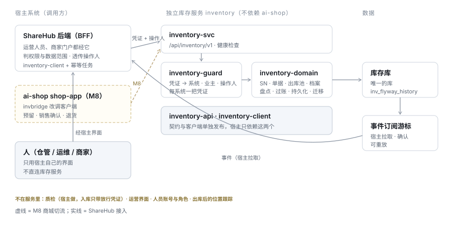
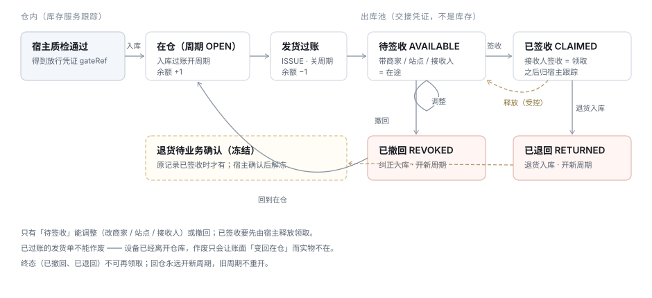

# TDD-进销存独立服务与多业态

> 状态：**已确认 · 待实施** · 2026-10-29（方向与五项裁决已定，见 §7.1；§7.2 余项未提异议即按建议）
> 关联需求：[进销存-需求](../../requirements/进销存-需求.md) §十三（多业态与独立服务）
> 决策：[ADR-046](../ADR/ADR-046-进销存独立为服务与业态档案化.md)
> 上游：[TDD-进销存领域模型](./TDD-进销存领域模型.md)（沿用五个聚合根与 A1 ~ A3 约束；本篇是其 D5「可独立交付」的落地）
> 修订：[TDD-进销存模块化与独立部署](./TDD-进销存模块化与独立部署.md) §2.2 ~ 2.3 的部署结论 · [进销存-决策记录](./进销存-决策记录.md)「序列号一期只留位」
> 参照：[TDD-支付域-双形态部署与装配](./TDD-支付域-双形态部署与装配.md)（模块切法、过渡期双形态）
> 执行：[进销存独立服务-执行方案](./进销存独立服务-执行方案.md)（环境、分阶段步骤、上线与回滚）
> 来源：ShareHub 提交的方案与评审原稿 `handoff/sharehub-进销存/`（只作追溯；与本篇冲突处以本篇为准）
> 基线：ai-shop `0e686ab8f`；`shop-inventory` 最后改动 `ab665c74e`，迁移 V1 ~ V15，103 个 Java 文件
> 档位：**2** · 创建 2026-10-29 · 最后更新 2026-10-29

---

## L1 · 定位

**进销存成为一个不认识 ai-shop 的独立服务 `inventory`**：自己的父 POM、包名、进程与版本线；只依赖不含业务的基础包（Maven 引入），不依赖 ai-shop 的业务代码与运行时。电商、餐饮（系统码 `SHOP`）、共享充电宝 ShareHub（`SHAREHUB`）、充电桩及将来的业态，都是它的调用方，经同一套 API 调用。**同一个构件按配置部署**：测试环境共用一套（验证通用性），生产分两套 —— 电商一套、设备（充电宝 / 充电桩）一套，各自一个库。

业态之间的差异**不写进代码**，写进业主级的**业态档案**；契约分**通用内核 + 能力包**。

库存服务**只管仓内**：入库、在仓、出库、盘点、流水。货一旦交出去（签收），它不再跟踪 —— 之后的位置、安装、维修都归调用方。

---

## L2 · 结构

图上看不出来的三件事：

- **人不直连库存服务**。仓管、运维、商家只用宿主的界面；宿主后端判权限与数据范围，再以**系统凭证 + 操作人**调用。库存服务没有用户体系。
- **事件由宿主拉取**，不由服务推送。拉取只需要游标；宿主宕机一天回来接着拉，不丢不重。
- **质检不在服务里**。库存只认宿主出具的「放行凭证」。

| 模块 | 内容 | 不包含 |
|---|---|---|
| `inventory-api` | DTO、错误码键、事件信封、业态档案 schema、OpenAPI | 任何实现 |
| `inventory-domain` | 物料、库位、余额、单据、SN 与组装、出库池、冻结、盘点、预留、过账；档案求值；Mapper、Flyway 迁移、Outbox、命令表 | Servlet、任何 `ai.neargo.shop.*` |
| `inventory-guard` | 凭证 → `InventoryPrincipal(system, owner, actor)`；能力包与动作范围校验 | 人的会话与角色 |
| `inventory-svc` | 启动类、`/api/inventory/v1` 控制器、健康检查 | 商城控制器 |
| `inventory-client` | 生成的客户端 + 幂等 / 重试封装 | — |

| 管 | 不管（归调用方） |
|---|---|
| 仓库、物料、仓内余额与 SN | 质检执行与结论（只收放行凭证） |
| 入库（采购、期初、退货、纠正、盘盈） | 出库后的位置：绑定、安装、换站点、撤机 |
| 出库（发货、领用、报废、退供应商、盘亏、销售确认） | 人员账号、角色、数据范围 |
| 出库池：调整、撤回、签收、释放、退回 | 运营与商家界面 |
| 预留（下单锁库存）、生产扣料 | 订单、支付、结算 |
| 盘点与冻结、流水、期间汇总 | 资产折旧与会计、采购订单与应付 |

---

## §0 对账一 · 需求 → 设计

验收用例全文见 [进销存-需求](../../requirements/进销存-需求.md) §13.4。

| AC | 需求（一句话） | 落点 |
|---|---|---|
| AC-01 | 入库过账中途失败全部回滚 | `InboundPostingService`（单事务）· §2.8 |
| AC-02 | 同一 SN 并发入库只成功一个 | `inv_serial.active_episode_id` 条件更新 + `inv_stock_episode.open_serial_id` 唯一 · §2.6 |
| AC-03 | 回包丢失按原键重试返回原结果 | `inv_command` · `CommandService` · §2.12 |
| AC-04 | 缺放行凭证拒绝入库并列出缺件 | `GatePolicy` 校验 · `inv_inbound_line.gate_ref` · §2.8 |
| AC-05 | 发到不属于该商家的站点被拒 | 档案目标规则求值 `TargetRuleEvaluator` · `inv_target_ref.parent_ref` · §2.5、§2.9 |
| AC-06 | 发货过账：余额、周期、出库池、流水、事件同事务 | `IssuePostingService` · §2.9 |
| AC-07 | 待签收可调整并留快照；已签收 409 | `DispatchService#redirect` · `inv_dispatch_adjust` |
| AC-08 | 撤回：池 `REVOKED`、新周期、余额恢复 | `DispatchService#revoke` → `CORRECTION` 入库 |
| AC-09 | 并发签收同一批只一方成功、整批全成全败 | `inv_dispatch_claim` 每记录至多一个 `ACTIVE` |
| AC-10 | 已签收退货：新周期 + 业务确认冻结 | `RETURN` 入库 · `inv_stock_hold(reason=RETURN_PENDING)` |
| AC-11 | 盘点范围内出库 409 | `inv_stock_hold(reason=COUNT)` + 全部写入口的冻结守卫 |
| AC-12 | 期间汇总：期初 + 入 − 出 = 期末 | `PeriodSummaryQuery`（只读流水） |
| AC-13 | 已过账发货不能作废 | `OutboundService#cancel` 按用途拒绝 |
| AC-14 | 游标过期重拉不漏不重 | `inv_event_subscription` / `inv_event_delivery` |
| AC-15 | 跨业主、跨系统访问 403 | `inventory-guard` 覆盖请求参数 · DAO 显式带 `owner_id` |
| AC-16 | 能力包未开通 403 | `CapabilityGuard` · 档案 `capabilities` |
| AC-17 | 充电桩只改档案即可接入 | 档案 · §2.5 |
| AC-18 | 成套出库后撤回主件，从属随动；单撤从属 409 | `inv_dispatch_item.parent_item_id` · §2.6 |
| AC-19 | 非写入方的写命令被拒 | `inv_owner.write_authority` |
| AC-20 | 过渡期两种装配同一组用例结果一致 | 核心用例基类 · §2.3 |
| AC-21 | 不依赖 shop 构件可单独构建 | 闸门 I1 · §2.1 |
| AC-22 | 加 shop import / 依赖即变红 | 闸门 I2、I3 |
| AC-23 | 服务依赖树无 Redis / Security / `shop-*` | 闸门 I3 + `dependency:tree` 断言 |
| AC-24 | 只扫柜码，单据逐块列出柜内宝 | `SerialExpansionService` · `inv_serial.parent_serial_id` |
| AC-25 | 预留幂等；到期自动释放 | `ReservationService` · `expires_at` 回收任务 |
| AC-26 | 订单回滚 → 预留到期回收；确认丢失 → 重投确认一次 | ai-shop 订单 Outbox · `/reservations/{ref}/commit` 幂等 |
| AC-27 | 业主写入方翻转前后数据一致、翻转期间拒写 | `write_authority` 翻转工具 · 对账 |
| AC-28 | 凭证所属系统不在本套放行范围 → 拒绝 | `inventory-guard` `InstanceGuard` · `inventory.instance.allowed-systems` |

**孤立项**：无没落点的 AC。挂不上 AC 的设计：`attributes` JSON（只展示、不参与规则，故无 AC）；监控告警（以演练记录验收，见 T6.2）。

---

## §1 现状与影响面

### 1.1 今天的「可独立部署」是什么

| 形态 | 现状 | 外部系统能用吗 |
|---|---|---|
| `shop-app` `api` / `ops` profile | 商家端 6 个、运营端 2 个控制器 | ❌ 要商城登录（`BizContext`） |
| `shop-app` `openapi` profile 单独起进程 | 3 个接口：查物料、查流水、数量同步 | ❌ 无写接口、无 SN、无出库池；仍要商城主库、Redis、整套装配 |
| 独立服务 | 不存在 | — |

### 1.2 支付服务做到了什么、本篇多做什么

参考支付的**切法**，不是它的**独立程度** —— 支付只做到了进程独立：

| 维度 | 支付服务（2026-10-29 实测） | 进销存 |
|---|---|---|
| 父 POM | `ai.neargo.shop:shop-parent` | `ai.neargo:neargo-build-parent:2.0.0-SNAPSHOT` |
| 依赖 | `shop-base`、`shop-store-mybatis`、`shop-base-auth`、`secret-*` | §2.1 白名单基础包；不依赖任何 `shop-*` 业务构件 |
| 包名 | `ai.neargo.shop.pay…` | `ai.neargo.inventory…` |
| 反向依赖 | 41 处业务 Port | 零：商城把物料推给它，它不回头查商城 |
| 库 | 曾连主库（ADR-025 要求先分库） | 已有独立数据源与 `inv_flyway_history` |
| 形态 | 内嵌 / 独立长期并存 | 终态只有独立；内嵌只作商城切流过渡 |

照搬：`pay-domain → inventory-domain`（「持久层只有一套」）· `pay-guard → inventory-guard` · `pay-svc → inventory-svc`；不要 `pay-portal`（进销存不对人开放）、`pay-channel`。另一条照搬的规矩：**过渡期的内嵌也按「没有共享事务」写**。

### 1.3 依赖底账（`shop-inventory`）

Maven 直接依赖：`shop-base`、`shop-base-auth`、`shop-store-mybatis`、`flyway-core`、`flyway-mysql`、`h2`（测试）。代码引用 **28 个外部顶层类、123 处 import**（2026-10-29 复核）：

| 外部类 | 模块 | 引用文件数 | 处理 |
|---|---|---|---|
| `common.BizException` / `ErrorCode` | shop-base | 23 / 22 | `neargo-common-core` 的异常承载 + `inventory-api` 自己的错误码键（`inventory.*`，三语） |
| `common.BizKey` | shop-base | 1 | `IdGenerator`（neargo-common-core） |
| `common.pricing.PricingSnapshotHash` | shop-base | 5 | 复制为本服务纯函数 |
| `auth.BizContext` / `BizPerms` / `SecurityUtils` / `Perms` | shop-base-auth | 6 / 6 / 5 / 2 | `InventoryPrincipal` + 凭证动作范围（`inventory-guard`） |
| `auth.PasswordHasher` | shop-base-auth | 1 | 凭证哈希自带实现 |
| `spi.inventory.MaterialCatalog*`（3） | shop-base | 10 | **反转**：商城调 `PUT /items` 推送物料 |
| `spi.inventory.InventoryDemandPlan*` / `InventoryProduction*` / `InventoryReservation*`（8） | shop-base | 约 18 | 接口留在 shop-base（商城自己的端口）；进销存在 `inventory-api` 定义自己的契约，商城侧适配 |
| `spi.report.ReportContracts` / `ReportSourceFactsPort` | shop-base | 9 | 报表事实适配移到 ai-shop；服务只提供期间汇总 |
| `svc.InternalHttp` / `InternalServiceResponses` | shop-base | 4 / 4 | 本服务 API 与错误模型；客户端传输层用 `svc-client` |
| `event.DomainEvent` / `event.outbox.RetryPolicy` | shop-base | 1 / 1 | 本服务事件信封与重试 |
| `job.JobSupport` | shop-store-mybatis | 3 | 注册到共用任务服务（`job-api`） |
| `event.outbox.runtime.UnifiedOutboxFacade` | shop-store-mybatis | 2 | 用本模块的 `inv_outbox` |

放错位置的：`ai/neargo/shop/portal/internal/InternalMaterialCatalogController`（属于商城门户）。

反向依赖：`shop-app` 37 个文件（`invbridge` 32）；shop-base `spi.inventory.*` 18 个文件、shop-core 9 个文件引用这些端口。

### 1.4 会被改到的

- `backend/shop-inventory/` 全部（领域代码移走，剩适配）；`backend/pom.xml`（聚合新目录）。
- `shop-app` 37 个引用文件（M1 改 import，M8 改调客户端）。
- 订单侧 `stockPort.confirm` 的事务位置（M8）。
- 配置 `shop.inventory.*` → `inventory.*`。
- `.githooks/pre-push`（加 I1 ~ I4）。

### 1.5 明确不受影响

- 商品域（定义归商品域、数量归进销存域、只共享 `sku_no` 的边界不变）。
- 三端界面：B 端九屏与运营端三个只读功能点照旧经 `shop-inventory` 的控制器，路径与权限码不变。
- 已有 `inv_*` 表名与 `inv_flyway_history`。

---

## §2 方案（L3）

### 2.1 「独立」的定义与闸门

**可以依赖的基础包**（判据：不含业务语义，不带 ai-shop 的运行时）：

| 构件 | 用途 | 结论 |
|---|---|---|
| `ai.neargo:neargo-common-core` | 异常承载、`Result` / `PageResult`、`IdGenerator` | 允许（`shop-base` 今天已依赖它） |
| `ai.neargo:neargo-common-data` | MyBatis-Plus 装配、实体基类、审计填充 | 允许；**不启用**数据范围引擎与租户行拦截器 —— 业主隔离在 SQL 里显式传参 |
| `ai.neargo:neargo-common-web` | 全局异常处理 | 允许，仅 `inventory-svc` |
| `ai.neargo.shop:job-api`（包 `ai.neargo.job.api`，零依赖） | 定时任务注册到共用任务服务 | 允许；groupId 是历史遗留，迁出仓库前随任务服务改坐标 |
| `ai.neargo.shop:svc-client`（包 `ai.neargo.svc.client`，只依赖 spring-web） | `inventory-client` 传输层 | 允许，同上 |
| `neargo-common-security` / `neargo-auth-core` | 人的会话与 RBAC | 不用 |
| `shop-base` | 22 个业务域的契约与商城错误码 | **禁止** |
| `shop-store-mybatis` / `shop-base-auth` | 传递带入 Redis、Spring Security、`shop-auth-store` | **禁止** |

neargo 框架按 powerbank ADR-025 冻结（不做 2.x 重排），但 `2.0.0-SNAPSHOT` 已在 Nexus、ai-shop 在用；只用其中已稳定的类。

**闸门**（每条都能失败）：

| # | 闸门 | 怎么跑 | 防住什么 |
|---|---|---|---|
| I1 | 单独构建 | `mvn -f backend/inventory/pom.xml verify`，删掉 `~/.m2/repository/ai/neargo/shop` 中除 `job-api`、`svc-client` 外的构件后仍绿 | 传递依赖带进 shop 构件 |
| I2 | import 白名单 | ArchUnit：`ai.neargo.inventory..` 只能依赖自身、`ai.neargo.common..`、`ai.neargo.job.api..`、`ai.neargo.svc.client..` 与第三方 | 「先 import 一个商城工具类」 |
| I3 | Maven 依赖白名单 | enforcer `bannedDependencies`：禁 `ai.neargo.shop:*`（`job-api`、`svc-client` 例外） | 构建期拦；也拦经传递依赖带入的 Redis / Security |
| I4 | 目录自洽 | 脚本：`backend/inventory/` 内不出现指向目录外的 `../`（`relativePath`、文档链接、脚本） | 整目录搬走时断链 |
| I5 | 空库启动 | `StandaloneContextTest`：只连库存库、无 Redis、无商城配置、迁移幂等 | 运行期依赖商城 |
| I6 | 过渡期同一组用例 | 核心用例基类以内嵌、独立两种装配各跑一遍（T8.6 后退役） | 内嵌能跑、独立不通 |

I1 ~ I4 挂 `.githooks/pre-push`；I5、I6 进后端测试。

**构建关系**：`backend/pom.xml` 在 `<modules>` 里聚合 `inventory`（聚合 ≠ 继承）；ai-shop 以显式版本属性 `inventory.version` 依赖它，迁出仓库那天只换成 Nexus 发布版。ai-shop enforcer 的 `ai.neargo:*:[2.0.0-SNAPSHOT]` 规则只管 groupId `ai.neargo`，新坐标 `ai.neargo.inventory` 不受影响。

### 2.2 命名

| 项 | 取值 | 现名 |
|---|---|---|
| 目录 | `backend/inventory/` | `backend/shop-inventory/` |
| 坐标 | `ai.neargo.inventory:inventory-{api,domain,guard,svc,client}`，`1.0.0-SNAPSHOT` | `ai.neargo.shop:shop-inventory:0.1.0-SNAPSHOT` |
| 包 | `ai.neargo.inventory.*` | `ai.neargo.shop.inventory` |
| 配置前缀 | `inventory.*`（旧键兼容读一个发布版本） | `shop.inventory.*` |
| 进程 / systemd | `inventory-svc` / `neargo-inventory.service` | — |
| 库 | 现进销存库原地升级，只改连接配置 | — |
| 表 / 迁移历史 | `inv_*` / `inv_flyway_history` **不改** | 同 |
| 系统码 | `SHOP` · `SHAREHUB`（powerbank ADR-023 / 025 的平台代号）· 充电桩待定 | — |

`shop-inventory` 这个名字留给 ai-shop 侧的适配模块（§2.16），它确实属于商城。

### 2.3 部署形态与商城切流

**终态**

| 项 | 取值 |
|---|---|
| 进程 | 同一个 `inventory-svc` 构件，按环境部署：**测试一套**（放行全部系统）；**生产两套** —— 电商套（只放行 `SHOP`）、设备套（放行 `SHAREHUB`、充电桩）。每套无状态，可多实例 |
| 库 | 测试：一个库装全部业态。生产：电商套 = 现商城进销存库 `ai_shop_inv` 原地升级；设备套 = 新库（空库跑迁移）。两套之间不共享任何资源，只共享构件版本 |
| 实例放行 | `inventory.instance.allowed-systems`：凭证所属系统不在内 → 403 `inventory.instance.system_not_served`；凭证只在所属实例的库里签发。**差异只在环境文件**，代码里不判断「我是哪套」 |
| 调用方 | 全部经 `/api/inventory/v1` + 每系统一把凭证 |
| 网络 | 同机内网（各系统与 ai-shop 同在一台腾讯云机器，ADR-025）；`/api/inventory/v1` 与 `/actuator` 不经 nginx 对外。服务自己验凭证，并以凭证中的系统与业主覆盖请求参数 —— 同机多系统时，内网不等于可信 |
| 定时任务 | 注册到共用任务服务作为一个 worker 目标；任务服务不可用时 Outbox 只延迟、不丢 |

**过渡**：商城今天在生产上进程内调用进销存，按支付的双形态做法过渡 ——

| 项 | 内嵌（过渡） | 独立（终态） |
|---|---|---|
| 谁用 | 尚未切流的商城业主 | 已切流的商城业主 + 所有外部系统 |
| 进程 | `shop-app` 依赖 `inventory-domain` 构件 | `inventory-svc` |
| 身份 | 适配层把 `BizContext` 翻译为 `InventoryPrincipal(system=SHOP)` | 凭证 |
| 库 | 同一个 | 同左 |

每个业主只有一个写入方（`inv_owner.write_authority = EMBEDDED / SVC`），按业主灰度翻转，翻回即回滚。生产里过渡期只发生在电商套（它连的就是商城今天内嵌直连的库）。全部切完、观察期过后删除内嵌装配（T8.6）。

**下单预留跨进程**：[TDD-进销存模块化与独立部署](./TDD-进销存模块化与独立部署.md) §2.2「扣减永远不跨进程」的依据是 `stockPort.confirm(orderNo)` 与订单转态、结算计提同在一个事务；[TDD-进销存领域模型](./TDD-进销存领域模型.md) §二 已更正：预留协议下跨进程仍是同步强一致，`available ≥ 0` 只需在进销存自己的库里成立。本篇按后者落地（ADR-046 修订前者）。

| 步骤 | 做法 | 失败时 |
|---|---|---|
| 下单前 | `POST /reservations`，幂等键 = 订单号，全成全败，`expires_at` ≥ 支付窗口 + 余量 | 拒单；熔断后**拒单而不是放行** |
| 订单事务 | 订单落库 + 同事务写 Outbox「待确认 / 待释放」，**不在事务里调远程** | 事务回滚 → 预留由 `expires_at` 回收 |
| 支付成功 | Outbox 投递 `POST /reservations/{ref}/commit`，幂等可重试 | 预留已过期 → 尝试重新预留；仍失败告警进人工（发货前拦截） |
| 关单 / 退款 | Outbox 投递 `release` / 退款回补 | 重试直到成功 |
| 餐饮生产扣料 | 经 Outbox 投递（`PRODUCTION` 能力包） | 重试 |

代价：进销存不可用 = 商城不能下单（今天进程内挂了也一样）；下单多一次同机 RTT（1 ~ 3 ms）；`expires_at` 回收任务成为必需品。生产订单数今天为 0（[进销存-需求](../../requirements/进销存-需求.md) §十二），切流风险最低的时间点就是现在。

### 2.4 租户与身份

**一个业主（Owner）= 一本库存账**。商城里业主是商家主体；ShareHub 里业主是运营方（powerbank ADR-026：唯一运营方 → 一个业主），它的每个仓库是业主下的库位。

| 层 | 含义 | 由谁确定 | 服务怎么用 |
|---|---|---|---|
| 系统 | 哪个调用方（`SHOP` / `SHAREHUB`） | 凭证 | 只放行凭证允许的动作与能力包 |
| 业主 | 动哪本账 | 凭证绑定（**不信请求体**） | 所有读写限定在该业主 |
| 操作人 | 实际点按钮的人 | 宿主透传 `X-Inventory-Actor`（`STAFF:E1003` / `AGENT:AG001` / `SYSTEM:job`） | 只记审计，不授权 |

**外部目标**：宿主单向同步过来、可作为收货方或接收人的对象，以 `system_code + type + ref` 唯一，带名称、状态、上级引用、`sourceVersion`（旧版本到达忽略）。**类型不是枚举**，由业态档案注册（§2.5）。停用的目标不能作新发货的收货方；历史单据保留名称快照。

### 2.5 业态档案（Business Profile）

| 档案项 | 作用 | 修改约束 |
|---|---|---|
| `capabilities` | 开通的能力包：`SERIAL` / `DISPATCH_POOL` / `RESERVATION` / `PRODUCTION` | 关闭时须无进行中的对象 |
| `targetTypes[]` | 外部目标类型、名称键、`parentType` | 删除须无引用 |
| `inboundPurposes[]` | 启用的入库用途；是否要依据 / 附件 | 有草稿时不可停 |
| `outboundPurposes[]` | 启用的出库用途；**目标规则**（必填类型、可选类型、层级约束）与 `handover = POOL / NONE` | 同上 |
| `gateRefTypes[]` | 放行凭证类型（`QC`、`ACCEPTANCE`…） | — |
| `countReview` | 盘点是否强制复核、复核人 ≠ 录入人 | — |

存 `inv_business_profile(owner_id, version, body JSON)`；单据过账时记 `profile_version`。由平台管理员经运维接口修改，宿主只读。内核里不出现任何业态名。

| 档案项 | 商城 | 餐饮 | ShareHub（充电宝） | 充电桩（预案） |
|---|---|---|---|---|
| 系统码 | `SHOP` | `SHOP` | `SHAREHUB` | 待定 |
| 业主 | 商家主体 | 商家主体 | 运营方 | 运营方 |
| 能力包 | `RESERVATION` | `RESERVATION`、`PRODUCTION` | `SERIAL`、`DISPATCH_POOL` | `SERIAL`、`DISPATCH_POOL` |
| 物料 | SKU 按数量 | 原料按数量 | 柜、宝都按 `SERIAL` | 桩主机 / 模块 `SERIAL`；枪线、耗材 `QUANTITY` |
| 放行凭证 | 无 | 无 | `QC` | `ACCEPTANCE` |
| 目标类型 | 无 | 无 | `MERCHANT`、`SITE → MERCHANT`、`PERSON` | `PROJECT`、`STATION → PROJECT`、`PERSON` |
| `ISSUE` | 不启用 | 不启用 | 必填 `MERCHANT` + `PERSON`，可选 `SITE`；`POOL` | 必填 `STATION` + `PERSON`；`POOL` |
| 其它出库 | `SALE`（仅预留确认）、`TRANSFER_OUT`… | `PRODUCTION` | `SCRAP`、`RETURN_SUPPLIER` | `CONSUME` 维修领用（必填 `PERSON`，可带工单引用；`NONE`） |
| 不良品 | — | — | 复检不过不入库（归业务） | 同仓单独的不良品库位，不新增「库存状态」维度 |
| 成套 | — | — | 柜 SN ⊃ 宝 SN（§2.6） | 桩 + 数量附件（成套行） |

**新业态接入判据**

| 新业态需要的 | 怎么做 | 要不要 ADR |
|---|---|---|
| 新的单据用途、目标类型、放行类型、层级约束 | 改档案 | 否 |
| 只展示、不参与规则的物料属性 | 物料 `attributes` JSON | 否 |
| 新的状态机（寄售、租赁到期回收…） | 新能力包 | **是** |
| 库存跟踪出库后的位置 | 不做 | 推翻需 ADR |

### 2.6 物料、SN 与组装

| 字段 | 取值 | 防住什么 |
|---|---|---|
| `trackingMode` | `QUANTITY` / `SERIAL`（`BATCH` 保留值，不实现） | 商城 SKU 不被强制录 SN；设备逐台可追。有流水后不可改 |
| `gatePolicy` + `gateRefType` | `NONE` / `REF_REQUIRED` + 档案里的凭证类型 | 设备没检就入库；内核里长出质检规则 |
| `externalRef` | 宿主物料号（商城 SKU 号、ShareHub 型号） | 商城推送物料时的对应关系 |
| `attributes` | JSON | 宿主自管的展示属性 |

**SN 档案与在库周期**：每个 SN 一份档案（`inv_serial`）；入库开一个在库周期（`inv_stock_episode`，`OPEN`），出库关闭。**同一 SN 同时至多一个 `OPEN` 周期**，用「条件更新档案上的当前周期号 + 生成列唯一索引」双保险；回仓永远开新周期，旧周期不重开。

**组装关系（柜、宝都按 SN 的配套）**：一柜 8 ~ 48 块宝，全按 SN 后扫码量翻几十倍，四件事一起做：

| 配套 | 做法 | 防住什么 |
|---|---|---|
| 组装关系 | `inv_serial.parent_serial_id`：宝挂在柜下；入库时随柜登记（宿主质检单附柜内宝清单）；在仓期间可拆装（`POST /serials/{sn}/assemble`、`/disassemble`，写流水不改余额） | 出库只扫柜码却要逐块录宝 |
| 扫柜码展开 | 单据行与盘点扫码接受柜 SN，服务展开为「柜 + 当前挂着的宝」，结果写进 `inv_document_serial` | 同上；展开在服务里做，宿主不各自实现 |
| 成套随动 | 出库池以柜为主记录，宝为从属记录（`parent_item_id`），随柜调整 / 撤回 / 签收 / 退货；单独动从属 409 | 只撤柜留下孤儿宝 |
| 批量上限 | 单命令按**展开后**计 ≤ 2 000 SN；草稿可分批追加行（`PATCH`），过账一次完成 | 5 柜 × 48 宝超过 200 上限 |

签收后宝在商家处换柜、丢失，库存服务不知道也不该知道；退货回仓按实收重新登记组装关系（新周期）。数量附件（如充电桩枪线）用成套行 `parent_line_no`，随动规则同上。

### 2.7 余额口径

`available = onHand − reserved − unavailable`，三者非负且 `reserved + unavailable ≤ onHand`。`unavailable` 来自多原因冻结 `inv_stock_hold`（盘点、退货待业务确认、人工），可并存、按原因单独解除；**同一件至多计 1**。顺带修复「普通扣减侵占预留」。

### 2.8 入库

| 用途 | 何时用 | 规则 |
|---|---|---|
| `PURCHASE` | 采购到货 | 沿用 |
| `OPENING` | 期初登记（存量设备无发票） | 必带依据（发票 / 送货单 / 合同 / 盘点 / 迁移 / 其他）与附件引用；报表单列 |
| `RETURN` | 退货回仓 | 可引用原出库池记录 → 标「已退回」；原记录已签收的加「退货待业务确认」冻结 |
| `CORRECTION` | 发货撤回的纠正入库 | 只由撤回动作生成，不可手建 |
| `COUNT_GAIN` / `OTHER` | 盘盈 / 其他 | 沿用 |

放行凭证：`gatePolicy = REF_REQUIRED` 的物料，入库行必须带 `gateRef`（SERIAL 逐件、QUANTITY 逐行）；库存校验「有、来源系统授权、未被别的 SN 用过」，不判断内容。SN 校验在**过账时**做（草稿不占用），重复与未知一次列全。

### 2.9 出库与出库池

图以 ShareHub 发货为例；商家 / 站点 / 接收人在其它业态里由档案的目标类型代替。

**出库用途**：沿用 `SCRAP` / `COUNT_LOSS` / `TRANSFER_OUT` / `SALE`（销售只能由预留确认产生）；新增 `ISSUE`（交接给外部目标，按档案生成出库池）、`CONSUME`（领用，不生成出库池）、`RETURN_SUPPLIER`。

**`ISSUE` 过账**（一个事务）：条件更新单头 `DRAFT → POSTED` → 按 SN 升序锁档案与周期 → 校验在本仓、`OPEN`、无冻结、不在盘点范围、目标满足档案规则 → 扣余额 → 关周期 → 写流水 → 逐件 / 逐行建出库池记录（带目标快照与 `root_target`）→ 写事件 → 存命令结果。

| 状态 | 进入方式 | 能做什么 |
|---|---|---|
| `AVAILABLE` 待签收 | 发货过账 | 调整（改目标，原因必填，留前后快照）· 撤回（同事务生成 `CORRECTION` 入库、开新周期、恢复余额）· 签收 |
| `CLAIMED` 已签收 | 接收人签收（宿主调用，批量全成全败） | 受控释放回 `AVAILABLE`（只有原领取系统）· 退货入库 |
| `REVOKED` 已撤回 | 撤回 | 终态 |
| `RETURNED` 已退回 | 退货入库 | 终态 |

规则：已过账的 `ISSUE` 不能作废（纠错只走调整、撤回、退货）；只有待签收能调整或撤回；签收后不再跟踪；出库池按 `root_target`（层级最顶的目标，如商家、项目）与目标多值过滤（`in`），供宿主套数据范围。商城原有用途的反冲语义不变。

### 2.10 盘点

沿用盘点单与「一个库位同时一张」，补：

- **范围冻结持久化**：开盘对 `(业主, 库位, 物料集合)` 写冻结；所有改库存的命令（过账、发货、撤回、退货确认、预留）锁行前先查冻结。范围内有活跃预留或未结命令时拒绝开盘。
- **SN 实盘**：扫码可多次、多人，同一 SN 重扫不重计；扫柜码按组装关系展开；未知 SN 列为异常候选，不自动当盘盈；已出库的 SN 提示「疑似未登记退货」。
- **复核**：提交 → 复核（复核人 ≠ 录入人）→ 过账；批准绑定内容版本，驳回后修改使旧批准失效。
- 作废立即解冻；冻结持久化，重启后仍在。

### 2.11 查询与期间汇总

| 查询 | 用途 |
|---|---|
| 余额（仓 × 物料，含不可用） | 仓内数量 |
| 在库 SN（仓、物料、SN、上级 SN、冻结原因） | 只返回 `OPEN` 周期 |
| 流水（只追加） | 按仓、物料、SN、单号、期间 |
| 期间汇总 | 期初、按用途分类的入与出、期末 —— 宿主的统一库存报表取仓内这一段 |
| 在途 | 待签收数量按 `root_target` 汇总 |

### 2.12 命令幂等、事件、审计

- **幂等**：所有写请求带 `Idempotency-Key`；`inv_command(system, owner, request_id)` 唯一，与业务写入同事务存结果；同键同参返回原结果、同键异参 409；可按键查结果。
- **事件**：沿用 `inv_outbox` 同事务写；订阅序号与游标（提交后分配序号），宿主 `GET /events` 拉取、`POST /event-acks` 确认；信封带 `resourceVersion`。
- **审计**：所有写动作记操作人、系统、前后值、原因、traceId；只追加。

### 2.13 契约

前缀 `/api/inventory/v1`；`Authorization: Bearer <服务凭证>`；写请求带 `Idempotency-Key`；`X-Inventory-Actor`；分页 `{list, total}`；错误 `{code, message, data}`，批量错误在 `data.errors[]` 逐件列出。

| 层 | 端点 | 谁能用 |
|---|---|---|
| 通用内核 | `GET/POST /items` · `PATCH /items/{id}` · `PUT /items/by-ref/{externalRef}` · `GET/POST /warehouses` · `PATCH /warehouses/{id}` · `POST /warehouses/{id}/disable` · `PUT /external-targets/{type}/{ref}` · `GET /external-targets` · `POST/PATCH/GET /inbounds[/{no}]` · `POST /inbounds/{no}/post` · `/cancel` · `/business-clearance` · `POST/PATCH/GET /outbounds[/{no}]` · `POST /outbounds/{no}/post` · `/cancel` · `GET /balances` · `/ledger` · `/documents` · `/reports/period-summary` · `/counts/*` · `GET /commands/{requestId}` · `GET /events` · `POST /event-acks` | 所有凭证 |
| `SERIAL` | `GET /serials` · `POST /serials/{sn}/assemble` · `/disassemble`；单据行 SN 明细；盘点 SN 扫码 | 开通的业主 |
| `DISPATCH_POOL` | `ISSUE` 生成池记录 · `GET /dispatch-pool` · `POST /dispatch-pool/{id}/redirect` · `/revoke` · `POST /dispatch-pool/claims` · `GET /dispatch-pool/claims/by-request/{requestId}` · `POST /dispatch-pool/claims/{claimNo}/release` · `GET /in-transit` | 同上 |
| `RESERVATION` | `POST /reservations` · `POST /reservations/{ref}/commit` · `/release` · `/refund-restore` | 同上 |
| `PRODUCTION` | `POST /demand-plans` · `POST /production-consumptions` | 同上 |
| 平台运维 | 业主开通、凭证签发与轮换、档案变更 | 平台管理员凭证（内网，不对宿主） |

能力包未开通返回 403 `inventory.capability.disabled`。过渡期内嵌装配不走 HTTP，但调用同一组应用服务 facade，契约测试两种装配共用。

错误码示例：`inventory.instance.system_not_served` · `inventory.serial.duplicate_open` · `inventory.gate.ref_missing` · `inventory.dispatch.not_available` · `inventory.dispatch.child_locked` · `inventory.target.disabled` · `inventory.target.rule_violated` · `inventory.count.frozen` · `inventory.issue.void_forbidden` · `inventory.capability.disabled` · `inventory.owner.not_writer` · `inventory.reservation.expired`。

事件：`InboundPosted` · `OutboundPosted` · `DispatchCreated` · `DispatchRedirected` · `DispatchRevoked` · `DispatchClaimed` · `DispatchReleased` · `ReturnReceived` · `ReturnCleared` · `SerialAssembled` · `CountOpened` · `CountPosted` · `CountCancelled` · `ReservationExpired`。信封：`eventId`、`type`、`systemCode`、`ownerId`、`resourceType / resourceId`、`resourceVersion`、`occurredAt`、`actor`、`traceId`、`payload`。

### 2.14 数据模型变更

迁移文件从 `shop-inventory/src/main/resources/db/inventory/` **移到** `inventory-domain` 同路径，历史表 `inv_flyway_history` 不变；新迁移接 V15 之后（开工时再 `ls` 确认）。

| 表 | 变更 |
|---|---|
| `inv_owner` | 加 `system_code`、`external_ref`、`write_authority`、`profile_version`；商城现有业主补 `SHOP` / `EMBEDDED` / 默认商城档案 |
| ★ `inv_client_system` | 系统码登记 |
| ★ `inv_business_profile` | `UK(owner_id, version)`，`body` JSON |
| `inv_open_credential` | 升级为服务凭证：`system_code`、可访问业主、动作范围、能力包 |
| `inv_item` | 加 `tracking_mode`、`gate_policy`、`gate_ref_type`、`external_ref`、`attributes` |
| `inv_location` | 加 `region_ref`、`disabled_at`（停用守卫：有余额 / 未完成单 / 冻结时逐项拒绝） |
| `inv_stock_balance` | 加 `unavailable_quantity` |
| `inv_inbound_order` / `_line` | 用途扩 `OPENING / CORRECTION`；单头加 `basis`、`attachment_refs`、`dispatch_item_id`；行加 `gate_ref`、`parent_line_no` |
| `inv_outbound_order` / `_line` | 用途扩 `ISSUE / CONSUME / RETURN_SUPPLIER`；行加 `parent_line_no` |
| ★ `inv_document_target` | `(doc_kind, doc_no, role, target_type, target_ref, name_snapshot)`，角色 `DESTINATION / PARENT / RECEIVER` |
| 盘点三表 | 加 `scope_items`、`content_version`、`approved_version`、`reviewer`；实扫加 `serial_id` |
| ★ `inv_serial` | `UK(owner_id, serial_no)`，`active_episode_id`，`parent_serial_id` |
| ★ `inv_stock_episode` | 生成列 `open_serial_id` 唯一 |
| ★ `inv_document_serial` | `UK(doc_kind, doc_no, serial_id)` |
| ★ `inv_target_ref` | `UK(owner_id, system_code, object_type, object_ref)`，`parent_ref`；`object_type` 校验来自档案 |
| ★ `inv_dispatch_item` | SERIAL `UK(episode_id)`；`root_target_type`、`root_target_ref`、`parent_item_id` |
| ★ `inv_dispatch_claim` | 每条池记录至多一个 `ACTIVE` |
| ★ `inv_dispatch_adjust` | 调整 / 撤回的前后快照，只追加 |
| ★ `inv_stock_hold` | 多原因冻结 |
| ★ `inv_command` | 命令幂等与结果 |
| ★ `inv_event_subscription` / `inv_event_delivery` | 订阅与序号 |
| ★ `inv_audit` | 审计，只追加 |
| `inv_reservation` | 确认 `external_ref` 唯一与 `expires_at` 必填（领域模型 §5.5） |

实施每条迁移时同步 [进销存-数据库表结构](./进销存-数据库表结构.md) 的表清单与张数（有守卫测试）。

### 2.15 模块设计

| 动作 | 路径 | 说明 |
|---|---|---|
| 新增 | `backend/inventory/pom.xml` | 父 `neargo-build-parent`；enforcer 白名单 |
| 新增 | `backend/inventory/inventory-{api,domain,guard,svc,client}/` | §L2 模块表 |
| 新增 | `backend/inventory/docs/` | 服务自身的契约与运维文档（随目录迁出）；商城侧用法留 ai-shop `docs/` |
| 移动 + 改包 | `shop-inventory` 的 entity / mapper / service / job / config / 迁移 → `inventory-domain` | `ai.neargo.inventory.domain.*` |
| 修改 | `backend/shop-inventory/` | 只剩控制器（biz 6、ops 2、open 1、internal 3）、`port/` 实现、报表适配、`BizContext → InventoryPrincipal` 翻译 |
| 移动 | `InternalMaterialCatalogController` → `shop-app` | 属于商城门户 |
| 修改 | `shop-app` 37 个引用文件 | M1 改 import；M8 `invbridge` 改调客户端 |
| 修改 | 订单侧 `stockPort.confirm` 调用点 | M8：移出事务，写 Outbox |
| 修改 | `backend/pom.xml` | 聚合 `inventory`；`inventory.version` 属性 |
| 修改 | `.githooks/pre-push` | I1 ~ I4 |
| 新增 | `deploy/tencent/systemd/neargo-inventory@.service`（模板单元，`@shop` / `@device` / `@test`）· `backend/inventory/deploy/inventory.env.example` | 照 `ai-shop-pay.service` 同形；同一程序包按实例名起多套 |
| 修改 | `deploy/tencent/backup-to-cos.sh` | `DBS` 加设备套的库 |

### 2.16 ai-shop 侧留下什么

| 原位置 | 去向 |
|---|---|
| 12 个控制器 | 留 `shop-inventory`，作商城 BFF：判权、数据域在这里做完；过渡期调 `inventory-domain`，切流后调 `inventory-client` |
| `port/` 4 个实现、报表事实适配 | 留 `shop-inventory`，实现 shop-base 的 `spi.inventory.*` / `spi.report.*` |
| shop-base `spi.inventory.*`（18）、shop-core 引用（9） | 接口不动；`confirm` 改为事务外投递（§2.3），这是 ai-shop 唯一的语义改动 |
| `shop-app/invbridge`（32） | 切流后改调 `inventory-client` |
| `MaterialCatalogQueryPort` | 反转：商品变更时商城调 `PUT /items/by-ref/{sku_no}` |

方向只有一条：`ai-shop → inventory`。

### 2.17 走查：平台给商家发一单货

从仓 W1 发 2 台柜（各挂 8 块宝）给商家 AG001 的站点 ST01，由运维 E1001 送达：

| 步 | 调用方动作 | 库存服务里的变化 |
|---|---|---|
| 0 | 商家开通、站点建立、运维入职时，宿主同步外部目标 | `MERCHANT/AG001`、`SITE/ST01（上级 AG001）`、`PERSON/E1001` |
| 1 | 仓管建出库单：W1、AG001、ST01、E1001，扫 2 个柜码 | `ISSUE` 草稿；展开为 2 柜 + 16 宝；库存不变 |
| 2 | 仓管确认出库 | 柜 −2、宝 −16；18 个周期关闭；流水；出库池 2 条主记录 + 16 条从属，`AVAILABLE`；`DispatchCreated` |
| 3 | 路上发现站点选错 | `redirect` 到 ST02（须属于 AG001），从属随动，留快照；`DispatchRedirected` |
| 4 | E1001 签收 | 18 条 → `CLAIMED`；之后库存不再跟踪 |
| 5 | 半年后 1 台柜撤机回仓，宿主复检通过 | `RETURN` 入库（新 `gateRef`、按实收登记柜内宝）→ 新周期、原记录 `RETURNED`、加退货待业务确认冻结 |
| 6 | 宿主解除本地业务关联后确认 | `business-clearance` 解冻，可再次发货 |

### 2.18 实施计划

规模：S ≤ 2 天 · M 3 ~ 5 天 · L 1 ~ 2 周（单人）。每个任务：失败测试 → 最小实现 → 目标测试 → 回归 → 显式路径提交（共享工作区，不 `git add <目录>`）。

| 里程碑 | 目标 | 判据 |
|---|---|---|
| **M0** 契约 | OpenAPI v1（内核 + `SERIAL` + `DISPATCH_POOL`）冻结；档案 schema | ShareHub 联合评审；`inventory-client` 0.1 |
| **M1** 脱离 ai-shop | 新目录与五模块；领域代码改包移入；28 个外部类替换；商城经适配模块调用 | I1 ~ I6 全绿；商城进销存回归 0 新增失败 |
| **M2** 平台层 | 系统 / 业主 / 凭证 / 档案 / 幂等 / 审计 / 通用外部目标 | AC-03、15、16、19 |
| **M3** SN 与放行 | SN 档案与周期、组装与展开、放行凭证、入库用途、处置出库、查询 | AC-01、02、04、24 |
| **M4** 出库池 | `ISSUE` 目标规则、成套随动、调整、撤回、签收、释放、退货确认、事件拉取 | AC-05 ~ 10、13、14、18 → 交付 ShareHub 联调 |
| **M5** 盘点与汇总 | 冻结持久化、SN 实盘、复核、期间汇总、在途 | AC-11、12 |
| **M6** 上线就绪 | ShareHub 数据迁移、监控告警、故障演练、systemd、回滚手册；**设备套**上线 | ShareHub 生产上线；AC-28 |
| **M7** 第二业态 | 充电桩档案 + 成套行 + `CONSUME` + 不良品库位 | AC-17 |
| **M8** 商城切流 | **电商套**上线；预留跨进程、`confirm` 改 Outbox、`invbridge` 改客户端、按业主灰度、删内嵌 | AC-20、25 ~ 27 |
| 后置 | 整目录迁出为独立仓库；`BATCH`；SN 调拨 | 各自立项 |

| # | 任务 | 验收 | 规模 |
|---|---|---|---|
| T0.1 | 档案 schema + 四个业态示例档案（测试夹具） | schema 校验通过 | S |
| T0.2 | OpenAPI v1、错误码三语文案键、事件信封 | 与 ShareHub 联合评审 | M |
| T1.1 | `backend/inventory/` 父 POM 与五模块、聚合；I2 ArchUnit、I3 enforcer、I4 脚本先写上（先红） | 闸门可执行 | S |
| T1.2 | 基础件接白名单包：异常 / 结果（`neargo-common-core`）、错误码键（`inventory-api`）、`IdGenerator`、哈希纯函数、任务注册（`job-api`）、`inv_outbox` | 单测 | S |
| T1.3 | 领域代码与迁移改包移入 `inventory-domain`；配置改 `inventory.*`；逐类替换 §1.3 | I2、I3 绿 | L |
| T1.4 | `inventory-guard`（`InventoryPrincipal`、凭证过滤器、覆盖请求业主）；`inventory-svc` 启动与健康检查 | I5 绿 | M |
| T1.5 | `shop-inventory` 改适配模块；`shop-app` 37 文件改 import；物料推送反转；旧配置键兼容读取 | 商城进销存用例全绿 | L |
| T1.6 | 核心用例基类化，两种装配各跑一遍；I1 ~ I4 挂 pre-push | I1、I6 绿 | M |
| T2.1 | `inv_client_system`、业主扩列、凭证升级、`write_authority`；商城业主补数据 | AC-15、19 | M |
| T2.2 | 档案存储、版本、求值器；能力包开关 | AC-16 | M |
| T2.3 | 命令幂等、操作人、审计 | AC-03 | M |
| T2.4 | 物料（`gatePolicy`、`attributes`、`external_ref`）、库位停用守卫、外部目标（档案类型 + 层级） | §2.4 | M |
| T2.5 | 余额加 `unavailable`、多原因冻结；修「普通扣减侵占预留」 | 原数量过账回归 0 失败 | M |
| T3.1 | SN 档案与在库周期、唯一 `OPEN` 双保险、固定锁序 | AC-02 + 并发测试 | L |
| T3.2 | 入库用途、放行凭证、SN 一次列全 | AC-01、04 | M |
| T3.3 | 处置出库、`inv_document_target`、查询 | — | M |
| T3.4 | 组装关系、拆装、扫柜码展开、展开后 ≤ 2 000、草稿分批追加 | AC-24 | M |
| T4.1 | `ISSUE` 档案目标规则、过账建出库池 | AC-05、06 | L |
| T4.2 | 出库池多值查询、调整、撤回 | AC-07、08 | M |
| T4.3 | 签收与释放 | AC-09 | M |
| T4.4 | 退货入库关联池记录、业务确认冻结 | AC-10 | M |
| T4.5 | 已过账 `ISSUE` 禁止作废 | AC-13 | S |
| T4.6 | 事件订阅、拉取、确认、重放、保留期 | AC-14 | M |
| T4.7 | 成套随动（从属记录随主记录） | AC-18 | M |
| T5.1 | 盘点：持久化冻结、SN 实盘（含展开）、复核、作废 | AC-11 | L |
| T5.2 | 期间汇总、在途 | AC-12 | M |
| T6.1 | ShareHub 迁移工具：dry-run → apply，可重复（仓内设备按 `OPENING`，依据「迁移」） | 重复 apply 无变化 | L |
| T6.2 | 监控告警（命令失败率、冲突率、事件积压、游标延迟、冻结超时、预留过期） | 演练记录 | M |
| T6.3 | 故障演练（库停、重启、事件重放、回包丢失） | 演练记录 | M |
| T6.4 | 两套 systemd 与 env 模板、实例放行系统、内网绑定、凭证分库签发、生产形态演练、回滚手册 | AC-28 | S |
| T7.1 | 成套行（数量附件 `parent_line_no`），复用 T4.7 规则 | — | S |
| T7.2 | 出库用途 `CONSUME` | — | S |
| T7.3 | 充电桩档案 + 端到端用例 | AC-17 | M |
| T8.1 | 预留能力包对外；`expires_at` 回收任务 | AC-25 | M |
| T8.2 | ai-shop：`confirm` 移出订单事务，写 Outbox、事务外投递；过期重新预留与告警 | AC-26 | L |
| T8.3 | ai-shop：`invbridge`、`shop-inventory` 控制器改调客户端；超时与熔断（熔断即拒单） | 商城用例在独立形态 0 失败 | L |
| T8.4 | 餐饮生产扣料经 Outbox 投递 | 餐饮用例 0 失败 | M |
| T8.5 | 按业主灰度：`write_authority` 翻转工具、对账、回滚手册 | AC-27 | M |
| T8.6 | 全部切完 + 观察期后删除内嵌装配、`EMBEDDED` 分支与 AC-20 | `shop-app` 不再依赖 `inventory-domain` | S |

分阶段的前置、步骤、出口、上线与回滚见 [进销存独立服务-执行方案](./进销存独立服务-执行方案.md)。

**规模**：到 ShareHub 上线（M0 ~ M6）约 17.5 周单人 / 两人约 11 周；M7 约 2 周；M8 约 5 周，可在 M6 后与 M7 并行。M1 期间 `shop-inventory` 整体移动，需冻结其他会话对该模块的改动约 2 周。

---

## §3 选型

| 方案 | 优点 | 缺点 | 结论 |
|---|---|---|---|
| A. 沿用 `openapi` profile 多起 `shop-app` | 已实现 | 只有 3 个只读 / 同步接口；仍要商城主库、Redis 与整套装配 | ❌ |
| B. 作为 Java 库嵌入各宿主 | 无网络跳 | 带入商城假设；账本分散；版本被宿主绑死 | ❌ |
| C. 各宿主各自建库存 | 互不影响 | 重写单据、流水、盘点、冻结；口径分叉（ShareHub 做完设计后放弃） | ❌ |
| D. 独立服务，仍依赖 `shop-base` 等（支付今天的样子） | 改动最小 | 进程独立而依赖不独立；外部宿主仍间接依赖商城词汇与运行时 | ❌ |
| E. 独立服务，零依赖（基础件全部自写） | 最彻底 | 约 10 个基础类与框架重复 | ❌ 用户裁决：基础代码可经 Maven 包依赖 |
| **F. 独立服务，基础包白名单（本篇）** | 不依赖 ai-shop 业务与运行时；复用框架 | 需三道闸门持续守 | ✅ |
| 生产所有业态共用一套 | 运维最省 | 设备批量作业与商城锁库存争用同一库；爆炸半径覆盖全部业务 | ❌ |
| 每个系统一套实例 | 隔离彻底 | 套数随系统增长 | ❌ 按负荷特征分电商、设备两套已够 |
| **测试一套、生产两套（本篇）** | 测试同库多业态压出通用性与隔离问题；生产负荷与故障隔离 | 测试与生产形态不同 | ✅ 上线前临时按生产形态演练补上差异 |
| 商城长期内嵌 | 下单不跨进程 | 两套装配长期并存，一套没人测 | ❌ 内嵌只作过渡 |
| 业态差异写代码分支 | 直观 | 每来一个业态改一次内核 | ❌ 档案化 |

不可逆的部分见 [ADR-046](../ADR/ADR-046-进销存独立为服务与业态档案化.md)。

**取舍记录**

| 冲突 | 让了谁 | 为什么 |
|---|---|---|
| 出库后继续跟踪 vs 交接即止 | 交接即止 | 跟踪到安装意味着绑定、换站点、撤机都要回写库存，跨系统交互翻几倍 |
| 质检放库存 vs 放业务 | 放业务，库存只收凭证 | 检测项是设备专属的；凭证足以防「没检就入库」 |
| 已过账可作废 vs 发货禁止 | 发货禁止作废 | 反冲只改账不改实物；商城原有用途的反冲不变 |
| 独立前端 vs 宿主界面 | 宿主界面 | 运营不应在两个后台之间切换 |
| 充电宝按数量（扫码少）vs 按 SN（可追） | 按 SN + 组装关系 | 用户裁决；以组装、展开、随动把扫码量压回「扫柜码」 |
| 商城扣减同进程 vs 走服务 | 走服务 | 用户裁决；预留协议保证强一致，代价是可用性耦合与一次 RTT |

---

## §4 风险

| 风险 | 影响 | 缓解 |
|---|---|---|
| 爆炸半径：一套挂了影响其上所有系统 | 中 | 生产分电商套与设备套，互不共享资源；每套多实例无状态；宿主侧写入转持久化任务重试、查询降级；商城熔断即拒单；监控分套告警 |
| 测试「一套能跑」掩盖生产「两套才暴露」的问题 | 中 | 上线前在测试机按生产形态临时起两套演练（执行方案 M6、M8） |
| 配错实例地址把一个系统的数据写进另一套 | 高 | 实例放行系统 + 凭证分库签发 + 调用方启动自检；AC-28 |
| 越权：一个系统读到另一系统的账 | 高 | 凭证强制覆盖业主；DAO 显式带 `owner_id`；AC-15 |
| M1 大移动与其他会话冲突 | 中 | 冻结 `shop-inventory` 改动约 2 周；显式路径提交 |
| 商城 `confirm` 事务语义改变 | 中 | 预留幂等 + `expires_at`；AC-26；生产订单为 0 时完成切流 |
| 双写：内嵌与独立同时写一个业主 | 高 | `write_authority`；AC-19、27 |
| 基础包回流 shop 依赖 | 中 | I1 ~ I3 + 消融 AC-22 |
| 框架冻结期间 `neargo-common-*` 变动 | 低 | 只用已稳定类；显式版本 |
| 充电宝全按 SN 的规模（10 万 SN 级） | 中 | 组装展开在服务内；单命令 ≤ 2 000；P95 写 < 500 ms 的压测进 T6.3 |
| 档案改坏导致历史单据解释不通 | 中 | 档案带版本、单据记 `profile_version`；变更走审批（Q4） |

---

## §5 对账三 · 实现 → 需求（测试）

实施时逐行填写「跑过」与「消融」两列；测试类名为计划名，落地后按实名更新。

| AC | 测试方法 | 跑过 | 消融验证 |
|---|---|---|---|
| AC-01 | `InboundPostingTest#rollback_all_on_midway_failure` | | |
| AC-02 | `SerialEpisodeConcurrencyTest#same_sn_two_inbounds_only_one_wins` | | |
| AC-03 | `ServicePlatformFlowTest#ownerCredentialProfileAndIdempotentWarehouse`（同键同参同结果、只建一个仓；同键异参 409；按键查结果） | ✅ 2026-10-29 | ✅ 去掉占键插入 → 变红 |
| AC-04 | `GatePolicyTest#missing_gate_ref_lists_all_items` | | |
| AC-05 | `IssueTargetRuleTest#site_not_under_merchant_rejected` | | |
| AC-06 | `IssuePostingTest#balance_episode_pool_ledger_event_in_one_tx` | | |
| AC-07 | `DispatchRedirectTest#available_ok_claimed_409` | | |
| AC-08 | `DispatchRevokeTest#revoke_reopens_episode_and_restores_balance` | | |
| AC-09 | `DispatchClaimConcurrencyTest#batch_all_or_nothing` | | |
| AC-10 | `ReturnInboundTest#claimed_return_holds_until_clearance` | | |
| AC-11 | `CountFreezeTest#issue_in_scope_409` | | |
| AC-12 | `PeriodSummaryTest#opening_plus_in_minus_out_equals_closing` | | |
| AC-13 | `OutboundCancelTest#posted_issue_cancel_409` | | |
| AC-14 | `EventCursorTest#expired_cursor_recovers_without_gap_or_dup` | | |
| AC-15 | `ServicePlatformFlowTest#ownersAreIsolatedByCredential`（B 的凭证带 A 的业主号也看不到 A 的仓）· `#badCredentialsAllLookTheSame` | ✅ 2026-10-29 | |
| AC-16 | `CapabilityGuardTest#dispatch_pool_disabled_403` | | |
| AC-17 | `ChargingPileProfileE2ETest#profile_only_onboarding` | | |
| AC-18 | `KitDispatchTest#revoke_parent_moves_children_child_alone_409` | | |
| AC-19 | `ServicePlatformFlowTest#writesAreRejectedWhenThisProcessIsNotTheWriter`（写入方翻回 EMBEDDED 后写 409、读照常） | ✅ 2026-10-29 | |
| AC-20 | `CoreScenarioSuite`（内嵌 / 独立两种装配） | | |
| AC-21 | pre-push I1（删本地 shop 构件后构建） | | |
| AC-22 | `InventoryArchitectureTest#inventoryDoesNotDependOnShopCode` + `scripts/check-inventory-independence.mjs` + enforcer | ✅ 2026-10-29 | ✅ 临时加一行 `import ai.neargo.shop.common.BizException` 与一个指出目录的链接 → 脚本报 2 处、退出 1 |
| AC-23 | `DependencyTreeTest#no_redis_security_shop` | | |
| AC-24 | `SerialExpansionTest#scan_cabinet_expands_children` | | |
| AC-25 | `ReservationTest#idempotent_and_expires` | | |
| AC-26 | ai-shop `OrderReservationOutboxTest#rollback_expires_and_commit_once` | | |
| AC-27 | `WriteAuthorityFlipTest#flip_and_back_consistent` | | |
| AC-28 | `InstanceGuardTest`（4 例）+ `ServicePlatformFlowTest#shopCredentialIsRejectedByTheDeviceInstance`（经过滤器）+ 生产形态演练（M6） | ✅ 2026-10-29（演练待 M6） | ✅ 去掉过滤器里的放行检查 → 变红 |
| I5 | `StandaloneContextTest`（空库、只连库存库、进程内 0 个 `ai.neargo.shop.*` Bean） | ✅ 2026-10-29 | |
| M1 零行为变化 | 商城进销存相关 199 例 + 后端全量（`mvn -o test`，全部模块 SUCCESS、0 失败） | ✅ 2026-10-29 | |
| M1 错误码 | `InventoryErrorsTest`（映射逐个与搬迁前相同、Advisor 翻译并保留参数） | ✅ 2026-10-29 | ✅ 把 `STOCK_SHORT` 映到 `CONFLICT` → 2 例变红 |
| M1 复制规则 | `DomainRuleParityTest`（规范哈希、凭证哈希、精确数量、物料规则与原件逐一比对） | ✅ 2026-10-29 | |
| T0.1 档案 | `ProfileCodecTest`（四份示例档案通过并可往返；出库池缺能力包、可选目标没挂在必填目标下、未知上级、未知字段四种写错被拒并说清规则） | ✅ 2026-10-29 | |
| T2.4 物料 | `CatalogTargetsHoldsFlowTest#itemsFollowTheProfileAndFreezeTrackingOnceTheyHaveLedger`（SERIAL 需档案能力包、放行凭证类型须登记、BATCH 拒绝、有流水后跟踪方式不可改、改名照常） | ✅ 2026-10-29 | |
| T2.4 外部目标 | `#targetsUseProfileTypesHierarchyAndSourceVersion`（档案外类型拒绝、站点须挂已同步商家、旧版本忽略） | ✅ 2026-10-29 | |
| T2.4 仓库停用 | `#warehouseCannotBeDisabledWhileItStillHoldsStockOrFreezes`（一次列全 BALANCE、HOLDS） | ✅ 2026-10-29 | |
| T2.5 冻结 | `#holdsReduceAvailabilityCountEachUnitOnceAndBlockDeduction`（不可用随冻结 / 解冻变化、冻不进余量、解冻幂等、扣减不进冻结） | ✅ 2026-10-29 | ✅ 扣减守卫改回旧写法 → 变红 |
| T2.5 修侵占预留 | `#ordinaryDeductionNoLongerEatsReservedStock`（报废扣不动预留；销售「先释放、后扣减」照常） | ✅ 2026-10-29 | ✅ 同上 → 变红 |

## §6 对账二 · 设计 → 实现（实现完再填）

按里程碑贴 `git show --stat <提交>`，与 §2.15 逐行比；差异与偏差写在这里。

### M1 · 脱离 ai-shop（2026-10-29，T1.1 ~ T1.6）

| 设计 | 实现 | 偏差与原因 |
|---|---|---|
| `backend/inventory/` 五模块，父 `neargo-build-parent` | 已建：`inventory-{api,domain,guard,svc,client}`；`backend/pom.xml` 只聚合 | — |
| 领域代码改包移入 `inventory-domain` | 79 个类 + 15 个迁移 `git mv`，包 `ai.neargo.inventory.domain.*`；`inv_flyway_history` 不变 | — |
| §1.3 的 28 个外部类逐类替换 | `BizException / ErrorCode` → `InventoryException / InventoryError`（`inventory-api`）；`PricingSnapshotHash`、`InventoryDemandPlanFacts.quantity`、`MaterialCatalog*` 的校验、`PasswordHasher` → 本服务 `support` 下的复制品；`JobSupport` → SPI `InventoryJobRunner`；`UnifiedOutboxFacade` → SPI `InventoryEventRelay`；`RetryPolicy` → `RetryBackoff` | **复制而非依赖**：四条规则与原件逐字节一致由 `shop-inventory` 的 `DomainRuleParityTest` 守住。`SecretHasher` **不认一期占位哈希**（凭证从来都是 BCrypt；占位哈希只准留在商城口令哈希里，`ArchitectureTest#legacyPasswordHashIsContained`） |
| `MaterialCatalogQueryPort` 反转为商城推送 | 未做 | 搬迁时发现领域里只用到它的**静态校验**，不是反向调用；推送改造归 M2 T2.4 |
| 错误码在边界翻译 | `shop-inventory` 的 `InventoryEmbeddingConfiguration`：基础设施 Advisor 包在领域 service 外层，`InventoryException` → 原商城码 | 用 Spring 自带 Advisor 而不是 AspectJ（ai-shop 没引 AspectJ）；`InventoryErrorsTest` 守映射与翻译 |
| 配置改 `inventory.*`，旧键兼容 | `shop-app/application.yml` 一对一桥接 `shop.inventory.*`、`shop.job.*` → `inventory.*` | 商城侧开关仍认 `shop.inventory.enabled`：恢复了商城自己的 `ConditionalOnInventory`（菜单门控 `gated_by` 与部署都是这个键） |
| 内嵌装配 | 领域经 `InventoryDomainAutoConfiguration`（自动装配）进入 shop-app；`ShopInventoryJobRunner`、`UnifiedOutboxEventRelay` 接商城的任务记录与统一出站表 | — |
| `inventory-guard` 凭证解析 | 只做了 `InstanceProperties` + `InstanceGuard`（AC-28 的判定） | 凭证模型升级在 M2 T2.1，届时接进过滤器 |
| `inventory-svc` | 启动类、`/actuator/info` 报实例代号与放行系统、`StandaloneContextTest`（I5） | — |
| systemd 两个单元 | 一个模板单元 `neargo-inventory@.service`，`@shop / @device / @test` | 同一程序包按实例名起，比三个几乎相同的单元文件少一处漂移 |
| 闸门 I1 ~ I4 | I2 `InventoryArchitectureTest`（字节码）+ `check-inventory-independence.mjs`（源码，含 I3、I4，已挂 pre-push）；I3 enforcer；I5 `StandaloneContextTest` | I1「删本地 shop 构件后构建」未自动化：enforcer 已在构建期禁 shop 构件，删 `.m2` 的做法会破坏共享机器的本地仓库 |
| I6 核心用例两种装配各跑一遍 | 未做 | 归 M2：先有独立形态的 HTTP 入口才有第二种装配可跑 |
| 路径类引用 | 脚本与棘轮里 9 处 `backend/shop-inventory/.../db/inventory` 改为新路径（`known-sql-dialect.txt` 两条只是改名，条数不变）；新增 `inventory-svc` 的 H2 测试库生成登记 | — |

### M2 · 平台层（2026-10-29，T0.1、T2.1 ~ T2.5）

| 设计 | 实现 | 偏差与原因 |
|---|---|---|
| T0.1 档案 schema + 四份示例 | `inventory-api` 的 `BusinessProfile` / `Capability`；示例在 `inventory-domain` 测试资源 `profiles/{shop,food,sharehub,charging}.json`；`ProfileCodec` 保存时一次校验完 | — |
| V16 迁移 | `inv_client_system`（种子 SHOP / SHAREHUB / CHARGING）、`inv_business_profile`、`inv_command`、`inv_audit`；`inv_owner` 加 `system_code / write_authority / profile_version`，外部引用唯一键改「系统 + 外部引用」；`inv_open_credential` 加 `system_code / capabilities` | 存量业主默认 `SHOP` + `EMBEDDED`，无需数据迁移 |
| 商城侧按主体号找业主 | ACL 两处、`shop-app` 三处查询加系统码条件（`ShopInventorySystem.CODE`） | 测试环境共用一个库时，ShareHub 的运营方号可能与商城主体号相同 —— 不加就会认错账 |
| 服务凭证（T2.1） | 一把凭证绑一个系统、一个业主；`Authorization: Bearer <appKey>:<appSecret>`；五种失败同一个 401 | 设计里「可访问业主」写的是复数，实现为单个：一个宿主多个业主就多签几把，换来「业主取自凭证」没有歧义 |
| 档案（T2.2） | `BusinessProfileService`：只追加、版本递增、锁业主行防并发；`requireCapability` | 能力包开关已有，但还没有能力包端点用它（出库池在 M4），AC-16 的端点级用例随 M4 补 |
| 幂等与审计（T2.3） | `CommandService`：先占键再执行，同事务；同键并发靠唯一索引排队 + 锁定读；`AuditService` 强制在业务事务内 | — |
| 入口守卫 | `InventoryAuthFilter`：凭证 → 实例放行 → 写请求查写入方 → 透传操作人 / 幂等键 / 链路号；`AdminTokenFilter`：每套一把运维令牌，没配即关闭 | — |
| 独立进程首批端点 | 运维：开通业主、签凭证、装档案、翻写入方；宿主：读档案、按键查命令、仓库列表与新建（完整写路径） | 「仓库」先于主方案其它主数据落地，用来打通整条写路径 |
| T2.4 物料 | V17 给 `inv_item` 加跟踪方式、放行策略与类型、宿主物料号、展示属性；`HostCatalogService` 按宿主物料号推送，规则取自档案 | 物料走「宿主推送」新入口；商城的 `ItemService` 不动（它的物料仍由商城同步链路建） |
| T2.4 库位 | `inv_location` 加区域、停用时间；`WarehouseService` 停用守卫逐项列 `BALANCE / OPEN_DOCUMENTS / HOLDS` | — |
| T2.4 外部目标 | 新表 `inv_target_ref`；`ExternalTargetService`：类型取自档案、按上级类型校验挂靠、`sourceVersion` 旧版本忽略、并发首推按已存在重走 | — |
| T2.5 不可用与冻结 | `inv_stock_balance.unavailable_quantity`；新表 `inv_stock_hold`；`StockHoldService` 按「单件去重 + 数量按原因取最大」重算；余额、预留、按需计划预留的 SQL 守卫都减去不可用 | **数量冻结按原因取最大**：设计只说「同一件至多计 1」，数量物料无法逐件识别，取最大是不重复计的最保守解释 |
| T2.5 修「普通扣减侵占预留」 | `applyDelta` 守卫由 `on_hand + delta >= 0` 改为 `delta >= 0 OR on_hand + delta >= reserved + unavailable` | 销售出库先释放预留再扣减，不受影响；后端全量回归见 §7.3 |
| 商城侧可用量展示 | 未改 | `StockQueryServiceImpl` 等处仍按 `on_hand − reserved` 展示：商城业主今天不会有冻结（冻结只能经独立服务下），切流（M8）前补 |
| 定时任务接共用任务服务 | 未做 | 独立进程仍 `inventory.jobs.enabled=false`；接入随 M3 的出站投递一起做 |

## §7 确认与完成

### 7.1 已裁决（2026-10-29，用户）

| # | 事项 | 裁决 |
|---|---|---|
| D1 | 依赖边界 | 独立部署；不含业务的基础代码以 Maven 包依赖（§2.1 白名单） |
| D2 | 实例与库 | ~~共用一个实例、一个库~~ → **2026-10-29 改判**：同一构件按配置部署；**测试环境共用一套**（验证通用性），**生产两套**（电商套连 `ai_shop_inv` 原地升级；设备套新库） |
| D3 | 充电宝 | 柜、宝都按 SN（§2.6 组装配套） |
| D4 | 商城形态 | 商城也走独立服务；内嵌只作切流过渡与回滚 |
| D5 | 定时任务 | 走共用任务服务 |
| D6 | 命名与位置 | 名称不带 shop；代码暂留 ai-shop `backend/inventory/`，按可整目录迁出写 |

### 7.2 待确认（未提异议即按建议）

| # | 事项 | 建议 | 卡住 |
|---|---|---|---|
| Q1 | 签收（领取）时机 | 内部接收人签收即领取 | T4.3 |
| Q2 | 撤回是否要求重新出具放行凭证 | 默认沿用原凭证，物料级可配 | T4.2 |
| Q3 | ShareHub 旧仓储数据如何导入 | 仓内设备按 `OPENING` 入库，依据「迁移」，放行凭证由 ShareHub 出具；已投放设备不入库 | T6.1 |
| Q4 | 档案谁来改 | 平台管理员经运维接口，宿主只读，变更走审批 | T2.2 |
| Q5 | 何时整目录迁出为独立仓库 | M8 后；判据 = I1 ~ I4 连续绿 + `inventory-api` / `-client` 已发布 Nexus + `job-api` / `svc-client` 以 Nexus 版本引用 | 后置 |
| Q6 | 旧配置键兼容多久 | 一个发布版本 | T1.5 |
| Q7 | 进销存不可用时商城下单 | 熔断即拒单；是否对「不纳入进销存的商品」放行待定 | T8.3 |
| Q8 | 宝的组装关系由谁出 | 宿主质检单附柜内宝清单，入库时登记；仓内拆装由仓管在宿主界面操作 | T3.4 |

### 7.3 记录

| 日期 | 事件 |
|---|---|
| 2026-10-29 | 由 ShareHub 方案 + 三轮改造计划合成；D1 ~ D6 裁决；ADR-046 接受；待实施 |
| 2026-10-29 | D2 改判为「测试一套、生产两套」；新增 AC-28 与 [进销存独立服务-执行方案](./进销存独立服务-执行方案.md) |
| 2026-10-29 | M1 完成（`1759f58fa`）；M2 T0.1、T2.1 ~ T2.3 完成（`fc682c4e9`）；T2.4、T2.5 完成，后端全量 6975 例 0 失败 |
