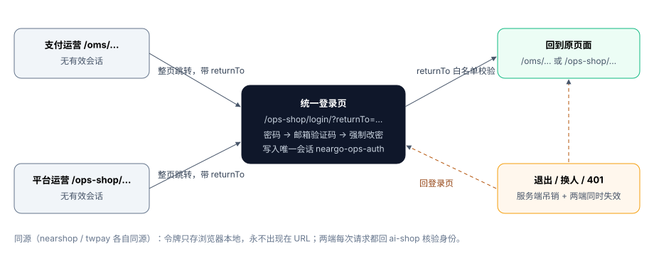

# TDD · 运营端统一登录与系统切换（ai-shop × near-pay）

> 状态：**部分上线**（2026-11-16）：ai-shop 后端退出接口与 `/ops-shop` 前端已发布 UME166；near-pay `/oms` 未切换，见[交接与发布记录](../../../handoff/ops-unified-login-2026-11-16/README.md)。档位 2：跨两个仓库，新增 ai-shop 服务端接口（退出吊销）与前端配置项。
> 前序：near-pay `docs/delivery/31-运营端统一登录/技术方案.md`（v0.2，2026-11-06）。本文在它的基础上标出**已经做了什么**，补齐剩下的部分，并加上两端互相切换的入口。

## 一、定位（L1）

平台运营（ai-shop，`/ops-shop/`）和支付运营（near-pay，`/oms/`）用的是**同一套运营账号**，部署在**同一个域名**下。目标是：

1. **只有一个登录页**：NearGo平台运营的登录页 `/ops-shop/login/`。从任何一端的任何页面被拦下，都去这里登录。
2. **登录后回到原来的页面**：包括另一端的深链（例如 `/oms/trade/payments/?status=FAILED`）。
3. **两端顶部都有切换入口**：一点就进另一端，不用再登录。
4. **一处退出，两处都退出**；换人登录时，另一端不会继续显示上一个人的数据。

## 二、结构（L2）

- **登录只在 ai-shop**：账号、密码、邮箱验证码、强制改密都只在一处处理。near-pay 不再有自己的登录框。
- **会话只有一份**：令牌存在同源浏览器本地，两端读同一个键。令牌永不出现在 URL 里。
- **身份每次现查**：两端的每个接口请求都带令牌，后端回 ai-shop `/ops/auth/me` 核验；停用账号、撤权限下一次请求就生效。
- **两个域名各自同源**：nearshop.umeshop.ai 与 twpay.umeshop.ai 各是一套，互不共享会话（浏览器的同源限制），这是预期行为。

### 2.1 现状对照（2026-11-16 读代码）

| 能力 | ai-shop `/ops-shop` | near-pay `/oms` | 结论 |
|---|---|---|---|
| 登录页 | 有：密码 + 邮箱验证码；已支持 `returnTo`，白名单含 `/oms` 与 `/ops-shop`，排除登录页本身（`lib/auth/ops-bridge.ts`） | 有自己的登录框；另有 `shared` 模式会整页跳 ai-shop 登录页（`features/auth/login-gate.tsx`） | **线上 near-pay 仍是 `local` 模式**（构建变量 `NEXT_PUBLIC_LOGIN_MODE` 未设，线上脚本里是 `"local"`），两处都能登录 |
| 会话存储 | `localStorage["shop-ops-auth"]`（持久、跨标签页）+ `sessionStorage["neargo-ops-session"]`（单标签页共享） | `sessionStorage["nearpay-ops-session"]`，并读 ai-shop 的两个键 | 三个键、两种生命周期，换人和退出时容易串 |
| 退出 | 只清前端两个键 | 只清前端，并设「不再复用」标记 | ai-shop **没有服务端退出接口**，令牌在过期前仍可用 |
| 跨标签页同步 | 无 | 无 | 一个标签页退出，另一个标签页还停在已登录界面 |
| 切换入口 | 顶栏有「支付运营」文字按钮，**所有人都显示**（`components/layout/header.tsx`） | 顶栏和登录页都有「商城运营」 | 文案不对称；无支付权限的人点进去才发现进不去 |
| 强制改密 | 后端有 `mustChangePassword`，登录页**未拦** | 后端拒绝初始密码账号 | 初始密码账号在 ai-shop 能用，在 near-pay 被拒 |
| 登录页品牌 | NearGo平台运营（`brand.json`） | 自带「支付运营」页头 | 去掉 near-pay 登录框后自然统一 |

## 三、详情（L3）

### 3.1 统一登录页（ai-shop）

| 项 | 设计 |
|---|---|
| 入口 | `/ops-shop/login/?returnTo=<站内路径>&locale=<语言>` |
| `returnTo` 校验 | 沿用现有 `safeReturnTo`：同源、无用户名密码、路径必须以 `/ops-shop/` 或 `/oms/` 开头、拒绝 `%2f %5c` 与控制字符、不能是登录页本身；不合格一律回平台运营首页 |
| 去向提示 | `returnTo` 指向 `/oms` 时，卡片副标题改为「登录后进入 支付运营」（现有 `paymentSource` 提示改用这一句） |
| 已登录再访问 | 已有有效会话时不显示表单，直接跳 `returnTo`（现有逻辑） |
| 强制改密（新增） | 登录成功若 `mustChangePassword=true`：卡片原地切到「设置新密码」，改完再跳 `returnTo`；不改不放行。near-pay 后端继续拒绝初始密码账号，作为兜底 |
| 语言 | `locale` 参数优先，登录页切换语言后跳回时带上所选语言（现有逻辑） |

### 3.2 会话：只留一个键

| 项 | 设计 |
|---|---|
| 存储 | 新键 `localStorage["neargo-ops-auth"] = { token, username, issuedAt }`，两端都只读写这一个。持久、跨标签页。ai-shop 自己的 `shop-ops-auth` 只作为角色与权限的本页缓存保留：令牌与共用键不一致时作废，不再被另一端读取 |
| 迁移 | 上线后第一次加载：若新键为空、旧键 `shop-ops-auth` 有令牌，搬过来并删除旧键；`neargo-ops-session`、`nearpay-ops-session` 一律删除。只做一次，不改变用户体验 |
| 身份 | 只存令牌和用户名。角色、权限每次从 `/ops/auth/me`（ai-shop）或 `/me/access`（near-pay）现取，不信本地 |
| 跨标签页 | 两端都监听 `storage` 事件：令牌被删除或换成另一个人的 → 清空页面数据和查询缓存，整页跳统一登录页（带当前 `returnTo`） |
| 401 | 任一端接口返回 401：清令牌，跳统一登录页（带当前 `returnTo`）。near-pay 现有「60 秒内刚登录就 401 = 无支付权限」的提示保留 |

### 3.3 退出与吊销

| 项 | 设计 |
|---|---|
| 新接口（ai-shop） | `POST /ops/auth/logout`：调用现有 `TokenStore.revoke(token)` 吊销当前令牌（`shop-base-auth`，DB / Ehcache / 内存三种实现都已支持）；幂等，令牌已失效也返回成功 |
| 两端「退出」 | 调 `logout` → 删 `neargo-ops-auth` → 整页跳统一登录页（不带 `returnTo`）。另一端通过 `storage` 事件同时退出。near-pay 经同源的 `/ops-shop/ops/auth/logout` 调用（该前缀已由 Nginx 转发到 ai-shop），**无需改 Nginx** |
| 网关 | 不变：near-pay 走 `/ops-shop/ops/auth/logout`，不新增 `/oms-api/auth/logout` 规则 |

### 3.4 顶部系统切换（两端对称）

| 项 | 设计 |
|---|---|
| 形态 | 顶栏右侧、用户名左边，一个「系统切换」小控件：显示当前系统名，点开列出另一个系统（名称 + 一句说明 + ↗）。两端外观、位置、文案一致 |
| 名称 | 平台运营一侧读 `brand.json` 的 `name`（NearGo平台运营）；支付运营固定「支付运营」。near-pay 现有「商城运营」改为「平台运营」 |
| 显隐（ai-shop → 支付） | 登录后用当前令牌调一次同源 `GET /oms-api/pay-ops/v2/me/access`：200 且有权限才显示「支付运营」；401/403/空/失败都不显示，且不影响平台运营本身。结果随会话缓存，换人或退出时清除 |
| 显隐（near-pay → 平台） | 能进 near-pay 的人都有 ai-shop 账号，始终显示「平台运营」 |
| 跳转 | 同一标签页整页跳转到对方首页，带当前语言；会话共享，落地即已登录 |
| 手机 | 平台运营放进 `MobileNav` 抽屉顶部；支付运营放进左侧导航抽屉顶部 |
| 配置 | ai-shop：现有 `NEXT_PUBLIC_NEARPAY_OPS_URL`（默认 `/oms/`）；near-pay：现有 `NEXT_PUBLIC_AI_SHOP_OPS_URL`（默认 `/ops-shop/`）。未配置的环境不显示入口 |

### 3.5 near-pay 去掉自有登录框

- 生产构建设 `NEXT_PUBLIC_LOGIN_MODE=shared`。无会话时整页跳 `/ops-shop/login/?returnTo=<当前 /oms 路径>`。
- 删除 `LoginForm` 及「在此登录」后备按钮的生产入口；本地开发保留 `local` 模式便于联调。
- 等待跳转期间只显示「正在前往登录…」，不渲染任何业务数据。

## 四、改动清单

| 仓库 | 改动 | 契约 |
|---|---|---|
| ai-shop 后端 | `POST /ops/auth/logout`（吊销当前令牌） | 新端点 |
| ai-shop ops-web | 会话键迁移到 `neargo-ops-auth`；`storage` 同步；退出调接口；登录页去向提示与强制改密；顶栏系统切换（按 `/me/access` 显隐）；`MobileNav` 同步 | i18n 词条若干 |
| near-pay ops-web | 生产 `shared` 模式；读写 `neargo-ops-auth`；`storage` 同步；退出调接口；顶栏系统切换（文案「平台运营」）；删生产登录框 | 构建变量 |
| near-pay 网关 / 后端 | 不变（`/me/access` 维持现状；退出走 `/ops-shop/ops/auth/logout`） | 无 |
| 部署 | 两端同批发布：先 ai-shop 后端（`logout`），再两个前端同时切换；Nginx 不变 | — |

## 五、安全

- 令牌只在同源浏览器本地，不进 URL、不进日志；`returnTo` 白名单只允许站内两个前缀，防开放重定向。
- 退出在服务端吊销；跨标签页即时失效；换人登录时另一端立即清空页面。
- 两端后端逐请求核验，不缓存身份；支付权限仍由 near-pay 的权限映射与数据范围决定（v0.2 §2.4 不变）。
- 本地存储会被同源脚本读到：两个前端都是自有静态资源，不加载第三方脚本；与现状相同，不新增风险。

## 六、实施与验收

| 步 | 内容 | 验收 |
|---|---|---|
| 1 | ai-shop 后端 `logout` | 调用后同一令牌访问 `/ops/auth/me` 返回 401 |
| 2 | ai-shop 前端：会话键、同步、退出、登录页提示与强制改密、系统切换 | 未登录开 `/ops-shop/merchants/?tab=stores` → 登录 → 回到该页；初始密码账号必须先改密 |
| 3 | near-pay 前端：`shared` 模式、会话键、同步、退出、系统切换 | 未登录开 `/oms/trade/payments/?status=FAILED` → 统一登录 → 回到原页并保留查询条件 |
| 4 | 联调 | 两个标签页分别开两端：一端退出，另一端立即回登录页；A 退出后 B 登录，原标签页不显示 A 的数据；无支付权限账号看不到「支付运营」入口；`returnTo=https://evil.example` 被忽略 |
| 5 | 发布 | 两个域名各验一遍；回退：两端前端切回上一版，`logout` 接口保留无害 |

## 七、待决与取舍（L4）

| # | 待决 | 选项 | 建议 |
|---|---|---|---|
| D1 | 会话存在 `localStorage`（跨标签页、关浏览器仍在）还是 `sessionStorage`（关标签页即失效） | 前者体验好，后者更保守 | **已定：`localStorage`** + 服务端令牌有效期兜底 |
| D2 | 生产环境是否保留 near-pay 的应急本地登录 | 保留（ai-shop 登录页不可用时仍能进支付端）/ 删除 | **已定：删除**（shared 模式不再显示「在此登录」）；local 模式只留给本地开发 |
| D3 | 系统切换是否扩展到更多系统（库存、IPS） | 现在就做成列表 / 只做两端 | 控件按列表实现，本期只列两项 |
| D4 | ai-shop 里旧的「支付流水核对」「掉单补偿」菜单 | 保留 / 隐藏 / 改为跳 `/oms` 对应页 | 沿用 v0.2 §2.6，单列，不在本期 |

**取舍记录**

- 不引入 OAuth / CAS 之类的单点登录协议：两端同源、同一账号池，共享同一个令牌就够了，协议只会增加跳转和故障点。
- 统一登录页放在 ai-shop：账号、密码、验证码、改密、品牌配置都在这边，near-pay 的认证本来就转发到 ai-shop。
- 「支付运营」入口按 near-pay 的 `/me/access` 显隐，而不是在 ai-shop 里登记支付权限码：支付权限只在支付端配置（v0.2 §2.4），两边不各维护一份。

## 八、实现记录（2026-11-16）

| 仓库 | 实现 | 验证 |
|---|---|---|
| ai-shop 后端 | `POST /ops/auth/logout`（`OpsService.logout` → `TokenStores.of(OPERATOR).revoke`）；SecurityConfig 放行；`OpsEndpointPermTest` 登记为「任何运营」 | `OpsLogoutFlowTest` 3 项：退出后 `/ops/auth/me` 401、幂等、只吊销自己的令牌 |
| ai-shop ops-web | `lib/auth/ops-bridge.ts` 共用键与一次性迁移；`lib/auth/shared-session.ts` 启动对齐与跨标签页同步；顶栏退出先吊销；登录页去向提示与强制改密；`components/layout/system-switcher.tsx`（按 `/me/access` 显隐） | vitest 全量 1268 通过（`gated-endpoints` 文件既有问题除外），新增共用会话、跨标签页、入口显隐用例 |
| near-pay ops-web | `lib/auth/shared-session.ts` / `session.ts` 改读写共用键并迁移；登录门删除 shared 模式的本页登录；跨标签页同步；退出经 `/ops-shop/ops/auth/logout` 吊销；`features/auth/system-switcher.tsx`（平台运营名称读 `/ops-shop/brand.json`）；`build:live` 改为 `shared` | vitest 442 通过 |
