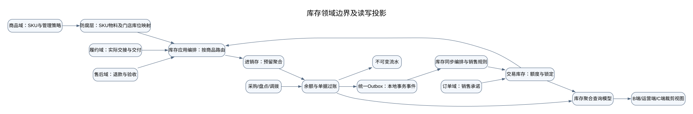
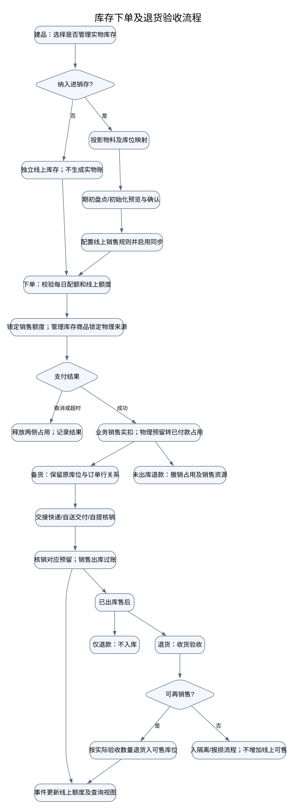
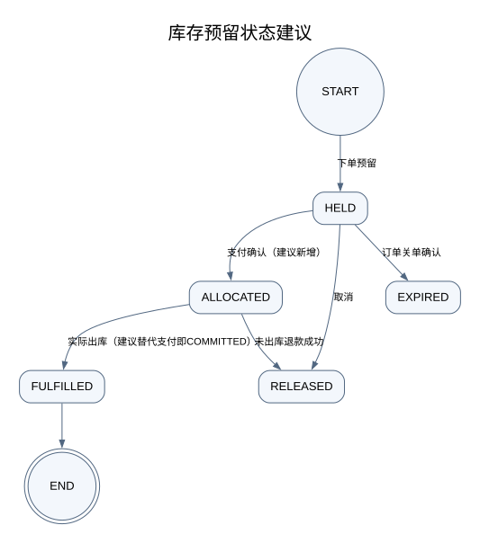

# 业务库存与进销存：领域、流程及前后端优化方案

> 状态：历史设计，当前实施状态以现行TDD为准。
> 来源：恢复自仓库历史提交 `ad570bf3e`；保留原文作为现有引用的历史设计输入，下列原始状态及数量不代表当前实现。

日期：2026-10-19
状态：深度 review 后的建议设计，尚未实现。本文不使用线上数据，不代表现有功能全部缺失。
范围：商品建账、线上库存、订单预留、支付、发货、退款退货、进货、盘点、调拨、库存同步；B/C/运营端。

## 1. 目标与边界

商家应能回答：货在哪里、实际还有多少、多少已被订单占用、线上还能卖多少、为什么变化、异常如何恢复。

保留两个领域：交易库存负责销售承诺与渠道额度，进销存负责货物存量与库存凭证。商品负责规格与管理策略，订单负责交易，履约负责交付，售后负责退款及退货验收。跨域通过明确的命令、查询与事件协作，不通过跨库改表。

本方案不涉及积分、资金结算或生产数据修复。先补齐基础流程，不扩展 BOM、批次、称重、多单位、部分调拨验收等能力；这些扩展必须保留可兼容的明细级标识。

## 2. 代码证据与复核结论

以下路径相对仓库根目录。业务解释与实现现状分开记录。

| 主题 | 当前实现证据 | review 结论 |
|---|---|---|
| 支付扣业务库存 | `backend/shop-core/src/main/java/ai/neargo/shop/trade/service/impl/OrderServiceImpl.java` 支付处理调用 `stockPort.confirm(orderNo)` | 支付即销售实扣，是现有交易口径 |
| 进销存销售出库 | `backend/shop-inventory/src/main/java/ai/neargo/shop/inventory/service/impl/ReservationServiceImpl.java`：commit 解除预留并生成 SALE 出库 | 在 DUAL/INVENTORY 链路中，支付可能已改变进销存实存；不能直接把此数称为“货架实物” |
| 纳入进销存 | `backend/shop-app/src/main/java/ai/neargo/shop/invbridge/InvManagedAppService.java` | 已有品类/商品开关和退出保护；需补清生命周期及交互说明 |
| 全局库存权威 | `backend/shop-app/src/main/java/ai/neargo/shop/invbridge/port/InventoryStockPort.java` | 直接解析物料，混合管理商品需要明确逐商品路由；不能只切全局模式 |
| 线上销售规则 | `backend/shop-core/src/main/java/ai/neargo/shop/product/service/impl/StockSyncServiceImpl.java` | 已有单品 > 品类 > 门店优先级、ALL/RESERVE/RATIO/CAP/MANUAL；应复用并明确手动模式只降不升 |
| 库存回写 | `backend/shop-app/src/main/java/ai/neargo/shop/invbridge/InventoryWritebackService.java` | 已有按发货库位向门店回写；共仓分配及事件完整性保护需要补强 |
| 期初对齐 | `backend/shop-app/src/main/java/ai/neargo/shop/invbridge/StockSyncAppService.java` | MALL 会盘点调整实存，COUNT 记录已盘点；缺少逐行可审查的批次闭环 |
| 盘点 | `backend/shop-inventory/src/main/java/ai/neargo/shop/inventory/service/impl/StockCountServiceImpl.java` | 开单快照账面，fill 使用实盘减开单账面；不能无条件承诺“盘点期间照常卖不影响差异” |
| 退款库存恢复 | `backend/shop-core/src/main/java/ai/neargo/shop/trade/order/refund/service/impl/RefundResourceServiceImpl.java` | 已有退款资源恢复、原来源校验和重试；方案应拆分销售资源恢复与实际退货入库，避免重复 |
| 退回原库存 | `backend/shop-inventory/src/main/java/ai/neargo/shop/inventory/service/impl/OriginalReservationRestoreServiceImpl.java` | 已有原预留行追溯、数量上限和幂等；应保留，不另建平行恢复引擎 |
| B 端 | `b-app/src/pages/stock*`、`stock-settings`、`stock-align` | 已有查看、盘点、规则、对齐；需要统一数量口径、作用范围和操作结果 |

### 优先风险

- **P0：实物口径与出库时点。** 支付后货尚在店内却已从进销存实存扣除，会影响盘点解释。建议目标态支付只转为“已付款占用”，交接快递/自送交付/自提核销时才出库。录入运单不等于实物交接；应由履约确认动作提供业务凭证。此项是行为变更，需要旧订单兼容，不能只移动一个调用。
- **P0：共享仓复制额度。** 当前回写按库位遍历关联门店；若同一仓可用 10，每店都获得 10 的额度，平台分店锁无法保护共仓总量。建议一期禁止多门店共享池启用独立全量同步；支持时必须共享预留或执行受控额度分配。
- **P0：盘点截止口径。** 开单时 10，盘点前卖出 2，盘到 8，直接差额 -2 后再扣当前 8 会变 6。必须选定统一截止时点，不能仅靠“开单快照”。
- **P1：安全库存语义混用。** 库存查询的 available 是 onHand-reserved；但 `InventoryAclService.StockAt.available()` 实际返回 max(0,onHand-reserved-safety)，商城回写使用后者。现状确实有两种可用口径，并非仅注释差异。首批分别展示 available 与 supplyAvailable，保留当前回写算法；将安全库存改为仅预警是后续策略变更，需要预览及兼容，不能直接删除扣减。
- **P1：回写保护不完整。** `mirrorPending` 仅检查旧事件 PENDING 的部分类型。失败、未知结果、处理中及统一 outbox 的按处理器投递状态，都应进入是否可安全同步的判定。
- **P1：同步开关并非健康状态。** 当前设置状态由 enabled/alignedAt 推导，无法代表某 SKU 是否已成功回写。配置、运行进度、异常分开建模。
- **P1：期初对齐可改实存。** 不能把“以商城为准”当作普通同步方向选项。只在初始化确认下生成可追溯的期初凭证；日常线上额度不能反推实物数量。

## 3. 数量口径与不变式

| 名称 | 目标定义 | 归属 |
|---|---|---|
| 实存 onHand | 指定库位已入库未实际出库的数量 | 进销存 |
| 未付款预留 unpaidHeld | 有效待支付订单占用 | 进销存预留明细 |
| 已付款占用 paidAllocated | 已付款未交付/未交接的数量 | 进销存预留明细 |
| 预留 reserved | unpaidHeld + paidAllocated | 进销存余额的汇总，不再额外重复扣减 |
| 可用 available | max(0, onHand-reserved) | 进销存派生读模型 |
| 预警阈值 warningThreshold | 触发补货提醒；不默认参与扣减 | 进销存，兼容现有 safety_stock |
| 销售保留量 salesReserve | 留给线下等用途的数量，参与销售规则 | 交易库存策略，复用 RESERVE |
| 线上可售 onlineSellable | 当前可新增下单数量，受规则和共享池保护 | 交易库存 |
| 每日配额 dailyQuota | 当日流量限制，独立于存量 | 门店 listing |

不变式：预留不得超过可用；出库不得侵占其他订单预留；预留转出库应在进销存本地事务中一次完成；退款金额不直接决定回库数量；实存只由凭证过账改变；所有数量都必须带 owner、item、location 和单位；订单按行/履约批次核销，累计出库不超过应交付量，累计退回不超过实际出库量。

共享池：独立额度模式下，各门店未售额度加有效占用不得超过可分配池；共享预留模式下，页面库存可以是快照，但提交订单必须统一占池，额度展示不构成无条件承诺。不得将同一池完整复制给多个独立销售库存。

## 4. 领域对象与依赖

| 对象 | 聚合/模型与身份 | 职责与约束 | 现有落点/优化 |
|---|---|---|---|
| 商品及 SKU | 商品聚合；goodsNo/skuNo | 规格、上下架、库存管理模式；下架不删除历史 | 复用 prd_goods/prd_sku |
| InventoryPolicy | 策略；商品/品类有效配置 | 是否记账、权威路由、切换前置条件 | 整合现有 inv_mode，禁止前端自行推断 |
| ItemMapping | 防腐层映射；owner+system+ref | SKU ↔ item；不是跨库主键复用 | 复用 inv_item_ref |
| StockLocation | 库位聚合；owner+locationId | 货物位置、发货源映射；有未完成承诺不得随意更换 | 复用 inv_location |
| InventoryBalance | 库存聚合；owner+item+location | 实存与预留守恒 | 复用 inv_stock_balance |
| Reservation | 预留聚合；reservationId | 按订单行锁定来源、占用、释放、核销 | 扩展现有预留行，保存原来源与数量 |
| InventoryDocument | 单据族，非合并成一张大表 | 入库、出库、盘点、调拨各自状态机 | 复用当前单据；已过账更正通过反向凭证 |
| StockLedger | 不可变事实；ledgerId | 单据、订单、售后、操作人、前后余额追溯 | 只追加；预留变化另有审计，不能伪造实存流水 |
| SalesStock | 交易库存聚合；store+sku 或明确的共享池 | 线上额度、锁定与销售扣减 | 复用 prd_store_stock/prd_stock_lock；逐步统一路由 |
| SellRule | 策略；门店/品类/商品 | 计算渠道目标额度，返回规则来源 | 复用 prd_sell_rule，继承规则显式可查 |
| AlignmentBatch | 建议新增编排聚合；batchNo | 预览、版本、确认、逐项结果、恢复 | 取代单次按钮直接整店修改的体验 |
| StockSyncOperation | 建议新增业务操作记录；operationNo | 本次库存计算输入、规则版本、目标、投递与结果 | 关联现有同步日志和 outbox，避免重复存投递状态 |
| InventoryOverview | 查询模型；store+sku | 两套库存、占用、规则来源、时间及可操作项 | B/运营端共用语义，C 端裁剪 |



依赖规则：core 内订单依赖 StockPort 等端口；shop-app/invbridge 负责跨域组合；shop-inventory 不反向依赖订单实现或平台表。跨库操作拆为两个本地事务，通过统一 outbox 与幂等操作号衔接。Spring 事务事件只做提交后唤醒，不能替代持久化投递。

## 5. 目标业务流程



### 5.1 事件与库存变化矩阵

| 事件 | 实存 | 预留 | 销售资源 | 发起与凭证 |
|---|---|---|---|---|
| 下单成功 | 不变 | 未付款 +q | 锁定 q | 订单号+订单行+锁定来源 |
| 取消/支付超时 | 不变 | 未付款 -q | 释放锁定 | 关单操作号 |
| 支付成功 | 不变 | 未付款转已付款，总预留不变 | 锁定转销售扣减 | 支付确认事实 |
| 开始备货/录运单 | 不变 | 不变 | 不变 | 备货/物流信息，不作为出库证据 |
| 确认交接/自提核销 | -q | 已付款 -q | 不重复扣销售库存 | shipment/核销明细对应出库凭证 |
| 未出库退款 | 不变 | 已付款 -q | 按原来源恢复 | 退款执行号；实际完成后再重算可售 |
| 已出库仅退款 | 不变 | 不变 | 不恢复货物可售 | 资金执行与库存处理独立 |
| 退货验收 | 按验收数量增加对应库位 | 不变 | 仅可售库位触发重算 | returnReceiptNo+行+验收结果 |
| 进货/报损 | +q/-q | 不侵占有效预留 | 重算 | 入/出库单 |
| 调拨发出/接收 | 源库→在途→目的库 | 不侵占预留 | 源减、目的实收后可增加 | 调拨单及出入库凭证 |

物流轨迹签收只影响交易完成判断，不触发第二次库存扣减。商家修正运单只改物流信息，不能生成重复出库。退款失败不释放已付款占用；库存恢复失败呈现独立“待处理”，不能把已成功退款改成退款失败。

### 5.2 盘点与调拨

一期建议按库位/物料短时冻结库存变动，开始盘点时检查在途业务；阻止新的预留、出入库和调拨，已付款通知不能被阻断，允许只转预留分类，待出库动作进入待处理。冻结必须由服务端判定，退出或作废释放，长时间未结束提示负责人；不要只锁 UI。若业务无法接受冻结，则选择逐行截止时间+期间流水归一化模型，两者不能混用。

盘点行必须区分“未录入”与“实盘 0”，过账前所有选中行必须完成或明确排除。确认页展示盘盈、盘亏、对预留的影响；已过账通过反向更正，不修改原凭证。

调拨保留 DRAFT→SHIPPED→RECEIVED；已发出不得当草稿作废。未启用差异收货前，实际数量不符应进入异常待处理，不提供虚假的“全量收到”。在途数量在首页可见并可直达待收货单。

## 6. 状态抽象

以下标有“建议”的状态是目标设计，不能直接当现有数据库枚举使用。



预留状态按行/数量核销；头状态由行汇总，不能用一个终态掩盖部分出库。已付款占用不使用待付款 TTL 自动释放。过期任务先确认订单关单事实；支付与释放冲突由业务状态裁决，不能静默吞掉。

| 对象 | 状态及合法流转 | 前端表达 |
|---|---|---|
| 入/出库单（当前） | DRAFT→POSTED；草稿作废，已过账按类型反向更正 | 草稿/已生效/已更正，显示关联反向单 |
| 盘点（当前+建议守卫） | COUNTING→POSTED或VOIDED；未完成行禁止过账 | 盘点中/已完成/已取消，显示未录行数 |
| 调拨（当前） | DRAFT→SHIPPED→RECEIVED；DRAFT可取消 | 待发出/在途待收货/已收货 |
| 管理接入（建议） | UNMANAGED→INITIALIZING→READY；READY→DISABLING→UNMANAGED | 未管理/待初始化/已管理/待关闭 |
| 对齐批次（建议） | PREVIEW→CONFIRMED→APPLYING→SUCCEEDED或PARTIAL_FAILED；预览过期→EXPIRED | 待确认/处理中/完成/部分失败/需重新预览 |
| 同步配置 | NOT_ALIGNED→DISABLED↔ENABLED；配置变更需重新校验 | 尚未初始化/已暂停/已启用 |
| 同步操作（建议） | QUEUED→RUNNING→SUCCEEDED；可转RETRYING/BLOCKED/FAILED，人工恢复再入队 | 等待/处理中/完成/重试中/需处理 |

同步健康与同步开关是两个维度，ENABLED 不等于 SUCCEEDED；处于 BLOCKED 应显示阻断原因与操作入口。技术投递状态从统一 outbox 派生，业务操作保存目标与结果，避免两份重试计数。

## 7. 同步与异常恢复设计

- 每次命令带 operationNo，事件带 eventNo、业务发生时间、聚合版本、主体、SKU/物料、门店/来源库位及原业务引用。幂等不能依赖“目标数量相同”：先改成10、卖出2后重放旧的设10会错误补货。
- 按库存来源池及 SKU 定义顺序；旧版本回写不覆盖新结果。跨聚合事件只触发“读取当前有效状态并重算”，保留触发事件与计算快照以解释结果。
- 查询未完成事件需读统一 outbox 的处理器投递状态，覆盖运行、等待、重试、失败、结果未知。只查旧表 PENDING 不足以证明已追平。
- 独立销售额度模式保留当前原子锁定；共仓第一阶段禁止复制额度，后续引入共享预留。不可把异步回写当作防超卖边界。
- 统一 `reconcile(store, sku, reason, operationNo)` 应用入口：规则变更、库存过账、启用同步、人工重算都调用它；不允许页面绕过规则写业务库存。
- 开同步用可恢复编排：校验→任务入队→初始化重算→记录结果。部分失败不得显示整店“已同步”；关闭只停止后续额度回写，不撤销现有订单预留。
- 退出管理/更换发货源：检查未付款及已付款占用、未完单据、同步任务；有业务时阻止并列出关联单。历史订单始终使用原来源快照。
- 补偿分两类：技术失败可重试；物料不存在、库存不足、规则不合法等业务阻断需要人工处理后重试。禁止一键清除失败或直接修改余额掩盖差异。

## 8. 后端与契约优化

复用现有 `StockPort`、`ReservationService`、`StockPostingService`、`StockSyncService` 与统一 JDBC outbox，不另起一套库存/消息框架。

建议新增以下应用契约；路径为建议，需要与现有 `/biz/inventory`、库存同步控制器统一后确定，不代表已上线。

| 能力 | 输入 | 输出及关键校验 |
|---|---|---|
| InventoryOverviewQuery | storeNo、skuNo、可选locationId | 数量口径、单位、权威模式、规则来源、同步时间、版本、actions |
| AlignmentPreview | store、mode、scope | batchNo、expiresAt、snapshotVersion、逐行before/after、阻断项 |
| AlignmentConfirm | batchNo、snapshotVersion、operationNo | operationNo；版本变化拒绝并重新预览，支持查询逐项结果 |
| StockReconcile | store、sku、reason、operationNo | ACCEPTED+operationNo；只重算不凭空改实物账 |
| OperationQuery | operationNo | 业务状态、事件引用、结果、错误码、是否可重试、下一动作 |
| ReturnReceive | afterSaleNo、lineNo、receivedQty、quality、location、operationNo | 验收凭证，限制累计数量、原来源可追溯，独立于退款通道回调 |
| FulfillmentStockIssue | shipment/receiptRef、原预留行、qty、operationNo | 出库凭证；服务端确认真实履约动作，重复调用返回原结果 |

数据演进：先扩展预留阶段及来源行映射、增加批次/操作记录，再增加统一读模型。订单已存在 stockAuthority、原锁定来源等快照应复用。数量精度保持现有整数，页面显示单位，不在本期启用小数库存。

## 9. 前端优化方案

### 9.1 B 端页面与动作

| 页面 | 展示 | 操作及结果 |
|---|---|---|
| 库存首页 | 门店/仓库范围；缺货、待收货、未完盘点、同步需处理；库存单位 | 搜索SKU/条码；待办直达关联单；核心入口进货、盘点、调拨、报损 |
| 库存列表 | 实存、占用、可用；线上可售另列且带模式，避免把“可用”写成线上可售 | 未管理商品显示独立线上库存标签；初始化中显示原因而非0库存 |
| 库存详情 | 数量关系卡、未付款/已付款占用、所在库位、规则及同步结果 | “盘这一件”改实物账；“设置线上额度”只改销售额度，两个按钮明确分组 |
| 商品编辑 | 是否记库存、继承来源、当前门店有效规则 | 关闭时展示未完成订单/单据；新建纳入库存后直达期初盘点/进货 |
| 线上库存设置 | 显示配置开关和运行健康两行；规则来源：单品/品类/门店 | 保存前预览变化；手动模式明确“进货不自动抬高额度” |
| 期初对齐 | 左列线上数量与锁定，右列账面与预留；说明不一定同口径 | 默认引导实地盘点；“采用商城数量初始化实物账”只给初始化场景；确认后进入结果页 |
| 订单/备货 | 订单占用与出库状态分开；关联原库位 | 改运单不再出库；实际交接展示出库结果；失败给待处理而非重复提交 |
| 退款/退货 | 退款状态、货物状态、库存处理状态三行 | 仅退款不给入库；退货可录实收与质量，不可售货物转隔离 |
| 单据/流水 | 来源订单/售后/调拨/盘点、操作人、时间、数量前后值 | 双向跳转；已过账更正显示反向凭证；按状态控制按钮 |
| 同步记录/异常 | 来源、计算口径、原值→目标→实际结果、规则版本、错误原因 | 权限内重试、查看关联单；不提供直接改消息状态或强制抬库存 |

详情页关系卡示意（目标口径）：

```text
门店A · 发货仓：中心仓     库存管理：已接入
实物 20  −  未付款占用 2  −  已付款占用 3  =  可用 15 件
线上还能卖 10 件  · 规则：最多10件（来自本商品）
同步：需处理 · 1分钟前 · 查看原因
[进货] [盘这一件]       [设置线上额度]
```

交互统一：所有写动作防重复提交；网络超时显示“结果确认中”，用 operationNo 查结果，不直接宣告失败。成功页显示实际变化及关联单号；部分成功保留逐项结果。禁用按钮给出原因与解决入口；空数据、加载失败、初始化中分别展示。多门店切店时丢弃旧店延迟响应，操作确认明确门店和库位。

### 9.2 C 端

只呈现可购买状态与必要提示，不暴露实物、预留、销售策略、同步失败等后台细节。列表和详情用同一可售查询口径；数量选择和提交都校验，服务端为最终裁决。库存变化后保留购物车输入并提示调整数量；订单创建结果未知先查订单结果，避免重复建单。退款页区分退款处理中、退货待验收，退款成功不宣称已回库。

### 9.3 运营端与权限

运营端库存健康、对账、流水页统一展示业务操作链：订单→预留→出库→退货→同步事件；按主体/库位/SKU筛选。展示计算输入与失败来源，支持受控重放，保留操作原因和审计。默认只读，不直接跨库改余额。

权限按动作定义：查看库存、出入库、盘点、库存策略配置、初始化确认、退货验收、异常重试、经营成本查看。隐藏前端入口与后端鉴权同时实施，成本权限不再仅凭是否拥有客户权限推断；策略配置与初始化确认采用店主管理权限。

## 10. 兼容、交付顺序与验收

### 阶段A：统一口径和查询/交互

交付术语、数量读模型、规则来源、B端详情关系卡、初始化影响预览、同步结果展示。先保证显示符合当前“支付即出库”口径：在切换前标为“账面结存（支付时扣减）”，不能提前标成实时实物。修正文档中的旧状态描述。

验收：单店/多店、管理/不管理、自动/手动规则、0库存/失败/初始化分别可理解；列表详情一致；权限与切店一致。

### 阶段B：同步编排及保护

交付可恢复初始化批次、版本校验、统一同步入口、统一outbox状态适配、共仓阻断、原来源切换保护、异常追溯。关闭同步或规则变更时处理在途任务版本，不能让旧任务重新打开/覆盖设置。

验收：部分失败准确展示；失败恢复不重复改库存；旧事件不抬高新额度；同仓多店不会各复制全量。

### 阶段C：支付占用与履约出库

交付 ALLOCATED 阶段、履约明细出库、退款与验收入库分离、盘点截止策略。按订单创建时的版本快照路由；旧订单保留支付即出库与原退款恢复逻辑，新订单使用新预留阶段。禁止旧订单再次履约出库。切换前列出所有调用者，包括旧 `trade/service/impl/OrderServiceImpl` 与新的 `trade/order`，不能只按包名判断链路已迁移。

验收：未付取消、支付后取消、备货退款、已发仅退款、退货可售/不可售、重复通知、运单修正、自送、自提、部分履约均不重复出入库；已付款不被预留TTL释放。

### 阶段D：范围扩展

基础闭环通过后再开放共享池动态分配及全局 INVENTORY 模式。混合商品按策略路由，未管理商品继续独立销售库存；不在未完成订单上热切权威来源。

验证采用受影响服务的定向测试、B端类型检查与关键页人工检查；不做并发压力或全量回归。必须覆盖业务反例：盘点期间出库、部分验收、退款成功但资源恢复待处理、同仓多店、旧订单新履约、旧回写乱序。方案本轮只完成文档，不切换模式或改线上库存。

## 11. 待实施前固定的决策

推荐默认：支付只转已付款占用；实物交接才出库；一期采用范围内短时冻结盘点；安全库存只预警，销售保留通过规则表达；共仓未实现统一占用前阻止多店独立全量同步；旧订单按来源及版本快照继续原路径。

这些是目标方案选择，不是对已有实现的描述。实施前需把冻结对履约的影响、交接凭证动作和历史兼容分支落实到接口及迁移计划；不以文档通过代替代码验收。
