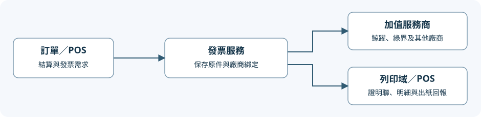

# 台灣電子發票多服務商接入方案

狀態：草稿，2026-11-21。調研對象為 UME 原發票服務，設計對象為需要同時支援多家加值服務商的系統。建議先驗收鯨躍與一家公開規格完整的廠商，涵蓋門店出紙與線上開票。

首批兩家廠商的詳細接口、資料庫、密鑰和聯調步驟見[鯨躍與綠界接入 TDD](../TDD-台湾电子发票-鲸跃与绿界.md)及[交接文檔](../交接-台湾电子发票-鲸跃与绿界.md)。

## 一、定位

由發票服務按營業人與門店選定加值中心，管理開立、查詢、作廢與折讓。POS 使用已確認的發票資料出紙。首批建議鯨躍科技（既有 UME 商家）和綠界（獨立 B2C 與離線規格），光貿作為下一批候選。

## 二、接入結構

| 部分 | 職責 |
|---|---|
| 訂單／POS | 提供結算後的原訂單、金額、稅別、買方統編與載具／捐贈／紙本選項。 |
| 發票服務 | 依營業人、授權門店與生效期選擇廠商帳號。送出前保存開票命令、資料快照和廠商綁定。 |
| 廠商適配器 | 處理該廠商的傳輸、認證、欄位映射及回覆。按已驗證能力開放功能。 |
| 列印域／POS | 依原發票保存的證明聯資料排版、送印、重試或補印。開票、平台上傳與出紙各自回報。 |

## 三、接口、密鑰與廠商清單

### 3.1 UME 既有對接

UME 備份 `trendlab-pay/service@8e4f861bc` 的 `invoice-web` 實作了 `cetustek`（鯨躍）和 `bbcsoft`（宣揚）。2026-11-21 唯讀查詢顯示，`invoice.t_user` 的 274 筆帳號及 `invoice.t_invoice` 的 18,653 筆資料，平台欄位均為 `cetustek`。餐飲四個分片有填平台的發票記錄也均為 `cetustek`，四個分片當日都有開立紀錄。宣揚屬於既有程式支援，本次查詢範圍內未見使用紀錄。

| 介面 | 定位與證據 |
|---|---|
| UME POS → UME | `POST /invoice/{getPlatform,login,logout,getVehType,getLoveCode,getOfficeInfo,getInvoiceNumber,checkInvoiceNumber,uploadInvoice,queryInvoiceStatus,cancelInvoice,voidInvoice,uploadAllowance,cancelAllowance}`。以 `InvoiceIndexController.java`、`invoice-rpc` 的 `Pos*Entity` 為舊 POS 契約。 |
| UME → 鯨躍 POS SOAP | `invoice/default/application` 已發布版本 1305，`api.cetustek.url` 為 `http://ve.ei.com.tw/InvoiceEntitySync/InvoiceAPI`。dev／uat 與備份的 `sysconfig.properties` 指向 `invoice.cetustek.com.tw` 同一路徑。新接入需取得與帳號匹配的 HTTPS 正式及測試端點。 |
| 鯨躍公開 SOAP | 公開服務為 `https://www.ei.com.tw/InvoiceMultiWeb/InvoiceAPI`。實際讀取 WSDL 成功，可見 `CreateInvoiceV3`、`QueryInvoiceByOrderid`、`QueryInvoiceNumberByOrderid`、`CancelInvoice`、`CreateAllowance`、`QueryAllowance`、`CancelAllowance`、`QueryLoveCode` 等操作。此服務與 UME 的 `InvoiceEntitySync` 方法集合不同。 [鯨躍服務頁](https://www.ei.com.tw/InvoiceMultiWeb/InvoiceAPI) · [WSDL](https://www.ei.com.tw/InvoiceMultiWeb/InvoiceAPI?wsdl) |
| UME → 宣揚 | `api.bbcsoft.url` 指向 `rd.jabezpos.com/B1POS/POS01013_Soap.dll`。舊適配器以表單 POST 呼叫 `initAccount`、`getTerminal_Invoice_Rows`、`setInvoice_No`、`cancelInvoice_No`。UME 控制器對 `voidInvoice` 及兩個折讓操作回覆平台未實作。新版完整規格及測試資格向宣揚索取。 [宣揚發票系統](https://www.bethel.com.tw/product/mobile-invoice/) |

鯨躍舊 POS SOAP 由 `CetustekInvoiceServiceHelper.java` 輸出 SOAP 1.1、`text/xml;charset=UTF-8`。命名空間為 `http://webservice.cetustek.com/`，回傳讀取 `<return>`。舊接口的 HTTPS WSDL 請求回覆 403，以下對照以 UME 源碼為準。

| 功能 | 鯨躍舊 POS SOAP | 舊程式採用的資料／回覆 |
|---|---|---|
| 帳號與查驗 | `QueryOfficeInfo`、`QueryLoveCode` | `officeid`、`posno`、`posid`。 |
| 字軌配號 | `ApplyInvoiceNumber`、`TakeInvoiceNumber`、`CheckInvoiceNumber` | 申請按年、月期別，領取與檢查使用 `applyid`。 |
| 開立／上傳 | `UploadInvoice` | `invoicexml` 含發票號、原訂單號、買賣方、稅額、品項及載具／捐贈資料。UME 把 `S0` 視為操作成功。 |
| 查詢 | `QueryInvoiceStatus` | 依發票號及發票日期查詢。 |
| 取消／作廢 | `UploadCancelInvoice`、`UploadVoidInvoice` | 傳原發票資料與操作原因，各自保留廠商原始回覆。UME 分別識別 `C0`、`V0`。 |
| 折讓 | `UploadAllowance`、`UploadCancelAllowance` | `allowancexml` 保留原發票及折讓資料。UME 分別識別 `A0`、`C0`。 |

### 3.2 鯨躍憑證清冊

| 用途 | 欄位與現有落點 | 新系統接法 |
|---|---|---|
| 鯨躍 POS SOAP 帳號 | `invoice.t_user` 中按 `PLATFORM`、`STORE_ID`、`OFFICE_ID` 查找綁定。來源欄位為 `OFFICE_ID`、`ID`、`PW`，舊程式分別映射至 `officeid`、`posno`、`posid`。只核對了憑證存在性。 | 按營業人、門店授權及環境保存憑證引用。正式與測試憑證由廠商按服務開通。 |
| UME POS → UME 認證 | `invoice.t_user.TOKEN_STR` 為 UME 發票登入工作階段憑證。舊請求另帶 `randomStr` 和 `token`，由 UME 的簽名服務核對。 | 僅在相容舊 POS 時保留此入口。新端使用既有系統身分與門店權限。 |
| UME Web 開票帳號 | Apollo dev／uat 的 `web.invoice.username`、`web.invoice.password`、`web.invoice.officeid`，另有 `braid`、`platform`、`deviceid`。已查閱的 default 發布版本未提供這組鍵。 | 測試與正式分開授權。設定保存帳號及密碼的引用。 |
| 證明聯 QR Code | 列印資料可能含廠商提供的條碼，或由獲授權的本地列印流程產生。開票 API 帳號、UME token 與 QR Code 參數各有用途。 | 優先保存廠商回傳的可列印內容。若合約要求本地產生，另向廠商取得對應參數、編碼規格和樣張，按店與版本配置。 |

方案記錄憑證欄位、出處與用途。部署時由有權限的管理員將商戶核發的憑證放入既有密鑰存放機制，應用設定只保存引用及版本。換密鑰時沿原營業人與原廠商更新其認證材料。

### 3.3 其他台灣廠商及官方文件

此表為接入候選清單。加值中心資格、服務範圍與商戶授權以[財政部當日名冊](https://www.einvoice.nat.gov.tw/ptl008w)及各廠商合約查核。「待索取」表示目前取得了官方服務入口，實作前需取得廠商技術規格。

| 廠商 | 開立與憑證線索 | 官方文件／接入狀態 |
|---|---|---|
| 鯨躍 Cetustek | 既有 UME 走 POS SOAP，公開版另有 `CreateInvoiceV3`。 | [公開 WSDL](https://www.ei.com.tw/InvoiceMultiWeb/InvoiceAPI?wsdl) · [申請與串接](https://www.cetustek.com.tw/apply.php)。先請廠商核對現有帳號適用的版本、憑證及 HTTPS 端點。 |
| 綠界 ECPay | `POST /B2CInvoice/Issue`。商戶 `MerchantID`、`HashKey`、`HashIV`，依官方規格傳送加密 `Data` 並判讀業務回覆。 | [B2C 技術文件](https://developers.ecpay.com.tw/7809/) · [一般開立](https://developers.ecpay.com.tw/7896/) · [發票列印](https://developers.ecpay.com.tw/7949/) · [B2B 交換](https://developers.ecpay.com.tw/14808/) · [離線規格](https://developers.ecpay.com.tw/13738/)。 |
| 光貿 Amego | `POST /json/f0401`，自動配號與 API 配號各有流程。統編識別、`APP KEY` 與請求簽名依官方範例。 | [API 文件](https://invoice.amego.tw/api_doc/) · [程式範例](https://invoice.amego.tw/api_doc/example) · [配號方式](https://invoice.amego.tw/info_detail?mid=70)。 |
| ezPay 電子發票 | `POST /Api/invoice_issue`。商店 `MerchantID`、`Hash Key`、`Hash IV`，依手冊封裝 `PostData_`。支援帶回相關證明聯條碼資料的接口。 | [技術手冊 v1.2.2](https://inv.ezpay.com.tw/dw_files/info_api/EZP_INVI_1_2_2.pdf) · [字軌手冊](https://inv.ezpay.com.tw/dw_files/info_api/EZP__Track__1_0_0.pdf) · [下載入口](https://inv.ezpay.com.tw/Invoice_index/download)。 |
| 歐付寶 O’Pay | 官方提供 B2C 及離線兩套發票規格。依所選規格向廠商申請發票介接憑證。 | [文件總覽](https://developers.opay.tw/Download/Document) · [B2C PDF](https://developers.opay.tw/Content/Doc/opay_i100.pdf) · [離線 PDF](https://developers.opay.tw/Content/Doc/opay_i301.pdf)。 |
| 宣揚 JabezPOS | UME 有 `bbcsoft` 舊適配器。現行服務、測試與完整能力待宣揚確認。 | [宣揚發票方案](https://www.bethel.com.tw/product/mobile-invoice/)。舊介面查 UME 備份 `BbcsoftInvoiceServiceHelper.java`。 |
| 訊航 SmilePay | 官方列出商家網站 API 開立。登入發票平台後，從「H 程式串接說明」取得商家文件，核對端點、簽名與測試帳號。 | [發票 API 取得方式](https://einvoice.net.tw/es/explain-api.asp)。 |
| 立吉富 PayNow | 開立、查詢、作廢及折讓查詢等規格已公開。按商家方案核對可用操作。 | [電子發票 v1.5 PDF](https://paynow-public.s3.ap-northeast-1.amazonaws.com/docs/PayNow_EInvoice_v1.5.pdf) · [官方文件索引](https://owlting.github.io/paynow-guideline/docs/api-reference/)。 |
| 康華 ezReceipt | 提供 POS／ERP 發票 API 與技術文件。端點、認證及測試帳號待索取。 | [官方 API 服務說明](https://www.ezreceipt.cc/application/options)。 |
| 關貿 Trade-Van | 有電子發票服務平台，依商戶及通路方案取得對應介接規格。 | [官方服務平台](https://veinv.tradevan.com.tw/APEINV/) · [服務申請與說明](https://csonline.tradevan.com.tw/PTVCS/help/Help_zh_TW.htm)。 |
| 紅陽 SunPay | 官方提供電子發票 v2.3 手冊及測試帳號申請。依手冊與開通結果核對發票端點和認證。 | [官方技術手冊 v2.3](https://storage.googleapis.com/joinchill-image/sunpay_techdoc/202603/%E7%B4%85%E9%99%BD%E7%A7%91%E6%8A%80%E9%9B%BB%E5%AD%90%E7%99%BC%E7%A5%A8%E6%8A%80%E8%A1%93%E4%B8%B2%E6%8E%A5%E6%89%8B%E5%86%8AV2.3.pdf) · [開發者與測試入口](https://www.sunpay.com.tw/developers)。 |

### 3.4 統一契約及路由

| 動作 | 建議統一契約 |
|---|---|
| 開立 `issue` | 輸入營業人、門店、訂單來源與編號、明細、稅別、幣種、買方、載具／捐贈與列印選項。線上由廠商配號。現場離線開立需廠商提供可獨占配號的契約及後送流程。 |
| 查詢 `query` | 依原廠商帳號、原商家訂單號或發票號查詢。保存本地處理結果、廠商原始碼及可取得的財政部上傳狀態。 |
| 作廢／折讓 | 使用原發票或原折讓作業的廠商帳號及外部識別。各廠商的取消、作廢、折讓、取消折讓分別映射，按商戶開通能力顯示。 |
| 列印 | 以同一份已確認的發票原件輸出證明聯與明細。保存廠商回傳的原始條碼、官方列印文件或所需欄位。首次出紙失敗、補印與結果待確認均沿原發票處理。系統如接入 ai-shop，沿用[統一列印域](../TDD-统一打印域兼容整合.md)的投遞與回報邊界。 |

首次開票以營業人、原訂單及明確的出單範圍標識一次業務效果，折讓沿原售後操作身份，補印沿單次列印操作身份。原命令、發票平台、帳號綁定及對外單號在送出前持久化。外部結果不明時，沿原廠商及原單號查詢後恢復原操作。切換廠商只影響生效後新開立的發票，歷史發票仍由原廠商處理。逐筆交易及驗證依[冪等設計規範](../reference/幂等设计规范.md)落地。

## 四、取捨與驗收

| 路徑 | 適用範圍與取捨 |
|---|---|
| 延續 UME 發票服務 | 既有鯨躍 POS、取號和歷史發票延續性好。需確認舊 SOAP 的安全端點、相容版本和維運責任。 |
| 統一發票服務逐家直連 | 建議作為目標架構。既有商戶先沿授權的鯨躍流程，新廠商各自依正式契約適配，POS 使用一致的列印資料。 |
| 直接接財政部 | 需獨立申請、測試與營運能力，另行評估。政府查詢 API、MIG／Turnkey 依各自權限和用途納入設計。 [財政部 API 使用規範](https://www.einvoice.nat.gov.tw/static/ptl/ein_upload/download/13.pdf) |

1. **鯨躍技術確認。** 取得既有 POS SOAP 與公開 SOAP 各自的版本、HTTPS 測試／正式端點、憑證資料字典、取號規則、重複上傳與狀態碼說明、開立與折讓樣本。確認同一測試商戶可完成開立、查詢及反向操作。
2. **第二家驗證。** 以綠界為建議候選，驗證商戶切換後路由、新發票與歷史發票的查詢、紙本／載具／捐贈、統編、作廢及部分折讓。若首批門店需要斷網開立，使用已開通的離線規格驗收斷網取號及後送。
3. **異常與列印。** 驗證廠商已收件但請求逾時、重複提交、字軌耗盡、輪替憑證與切換廠商。以 N5／區網印表機驗證首印、補印、明細、條碼掃描與送印結果。
4. **生效與對帳。** 確認營業人授權、門店帳號、字軌歸屬與生效期。核對原發票、廠商回覆、上傳結果與列印紀錄後，再按門店啟用。

調研依據為 UME Git 備份、2026-11-21 的 UME MySQL 與 Apollo 唯讀查詢，以及表列官方資料。本次驗證了公開 WSDL 可讀性。現行帳號適用的 HTTPS 服務、沙箱開票與 POS 實機出紙待取得測試環境後核對。
