# 积分模块完整流转图与类图

状态：v3设计契约，积分内核已实现并验收中；运营与订单接入后置 · 更新：2026-10-16

积分流转图展示五种持有方及分格、两种兑付、退款、备付、回流、到期、调账和异常恢复；类图按模块协作、核心对象、应用服务、订单SPI/结算Hook与持久化拆分。蓝线为积分移动，资金动作另用橙色；R是应收，不充当现金。

由 `python3 scripts/gen-points-diagrams.py` 从[图契约](./积分模块-图契约.json)生成，勿手改。源方案：[积分TDD](../TDD-积分域重整.md) · [资金方案](./积分资金方案-平台预存池.md) · [需求PRD](../../requirements/PRD-积分模块.md)。类图是79个核心设计类，不是当前Java源码反射；积分集成pay-domain，复用payTxManager/paySqlSessionFactory；接口嵌套DTO与基础框架不逐一展开。

## 模块定位

积分与结算是pay内部的业务模块，必要结算结果与积分账务共用短pay事务；外部付款在意图提交后执行。订单与售后仍经SPI、Outbox/Inbox和事实补偿跨域协作。

## 一 完整积分流转

### 完整积分流转总览

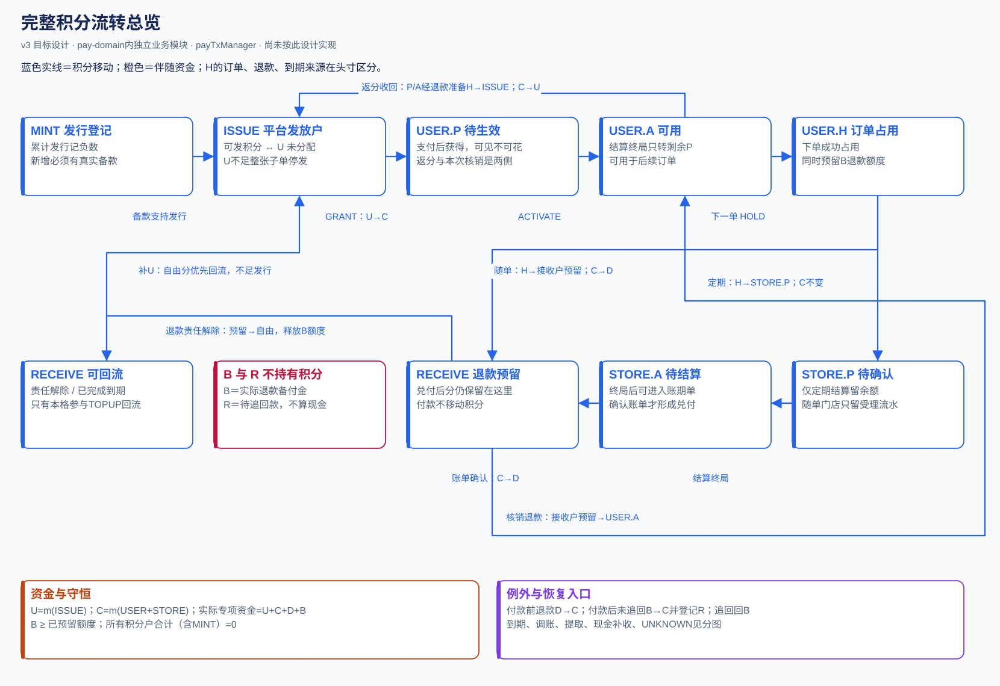

正常返分和核销构成主链；随单门店不留余额，定期门店先留分。退分从退款预留恢复，回流只用自由格，付款本身不移动积分。

### 备款发行回流与预算提取

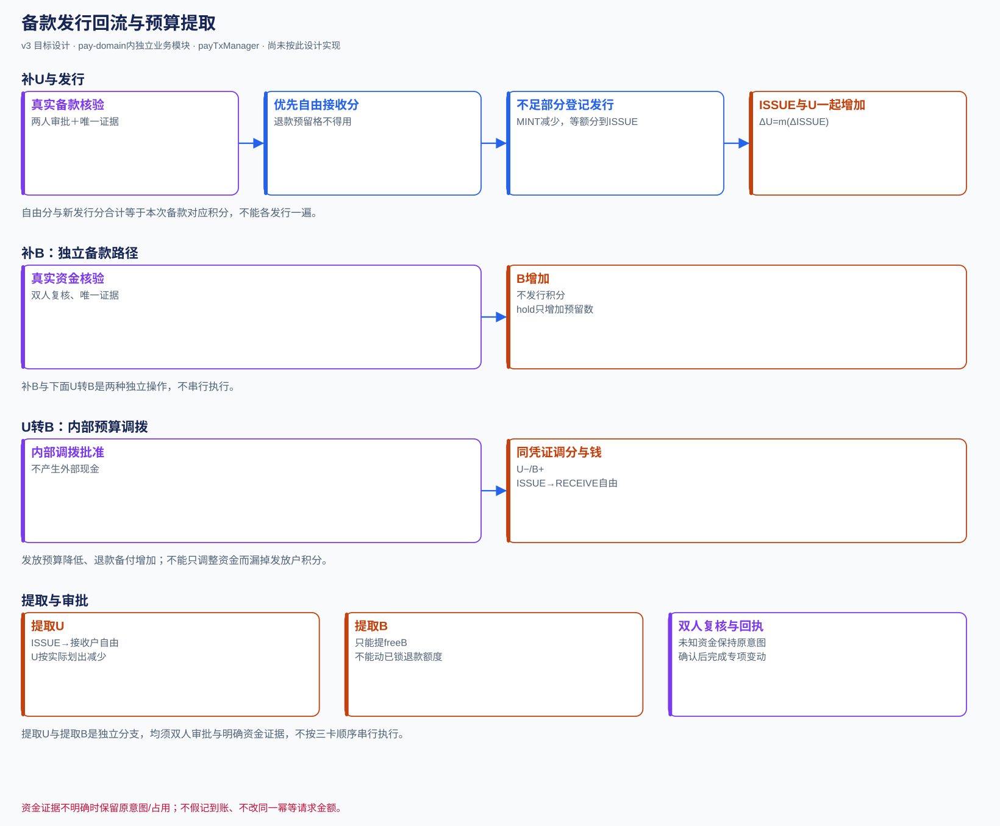

补U支持新增发行；补B不发行。U转B必须同时移动发放户积分。提取与内部调拨是不同动作，不能看见箭头就按同一笔顺序执行。

### 下单核销与两种商家兑付

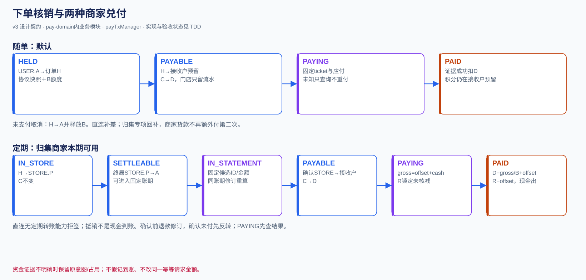

上下两行是互斥结算路径；只有明确成功后扣D。账单抵销回补B并核减具体R，不是外部现金收入。

### 核销退款与备付

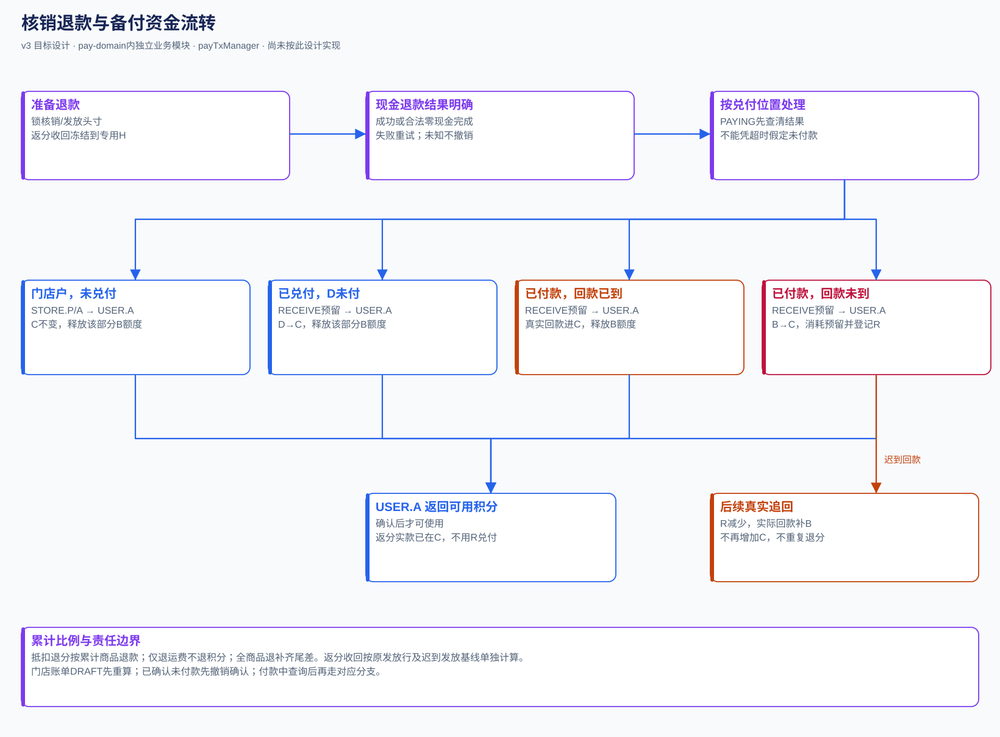

四个框是按积分位置和资金结果选择的分支，不是依次执行。现金确认后才返可用积分；未追回以B垫付，迟到追回只回B。

### 购物返分收回与不足

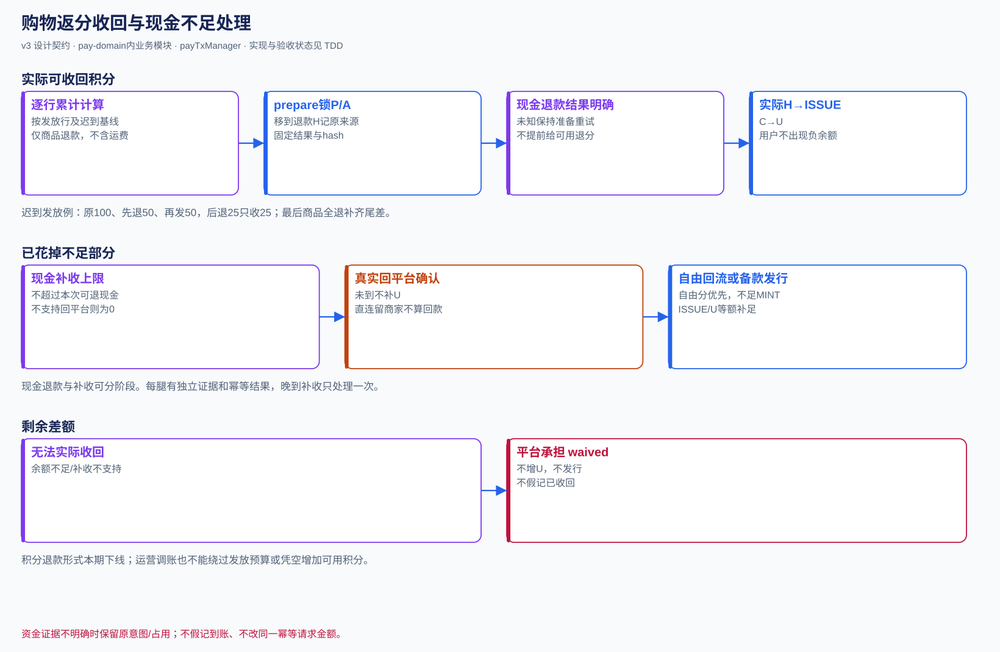

这张图处理购物返分的收回，与上一张抵扣积分退回分开。不足部分现金补收必须实际回平台；平台承担的差额不造分、不补U。

### 责任解除与到期

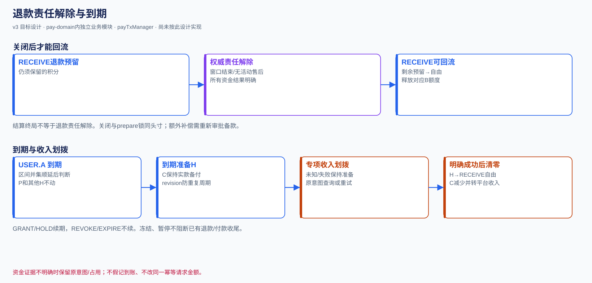

解除退款责任必须有权威关闭事实，不能借结算终局提前回流。到期准备仍保持C，收入划拨确认才清零；首次上线按真实备款初始化最新账本，旧方案不参与运行。

### 运营调账与可靠恢复

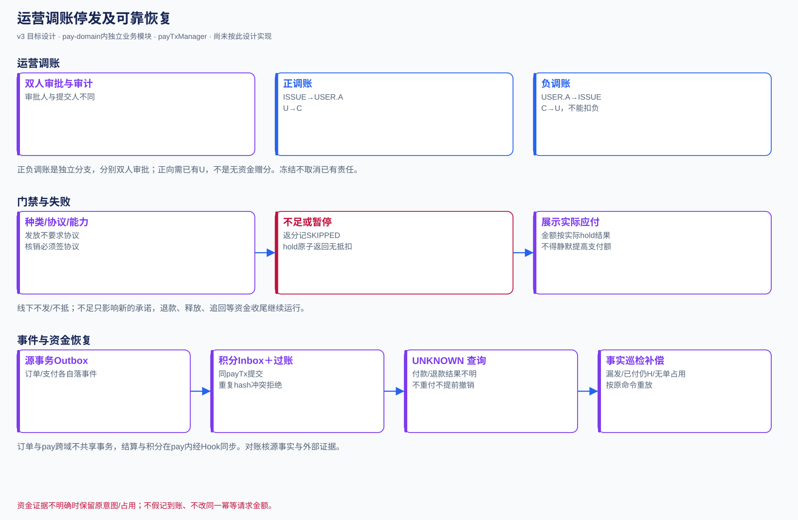

正负调账、停发、取消及未知资金分别处理。订单Outbox与pay消费跨域；结算Hook与积分同pay事务，资金未知仍需查询恢复，不直接改余额。

## 二 全量流转与资金对照

以下用1积分=1最小货币单位、单次100举例；实际系统按既约比例计算。预留增减仅改变可用额度，不重复扣B；R增减单独记应收。

| 动作 | 积分变化 | U/C/D/B变化 | 实际资金 | B预留 / R | 条件 |
|---|---|---|---|---|---|
| TOPUP_MINT 补U：新增发行 | MINT−100；ISSUE+100 | U+100 | 100 | 预留0 / R0 | 已核验备款；自由接收分不够 |
| TOPUP_RECYCLE 补U：优先回流 | RECEIVE_FREE−100；ISSUE+100 | U+100 | 100 | 预留0 / R0 | 只用可回流格；退款预留不动 |
| TOPUP_B 补退款备付B | 不动 | B+100 | 100 | 预留0 / R0 | 双人审批；不发行积分 |
| U_TO_B 发放预算转退款备付 | ISSUE−100；RECEIVE_FREE+100 | U−100；B+100 | 0 | 预留0 / R0 | 内部调拨；分和钱一起调整 |
| WITHDRAW_U 提取未发预算 | ISSUE−100；RECEIVE_FREE+100 | U−100 | -100 | 预留0 / R0 | 不能超过U和发放户 |
| WITHDRAW_B 提取自由B | 不动 | B−100 | -100 | 预留0 / R0 | 仅可提freeB=B−有效预留 |
| GRANT 支付后发待生效 | ISSUE−100；USER_P+100 | U−100；C+100 | 0 | 预留0 / R0 | 门禁与预算；不足整张子单SKIPPED |
| ACTIVATE 结算终局转正 | USER_P−100；USER_A+100 | 不动 | 0 | 预留0 / R0 | 只转剩余；退款与终局乱序按事实处理 |
| HOLD 下单占用 | USER_A−100；USER_H_ORDER+100 | 不动 | 0 | 预留100 / R0 | 签约/能力/最终金额；hold锁协议快照 |
| RELEASE 取消或关单释放 | USER_H_ORDER−100；USER_A+100 | 不动 | 0 | 预留-100 / R0 | 权威未付款取消；和支付抢同一头寸 |
| PAY_PER_ORDER 随单兑付 | USER_H_ORDER−100；RECEIVE_RESERVED+100 | C−100；D+100 | 0 | 预留0 / R0 | 门店仅留受理流水，不留余额 |
| PAY_PERIODIC 定期门店收分 | USER_H_ORDER−100；STORE_P+100 | 不动 | 0 | 预留0 / R0 | 按hold协议快照；钱仍在C |
| STORE_CONFIRM 终局门店转待结算 | STORE_P−100；STORE_A+100 | 不动 | 0 | 预留0 / R0 | 只转剩余；不是立刻付款 |
| STATEMENT_CONFIRM 确认账单兑付 | STORE_A−100；RECEIVE_RESERVED+100 | C−100；D+100 | 0 | 预留0 / R0 | 固定候选ID/修订号；头寸PAYABLE |
| UNCONFIRM 未付账单撤销确认 | RECEIVE_RESERVED−100；STORE_A+100 | D−100；C+100 | 0 | 预留0 / R0 | 没有在途付款；回草稿重算 |
| PAYOUT_CASH 现金/专项回补明确成功 | 不动 | D−100 | -100 | 预留0 / R0 | 意图先提交；证据确认；积分不动 |
| PAYOUT_OFFSET 账期现金70＋抵销30 | 不动 | D−100；B+30 | -70 | 预留0 / R-30 | 成功才冲R；gross=offset+cash |
| PREPARE_REFUND 准备：收回分先冻结 | USER_SOURCE−100；USER_H_REFUND+100 | 不动 | 0 | 预留0 / R0 | P/A来源分别记；不提前给可花退分 |
| ABORT_REFUND 安全撤销退款准备 | USER_H_REFUND−100；USER_SOURCE+100 | 不动 | 0 | 预留0 / R0 | 原来源恢复；资金未发生或补偿完 |
| REFUND_STORE 门店内未兑付退分 | STORE_SOURCE−100；USER_A+100 | 不动 | 0 | 预留-100 / R0 | STORE.P/A；现金结果明确后确认 |
| REFUND_D 已兑付未付款退分 | RECEIVE_RESERVED−100；USER_A+100 | D−100；C+100 | 0 | 预留-100 / R0 | PAYING先查询，不能反转未知资金 |
| REFUND_FUNDED 已付且补差实际追回 | RECEIVE_RESERVED−100；USER_A+100 | C+100 | 100 | 预留-100 / R0 | 实际追回直接支撑C，不再垫B |
| REFUND_ADVANCE 已付未追回：B垫付 | RECEIVE_RESERVED−100；USER_A+100 | B−100；C+100 | 0 | 预留-100 / R100 | 消耗该头寸预留，开R应收 |
| RECOVER 后续真实追回 | 不动 | B+100 | 100 | 预留0 / R-100 | 回补B，不重复补C/返分 |
| REVOKE 实际收回购物返分 | USER_H_REFUND−100；ISSUE+100 | C−100；U+100 | 0 | 预留0 / R0 | 准备成功后确认；不许负余额 |
| CLAWBACK_CASH 现金补收支持发行 | MINT−100；ISSUE+100 | U+100 | 100 | 预留0 / R0 | 到账才补U；先回流自由分，不足发行 |
| WAIVE 不足部分平台承担 | 不动 | 不动 | 0 | 预留0 / R0 | 不增U、不假造收回、不建用户负余额 |
| CLOSE_REFUND 退款责任解除 | RECEIVE_RESERVED−100；RECEIVE_FREE+100 | 不动 | 0 | 预留-100 / R0 | 窗口结束＋无活动售后＋资金明确 |
| EXPIRE_PREPARE 到期准备 | USER_A−100；USER_H_EXPIRE+100 | 不动 | 0 | 预留0 / R0 | C保留，收入划拨结果未知仍准备 |
| EXPIRE_CONFIRM 收入划拨确认后清零 | USER_H_EXPIRE−100；RECEIVE_FREE+100 | C−100 | -100 | 预留0 / R0 | 只清到期准备，不动退款/订单占用 |
| ADJUST_PLUS 审批正向调账 | ISSUE−100；USER_A+100 | U−100；C+100 | 0 | 预留0 / R0 | 双人复核；有U才加分 |
| ADJUST_MINUS 审批负向调账 | USER_A−100；ISSUE+100 | C−100；U+100 | 0 | 预留0 / R0 | 只扣可用，不借占用，不扣成负 |

USER_SOURCE代表退款准备冻结前P/A来源，STORE_SOURCE代表门店P/A来源，不是新增积分户。各HELD仍是USER.H，只在头寸按订单/退款/到期来源隔离。TOPUP和现金补收的发行/回流为分量选择，不能把两个分量各按全额记一次。

## 三 积分模块类图

### 模块协作总览

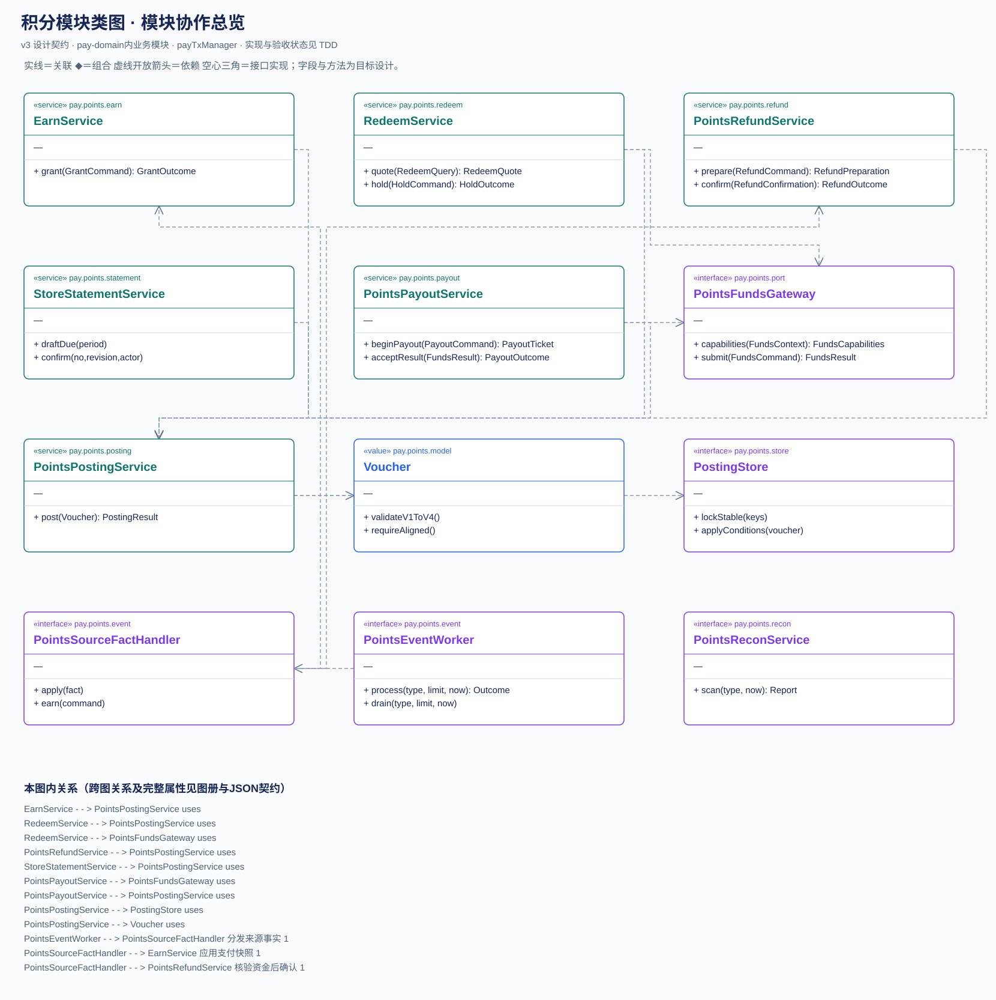

本图表达目标类的字段、方法及本组关系；跨图依赖见下表。接口实现使用空心三角，组合关系使用实心菱形。服务可读快照，写账必须经PointsPostingService。资金适配器留pay.points，依赖pay资金接口；订单事实适配由宿主提供，不反向依赖订单实现。

### 种类账户与预留

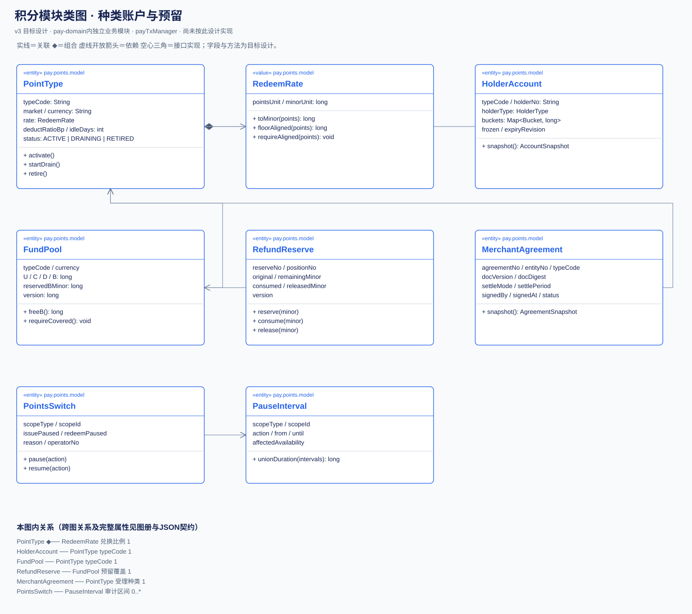

本图表达目标类的字段、方法及本组关系；跨图依赖见下表。接口实现使用空心三角，组合关系使用实心菱形。服务可读快照，写账必须经PointsPostingService。资金适配器留pay.points，依赖pay资金接口；订单事实适配由宿主提供，不反向依赖订单实现。

### 凭证与原子过账值对象

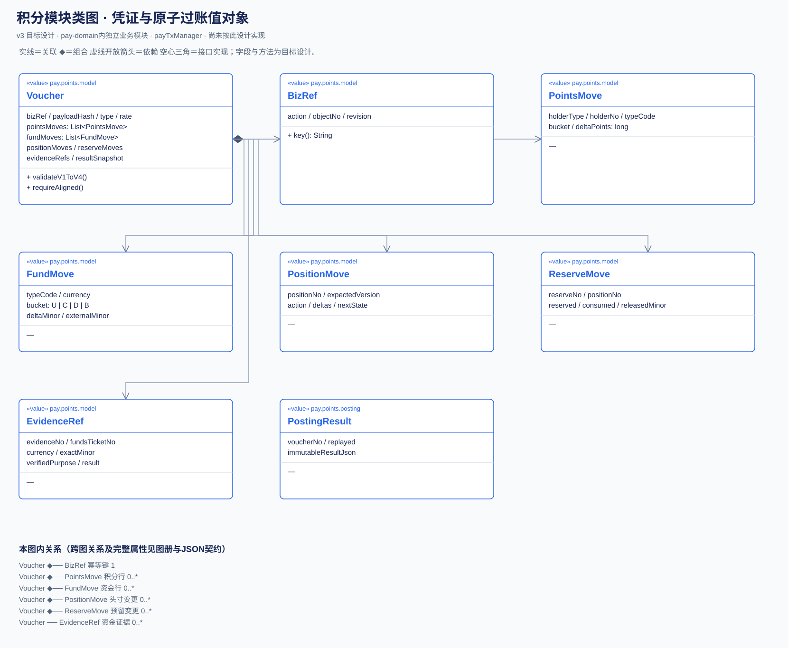

本图表达目标类的字段、方法及本组关系；跨图依赖见下表。接口实现使用空心三角，组合关系使用实心菱形。服务可读快照，写账必须经PointsPostingService。资金适配器留pay.points，依赖pay资金接口；订单事实适配由宿主提供，不反向依赖订单实现。

### 业务头寸与退款准备

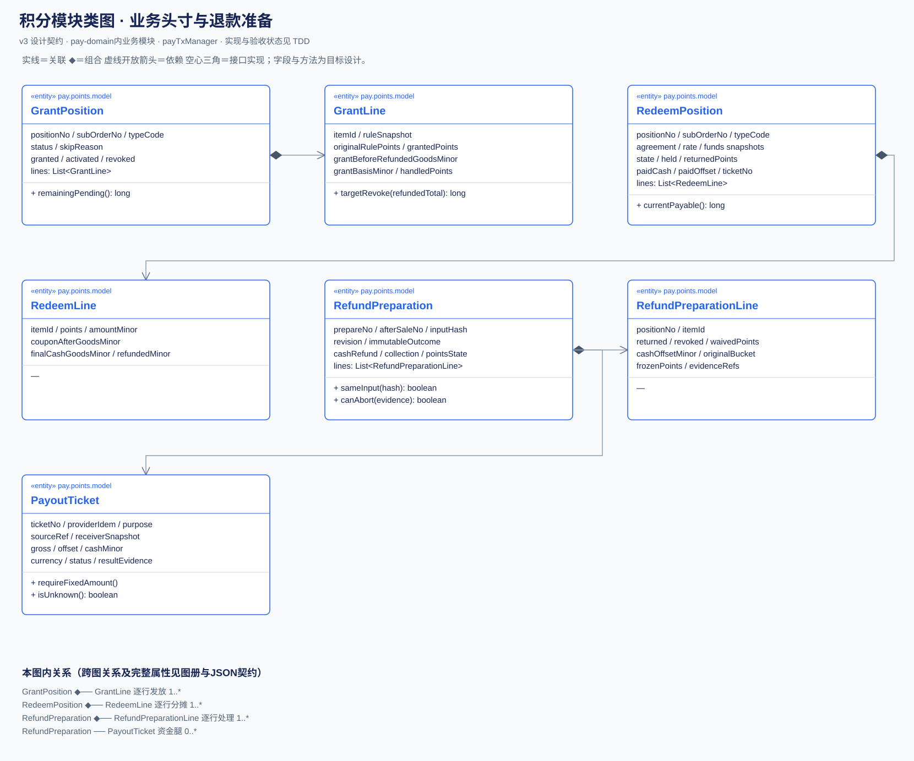

本图表达目标类的字段、方法及本组关系；跨图依赖见下表。接口实现使用空心三角，组合关系使用实心菱形。服务可读快照，写账必须经PointsPostingService。资金适配器留pay.points，依赖pay资金接口；订单事实适配由宿主提供，不反向依赖订单实现。

### 账期应收与生命周期事实

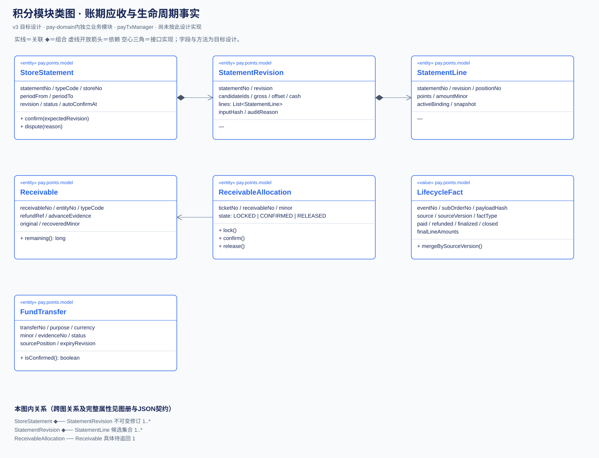

本图表达目标类的字段、方法及本组关系；跨图依赖见下表。接口实现使用空心三角，组合关系使用实心菱形。服务可读快照，写账必须经PointsPostingService。资金适配器留pay.points，依赖pay资金接口；订单事实适配由宿主提供，不反向依赖订单实现。

### 种类发放与核销服务

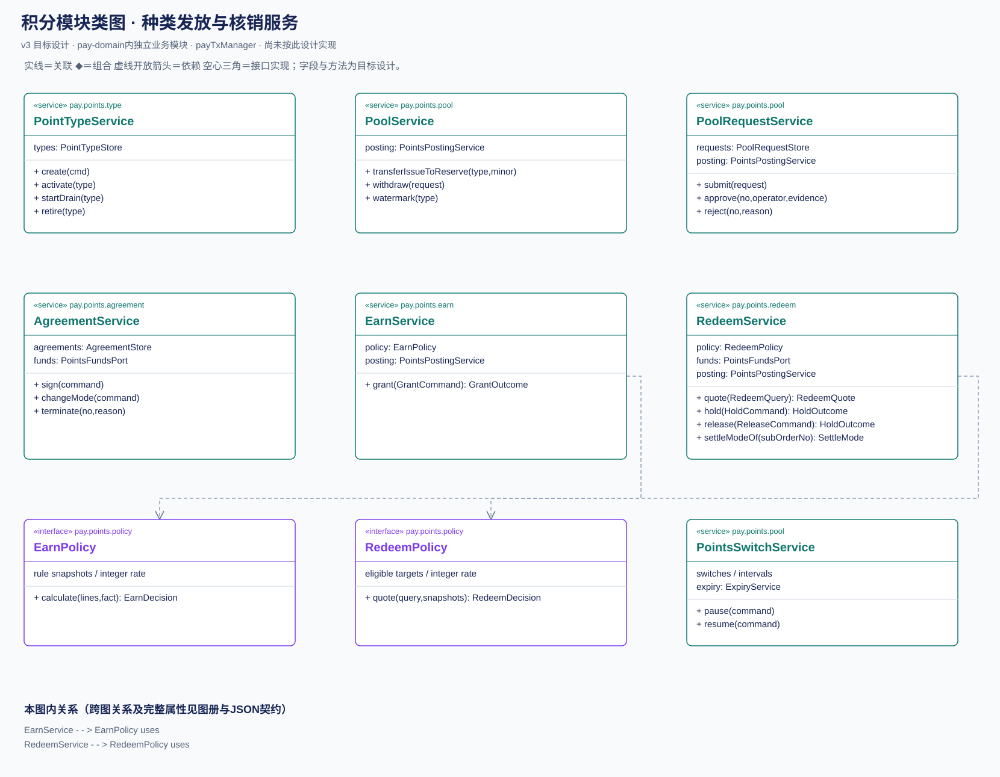

本图表达目标类的字段、方法及本组关系；跨图依赖见下表。接口实现使用空心三角，组合关系使用实心菱形。服务可读快照，写账必须经PointsPostingService。资金适配器留pay.points，依赖pay资金接口；订单事实适配由宿主提供，不反向依赖订单实现。

### 退款兑付与到期服务

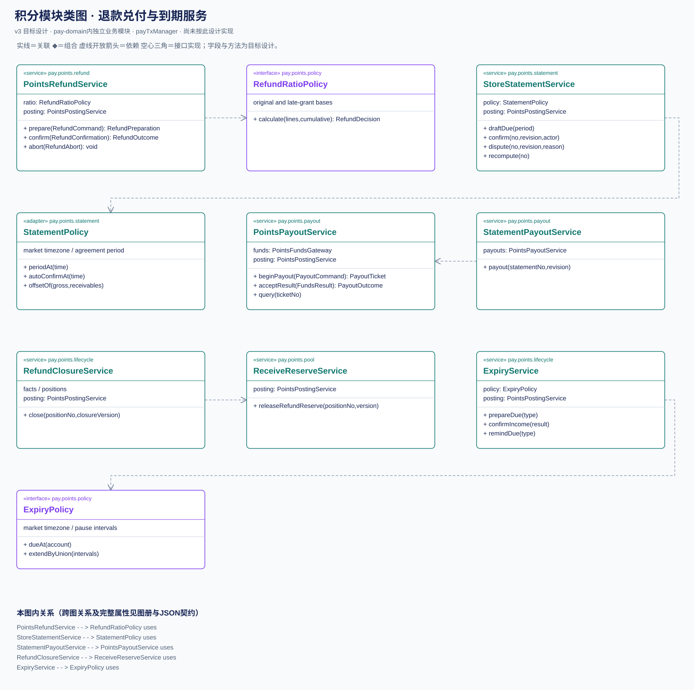

本图表达目标类的字段、方法及本组关系；跨图依赖见下表。接口实现使用空心三角，组合关系使用实心菱形。服务可读快照，写账必须经PointsPostingService。资金适配器留pay.points，依赖pay资金接口；订单事实适配由宿主提供，不反向依赖订单实现。

### 过账持久化与可靠事件

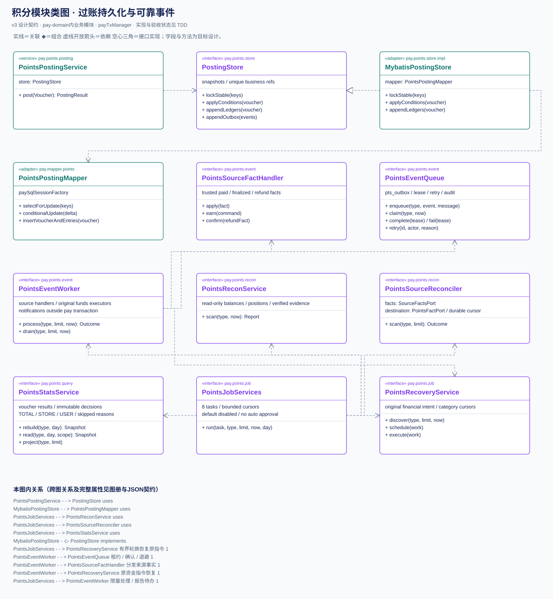

本图表达目标类的字段、方法及本组关系；跨图依赖见下表。接口实现使用空心三角，组合关系使用实心菱形。服务可读快照，写账必须经PointsPostingService。资金适配器留pay.points，依赖pay资金接口；订单事实适配由宿主提供，不反向依赖订单实现。

### 订单SPI及域内结算Hook实现

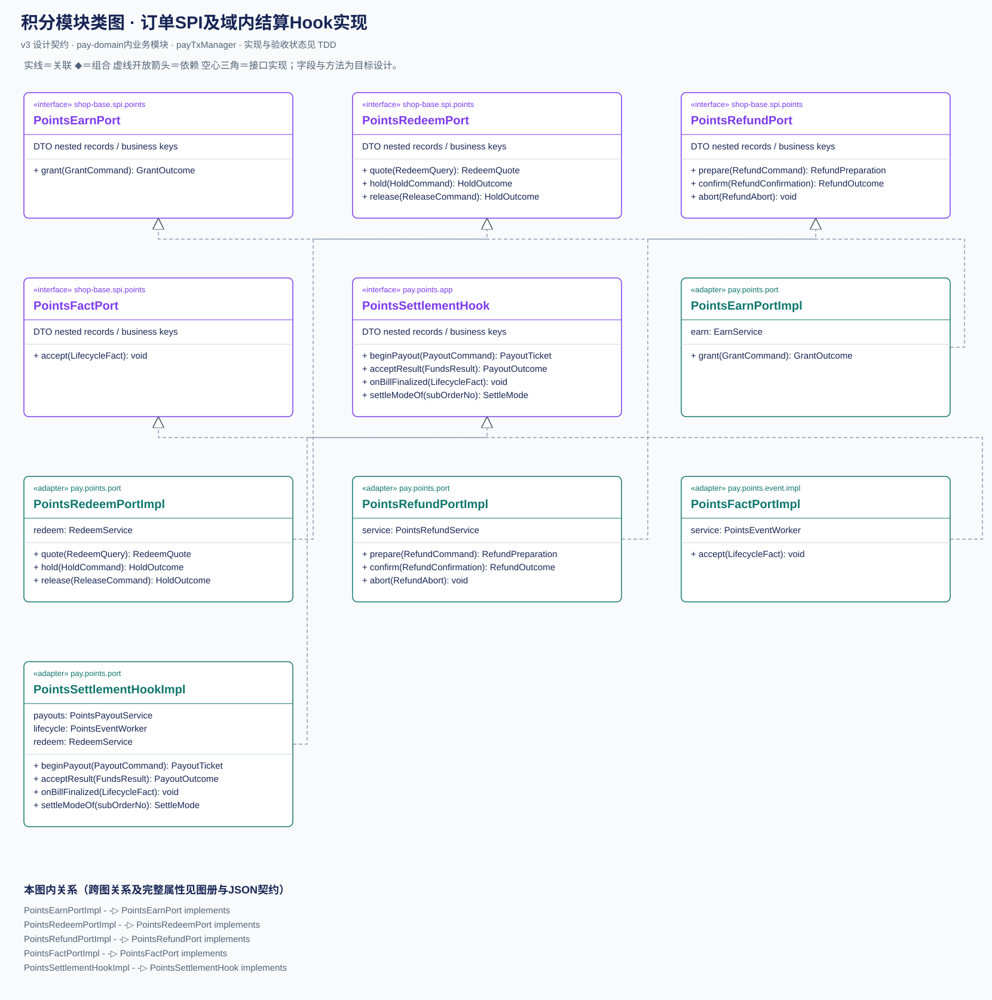

本图表达目标类的字段、方法及本组关系；跨图依赖见下表。接口实现使用空心三角，组合关系使用实心菱形。服务可读快照，写账必须经PointsPostingService。资金适配器留pay.points，依赖pay资金接口；订单事实适配由宿主提供，不反向依赖订单实现。

### pay内资金接口与订单事实SPI

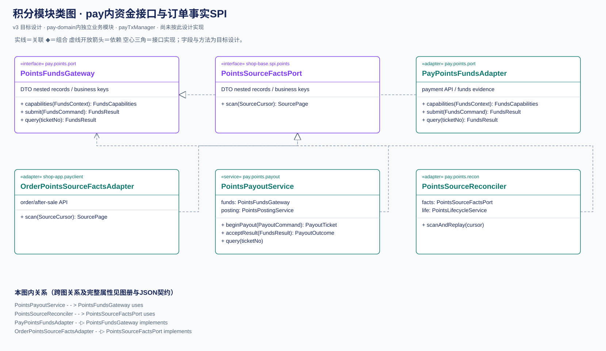

本图表达目标类的字段、方法及本组关系；跨图依赖见下表。接口实现使用空心三角，组合关系使用实心菱形。服务可读快照，写账必须经PointsPostingService。资金适配器留pay.points，依赖pay资金接口；订单事实适配由宿主提供，不反向依赖订单实现。

积分尚未上线：图中仅最新业务逻辑，不含新旧引擎路由、旧读兼容、迁移批次或开账服务；旧实现按TDD §1.1/§2.12/任务T13移除。

## 四 完整跨图关系

| 来源类 | 关系 | 目标类 | 语义 / 多重性 |
|---|---|---|---|
| PointType | composition | RedeemRate | 兑换比例 1 |
| HolderAccount | association | PointType | typeCode 1 |
| FundPool | association | PointType | typeCode 1 |
| RefundReserve | association | FundPool | 预留覆盖 1 |
| MerchantAgreement | association | PointType | 受理种类 1 |
| PointsSwitch | association | PauseInterval | 审计区间 0..* |
| Voucher | composition | BizRef | 幂等键 1 |
| Voucher | composition | PointsMove | 积分行 0..* |
| Voucher | composition | FundMove | 资金行 0..* |
| Voucher | composition | PositionMove | 头寸变更 0..* |
| Voucher | composition | ReserveMove | 预留变更 0..* |
| Voucher | association | EvidenceRef | 资金证据 0..* |
| GrantPosition | composition | GrantLine | 逐行发放 1..* |
| RedeemPosition | composition | RedeemLine | 逐行分摊 1..* |
| RefundPreparation | composition | RefundPreparationLine | 逐行处理 1..* |
| RefundPreparation | association | PayoutTicket | 资金腿 0..* |
| RedeemPosition | association | RefundReserve | 最大退款额度 1 |
| RedeemPosition | association | MerchantAgreement | hold快照 1 |
| StoreStatement | composition | StatementRevision | 不可变修订 1..* |
| StatementRevision | composition | StatementLine | 候选集合 1..* |
| StatementLine | association | RedeemPosition | 头寸绑定 1 |
| ReceivableAllocation | association | Receivable | 具体待追回 1 |
| PayoutTicket | composition | ReceivableAllocation | 抵销分配 0..* |
| StoreStatement | association | PayoutTicket | 付款意图 0..* |
| PoolService | dependency | PointsPostingService | uses  |
| PoolRequestService | dependency | PointsPostingService | uses  |
| EarnService | dependency | EarnPolicy | uses  |
| EarnService | dependency | PointsPostingService | uses  |
| RedeemService | dependency | RedeemPolicy | uses  |
| RedeemService | dependency | PointsPostingService | uses  |
| RedeemService | dependency | PointsFundsGateway | uses  |
| AgreementService | dependency | PointsFundsGateway | uses  |
| PointsRefundService | dependency | RefundRatioPolicy | uses  |
| PointsRefundService | dependency | PointsPostingService | uses  |
| StoreStatementService | dependency | StatementPolicy | uses  |
| StoreStatementService | dependency | PointsPostingService | uses  |
| StatementPayoutService | dependency | PointsPayoutService | uses  |
| PointsPayoutService | dependency | PointsFundsGateway | uses  |
| PointsPayoutService | dependency | PointsPostingService | uses  |
| RefundClosureService | dependency | ReceiveReserveService | uses  |
| ReceiveReserveService | dependency | PointsPostingService | uses  |
| ExpiryService | dependency | ExpiryPolicy | uses  |
| ExpiryService | dependency | PointsPostingService | uses  |
| PointsPostingService | dependency | PostingStore | uses  |
| PointsPostingService | dependency | Voucher | uses  |
| MybatisPostingStore | dependency | PointsPostingMapper | uses  |
| PointsSourceReconciler | dependency | SourceFactsPort | uses  |
| PointsJobServices | dependency | PointsReconService | uses  |
| PointsJobServices | dependency | PointsSourceReconciler | uses  |
| PointsJobServices | dependency | PointsStatsService | uses  |
| PointsSwitchService | dependency | ExpiryService | uses  |
| MybatisPostingStore | realization | PostingStore | implements  |
| PointsEarnPortImpl | realization | PointsEarnPort | implements  |
| PointsRedeemPortImpl | realization | PointsRedeemPort | implements  |
| PayPointsFundsAdapter | realization | PointsFundsGateway | implements  |
| OrderPointsSourceFactsAdapter | realization | SourceFactsPort | implements  |
| PointsEarnPortImpl | dependency | EarnService | uses  |
| PointsRedeemPortImpl | dependency | RedeemService | uses  |
| PointsRefundPortImpl | realization | PointsRefundPort | implements  |
| PointsRefundPortImpl | dependency | PointsRefundService | delegates  |
| PointsFactPortImpl | realization | PointsFactPort | implements  |
| PointsSettlementHookImpl | realization | PointsSettlementHook | implements  |
| PointsSettlementHookImpl | dependency | PointsPayoutService | delegates  |
| PointsSettlementHookImpl | dependency | RedeemService | settleModeOf  |
| EarnService | dependency | AccountExpiryGuard | 禁止到期余额被迟到发放续活 1 |
| RedeemService | dependency | AccountExpiryGuard | 新占用核验有效到期时间 1 |
| PointsJobServices | dependency | ExpiryReminderService | 按周期持久提醒 1 |
| PointsJobServices | dependency | PointsRecoveryService | 有界轮换恢复原指令 1 |
| PointsRecoveryService | dependency | PointsFundsGateway | 事务外执行或查询原号 1 |
| PointsFactPortImpl | dependency | PointsEventQueue | 先持久化可信事实 1 |
| PointsEventWorker | dependency | PointsEventQueue | 租约 / 确认 / 退避 1 |
| PointsEventWorker | dependency | PointsSourceFactHandler | 分发来源事实 1 |
| PointsEventWorker | dependency | PointsRecoveryService | 原资金指令恢复 1 |
| PointsEventWorker | dependency | ExpiryReminderService | 投递前核验周期 1 |
| PointsEventWorker | dependency | RefundClosureService | 可信责任解除 1 |
| PointsEventWorker | dependency | UserInboxPort | 事务外生命周期通知 1 |
| PointsEventWorker | dependency | OpsAlertPort | 事务外权限接收人告警 1 |
| PointsSourceFactHandler | dependency | EarnService | 应用支付快照 1 |
| PointsSourceFactHandler | dependency | PointsSettlementHook | 终局转正 1 |
| PointsSourceFactHandler | dependency | PointsRefundService | 核验资金后确认 1 |
| PointsSourceReconciler | dependency | PointsFactPort | 整页持久后推进水位 1 |
| PointsJobServices | dependency | PointsEventWorker | 限量处理 / 报告待办 1 |
| ExpiryReminderService | dependency | PointsEventQueue | 按活动周期幂等提醒 1 |

## 五 图的边界与校验

- 核心类覆盖图契约中全部79个类，细分图每张最多12个节点；总览最多15。基础框架、接口嵌套Command/Outcome与非账务元数据Store不冒充已实现类。
- 模块边界是pay内业务包，不新增JAR/数据源/事务；方法为设计契约的具名化补充，实施时与TDD/Java签名共同对齐；不会从旧PointsService自动推断新行为。
- 生成器检查类唯一、关系目标、分组覆盖和节点上限，并对32条流转样例核积分守恒、U/发放户、C/用户门店与真实资金总额变化。
- `python3 scripts/gen-points-diagrams.py --check`验证产物与图契约一致；SVG可直接放大导出，HTML由项目Markdown渲染器生成，不单独维护。
