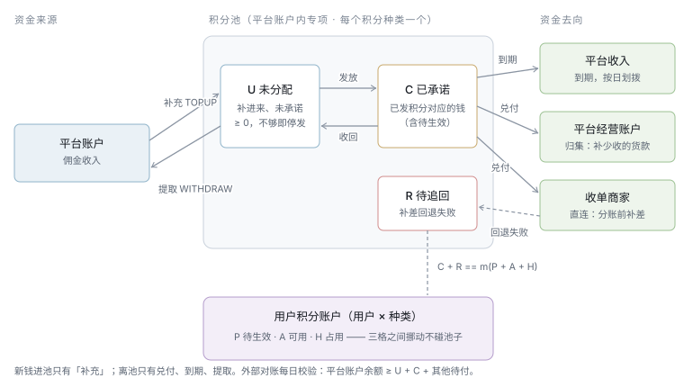
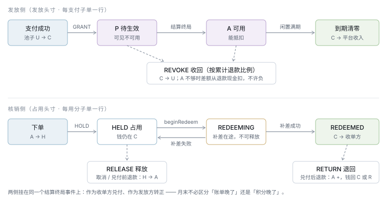

# 积分资金方案 · 平台积分专户与四类积分户

> 状态：**待确认**（2026-10-14 起草，同日按「积分户流转 + 两种结算方式」改写）· 取代：[积分域-完整方案](./积分域-完整方案.md) 的资金模型（商家发分费 1:1）
> 决策：[ADR-036 积分改为平台出资预存池](../ADR/ADR-036-积分改为平台出资预存池.md) ·
> 落地设计：[TDD-积分域重整](../TDD-积分域重整.md)（业务抽象 / 类设计 / 库表 / 接口）
> 范围：本期只做「购物返积分」，只开 `CN / CNY` 一个区域；模型按多区域、多币种、多场景设计。

---

## 一、一句话

**积分是平台发行的一种币，在「平台发放户 → C 端户 → 门店户 → 平台接收户」之间流转；
每一分在发出之前，平台积分专户里已经存好等额的钱。商家收到的积分平台全额兑付 ——
默认在支付时随单结算（商家这一单收到的就是现金），也可以按协议先收积分、定期结算。**

所有流转只能通过一张「积分守恒、资金平衡」的记账凭证写入，写不平就写不进去。

---

## 二、为什么是这个方案

### 被否掉的资金模型

| 方案 | 机制 | 否掉的理由 |
|---|---|---|
| 商家发分费（**现状**） | 商家每发 1 分，结算时从货款扣 1 分钱进池 | 发分时钱没到，费用金只是账面应收；线下单、积分退款、售后期内退款三条路径收不到费用金，池子凭空少钱 |
| 信用模型 | 发分只记负债，兑付时再找发放方要钱 | 或有负债藏在账外；需要授信额度与跨商家清算（V17 → V22 已否过一次） |
| 佣金到账时才进池 | 发分只记承诺，结算终局才划钱 | 待生效的分没有钱对应；做不出「超过就停发」 |
| 兑付时平台直接掏钱 | 不设专户 | 没有上限；答不出「平台为积分备了多少钱」 |

### 运营诉求与对应机制

| 诉求（2026-10-14） | 机制 |
|---|---|
| 运营创建积分，含对标币种、兑换比例 | 积分种类主数据；兑换比例**生效后锁定** |
| 建资金池（专户），超过就停发 | 发放户余额 = 专户未分配资金折算的分；发放户扣不动即停发 |
| 定期补充 | 补充单（双人复核）+ 定期补充计划（只生成待审批单）；补充时接收户回收的分**流转**回发放户 |
| 积分在平台、门店、C 端之间流转 | 四类积分户，每笔转出 = 转入 |
| B 端与平台达成一致，用积分抵现金；B 端收到的平台要兑付 | **受理协议**：签了才能收积分；平台全额兑付 |
| 支付时直接结算（默认）/ 商家收积分统一结算 | **结算方式**写在协议里：随单结算（默认）/ 定期结算 |
| 详细的发放与核销记录，按平台 / 门店 / 用户统计 | 凭证行带齐维度；三视角汇总可从明细重算 |
| 能暂停 | 发放、核销分开暂停，粒度到全局 / 区域 / 种类 / 场景 / 端 / 商家 / 门店 / 用户 |
| 不超发、资金安全 | 两条守恒在**写入时**由凭证保证；三层对账兜底 |

---

## 三、结构

### 3.1 积分怎么流、钱怎么流



图上要读出四件事：

1. **积分只在四类户之间转**，不凭空出现也不凭空消失。唯一的「新增发行」发生在补充资金时，
   而且优先把接收户回收的分流转回发放户，不够的部分才新增发行。
2. **钱跟着积分走，但不逐笔动真钱**：发放、转正、占用都只是专户内部格子之间挪动。
   真钱只在四处进出专户：补充（进）、付给商家（出）、到期转平台收入（出）、提取（出）。
3. **两种结算方式的差别只在「积分在门店户停多久」**：随单结算停零秒（支付时直接转到接收户，钱跟着这一单的结算付给商家）；
   定期结算停到积分账期（结算单经 B 端确认后转接收户，平台统一打款）。
4. **专户本期是平台账户里的专项**，不是独立银行账户。外部对账每日校验
   「平台账户实际余额 ≥ 专户 U + C + D」—— 这是选择专项的代价，必须由对账补上。

### 3.2 四类积分户

| 户 | 归属 | 格子 | 说明 |
|---|---|---|---|
| **平台发放户** | 每个种类一个 | 可发 | 补充资金时进分，发放时出分；**扣不动即停发** |
| **C 端户** | 用户 × 种类 | 待生效 P · 可用 A · 占用 H | P 可见不可用；H 是下单已扣、支付前的占用 |
| **门店户** | 门店 × 种类 | 待确认 · 待结算 | 只有定期结算的门店会留余额；随单结算的门店只留流水 |
| **平台接收户** | 每个种类一个 | 回收 | 商家兑付后的分、到期的分都回到这里；补充时流转回发放户 |
| *发行登记* | 每个种类一个 | 累计发行（记负数） | 记账用，让「所有户合计 = 0」恒成立 |

### 3.3 平台积分专户（钱）

| 格 | 含义 | 对应的分 |
|---|---|---|
| **U 未分配** | 补进来、还没发出去 | 发放户 |
| **C 已承诺** | 已发给用户、还在用户或门店手里的分对应的钱 | C 端户（P + A + H）+ 门店户 |
| **D 待付商家** | 已经兑付（分已回到接收户）、钱还没付给商家 | — |
| **R 待追回** | 已付给商家、因退款该收回而暂时没收回 | 计入 C 的对应侧 |

**两条守恒（每个种类各自成立）**：

```text
积分守恒：发放户 + C 端户 + 门店户 + 接收户 + 发行登记 == 0
资金对应：U == m(发放户)
          C + R == m(C 端户 + 门店户)
外部对账：U + C + D == 平台账户里这笔专项
```

`m(x)` 是积分折成金额。兑换比例存为既约分数 `points_unit : minor_unit`
（100 积分 = 1 元 → 100 : 100 → 1 : 1），凭证里的分数必须是 `points_unit` 的整数倍，
所以 `m(x)` 永远整除 —— 余数是对账差异最常见的来源，这里从结构上消灭它。

### 3.4 时点



| 时点 | 发放侧 | 核销侧（随单结算） | 核销侧（定期结算） |
|---|---|---|---|
| 下单 | — | C 端 A → H | 同左 |
| **支付成功** | 发放户 → C 端 P | **H → 门店户 → 接收户**；钱 C → D | H → 门店户「待确认」 |
| 订单结算终局 | P → A | 分账时 D 付给商家（直连补差 / 归集回补） | 门店户「待确认」→「待结算」 |
| 积分账期 | — | — | 出结算单 → B 端确认 → 门店户 → 接收户，C → D → 平台打款 |

> 发放侧「P → A」挂在订单结算终局（直连 `SPLIT_CONFIRMED` / 归集 `CONFIRMED`）而不是「支付 + 7 天」：
> 终局在售后期之后，期内退款时分还在 P，原样收回。防的是「下单拿分 → 立刻花掉 → 退单」。

---

## 四、详细设计

### 4.1 凭证：唯一的写入口

每个业务动作开一张凭证，`biz_ref` 唯一，过账时在**同一个事务**里对积分户、专户、头寸做条件更新，任何一行影响 0 行即整张回滚。

| 凭证 | 触发 | 积分流转 | 专户 | 写不进去 = |
|---|---|---|---|---|
| `TOPUP` 补充 | 补充单审批通过 | 接收户 →（不足部分：发行登记 →）发放户 | U +M（进） | 无回单号、提交人 = 审批人 |
| `WITHDRAW` 提取 | 提取单审批通过 | 发放户 → 接收户 | U −M（出） | 发放户不够（**只能提未发出的**） |
| `GRANT` 发放 | 支付提交后 | 发放户 → C 端 P | U → C | 发放户不够 → **停发**，记 `SKIPPED/POOL_EXHAUSTED` |
| `ACTIVATE` 转正 | 发放子单结算终局 | C 端 P → A | — | 已收回的部分不转 |
| `HOLD` 占用 | 下单 | C 端 A → H | — | A 不够 → 降级不抵扣（不挡下单） |
| `RELEASE` 释放 | 未支付取消 / 关单 | C 端 H → A | — | 已支付的不走这里 |
| `PAY_SETTLE` 随单兑付 | 支付成功（随单结算） | C 端 H → 门店户 → 接收户（流水两条） | C → D | 头寸不在 HELD |
| `PAY_TRANSFER` 收积分 | 支付成功（定期结算） | C 端 H → 门店户「待确认」 | — | 同上 |
| `STORE_CONFIRM` 门店确认 | 订单结算终局（定期结算） | 门店户「待确认」→「待结算」 | — | — |
| `STORE_SETTLE` 门店结算 | B 端确认结算单 | 门店户「待结算」→ 接收户 | C → D | 结算单不在待确认 |
| `PAYOUT` 付款 | 随单：分账补差成功 / 归集确认；定期：打款成功 | — | D −m（出） | 付款头寸不在付款中 |
| `REVERSE` 反转 | 支付后、付款前退款 | 接收户或门店户 → C 端 A | D → C（若已在 D） | 超过已转入 |
| `RETURN` 退回 | 付款后退款 | 接收户 → C 端 A | 收回成功 C +m（进）；失败 R +m | 超过已付款 |
| `RECOVER` 追回 | 待追回的钱到账 / 下期结算单冲减 | — | R → C（进） | — |
| `REVOKE` 收回 | 发放子单退款 | C 端 P 或 A → 发放户 | C → U；A 不够的差额从退款现金扣，进 U | 超过已发放；**不许负余额** |
| `EXPIRE` 到期 | 账户闲置满期 | C 端 A → 接收户 | C −m（出，转平台收入） | A 已变化（下一轮再判） |
| `ADJUST` 调账 | 调账单审批通过 | 发放户 ↔ C 端 A | U ↔ C | 双人复核未过 |
| *`PROMO_GRANT`* | *将来：签到等营销* | *发放户 → C 端 A* | *U → C* | *本期只预留* |

两条硬规则（ArchUnit 守）：
- **新钱进专户只有 `TOPUP`**；收回的钱经 `RETURN`、`RECOVER`、`REVOKE`（现金抵扣部分）回来；离开专户只有 `PAYOUT`、`EXPIRE`、`WITHDRAW`。
- **分只有一个凭空来处**：`TOPUP` 里的新增发行，而且必须带着等额的钱。

### 4.2 发放：返多少

```text
x = Σ 每行规则（类目规则 / 商品例外）      ← 返多少由规则定，运营按种类配
x = floor_to_unit(x)
可选：x ≤ m⁻¹(本单佣金 × 封顶比例)        ← 本期默认关闭，只留接口
发放户 ≥ x 才发；否则整单不发              ← 不部分发：「为什么只给了 37 分」解释不清
```

- `FIXED` = 每件 n 分 × 件数（**现状按行发、不乘件数，改正**）；`RATIO` = 行实付（不含运费，已扣券与积分）× 万分比；赠品不发。
- 不发也落一行发放头寸（`SKIPPED` + 原因），统计能看到「因专户不足少发了多少」—— 运营据此决定补多少钱。
- **发放不需要商家签协议**：平台出资、商家零成本。受理（收积分）才需要协议。

| 不发的原因 | 为什么 |
|---|---|
| `POOL_EXHAUSTED` | 不超发 |
| `PAUSED` | 运营控制 |
| `OFFLINE` 线下单 | 平台出资后，线下单成交由商家自报、无法核验，是串通造单套平台钱的入口 |
| `FROZEN` | 用户被风控冻结 |
| `RULE_ZERO` | 规则明确配 0（如储值卡） |

### 4.3 核销：受理协议与两种结算方式

**受理协议**（商家主体 × 积分种类）：

| 条款 | 规则 | 防住什么 |
|---|---|---|
| 签署 | B 端在线签，留协议版本、签署人、时刻；未签的商家不能收积分 | 商家事后不认「积分当现金」 |
| 兑付价格 | **全额**：抵了多少钱付多少钱 | 折价兑付带来的尾差与解释成本 |
| 结算方式 | `PER_ORDER` 随单结算（**默认**）/ `PERIODIC` 定期结算 | — |
| 积分账期 | 定期结算时：月 / 半月 / 周 | — |
| 变更与解约 | 只影响将来；门店户里已有的分照常结算完 | 解约变成赖账 |
| 直连商家选定期结算 | **打款通道接通前不允许**（直连商家的钱在微信二级户，平台现有能力只有分账时逐单补差） | 选了一个付不出钱的方式 |

**核销规则**：

| 规则 | 防住什么 |
|---|---|
| 一单只用一种积分（本期每区域一种，自然满足） | 多种叠加让单笔让利失控 |
| 上限 = 可受理子单（券后、不含运费）× 抵扣比例 | 整单抵光；运费要付给运力 |
| 只在**已签协议、未暂停**的门店的子单间按金额分摊，余数给最后一家 | 分摊到不能受理的门店会让它凭空少收钱 |
| 线下单不能抵扣 | 线下没有任何通道能把专户的钱付给商家，结算单是终态 `OFFLINE_SETTLED` |

**随单结算的付款：两阶段**（防「付款在途时被退款，付两次」）：

```text
TRANSFERRED（支付后已兑付，钱在 D）──beginPayout──▶ PAYING ──confirm──▶ PAID
            ▲                                         │
            └──────────────abort（补差失败）────────────┘
退款只作用于 TRANSFERRED（走 REVERSE）；遇 PAYING 返回「处理中」由调用方重试；PAID 之后走 RETURN
```

结算域在分账补差**之前**调 `beginPayout`，拿到**此刻真实的应付额**（已扣除退款反转的部分）作为补差额 ——
不再用结算单生成时的快照。现状的问题正在这里：积分已退回买家，分账照样按快照补差，付了两次。

**定期结算的门店积分结算单**：

```text
出单（DRAFT）：锁定本期「待结算」的头寸 ─▶ B 端确认（CONFIRMED，超 N 天未处理自动确认）
  ─▶ STORE_SETTLE 凭证（门店户 → 接收户，C → D）─▶ 平台打款（PAYING）─▶ PAYOUT 凭证（PAID）
结算单金额 = 本期兑付 − 上期待追回冲减；为负则不打款、结转下期
```

- 出单后、确认前发生退款：作废草稿、重新出单。确认后的退款：记待追回 R，下期结算单冲减。
- 打款执行器按资金路径区分：**归集商家**并入现有打款单；**直连商家**用新的转账通道（接通前不允许选定期结算）。

### 4.4 退款：两侧分开、按累计比例

```text
k     = 子单累计已退金额 ÷ 子单实付（头寸上的快照）
应退回 = floor_to_unit(核销分 × k) − 已退回
应收回 = floor_to_unit(发放分 × k) − 已收回
全额退款时 k = 1，取精确值
```

| 侧 | 积分当前在哪 | 用户 | 专户 / 现金 |
|---|---|---|---|
| 核销侧 | 未支付（占用） | `RELEASE` H → A | — |
| | 门店户（定期结算，未出单） | `REVERSE` 门店户 → A | — |
| | 接收户、钱在 D 未付 | `REVERSE` 接收户 → A | D → C |
| | 已付给商家 · 直连 | `RETURN` 接收户 → A | 补差回退成功 C +；失败 R + 并告警 |
| | 已付给商家 · 定期 / 归集 | `RETURN` 接收户 → A | R +，下期结算单冲减 |
| 发放侧 | 待生效（绝大多数） | `REVOKE` P → 发放户 | C → U |
| | 可用且够 | `REVOKE` A → 发放户 | C → U |
| | 可用不够（分已花掉） | A 扣到 0，**不许负** | 差额从退款现金扣，进 U（发放户同步得到等额的分）；退款单明示 |

**顺序：先积分、后现金**。售后：① 回退分账 → ② 积分 `apply`（幂等，返回现金要扣多少）→ ③ 退现金。

### 4.5 到期

- 账户级滚动到期（沿用 V30）：`GRANT`、`HOLD` 续期；`REVOKE`、`EXPIRE` 不续。
- 到期时刻取区域时区的当天 23:59:59；只清 A，P、H 不动。
- 到期的分转到**接收户**，钱**转平台收入**（2026-10-14 定），按日汇总成一张划拨单。
- 到期前 30 天提醒，`expire_notified_at` 幂等；核销暂停期间到期时钟停走，恢复时顺延。
- 条件清零（`WHERE available = 读到的值 AND expire_at <= now`），循环到清完，不再是一天 500 条。

### 4.6 运营

| 能力 | 规则 | 防住什么 |
|---|---|---|
| 创建积分种类 | 区域 + 币种（取自 `MarketService`）+ 兑换比例 + 抵扣比例 + 返分规则 + 闲置天数；`草稿 → 生效 → 停用` | 每区域同时只有一种生效中的平台积分 |
| 兑换比例 | 生效后锁定；要改就新建种类、迁移余额 | 直接改会把存量负债按新比例重估 |
| 专户 | 建种类时同时建；生效前必须有过一笔补充 | 没钱就上线 |
| 补充 / 提取 / 调账 | 一人提交、另一人审批；补充须带打款回单号 | 一个人既能录钱又能批钱 |
| 定期补充（流转） | 按月生成**待审批**补充单（固定额 / 上月佣金 × 比例）；过账时先把接收户的分流转回发放户 | 计划自动动钱 = 没有复核 |
| 低水位预警 | 可发天数 = 发放户 ÷ 近 7 天日均发放；低于阈值告警；扣不动即停发并告警 | 专户悄悄见底 |
| 受理协议 | 运营可查看、可代为终止（风控），不可代签 | 平台替商家「同意」 |
| 门店积分结算单 | 运营可查看、处理争议、手工确认 | 结算单卡在待确认 |
| 暂停 | 发放 / 核销分开；八个粒度；必填原因、留审计；只影响将来 | 在途订单被打断 |

### 4.7 统计

明细只有一份：凭证行，带区域、种类、场景、凭证类型、结算方式、用户、订单 / 子单、**发放门店 / 受理门店**、商家主体、时间、分数、金额。

| 视角 | 内容 |
|---|---|
| 平台 | 区域 × 种类 × 日 / 月：发放、停发（次数与少发量）、转正、核销、兑付、付款、退回、收回、到期；四类户余额；专户 U / C / D / R；补充、提取、流转；可发天数 |
| 门店 | 本店返出（平台出资）、本店受理的分；随单兑付额、定期结算单；待结算余额；下钻到单 |
| 用户 | 三格余额、到期日、逐笔明细（链接订单）；累计获得 / 使用 / 收回 / 到期 |

汇总表按凭证号水位每 5 分钟增量计算，随时可从明细重算。

### 4.8 对账与告警

| 层 | 内容 | 频率 |
|---|---|---|
| L1 写入时 | 每张凭证积分守恒、资金对应、币种一致；`biz_ref` 唯一；全部条件更新 | 每次 |
| L2 内部 | 一致性快照（`START TRANSACTION WITH CONSISTENT SNAPSHOT`）里核 I1–I7 | 每小时 |
| L3 外部 | 平台账户余额 ≥ U + C + D；补差 / 补差回退 / 打款流水与 `PAYOUT` / `RETURN` 逐笔 | 每日 |

| # | 核对 | 粒度 |
|---|---|---|
| I1 | 四类户 + 发行登记合计 == 0；`U == m(发放户)`；`C + R == m(C 端户 + 门店户)` | 每个种类 |
| I2 | 每个户的各格 == Σ 该户流水 | 逐户（按水位） |
| I3 | 专户各格 == Σ 专户流水 | 每个种类 |
| I4 | 发放头寸、核销头寸各自自洽 | 逐子单 |
| I5 | 结算单补差额 == 该子单 `PAYOUT`；终局子单都有转正 / 门店确认；`PAYING` 不超 30 分钟 | 逐子单 |
| I6 | 门店积分结算单金额 == 所含头寸之和 − 冲减；已确认的都有 `STORE_SETTLE` | 逐结算单 |
| I7 | 划拨单 / 打款单金额 == 覆盖的专户流水之和 | 逐单 |

可定位的（I2、I4–I7）落差异单进对账总览 `POINTS` 轴；I1 只告警。告警走 `OpsAlertPort` 发企微群：
专户低水位 / 停发、I1 失衡（**为负 = 资金缺口**，最高级）、外部余额不足、R 超 7 天、`PAYING` 超时、
补充单待审批超 24 小时、结算单待确认超期、暂停超 7 天。

---

## 五、与现状的对比

依据：2026-10-14 对 `PointsServiceImpl` 等的逐行 review。

| 维度 | 现状 | 新方案 | 消掉的缺陷 |
|---|---|---|---|
| 出资方 | 商家，每单 `points_fee_minor` 1:1 | 平台，预存专户 | 商家「替别人兑付」的推广阻力 |
| 发分时有没有钱 | 没有：费用金建结算单时**记账**入池，并未收到 | 有：发放户扣得动才发 | 超发；退款单的费用金永久挂在池里 |
| 积分的去向 | 抵扣后「消失」，池子出钱 | 四类户流转，积分守恒；回收的分可流转再发 | 积分去哪了说不清 |
| 商家受理 | 商家自开 + 行业强制 + 小微判定 | **签受理协议**；运营可暂停到门店 | 商家不认「积分当现金」 |
| 商家结算 | 只有随单补差，补差额是快照 | 随单（默认，两阶段付款）+ 定期结算单（B 端确认、平台打款） | 积分退回后仍补差，付两次 |
| 停发 | 无 | 发放户不够自动停发 + 预警 | 发放量无上限 |
| 种类 / 币种 / 比例 | 隐式 CN；比例在 JSON 配置，随时可改 | 种类主数据，比例生效后锁定 | 改比例让存量负债重估 |
| 写入口 | 6 个方法各自改账户 / 流水 / 池子 | 唯一的 `post(voucher)` | 改了一边忘了另一边 |
| 幂等 / 并发 | 先查后写；`updateById` 冲突静默 0 行 | `biz_ref` 唯一 + 条件更新，0 行整张回滚 | 并发退两次分、记两笔兑付；清零写了流水没清余额 |
| 转正时点 | 支付 + 7 天 | 结算终局 | 售后期未过分就能花 |
| 部分退款 | 只在整单退完时退；一退全退 | 按累计比例 | 退 50 元退回全部抵扣积分 |
| 扣不回 | 默认允许负余额；`points_offset_minor` 零写入 | 不许负；差额从退款现金扣并明示 | 与方案自相矛盾 |
| 线下单 | 可抵扣，收单方被抵的钱永远拿不到 | 不返、不抵 | — |
| 积分退款形式 | 平台直接加可用余额，无资金来源、不受任何开关 | 下线 | — |
| 全局开关 | `features.points` 只下发前端 | 后端闸门矩阵 | — |
| 到期 | 一天一次 `LIMIT 500`；无提醒 | 条件清零、循环清完；提醒；暂停顺延 | — |
| 池子快照 | `balance_after` 全错（通道传 null → `= NULL` 匹配 0 行） | 专户一行余额条件更新，流水带变动后值 | — |
| 对账 | 一个恒等式，只写日志 | L1–L3、七项核对、差异单、企微告警 | 失衡没人知道 |
| 统计 | 只有商家本期发分费 | 平台 / 门店 / 用户三视角 | — |

**沿用的**：账户级滚动到期、待生效、类目规则 + 商品例外、区域隔离、分摊余数给最后一家、抵扣失败不挡下单。

---

## 六、取舍记录

| 冲突 | 让了谁 | 代价 | 为什么接受 |
|---|---|---|---|
| 平台成本 ↔ 商家成本 | **平台出** | 营销成本随成交增长 | 专户上限 + 停发把它变成可控预算 |
| 物理隔离 ↔ 落地快 | **专项** | 平台账户被挪用时专户是空的 | L3 每日校验余额，不足即最高级告警；专户留作将来 |
| 部分发 ↔ 整单不发 | **整单不发** | 用户少拿一点 | 部分发解释不清；少发量进统计 |
| 到期的钱回专户 ↔ 转收入 | **转收入** | 每日一张划拨单 | 过期即实现收入，财务口径清楚 |
| 线下单返分 ↔ 防刷 | **防刷** | 线下用户拿不到分 | 平台出资后线下单是零成本刷分入口 |
| 随单结算 ↔ 定期结算 | **都支持，默认随单** | 两条结算链路 | 随单对商家最简单（这单就是现金）；定期给想「攒积分、对一次账」的商家 |
| 折价兑付 ↔ 全额 | **全额** | 平台不能借兑付补贴成本 | 商家接入零顾虑；没有尾差 |
| 积分守恒（多一个接收户与发行登记）↔ 简单 | **守恒** | 多两类平台户 | 「积分去哪了」任何时候都答得出；回收的分能流转再发 |
| 写入时强制总恒等式 ↔ 热点行 | **总量不放进专户行** | I1 靠快照求和、每小时一次 | 每张凭证都改同一行会让下单抢锁；L1 已保证逐张平衡 |

---

## 七、待确认

| # | 事项 | 卡住谁 |
|---|---|---|
| 1 | 兑换比例与抵扣比例初值（建议 100 积分 = 1 元、30%） | 种类创建 |
| 2 | 返分规则初值（类目 RATIO 万分比） | 首次补充金额估算 |
| 3 | 低水位阈值（建议可发天数 < 7 天告警） | 预警 |
| 4 | 定期结算的默认账期与自动确认天数（建议月结、出单后 7 天自动确认） | 门店积分结算单 |
| 5 | 直连商家定期打款的通道（银行代付 / 微信转账类能力）—— 接通前直连商家只能选随单结算 | 定期结算对直连商家开放 |
| 6 | 受理协议文本（法务） | B 端签约页 |
| 7 | 生产存量：旧三张表的行数与余额合计、`AFTER_SALE_COMP` 是否发生过（需只读查生产库） | 迁移方式 |
| 8 | 首笔补充的资金来源与会计科目 | 财务 |
