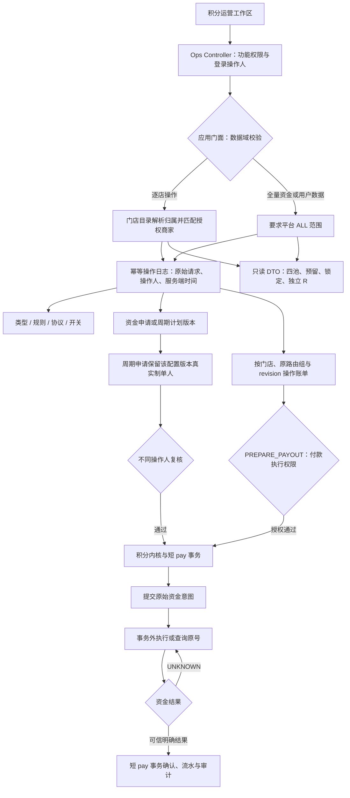

# 积分运营端流转与类图

本图补充积分模块总图，描述阶段 B 已实现的运营边界。积分内核与账务位于 pay-domain；payclient 负责登录主体的数据域授权，Controller 负责功能权限。所有金额沿用类型汇率与最小货币单位，门店号是操作和账务维度，商家仅用来解析授权归属。

## 运营操作流转

R 不作为现金；只对同店账单抵销。准备付款生成的 READY 意图可被恢复任务执行，因此准备动作本身必须取得付款执行权限。运营端不能提交权威订单支付或退款成功事实。

## 运营模块类关系

```mermaid
classDiagram
    OpsPointsController --> PointsOpsAppService
    OpsPointsPolicyController --> PointsConfigurationAppService
    OpsPointsTreasuryController --> PointsTreasuryAppService
    OpsPointsWorkbenchController --> PointsWorkbenchAppService
    OpsPointsInspectionController --> PointsInspectionAppService
    PointsOpsAppServiceImpl ..|> PointsOpsAppService
    PointsConfigurationAppServiceImpl ..|> PointsConfigurationAppService
    PointsTreasuryAppServiceImpl ..|> PointsTreasuryAppService
    PointsWorkbenchAppServiceImpl ..|> PointsWorkbenchAppService
    PointsInspectionAppServiceImpl ..|> PointsInspectionAppService
    PointsOpsAppServiceImpl --> PointsOpsAccess
    PointsConfigurationAppServiceImpl --> PointsOpsAccess
    PointsTreasuryAppServiceImpl --> PointsOpsAccess
    PointsWorkbenchAppServiceImpl --> PointsOpsAccess
    PointsInspectionAppServiceImpl --> PointsOpsAccess
    PointsOpsAccess --> SecurityUtils
    PointsOpsAccess --> StoreDirectoryPort
    PointsOpsAppServiceImpl --> PointsOverviewService
    PointsConfigurationAppServiceImpl --> PointsAdministrationService
    PointsTreasuryAppServiceImpl --> PointsTreasuryService
    PointsWorkbenchAppServiceImpl --> PointsWorkbenchService
    PointsInspectionAppServiceImpl --> PointsInspectionService
    PointsAdministrationServiceImpl --> PointsOperatorJournal
    PointsTreasuryServiceImpl --> PointsOperatorJournal
    PointsWorkbenchServiceImpl --> PointsOperatorJournal
    PointsInspectionServiceImpl --> PointsOperatorJournal
    PointsTreasuryServiceImpl --> TopupPlanService
    TopupPlanServiceImpl --> Schedule
    Schedule : Plan plan
    Schedule : LocalDate nextPeriod
    Schedule : String maker
    PointsWorkbenchServiceImpl --> StatementPayoutService
    PointsInspectionServiceImpl --> FlowBucket
    FlowBucket : U C D B
    FlowBucket : RESERVED_B LOCKED_U LOCKED_B
    PointsInspectionServiceImpl --> PointsOperationsStore
    PointsInspectionServiceImpl --> PointsReadStore
```

类型、公开规则与协议条款元数据允许受限运营读取，仍需原功能权限；全量流水、平台账户、用户账户、重建和对账要求平台范围。逐店查询、账单、退款、应收和资金恢复逐次授权；无法从可信门店目录确认归属时拒绝操作。社区、自提点等范围暂不推导为某门店的完整财务授权。
