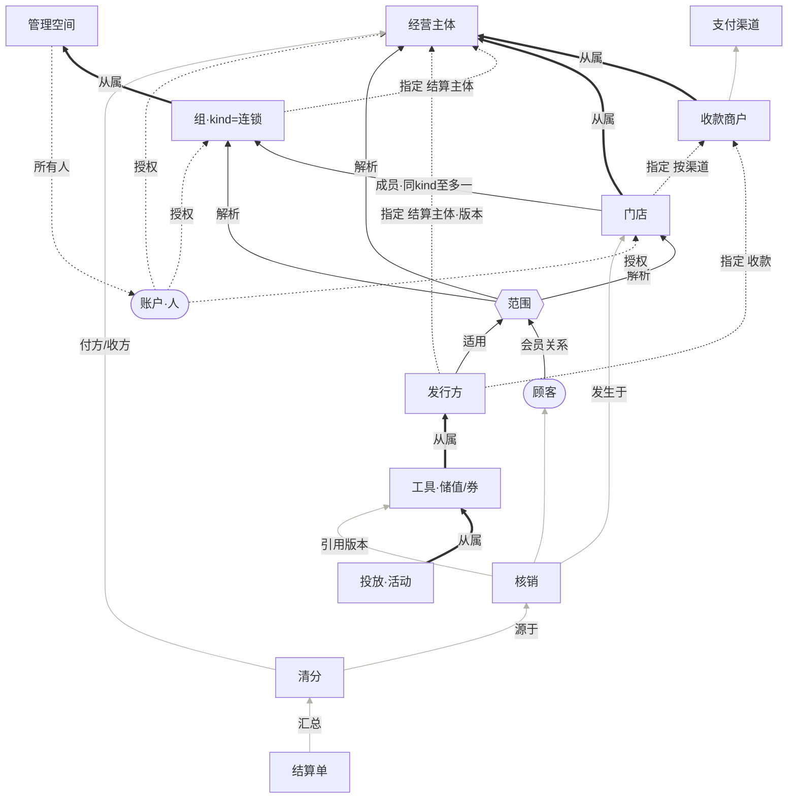

# 组织关系 · 业务模型抽象与依赖

> 状态：方案稿（2026-10-30，第二版：按「分层 + 关系类型」重新抽象），待评审。
> 技术落地见 [组织抽象-技术方案与缺口.md](组织抽象-技术方案与缺口.md)。本文只讲业务模型，以及它和现状、和技术方案的对照。
>
> 依据：
> - ADR-011；
> - 库表：V1 基线（账户 / 主体 / 收款商户 / 门店 / 渠道）；
> - 运营组织与会员：V544 / V545；
> - 储值发行、投放、清分、结算：V548–V576；
> - 定价资金来源：V560；
> - 券：V231。

## 0. 一句话

**钱只落在主体上，运营靠组来组织，权益靠发行方来承担。**
- 主体管钱；
- 门店管履约；
- 组管「对顾客是一家」；
- 发行方管「欠顾客的权益」。

主体与组之间只有一种联系：**结算指定**。

---

## 1. 六种关系

先把「谁和谁有关」分清类型。同样是一根连线，从属和成员的生命周期规则完全不同。

| 关系 | 含义 | 可变性 | 例子 |
|---|---|---|---|
| **从属** | B 的存在依附于 A，不能换主人 | 不可转移；A 停了 B 必须先停 | 门店 → 主体；收款商户 → 主体；工具 → 发行方 |
| **成员** | B 加入 A 这个集合 | 可进可出，带生效窗，进出要走变更 | 门店 ∈ 组；顾客 ∈ 会员范围 |
| **指定** | A 选定 B 承担某个职责 | 按版本；下游复制并冻结，不追溯 | 组 → 结算主体；发行方 → 结算主体、收款商户 |
| **授权** | 人对资源拥有某项能力 | 可授、可撤、可委托 | 账户 → 主体 / 门店 / 组 / 空间 |
| **适用** | 一项能力在哪生效 | 跟着范围动态解析 | 发行方、券、会员关系 → 范围 |
| **事实** | 已经发生的事 | 不可变；引用发生时的版本 | 充值、领券、核销、清分、结算单 |

---

## 2. 分层模型

```
L6 事实     发放/充值 · 核销 · 清分 · 结算单
              │ 引用版本
L5 权益     发行方 ─从属─ 工具(储值方案 / 券) ─从属─ 投放(活动)
              │ 适用            │ 指定
L4 运营     管理空间 ─从属─ 组(kind=连锁…) ∋ 门店        范围 = 门店|主体|组|平台
              │                              (派生概念，解析成门店集合)
L3 经营单元  门店 ─从属→ 主体
L2 资金能力  收款商户 ─从属→ 主体；收款商户 → 渠道
L1 参与方    账户(人)   经营主体(法人)
L0 外部      租户 · 支付渠道 · 顾客
横切        授权（账户 → L1–L5 资源）  会员关系（顾客 ∈ 范围）
```

**依赖规则**：
- 上层引用下层，下层永远不知道上层。例如主体上没有组号，门店上没有发行方号。
- 事实层只引用版本，不引用「当前值」。

### 2.1 各层对象

| 层 | 对象 | 定义 | 关键关系 |
|---|---|---|---|
| L1 | **账户** | 一个能登录的人 | 授权 → 资源；**不从属**任何主体 |
| L1 | **经营主体** | 一张执照；收款、负债、开票、纳税的唯一落点 | — |
| L2 | **收款商户** | 主体在某个渠道上进件得到的收款号 | 从属主体；按渠道 |
| L3 | **门店** | 顾客感知的经营场所：履约、货、人 | 从属主体；**按渠道指定**本主体的收款商户 |
| L4 | **管理空间** | 运营方（总部 / 连锁方）的后台；组的所有者 | 所有人 = 账户 |
| L4 | **组** | 一组门店，在某个运营意义上算一伙；`kind` 区分连锁、区域、商圈…… | 从属空间；成员 = 门店，**同一 kind 内一店至多一组**；**指定**结算主体 |
| L4 | **范围** | 「在哪生效」：门店 / 主体 / 组 / 平台。不是实体，是解析规则 | 由门店、组成员关系、门店从属关系推出 |
| L5 | **发行方** | 预付性权益的负债方 | **适用**于一个范围；**指定**结算主体和收款商户（按版本） |
| L5 | **工具** | 发行方发出的权益种类：储值方案、券（以后也可以是积分、次卡） | 从属发行方；成本承担规则按版本 |
| L5 | **投放** | 工具的一次发放安排：活动、档位、额度、审批 | 从属工具；**不另指定结算主体** |
| L6 | **核销** | 在某店兑付某工具 | 记录核销门店、当时的主体、发行方版本 |
| L6 | **清分 / 结算单** | 核销主体与承担主体不同时形成的应收应付，以及按期汇总 | 引用发行方版本；按 发行方 / 期间 / 付款方 / 收款方 / 币种 汇总 |
| 横切 | **授权** | 账户 × 资源 × 能力 | 只给能力，不改变从属 |
| 横切 | **会员关系** | 顾客 ∈ 范围（组或门店） | 共享关系 ≠ 共享资金或私有档案 |

### 2.2 依赖图

箭头从「依赖方」指向「被依赖方」。线型区分关系：
- 粗实线：从属；
- 细实线：成员、适用；
- 虚线：指定；
- 点线：授权；
- 浅灰线：事实引用。



**读图要点**：
- 所有带钱的线最终都汇到「经营主体」：收款商户从属主体，组和发行方指定主体，清分的付方和收方都是主体（I1）。
- 组和主体之间**只有一根虚线**，就是指定，没有从属线（I3）。
- 工具和投放只沿从属线上挂到发行方，再由发行方的指定线拿到结算主体。投放没有自己连到主体的线（I6）。
- 范围是唯一的「适用」入口：发行方、会员关系都先指向范围，再由范围解析到门店、组或主体。

### 2.3 不变量

| # | 不变量 |
|---|---|
| I1 | **钱只落在主体上**。收款、负债承担、结算的最终落点都是主体；组、发行方、门店都不持有钱 |
| I2 | 门店**从属唯一主体**。门店可以属于多个组，但不同组必须是不同 kind；同一 kind 内至多一个 |
| I3 | **组不从属主体**。组与主体之间唯一的联系是「结算指定」，所以组可以跨主体（加盟） |
| I4 | 每个权益都有发行方。「主体券」就是发行方 = 主体范围的特例，「平台券」就是平台范围的特例 |
| I5 | 一个范围、一种工具，至多一个有效发行方 |
| I6 | **投放不另指定结算主体**，一律继承发行方当时的版本 |
| I7 | 指定的变更不追溯。事实引用发生时的版本；改结算主体要出新版本 |
| I8 | 核销记录「核销门店 + 当时的主体 + 发行方版本」。承担主体 ≠ 核销主体时，**必须**产生清分事实 |
| I9 | 授权只给能力。组的运营授权不包含组内各主体的收款与结算权限 |
| I10 | 会员关系不等于资金共享，也不等于私有档案或营销授权共享 |

### 2.4 生命周期顺序（由依赖图推出）

- **建立**：渠道 → 主体 → 收款商户 → 门店 → 空间 → 组（加入门店、指定结算主体）→ 发行方（指定版本）→ 工具 → 投放。
- **停用**：顺序反过来。**被从属或被指定中的对象不能先停**：
  - 主体还是任何有效指定的对象时，不能停；
  - 门店还在组内且有在途核销时，不能停；
  - 发行方还有负债余额时，只能停止新发行，不能停用。
- **门店进出组**：走变更单，影响检查要覆盖：
  - 在途预占和券；
  - 未清分的应付；
  - 旧发行方的接受资格。

  退出后，旧余额仍由原发行方承担负债。

---

## 3. 术语

- B 端统一叫「**连锁**」：连锁 = kind 为连锁的组。
- C 端只显示名称：「〈连锁名〉通用」或「本店」。
- 「**品牌**」只留给商品属性 `SD_BRAND`。

已改：提交 `9b1633430`，文案和页面标题。代码、库表、权限码中的 `brand` 都冻结为历史编码，见技术方案 §2。

---

## 4. 对照：现状实现 × 已有技术方案

对照的两个对象：
- **现状**：库里和代码里已经有的东西；
- **技术方案**：《组织抽象-技术方案与缺口》v1。

判定：● 与模型一致　◐ 部分一致　○ 缺失或冲突。

### 4.1 L1–L3 参与方、资金、门店

| 模型 | 现状 | 判定 | 技术方案 v1 | 对照结论 |
|---|---|---|---|---|
| 账户（不从属主体） | `mch_account` 一个主体一行（`entity_no NOT NULL`），实际上是「任职」；连锁授权另用 `actor_no` | ○ | G1：`iam_account` + 任职 | 方向一致。**需要补充**：现状有**两套授权**，主体内是 `is_owner` + `mch_store_role`，空间内是 `mch_management_grant`。G1 要把两者统一成「账户 × 资源 × 能力」，不能只拆表 |
| 主体 | `mch_entity` | ● | — | — |
| 收款商户从属主体、按渠道 | `mch_payment_merchant`，`(entity_no, pay_channel)` 唯一 | ● | — | — |
| 门店从属主体 | `mch_store.entity_no` | ● | — | — |
| 门店 → 收款商户（按渠道指定） | `mch_store.pay_merchant_no` 一列 | ◐ | G2：路由表（待确认） | 模型要求「按渠道」。由于一个主体一个渠道只有一个号，现状这一列实际上只能选一个渠道。G2 维持「待产品确认」，若不做，**这一列的语义要收窄为「默认渠道」并写进注释** |

### 4.2 L4 运营组织与范围

| 模型 | 现状 | 判定 | 技术方案 v1 | 对照结论 |
|---|---|---|---|---|
| 管理空间 = 运营方 | `mch_management_space`（所有人 actor） | ● | — | — |
| 组（带 kind，同 kind 排他） | `mch_brand` + `mch_brand_store_binding`，kind 隐含为连锁，一店至多一个 | ● | §1.3：现在用仓储包一层，出现第二种 kind 再迁表 | 一致 |
| 组 → 结算主体（指定） | **无**；分散在 `sv_issuer_version.settlement_entity_no` 和 `pmt_brand_activity_owner.entity_no` | ○ | G3：`org_settlement_designation`，主体类型 GROUP / ISSUER / **ACTIVITY** | **需要修正**：按 I6，投放不另指定结算主体，**去掉 ACTIVITY**。`pmt_brand_activity_owner.entity_no` 改为从发行方版本推出，只读，不再由活动选择 |
| 范围（派生、动态解析） | 散落的字符串 `scope_type`（BRAND / STORE），`MemberOperatingScopePort` 解析门店 | ◐ | P0：`ScopeRef` / `ScopeResolver`，类型 STORE / ENTITY / GROUP / PLATFORM | 一致 |

### 4.3 L5 权益

| 模型 | 现状 | 判定 | 技术方案 v1 | 对照结论 |
|---|---|---|---|---|
| 发行方适用于范围，一个范围一种工具至多一个 | `sv_issuer(scope_type, scope_no)` 唯一，只服务储值 | ◐ | G4：发行方加 `instruments` | 一致 |
| 发行方指定结算主体和收款（按版本） | `sv_issuer_version.settlement_entity_no` / `collection_mode` / `collection_config` | ● | G3：新版本默认取组的指定 | 一致 |
| 工具：储值 | `sv_issue_policy` / `sv_release` 等，挂在 issuer 下 | ● | — | — |
| 工具：券 | `pmt_coupon.entity_no`（平台券为空），范围只能是 STORE / CATEGORY / GOODS | ○ | G4：券加范围和发行方 | 方向一致。**需要补充**：按 I4，平台券是「平台范围的发行方」，G4 要把它一起纳入，否则券仍有两套归属规则。平台承担的部分可以复用渠道的「补差」能力（`sys_pay_channel.supports_subsidy`） |
| 投放从属工具、不另指定结算主体 | `pmt_sv_release_link`（`store_no` / `entity_no`）、`pmt_brand_activity_owner`（`brand_no` + `entity_no`） | ◐ | 未涉及 | **需要补充**：活动的归属应改为「发行方 + 工具」，主体由版本推出（同 G3 的修正）。可以随 G3 一起做 |

### 4.4 L6 事实

| 模型 | 现状 | 判定 | 技术方案 v1 | 对照结论 |
|---|---|---|---|---|
| 核销记录门店、当时的主体、发行方版本 | 储值核销 + `sv_issuer_store_access.operating_entity_no` | ● | — | — |
| 清分事实（按工具通用） | `sv_clearing_entry`（`payer_entity_no` / `payee_entity_no`，发行方版本），只有储值 | ◐ | G4：清分加 `instrument` 维度 | 一致 |
| 优惠的资金来源 | `ord_pricing_funding_source`（报价级：主体、门店、金额） | ◐ | 未涉及 | **需要补充**：券的成本承担规则要落到这里，按承担方拆分资金来源（发行方承担 / 核销主体承担 / 平台补差）。清分从这里取数，不在券模块另算 |
| 结算单 | `sv_settlement_bill*`，只有储值 | ◐ | 未涉及 | **需要补充**：结算单按「发行方 / 期间 / 付款方 / 收款方 / 币种」汇总，与工具无关。G4 落地时把账单泛化，或者给账单明细加工具维度 |

### 4.5 横切

| 模型 | 现状 | 判定 | 对照结论 |
|---|---|---|---|
| 授权：账户 × 资源 × 能力 | 两套：主体内角色 + 空间授权 | ◐ | 并入 G1（见 4.1） |
| 会员关系：顾客 ∈ 范围 | `mbr_scope_member(BRAND/STORE)` | ● | 主体范围的会员暂不需要：单主体多店想共享会员，就建一个连锁 |
| 门店进出组的变更 | `mch_brand_change` + `mch_brand_financial_change`（saga） | ● | 影响检查要随 G4 加入「在途组券」 |

### 4.6 小结

- **模型与现状**：L1 账户、L5 券、L6 清分和结算单的通用化，这三处偏离模型；其余与模型一致。
- **模型与技术方案 v1**：方向一致，需要做 5 处修订，已同步到技术方案 v2：
  1. G3 去掉 ACTIVITY 这个指定对象；活动的主体改为从发行方版本推出；
  2. G4 纳入平台券（平台范围的发行方）；
  3. G4 的成本承担落到 `ord_pricing_funding_source`；
  4. G4 把清分事实和结算单泛化为与工具无关；
  5. G1 同时统一两套授权。

---

## 5. 独立进销存：同一套模型的投影

进销存只认三样东西：
- **系统**（调用方）；
- **账本**（货权主体）；
- **管理范围**。

它不认识账户，也不认识连锁。

| 本模型 | 进销存 | ai-shop | ShareHub |
|---|---|---|---|
| 主体（钱和货权） | 账本 | 每个经营主体一本 | 运营方一本；商户自有货时每个商户一本 |
| 门店 / 站点 | 库位 | 总仓、门店 | 平台仓；站点（保管方 = 商户） |
| 组 / 范围 | 管理范围 | 连锁，成员 = 门店库位，可以跨账本 | 平台、区域、商户 |
| 事实 | 出入库、调拨、跨账本供货 | 直营是账内调拨；加盟是成对供货单 | 投放是调拨；派发池领用 |

不变量同样适用：
- 货权只在账本上（对应 I1）；
- 范围只是视图，不改变记账（对应 I3、I9）；
- 组织主数据的真源在宿主，进销存只存引用和版本。

细节见本文前一版（提交 `9b1633430` 中的 §4）：ShareHub 三种货权形态、`inv_scope`、保管方、成对供货单。与组和范围的对齐见技术方案 §1.4。

---

## 6. 待确认

1. 六种关系、分层模型和十条不变量，是否认可作为后续设计的基准？
2. I4：平台券是否也要纳入「发行方」模型？
3. I6：活动不能再单独选结算主体，改为一律继承发行方，业务上是否接受？
4. G2：门店按渠道指定收款商户号，是否有真实需求？
