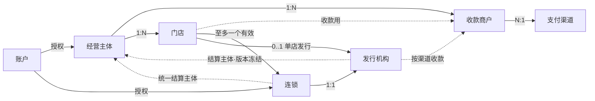

# 组织关系 · 业务抽象与现状匹配度

> 状态：方案稿（2026-10-30），待评审。本文不改契约；落地项按 `ai-shop-dev-standards` 分档，另写 TDD。
>
> 依据：
> - ADR-011：钱归主体，货和人归门店；
> - V1 基线：`mch_account`、`mch_entity`、`mch_payment_merchant`、`mch_store`、`sys_pay_channel`；
> - V544 / V545 / V548 / V571 / V573 / V576：经营组织、会员范围、储值发行方；
> - `TDD-品牌与门店双线储值-系统设计.md`、`TDD-进销存独立服务与多业态.md`、`进销存独立服务-ShareHub对接方案.md`。

## 0. 一句话

**组织不是一棵树，而是两条线在门店相交。**

- **资金线**：账户 → 经营主体 → 收款商户 → 支付渠道。回答「钱归谁、从哪收」。
- **运营线**：账户 → 连锁 → 发行机构。回答「对顾客是不是同一家、谁来统一发券、储值和核销」。

两条线有两处交汇：
- **门店**：门店同时挂在两条线上，资金线上属于唯一的主体，运营线上至多属于一个连锁。
- **结算主体**：运营线上统一做的事最终要落到某个主体上收钱和担责。连锁和发行机构因此都**引用**一个主体，但不**拥有**主体。

---

## 1. 实体与关系

### 1.1 实体

| 实体 | 一句话 | 归属线 | 现有落点 |
|---|---|---|---|
| 账户 | 一个能登录的人 | — | `mch_account`（**按主体一行**，见 §3 差距 G1） |
| 经营主体 | 一张营业执照；收款、结算、开票、担责 | 资金 | `mch_entity` |
| 收款商户 | 主体在某个支付渠道上进件得到的收款号 | 资金 | `mch_payment_merchant`（`entity_no` × `pay_channel` 唯一） |
| 支付渠道 | 微信、支付宝…… | 资金 | `sys_pay_channel` |
| 门店 | 顾客感知的边界：地址、履约、货、人 | 交汇 | `mch_store`（`entity_no`, `pay_merchant_no`） |
| 连锁 | 从运营角度统一管理的一组门店 | 运营 | `mch_brand` + `mch_management_space` |
| 发行机构 | 储值、券这类「先收钱、后兑付」权益的负债方 | 运营 | `sv_issuer` + `sv_issuer_version` |

### 1.2 关系



| # | 关系 | 基数 | 不变量 |
|---|---|---|---|
| R1 | 账户 → 主体 | N:M（经授权） | 店主 = 主体级全部权限；员工 = 门店级授权 |
| R2 | 账户 → 连锁 | N:M（经授权） | 只授运营能力（发券、储值方案、报表），**不含**连锁内各主体的收款和结算 |
| R3 | 主体 → 收款商户 | 1:N | 一个主体在一个渠道上一个商户号 |
| R4 | 收款商户 → 支付渠道 | N:1 | 渠道能力（分账、补差、退款限制）跟着渠道走 |
| R5 | 主体 → 门店 | 1:N | 门店**只属于一个主体**；一个主体恰好一个默认门店 |
| R6 | 门店 → 收款商户 | N:1（按渠道） | 只能用本主体的商户号；为空时用主体默认 |
| R7 | 门店 → 连锁 | N:0..1 | 同一时刻至多一个有效连锁，有生效窗；变更要走变更单 |
| R8 | 连锁 → 发行机构 | 1:1 | 连锁的统一储值、券由这一个机构发行 |
| R9 | 门店 → 发行机构 | 1:0..1 | 单店储值；门店入连锁后，单店发行机构仍独立存在 |
| R10 | 连锁 → 主体（统一结算） | N:1 | **引用，不拥有**：连锁不改变门店属于哪个主体 |
| R11 | 发行机构 → 主体 | N:1（按版本） | 每个配置版本冻结一个结算主体；改结算主体要出新版本 |
| R12 | 发行机构 → 收款商户 | 按渠道引用 | 集中收款时用结算主体名下的商户号，门店本地收款时用门店的商户号 |

### 1.3 运营能力统一成一个抽象：运营范围

```
运营范围 = 连锁(chainNo) | 门店(storeNo)
```

每项运营能力都先选一个范围，然后由范围回答三个问题：
1. **在哪能用**：该范围此刻的门店集合。连锁按绑定和生效窗算，门店就是它自己。
2. **谁担负债**：范围的发行机构 → 当前版本的结算主体。
3. **钱怎么回去**：核销门店的主体 ≠ 结算主体时，生成跨主体应付；相同主体只做内部对账。

| 能力 | 连锁范围 | 门店范围 |
|---|---|---|
| 储值 | 连锁发行机构 | 单店发行机构 |
| 券 | 连锁发行机构（**现状缺**，§3 G4） | 门店 / 主体 |
| 核销 | 连锁下任一有效门店；记录实际核销门店 | 本店 |
| 会员 | 连锁内共享关系（≠ 共享资金、私有档案、营销授权） | 本店 |
| 报表 | 同币种经营指标可以合计，余额不合并 | 本店 |

### 1.4 依赖顺序

- **建立**：支付渠道 → 主体 → 收款商户 → 门店 → 连锁（绑门店、指定结算主体）→ 发行机构（版本冻结结算主体和收款配置）。
- **停用**：顺序反过来。被引用的一方不能先停：
  - 主体还是某个连锁或发行机构的结算主体时，不能停；
  - 门店还在连锁里、有在途核销时，不能直接停。
- **门店换连锁**：走变更单，状态从 PREPARING 到 PAY_PREPARED 再到 COMPLETED。影响检查要看：
  - 在途预占；
  - 未清分的跨主体应付；
  - 旧发行机构的接受资格。

  门店退出连锁后，旧余额仍由原发行机构承担负债。

---

## 2. 术语：「品牌」改叫什么

### 2.1 「品牌」现在有三个意思，彼此冲突

| 用处 | 位置 | 意思 |
|---|---|---|
| 商品属性 | V374 `SD_BRAND`「品牌」；C 端选品说明「品牌型号规格」；法律文案「各品牌方」 | **商品的制造商或商标** |
| 经营组织 | B 端 `brands`「品牌管理」等约 30 条词条，`pages.json` 中 5 个页面标题 | 一组门店 |
| 口语 | C 端 `contract.ts`「同品牌几家店」 | 实际指同一个**主体** |

同一个 App 里，「品牌」既是商品筛选维度，又是门店组织，商家一定会混淆，例如「品牌管理」到底管的是商品品牌还是门店。

### 2.2 候选词

| 候选 | 优点 | 问题 |
|---|---|---|
| **连锁** | 商家最熟悉（直营连锁、加盟连锁）；只指组织，不和商品撞词；能直接组成「连锁储值」「连锁会员」「连锁门店」 | 只有一家店时叫连锁略怪，但组织的意义本来就在多店，单店可以不建 |
| 品牌 | 顾客视角最自然 | 与商品品牌冲突，见上 |
| 总部 | 能体现「统一管理」 | 指的是管理方，而不是那一组门店；「门店属于总部」又会和主体关系混淆 |
| 集团 | — | 有法律上的含义，容易被理解成主体之上的母公司 |
| 门店组 / 经营组 | 中性 | 太技术化，商家不会这么说 |

**建议：B 端统一改叫「连锁」；C 端两个词都不用。**

- **B 端**：
  - 品牌管理 → **连锁管理**；
  - 门店品牌 → **所属连锁**；
  - 品牌储值 → **连锁储值**；
  - 品牌变更 → **连锁变更**；
  - 权限名同步改，如「管理连锁」。
- **C 端**：顾客只看到名称，不需要知道「连锁」这个概念。
  - 储值账户显示「〈连锁名〉通用」和「本店」；
  - 不要写「品牌储值」，也不要写「连锁储值」。
- **连锁的 logo、名称**：作为连锁对外展示的「招牌」，字段继续叫 `name` / `logo`。
- **管理空间**（`mch_management_space`）：不对商家露出，它是连锁的授权容器；商家感知到的就是连锁本身。
- **代码标识符**：先不改。`mch_brand*`、`scope_type='BRAND'`、权限码 `brand_*` 已经进了库表、权限码和 Pay 的范围类型，改名属于契约档，收益只在于和文案一致。做法：
  - 在术语表登记 `brand`（代码）= 连锁（业务），商品属性的品牌另记为 `SD_BRAND`；
  - 新代码继续沿用 `brand`，不要同时混入 `chain`。

  等到有一次必须动这些表的契约变更时，再一并评估是否改名。

本次只改文案，属于文案档，不需要写文档。但是 `pages.json` 里 5 个标题要改，**按 CLAUDE.md 要重跑 `gen-ui-catalog.py`**。

---

## 3. 现状匹配度 review

| # | 关系 | 现状 | 匹配 | 差距与建议 |
|---|---|---|---|---|
| R1 | 账户 → 主体 | `mch_account` 按主体一行（`entity_no NOT NULL`）；跨主体靠 `login_phone` / `user_no` 和 `is_primary` 切换 | ◐ | **G1**：系统里没有「账户」这个实体，只有「某主体的员工」。R2 的授权用 `actor_no` 另起了一套身份。建议把账户（登录身份）和主体成员关系（任职）拆开：账户 1:N 成员关系。中期做，不阻塞连锁 |
| R2 | 账户 → 连锁 | `mch_management_grant`：资源 SPACE / BRAND / STORE / ENTITY / PAYMENT_MERCHANT，可以委托 | ● | 与方案一致。注意连锁运营授权不要顺带授出 ENTITY 或 PAYMENT_MERCHANT |
| R3 | 主体 → 收款商户 | `mch_payment_merchant`，`(entity_no, pay_channel)` 唯一 | ● | 一致：一个渠道一个号。将来如果要同一渠道多个号（多个结算账户），要放开这个唯一键 |
| R4 | 收款商户 → 渠道 | `pay_channel` + `sys_pay_channel` 能力位 | ● | — |
| R5 | 主体 → 门店 | `mch_store.entity_no`，默认门店有且只有一个 | ● | — |
| R6 | 门店 → 收款商户 | `mch_store.pay_merchant_no`，**单列** | ◐ | **G2**：一家店只能指定一个商户号，而商户号是按渠道的。多渠道时，这家店的另一个渠道只能退回主体默认。需要确认是否要改成按渠道指定（门店 × 渠道 → 商户号） |
| R7 | 门店 → 连锁 | `mch_brand_store_binding` 至多一个有效，有生效窗；`mch_brand_change` / `mch_brand_financial_change` 变更单 | ● | 一致，而且已经把资金协调做成了 saga |
| R8 | 连锁 → 发行机构 | `sv_issuer(scope_type=BRAND)` 按范围唯一；`mch_brand_financial_activation` 把连锁和发行机构一对一绑定 | ● | 一致 |
| R9 | 门店 → 发行机构 | `sv_issuer(scope_type=STORE)` | ● | 一致 |
| R10 | 连锁 → 主体（统一结算） | **连锁上没有这个字段**。结算主体分散在 `sv_issuer_version.settlement_entity_no`（储值）和 `pmt_brand_activity_owner.entity_no`（活动）两处 | ○ | **G3**：「连锁统一结算」没有一个单一的真相源，储值和活动可以各指一个主体，而且没有校验。建议连锁上加**默认结算主体**（带版本和结算主体授权确认）；发行机构新版本和连锁活动默认取它并冻结；两者不一致时要显式确认 |
| R11 | 发行机构 → 主体 | `sv_issuer_version.settlement_entity_no` 版本化 + `entity_acceptance` | ● | 一致 |
| R12 | 发行机构 → 收款商户 | `collection_mode` CENTRALIZED / STORE_LOCAL + `collection_config` 引用 | ● | 一致 |
| — | 统一发券 | `pmt_coupon.entity_no` + 范围 ALL / STORE / CATEGORY / GOODS，**只能在主体内** | ○ | **G4**：没有连锁券。加盟连锁（跨主体）发不了统一的券，也没有券的负债方和清分。建议券接入发行机构模型：券挂在运营范围上，由发行机构承担，核销时按核销门店的主体清分，复用储值已有的跨主体应付 |
| — | 统一核销 | `sv_issuer_store_access`（`can_issue` / `can_redeem` + `operating_entity_no`） | ● 储值 / ○ 券 | 储值已经按门店准入；券随 G4 一起做 |
| — | 会员 | `mbr_scope_member(scope_type=BRAND/STORE)` | ● | 一致 |
| — | 术语 | B 端「品牌」与商品属性「品牌」撞词 | ○ | **G5**：见 §2 |

● 一致　◐ 部分一致　○ 缺失或冲突

**结论**：运营线的骨架已经基本到位，包括连锁、门店绑定、发行机构、会员范围和储值准入，而且比方案图更严谨（版本冻结、变更 saga）。真正的缺口有四个：

1. **G4 连锁券**：功能缺失，直接影响「统一发券」这个核心诉求。优先级最高。
2. **G3 连锁 → 结算主体没有单一真相源**：先补，G4 也要用到它。
3. **G5 术语**：只改文案，成本最低，可以随时做。
4. **G1 / G2**：账户模型和门店按渠道收款，中期再做。

---

## 4. 独立进销存：货权线 + 管理范围

### 4.1 映射

进销存不认识「账户」，也不认识「连锁」这个词。它只认三样东西：
- **系统**（调用方）；
- **账本**（货权主体）；
- **管理范围**（把多本账或多个库位圈起来统一看、统一管）。

| 进销存抽象 | ai-shop | ShareHub · 平台自有 | ShareHub · 商户自有 |
|---|---|---|---|
| 系统 | SHOP | SHAREHUB | SHAREHUB |
| 账本（是谁的货） | **经营主体**（货权跟着资金线走） | 运营方 | 商户 |
| 库位（货在哪） | 总仓、门店 | 平台仓、站点（保管方 = 商户） | 商户仓、站点 |
| 目标（货去哪） | 供应商 | 接收人、供应商 | 接收人 |
| 管理范围（谁来管） | **连锁**：成员 = 门店库位，可以跨账本 | 平台、区域、商户 | 平台 |

判别准则：货出去以后还要不要按它数库存？要数，就是库位；不数，就是目标。

### 4.2 两种管理方式

**连锁 / 门店（ai-shop）**
- 直营：总仓 → 门店是账内调拨。
- 加盟：总部 → 加盟店是**跨账本供货**。总部账记供货出库，加盟账记采购入库，成对关联，钱由 ai-shop 结算。
- 连锁这个范围可以只读汇总、代下补货申请，**不能直接改加盟店的账**。
- 范围成员由 ai-shop 按 `mch_brand_store_binding` 同步过来，带生效窗和版本。

**平台 / 商户（ShareHub）**

三种货权形态可以并存：

| 形态 | 账本 | 站点 | 出库 / 派发 |
|---|---|---|---|
| 平台自有（现状） | 运营方一本 | 平台账里的库位，保管方 = 商户 | 投放 = 账内调拨；派发池把货发给接收人 |
| 商户自有、平台代管 | 每个商户一本 | 商户账里的库位 | 平台用系统凭证 + 业主头代操作（D7） |
| 寄售 | 平台一本 | 平台账里的库位，保管方 = 商户 | 售出时记寄售出库，结算事实交回宿主 |

### 4.3 要动的东西（按依赖顺序）

1. `inv_scope` / `inv_scope_member`：管理范围及成员，成员可以是 OWNER 或 LOCATION，带生效窗和 `source_version`，由宿主同步。首期只用于只读汇总和判权。
2. 库位加保管方 `custodian_type/ref`，新增 `kind=SITE`。
3. 范围凭证：读可以跨成员汇总；写仍要带业主头，只能写范围内的账本或库位，并受档案中的动作白名单约束。
4. 跨账本成对供货单。
5. 档案扩展：`scopeTypes`、范围可代办的动作、`custodianTypes`。

### 4.4 边界

- 账本不按连锁开。连锁不拥有货；门店换连锁是运营变动，不是货权过户。
- 范围只是视图，不改变记账规则。
- 组织主数据的真源在宿主，进销存只存引用和版本。

---

## 5. 待确认

1. **术语**：B 端「品牌」统一改为「连锁」，C 端用「〈连锁名〉通用 / 本店」。代码标识符保留 `brand`，在术语表登记映射。
2. **G3**：连锁上加默认结算主体，发行机构和连锁活动默认取它并冻结。是否允许储值和券各自指定不同的结算主体？
3. **G4**：连锁券是否采用发行机构模型，即「发行机构 + 接受范围 + 清分」？
4. **G2**：门店是否需要按渠道分别指定收款商户号？
5. **进销存**：
   - ShareHub 站点是否升级为库位；
   - 加盟供货第一期是否只做连锁只读汇总；
   - 是否要支持多个运营方。
