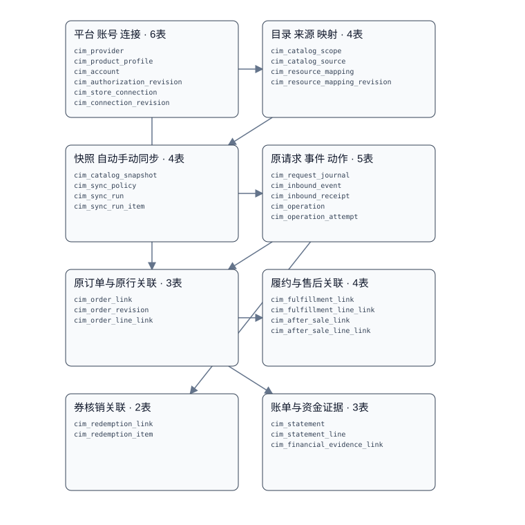

# 统一销售渠道接入 数据库设计

> 状态：全量候选设计；已编码子集见下方实施进度，候选数不代表完成数。由 `node scripts/gen-commerce-integration-design.mjs` 生成，勿手改。真源：[commerce-integration-design.json](./schema/commerce-integration-design.json)，2026-10-26。

## 当前实施进度

| 项 | 实际范围 |
| --- | --- |
| 状态 | C1_MAPPING_ENGINE_VERIFIED |
| 已编码迁移表 | cim_provider, cim_product_profile, cim_account, cim_store_connection, cim_connection_revision, cim_request_journal, cim_authorization_revision, cim_operation, cim_operation_attempt, cim_catalog_scope, cim_catalog_source, cim_sync_policy, cim_catalog_snapshot, cim_sync_run, cim_sync_run_item, cim_resource_mapping, cim_resource_mapping_revision |
| 已编码API子集 | COM-001, COM-002, COM-003, COM-004, COM-005, COM-009, COM-010, COM-011, COM-006, COM-007, COM-008, COM-035, COM-070, COM-015, COM-016, COM-017, COM-018, COM-019, COM-020, COM-021, COM-022, COM-023, COM-024, COM-025, COM-026, COM-027, COM-028, COM-029, COM-030 |
| 限制 | B端仍仅主体属主；累计29个基础/授权/目录/任务路由，17张迁移业务表。目录仅支持一个连接一个STORE完整范围，同行业聚合餐牌。默认无原行业目录/来源/授权/真实网关提供方；无连接激活接口，不能直接对Keeta等发布。目录自动策略与唯一恢复Job默认关闭；onAvailability和自动远端取消未开放。同步恢复只查原目录动作，不恢复C0 OAuth过期/UNKNOWN。目录授权事实只读内部端点及独立客户端已编码；完整渠道业务的独立模式客户端、订单导入、履约售后、资金对账及真实平台仍未开放。基础内核已集成部署；新增原FOOD来源/价格和目录v2尚未推送部署。 定时核验仅针对选定来源修订及本地发送，不自动发现source head或读取远端菜单漂移；原来源须投递可信发布通知。 资源映射公共写入仅IMPORTED草稿，核验由默认关闭的唯一Job调用；MANAGED代码分配/发布证明、真实资源查询网关尚未开放。历史解析内核已实现，不代表原订单导入已就绪。 目录v2合同/冻结/稳定摘要/版本派发门禁已实现，原FOOD完整目录适配及连接/媒体依据仍未装配。 S2B2B1仅原连接/CATALOG授权事实，未装配完整FOOD目录；不新增公开路由和业务表。 |
| 验证 | 累计79个唯一受影响Java专项通过；复核及关联修复后仅复测35项。资源归属消融红灯、恢复绿灯；一项独立复核Important与原连接owner历史解析回归均RED→GREEN。原生隔离MySQL V1-V4十七表及约束通过；最终宿主/server编译打包、设计10/文档8/SQL守卫见TDD。不等同真实来源/供应商、生产JDBC并发和完整认证链验收。 本批目录v2另有48个相关专项及5个架构/装配专项通过；历史79项不与本批简单相加。统一编译/干净打包和消融记录见原TDD。 S2B2B1新增原授权读取/真实HTTP/令牌和独立关闭测试，具体集中回归及构建证据见TDD。 |

## L1 定位

渠道只拥有授权、同步、事件、接入关联和证据。商品、订单、库存、支付、仓库包裹与权益余额归原owner；餐饮/零售分别提供来源Port。当前同业务库、cim_前缀及独立迁移历史，未来可迁到独立库。

## L2 表族与关系

候选共31张表，按业务闭环逐批实施，不能把候选表数当建表进度。

图为真源表族和逻辑引用的投影，不是跨业务物理外键。最关键的两条关系是稳定连接贯穿订单去重，以及每次外部动作关联原快照和原业务结果。

| 表 | 阶段 | 职责 | Entity |
| --- | --- | --- | --- |
| cim_provider | BASE | 平台品牌目录 | CimProvider |
| cim_product_profile | BASE | 平台业务产品与获准协议定义 | CimProductProfile |
| cim_account | BASE | 主体所有的渠道授权账号 | CimAccount |
| cim_authorization_revision | BASE | 不可变授权范围与凭据引用 | CimAuthorizationRevision |
| cim_store_connection | BASE | 稳定外部门店与本地主体门店绑定 | CimStoreConnection |
| cim_connection_revision | BASE | 门店接入、履约及路由配置快照 | CimConnectionRevision |
| cim_resource_mapping | CATALOG | 稳定远端对象映射身份 | CimResourceMapping |
| cim_resource_mapping_revision | CATALOG | 映射修订及冻结来源 | CimResourceMappingRevision |
| cim_catalog_scope | CATALOG | 远端完整目录的发布所有权与版本指针 | CimCatalogScope |
| cim_catalog_source | CATALOG | 完整目录包含的行业来源 | CimCatalogSource |
| cim_sync_policy | SYNC | 范围内自动同步策略 | CimSyncPolicy |
| cim_catalog_snapshot | SYNC | 不可变的完整通用目录 | CimCatalogSnapshot |
| cim_sync_run | SYNC | 一次逻辑同步或核对执行 | CimSyncRun |
| cim_sync_run_item | SYNC | 每个尝试的条目及图片结果 | CimSyncRunItem |
| cim_request_journal | BASE | 公开写接口的原请求幂等 | CimRequestJournal |
| cim_inbound_event | EVENT | 逻辑入站事件和处理租约 | CimInboundEvent |
| cim_inbound_receipt | EVENT | 到达报文与重复或冲突证据 | CimInboundReceipt |
| cim_operation | EVENT | 出站动作或受控内部交接意图 | CimOperation |
| cim_operation_attempt | EVENT | 每次发送及查询的不可变调用证据 | CimOperationAttempt |
| cim_order_link | ORDER | 外部交易与原行业及核心订单关联 | CimOrderLink |
| cim_order_revision | ORDER | 不可变平台订单快照及解释依据 | CimOrderRevision |
| cim_order_line_link | ORDER | 外部父子原行与核心分摊的多对多关联 | CimOrderLineLink |
| cim_fulfillment_link | FULFILLMENT | 原履约单或包裹的渠道关联 | CimFulfillmentLink |
| cim_fulfillment_line_link | FULFILLMENT | 本次履约原行及数量关联 | CimFulfillmentLineLink |
| cim_after_sale_link | AFTER_SALE | 平台售后与原售后关联 | CimAfterSaleLink |
| cim_after_sale_line_link | AFTER_SALE | 售后原行及数量金额证据 | CimAfterSaleLineLink |
| cim_redemption_link | VOUCHER | 平台券履约与本地权益核销关联 | CimRedemptionLink |
| cim_redemption_item | VOUCHER | 一次核销的券与本地消费原行关联 | CimRedemptionItem |
| cim_statement | FINANCIAL | 不可变平台账单版本 | CimStatement |
| cim_statement_line | FINANCIAL | 平台账单原行及对账结果 | CimStatementLine |
| cim_financial_evidence_link | FINANCIAL | 平台证据向原资金owner交接关联 | CimFinancialEvidenceLink |

## L3 公共字段与逐表字段

| 公共字段 | 类型 | 规则 |
| --- | --- | --- |
| id | BIGINT AUTO_INCREMENT | 物理主键，不出URL/公共响应 |
| tenant_no | VARCHAR(32) | 一期MAIN，保留原平台口径 |
| created_at/updated_at | DATETIME(3) | UTC LocalDateTime，沿原填充 |
| created_by/updated_by | VARCHAR(32) | 原操作者或SYSTEM |
| version | BIGINT | 乐观锁，初始0 |
| deleted | INT | 沿BaseEntity；事实/修订禁止业务archive |

业务号VARCHAR(32)且按原编号组件；外部标识默认VARCHAR(128)，协议更长时设计前补约，禁止截断；hash CHAR(64)；数量DECIMAL(20,6)；金额BIGINT最小单位并执行原MoneyMinor JSON安全边界；字符标识使用平台现有utf8mb4二进制比较策略。

租户/主体/门店身份沿原体系；主体级表不伪造store_no。所有内部资源查询都验证可信entity/store/账号数据范围。模块内逻辑引用按关联双方scope验证，跨域不建物理外键；不让外部调用者传主体冒充授权。

### cim_provider · 平台品牌目录

阶段：BASE。Entity：`ai.neargo.shop.commerce.entity.CimProvider`。除下表外包含公共字段。

| 字段 | 类型与说明 |
| --- | --- |
| provider_no | VARCHAR(32)业务号 |
| provider_code | VARCHAR(32)品牌代码 |
| name | VARCHAR(128)展示名 |
| status | VARCHAR(24)启用状态 |

键：U(provider_code)；U(provider_no)。

逻辑关联：本域原请求事实。

约束：品牌不决定行业、产品、币种或履约；无实现网关不能因启用目录就可调用。

### cim_product_profile · 平台业务产品与获准协议定义

阶段：BASE。Entity：`ai.neargo.shop.commerce.entity.CimProductProfile`。除下表外包含公共字段。

| 字段 | 类型与说明 |
| --- | --- |
| profile_no | VARCHAR(32)业务号 |
| provider_no | VARCHAR(32)平台 |
| product_code | VARCHAR(32)业务产品 |
| market | VARCHAR(8)市场 |
| protocol_code | VARCHAR(64)协议档案 |
| capability_definition | JSON非凭据能力定义 |
| identity_schema_version | INT平台身份归一版本 |
| status | VARCHAR(24)状态 |
| identity_namespace | VARCHAR(128)协议远端身份命名空间；不可随Token或本地账号变化 |
| store_identity_scope | VARCHAR(24)GLOBAL/ACCOUNT；仅获准协议可确定 |

键：U(profile_no)；U(provider_no,product_code,market,protocol_code)。

逻辑关联：provider。

约束：实现能力、协议能力、账号授权和门店开关取交集；未核验不能开能力。配置变更影响历史时追加档案而非改旧语义。

### cim_account · 主体所有的渠道授权账号

阶段：BASE。Entity：`ai.neargo.shop.commerce.entity.CimAccount`。除下表外包含公共字段。

| 字段 | 类型与说明 |
| --- | --- |
| account_no | VARCHAR(32)业务号 |
| entity_no | VARCHAR(32)经营主体 |
| profile_no | VARCHAR(32)协议 |
| external_account_ref | VARCHAR(128)稳定外部账号 |
| active_authorization_no | VARCHAR(32)NULL活动授权修订 |
| status | VARCHAR(24)状态 |
| active_operation_no | VARCHAR(32)NULL；串行化授权/撤权，UNKNOWN保持原动作 |

键：U(account_no)；U(entity_no,profile_no,external_account_ref)。

逻辑关联：product_profile。

约束：Token刷新不改变账号身份；敏感凭据仅安全存储引用。一个账号可关联多渠道门店。

### cim_authorization_revision · 不可变授权范围与凭据引用

阶段：BASE。Entity：`ai.neargo.shop.commerce.entity.CimAuthorizationRevision`。除下表外包含公共字段。

| 字段 | 类型与说明 |
| --- | --- |
| authorization_no | VARCHAR(32)业务号 |
| entity_no | VARCHAR(32)主体 |
| account_no | VARCHAR(32)账号 |
| revision_no | BIGINT修订 |
| credential_ref | VARCHAR(128)安全存储引用 |
| granted_scopes | LONGTEXT服务端编码的原授权范围JSON |
| capability_hash | CHAR(64)核验摘要 |
| authorized_at | DATETIME(3)UTC |
| expires_at | DATETIME(3)NULL |
| status | VARCHAR(24)授权状态 |
| evidence_ref | VARCHAR(256)原平台授权回执；无明文凭据 |

键：U(authorization_no)；U(account_no,revision_no)。

逻辑关联：account。

约束：凭据轮换和撤权可追溯；刷新Token在原安全存储中处理，原已获授权证据不静默改写。

### cim_store_connection · 稳定外部门店与本地主体门店绑定

阶段：BASE。Entity：`ai.neargo.shop.commerce.entity.CimStoreConnection`。除下表外包含公共字段。

| 字段 | 类型与说明 |
| --- | --- |
| connection_no | VARCHAR(32)业务号 |
| entity_no | VARCHAR(32)经营主体 |
| store_no | VARCHAR(32)本地门店 |
| profile_no | VARCHAR(32)协议 |
| account_no | VARCHAR(32)账号 |
| external_store_ref | VARCHAR(128)外部门店 |
| channel_store_key | CHAR(64)稳定远端业务身份 |
| active_revision_no | VARCHAR(32)NULL配置修订 |
| status | VARCHAR(24)状态 |
| identity_receipt_ref | VARCHAR(128)可信平台授权/查询的原门店归属回执，公共请求不可自报 |
| identity_verified_at | DATETIME(3)UTC归属核验时点 |
| identity_valid_until | DATETIME(3)UTC创建时仍有效，激活须另复核 |

键：U(connection_no)；U(channel_store_key)；I(entity_no,store_no,status)。

逻辑关联：product_profile,account。

约束：身份归一按协议声明的远端命名空间。内部账号号和Token不得进入稳定键；外部账号仅在协议确实以其限定门店时纳入。禁止直接换主体或重建连接绕过订单去重；换授权沿同一连接。转让归属流程首版不开放。 创建草稿也会永久认领唯一远端身份，因此必须先取得精确绑定主体/账号/协议修订/远端店的可信归属证据；无提供方或UNKNOWN拒绝写入，不能用自报externalStoreRef抢占其他商家。

### cim_connection_revision · 门店接入、履约及路由配置快照

阶段：BASE。Entity：`ai.neargo.shop.commerce.entity.CimConnectionRevision`。除下表外包含公共字段。

| 字段 | 类型与说明 |
| --- | --- |
| revision_no | VARCHAR(32)业务号 |
| entity_no | VARCHAR(32)主体 |
| connection_no | VARCHAR(32)连接 |
| revision | BIGINT修订 |
| source_owner | VARCHAR(24)FOOD/RETAIL |
| accept_mode | VARCHAR(24)MANUAL/AUTO/PLATFORM |
| fulfillment_profile | VARCHAR(32)即时/快递/核销 |
| catalog_authority | VARCHAR(24)本地发布/外部导入草稿 |
| source_routing_ref | VARCHAR(64)可信业务路由 |
| config_json | JSON白名单配置 |
| config_hash | CHAR(64)摘要 |

键：U(revision_no)；U(connection_no,revision)。

逻辑关联：store_connection。

约束：默认一笔外部单一个接入责任方；混合行业订单首版拒绝，不能两消费者分别导入。不能用accept_mode伪造资金证明。

### cim_resource_mapping · 稳定远端对象映射身份

阶段：CATALOG。Entity：`ai.neargo.shop.commerce.entity.CimResourceMapping`。除下表外包含公共字段。

| 字段 | 类型与说明 |
| --- | --- |
| mapping_no | VARCHAR(32)业务号 |
| entity_no | VARCHAR(32)主体 |
| connection_no | VARCHAR(32)连接 |
| object_type | VARCHAR(32)类目/销售条目/SKU/选项/仓库等 |
| external_ref | VARCHAR(128)平台原号 |
| external_identity_hash | CHAR(64)含协议规定的父对象身份 |
| active_revision_no | VARCHAR(32)NULL活动修订 |
| store_no | VARCHAR(32)可信连接门店 |
| external_identity_json | LONGTEXT固定父身份与原平台代码 |
| latest_revision_no | VARCHAR(32)最新修订，不与有效修订混淆 |
| verification_operation_no | VARCHAR(32)NULL当前只读核验原动作 |
| verification_lease_until | DATETIME(3)NULL核验租约 |
| next_verification_at | DATETIME(3)NULL到期扫描 |

键：U(mapping_no)；U(connection_no,object_type,external_identity_hash)。

逻辑关联：store_connection。

约束：平台编号若只在父对象内唯一，必须把父身份纳入归一摘要；条码、名称和取餐短码不能作唯一订单/商品身份。 C1公共写入仅创建IMPORTED草稿；latest与active分离，新草稿立即撤下active但不删除原VERIFIED修订。外部identity与父身份固定；换远端身份另建映射。核验前持久化QUERY原动作/attempt，租约和版本控制迟到证明。

### cim_resource_mapping_revision · 映射修订及冻结来源

阶段：CATALOG。Entity：`ai.neargo.shop.commerce.entity.CimResourceMappingRevision`。除下表外包含公共字段。

| 字段 | 类型与说明 |
| --- | --- |
| revision_no | VARCHAR(32)业务号 |
| entity_no | VARCHAR(32)主体 |
| mapping_no | VARCHAR(32)映射 |
| revision | BIGINT修订 |
| source_owner | VARCHAR(24)来源业务 |
| source_ref | VARCHAR(128)来源对象 |
| source_revision_ref | VARCHAR(128)原修订 |
| sales_offer_ref | VARCHAR(128)NULL；销售条目/SKU/选项必填并由原owner证明归属，MENU/类目/仓库/库存策略不填 |
| mapping_snapshot | JSON白名单映射 |
| content_hash | CHAR(64)摘要 |
| effective_at | DATETIME(3)NULL |
| validation_receipt_ref | VARCHAR(128)NULL原来源核验回执，草稿为空 |
| external_evidence_ref | VARCHAR(256)NULL已确认发布/原订单/平台查询的远端身份依据 |
| mapping_origin | VARCHAR(24)MANAGED/IMPORTED |
| validation_status | VARCHAR(24)DRAFT/VERIFIED/REJECTED |
| source_content_hash | CHAR(64)NULL原资源hash |
| validation_expires_at | DATETIME(3)NULL原核验时的双证明最短期限 |
| connection_revision_no | VARCHAR(32)冻结连接修订 |
| authorization_no | VARCHAR(32)NULL核验使用的授权修订；只存业务引用 |
| reason | VARCHAR(256)修订/核验原因 |

键：U(revision_no)；U(mapping_no,revision)。

逻辑关联：resource_mapping。

约束：历史订单读取原映射；同SKU不同餐牌/选项用不同销售条目；不按当前映射追改历史。 手工输入先DRAFT，经ChannelSourceValidationPort核验原对象/修订/归属，再以受控发布代码或远端真实查询/订单证据确认外部身份；无证据不得自动参与订单解析。capture和prepareImport再次复核冻结依据，防止验证后来源漂移。 草稿/核验修订均只追加，核验通过另增VERIFIED修订；失败记录在原operation/attempt，草稿重查，无默认成功。历史解析必须显式原修订并重新证明source+salesOffer关系/hash，历史远端证明不能冒充当前远端一致性；不授予价格/库存/资金/履约准入。 历史验证使用原connection_revision_no的owner/LOCAL规则，当前连接改路由不改变原归属；当前写入仍受现有连接规则约束。

### cim_catalog_scope · 远端完整目录的发布所有权与版本指针

阶段：CATALOG。Entity：`ai.neargo.shop.commerce.entity.CimCatalogScope`。除下表外包含公共字段。

| 字段 | 类型与说明 |
| --- | --- |
| scope_no | VARCHAR(32)业务号 |
| entity_no | VARCHAR(32)主体 |
| connection_no | VARCHAR(32)连接 |
| remote_scope_key | VARCHAR(128)协议声明的完整替换范围 |
| name | VARCHAR(128)名称 |
| desired_snapshot_no | VARCHAR(32)NULL期望快照 |
| last_confirmed_snapshot_no | VARCHAR(32)NULL最后全量确认 |
| remote_consistency | VARCHAR(24)UNKNOWN/CONSISTENT/PENDING/PARTIAL/STALE/SUBMITTED/DRIFT |
| generation | BIGINT已启动发送代次；排队新期望不抢占未决远端动作 |
| status | VARCHAR(24)状态 |
| active_operation_no | VARCHAR(32)NULL阻断后续全量发布的原动作 |
| remote_pending_evidence | JSONNULL未决平台菜单/图片等变更子任务及查回证据 |
| store_no | VARCHAR(32)可信连接门店，便于服务端分页 |

键：U(scope_no)；U(connection_no,remote_scope_key)。

逻辑关联：store_connection。

约束：全量覆盖一整个店铺的平台只允许一个remote_scope_key=STORE；早餐/午餐不能各建覆盖范围。最后确认快照是历史证据，PARTIAL时不代表远端仍是该完整版本。 scope键由服务器依据协议归一；不能通过自报任意remoteScopeKey创建第二个全店发布者。 串行覆盖远端完整异步执行期。SUBMITTED/UNKNOWN及未决可写子任务阻断后续全量发送；过期本地lease仅换worker，不清activeOperation。须取得原平台任务/子任务明确终结、确已取消或获准有序覆盖证明才释放；PARTIAL确认终结后才可新全量修复。无查回能力保持阻断并告警，不能仅凭人工reason解除。

### cim_catalog_source · 完整目录包含的行业来源

阶段：CATALOG。Entity：`ai.neargo.shop.commerce.entity.CimCatalogSource`。除下表外包含公共字段。

| 字段 | 类型与说明 |
| --- | --- |
| source_no | VARCHAR(32)业务号 |
| entity_no | VARCHAR(32)主体 |
| scope_no | VARCHAR(32)范围 |
| source_owner | VARCHAR(24)FOOD/RETAIL |
| source_ref | VARCHAR(128)餐饮绑定/零售选品引用 |
| selection_revision | VARCHAR(128)指定配置修订 |
| priority | INT展示顺序 |
| status | VARCHAR(24)状态 |

键：U(source_no)；U(scope_no,source_owner,source_ref)。

逻辑关联：catalog_scope。

约束：同一个完整范围可聚合多个来源；平台不支持混合品类则捕获时拒绝。来源引用保留原域所有权。 首版来源必须与连接source_owner一致；跨行业混合目录也关闭，避免允许下单却无法履约。多个餐牌或多个零售选品可同域聚合。

### cim_sync_policy · 范围内自动同步策略

阶段：SYNC。Entity：`ai.neargo.shop.commerce.entity.CimSyncPolicy`。除下表外包含公共字段。

| 字段 | 类型与说明 |
| --- | --- |
| policy_no | VARCHAR(32)业务号 |
| entity_no | VARCHAR(32)主体 |
| scope_no | VARCHAR(32)范围 |
| enabled | BOOLEAN |
| on_publish | BOOLEAN |
| on_availability | BOOLEAN |
| scheduled_check | BOOLEAN |
| debounce_seconds | INT合并窗口 |
| recovery_profile | VARCHAR(32)受控恢复策略 |
| next_check_at | DATETIME(3)NULLUTC |
| store_no | VARCHAR(32)可信门店 |
| pending_event_ref | VARCHAR(128)NULL已核验原发布通知，CAS合并 |

键：U(policy_no)；U(scope_no)；I(enabled,next_check_at)。

逻辑关联：catalog_scope。

约束：自动只同步获准的已发布事实。只合并未发送意图，不覆盖已发送任务；资金及非幂等动作不能配置为盲重试。 C1默认关闭；仅onPublish和五分钟来源核验，onAvailability=true明确拒绝。定时任务仅一个平台Job，默认停用。

### cim_catalog_snapshot · 不可变的完整通用目录

阶段：SYNC。Entity：`ai.neargo.shop.commerce.entity.CimCatalogSnapshot`。除下表外包含公共字段。

| 字段 | 类型与说明 |
| --- | --- |
| snapshot_no | VARCHAR(32)业务号 |
| entity_no | VARCHAR(32)主体 |
| scope_no | VARCHAR(32)范围 |
| schema_version | INT |
| source_manifest | JSON来源/修订/价格/配方等引用 |
| payload_ref | VARCHAR(256)受控负载引用；首版DB:snapshotNo |
| content_hash | CHAR(64)内容摘要 |
| item_count | BIGINT |
| currency | VARCHAR(8)目录币种 |
| captured_at | DATETIME(3)UTC |
| expires_at | DATETIME(3)预览有效期限，具体TTL用配置；提交必须验证 |
| payload_json | LONGTEXT冻结原目录，首版最大4MiB |
| scope_version | BIGINT来源配置版本 |
| connection_revision_no | VARCHAR(32)冻结连接修订 |

键：U(snapshot_no)；I(scope_no,content_hash)；I(expires_at)。

逻辑关联：catalog_scope。

约束：确定性规范化后计算摘要；平台协议字段从快照转换。现有MenuPublicationSnapshot不直接授予价格/库存权威。快照含原价格来源及税口径，不自行估价。 相同内容可重新捕获新的有效证据，不以(scope,hash)唯一键阻止过期后的合法预览。 C1哈希覆盖按原owner给定顺序的稳定业务内容及源内容hash，原价格/税/价格回执保留；验证有效期/验证回执号刷新不改变菜单hash。冻结完整payload另存本域JSON，不把hash当不透明TTL校验凭证。源端应确定性输出数组顺序。

### cim_sync_run · 一次逻辑同步或核对执行

阶段：SYNC。Entity：`ai.neargo.shop.commerce.entity.CimSyncRun`。除下表外包含公共字段。

| 字段 | 类型与说明 |
| --- | --- |
| run_no | VARCHAR(32)业务号 |
| entity_no | VARCHAR(32)主体 |
| store_no | VARCHAR(32)门店 |
| connection_no | VARCHAR(32)连接 |
| scope_no | VARCHAR(32)NULL目录范围 |
| run_type | VARCHAR(32)CATALOG/AVAILABILITY/INVENTORY/STORE_STATUS/CHECK |
| trigger_type | VARCHAR(24)AUTO_EVENT/MANUAL/SCHEDULED/RECOVERY |
| source_event_ref | VARCHAR(128)NULL |
| snapshot_no | VARCHAR(32)NULL |
| request_hash | CHAR(64) |
| generation | BIGINT NULL；获得远端发送权时分配，QUEUED不分配 |
| status | VARCHAR(24) |
| started_at | DATETIME(3)NULL |
| finished_at | DATETIME(3)NULL |
| next_recovery_at | DATETIME(3)NULL |
| failure_code | VARCHAR(64)NULL |
| operation_no | VARCHAR(32)NULL发送时绑定原动作 |

键：U(run_no)；I(entity_no,store_no,created_at,id)；I(status,next_recovery_at,id)。

逻辑关联：store_connection,catalog_scope,catalog_snapshot。

约束：状态：QUEUED/RUNNING/SUBMITTED/SUCCEEDED/PARTIAL/FAILED/UNKNOWN/CANCELLED。恢复同一run；菜单重新发布另建run并重新确认完整快照。

### cim_sync_run_item · 每个尝试的条目及图片结果

阶段：SYNC。Entity：`ai.neargo.shop.commerce.entity.CimSyncRunItem`。除下表外包含公共字段。

| 字段 | 类型与说明 |
| --- | --- |
| item_no | VARCHAR(32)业务号 |
| entity_no | VARCHAR(32)主体 |
| run_no | VARCHAR(32)任务 |
| attempt_no | BIGINT |
| object_type | VARCHAR(32)销售条目/选项/图片 |
| object_key_hash | CHAR(64) |
| external_ref | VARCHAR(128)NULL |
| source_ref | VARCHAR(128)NULL |
| result | VARCHAR(24) |
| error_code | VARCHAR(64)NULL |
| evidence_ref | VARCHAR(256)NULL |

键：U(item_no)；U(run_no,attempt_no,object_type,object_key_hash)；I(run_no,result)。

逻辑关联：sync_run。

约束：菜单和图片结果分别记录；失败条目不能拼成全量成功。平台只返回总结果时保留粒度，不生成伪逐项成功。

### cim_request_journal · 公开写接口的原请求幂等

阶段：BASE。Entity：`ai.neargo.shop.commerce.entity.CimRequestJournal`。除下表外包含公共字段。

| 字段 | 类型与说明 |
| --- | --- |
| request_no | VARCHAR(32)业务号 |
| entity_no | VARCHAR(32)NULL；仅PLATFORM作用域可空 |
| endpoint_key | VARCHAR(96)规范动作 |
| key_hash | CHAR(64)Idempotency-Key摘要 |
| actor_no | VARCHAR(32)操作者 |
| request_hash | CHAR(64) |
| status | VARCHAR(24) |
| result_ref | VARCHAR(128)NULL |
| result_snapshot | LONGTEXT NULL；服务端编码的冻结JSON响应 |
| scope_kind | VARCHAR(24)PLATFORM/ENTITY/STORE |
| scope_key | CHAR(64)服务端规范作用域；GLOBAL平台范围不伪造经营主体 |

键：U(request_no)；U(tenant_no,scope_kind,scope_key,endpoint_key,key_hash)。

逻辑关联：本域原请求事实。

约束：同键不同参数/不兼容操作者冲突；insert-first或稳定锁保证并发唯一。复用现有编号/哈希/审计组件，只有本域命令事实另存。

### cim_inbound_event · 逻辑入站事件和处理租约

阶段：EVENT。Entity：`ai.neargo.shop.commerce.entity.CimInboundEvent`。除下表外包含公共字段。

| 字段 | 类型与说明 |
| --- | --- |
| event_no | VARCHAR(32)业务号 |
| entity_no | VARCHAR(32)主体 |
| connection_no | VARCHAR(32)连接 |
| dedupe_key | CHAR(64)协议归一身份 |
| provider_event_ref | VARCHAR(128)NULL |
| event_type | VARCHAR(64) |
| payload_hash | CHAR(64) |
| original_receipt_no | VARCHAR(32) |
| occurred_at | DATETIME(3)NULL平台原时间 |
| status | VARCHAR(24) |
| attempt_no | BIGINT |
| fence | BIGINT |
| lease_until | DATETIME(3)NULL |
| next_attempt_at | DATETIME(3)NULL |
| result_ref | VARCHAR(128)NULL |

键：U(event_no)；U(connection_no,dedupe_key)；I(status,next_attempt_at,id)。

逻辑关联：store_connection。

约束：无平台唯一事件号时按协议业务事件/修订构造；不只用请求时间。事件至少一次投递，目标业务接口仍须幂等。

### cim_inbound_receipt · 到达报文与重复或冲突证据

阶段：EVENT。Entity：`ai.neargo.shop.commerce.entity.CimInboundReceipt`。除下表外包含公共字段。

| 字段 | 类型与说明 |
| --- | --- |
| receipt_no | VARCHAR(32)业务号 |
| entity_no | VARCHAR(32)主体 |
| connection_no | VARCHAR(32)连接 |
| event_no | VARCHAR(32)NULL逻辑事件 |
| received_at | DATETIME(3)UTC |
| payload_ref | VARCHAR(256)受控原始字节引用 |
| payload_hash | CHAR(64) |
| signature_result | VARCHAR(24) |
| classification | VARCHAR(24)ORIGINAL/DUPLICATE/CONFLICT |
| retention_until | DATETIME(3) |

键：U(receipt_no)；I(connection_no,received_at,id)；I(event_no,classification)。

逻辑关联：inbound_event。

约束：相同事件不同摘要另存CONFLICT且告警，不覆盖原事件。未验签请求只作脱敏安全计数，不创建受信主体事实。已受理原报文按凭据代次保存验签证据。

### cim_operation · 出站动作或受控内部交接意图

阶段：EVENT。Entity：`ai.neargo.shop.commerce.entity.CimOperation`。除下表外包含公共字段。

| 字段 | 类型与说明 |
| --- | --- |
| operation_no | VARCHAR(32)业务号 |
| entity_no | VARCHAR(32)主体 |
| store_no | VARCHAR(32)NULL；账号级动作不伪造门店 |
| connection_no | VARCHAR(32)NULL；CONNECTION动作必填 |
| destination | VARCHAR(24)PROVIDER/SOURCE_OWNER |
| operation_type | VARCHAR(48) |
| business_ref | VARCHAR(128) |
| business_revision | VARCHAR(128) |
| semantic_key | CHAR(64)原动作身份 |
| request_hash | CHAR(64) |
| request_ref | VARCHAR(256) |
| status | VARCHAR(24) |
| current_attempt_no | BIGINT |
| fence | BIGINT |
| lease_until | DATETIME(3)NULL |
| next_recovery_at | DATETIME(3)NULL |
| original_evidence_ref | VARCHAR(256)NULL |
| account_no | VARCHAR(32)账号级动作必填，连接级动作由连接确定 |
| profile_no | VARCHAR(32)平台协议档案 |
| target_scope_kind | VARCHAR(24)ACCOUNT/CONNECTION |
| target_scope_key | CHAR(64)服务端账号或稳定店铺动作范围 |
| callback_state_hash | CHAR(64)NULL授权回调nonce摘要，绑定原账号及操作者 |
| expires_at | DATETIME(3)NULL授权状态及一次性预览操作期限 |
| callback_consumed_at | DATETIME(3)NULL；state单次消费时点 |
| callback_request_hash | CHAR(64)NULL；原code/error摘要，异payload重放冲突 |
| authorization_url | LONGTEXT NULL；仅适配器登记来源/回调的公开授权URL，消费或到期不再公开 |
| return_target_code | VARCHAR(32)NULL；服务器预登记回跳目标码 |
| reason_code | VARCHAR(64)NULL；撤权原因分类 |
| reason | VARCHAR(256)NULL；原人工撤权依据 |

键：U(operation_no)；U(target_scope_key,destination,semantic_key)；U(callback_state_hash)；I(status,next_recovery_at,id)。

逻辑关联：store_connection,account,product_profile。

约束：状态明确SUCCEEDED/SUBMITTED/PARTIAL/REJECTED/UNKNOWN；HTTP200不等于业务完成。内外交接同一逻辑意图持久化，Outbox只负责唤醒。超时进入UNKNOWN并按能力查回，不自动换动作号。 账号授权动作允许尚无连接；target_scope_kind决定合法必填项，不能依赖NULL唯一键去重；授权state单次消费及期限在原动作版本锁内校验。

### cim_operation_attempt · 每次发送及查询的不可变调用证据

阶段：EVENT。Entity：`ai.neargo.shop.commerce.entity.CimOperationAttempt`。除下表外包含公共字段。

| 字段 | 类型与说明 |
| --- | --- |
| attempt_ref | VARCHAR(32)业务号 |
| entity_no | VARCHAR(32)主体 |
| operation_no | VARCHAR(32)动作 |
| attempt_no | BIGINT |
| fence | BIGINT |
| attempt_kind | VARCHAR(24)SEND/QUERY/CALLBACK |
| provider_request_ref | VARCHAR(128)NULL |
| provider_task_ref | VARCHAR(128)NULL |
| started_at | DATETIME(3) |
| finished_at | DATETIME(3)NULL |
| outcome | VARCHAR(24) |
| response_ref | VARCHAR(256)NULL |
| error_code | VARCHAR(64)NULL |
| late_evidence_ref | VARCHAR(256)NULL过期尝试迟到证据，首次追加后不覆盖 |
| late_outcome | VARCHAR(24)NULL迟到结论，仅留证不推进当前状态 |

键：U(attempt_ref)；U(operation_no,attempt_no)；I(provider_task_ref)。

逻辑关联：operation。

约束：旧attempt/ACK可追加证据，不能覆盖新代次。凭据敏感字段不进请求快照及日志；查询同样有调用证据。

### cim_order_link · 外部交易与原行业及核心订单关联

阶段：ORDER。Entity：`ai.neargo.shop.commerce.entity.CimOrderLink`。除下表外包含公共字段。

| 字段 | 类型与说明 |
| --- | --- |
| channel_order_no | VARCHAR(32)业务号 |
| entity_no | VARCHAR(32)主体 |
| store_no | VARCHAR(32)门店 |
| connection_no | VARCHAR(32)连接 |
| channel_store_key | CHAR(64)稳定店铺身份 |
| external_order_ref | VARCHAR(128)真实订单号 |
| external_order_key | CHAR(64)协议归一订单身份 |
| source_owner | VARCHAR(24)接入责任方 |
| active_revision_no | VARCHAR(32)原单快照指针 |
| import_ref | VARCHAR(64)NULL |
| source_order_ref | VARCHAR(64)NULL |
| core_order_ref | VARCHAR(64)NULL |
| import_status | VARCHAR(24) |
| acceptance_status | VARCHAR(24) |
| platform_status | VARCHAR(64) |
| fulfillment_status | VARCHAR(32) |
| financial_evidence_status | VARCHAR(32) |

键：U(channel_order_no)；U(channel_store_key,external_order_key)；I(entity_no,store_no,created_at,id)。

逻辑关联：store_connection,order_revision。

约束：取餐短码不作主键；回调和查询统一原订单身份。创建未付单不等于可发货。订单来源、履约及资金状态分别维护。多核心子单关联在导入回执内保留，不假定平台父单只能有一个子单。

### cim_order_revision · 不可变平台订单快照及解释依据

阶段：ORDER。Entity：`ai.neargo.shop.commerce.entity.CimOrderRevision`。除下表外包含公共字段。

| 字段 | 类型与说明 |
| --- | --- |
| revision_no | VARCHAR(32)业务号 |
| entity_no | VARCHAR(32)主体 |
| channel_order_no | VARCHAR(32)原单 |
| external_revision | VARCHAR(128)NULL |
| source_event_no | VARCHAR(32)NULL |
| normalized_snapshot_ref | VARCHAR(256) |
| raw_receipt_ref | VARCHAR(32)NULL |
| content_hash | CHAR(64) |
| mapping_revision_refs | JSON原映射 |
| catalog_evidence | JSON目录解释依据及模式 |
| currency | VARCHAR(8) |
| amount_evidence | JSON带语义的原金额及原分配引用 |
| captured_at | DATETIME(3) |

键：U(revision_no)；U(channel_order_no,content_hash)。

逻辑关联：order_link,inbound_event。

约束：不以当前菜单改写成交。平台无目录修订时记录EXPLICIT_REVISION/VERIFIED_LINE_MAPPING/UNRESOLVED；无法解释则阻止自动受理。税/折扣来源缺失保持未知。

### cim_order_line_link · 外部父子原行与核心分摊的多对多关联

阶段：ORDER。Entity：`ai.neargo.shop.commerce.entity.CimOrderLineLink`。除下表外包含公共字段。

| 字段 | 类型与说明 |
| --- | --- |
| link_no | VARCHAR(32)业务号 |
| entity_no | VARCHAR(32)主体 |
| channel_order_no | VARCHAR(32) |
| order_revision_no | VARCHAR(32) |
| external_line_ref | VARCHAR(128) |
| parent_external_line_ref | VARCHAR(128)NULL |
| component_ref | VARCHAR(128) |
| source_line_ref | VARCHAR(128) |
| core_order_ref | VARCHAR(64) |
| core_item_ref | VARCHAR(64)受控契约引用 |
| sale_quantity | DECIMAL(20,6) |
| quantity_unit | VARCHAR(16) |
| allocation_evidence_ref | VARCHAR(256) |

键：U(link_no)；U(order_revision_no,external_line_ref,component_ref,core_order_ref,core_item_ref)。

逻辑关联：order_revision。

约束：不重新计算分摊；保留套餐/小料及多子单映射。一条外部原行可映射多个核心组件，接口不暴露物理自增id。

### cim_fulfillment_link · 原履约单或包裹的渠道关联

阶段：FULFILLMENT。Entity：`ai.neargo.shop.commerce.entity.CimFulfillmentLink`。除下表外包含公共字段。

| 字段 | 类型与说明 |
| --- | --- |
| link_no | VARCHAR(32)业务号 |
| entity_no | VARCHAR(32)主体 |
| channel_order_no | VARCHAR(32) |
| source_owner | VARCHAR(24) |
| source_fulfillment_ref | VARCHAR(128)原履约业务号 |
| source_revision | VARCHAR(128) |
| fulfillment_type | VARCHAR(24)INSTANT/PARCEL/PICKUP |
| external_fulfillment_ref | VARCHAR(128)NULL |
| tracking_evidence_ref | VARCHAR(256)NULL |
| operation_no | VARCHAR(32)回传动作 |

键：U(link_no)；U(channel_order_no,source_owner,source_fulfillment_ref,source_revision)。

逻辑关联：order_link,operation。

约束：这里只关联原配送/仓库/行业履约；不另建WMS或渠道库存账。快递一单多包裹；备餐完成不冒充签收。

### cim_fulfillment_line_link · 本次履约原行及数量关联

阶段：FULFILLMENT。Entity：`ai.neargo.shop.commerce.entity.CimFulfillmentLineLink`。除下表外包含公共字段。

| 字段 | 类型与说明 |
| --- | --- |
| link_no | VARCHAR(32)业务号 |
| entity_no | VARCHAR(32)主体 |
| fulfillment_link_no | VARCHAR(32) |
| order_line_link_no | VARCHAR(32) |
| quantity | DECIMAL(20,6) |
| unit | VARCHAR(16) |
| source_receipt_ref | VARCHAR(128) |

键：U(link_no)；U(fulfillment_link_no,order_line_link_no)。

逻辑关联：fulfillment_link,order_line_link。

约束：累计履约数量由原owner守恒核验，渠道仅保留已确认回执。

### cim_after_sale_link · 平台售后与原售后关联

阶段：AFTER_SALE。Entity：`ai.neargo.shop.commerce.entity.CimAfterSaleLink`。除下表外包含公共字段。

| 字段 | 类型与说明 |
| --- | --- |
| case_no | VARCHAR(32)业务号 |
| entity_no | VARCHAR(32)主体 |
| channel_order_no | VARCHAR(32) |
| external_case_ref | VARCHAR(128) |
| external_case_key | CHAR(64) |
| case_type | VARCHAR(24)REFUND/RETURN/EXCHANGE/CANCEL |
| source_after_sale_ref | VARCHAR(128)NULL |
| platform_status | VARCHAR(64) |
| local_status | VARCHAR(32) |
| original_evidence_ref | VARCHAR(256) |
| financial_evidence_ref | VARCHAR(128)NULL |

键：U(case_no)；U(channel_order_no,external_case_key)。

逻辑关联：order_link。

约束：退款申请不是退款完成；取消、退货、库存回补分别取原owner事实。资金阶段前仅接收/查询，不自动执行退款。

### cim_after_sale_line_link · 售后原行及数量金额证据

阶段：AFTER_SALE。Entity：`ai.neargo.shop.commerce.entity.CimAfterSaleLineLink`。除下表外包含公共字段。

| 字段 | 类型与说明 |
| --- | --- |
| link_no | VARCHAR(32)业务号 |
| entity_no | VARCHAR(32)主体 |
| case_no | VARCHAR(32) |
| external_case_line_ref | VARCHAR(128) |
| order_line_link_no | VARCHAR(32) |
| quantity | DECIMAL(20,6)NULL |
| unit | VARCHAR(16)NULL |
| amount_minor | BIGINT NULL |
| currency | VARCHAR(8)NULL |
| source_receipt_ref | VARCHAR(128)NULL |

键：U(link_no)；U(case_no,external_case_line_ref,order_line_link_no)。

逻辑关联：after_sale_link,order_line_link。

约束：未知量/金额不填0；不把仅退款当退实物；退换货包裹取原售后物流合同。

### cim_redemption_link · 平台券履约与本地权益核销关联

阶段：VOUCHER。Entity：`ai.neargo.shop.commerce.entity.CimRedemptionLink`。除下表外包含公共字段。

| 字段 | 类型与说明 |
| --- | --- |
| redemption_no | VARCHAR(32)业务号 |
| entity_no | VARCHAR(32)主体 |
| connection_no | VARCHAR(32) |
| external_certificate_key | CHAR(64)受保护券身份 |
| source_redemption_ref | VARCHAR(128)NULL |
| original_operation_no | VARCHAR(32) |
| status | VARCHAR(24) |
| evidence_ref | VARCHAR(256) |

键：U(redemption_no)；U(connection_no,external_certificate_key,original_operation_no)。

逻辑关联：store_connection,operation。

约束：不创建第二份券余额；券明文受控存储。核销/撤销均需原权益与交易owner合同，首版不默认开放。重复核销身份由平台券实例和原业务消费唯一证明。 原权益owner须基于券实例/原消费和平台状态作排他授权，不能仅凭本表operation唯一键认定券可再次消费。

### cim_redemption_item · 一次核销的券与本地消费原行关联

阶段：VOUCHER。Entity：`ai.neargo.shop.commerce.entity.CimRedemptionItem`。除下表外包含公共字段。

| 字段 | 类型与说明 |
| --- | --- |
| item_no | VARCHAR(32)业务号 |
| entity_no | VARCHAR(32)主体 |
| redemption_no | VARCHAR(32) |
| external_certificate_key | CHAR(64) |
| source_consumption_ref | VARCHAR(128) |
| source_line_ref | VARCHAR(128) |
| quantity | DECIMAL(20,6) |
| unit | VARCHAR(16) |
| source_receipt_ref | VARCHAR(128) |

键：U(item_no)；U(redemption_no,external_certificate_key,source_consumption_ref,source_line_ref)。

逻辑关联：redemption_link。

约束：重复执行不得再次消费同一券；能否多次/部分核销以协议和原权益合同校验，不按本表数量自行放行。

### cim_statement · 不可变平台账单版本

阶段：FINANCIAL。Entity：`ai.neargo.shop.commerce.entity.CimStatement`。除下表外包含公共字段。

| 字段 | 类型与说明 |
| --- | --- |
| statement_no | VARCHAR(32)业务号 |
| entity_no | VARCHAR(32)主体 |
| account_no | VARCHAR(32) |
| connection_no | VARCHAR(32)NULL账号级账单 |
| external_statement_ref | VARCHAR(128) |
| statement_revision | VARCHAR(64) |
| currency | VARCHAR(8) |
| period_from | DATETIME(3) |
| period_to | DATETIME(3) |
| payload_ref | VARCHAR(256) |
| content_hash | CHAR(64) |
| status | VARCHAR(24) |

键：U(statement_no)；U(account_no,external_statement_ref,statement_revision)。

逻辑关联：account,store_connection。

约束：账单日、经营营业日、到账日不混用；账号跨门店账单先验证全部归属，店级接口不得泄露其他门店行。

### cim_statement_line · 平台账单原行及对账结果

阶段：FINANCIAL。Entity：`ai.neargo.shop.commerce.entity.CimStatementLine`。除下表外包含公共字段。

| 字段 | 类型与说明 |
| --- | --- |
| line_no | VARCHAR(32)业务号 |
| entity_no | VARCHAR(32)主体 |
| statement_no | VARCHAR(32) |
| external_line_ref | VARCHAR(128) |
| connection_no | VARCHAR(32)NULL待归属 |
| channel_order_no | VARCHAR(32)NULL |
| line_type | VARCHAR(32) |
| signed_amount_minor | BIGINT NULL |
| currency | VARCHAR(8) |
| allocation_evidence | JSONNULL |
| reconciliation_status | VARCHAR(24) |
| difference_code | VARCHAR(64)NULL |

键：U(line_no)；U(statement_no,external_line_ref)；I(connection_no,reconciliation_status)。

逻辑关联：statement,order_link。

约束：原行类型和符号含义显式保存；到账不是净利润。无法归属行不分摊伪造店级金额。

### cim_financial_evidence_link · 平台证据向原资金owner交接关联

阶段：FINANCIAL。Entity：`ai.neargo.shop.commerce.entity.CimFinancialEvidenceLink`。除下表外包含公共字段。

| 字段 | 类型与说明 |
| --- | --- |
| evidence_no | VARCHAR(32)业务号 |
| entity_no | VARCHAR(32)主体 |
| connection_no | VARCHAR(32) |
| channel_order_no | VARCHAR(32)NULL |
| external_evidence_key | CHAR(64) |
| evidence_type | VARCHAR(32)COLLECTION/REFUND/SETTLEMENT |
| source_receipt_ref | VARCHAR(128)NULL原资金回执 |
| operation_no | VARCHAR(32) |
| status | VARCHAR(24) |

键：U(evidence_no)；U(connection_no,evidence_type,external_evidence_key)。

逻辑关联：order_link,operation。

约束：不直接改核心paid_at、不凭回调造本地付款。平台代收、平台应收和实际到账由原资金合同分别认定。

## L4 事务与迁移边界

DB时间判断lease；领取先锁业务资源再锁operation；写回必须同时满足operation状态、attemptNo、fence；恢复不得持有事务跨网络。

原有fnb_menu_channel_binding继续归餐饮，新增connection引用通过增量迁移实施；旧fnb_external_mapping若已有运行映射，须先盘点和迁移证明，禁止双写；fnb_sync_batch是边缘离线恢复，不挪作渠道任务。

迁移候选资源路径commerce-core/src/main/resources/db/commerce，历史表cim_flyway_history；首版V1实际编号及初始化流程在编码前核号，全量设计不是可执行迁移；实际V1/V2/V3/V4增量迁移及业务表数见实施进度，尚未在生产执行。禁止修改原已发布Flyway。业务表默认不物理分区；仅事件/尝试长期量大后按实际保留与索引评估，避免预先引入分区与唯一键冲突。

快递包裹、退货包裹、成本估值和券消费若原owner缺合同，先补原域，不在此复制。statement/line仅结算对账事实，不是报表聚合表或资金账。生产report库、日报和经营指标最后实施。

[总览](../TDD-统一销售渠道接入.md) · [API](./统一销售渠道接入-API清单.md) · [代码](./统一销售渠道接入-代码清单.md)
