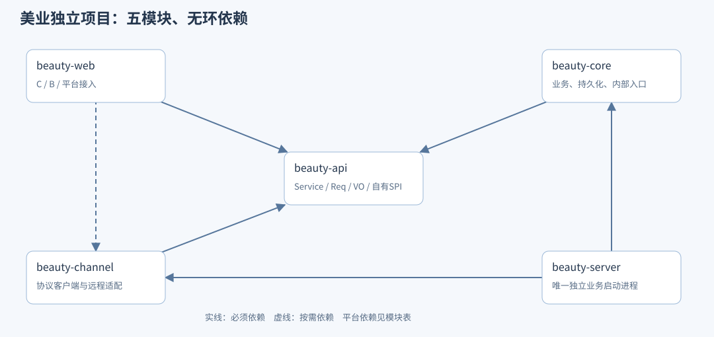

# 美业系统 Java 类与方法清单

> 状态：方法级目标与实施对照 · 2026-10-21 · 已实现范围和部署结果以主TDD为准，不能把整张清单当已完成。
> 由 `python3 scripts/gen-beauty-java-method-design.py` 生成，勿手改；真源：[Java方法设计JSON](./schema/beauty-java-method-design.json)。
> 依据：[统一Java规范§七](../../../.claude/skills/ai-shop-dev-standards/references/java.md) · [独立项目结构](../TDD-美业系统-独立项目与包依赖方案.md) · [API清单](./美业系统-API清单.md) · [数据库结构](./美业系统-数据库结构设计.md)。

## 一、范围与规范

目标包含44个美业用户Controller、28个Service及同名Impl、25个内嵌Mapper、25个Entity、162个Req/Query/VO和7个必要辅助类。95条美业HTTP方法与6条内部业务方法合计101条Service方法。按需提供同接口远程实现、协议客户端和内部入口，不能把目标清单当已生成源码。

11个共用候选HTTP另列其所属域的类/方法，54个CONTRACT是能力接入点而非54条已定Java方法。共享资源、账户、打印、报表等不复制到美业；需要补齐的正式契约在原所有者评审。



图由项目结构真源生成。签名清单沿api/core/web/channel/server交付，业务归属不因同库或同名改变。逐API调用与Mapper约束见[方法清单](./美业系统-Controller-Service-Mapper方法清单.md)。

1. Controller仅绑定路径/Body/Query/协议头、鉴权与调用Service，返回业务VO/PageData；沿平台ApiResponseWrapper，不再包ApiResult。声明省略import、类级条件、Mapping和权限注解，HTTP方法/路径在标题；实施必须补齐其对应注解及“为什么”的公开API Javadoc。
2. Service接口归beauty-api/service，Impl归beauty-core/service/impl且同名后缀Impl；Service方法无HTTP注解，Impl直接注入本域Mapper。禁止新增Repository、等义Application/DomainService或一个巨型BeautyManager。
3. 经营主体用entityNo；BizContext.requireMerchantNo()是现有兼容来源，在Web接入处映射为该语义。currentStoreNo/actorNo来自可信上下文，actorNo是账号/用户/运营操作身份，实际执行人员由共用账号关联及任职核验取得，不能把无登录人员伪装成操作者。
4. Service签名显式接收可信范围；租户沿平台当前MAIN及数据域规则，不另启租户体系。详情按对象解析归属后与获准范围相交，SQL仍限entity/门店/受控父链。技师本人范围由可信数据域/共用任职授权解析，不采信query.personnelNo；非受权跨店请求拒绝。
5. 消费者本人方法接userNo，由SecurityUtils.requireUser()解析；publicStore/publicService/publicAvailability只由真实门店/目录确定主体，允许公开查询，不要求伪造商家身份。本人方法每次验证资源属主，不接收客户端自报userNo/entityNo/actorNo。
6. ops的entityNo与authorizedStoreNos是平台授权目标，不是客户端任意主体；actorNo是当前运营身份，不代商家。技术恢复仍执行同一业务校验，不代顾客同意或代技师完工。跨店报表只读authorizedStoreNos与查询条件交集。
7. Req/Query按统一Validation校验必填、长度、枚举、正数/精度与时间窗口；普通page>=1、size默认20且最大50，日历资源页/窗口沿工作台合同。错误沿统一ErrorCode/BizException及三语词条，不另造BeautyError体系。Req/Query只包含业务字段，VO不含物理id。body/query字段沿API输入合同，必须剔除路径字段及仅属身份的可信参数；预览编号绑定原操作者/主体/门店/窗口/版本，不能换人拿号提交。
8. 版本请求expectedRevision映射到聚合BaseEntity.version；scopeRevision/bindingRevision/appointmentRevision/planRevision分别是范围、来源、安排、计划版本，不能混用。步骤/参与子行CAS版本取锁内真实行，根版本仍按用户期望检查。
9. 业务写命令带Idempotency-Key，同键同载荷取原号、异参拒绝；预览与查询POST无业务副作用，不强制业务幂等头。长流程操作号/请求指纹由共用幂等编排与本域ServiceSubmission持久记录，不因超时换键。
10. Mapper继承BaseMapper，常用CRUD不重写空壳；只对稳定行锁、CAS、数量上限等新增自定义方法。BaseMapper虽暴露删除/按id等方法，本域事实业务不使用delete/archive覆盖历史，也不把业务号传selectById。
11. 普通分页以用例的真实业务根/组合投影分页，返回IPage后用MybatisPages.of转换PageData；数据量大的列表不用PageData.ofAll。CalendarSnapshotVO/CalendarPageVO是快照协议，不套普通分页，不将未加载/延迟当空闲。批量获取任务/来源/资源，禁止每卡片循环跨域N+1。
12. API用带偏移时间并按门店IANA时区显示；本域Entity/自定义SQL采用与BaseEntity一致的LocalDateTime，边界明确转换成UTC本地值。区间[from,to)，数量BigDecimal，金额整数最小单位+币种；不引入浮点金额或全局时区重构。
13. LOCAL_ATOMIC仅指本域短事务；ORCHESTRATED先保存意图再外部调用、后短事务确认/补偿。调用清单是候选分支，不是一次必须全执行的线性脚本；HTTP不在长锁事务中等待，UNKNOWN按原号恢复。
14. 多行业同名短类通过受控扫描/必要Bean命名策略避免冲突；新增类正常import、构造器注入，不复制零售存量全限定注解/通配import等历史欠账。规范以统一Java文档为准，餐饮只参考模块隔离/薄适配和方法追溯。

## 二、Controller类与直接方法

全部位于beauty-web。以下为方法声明，注解中未使用全限定名；实现时用正常import。

### ai.neargo.shop.beauty.api.biz.BizAppointmentController

```java
AppointmentPreviewVO previewAppointment(@Valid @RequestBody PreviewAppointmentReq req);
AppointmentVO createAppointment(@Valid @RequestBody CreateAppointmentReq req, @RequestHeader("Idempotency-Key") String idempotencyKey);
PageData<AppointmentSummaryVO> listAppointments(@Valid @ModelAttribute AppointmentQuery query);
AppointmentDetailVO getAppointment(@PathVariable("appointmentNo") String appointmentNo);
AppointmentChangePreviewVO previewAppointmentChange(@PathVariable("appointmentNo") String appointmentNo, @Valid @RequestBody PreviewAppointmentChangeReq req);
AppointmentVO changeAppointment(@PathVariable("appointmentNo") String appointmentNo, @Valid @RequestBody ChangeAppointmentReq req, @RequestHeader("Idempotency-Key") String idempotencyKey);
CancellationVO cancelAppointment(@PathVariable("appointmentNo") String appointmentNo, @Valid @RequestBody CancelAppointmentReq req, @RequestHeader("Idempotency-Key") String idempotencyKey);
NoShowVO recordNoShow(@PathVariable("appointmentNo") String appointmentNo, @Valid @RequestBody RecordNoShowReq req, @RequestHeader("Idempotency-Key") String idempotencyKey);
WorkOrderVO openWorkOrderFromAppointment(@PathVariable("appointmentNo") String appointmentNo, @Valid @RequestBody OpenAppointmentWorkOrderReq req, @RequestHeader("Idempotency-Key") String idempotencyKey);
```

追溯：BAPI-038、BAPI-039、BAPI-040、BAPI-041、BAPI-042、BAPI-043、BAPI-044、BAPI-045、BAPI-052。

### ai.neargo.shop.beauty.api.biz.BizAppointmentWorkbenchController

```java
CalendarSnapshotVO getCalendarSnapshot(@Valid @ModelAttribute CalendarQuery query);
CalendarPageVO getCalendarPage(@Valid @ModelAttribute CalendarPageQuery query);
WorkbenchSummaryVO getWorkbenchSummary(@Valid @ModelAttribute WorkbenchSummaryQuery query);
PageData<ExceptionWorkitemVO> listWorkbenchExceptions(@Valid @ModelAttribute WorkbenchExceptionQuery query);
```

追溯：BAPI-025、BAPI-026、BAPI-117、BAPI-124。

### ai.neargo.shop.beauty.api.biz.BizArrivalController

```java
ArrivalVO checkIn(@Valid @RequestBody CheckInReq req, @RequestHeader("Idempotency-Key") String idempotencyKey);
```

追溯：BAPI-047。

### ai.neargo.shop.beauty.api.biz.BizAssetDisputeController

```java
AssetDisputeVO registerAssetDispute(@Valid @RequestBody RegisterAssetDisputeReq req, @RequestHeader("Idempotency-Key") String idempotencyKey);
```

追溯：BAPI-103。

### ai.neargo.shop.beauty.api.biz.BizAvailabilityController

```java
AvailabilityVO queryAvailability(@Valid @RequestBody AvailabilityQuery query);
```

追溯：BAPI-010。

### ai.neargo.shop.beauty.api.biz.BizCapabilityApplicationController

```java
CapabilityApplicationVO applyCapability(@Valid @RequestBody ApplyCapabilityReq req, @RequestHeader("Idempotency-Key") String idempotencyKey);
```

追溯：BAPI-004。

### ai.neargo.shop.beauty.api.biz.BizCapabilityController

```java
CapabilityStatusVO getCapabilityStatus(@Valid @ModelAttribute CapabilityStatusQuery query);
```

追溯：BAPI-135。

### ai.neargo.shop.beauty.api.biz.BizCareProfileController

```java
CareProfileVO getCareProfile(@PathVariable("customerNo") String customerNo, @Valid @ModelAttribute CareProfileQuery query);
CareNoteVO appendCareNote(@PathVariable("customerNo") String customerNo, @Valid @RequestBody AppendCareNoteReq req, @RequestHeader("Idempotency-Key") String idempotencyKey);
MediaAuthorizationVO authorizeCareMedia(@PathVariable("customerNo") String customerNo, @Valid @RequestBody AuthorizeCareMediaReq req, @RequestHeader("Idempotency-Key") String idempotencyKey);
PrivacyRequestVO requestCarePrivacy(@PathVariable("customerNo") String customerNo, @Valid @RequestBody CarePrivacyReq req, @RequestHeader("Idempotency-Key") String idempotencyKey);
```

追溯：BAPI-034、BAPI-035、BAPI-036、BAPI-037。

### ai.neargo.shop.beauty.api.biz.BizCommissionEntryController

```java
PageData<CommissionEntryVO> listCommissionEntries(@Valid @ModelAttribute CommissionEntryQuery query);
```

追溯：BAPI-108。

### ai.neargo.shop.beauty.api.biz.BizCommissionPolicyController

```java
PageData<CommissionPolicyVO> listCommissionPolicies(@Valid @ModelAttribute CommissionPolicyQuery query);
CommissionPolicyVersionVO publishCommissionPolicy(@Valid @RequestBody PublishCommissionPolicyReq req, @RequestHeader("Idempotency-Key") String idempotencyKey);
```

追溯：BAPI-106、BAPI-107。

### ai.neargo.shop.beauty.api.biz.BizCommissionSettlementRecordController

```java
SettlementRecordVO recordCommissionSettlement(@Valid @RequestBody RecordCommissionSettlementReq req, @RequestHeader("Idempotency-Key") String idempotencyKey);
```

追溯：BAPI-110。

### ai.neargo.shop.beauty.api.biz.BizCustomerTimelineController

```java
PageData<CustomerTimelineVO> listCustomerTimeline(@PathVariable("customerNo") String customerNo, @Valid @ModelAttribute CustomerTimelineQuery query);
```

追溯：BAPI-116。

### ai.neargo.shop.beauty.api.biz.BizExceptionWorkitemController

```java
ExceptionResolutionVO resolveException(@PathVariable("workitemNo") String workitemNo, @Valid @RequestBody ResolveServiceExceptionReq req, @RequestHeader("Idempotency-Key") String idempotencyKey);
```

追溯：BAPI-125。

### ai.neargo.shop.beauty.api.biz.BizFollowUpTaskController

```java
PageData<FollowUpTaskVO> listFollowUps(@Valid @ModelAttribute FollowUpQuery query);
FollowUpTaskVO planFollowUp(@Valid @RequestBody PlanFollowUpReq req, @RequestHeader("Idempotency-Key") String idempotencyKey);
FollowUpEntryVO appendFollowUpEntry(@PathVariable("followUpNo") String followUpNo, @Valid @RequestBody AppendFollowUpEntryReq req, @RequestHeader("Idempotency-Key") String idempotencyKey);
```

追溯：BAPI-126、BAPI-127、BAPI-128。

### ai.neargo.shop.beauty.api.biz.BizGroupSchedulingController

```java
GroupSchedulePreviewVO previewGroupSchedule(@Valid @RequestBody GroupScheduleQuery query);
```

追溯：BAPI-029。

### ai.neargo.shop.beauty.api.biz.BizGuestRegistrationController

```java
GuestRegistrationVO registerGuest(@Valid @RequestBody RegisterGuestReq req, @RequestHeader("Idempotency-Key") String idempotencyKey);
GuestClaimVO claimGuest(@PathVariable("guestNo") String guestNo, @Valid @RequestBody ClaimGuestReq req, @RequestHeader("Idempotency-Key") String idempotencyKey);
```

追溯：BAPI-031、BAPI-032。

### ai.neargo.shop.beauty.api.biz.BizPerformanceAdjustmentCaseController

```java
AdjustmentCaseVO requestPerformanceAdjustment(@Valid @RequestBody PerformanceAdjustmentReq req, @RequestHeader("Idempotency-Key") String idempotencyKey);
```

追溯：BAPI-109。

### ai.neargo.shop.beauty.api.biz.BizReceptionExceptionController

```java
ReceptionExceptionVO coordinateReceptionException(@Valid @RequestBody ReceptionExceptionReq req, @RequestHeader("Idempotency-Key") String idempotencyKey);
```

追溯：BAPI-053。

### ai.neargo.shop.beauty.api.biz.BizReportExportController

```java
ReportExportVO requestReportExport(@Valid @RequestBody RequestReportExportReq req, @RequestHeader("Idempotency-Key") String idempotencyKey);
ReportExportVO getReportExport(@PathVariable("exportNo") String exportNo);
```

追溯：BAPI-121、BAPI-122。

### ai.neargo.shop.beauty.api.biz.BizResourceChangeController

```java
ResourceChangePreviewVO previewResourceChange(@Valid @RequestBody PreviewResourceChangeReq req);
ResourceChangeResultVO changeResources(@Valid @RequestBody ChangeResourcesReq req, @RequestHeader("Idempotency-Key") String idempotencyKey);
```

追溯：BAPI-027、BAPI-028。

### ai.neargo.shop.beauty.api.biz.BizServiceController

```java
ServiceDetailVO getService(@PathVariable("skuNo") String skuNo, @Valid @ModelAttribute ServiceDetailQuery query);
```

追溯：BAPI-009。

### ai.neargo.shop.beauty.api.biz.BizServiceDefinitionController

```java
PageData<ServiceDefinitionVO> listDefinitions(@Valid @ModelAttribute ServiceDefinitionQuery query, @RequestHeader(value = "X-Store-No", required = false) String requestedStore);
ServiceDefinitionVersionVO publishDefinitionVersion(@Valid @RequestBody PublishServiceDefinitionVersionReq req, @RequestHeader("Idempotency-Key") String idempotencyKey, @RequestHeader(value = "X-Store-No", required = false) String requestedStore);
```

追溯：BAPI-007、BAPI-008。

### ai.neargo.shop.beauty.api.biz.BizServiceOperationController

```java
OperationVO getOperation(@PathVariable("operationNo") String operationNo);
```

追溯：BAPI-160。

### ai.neargo.shop.beauty.api.biz.BizServicePrintDocumentController

```java
PrintDocumentVO createPrintDocument(@Valid @RequestBody CreateServicePrintDocumentReq req, @RequestHeader("Idempotency-Key") String idempotencyKey);
```

追溯：BAPI-130。

### ai.neargo.shop.beauty.api.biz.BizServiceRemedyCaseController

```java
RemedyCaseVO requestServiceRemedy(@Valid @RequestBody RequestServiceRemedyReq req, @RequestHeader("Idempotency-Key") String idempotencyKey);
```

追溯：BAPI-102。

### ai.neargo.shop.beauty.api.biz.BizServiceReportController

```java
SchedulingReportVO getSchedulingReport(@Valid @ModelAttribute SchedulingReportQuery query);
ServiceReportVO getServiceReport(@Valid @ModelAttribute ServiceReportQuery query);
```

追溯：BAPI-119、BAPI-120。

### ai.neargo.shop.beauty.api.biz.BizServiceSubmissionController

```java
ServiceSubmissionVO getSubmission(@PathVariable("submissionNo") String submissionNo);
RecoveryRequestVO requestSubmissionRecovery(@PathVariable("submissionNo") String submissionNo, @Valid @RequestBody RecoverSubmissionReq req, @RequestHeader("Idempotency-Key") String idempotencyKey);
```

追溯：BAPI-072、BAPI-073。

### ai.neargo.shop.beauty.api.biz.BizServiceTaskController

```java
PageData<ServiceTaskVO> listTasks(@Valid @ModelAttribute ServiceTaskQuery query);
TaskActionResultVO acceptTask(@PathVariable("taskNo") String taskNo, @Valid @RequestBody AcceptTaskReq req, @RequestHeader("Idempotency-Key") String idempotencyKey);
TaskActionResultVO startTask(@PathVariable("taskNo") String taskNo, @Valid @RequestBody StartTaskReq req, @RequestHeader("Idempotency-Key") String idempotencyKey);
ServiceStepVO completeStep(@PathVariable("taskNo") String taskNo, @PathVariable("stepNo") String stepNo, @Valid @RequestBody CompleteServiceStepReq req, @RequestHeader("Idempotency-Key") String idempotencyKey);
TaskHandoverPreviewVO previewHandover(@PathVariable("taskNo") String taskNo, @Valid @RequestBody PreviewTaskHandoverReq req);
TaskHandoverVO handoverTask(@PathVariable("taskNo") String taskNo, @Valid @RequestBody HandoverTaskReq req, @RequestHeader("Idempotency-Key") String idempotencyKey);
TaskActionResultVO interruptTask(@PathVariable("taskNo") String taskNo, @Valid @RequestBody InterruptTaskReq req, @RequestHeader("Idempotency-Key") String idempotencyKey);
TaskCompletionVO completeTask(@PathVariable("taskNo") String taskNo, @Valid @RequestBody CompleteTaskReq req, @RequestHeader("Idempotency-Key") String idempotencyKey);
ServiceTaskDetailVO getTask(@PathVariable("taskNo") String taskNo);
TaskCancellationVO cancelTask(@PathVariable("taskNo") String taskNo, @Valid @RequestBody CancelTaskReq req, @RequestHeader("Idempotency-Key") String idempotencyKey);
ServiceEvidenceVO appendServiceEvidence(@PathVariable("taskNo") String taskNo, @Valid @RequestBody AppendServiceEvidenceReq req, @RequestHeader("Idempotency-Key") String idempotencyKey);
ParticipationVO listParticipations(@PathVariable("taskNo") String taskNo);
```

追溯：BAPI-057、BAPI-058、BAPI-059、BAPI-060、BAPI-061、BAPI-062、BAPI-063、BAPI-064、BAPI-159、BAPI-100、BAPI-101、BAPI-105。

### ai.neargo.shop.beauty.api.biz.BizServiceTraceController

```java
BusinessTraceVO getBusinessTrace(@PathVariable("businessNo") String businessNo);
```

追溯：BAPI-137。

### ai.neargo.shop.beauty.api.biz.BizStorePolicyController

```java
StorePolicyVO getPolicy(@Valid @ModelAttribute StorePolicyQuery query, @RequestHeader(value = "X-Store-No", required = false) String requestedStore);
PolicyVersionVO publishPolicyVersion(@Valid @RequestBody PublishStorePolicyVersionReq req, @RequestHeader("Idempotency-Key") String idempotencyKey, @RequestHeader(value = "X-Store-No", required = false) String requestedStore);
```

追溯：BAPI-001、BAPI-002。

### ai.neargo.shop.beauty.api.biz.BizTreatmentPlanController

```java
PageData<TreatmentPlanVO> listTreatmentPlans(@Valid @ModelAttribute TreatmentPlanQuery query);
TreatmentPlanVO createTreatmentPlan(@Valid @RequestBody CreateTreatmentPlanReq req, @RequestHeader("Idempotency-Key") String idempotencyKey);
```

追溯：BAPI-086、BAPI-087。

### ai.neargo.shop.beauty.api.biz.BizWaitingTicketController

```java
PageData<WaitingTicketVO> listWaitingTickets(@Valid @ModelAttribute WaitingTicketQuery query);
WaitingTicketVO joinWaitingQueue(@Valid @RequestBody JoinWaitingQueueReq req, @RequestHeader("Idempotency-Key") String idempotencyKey);
WaitingTicketVO actOnWaitingTicket(@PathVariable("ticketNo") String ticketNo, @Valid @RequestBody WaitingTicketActionReq req, @RequestHeader("Idempotency-Key") String idempotencyKey);
```

追溯：BAPI-049、BAPI-050、BAPI-051。

### ai.neargo.shop.beauty.api.biz.BizWalkInController

```java
WalkInVO receiveWalkIn(@Valid @RequestBody ReceiveWalkInReq req, @RequestHeader("Idempotency-Key") String idempotencyKey);
```

追溯：BAPI-048。

### ai.neargo.shop.beauty.api.biz.BizWorkOrderController

```java
WorkOrderVO openWorkOrder(@Valid @RequestBody OpenWorkOrderReq req, @RequestHeader("Idempotency-Key") String idempotencyKey);
WorkOrderDetailVO getWorkOrder(@PathVariable("workOrderNo") String workOrderNo);
ServiceSubmissionVO submitServices(@PathVariable("workOrderNo") String workOrderNo, @Valid @RequestBody SubmitServicesReq req, @RequestHeader("Idempotency-Key") String idempotencyKey);
ClosurePreviewVO previewClosure(@PathVariable("workOrderNo") String workOrderNo, @Valid @RequestBody PreviewWorkOrderClosureReq req);
WorkOrderClosureVO closeWorkOrder(@PathVariable("workOrderNo") String workOrderNo, @Valid @RequestBody CloseWorkOrderReq req, @RequestHeader("Idempotency-Key") String idempotencyKey);
StagePlanVO planStages(@PathVariable("workOrderNo") String workOrderNo, @Valid @RequestBody PlanWorkOrderStagesReq req, @RequestHeader("Idempotency-Key") String idempotencyKey);
WorkOrderBillVO getBill(@PathVariable("workOrderNo") String workOrderNo);
```

追溯：BAPI-054、BAPI-055、BAPI-056、BAPI-065、BAPI-066、BAPI-067、BAPI-071。

### ai.neargo.shop.beauty.api.mp.MpAppointmentController

```java
AppointmentPreviewVO previewMyAppointment(@Valid @RequestBody PreviewMyAppointmentReq req);
MyAppointmentVO createMyAppointment(@Valid @RequestBody CreateMyAppointmentReq req, @RequestHeader("Idempotency-Key") String idempotencyKey);
PageData<MyAppointmentVO> listMyAppointments(@Valid @ModelAttribute MyAppointmentQuery query);
MyAppointmentDetailVO getMyAppointment(@PathVariable("appointmentNo") String appointmentNo);
AppointmentChangePreviewVO previewMyAppointmentChange(@PathVariable("appointmentNo") String appointmentNo, @Valid @RequestBody PreviewMyAppointmentChangeReq req);
MyAppointmentVO changeMyAppointment(@PathVariable("appointmentNo") String appointmentNo, @Valid @RequestBody ChangeAppointmentReq req, @RequestHeader("Idempotency-Key") String idempotencyKey);
CancellationVO cancelMyAppointment(@PathVariable("appointmentNo") String appointmentNo, @Valid @RequestBody CancelAppointmentReq req, @RequestHeader("Idempotency-Key") String idempotencyKey);
```

追溯：BAPI-147、BAPI-148、BAPI-149、BAPI-150、BAPI-151、BAPI-152、BAPI-153。

### ai.neargo.shop.beauty.api.mp.MpArrivalController

```java
MyArrivalVO checkInMyAppointment(@Valid @RequestBody MyCheckInReq req, @RequestHeader("Idempotency-Key") String idempotencyKey);
```

追溯：BAPI-154。

### ai.neargo.shop.beauty.api.mp.MpAvailabilityController

```java
PublicAvailabilityVO queryPublicAvailability(@Valid @RequestBody PublicAvailabilityQuery query);
```

追溯：BAPI-146。

### ai.neargo.shop.beauty.api.mp.MpCustomerTimelineController

```java
PageData<MyTimelineVO> listMyTimeline(@Valid @ModelAttribute MyTimelineQuery query);
```

追溯：BAPI-158。

### ai.neargo.shop.beauty.api.mp.MpServiceController

```java
PublicServiceVO getPublicService(@PathVariable("skuNo") String skuNo, @Valid @ModelAttribute ServiceDetailQuery query);
```

追溯：BAPI-145。

### ai.neargo.shop.beauty.api.mp.MpServiceDisputeController

```java
ServiceDisputeVO raiseMyServiceDispute(@Valid @RequestBody RaiseMyServiceDisputeReq req, @RequestHeader("Idempotency-Key") String idempotencyKey);
```

追溯：BAPI-157。

### ai.neargo.shop.beauty.api.mp.MpStoreController

```java
PublicStoreVO getPublicStore(@PathVariable("storeNo") String storeNo);
```

追溯：BAPI-144。

### ai.neargo.shop.beauty.api.mp.MpTreatmentPlanController

```java
PageData<MyTreatmentPlanVO> listMyTreatmentPlans(@Valid @ModelAttribute MyTreatmentPlanQuery query);
```

追溯：BAPI-156。

### ai.neargo.shop.beauty.api.mp.MpWorkOrderController

```java
MyWorkOrderVO getMyWorkOrder(@PathVariable("workOrderNo") String workOrderNo);
```

追溯：BAPI-155。

### ai.neargo.shop.beauty.api.ops.OpsServiceRecoveryController

```java
PageData<RecoveryWorkitemVO> listRecoveryWorkitems(@Valid @ModelAttribute RecoveryWorkitemQuery query);
RecoveryRequestVO requestRecovery(@Valid @RequestBody RequestServiceRecoveryReq req, @RequestHeader("Idempotency-Key") String idempotencyKey);
```

追溯：BAPI-138、BAPI-139。

## 三、Service接口与同名Impl方法

每组接口位于beauty-api，同名Impl位于beauty-core；Impl覆写同一签名，不再人为复制一组不同的Command/DTO。

### ai.neargo.shop.beauty.service.AppointmentAvailabilityService

实现：`ai.neargo.shop.beauty.service.impl.AppointmentAvailabilityServiceImpl`。

```java
AvailabilityVO queryAvailability(String entityNo, String currentStoreNo, String actorNo, AvailabilityQuery query);
PublicAvailabilityVO queryPublicAvailability(PublicAvailabilityQuery query);
```

### ai.neargo.shop.beauty.service.AppointmentService

实现：`ai.neargo.shop.beauty.service.impl.AppointmentServiceImpl`。

```java
AppointmentPreviewVO previewAppointment(String entityNo, String currentStoreNo, String actorNo, PreviewAppointmentReq req);
AppointmentVO createAppointment(String entityNo, String currentStoreNo, String actorNo, CreateAppointmentReq req, String idempotencyKey);
PageData<AppointmentSummaryVO> listAppointments(String entityNo, String currentStoreNo, String actorNo, AppointmentQuery query);
AppointmentDetailVO getAppointment(String entityNo, String currentStoreNo, String actorNo, String appointmentNo);
AppointmentChangePreviewVO previewAppointmentChange(String entityNo, String currentStoreNo, String actorNo, String appointmentNo, PreviewAppointmentChangeReq req);
AppointmentVO changeAppointment(String entityNo, String currentStoreNo, String actorNo, String appointmentNo, ChangeAppointmentReq req, String idempotencyKey);
CancellationVO cancelAppointment(String entityNo, String currentStoreNo, String actorNo, String appointmentNo, CancelAppointmentReq req, String idempotencyKey);
NoShowVO recordNoShow(String entityNo, String currentStoreNo, String actorNo, String appointmentNo, RecordNoShowReq req, String idempotencyKey);
AppointmentPreviewVO previewMyAppointment(String userNo, PreviewMyAppointmentReq req);
MyAppointmentVO createMyAppointment(String userNo, CreateMyAppointmentReq req, String idempotencyKey);
PageData<MyAppointmentVO> listMyAppointments(String userNo, MyAppointmentQuery query);
MyAppointmentDetailVO getMyAppointment(String userNo, String appointmentNo);
AppointmentChangePreviewVO previewMyAppointmentChange(String userNo, String appointmentNo, PreviewMyAppointmentChangeReq req);
MyAppointmentVO changeMyAppointment(String userNo, String appointmentNo, ChangeAppointmentReq req, String idempotencyKey);
CancellationVO cancelMyAppointment(String userNo, String appointmentNo, CancelAppointmentReq req, String idempotencyKey);
WorkOrderVO openWorkOrderFromAppointment(String entityNo, String currentStoreNo, String actorNo, String appointmentNo, OpenAppointmentWorkOrderReq req, String idempotencyKey);
```

### ai.neargo.shop.beauty.service.AppointmentWorkbenchQueryService

实现：`ai.neargo.shop.beauty.service.impl.AppointmentWorkbenchQueryServiceImpl`。

```java
CalendarSnapshotVO getCalendarSnapshot(String entityNo, String currentStoreNo, String actorNo, CalendarQuery query);
CalendarPageVO getCalendarPage(String entityNo, String currentStoreNo, String actorNo, CalendarPageQuery query);
WorkbenchSummaryVO getWorkbenchSummary(String entityNo, String currentStoreNo, String actorNo, WorkbenchSummaryQuery query);
PageData<ExceptionWorkitemVO> listWorkbenchExceptions(String entityNo, String currentStoreNo, String actorNo, WorkbenchExceptionQuery query);
```

### ai.neargo.shop.beauty.service.CapabilityService

实现：`ai.neargo.shop.beauty.service.impl.CapabilityServiceImpl`。

```java
CapabilityApplicationVO applyCapability(String entityNo, String currentStoreNo, String actorNo, ApplyCapabilityReq req, String idempotencyKey);
CapabilityStatusVO getCapabilityStatus(String entityNo, String currentStoreNo, String actorNo, CapabilityStatusQuery query);
```

### ai.neargo.shop.beauty.service.CareProfileService

实现：`ai.neargo.shop.beauty.service.impl.CareProfileServiceImpl`。

```java
CareProfileVO getCareProfile(String entityNo, String currentStoreNo, String actorNo, String customerNo, CareProfileQuery query);
CareNoteVO appendCareNote(String entityNo, String currentStoreNo, String actorNo, String customerNo, AppendCareNoteReq req, String idempotencyKey);
MediaAuthorizationVO authorizeCareMedia(String entityNo, String currentStoreNo, String actorNo, String customerNo, AuthorizeCareMediaReq req, String idempotencyKey);
PrivacyRequestVO requestCarePrivacy(String entityNo, String currentStoreNo, String actorNo, String customerNo, CarePrivacyReq req, String idempotencyKey);
```

### ai.neargo.shop.beauty.service.CommissionPolicyService

实现：`ai.neargo.shop.beauty.service.impl.CommissionPolicyServiceImpl`。

```java
PageData<CommissionPolicyVO> listCommissionPolicies(String entityNo, String currentStoreNo, String actorNo, CommissionPolicyQuery query);
CommissionPolicyVersionVO publishCommissionPolicy(String entityNo, String currentStoreNo, String actorNo, PublishCommissionPolicyReq req, String idempotencyKey);
```

### ai.neargo.shop.beauty.service.CommissionService

实现：`ai.neargo.shop.beauty.service.impl.CommissionServiceImpl`。

```java
PageData<CommissionEntryVO> listCommissionEntries(String entityNo, String currentStoreNo, String actorNo, CommissionEntryQuery query);
SettlementRecordVO recordCommissionSettlement(String entityNo, String currentStoreNo, String actorNo, RecordCommissionSettlementReq req, String idempotencyKey);
List<CommissionEntryVO> accrueFromAllocation(String entityNo, String currentStoreNo, String actorNo, String allocationNo, String commissionPolicyNo);
List<CommissionEntryVO> reverseAccrual(String entityNo, String currentStoreNo, String actorNo, String originalEntryNo, String approvedAdjustmentNo);
```

`accrueFromAllocation`：P3计提业务键幂等；金额用整数最小单位和币种，不按商品原价默认计提。

内部流程：**LOCAL_ATOMIC**；读取：bty_performance_allocation、bty_performance_share、bty_commission_policy、bty_commission_entry；写入：bty_commission_entry、bty_action_log。

守卫：每份share/政策/计提类别形成稳定businessKey唯一，重复返回原账。

`reverseAccrual`：P3受支持逆向只追加冲回，原计提金额不可覆盖；并非资金退款。

内部流程：**ORCHESTRATED**；读取：bty_commission_entry；写入：bty_commission_entry、bty_action_log。

守卫：锁定原业务事实并唯一追加反向凭证，不能用update改原金额。

### ai.neargo.shop.beauty.service.CustomerTimelineQueryService

实现：`ai.neargo.shop.beauty.service.impl.CustomerTimelineQueryServiceImpl`。

```java
PageData<CustomerTimelineVO> listCustomerTimeline(String entityNo, String currentStoreNo, String actorNo, String customerNo, CustomerTimelineQuery query);
PageData<MyTimelineVO> listMyTimeline(String userNo, MyTimelineQuery query);
```

### ai.neargo.shop.beauty.service.FollowUpCoordinationService

实现：`ai.neargo.shop.beauty.service.impl.FollowUpCoordinationServiceImpl`。

```java
PageData<FollowUpTaskVO> listFollowUps(String entityNo, String currentStoreNo, String actorNo, FollowUpQuery query);
FollowUpTaskVO planFollowUp(String entityNo, String currentStoreNo, String actorNo, PlanFollowUpReq req, String idempotencyKey);
FollowUpEntryVO appendFollowUpEntry(String entityNo, String currentStoreNo, String actorNo, String followUpNo, AppendFollowUpEntryReq req, String idempotencyKey);
```

### ai.neargo.shop.beauty.service.GroupSchedulingService

实现：`ai.neargo.shop.beauty.service.impl.GroupSchedulingServiceImpl`。

```java
GroupSchedulePreviewVO previewGroupSchedule(String entityNo, String currentStoreNo, String actorNo, GroupScheduleQuery query);
```

### ai.neargo.shop.beauty.service.GuestRegistrationService

实现：`ai.neargo.shop.beauty.service.impl.GuestRegistrationServiceImpl`。

```java
GuestRegistrationVO registerGuest(String entityNo, String currentStoreNo, String actorNo, RegisterGuestReq req, String idempotencyKey);
GuestClaimVO claimGuest(String entityNo, String currentStoreNo, String actorNo, String guestNo, ClaimGuestReq req, String idempotencyKey);
```

### ai.neargo.shop.beauty.service.PerformanceService

实现：`ai.neargo.shop.beauty.service.impl.PerformanceServiceImpl`。

```java
AdjustmentCaseVO requestPerformanceAdjustment(String entityNo, String currentStoreNo, String actorNo, PerformanceAdjustmentReq req, String idempotencyKey);
PerformanceAllocationVO allocateCompletedTask(String entityNo, String currentStoreNo, String actorNo, String taskNo, long taskRevision, String ruleVersionNo);
```

`allocateCompletedTask`：P3内部产出分配，按实际参与和可信来源事实，首版唯一锚点/后续追加；返回受控处理结果，非新售后案件。

内部流程：**ORCHESTRATED**；读取：bty_service_task、bty_service_participation、bty_trade_binding、bty_performance_allocation；写入：bty_performance_allocation、bty_performance_share、bty_action_log。

守卫：首版并发靠唯一键，后续版本锁首版锚点；分摊合计守恒、售卡与服务分开。

### ai.neargo.shop.beauty.service.ReceptionService

实现：`ai.neargo.shop.beauty.service.impl.ReceptionServiceImpl`。

```java
ArrivalVO checkIn(String entityNo, String currentStoreNo, String actorNo, CheckInReq req, String idempotencyKey);
WalkInVO receiveWalkIn(String entityNo, String currentStoreNo, String actorNo, ReceiveWalkInReq req, String idempotencyKey);
PageData<WaitingTicketVO> listWaitingTickets(String entityNo, String currentStoreNo, String actorNo, WaitingTicketQuery query);
WaitingTicketVO joinWaitingQueue(String entityNo, String currentStoreNo, String actorNo, JoinWaitingQueueReq req, String idempotencyKey);
WaitingTicketVO actOnWaitingTicket(String entityNo, String currentStoreNo, String actorNo, String ticketNo, WaitingTicketActionReq req, String idempotencyKey);
ReceptionExceptionVO coordinateReceptionException(String entityNo, String currentStoreNo, String actorNo, ReceptionExceptionReq req, String idempotencyKey);
MyArrivalVO checkInMyAppointment(String userNo, MyCheckInReq req, String idempotencyKey);
```

### ai.neargo.shop.beauty.service.ResourceChangeService

实现：`ai.neargo.shop.beauty.service.impl.ResourceChangeServiceImpl`。

```java
ResourceChangePreviewVO previewResourceChange(String entityNo, String currentStoreNo, String actorNo, PreviewResourceChangeReq req);
ResourceChangeResultVO changeResources(String entityNo, String currentStoreNo, String actorNo, ChangeResourcesReq req, String idempotencyKey);
```

### ai.neargo.shop.beauty.service.ServiceCaseCoordinationService

实现：`ai.neargo.shop.beauty.service.impl.ServiceCaseCoordinationServiceImpl`。

```java
RemedyCaseVO requestServiceRemedy(String entityNo, String currentStoreNo, String actorNo, RequestServiceRemedyReq req, String idempotencyKey);
AssetDisputeVO registerAssetDispute(String entityNo, String currentStoreNo, String actorNo, RegisterAssetDisputeReq req, String idempotencyKey);
ServiceDisputeVO raiseMyServiceDispute(String userNo, RaiseMyServiceDisputeReq req, String idempotencyKey);
```

### ai.neargo.shop.beauty.service.ServiceCatalogQueryService

实现：`ai.neargo.shop.beauty.service.impl.ServiceCatalogQueryServiceImpl`。

```java
PublicStoreVO getPublicStore(String storeNo);
ServiceDetailVO getService(String entityNo, String currentStoreNo, String actorNo, String skuNo, ServiceDetailQuery query);
PublicServiceVO getPublicService(String skuNo, ServiceDetailQuery query);
```

### ai.neargo.shop.beauty.service.ServiceDefinitionService

实现：`ai.neargo.shop.beauty.service.impl.ServiceDefinitionServiceImpl`。

```java
PageData<ServiceDefinitionVO> listDefinitions(String entityNo, String currentStoreNo, String actorNo, ServiceDefinitionQuery query);
ServiceDefinitionVersionVO publishDefinitionVersion(String entityNo, String currentStoreNo, String actorNo, PublishServiceDefinitionVersionReq req, String idempotencyKey);
```

### ai.neargo.shop.beauty.service.ServiceExceptionService

实现：`ai.neargo.shop.beauty.service.impl.ServiceExceptionServiceImpl`。

```java
ExceptionResolutionVO resolveException(String entityNo, String currentStoreNo, String actorNo, String workitemNo, ResolveServiceExceptionReq req, String idempotencyKey);
```

### ai.neargo.shop.beauty.service.ServiceOperationQueryService

实现：`ai.neargo.shop.beauty.service.impl.ServiceOperationQueryServiceImpl`。

```java
OperationVO getOperation(String entityNo, String currentStoreNo, String actorNo, String operationNo);
```

### ai.neargo.shop.beauty.service.ServicePrintDocumentService

实现：`ai.neargo.shop.beauty.service.impl.ServicePrintDocumentServiceImpl`。

```java
PrintDocumentVO createPrintDocument(String entityNo, String currentStoreNo, String actorNo, CreateServicePrintDocumentReq req, String idempotencyKey);
```

### ai.neargo.shop.beauty.service.ServiceRecoveryService

实现：`ai.neargo.shop.beauty.service.impl.ServiceRecoveryServiceImpl`。

```java
PageData<RecoveryWorkitemVO> listRecoveryWorkitems(String entityNo, Set<String> authorizedStoreNos, String actorNo, RecoveryWorkitemQuery query);
RecoveryRequestVO requestRecovery(String entityNo, Set<String> authorizedStoreNos, String actorNo, RequestServiceRecoveryReq req, String idempotencyKey);
```

### ai.neargo.shop.beauty.service.ServiceReportQueryService

实现：`ai.neargo.shop.beauty.service.impl.ServiceReportQueryServiceImpl`。

```java
SchedulingReportVO getSchedulingReport(String entityNo, String currentStoreNo, String actorNo, Set<String> authorizedStoreNos, SchedulingReportQuery query);
ServiceReportVO getServiceReport(String entityNo, String currentStoreNo, String actorNo, Set<String> authorizedStoreNos, ServiceReportQuery query);
ReportExportVO requestReportExport(String entityNo, String currentStoreNo, String actorNo, Set<String> authorizedStoreNos, RequestReportExportReq req, String idempotencyKey);
ReportExportVO getReportExport(String entityNo, String currentStoreNo, String actorNo, String exportNo);
```

### ai.neargo.shop.beauty.service.ServiceSubmissionService

实现：`ai.neargo.shop.beauty.service.impl.ServiceSubmissionServiceImpl`。

```java
ServiceSubmissionVO getSubmission(String entityNo, String currentStoreNo, String actorNo, String submissionNo);
RecoveryRequestVO requestSubmissionRecovery(String entityNo, String currentStoreNo, String actorNo, String submissionNo, RecoverSubmissionReq req, String idempotencyKey);
ServiceSubmissionVO submitForWorkOrder(String entityNo, String currentStoreNo, String actorNo, String workOrderNo, SubmitServicesReq req, String idempotencyKey);
ServiceSubmissionVO recoverPending(String entityNo, String currentStoreNo, String actorNo, String submissionNo);
```

`submitForWorkOrder`：WorkOrderService.submitServices委托；保存原来源意图，不另开HTTP入口。

内部流程：**ORCHESTRATED**；读取：bty_work_order、bty_service_task、bty_source_allocation_guard；写入：bty_service_submission、bty_trade_binding、bty_source_allocation_guard、bty_service_task、bty_work_order、bty_action_log。

守卫：来源写者仍在Core/Pay；先保存意图和范围版本，再绑定原来源。

`recoverPending`：业务恢复Job/已审核恢复命令共用此方法；用意图原键，不接收新请求键替换来源。

内部流程：**ORCHESTRATED**；读取：bty_service_submission、bty_trade_binding、bty_source_allocation_guard、bty_work_order、bty_service_task；写入：bty_service_submission、bty_trade_binding、bty_source_allocation_guard、bty_service_task、bty_action_log。

守卫：只按原键查询/幂等恢复，不新号支付或重复分配；涉及任务绑定才按workOrder→task→提交/guard锁序确认，冻结/绑定修订变化时拒绝旧结果覆盖；纯预约资源恢复分支不伪造任务。

### ai.neargo.shop.beauty.service.ServiceTaskService

实现：`ai.neargo.shop.beauty.service.impl.ServiceTaskServiceImpl`。

```java
PageData<ServiceTaskVO> listTasks(String entityNo, String currentStoreNo, String actorNo, ServiceTaskQuery query);
TaskActionResultVO acceptTask(String entityNo, String currentStoreNo, String actorNo, String taskNo, AcceptTaskReq req, String idempotencyKey);
TaskActionResultVO startTask(String entityNo, String currentStoreNo, String actorNo, String taskNo, StartTaskReq req, String idempotencyKey);
ServiceStepVO completeStep(String entityNo, String currentStoreNo, String actorNo, String taskNo, String stepNo, CompleteServiceStepReq req, String idempotencyKey);
TaskHandoverPreviewVO previewHandover(String entityNo, String currentStoreNo, String actorNo, String taskNo, PreviewTaskHandoverReq req);
TaskHandoverVO handoverTask(String entityNo, String currentStoreNo, String actorNo, String taskNo, HandoverTaskReq req, String idempotencyKey);
TaskActionResultVO interruptTask(String entityNo, String currentStoreNo, String actorNo, String taskNo, InterruptTaskReq req, String idempotencyKey);
TaskCompletionVO completeTask(String entityNo, String currentStoreNo, String actorNo, String taskNo, CompleteTaskReq req, String idempotencyKey);
ServiceTaskDetailVO getTask(String entityNo, String currentStoreNo, String actorNo, String taskNo);
TaskCancellationVO cancelTask(String entityNo, String currentStoreNo, String actorNo, String taskNo, CancelTaskReq req, String idempotencyKey);
ServiceEvidenceVO appendServiceEvidence(String entityNo, String currentStoreNo, String actorNo, String taskNo, AppendServiceEvidenceReq req, String idempotencyKey);
ParticipationVO listParticipations(String entityNo, String currentStoreNo, String actorNo, String taskNo);
TaskCompletionVO confirmFulfillment(String entityNo, String currentStoreNo, String taskNo, long bindingRevision, String sourceOperationNo, String eventNo);
```

`confirmFulfillment`：验签/去重后再权威查询；只确认当前绑定的实际履约，不把资金事件当服务完工；不再调用recordCompletion或增加doneQty，重复回调只返回原结果。

内部流程：**ORCHESTRATED**；读取：bty_work_order、bty_service_task、bty_trade_binding、bty_service_submission；写入：bty_service_submission、bty_action_log。

守卫：验签、去重和绑定版本核对后，仅确认原来源履约结果/提交检查点；服务完工事实此前已提交，不增加doneQty、不重做参与段结束、不重扣资产；重复回调返回原状态。

### ai.neargo.shop.beauty.service.ServiceTraceQueryService

实现：`ai.neargo.shop.beauty.service.impl.ServiceTraceQueryServiceImpl`。

```java
BusinessTraceVO getBusinessTrace(String entityNo, String currentStoreNo, String actorNo, String businessNo);
```

### ai.neargo.shop.beauty.service.StorePolicyService

实现：`ai.neargo.shop.beauty.service.impl.StorePolicyServiceImpl`。

```java
StorePolicyVO getPolicy(String entityNo, String currentStoreNo, String actorNo, StorePolicyQuery query);
PolicyVersionVO publishPolicyVersion(String entityNo, String currentStoreNo, String actorNo, PublishStorePolicyVersionReq req, String idempotencyKey);
```

### ai.neargo.shop.beauty.service.TreatmentPlanService

实现：`ai.neargo.shop.beauty.service.impl.TreatmentPlanServiceImpl`。

```java
PageData<TreatmentPlanVO> listTreatmentPlans(String entityNo, String currentStoreNo, String actorNo, TreatmentPlanQuery query);
TreatmentPlanVO createTreatmentPlan(String entityNo, String currentStoreNo, String actorNo, CreateTreatmentPlanReq req, String idempotencyKey);
PageData<MyTreatmentPlanVO> listMyTreatmentPlans(String userNo, MyTreatmentPlanQuery query);
```

### ai.neargo.shop.beauty.service.WorkOrderService

实现：`ai.neargo.shop.beauty.service.impl.WorkOrderServiceImpl`。

```java
WorkOrderVO openWorkOrder(String entityNo, String currentStoreNo, String actorNo, OpenWorkOrderReq req, String idempotencyKey);
WorkOrderDetailVO getWorkOrder(String entityNo, String currentStoreNo, String actorNo, String workOrderNo);
ServiceSubmissionVO submitServices(String entityNo, String currentStoreNo, String actorNo, String workOrderNo, SubmitServicesReq req, String idempotencyKey);
ClosurePreviewVO previewClosure(String entityNo, String currentStoreNo, String actorNo, String workOrderNo, PreviewWorkOrderClosureReq req);
WorkOrderClosureVO closeWorkOrder(String entityNo, String currentStoreNo, String actorNo, String workOrderNo, CloseWorkOrderReq req, String idempotencyKey);
StagePlanVO planStages(String entityNo, String currentStoreNo, String actorNo, String workOrderNo, PlanWorkOrderStagesReq req, String idempotencyKey);
MyWorkOrderVO getMyWorkOrder(String userNo, String workOrderNo);
WorkOrderBillVO getBill(String entityNo, String currentStoreNo, String actorNo, String workOrderNo);
```

## 四、远程Service、客户端和内部Controller

standalone时需要以下按资源切片的目标类；embedded不装Remote实现。RemoteXxxService覆写上节同一Service的全部方法，仅做协议/错误映射；内部调用采用签名身份与动作/对象/范围委托，不能将可信Service参数直接作为可伪造Body。

协议client方法与内部Controller使用同一业务方法名和返回值；用户入口方法沿原Path/Body/Query/幂等头绑定，可信范围由内部安全层验证委托后恢复再调用Service。非HTTP补充动作使用Typed Body绑定其业务参数，entity/store/actor依然取可信委托。每个操作使用固定、显式内部路由白名单，不注册按任意方法名反射调用的万能RPC；内部路由最终发布前单列协议并做契约测试。

| Service名 | beauty-web远程实现完整名 | beauty-channel协议客户端完整名 | beauty-core内部Controller完整名 |
|---|---|---|---|
| AppointmentAvailabilityService | `ai.neargo.shop.beautyclient.impl.RemoteAppointmentAvailabilityService` | `ai.neargo.shop.beauty.client.AppointmentAvailabilityInternalClient` | `ai.neargo.shop.beauty.api.internal.InternalAppointmentAvailabilityController` |
| AppointmentService | `ai.neargo.shop.beautyclient.impl.RemoteAppointmentService` | `ai.neargo.shop.beauty.client.AppointmentInternalClient` | `ai.neargo.shop.beauty.api.internal.InternalAppointmentController` |
| AppointmentWorkbenchQueryService | `ai.neargo.shop.beautyclient.impl.RemoteAppointmentWorkbenchQueryService` | `ai.neargo.shop.beauty.client.AppointmentWorkbenchInternalClient` | `ai.neargo.shop.beauty.api.internal.InternalAppointmentWorkbenchController` |
| CapabilityService | `ai.neargo.shop.beautyclient.impl.RemoteCapabilityService` | `ai.neargo.shop.beauty.client.CapabilityInternalClient` | `ai.neargo.shop.beauty.api.internal.InternalCapabilityController` |
| CareProfileService | `ai.neargo.shop.beautyclient.impl.RemoteCareProfileService` | `ai.neargo.shop.beauty.client.CareProfileInternalClient` | `ai.neargo.shop.beauty.api.internal.InternalCareProfileController` |
| CommissionPolicyService | `ai.neargo.shop.beautyclient.impl.RemoteCommissionPolicyService` | `ai.neargo.shop.beauty.client.CommissionPolicyInternalClient` | `ai.neargo.shop.beauty.api.internal.InternalCommissionPolicyController` |
| CommissionService | `ai.neargo.shop.beautyclient.impl.RemoteCommissionService` | `ai.neargo.shop.beauty.client.CommissionInternalClient` | `ai.neargo.shop.beauty.api.internal.InternalCommissionController` |
| CustomerTimelineQueryService | `ai.neargo.shop.beautyclient.impl.RemoteCustomerTimelineQueryService` | `ai.neargo.shop.beauty.client.CustomerTimelineInternalClient` | `ai.neargo.shop.beauty.api.internal.InternalCustomerTimelineController` |
| FollowUpCoordinationService | `ai.neargo.shop.beautyclient.impl.RemoteFollowUpCoordinationService` | `ai.neargo.shop.beauty.client.FollowUpCoordinationInternalClient` | `ai.neargo.shop.beauty.api.internal.InternalFollowUpCoordinationController` |
| GroupSchedulingService | `ai.neargo.shop.beautyclient.impl.RemoteGroupSchedulingService` | `ai.neargo.shop.beauty.client.GroupSchedulingInternalClient` | `ai.neargo.shop.beauty.api.internal.InternalGroupSchedulingController` |
| GuestRegistrationService | `ai.neargo.shop.beautyclient.impl.RemoteGuestRegistrationService` | `ai.neargo.shop.beauty.client.GuestRegistrationInternalClient` | `ai.neargo.shop.beauty.api.internal.InternalGuestRegistrationController` |
| PerformanceService | `ai.neargo.shop.beautyclient.impl.RemotePerformanceService` | `ai.neargo.shop.beauty.client.PerformanceInternalClient` | `ai.neargo.shop.beauty.api.internal.InternalPerformanceController` |
| ReceptionService | `ai.neargo.shop.beautyclient.impl.RemoteReceptionService` | `ai.neargo.shop.beauty.client.ReceptionInternalClient` | `ai.neargo.shop.beauty.api.internal.InternalReceptionController` |
| ResourceChangeService | `ai.neargo.shop.beautyclient.impl.RemoteResourceChangeService` | `ai.neargo.shop.beauty.client.ResourceChangeInternalClient` | `ai.neargo.shop.beauty.api.internal.InternalResourceChangeController` |
| ServiceCaseCoordinationService | `ai.neargo.shop.beautyclient.impl.RemoteServiceCaseCoordinationService` | `ai.neargo.shop.beauty.client.ServiceCaseCoordinationInternalClient` | `ai.neargo.shop.beauty.api.internal.InternalServiceCaseCoordinationController` |
| ServiceCatalogQueryService | `ai.neargo.shop.beautyclient.impl.RemoteServiceCatalogQueryService` | `ai.neargo.shop.beauty.client.ServiceCatalogInternalClient` | `ai.neargo.shop.beauty.api.internal.InternalServiceCatalogController` |
| ServiceDefinitionService | `ai.neargo.shop.beautyclient.impl.RemoteServiceDefinitionService` | `ai.neargo.shop.beauty.client.ServiceDefinitionInternalClient` | `ai.neargo.shop.beauty.api.internal.InternalServiceDefinitionController` |
| ServiceExceptionService | `ai.neargo.shop.beautyclient.impl.RemoteServiceExceptionService` | `ai.neargo.shop.beauty.client.ServiceExceptionInternalClient` | `ai.neargo.shop.beauty.api.internal.InternalServiceExceptionController` |
| ServiceOperationQueryService | `ai.neargo.shop.beautyclient.impl.RemoteServiceOperationQueryService` | `ai.neargo.shop.beauty.client.ServiceOperationInternalClient` | `ai.neargo.shop.beauty.api.internal.InternalServiceOperationController` |
| ServicePrintDocumentService | `ai.neargo.shop.beautyclient.impl.RemoteServicePrintDocumentService` | `ai.neargo.shop.beauty.client.ServicePrintDocumentInternalClient` | `ai.neargo.shop.beauty.api.internal.InternalServicePrintDocumentController` |
| ServiceRecoveryService | `ai.neargo.shop.beautyclient.impl.RemoteServiceRecoveryService` | `ai.neargo.shop.beauty.client.ServiceRecoveryInternalClient` | `ai.neargo.shop.beauty.api.internal.InternalServiceRecoveryController` |
| ServiceReportQueryService | `ai.neargo.shop.beautyclient.impl.RemoteServiceReportQueryService` | `ai.neargo.shop.beauty.client.ServiceReportInternalClient` | `ai.neargo.shop.beauty.api.internal.InternalServiceReportController` |
| ServiceSubmissionService | `ai.neargo.shop.beautyclient.impl.RemoteServiceSubmissionService` | `ai.neargo.shop.beauty.client.ServiceSubmissionInternalClient` | `ai.neargo.shop.beauty.api.internal.InternalServiceSubmissionController` |
| ServiceTaskService | `ai.neargo.shop.beautyclient.impl.RemoteServiceTaskService` | `ai.neargo.shop.beauty.client.ServiceTaskInternalClient` | `ai.neargo.shop.beauty.api.internal.InternalServiceTaskController` |
| ServiceTraceQueryService | `ai.neargo.shop.beautyclient.impl.RemoteServiceTraceQueryService` | `ai.neargo.shop.beauty.client.ServiceTraceInternalClient` | `ai.neargo.shop.beauty.api.internal.InternalServiceTraceController` |
| StorePolicyService | `ai.neargo.shop.beautyclient.impl.RemoteStorePolicyService` | `ai.neargo.shop.beauty.client.StorePolicyInternalClient` | `ai.neargo.shop.beauty.api.internal.InternalStorePolicyController` |
| TreatmentPlanService | `ai.neargo.shop.beautyclient.impl.RemoteTreatmentPlanService` | `ai.neargo.shop.beauty.client.TreatmentPlanInternalClient` | `ai.neargo.shop.beauty.api.internal.InternalTreatmentPlanController` |
| WorkOrderService | `ai.neargo.shop.beautyclient.impl.RemoteWorkOrderService` | `ai.neargo.shop.beauty.client.WorkOrderInternalClient` | `ai.neargo.shop.beauty.api.internal.InternalWorkOrderController` |

该表是结构定位，未虚构已经发布的内部HTTP路径、现有委托DTO或已运行的RPC能力。具体Controller→Service→Impl业务方法在本清单已直接给出，内部薄传输不复制业务算法。

## 五、Mapper与Entity类

| 表 | Entity完整名（beauty-core） | 内嵌Mapper完整名（beauty-core） | 自定义方法数 |
|---|---|---|---:|
| bty_store_policy | `ai.neargo.shop.beauty.entity.BtyStorePolicy` | `ai.neargo.shop.beauty.mapper.BeautyMappers.StorePolicyMapper` | 2 |
| bty_store_policy_version | `ai.neargo.shop.beauty.entity.BtyStorePolicyVersion` | `ai.neargo.shop.beauty.mapper.BeautyMappers.StorePolicyVersionMapper` | 0 |
| bty_service_definition | `ai.neargo.shop.beauty.entity.BtyServiceDefinition` | `ai.neargo.shop.beauty.mapper.BeautyMappers.ServiceDefinitionMapper` | 2 |
| bty_service_definition_version | `ai.neargo.shop.beauty.entity.BtyServiceDefinitionVersion` | `ai.neargo.shop.beauty.mapper.BeautyMappers.ServiceDefinitionVersionMapper` | 0 |
| bty_service_requirement | `ai.neargo.shop.beauty.entity.BtyServiceRequirement` | `ai.neargo.shop.beauty.mapper.BeautyMappers.ServiceRequirementMapper` | 0 |
| bty_appointment | `ai.neargo.shop.beauty.entity.BtyAppointment` | `ai.neargo.shop.beauty.mapper.BeautyMappers.AppointmentMapper` | 4 |
| bty_appointment_item | `ai.neargo.shop.beauty.entity.BtyAppointmentItem` | `ai.neargo.shop.beauty.mapper.BeautyMappers.AppointmentItemMapper` | 0 |
| bty_appointment_assignment | `ai.neargo.shop.beauty.entity.BtyAppointmentAssignment` | `ai.neargo.shop.beauty.mapper.BeautyMappers.AppointmentAssignmentMapper` | 1 |
| bty_work_order | `ai.neargo.shop.beauty.entity.BtyWorkOrder` | `ai.neargo.shop.beauty.mapper.BeautyMappers.WorkOrderMapper` | 4 |
| bty_service_task | `ai.neargo.shop.beauty.entity.BtyServiceTask` | `ai.neargo.shop.beauty.mapper.BeautyMappers.ServiceTaskMapper` | 4 |
| bty_service_step | `ai.neargo.shop.beauty.entity.BtyServiceStep` | `ai.neargo.shop.beauty.mapper.BeautyMappers.ServiceStepMapper` | 1 |
| bty_service_participation | `ai.neargo.shop.beauty.entity.BtyServiceParticipation` | `ai.neargo.shop.beauty.mapper.BeautyMappers.ServiceParticipationMapper` | 1 |
| bty_service_submission | `ai.neargo.shop.beauty.entity.BtyServiceSubmission` | `ai.neargo.shop.beauty.mapper.BeautyMappers.ServiceSubmissionMapper` | 4 |
| bty_trade_binding | `ai.neargo.shop.beauty.entity.BtyTradeBinding` | `ai.neargo.shop.beauty.mapper.BeautyMappers.TradeBindingMapper` | 1 |
| bty_action_log | `ai.neargo.shop.beauty.entity.BtyActionLog` | `ai.neargo.shop.beauty.mapper.BeautyMappers.ActionLogMapper` | 0 |
| bty_care_profile | `ai.neargo.shop.beauty.entity.BtyCareProfile` | `ai.neargo.shop.beauty.mapper.BeautyMappers.CareProfileMapper` | 2 |
| bty_care_note | `ai.neargo.shop.beauty.entity.BtyCareNote` | `ai.neargo.shop.beauty.mapper.BeautyMappers.CareNoteMapper` | 0 |
| bty_care_media | `ai.neargo.shop.beauty.entity.BtyCareMedia` | `ai.neargo.shop.beauty.mapper.BeautyMappers.CareMediaMapper` | 1 |
| bty_treatment_plan | `ai.neargo.shop.beauty.entity.BtyTreatmentPlan` | `ai.neargo.shop.beauty.mapper.BeautyMappers.TreatmentPlanMapper` | 2 |
| bty_treatment_session | `ai.neargo.shop.beauty.entity.BtyTreatmentSession` | `ai.neargo.shop.beauty.mapper.BeautyMappers.TreatmentSessionMapper` | 1 |
| bty_performance_allocation | `ai.neargo.shop.beauty.entity.BtyPerformanceAllocation` | `ai.neargo.shop.beauty.mapper.BeautyMappers.PerformanceAllocationMapper` | 1 |
| bty_performance_share | `ai.neargo.shop.beauty.entity.BtyPerformanceShare` | `ai.neargo.shop.beauty.mapper.BeautyMappers.PerformanceShareMapper` | 0 |
| bty_commission_policy | `ai.neargo.shop.beauty.entity.BtyCommissionPolicy` | `ai.neargo.shop.beauty.mapper.BeautyMappers.CommissionPolicyMapper` | 1 |
| bty_commission_entry | `ai.neargo.shop.beauty.entity.BtyCommissionEntry` | `ai.neargo.shop.beauty.mapper.BeautyMappers.CommissionEntryMapper` | 2 |
| bty_source_allocation_guard | `ai.neargo.shop.beauty.entity.BtySourceAllocationGuard` | `ai.neargo.shop.beauty.mapper.BeautyMappers.SourceAllocationGuardMapper` | 4 |

外部文件为`ai/neargo/shop/beauty/mapper/BeautyMappers.java`，每个嵌套接口继承其BaseMapper<Entity>。Entity继承`ai.neargo.shop.common.BaseEntity`，使用零售相同Getter/Setter、审计/乐观锁/逻辑删除基类；entityNo等自身字段按表补充。Entity不添加业务跨域调用，字段、唯一键和类型以数据库字段字典为准。所有Mapper继承方法与自定义完整签名见方法清单§四。

## 六、Req / Query / VO类型

全部位于beauty-api的`ai.neargo.shop.beauty.dto`；以下合同摘要同时包含路径/查询/body说明，定义record字段时按绑定来源拆分，不把actor/entity或路径键再塞一遍body。签名明确指向具体类型，不用Map<String,Object>代替公开入参。相同payload且授权由方法区分时复用同一Req，例如顾客/商家取消复用CancelAppointmentReq。VO集合和状态细节沿API/日历契约，此表不另造第二套JSON字段定义。

| 完整类名 | 类型 | 合同摘要 | 追溯 |
|---|---|---|---|
| `ai.neargo.shop.beauty.dto.AcceptTaskReq` | REQ | expectedRevision | BAPI-058 |
| `ai.neargo.shop.beauty.dto.AdjustmentCaseVO` | VO | AdjustmentCaseVO追加不覆盖 | BAPI-109 |
| `ai.neargo.shop.beauty.dto.AppendCareNoteReq` | REQ | taskNo,content,consentRef,correctsNoteNo? | BAPI-035 |
| `ai.neargo.shop.beauty.dto.AppendFollowUpEntryReq` | REQ | content,replyConsent,expectedRevision | BAPI-128 |
| `ai.neargo.shop.beauty.dto.AppendServiceEvidenceReq` | REQ | expectedRevision,kind,quantity,evidenceRefs | BAPI-101 |
| `ai.neargo.shop.beauty.dto.ApplyCapabilityReq` | REQ | storeNo,capability,evidence | BAPI-004 |
| `ai.neargo.shop.beauty.dto.AppointmentChangePreviewVO` | VO | AppointmentChangePreviewVO含报价影响；AppointmentChangePreviewVO | BAPI-042、BAPI-151 |
| `ai.neargo.shop.beauty.dto.AppointmentDetailVO` | VO | AppointmentDetailVO含版本与可用动作 | BAPI-041 |
| `ai.neargo.shop.beauty.dto.AppointmentPreviewVO` | VO | AppointmentPreviewVO无占位承诺；AppointmentPreviewVO | BAPI-038、BAPI-147 |
| `ai.neargo.shop.beauty.dto.AppointmentQuery` | QUERY | storeNo,from,to,status,personnelNo,page,size,assignmentState | BAPI-040 |
| `ai.neargo.shop.beauty.dto.AppointmentSummaryVO` | VO | PageData<AppointmentSummaryVO> | BAPI-040 |
| `ai.neargo.shop.beauty.dto.AppointmentVO` | VO | AppointmentVO与资源确认结果；AppointmentVO保留旧安排版本 | BAPI-039、BAPI-043 |
| `ai.neargo.shop.beauty.dto.ArrivalVO` | VO | ArrivalVO不履约核销 | BAPI-047 |
| `ai.neargo.shop.beauty.dto.AssetDisputeVO` | VO | AssetDisputeVO保留原账 | BAPI-103 |
| `ai.neargo.shop.beauty.dto.AuthorizeCareMediaReq` | REQ | taskNo,action,mediaNo?,purpose | BAPI-036 |
| `ai.neargo.shop.beauty.dto.AvailabilityQuery` | QUERY | storeNo,items,from,to,requestedPersonnelNo | BAPI-010 |
| `ai.neargo.shop.beauty.dto.AvailabilityVO` | VO | AvailabilityVO含候选组合与过期时间 | BAPI-010 |
| `ai.neargo.shop.beauty.dto.BusinessTraceVO` | VO | BusinessTraceVO按字段脱敏 | BAPI-137 |
| `ai.neargo.shop.beauty.dto.CalendarPageQuery` | QUERY | snapshotToken,resourceCursor | BAPI-026 |
| `ai.neargo.shop.beauty.dto.CalendarPageVO` | VO | CalendarPageVO过期要求重载 | BAPI-026 |
| `ai.neargo.shop.beauty.dto.CalendarQuery` | QUERY | storeNo,from,to,view,resourceTypes,resourceCursor | BAPI-025 |
| `ai.neargo.shop.beauty.dto.CalendarSnapshotVO` | VO | CalendarSnapshotVO见工作台专篇 | BAPI-025 |
| `ai.neargo.shop.beauty.dto.CancelAppointmentReq` | REQ | expectedRevision,reason | BAPI-044、BAPI-153 |
| `ai.neargo.shop.beauty.dto.CancelTaskReq` | REQ | expectedRevision,reason | BAPI-100 |
| `ai.neargo.shop.beauty.dto.CancellationVO` | VO | CancellationVO含来源处理进度；CancellationVO | BAPI-044、BAPI-153 |
| `ai.neargo.shop.beauty.dto.CapabilityApplicationVO` | VO | CapabilityApplicationVO不直接启用 | BAPI-004 |
| `ai.neargo.shop.beauty.dto.CapabilityStatusQuery` | QUERY | storeNo,clientVersion | BAPI-135 |
| `ai.neargo.shop.beauty.dto.CapabilityStatusVO` | VO | CapabilityStatusVO缺省关闭 | BAPI-135 |
| `ai.neargo.shop.beauty.dto.CareNoteVO` | VO | CareNoteVO | BAPI-035 |
| `ai.neargo.shop.beauty.dto.CarePrivacyReq` | REQ | requestType,scope,reason | BAPI-037 |
| `ai.neargo.shop.beauty.dto.CareProfileQuery` | QUERY | purpose,taskNo? | BAPI-034 |
| `ai.neargo.shop.beauty.dto.CareProfileVO` | VO | CareProfileVO按字段授权 | BAPI-034 |
| `ai.neargo.shop.beauty.dto.ChangeAppointmentReq` | REQ | previewNo,expectedRevision,reason,consentRef?；previewNo,expectedRevision,consentRef? | BAPI-043、BAPI-152 |
| `ai.neargo.shop.beauty.dto.ChangeResourcesReq` | REQ | previewNo,expectedRevision,reason | BAPI-028 |
| `ai.neargo.shop.beauty.dto.CheckInReq` | REQ | appointmentNo,identityProof | BAPI-047 |
| `ai.neargo.shop.beauty.dto.ClaimGuestReq` | REQ | verifiedIdentity,claimToken | BAPI-032 |
| `ai.neargo.shop.beauty.dto.CloseWorkOrderReq` | REQ | previewNo,expectedRevision | BAPI-066 |
| `ai.neargo.shop.beauty.dto.ClosurePreviewVO` | VO | ClosurePreviewVO含阻断项 | BAPI-065 |
| `ai.neargo.shop.beauty.dto.CommissionEntryQuery` | QUERY | storeNo,personnelNo,period,page,size | BAPI-108 |
| `ai.neargo.shop.beauty.dto.CommissionEntryVO` | VO | PageData<CommissionEntryVO> | BAPI-108 |
| `ai.neargo.shop.beauty.dto.CommissionPolicyQuery` | QUERY | storeNo,at,page,size | BAPI-106 |
| `ai.neargo.shop.beauty.dto.CommissionPolicyVO` | VO | PageData<CommissionPolicyVO> | BAPI-106 |
| `ai.neargo.shop.beauty.dto.CommissionPolicyVersionVO` | VO | CommissionPolicyVersionVO | BAPI-107 |
| `ai.neargo.shop.beauty.dto.CompleteServiceStepReq` | REQ | expectedRevision,completedQuantity,evidenceRef? | BAPI-060 |
| `ai.neargo.shop.beauty.dto.CompleteTaskReq` | REQ | expectedRevision,bindingRevision,quantity,consentRef? | BAPI-064 |
| `ai.neargo.shop.beauty.dto.CreateAppointmentReq` | REQ | previewNo,customerRef,sourceRefs?,consentRef? | BAPI-039 |
| `ai.neargo.shop.beauty.dto.CreateMyAppointmentReq` | REQ | previewNo,sourceRefs?,consentRef? | BAPI-148 |
| `ai.neargo.shop.beauty.dto.CreateServicePrintDocumentReq` | REQ | documentType,workOrderNo/sourceRef,templateVersion | BAPI-130 |
| `ai.neargo.shop.beauty.dto.CreateTreatmentPlanReq` | REQ | customerNo,entitlementRef?,sessions | BAPI-087 |
| `ai.neargo.shop.beauty.dto.CustomerTimelineQuery` | QUERY | storeNo,from,to,page,size | BAPI-116 |
| `ai.neargo.shop.beauty.dto.CustomerTimelineVO` | VO | PageData<CustomerTimelineVO> | BAPI-116 |
| `ai.neargo.shop.beauty.dto.ExceptionResolutionVO` | VO | ExceptionResolutionVO不绕过原聚合校验 | BAPI-125 |
| `ai.neargo.shop.beauty.dto.ExceptionWorkitemVO` | VO | PageData<ExceptionWorkitemVO> | BAPI-124 |
| `ai.neargo.shop.beauty.dto.FollowUpEntryVO` | VO | FollowUpEntryVO | BAPI-128 |
| `ai.neargo.shop.beauty.dto.FollowUpQuery` | QUERY | storeNo,personnelNo,status,page,size | BAPI-126 |
| `ai.neargo.shop.beauty.dto.FollowUpTaskVO` | VO | PageData<FollowUpTaskVO>；FollowUpTaskVO | BAPI-126、BAPI-127 |
| `ai.neargo.shop.beauty.dto.GroupSchedulePreviewVO` | VO | GroupSchedulePreviewVO仅规划 | BAPI-029 |
| `ai.neargo.shop.beauty.dto.GroupScheduleQuery` | QUERY | participants,items,locations,requirements | BAPI-029 |
| `ai.neargo.shop.beauty.dto.GuestClaimVO` | VO | GuestClaimVO | BAPI-032 |
| `ai.neargo.shop.beauty.dto.GuestRegistrationVO` | VO | GuestRegistrationVO不伪造买家 | BAPI-031 |
| `ai.neargo.shop.beauty.dto.HandoverTaskReq` | REQ | previewNo,expectedRevision,reason | BAPI-062 |
| `ai.neargo.shop.beauty.dto.InterruptTaskReq` | REQ | expectedRevision,action,reason,actualQuantity | BAPI-063 |
| `ai.neargo.shop.beauty.dto.JoinWaitingQueueReq` | REQ | customerRef,items | BAPI-050 |
| `ai.neargo.shop.beauty.dto.MediaAuthorizationVO` | VO | 短期MediaAuthorizationVO | BAPI-036 |
| `ai.neargo.shop.beauty.dto.MyAppointmentDetailVO` | VO | MyAppointmentDetailVO | BAPI-150 |
| `ai.neargo.shop.beauty.dto.MyAppointmentQuery` | QUERY | from,to,status,page,size | BAPI-149 |
| `ai.neargo.shop.beauty.dto.MyAppointmentVO` | VO | MyAppointmentVO；PageData<MyAppointmentVO> | BAPI-148、BAPI-149、BAPI-152 |
| `ai.neargo.shop.beauty.dto.MyArrivalVO` | VO | MyArrivalVO | BAPI-154 |
| `ai.neargo.shop.beauty.dto.MyCheckInReq` | REQ | appointmentNo,checkInProof | BAPI-154 |
| `ai.neargo.shop.beauty.dto.MyTimelineQuery` | QUERY | from,to,page,size | BAPI-158 |
| `ai.neargo.shop.beauty.dto.MyTimelineVO` | VO | PageData<MyTimelineVO> | BAPI-158 |
| `ai.neargo.shop.beauty.dto.MyTreatmentPlanQuery` | QUERY | page,size | BAPI-156 |
| `ai.neargo.shop.beauty.dto.MyTreatmentPlanVO` | VO | PageData<MyTreatmentPlanVO> | BAPI-156 |
| `ai.neargo.shop.beauty.dto.MyWorkOrderVO` | VO | MyWorkOrderVO | BAPI-155 |
| `ai.neargo.shop.beauty.dto.NoShowVO` | VO | NoShowVO不自动扣款扣次 | BAPI-045 |
| `ai.neargo.shop.beauty.dto.OpenAppointmentWorkOrderReq` | REQ | expectedRevision,assignments | BAPI-052 |
| `ai.neargo.shop.beauty.dto.OpenWorkOrderReq` | REQ | customerRef,storeNo,items,appointmentNo? | BAPI-054 |
| `ai.neargo.shop.beauty.dto.OperationVO` | VO | OperationVO含目标引用和恢复入口 | BAPI-160 |
| `ai.neargo.shop.beauty.dto.ParticipationVO` | VO | ParticipationVO含历史交接区间 | BAPI-105 |
| `ai.neargo.shop.beauty.dto.PerformanceAdjustmentReq` | REQ | entryNo,sourceRevision,evidence,reason | BAPI-109 |
| `ai.neargo.shop.beauty.dto.PerformanceAllocationVO` | VO | allocationNo,sourceRef,basisCode,revisionIndex,shares,status,currency,totalMinor | 内部产出分配 |
| `ai.neargo.shop.beauty.dto.PlanFollowUpReq` | REQ | customerNo,taskNo,dueAt,assignee | BAPI-127 |
| `ai.neargo.shop.beauty.dto.PlanWorkOrderStagesReq` | REQ | stageItems,resourceRequirements,expectedRevision | BAPI-067 |
| `ai.neargo.shop.beauty.dto.PolicyVersionVO` | VO | PolicyVersionVO | BAPI-002 |
| `ai.neargo.shop.beauty.dto.PreviewAppointmentChangeReq` | REQ | expectedRevision,items,startAt,assignments | BAPI-042 |
| `ai.neargo.shop.beauty.dto.PreviewAppointmentReq` | REQ | storeNo,customerRef,items,requestedAssignments,startAt | BAPI-038 |
| `ai.neargo.shop.beauty.dto.PreviewMyAppointmentChangeReq` | REQ | expectedRevision,startAt,items,requestedPersonnelNo | BAPI-151 |
| `ai.neargo.shop.beauty.dto.PreviewMyAppointmentReq` | REQ | storeNo,items,startAt,requestedPersonnelNo | BAPI-147 |
| `ai.neargo.shop.beauty.dto.PreviewResourceChangeReq` | REQ | targetRef,newAssignments,newEndAt,expectedRevision | BAPI-027 |
| `ai.neargo.shop.beauty.dto.PreviewTaskHandoverReq` | REQ | expectedRevision,newPersonnelNo,role,effectiveAt | BAPI-061 |
| `ai.neargo.shop.beauty.dto.PreviewWorkOrderClosureReq` | REQ | expectedRevision | BAPI-065 |
| `ai.neargo.shop.beauty.dto.PrintDocumentVO` | VO | PrintDocumentVO | BAPI-130 |
| `ai.neargo.shop.beauty.dto.PrivacyRequestVO` | VO | PrivacyRequestVO | BAPI-037 |
| `ai.neargo.shop.beauty.dto.PublicAvailabilityQuery` | QUERY | storeNo,items,from,to | BAPI-146 |
| `ai.neargo.shop.beauty.dto.PublicAvailabilityVO` | VO | PublicAvailabilityVO | BAPI-146 |
| `ai.neargo.shop.beauty.dto.PublicSalesCatalogVO` | VO | versionNo,validFrom,timezone,groups（共用Group，只含visible=true） | BAPI-144 |
| `ai.neargo.shop.beauty.dto.PublicServiceVO` | VO | storeNo,skuNo,goodsNo,title,cover,priceMinor,definitionVersionNo,duration,notes,store,sales（时区/周窗口/saleableNow；非预约许可） | BAPI-145 |
| `ai.neargo.shop.beauty.dto.PublicStoreVO` | VO | storeNo,name,logo,status,openHours,address,policyVersionNo,validFrom,policy,catalog（仅可见分组） | BAPI-144 |
| `ai.neargo.shop.beauty.dto.PublishCommissionPolicyReq` | REQ | scope,basis,shares,validity,expectedRevision | BAPI-107 |
| `ai.neargo.shop.beauty.dto.PublishServiceDefinitionVersionReq` | REQ | skuNo,expectedRevision,duration{minutes,bufferBeforeMin,bufferAfterMin},requirements[{roleCode,resourceType,skillGoodsNo,qty,sequenceNo,offsetMin,durationMin,selectionRule}],notes?(max20,eachNonblankMax500;default[]) | BAPI-008 |
| `ai.neargo.shop.beauty.dto.PublishStorePolicyVersionReq` | REQ | expectedRevision,validFrom,policy | BAPI-002 |
| `ai.neargo.shop.beauty.dto.RaiseMyServiceDisputeReq` | REQ | taskNo,reason,evidenceRefs | BAPI-157 |
| `ai.neargo.shop.beauty.dto.ReceiveWalkInReq` | REQ | customerRef,items,assignments,startAt | BAPI-048 |
| `ai.neargo.shop.beauty.dto.ReceptionExceptionReq` | REQ | appointmentNo,kind,proposal,reason | BAPI-053 |
| `ai.neargo.shop.beauty.dto.ReceptionExceptionVO` | VO | ReceptionExceptionVO含受影响待办 | BAPI-053 |
| `ai.neargo.shop.beauty.dto.RecordCommissionSettlementReq` | REQ | entryNos,approvalRef,paymentEvidence | BAPI-110 |
| `ai.neargo.shop.beauty.dto.RecordNoShowReq` | REQ | expectedRevision,reason,evidenceRef? | BAPI-045 |
| `ai.neargo.shop.beauty.dto.RecoverSubmissionReq` | REQ | expectedRevision,reason | BAPI-073 |
| `ai.neargo.shop.beauty.dto.RecoveryRequestVO` | VO | RecoveryRequestVO不能新号重复支付；RecoveryRequestVO不能代完工代授权 | BAPI-073、BAPI-139 |
| `ai.neargo.shop.beauty.dto.RecoveryWorkitemQuery` | QUERY | entityNo,storeNo,kind,page,size | BAPI-138 |
| `ai.neargo.shop.beauty.dto.RecoveryWorkitemVO` | VO | PageData<RecoveryWorkitemVO> | BAPI-138 |
| `ai.neargo.shop.beauty.dto.RegisterAssetDisputeReq` | REQ | sourceRef,assetUseNo,reason,evidence | BAPI-103 |
| `ai.neargo.shop.beauty.dto.RegisterGuestReq` | REQ | contact,displayName,consent | BAPI-031 |
| `ai.neargo.shop.beauty.dto.RemedyCaseVO` | VO | RemedyCaseVO审批不等于退款成功 | BAPI-102 |
| `ai.neargo.shop.beauty.dto.ReportExportVO` | VO | ReportExportVO含水位与到期下载；ReportExportVO下载二次鉴权 | BAPI-121、BAPI-122 |
| `ai.neargo.shop.beauty.dto.RequestReportExportReq` | REQ | storeNos,reportType,filters,purpose | BAPI-121 |
| `ai.neargo.shop.beauty.dto.RequestServiceRecoveryReq` | REQ | workitemNo,expectedRevision,reason,approvalRef? | BAPI-139 |
| `ai.neargo.shop.beauty.dto.RequestServiceRemedyReq` | REQ | taskNo,sourceRef,proposal,evidence | BAPI-102 |
| `ai.neargo.shop.beauty.dto.ResolveServiceExceptionReq` | REQ | expectedRevision,action,targetRef,reason | BAPI-125 |
| `ai.neargo.shop.beauty.dto.ResourceChangePreviewVO` | VO | ResourceChangePreviewVO | BAPI-027 |
| `ai.neargo.shop.beauty.dto.ResourceChangeResultVO` | VO | ResourceChangeResultVO或冲突 | BAPI-028 |
| `ai.neargo.shop.beauty.dto.SchedulingReportQuery` | QUERY | storeNo,from,to,resourceType | BAPI-119 |
| `ai.neargo.shop.beauty.dto.SchedulingReportVO` | VO | SchedulingReportVO含计划/实际口径 | BAPI-119 |
| `ai.neargo.shop.beauty.dto.ServiceDefinitionQuery` | QUERY | storeNo,skuNo,at,page=1,size=20(max100) | BAPI-007 |
| `ai.neargo.shop.beauty.dto.ServiceDefinitionVO` | VO | definitionNo,storeNo,skuNo,revision,definitionVersionNo,effectiveRevision,publishedAt,duration,requirements,snapshotHash,notes | BAPI-007 |
| `ai.neargo.shop.beauty.dto.ServiceDefinitionVersionVO` | VO | definitionNo,definitionVersionNo,revision,snapshotHash | BAPI-008 |
| `ai.neargo.shop.beauty.dto.ServiceDetailQuery` | QUERY | storeNo(required,max32) | BAPI-009、BAPI-145 |
| `ai.neargo.shop.beauty.dto.ServiceDetailVO` | VO | service,definitionNo,revision | BAPI-009 |
| `ai.neargo.shop.beauty.dto.ServiceDisputeVO` | VO | ServiceDisputeVO | BAPI-157 |
| `ai.neargo.shop.beauty.dto.ServiceEvidenceVO` | VO | ServiceEvidenceVO不可覆盖原事实 | BAPI-101 |
| `ai.neargo.shop.beauty.dto.ServiceReportQuery` | QUERY | storeNo,period,dimensions | BAPI-120 |
| `ai.neargo.shop.beauty.dto.ServiceReportVO` | VO | ServiceReportVO各事实水位 | BAPI-120 |
| `ai.neargo.shop.beauty.dto.ServiceSalesVO` | VO | catalogVersionNo,groupKey,position,timezone,salesMode,windows,saleableNow；引用共用SalesMode/Window | BAPI-145 |
| `ai.neargo.shop.beauty.dto.ServiceStepVO` | VO | ServiceStepVO | BAPI-060 |
| `ai.neargo.shop.beauty.dto.ServiceSubmissionVO` | VO | ServiceSubmissionVO含恢复号；ServiceSubmissionVO含UNKNOWN阻断项 | BAPI-056、BAPI-072 |
| `ai.neargo.shop.beauty.dto.ServiceTaskDetailVO` | VO | ServiceTaskDetailVO含来源状态及允许动作 | BAPI-159 |
| `ai.neargo.shop.beauty.dto.ServiceTaskQuery` | QUERY | storeNo,from,to,status,personnelNo,page,size,assignmentState | BAPI-057 |
| `ai.neargo.shop.beauty.dto.ServiceTaskVO` | VO | PageData<ServiceTaskVO> | BAPI-057 |
| `ai.neargo.shop.beauty.dto.SettlementRecordVO` | VO | SettlementRecordVO不新增银行代发 | BAPI-110 |
| `ai.neargo.shop.beauty.dto.StagePlanVO` | VO | StagePlanVO仅能力开放后 | BAPI-067 |
| `ai.neargo.shop.beauty.dto.StartTaskReq` | REQ | expectedRevision,expectedBindingRevision | BAPI-059 |
| `ai.neargo.shop.beauty.dto.StorePolicyQuery` | QUERY | storeNo,at | BAPI-001 |
| `ai.neargo.shop.beauty.dto.StorePolicyVO` | VO | policyNo,storeNo,revision,policyVersionNo,effectiveRevision,validFrom,policy | BAPI-001 |
| `ai.neargo.shop.beauty.dto.SubmitServicesReq` | REQ | items,quoteNo,customerConsent,expectedRevision | BAPI-056 |
| `ai.neargo.shop.beauty.dto.TaskActionResultVO` | VO | TaskActionResultVO；TaskActionResultVO含实际开始时间；TaskActionResultVO暂停不默认释放资源 | BAPI-058、BAPI-059、BAPI-063 |
| `ai.neargo.shop.beauty.dto.TaskCancellationVO` | VO | TaskCancellationVO源取消另查进度 | BAPI-100 |
| `ai.neargo.shop.beauty.dto.TaskCompletionVO` | VO | TaskCompletionVO分开服务和履约状态 | BAPI-064 |
| `ai.neargo.shop.beauty.dto.TaskHandoverPreviewVO` | VO | TaskHandoverPreviewVO | BAPI-061 |
| `ai.neargo.shop.beauty.dto.TaskHandoverVO` | VO | TaskHandoverVO | BAPI-062 |
| `ai.neargo.shop.beauty.dto.TreatmentPlanQuery` | QUERY | customerNo,storeNo,page,size | BAPI-086 |
| `ai.neargo.shop.beauty.dto.TreatmentPlanVO` | VO | PageData<TreatmentPlanVO>；TreatmentPlanVO计划不提前扣次 | BAPI-086、BAPI-087 |
| `ai.neargo.shop.beauty.dto.WaitingTicketActionReq` | REQ | action,expectedRevision | BAPI-051 |
| `ai.neargo.shop.beauty.dto.WaitingTicketQuery` | QUERY | storeNo,status,page,size | BAPI-049 |
| `ai.neargo.shop.beauty.dto.WaitingTicketVO` | VO | PageData<WaitingTicketVO>；WaitingTicketVO | BAPI-049、BAPI-050、BAPI-051 |
| `ai.neargo.shop.beauty.dto.WalkInVO` | VO | WalkInVO含预约/工单引用 | BAPI-048 |
| `ai.neargo.shop.beauty.dto.WorkOrderBillVO` | VO | WorkOrderBillVO不生成混合收款单 | BAPI-071 |
| `ai.neargo.shop.beauty.dto.WorkOrderClosureVO` | VO | WorkOrderClosureVO | BAPI-066 |
| `ai.neargo.shop.beauty.dto.WorkOrderDetailVO` | VO | WorkOrderDetailVO | BAPI-055 |
| `ai.neargo.shop.beauty.dto.WorkOrderVO` | VO | WorkOrderVO幂等返回原工单；WorkOrderVO | BAPI-052、BAPI-054 |
| `ai.neargo.shop.beauty.dto.WorkbenchExceptionQuery` | QUERY | storeNo,from,to,kind,page,size | BAPI-124 |
| `ai.neargo.shop.beauty.dto.WorkbenchSummaryQuery` | QUERY | storeNo,businessDate | BAPI-117 |
| `ai.neargo.shop.beauty.dto.WorkbenchSummaryVO` | VO | WorkbenchSummaryVO含asOf独立水位 | BAPI-117 |

## 七、必要辅助类与方法

### ai.neargo.shop.beauty.policy.AppointmentPolicy

模块：beauty-core；本域规则辅助，资源匹配与锁由共用所有者执行。

```java
void requireBookable(BtyStorePolicyVersion policy, LocalDateTime startAt, LocalDateTime now);
void requireChangeAllowed(BtyAppointment appointment, boolean hasStartedTask);
```

### ai.neargo.shop.beauty.statemachine.ServiceTaskStateMachine

模块：beauty-core；状态迁移不替代来源/资源/数量验证。

```java
void requireTransition(String currentStatus, String action);
boolean isTerminal(String status);
```

### ai.neargo.shop.beauty.assembler.CalendarSnapshotAssembler

模块：beauty-core；复用同一传输读模型，资源提供者映射为本域规范底图后装配；不新造多个等义CalendarDTO。

```java
CalendarSnapshotVO assemble(CalendarSnapshotVO resourceSnapshot, List<AppointmentSummaryVO> appointments, List<ServiceTaskVO> tasks);
```

### ai.neargo.shop.beauty.assembler.ServicePrintDocumentAssembler

模块：beauty-core；只构造脱敏内容，投递与补打状态归共享打印。

```java
PrintDocumentVO assemble(WorkOrderDetailVO workOrder, WorkOrderBillVO bill, String templateVersion);
```

### ai.neargo.shop.beauty.job.ServiceSubmissionRecoveryJob

模块：beauty-core；implements ai.neargo.job.api.JobHandler；短事务claimDue+nextRetryAt推进，再调原号recoverPending；业务失败按JobResult.failed，不用HTTP异常代替。

```java
String name();
JobResult run(JobInvocation invocation);
```

### ai.neargo.shop.beauty.event.ServiceSourceResultConsumer

模块：beauty-core；采用真实Core/Pay事件适配；验签/去重与权威重查后调用Service，不凭消息载荷改支付成功或服务完工。

```java
void onSourceResult(String eventNo, String entityNo, String storeNo, String submissionNo, String sourceOperationNo);
```

### ai.neargo.shop.beauty.event.ResourceImpactConsumer

模块：beauty-core；资源所有者事实触发本域协调/待办；不直接释放共用容量桶。

```java
void onResourceImpact(String eventNo, String entityNo, String storeNo, String resourceOperationNo);
```

## 八、装配类边界

| 完整类名 | 模块 | 方法/职责 |
|---|---|---|
| ai.neargo.shop.beauty.config.BeautyAutoConfiguration | beauty-core | 条件装配本域Service、Mapper、Job/事件；只按真实Bean签名创建@Bean工厂，无业务API方法 |
| ai.neargo.shop.beauty.config.BeautyWebAutoConfiguration | beauty-web | 独立Web条件；不得依赖core内配置类/条件注解 |
| ai.neargo.shop.beautyclient.BeautyClientConfiguration | beauty-web | standalone选择RemoteXxxService，embedded选本地同接口；不得双提供方 |
| ai.neargo.shop.beauty.server.BeautyApplication | beauty-server | `public static void main(String[] args)`；仅受控扫描启动包与显式导入业务/内部安全 |
| ai.neargo.shop.beauty.server.config.BeautyInternalSecurityConfiguration | beauty-server | 验证内部身份、重放防护、委托动作/范围；具体工厂沿平台安全栈，不复制新用户登录体系 |

DTO类型引用已逐项核对；字段完整定义沿API与数据库源，内部RPC、配置工厂尚无已发布协议。配置Properties、PersistenceConfiguration等按项目结构和首次接线实际签名增补；不为“类清单齐全”虚构大量@Bean方法。完整DTO字段定稿、内部RPC协议及Java编译/装配/并发验证是实施阶段工作，本轮只交付可审阅的类/方法设计。
